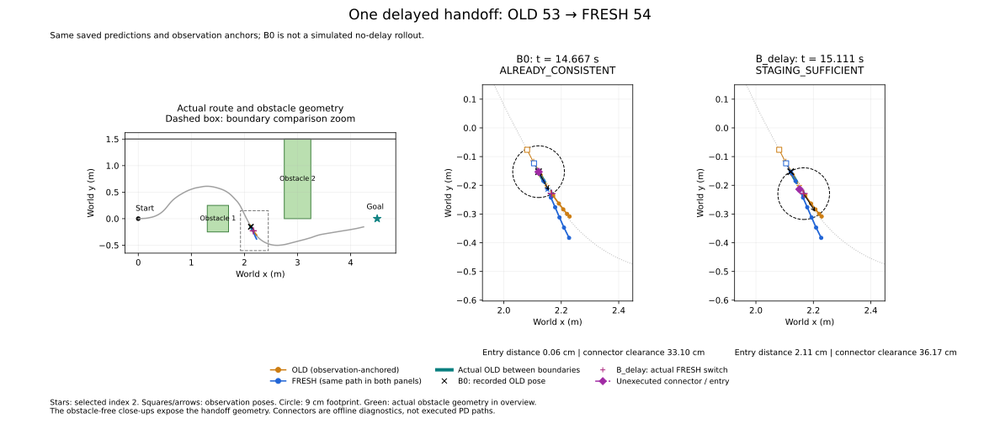

# Controlled latency handoff 결과

2026-10-17. **지연 재현 PASS, navigation 성공. 최종 handoff 분류 `STAGING_SUFFICIENT`, Graph 후보 판정 `NO_QUALIFIED_CANDIDATE`.** B0에서는 자연스럽게 이어졌지만 지연 후에는 기존 entry가 뒤쪽에 남았다. 그래도 안전한 단순 staging이 존재해 Graph가 해결해야 하는 연결 실패는 입증되지 않았다.

기준 `671ea9732125be10d38b04d31d5ad03fe1723e85`, branch `research/isaac6-controlled-latency`. [실행 전 protocol](CONTROLLED_LATENCY_PROTOCOL.md)은 `131bb3e`, runtime/분석 코드는 **`1487acd` clean 상태**로 고정했다. 정상 주행 **1회**, 재시도·sweep·baseline 재실행 **0회**. 실행 후 코드 변경은 비교 그림에 전체 장애물 위치도를 추가한 표시 수정뿐이며 수치·threshold는 바꾸지 않았다.

## 주입 및 clock 검증

기존 wide-wall scenario, scene, checkpoint/model/native inference, 원본 PD 및 4/9/72 Hz/1초 timeout을 유지했다. Fixed-goal adapter이며 Topomap/Graph는 없다. IPC thread의 단일 outstanding request에만 monotonic deadline hold를 추가했다. 실제 packet 수신과 controller 쪽 release를 분리했으며 기존 `received_monotonic_ns`는 release의 alias다. OLD의 수신·만료 시각은 변경하지 않고 FRESH는 release 후 1초 동안 유효하다.

첫 accepted request 중 observation X∈[2.1,2.4] m, 유효 OLD 조건을 만족한 **FRESH ID 54 / OLD ID 53**에 정확히 한 번 주입했다. Observation은 **t_sim=14.500000 s**, pose **`(2.105113842, −0.123311859, −1.085187329 rad)`**다. Request ID를 trigger 조건으로 사용하지 않았다.

| 시점 | Observation 이후 host monotonic 경과 |
|---|---:|
| t_obs | 0 ms |
| t_ready (GPU inference 완료) | 67.472530 ms |
| t_packet_received | 69.430330 ms |
| t_release | 569.503106 ms |
| t_switch | 610.712702 ms |

- 추가 전달 지연 설정 **500 ms**, 실측 **500.072776 ms**, deadline overshoot **0.072776 ms**. GPU inference 자체는 **29.559979 ms**다. 전체 warm GPU median/p95는 **30.147740/31.740886 ms**.
- Packet/release 당시 simulation snapshot 차이는 **0.500000 s**다. Hold 안에 완전히 포함된 실제 OLD integration interval 35개에서 **0.097222 m** 이동했고, hold 내 controller tick 4개 모두 OLD 53이 유효했다. 이 값과 아래 B0→B_delay 이동은 서로 다른 window다.
- Hold 중 busy observation skip **2개**(전체 3개), missed capture slot **0개**, waypoint timeout **0회**. Timeout runtime 경계는 `NOT_EXERCISED`, synthetic exact-boundary test는 PASS다.
- Real-time factor **0.999996588**, pacing 절대오차 p95/max **0.153885/1.442259 ms**. 한 integration tick 이상 늦은 pose row **0개**, GPU wall↔simulation mapping 오차 p95 **0.063330 ms**. 기존 soft real-time 기준을 통과했다.

## 동일 prediction의 B0/B_delay 비교

B0는 같은 지연 실행에서 packet 수신 직후 첫 9 Hz refresh의 **실제 OLD pose**다. B0에서 FRESH를 적용한 가상 rollout은 생성하지 않았다. B_delay는 FRESH 54의 실제 최초 적용 pose이며 release 직후 첫 controller tick과 일치한다. 두 패널 모두 동일 OLD/FRESH를 각자의 observation pose에 고정했다.

| 항목 | B0 | B_delay |
|---|---:|---:|
| Simulation time | 14.666666667 s | 15.111111111 s |
| World `(x,y,yaw rad)` | `(2.120987401, −0.152622242, −1.063712737)` | `(2.166355173, −0.229047635, −1.006447156)` |
| Nearest/chosen entry 거리 | **0.000583198 m** | **0.021058197 m** |
| B yaw↔entry tangent | 1.452775° | 6.797543° |
| B yaw↔connector bearing | 2.524063° | **168.298543°** |
| Connector obstacle clearance | **0.330987401 m** | **0.361717331 m** |
| Connector corridor clearance | 1.256855969 m | 1.180952365 m |
| 검사한 안전 entry / 전체 | **10 / 10** | **10 / 10** |
| 기존 규칙 분류 | `ALREADY_CONSISTENT` | `STAGING_SUFFICIENT` |
| 유효 common forward overlap | 0.188203227 m | 0.100704741 m |
| Equal-progress position RMSE | 0.015979795 m | 0.021359346 m |
| Tangent heading revision RMS | 10.438650° | 13.677407° |

**B0→B_delay 추가 OLD 이동은 32개 유효 interval, 0.088888889 m**, signed yaw 변화 **+0.057265581 rad (+3.281076°)**다. World displacement는 `(+0.045367773, −0.076425393) m`, net translation은 0.088876744 m다. 실제 controller tick 간 증가량은 **0.444725807 host s / 0.444444444 simulation s**다. 전달을 0.5 s 지연했어도 9 Hz tick 위상 때문에 switch 증가량은 4/9 s가 됐다.

지연 후 nearest entry는 prefix의 마지막인 index 2에 있고 B 뒤쪽이다. 기존 rotate→straight→rotate 진단에서 짧은 연결이 안전해 `STAGING_SUFFICIENT`가 됐다. 이 connector를 원본 PD가 실제 실행한 것은 아니며, 시간·efficiency 비용까지 검증했다는 뜻도 아니다. 각 B의 forward cutoff가 달라져 공통 overlap 범위와 RMSE가 달라졌지만 **prediction 자체는 동일**하다. B_delay overlap 10.0705 cm는 기존 10 cm 최소 기준에 가깝고 유효 tangent 비율은 83.33%(기준 80%)다. 기준을 조정하지 않았다.

전체 위치도와 두 확대 패널을 포함한 **비교 그림 한 장**이다. 주황 OLD, 파랑 FRESH, 청록 B0→B_delay 실제 OLD 실행, 검은 × B0, 자주색 + B_delay, 보라 점선은 미실행 connector다. 별표는 selected index 2, 사각형/화살표는 observation pose/yaw다. 궤적에 native yaw나 intrinsic timestamp를 만들지 않았다.

## Prediction과 실제 실행 안전성

| 대상 | 전체 장애물 중 최소 clearance | 안전 판정 |
|---|---:|---|
| OLD native 8-point / native prefix 0→2 | 0.315744780 / 0.315744780 m | 둘 다 안전 |
| FRESH native 8-point / native prefix 0→2 | **0.331247893 / 0.331247893 m** | 둘 다 안전; unsafe tail 없음 |
| FRESH observation origin 포함 full / prefix | 0.315113842 / 0.315113842 m | 둘 다 안전 |
| Packet 수신→delayed switch 실제 OLD | **0.321650685 m** | 모든 interval OLD 53 유효 |
| B0→B_delay 실제 OLD | 0.330986779 m | 모든 interval OLD 53 유효 |
| FRESH switch→다음 switch 실제 실행 | **0.376354971 m** | 모든 interval FRESH 54 유효 |

Window 경계를 걸치는 OLD interval은 보수적으로 포함했다. 실제 FRESH 적용 구간은 t_sim **15.111111..15.333333 s**다. 위 모든 실제 구간은 corridor 안에 있었다. 원본 PD command는 OLD `(v,w)=(0.2, +0.128847556)`에서 FRESH `(0.2, −0.042018534)`로 바뀌었다. FRESH local selected point `(0.101875238, −0.001070201)` m를 원본 그대로 전달했다. 전체 8-point를 순차 실행하는 controller나 staging controller는 추가하지 않았다.

최소 clearance는 위 표에서 첫 장애물 기준인 경우가 많다. FRESH의 **두 번째 장애물** clearance는 full **0.544205560 m**, prefix **0.545373253 m**다. 이번 trigger는 지정한 X 구간에서 작동했지만 obstacle-adjacent 좁은 연결 상황은 아니었다. OLD_EXECUTION_RISK, UNSAFE_FRESH, POTENTIAL_RECONCILIATION_CASE 모두 이 trigger에서 발견되지 않았다.

## Navigation 비교와 제한

| 항목 | 저장 baseline `async_wide_wall_01` | 새 지연 run |
|---|---:|---:|
| Goal entry | true | true |
| 종료 simulation time | 24.583333 s | 26.222222 s |
| 최소 goal 거리 | 0.297708 m | 0.298718 m |
| 장애물 1 / 2 최소 swept clearance | 0.069630 / 0.082836 m | **0.080234 / 0.248590 m** |
| 충돌 / corridor 침범 | 없음 / 없음 | 없음 / 없음 |
| 통과 방향 | 첫 왼쪽 / 둘째 오른쪽 | 첫 왼쪽 / 둘째 오른쪽 |

새 run은 **99 GPU predictions / 99 switches / 1,889 poses**다. Goal/start image 파일 hash부터 baseline과 다르며 이후 observation과 sampling의 대응도 달라질 수 있다. 전체 주행 시간·경로·clearance 차이를 지연만의 인과 효과나 성능 향상으로 해석하지 않는다. 핵심 근거는 **동일한 FRESH의 B0/B_delay 비교**다.

Graph의 필요성·성능·우월성은 입증되지 않았다. 이번 단일 0.5초 조건에서는 entry가 뒤에 남는 mismatch는 생겼지만 검사한 단순 staging으로 연결 가능했다. Fixed-goal, kinematic footprint, 유한 entry/connector family, 짧아진 overlap 및 충분한 obstacle 여유라는 제한이 남는다. 추가 latency/scenario 실험은 자동으로 진행하지 않았다.

## 검증과 보존

실행 전 synthetic/기존 tests **21 passed (0.09 s)**. 실제 raw/derived 99개 쌍의 normalization/cumsum/scaling/sample 선택, observation world anchor, 원본 PD, SE(2) 적분(최대 오차 0), timing/1초 timeout/next tick, swept clearance 검증 PASS. 별도 raw-record 검토에서도 B0/B_delay의 32개 interval과 추가 8.8889 cm, 전 interval OLD 53 유효 및 다음 tick FRESH 54 적용을 확인했다.

과거 baseline **205개** hash가 실행 전후 일치하며 새 run의 분석 입력 **226개** hash도 불변이다. Checkpoint hash 동일, 공식 model/controller와 보호한 source 10개·scenario·coordinate·clearance·기존 threshold 불변이다. 실행 당시 source hash는 clean commit과 대조했다. 시스템/Isaac/.venv 설정 변경 없음.

Isaac startup 중 renderer-step 오류 5개 및 RTX shader 컴파일 대기가 있었지만 navigation 시작 전 RGB/color/frame/actual obstacle AABB gate를 통과했다. 이는 준비 시간이며 주입 지연·navigation clock에 포함하지 않았다. 기술적 재시도는 없었다. 기존 static scene export는 보존했지만 새 GUI/replay/video/Graph는 만들거나 실행하지 않았다.

- Raw: `/home/gpuadmin/Workspace/NoMaD/artifacts/isaac6/controlled_latency_01/`
- Audit/기존 runtime validator 결과: `/home/gpuadmin/Workspace/NoMaD/artifacts/isaac6/controlled_latency_audit_01/`
- 최종 그림 PNG/SVG: `/home/gpuadmin/Workspace/NoMaD/artifacts/isaac6/controlled_latency_figure_01/`
- 작은 [summary](../research/results/isaac6_controlled_latency_20261017/summary.json), [B0/B_delay CSV](../research/results/isaac6_controlled_latency_20261017/boundaries.csv), [세부 pair](../research/results/isaac6_controlled_latency_20261017/pair_details.json), [별도 검토](../research/results/isaac6_controlled_latency_20261017/review.json), [추가 clock/command 기록](../research/results/isaac6_controlled_latency_20261017/supplement.json).

Raw/model/checkpoint/cache/PNG는 Git에 넣지 않고 관련 source/tests/docs 및 작은 JSON/CSV/SVG만 commit/push한다.
