# Graph 성공/실패 비교 주행 그림

| 지연 | 고정 블록 | R3만 통과(다른 둘 미통과) | 둘 다: R3+CUT | 둘 다: R3+GRAPH-HO | R3 통과 후 잘못된 도착 |
|---|---:|---:|---:|---:|---:|
| D150 | 8 | 3 | 4 | 1 | 4 |
| D075 | 8 | 1 | 4 | 5 | 3 |
| 합계 | 16 | 4 | 8 | 6 | 7 |

고정 선택: E3(D150) 및 E1(D075), L2·H1·H2·H1-v2 × seed225·226 전체16블록/48run. 기존 report가 선택한 attempt를 그대로 사용했다. 위 집계는 저장된 `box_passage`와 `wrong_stop`만 사용한다. “R3만”은 CUT·GRAPH-HO 모두 미통과, “둘 다”는 세 방법의 모호함을 피하려고 두 짝을 각각 표시했다. 집계 열은 서로 배타적이지 않다. H2의 통과는 동결 지표대로 두 상자 모두 통과한 경우다.

저장 로그만 읽었다. 시뮬레이션·solver·EC 재검사·HMM 재생·분류/성과 지표 재계산은 없다. 도착 선언 pose와 그 순간 로그된 HMM 노드를 검은 선으로 연결했다. 실제 최근접 노드는 **저장 선언 pose**에서 Topomap node pose까지의 유클리드 거리 최소 노드이며 표시용 기하 계산만 했다(관측 시점의 기존 node error를 대신 쓰지 않음). Δn=HMM−최근접, 노드번호는0부터 시작한다. 선언이 없는 timeout/collision run은 해당 마커를 만들지 않았다.

| 블록 | CUT: 분류·통과·도착시간 | GRAPH-HO: 분류·통과·도착시간 | OURS-R3: 분류·통과·도착시간 |
|---|---|---|---|
| D150 L2 225 | WRONG_STOP · 통과 14.9s · 도착 — | SUCCESS · 통과 14.8s · 도착 66.6s | WRONG_STOP · 통과 19.9s · 도착 — |
| D150 L2 226 | TIMEOUT · 미통과 · 도착 — | TIMEOUT · 미통과 · 도착 — | WRONG_STOP · 통과 18.1s · 도착 — |
| D150 H1 225 | SUCCESS · 통과 14.3s · 도착 50.8s | TIMEOUT · 미통과 · 도착 — | WRONG_STOP · 통과 21.7s · 도착 — |
| D150 H1 226 | SUCCESS · 통과 13.8s · 도착 50.6s | TIMEOUT · 미통과 · 도착 — | WRONG_STOP · 통과 18.9s · 도착 — |
| D150 H2 225 | TIMEOUT · 미통과 · 도착 — | TIMEOUT · 미통과 · 도착 — | SUCCESS · 통과 34.8s · 도착 61.8s |
| D150 H2 226 | TIMEOUT · 미통과 · 도착 — | SUCCESS · 통과 51.6s · 도착 82.1s | TIMEOUT · 미통과 · 도착 — |
| D150 H1-v2 225 | SUCCESS · 통과 42.3s · 도착 85.6s | WRONG_STOP · 미통과 · 도착 — | TIMEOUT · 통과 22.8s · 도착 — |
| D150 H1-v2 226 | TIMEOUT · 미통과 · 도착 — | WRONG_STOP · 미통과 · 도착 — | TIMEOUT · 통과 29.5s · 도착 — |
| D075 L2 225 | WRONG_STOP · 통과 18.3s · 도착 — | WRONG_STOP · 통과 16.0s · 도착 — | SUCCESS · 통과 16.7s · 도착 44.6s |
| D075 L2 226 | SUCCESS · 통과 17.3s · 도착 47.6s | WRONG_STOP · 통과 12.0s · 도착 — | SUCCESS · 통과 13.5s · 도착 43.6s |
| D075 H1 225 | WRONG_STOP · 통과 10.7s · 도착 — | SUCCESS · 통과 11.1s · 도착 34.8s | WRONG_STOP · 통과 11.9s · 도착 — |
| D075 H1 226 | SUCCESS · 통과 7.1s · 도착 29.6s | WRONG_STOP · 미통과 · 도착 — | WRONG_STOP · 미통과 · 도착 — |
| D075 H2 225 | TIMEOUT · 미통과 · 도착 — | TIMEOUT · 미통과 · 도착 — | WRONG_STOP · 통과 31.6s · 도착 — |
| D075 H2 226 | TIMEOUT · 미통과 · 도착 — | SUCCESS · 통과 54.8s · 도착 75.6s | WRONG_STOP · 통과 33.1s · 도착 — |
| D075 H1-v2 225 | TIMEOUT · 통과 42.5s · 도착 — | TIMEOUT · 미통과 · 도착 — | WRONG_STOP · 미통과 · 도착 — |
| D075 H1-v2 226 | SUCCESS · 통과 21.4s · 도착 41.8s | SUCCESS · 통과 22.6s · 도착 44.6s | TIMEOUT · 통과 47.3s · 도착 — |

패널은 CUT | GRAPH-HO | OURS-R3 순서다. 제목의 통과 시간은 출현→통과 시간, 도착시간은 성공 run의 기존 값이다(—=미도착). R3 파란삼각형은 모든 저장 trigger, 파란사각형은 실제 적용된 job의 저장 END 위치다. R2는 CUT으로 오인하지 않도록 보라 점선으로 따로 표시했다. 원8후보는 controller에 도착한 각 chunk의 저장 metric을 관측 pose로 world 변환해 아주 옅게 그렸다. 상자 윤곽은 시간 전체를 겹친 것이며 실제 출현 시각과 출현 순간 로봇 위치(보라 마름모)를 함께 표시했다.

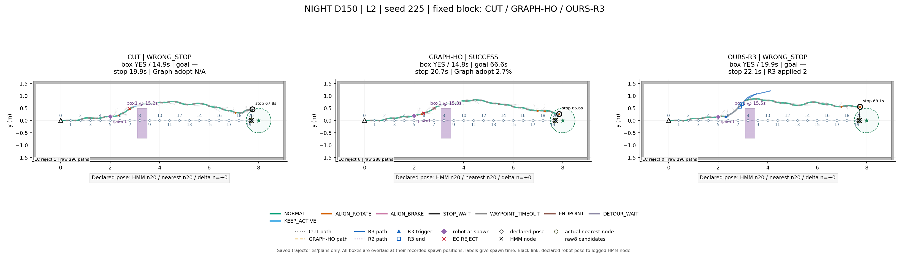

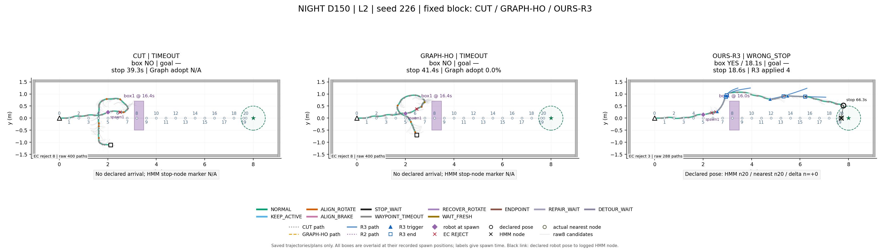

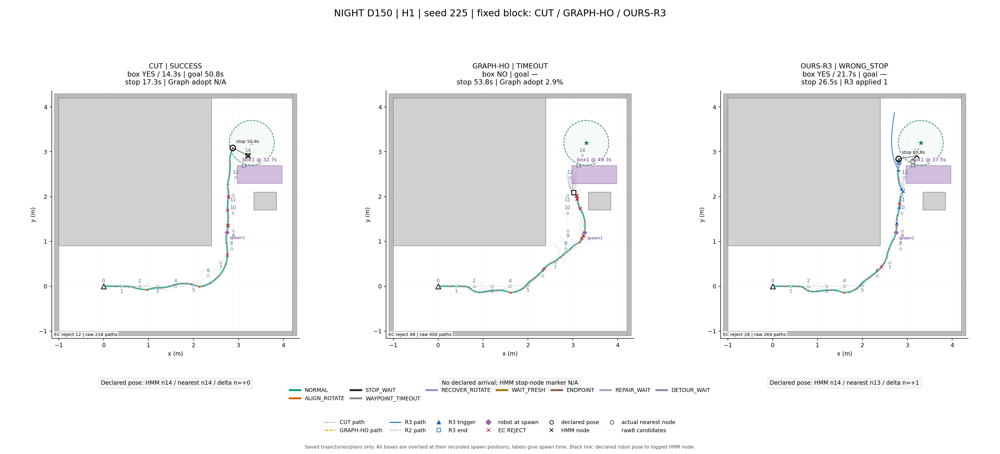

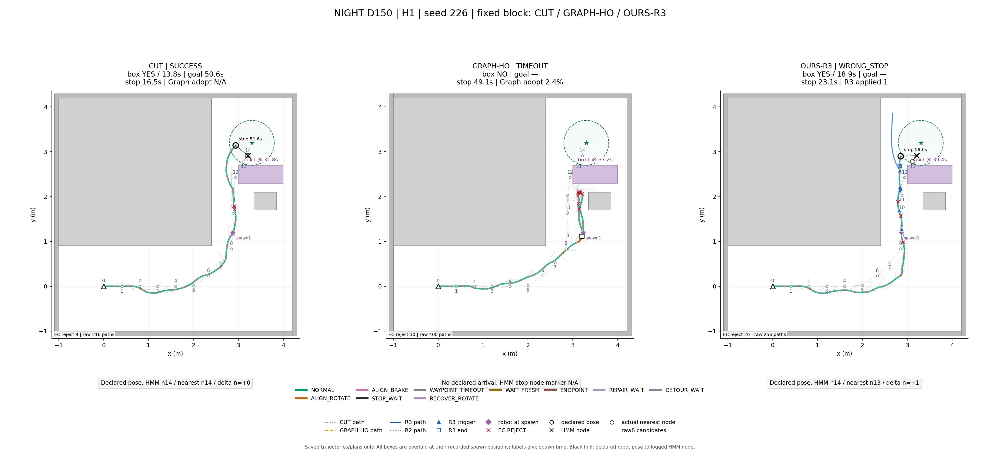

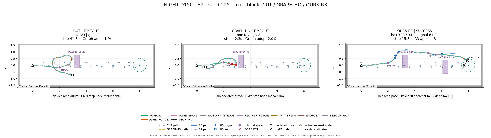

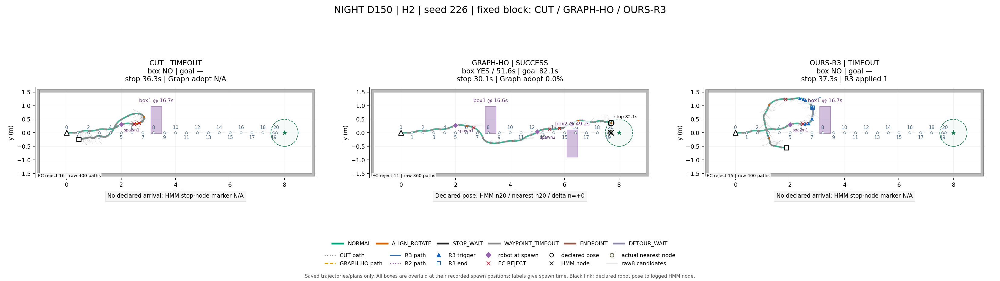

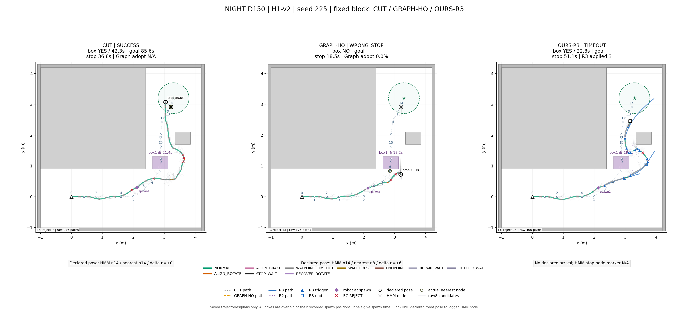

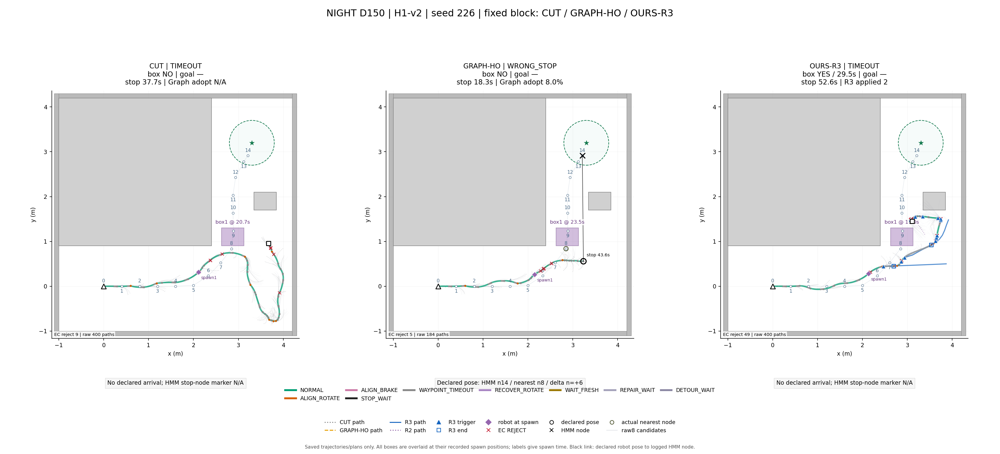

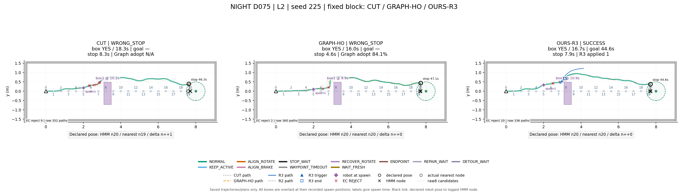

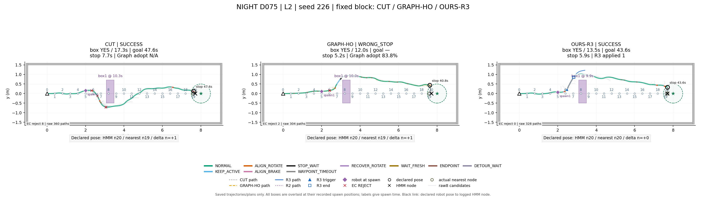

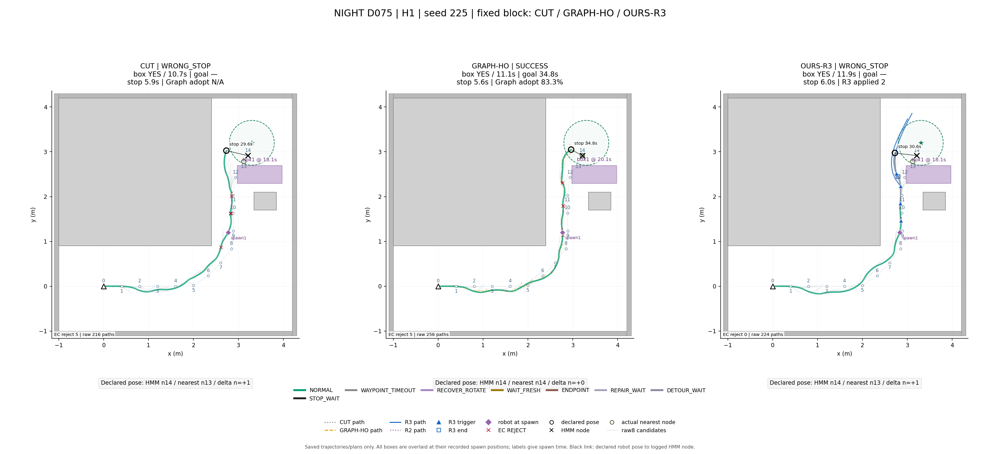

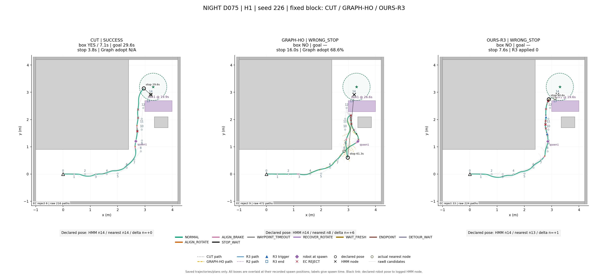

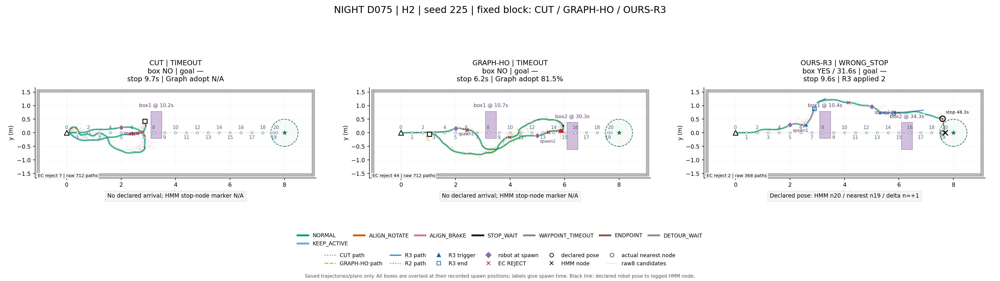

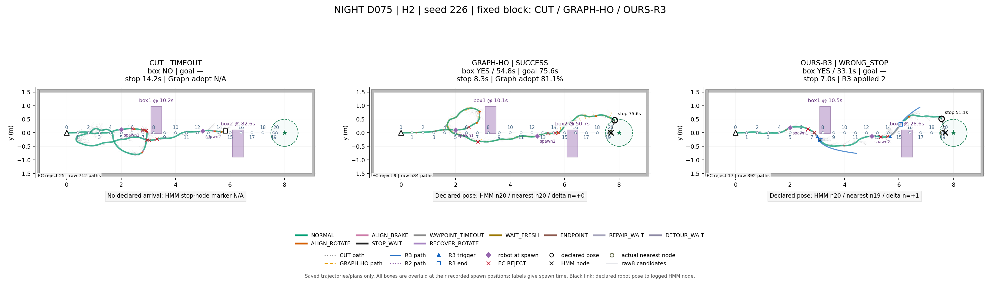

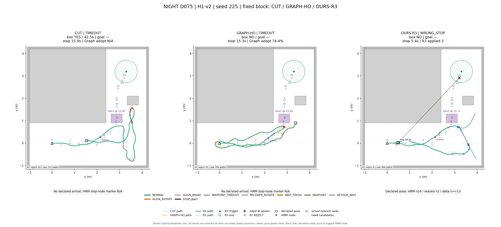

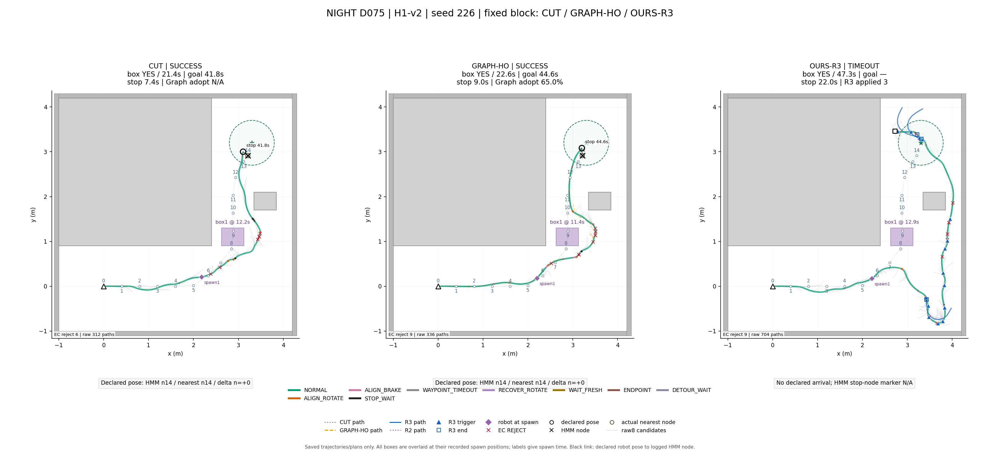

재생성(저장 로그만): `PYTHONPATH=research /usr/bin/python3 -m nomad_graphcmp_plots`
