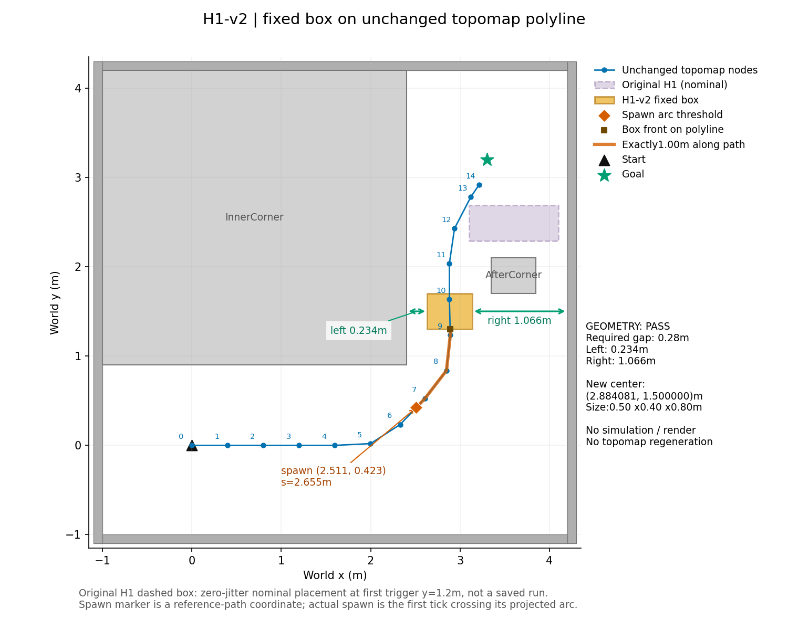

# H1-v2 장면 준비

**PASS — 정적 좌표 검증만 수행. 시뮬레이션·렌더·Topomap 재생성 0회.** 기존 H1 및 다른 장면·방법 코드는 변경하지 않았다.

| 항목 | 좌표 / 값 | 경로 호장 s (m) |
|---|---|---:|
| H1-v2 중심 | (2.884081, 1.500000) m | 3.855387 |
| 상자 크기 / yaw | 0.5 × 0.4 × 0.8 m (world x/y/z), 0 rad; AfterCorner와 동일 | — |
| 상자 앞면·polyline 교점 | (2.889147, 1.300000) m | 3.655323 |
| spawn 기준점 | (2.510571, 0.422807) m; tangent 46.406° | 2.655323 |
| 기존 H1 기준 상자 중심 | (3.600000, 2.490000) m; 1.0 × 0.4 × 0.8 m | — |
| 좌측 틈(진행 +y 기준 −x) | 0.234081 m | — |
| 우측 틈(진행 +y 기준 +x) | 1.065919 m | — |
| Phase38 최소 통과 폭 | 2 × 0.09 + 0.1 = 0.28 m; 한쪽 이상 | — |

Topomap 노드 pose를 잇는 polyline의 **y=1.5m 교점**을 사용했다. 이 경로의 x는 약2.884m이므로 `(2.5,1.5)`를 그대로 쓰지 않았다. 벽·정적 상자와 겹치지 않아 위치 조정은 없었다. Gap은 동결 `nomad_phase38.scenes.gap_check(axis=1)`을 직접 호출했다. 좌측은0.28m 미만이지만 우측이 통과하므로 PASS이며, gap 실패를 이유로 위치를 재조정하지 않는다.

Spawn은 로봇 **중심**의 실제 pose를 같은 노드 polyline에 투영한 호장이 `s_front−1.0m` 이상이 되는 **첫72Hz tick**, 단1회다. 앞면은 진행 순서상 polyline이 상자 footprint에 처음 들어가는 교점이다. 1.0m는 경로 호장 차이이며 별도 반경 보정은 없다. 실제 tick·시각·pose는 주행 전에는 정하지 않는다. 그림의 spawn 점은 경로 위 기준점이다.

기존 H1 상자는 고정 y가 아니라 실제 spawn pose에 따라 달라진다. 비교 그림에는 jitter0·기존 첫 trigger y=1.2m 기준의 중심`(3.6,2.49)`를 썼다(원래 trigger 구간y=1.2~1.3이면 상자 중심y=2.49~2.59). 실제 과거 run의 위치로 해석하지 않는다. 새 상자는 seed/jitter와 무관한 고정 좌표다.

구현: `research/nomad_h1v2/scene.py`, 좌표·hash: `research/nomad_h1v2/scene.json`. 향후 H1 config에 `configure(h1_config)`를 적용한 뒤 기존 방법 환경 초기화 **후** `install_environment(config)`를 명시적으로 호출한다. 원 H1의 geometry·Topomap·렌더·접촉/통과 평가를 재사용하며 신규 monitor는 box 배치와 spawn 조건만 바꾼다. 이 준비는 campaign에 자동 연결하거나 실행하지 않는다.

기하 단위테스트 **8개 PASS**. Topomap15개 이미지와 manifest, 기존 H1 scene 및 참조 코드 hash를 고정·재확인했다. Topomap manifest SHA256: `f1c4f080632b69f1e6e39eddbe9f8f0284f9a4ba44ff8f51be9c300db1a3045f`. 재생성 명령(시뮬레이션 없음): `PYTHONPATH=research /usr/bin/python3 -m nomad_h1v2.prepare`.
