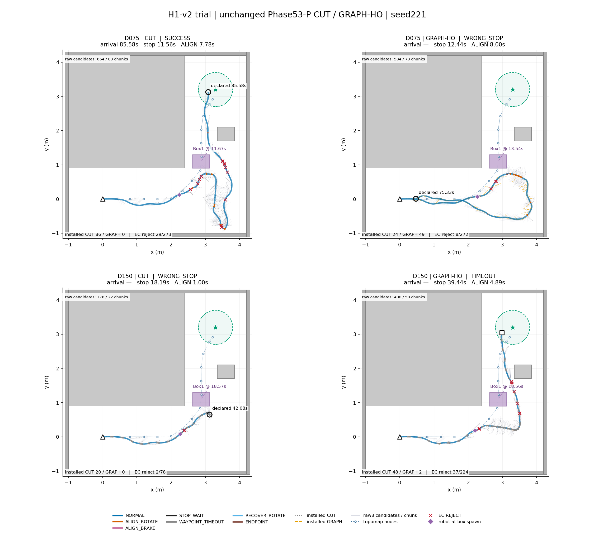

# H1-v2 시험 주행

| status | completed | planned | smoke | protocol_sha256 |
|---|---|---|---|---|
| COMPLETE | 4 | 4 | False | ad22df578a956218eb94b024e8121a836ae336b8e416932ee786617cde9b0b31 |

Phase53-P CUT·GRAPH-HO, EC 제동꼬리, 1초 만료 및 HMM·공식 도착 판정은 동결 그대로다. 장면만 H1-v2(y=1.10, 65556be)로 연결했다. Smoke는 없고 지정한4회가 본 실행이다.

| scene | seed | method | technical | classification | success | collision | wrong_stop | timeout_without_declaration | box_passage | passage_side | box_passage_from_spawn_s | spawn_time_s | goal_time_s | stopped_s | align_rotate_s | minimum_clearance_m | ec_rejects | graph_adoption_rate | graph_rejection_reasons |
|---|---|---|---|---|---|---|---|---|---|---|---|---|---|---|---|---|---|---|---|
| H1-v2_D150 | 221 | CUT | PASS | WRONG_STOP | False | False | True | False | False | — | — | 18.569 | — | 18.194 | 1 | 0.11541 | 2 | — | {} |
| H1-v2_D150 | 221 | GRAPH-HO | PASS | TIMEOUT | False | False | False | True | True | +X | 51.806 | 18.556 | — | 39.444 | 4.8889 | 0.032495 | 37 | 0.04 | {'INITIALIZATION_REJECTED': 47, 'SOLVER_OR_CERTIFICATE_REJECT': 1} |
| H1-v2_D075 | 221 | CUT | PASS | SUCCESS | True | False | False | False | True | +X | 66.292 | 11.667 | 85.583 | 11.556 | 7.7778 | 0.038952 | 29 | — | {} |
| H1-v2_D075 | 221 | GRAPH-HO | PASS | WRONG_STOP | False | False | True | False | False | — | — | 13.542 | — | 12.444 | 8 | 0.077694 | 8 | 0.67123 | {'INITIALIZATION_REJECTED': 11, 'EC_TAIL_REJECT': 1, 'SOLVER_OR_CERTIFICATE_REJECT': 12} |

분류·통과·최소 여유·EC·Graph 수치는 기존 평가/log에서 가져온다. 통과 쪽은 +y 진행 기준 +X(오른쪽)/−X(왼쪽), 출현→통과 시간은 실제 spawn 시각부터의 시간이다. Graph 채택률은 실제 Graph 설치/시도이며 실패 사유는 원 solver·certificate·EC 거절 로그명 그대로다.

- [h1v2_trial_H1-v2_D075_221_CUT](figures/h1v2_trial_H1-v2_D075_221_CUT.png)
- [h1v2_trial_H1-v2_D075_221_GRAPH-HO](figures/h1v2_trial_H1-v2_D075_221_GRAPH-HO.png)
- [h1v2_trial_H1-v2_D150_221_CUT](figures/h1v2_trial_H1-v2_D150_221_CUT.png)
- [h1v2_trial_H1-v2_D150_221_GRAPH-HO](figures/h1v2_trial_H1-v2_D150_221_GRAPH-HO.png)

위 그림은 시간축 없이 저장된 실제72Hz 궤적을 명령 상태 색으로 그린다. 회색 점선=CUT, 주황 파선=GRAPH 설치 경로. 아주 옅은 선은 controller에 도착한 각 chunk의 원 NoMaD8후보(저장 metric을 관측 pose로 world 변환)이며, 설치/채택되지 않은 후보도 표시한다. 빨간x는 저장 EC 거절 위치, 보라 마름모는 상자 출현 순간 로봇 위치다. 상자 미출현 시 계획 위치를 비어 있는 점선으로 구별한다.

| key | chunks | candidates | missing_chunk_ids | installed_paths | graph_paths |
|---|---|---|---|---|---|
| H1-v2_D075_221_CUT | 83 | 664 | [] | 86 | 0 |
| H1-v2_D075_221_GRAPH-HO | 73 | 584 | [] | 73 | 49 |
| H1-v2_D150_221_CUT | 22 | 176 | [] | 20 | 0 |
| H1-v2_D150_221_GRAPH-HO | 50 | 400 | [] | 50 | 2 |
