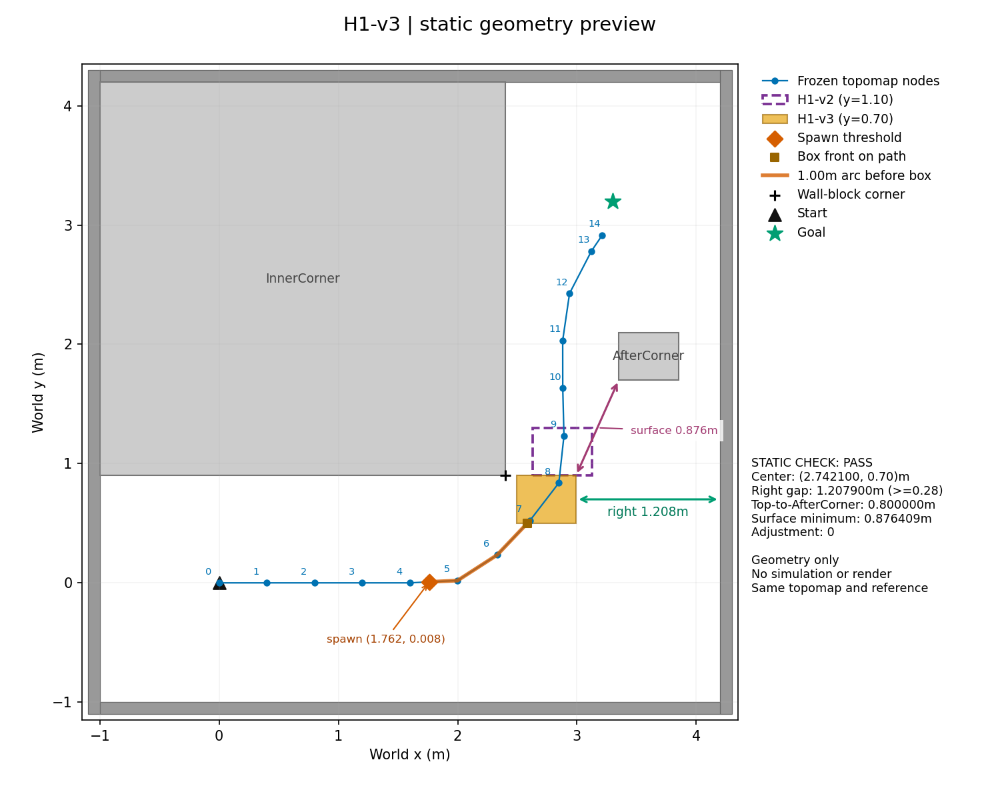
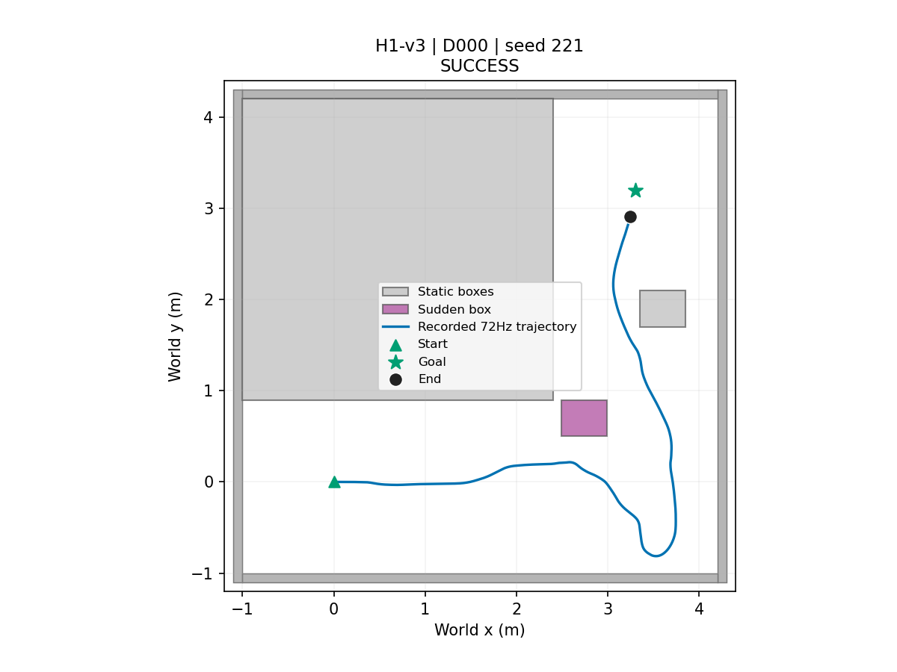
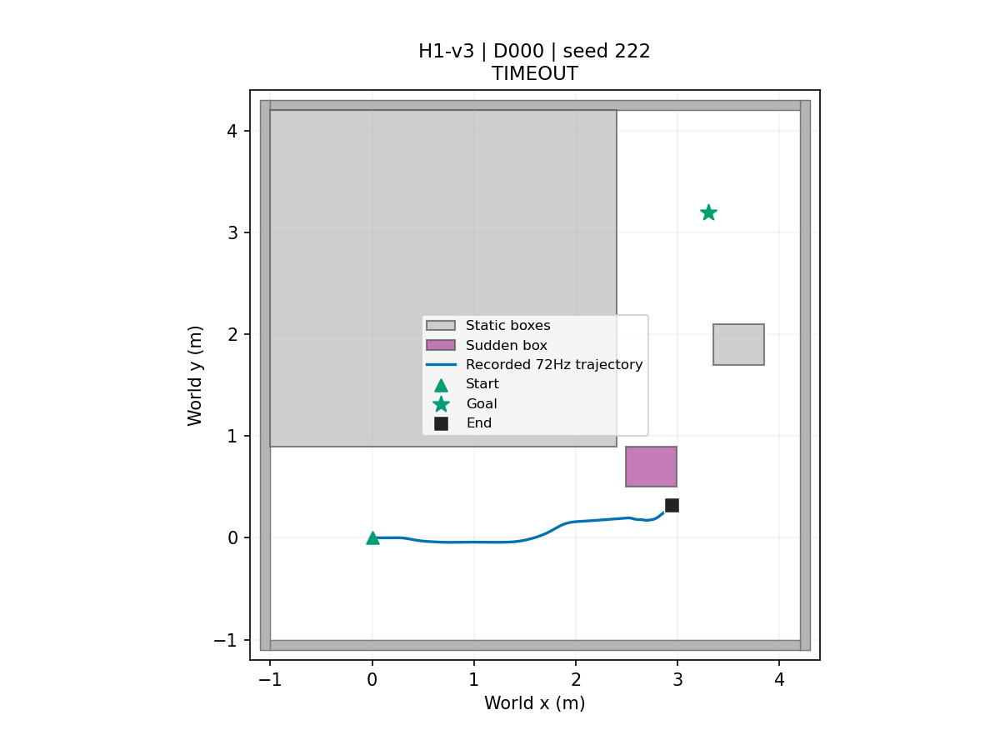
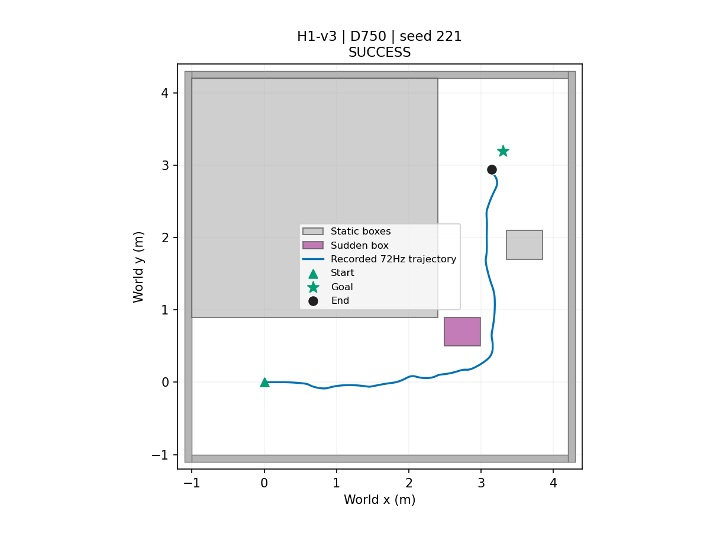
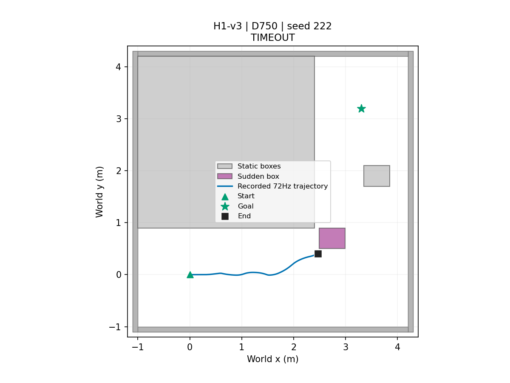

# H1-v3 — J0 선별

| status | planned | completed | eligible | protocol_sha256 |
| --- | --- | --- | --- | --- |
| COMPLETE | 4 | 4 | False | 60280e37fae59be42f8930dc00914be2fcd666110574e992736392405bb16846 |

방법·판정은 J0와 동일한 OURS-noEC, Phase18 PP/CURV·1s 만료·공식 NoMaD subgoal·ENDPOINT latch다. 종료 판정은 Phase18과 동일(0.3m). EC·HMM/NET·회복·STOP_WAIT 특수처리 없음.

| axis | direction | box_id | dynamic | threshold_m | formula |
| --- | --- | --- | --- | --- | --- |
| 1 | 1 | DynamicObstacle | False | 1.2 | box center along +y + projected half extent + 0.30 |

| scene | delay_s | planned | completed | technical_failures | success | collision | wall_intrusion | timeout | checkpoint_n | checkpoint_mean_s | checkpoint_median_s | checkpoint_p95_s | arrival_median_s | arrival_p95_s |
| --- | --- | --- | --- | --- | --- | --- | --- | --- | --- | --- | --- | --- | --- | --- |
| H1-v3 | 0 | 2 | 2 | 0 | 1 | 0 | 0 | 1 | 1 | 36.208 | 36.208 | 36.208 | 43.319 | 43.319 |
| H1-v3 | 0.75 | 2 | 2 | 0 | 1 | 0 | 0 | 1 | 1 | 30.278 | 30.278 | 30.278 | 41.194 | 41.194 |

| scene | zero_success | required_success | complete | all_checkpoints_observed | zero_checkpoint_mean_s | delayed_checkpoint_mean_s | difference_s | passed | reason |
| --- | --- | --- | --- | --- | --- | --- | --- | --- | --- |
| H1-v3 | 1 | 2 | True | False | — | — | — | False | INCOMPLETE_OR_MISSING_CHECKPOINT |

| index | delay | classification | technical_validation | success | collision | wall_intrusion | timeout | checkpoint_threshold_m | checkpoint_start_distance_m | checkpoint_time_s | goal_time_s | error |
| --- | --- | --- | --- | --- | --- | --- | --- | --- | --- | --- | --- | --- |
| 221 | 0 | SUCCESS | PASS | True | False | False | False | 1.2 | 1.2 | 36.208 | 43.319 | — |
| 222 | 0 | TIMEOUT | PASS | False | False | False | True | 1.2 | 1.2 | — | — | — |
| 221 | 0.75 | SUCCESS | PASS | True | False | False | False | 1.2 | 1.2 | 30.278 | 41.194 | — |
| 222 | 0.75 | TIMEOUT | PASS | False | False | False | True | 1.2 | 1.2 | — | — | — |

선별 기준: 0s 성공2/2 AND 0.75s checkpoint 평균>0s 평균. 두 조건 모두 seed221·222의 checkpoint가 있어야 하며 결측 대체 없음. 0s 두 run을 먼저 실행한다. 기존 H1-v2 코드·결과는 수정하지 않는다.

## 저장 궤적 그림

기존 4회 저장 72Hz 궤적·summary의 장면/상자/종료 위치만 그렸다. 시뮬레이션·solver·평가기 재실행 없음.

D000, seed221: SUCCESS

D000, seed222: TIMEOUT

D750, seed221: SUCCESS

D750, seed222: TIMEOUT

