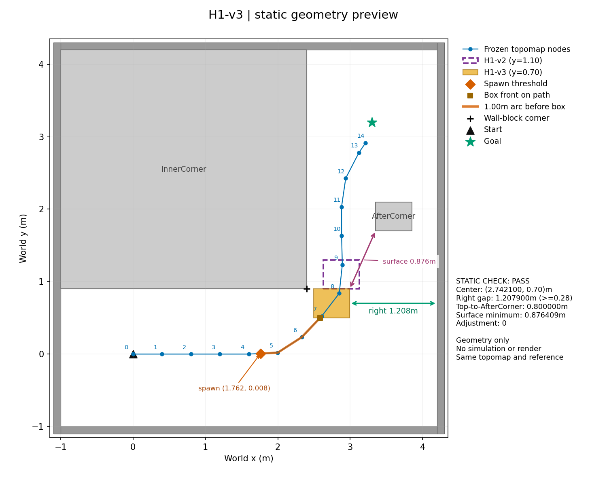

# H1-v3 장면 및 J0 선별 준비

| status | tests | launcher_dry_runs | simulations | renders | protocol_sha256 | topomap_sha256 |
| --- | --- | --- | --- | --- | --- | --- |
| GEOMETRY_PREPARED | 6 | 4 | 0 | 0 | 60280e37fae59be42f8930dc00914be2fcd666110574e992736392405bb16846 | f1c4f080632b69f1e6e39eddbe9f8f0284f9a4ba44ff8f51be9c300db1a3045f |

| item | value | arc_m |
| --- | --- | --- |
| H1-v3 center | [2.7420996020815553, 0.7] | 3.017 |
| size / yaw | 0.5 x 0.4 x 0.8m / 0rad | — |
| front/polyline intersection | [2.5840656426643367, 0.5] | 2.7619 |
| spawn threshold | [1.7617170527174075, 0.007836544424428412] | 1.7619 |
| right passage width | 1.2079 | — |
| top-to-AfterCorner y gap | 0.8 | — |
| minimum surface distance | 0.87641 | — |
| checkpoint +y | 1.2 | — |

같은 Topomap polyline의 y=0.70 교점으로 돌발 상자 중심만 옮겼다. 벽·정적 상자와 겹침 없음, 우측 통과 폭≥0.28m 확인. (2.4,0.9) 모서리와 겹치지 않아 y=0.65 조정은 사용하지 않았다(조정0회). 크기·yaw·벽·정적 상자·Topomap·reference는 H1-v2와 동일하며 기존 코드·결과를 변경하지 않았다.

Spawn은 원 H1-v2 monitor를 그대로 사용한다. 로봇 중심을 노드 polyline에 투영한 호장이 상자 앞면 첫 교점 호장−1.0m 이상인 첫72Hz tick에1회 생성한다. 그림의 spawn 점은 경로 위 기준점이며 실제 spawn pose를 미리 정한 것은 아니다.

점선 보라 상자는 기존 H1-v2(y=1.10), 주황 상자는 H1-v3다. 측면 폭과 AfterCorner 표면 간 거리는 정적 기하 수치이며, 실제 우회·복귀 주행 성공을 주장하지 않는다.

선별은 J0의 OURS-noEC 하나만 사용: Phase18 PP/CURV·0.3m 참위치 도착·공식 NoMaD closest/subgoal·1s 만료·depth SAFE 최장 선택+동결 ClearanceGraph·ENDPOINT latch. EC·HMM/NET·회복·STOP_WAIT 특수처리 없음. 장면별 SDF 등록 범위 수정도 동일하게 재사용한다.

4회 순서: D000 seed221 → D000 seed222 → D750 seed221 → D750 seed222. 기준은 0s 성공2/2 AND 0.75s checkpoint 시간 평균>0s 평균. 두 seed가 양 조건에서 모두 checkpoint를 기록해야 하며 결측 대체 없음. checkpoint는 돌발 상자 +y 먼 면+0.30m를 중심이 처음 넘는72Hz 시점이다.

실행은 미실행. 완료 시 docs/H1V3_J0_RESULTS.md와 research/results/h1v3_j0/를 자동 생성·commit·push한다. 별도 브랜치 feat/h1-v3-screening, 새 run-root h1v3_j0_01. J0의 잠금·재개·기술 실패1attempt·cache정리·디스크30GB하한을 그대로 사용한다.

진행 확인: `cd /home/gpuadmin/Workspace/NoMaD/visualnav-transformer-h1v3 && PYTHONPATH=research /usr/bin/python3 -m nomad_h1v3.campaign --status`

로그: `../artifacts/isaac6/h1v3_j0_01.log`

미실행 명령:

`cd /home/gpuadmin/Workspace/NoMaD/visualnav-transformer-h1v3 && nohup env -u LD_LIBRARY_PATH -u LD_PRELOAD -u PYTHONHOME -u VIRTUAL_ENV PYTHONPATH=research OPENBLAS_NUM_THREADS=1 OMP_NUM_THREADS=1 /usr/bin/python3 -u -m nomad_h1v3.campaign > ../artifacts/isaac6/h1v3_j0_01.log 2>&1 < /dev/null &`
