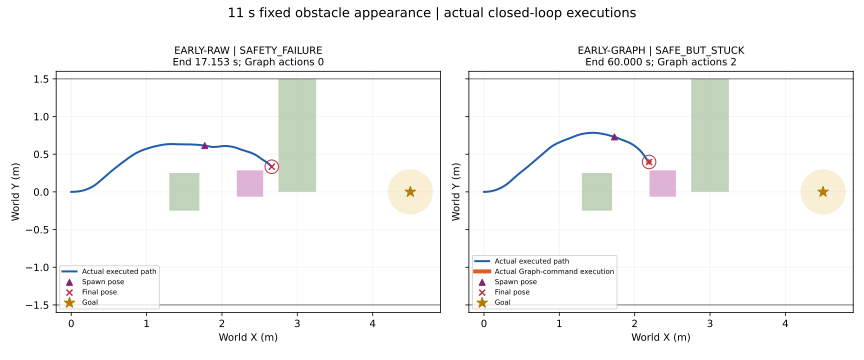

# Early fixed obstacle + online Graph: frozen two-run protocol

2026-10-20. Runtime base `a76ed2b`; Graph source `3a60531`.
Branch `research/isaac6-early-online-graph`.

## Scenario and scope

New `early_obstacle_scenario.json` fixes the dynamic box center to
`(2.372279542,0.110674603) m`, size `(.35,.35,.8) m`, spawn tick792/11.0s.
The original actual-OLD adaptive-placement scenario and its frozen validation
are unchanged. A separate mode validates only the new scenario hash and the
unchanged 14-node Topomap. All model/PD/seed/4·9·72Hz/timeout/goal settings remain
unchanged. Maximum navigation time is 60 simulation seconds, extra delay zero.
Fixed dynamic visibility uses existing USD time samples and RGB magenta evidence;
collision activation uses the same tick and box. No instance-mask dependency.

Two conditions, **one navigation each, no retries**:

- EARLY-RAW: original NoMaD/Topomap/PD; no command safety override.
- EARLY-GRAPH: oracle nominal-command check after spawn, STOP and separate CPU
  Graph worker only when a valid nominal command fails the 16/72s safety check.

## Graph action semantics

Only required factor definitions are extracted from the prior branch; their ASTs
are identical. The original factor protocol is copied byte-for-byte.
Eight future SE(2) nodes, fixed current B, unchanged prior/relative/boundary/
tangent/minimum-segment/native-safety/controller-safety residuals and SciPy
solver. First heading uses the same frozen chord variant; invalid initialization
is rejected without a solve. Soft safety target .025m, actual pass threshold .02m.
Each FRESH ID has at most one attempt; no restart or parameter tuning.

The existing `/usr/bin/python3` with SciPy1.11.4 runs the CPU worker.
No packages/environments are changed. No optimization runs on the 72Hz thread.
Only one solve is outstanding. While waiting, actual command is STOP, but RGB
capture, NoMaD inference, nominal FRESH switches and original receive timeout
continue. The worker receives only its sample0, observation pose, fixed B and
currently active geometry. World trajectories retain their observation anchor.

Converged results are accepted only if B is unchanged (component error <=1e-9),
geometry is identical, and a new original-PD rollout check passes.
The corrected world index2 becomes B-local PD input. A **separate Graph action**
holds that command for at most16 integration ticks, rechecking safety at the
intermediate9Hz update; unsafe continuation is cancelled. Then the newest nominal
waypoint is re-evaluated. A pending solve holds STOP even if a newer nominal
waypoint arrives; an accepted bounded Graph action completes before nominal
control resumes. These are explicit stop-and-plan scheduling decisions.

The original one-second timeout applies to nominal NoMaD commands. An older
Graph input may generate a separate accepted Graph action; input/receive age,
solve start/end, result receipt, wait and application times are recorded.
`events.jsonl` retains nominal FRESH switch semantics. `graph_control.jsonl`
records actual source/action ID and command; `agent_trajectory.csv` contains
actual integrated commands. Late results at navigation termination are saved
but never applied. This is not real-time Graph or PhysX robot execution.

## Preflight

- Saved tick792 poses: initial clearance .426326m (static2s reference) and
  .465345m (previous sudden run); center bearing −30.922° / −31.775°, inside
  90° horizontal FOV. Center sight ray has no static-box intersection.
  Box separation .202720m; corridor containment passes.
  These are geometric visibility checks; actual RGB is validated in each run.
- All eight required factor/function AST definitions match the previous source.
- One saved B52 CPU-worker solve: k2, convergence14nfev, wall1.765051s,
  `(v,w)=(.013416543383,+.4)`, clearance .021677381344m.
  Corrected poses/command match the prior offline result within1e-9.
- Focused scheduler/late-result/boundary rejection plus existing
  timeout/activation/frozen-mode tests: **21 passed**.
- Protocol: `early_graph_protocol.json`; preflight artifact:
  `artifacts/isaac6/early_graph_preflight_01/`.

## Commands

Run each once from the committed clean source:

```bash
env -u LD_LIBRARY_PATH -u LD_PRELOAD -u PYTHONHOME -u VIRTUAL_ENV bash research/python.sh -m nomad_isaac.launch --asynchronous --early-obstacle-mode raw --topomap /home/gpuadmin/Workspace/NoMaD/artifacts/isaac6/topomap_reference_2s_01/topomap/manifest.json --scenario research/nomad_isaac/early_obstacle_scenario.json --output /home/gpuadmin/Workspace/NoMaD/artifacts/isaac6/early_raw_01
env -u LD_LIBRARY_PATH -u LD_PRELOAD -u PYTHONHOME -u VIRTUAL_ENV bash research/python.sh -m nomad_isaac.launch --asynchronous --early-obstacle-mode graph --topomap /home/gpuadmin/Workspace/NoMaD/artifacts/isaac6/topomap_reference_2s_01/topomap/manifest.json --scenario research/nomad_isaac/early_obstacle_scenario.json --output /home/gpuadmin/Workspace/NoMaD/artifacts/isaac6/early_graph_01
```

## Actual results

Both conditions ran once from clean SHA
`7428f2824b618986f4a304111ec24c3dbfe24c6d`, with no restart, tuning, or scenario
change. Startup renderer errors were retained; both passed the existing RGB
gate and completed their bounded navigation. The obstacle spawned at tick792
in both runs and first appeared in RGB45 at 11.236111s.

| 실제 실행 결과 | EARLY-RAW | EARLY-GRAPH |
|---|---:|---:|
| 판정 | **SAFETY_FAILURE** | **SAFE_BUT_STUCK** |
| 종료 | 17.152778s, Static2 collision | 60.000000s, timeout |
| Goal / 최소 goal 거리 | 실패 / 1.869510m | 실패 / 2.342423m |
| Dynamic 최소 clearance | +0.022320m | +0.021406m |
| Static1 / Static2 최소 clearance | +0.280130 / **−0.000509m** | +0.369350 / +0.468548m |
| Dynamic 통과 | 17.000000s, 왼쪽(+Y) | 미통과 |
| Static1 / Static2 통과 | 왼쪽 / 미통과 | 왼쪽 / 미통과 |
| Geometric overlap / corridor 침범 | Static2 overlap / 없음 | 없음 / 없음 |
| 총 이동 거리 | 2.918290m | 2.561072m |
| `(v,w)=(0,0)` 정지 시간 | 1.222222s | 46.555556s |
| NoMaD request / receive / nominal switch | 65 / 65 / 65 | 236 / 236 / 236 |

EARLY-RAW의 새 동적 장애물 회피는 이 한 주행에서 확인됐다. 최초 visible
FRESH41은 native full/prefix clearance .256598/.287251m로 안전했다.
그러나 뒤의 Static2 접근에서 FRESH63의 prefix가 −.006448m,
FRESH64 full/prefix가 −.056292/−.047864m로 unsafe였다.
실제 첫 margin 위반은 ID63 실행 중17.013889s, 충돌은 ID64 실행 중이다.
Native prediction과 실제 PD arc는 다르지만, 마지막 prediction 자체의
Static2 overlap도 확인돼 이 실패를 단순 계산 지연으로 설명할 수 없다.

EARLY-GRAPH의 첫 visible FRESH41은 subgoal6, native full/prefix
.329530/.379385m로 안전했다. Visible history를 포함한195 predictions 중
native full 안전11개, prefix 안전14개였다(RAW는23개 중13/20개).
이 수치는 실제 적용 안전성이나 조건 간 모델 성능의 paired 비교가 아니다.
장시간 정지와 서로 다른 RGB/seed 대응을 포함한다.

## Actual Graph actions and feedback

18개의 고유 FRESH 입력을 시도했다. **13개는 기존 heading 초기화 규칙을
충족하지 못해 solve하지 않았다.** 실제 solver 호출5회 중3회 수렴,
2회는 고정 max_nfev200에서 미수렴했다. 수렴 결과 중1개(Graph14)는
재검사 clearance19.086mm라 차단했다. **안전한 결과2개가 실제 적용됐다.**

| Graph / 입력 FRESH | 실제 적용 시각 | 입력 FRESH의 원본 PD `(v,w)` | GRAPH PD `(v,w)` | 실제 전진 / yaw 변화 | 실제 최소 clearance |
|---|---:|---|---|---:|---:|
| 6 / 58 | 18.666667s | `(.151153,+.4)` | `(.018810,+.4)` | 2.090mm / +2.546° | 22.672mm |
| 16 / 196 | 55.111111s | `(.2,−.287461)` | `(.017014,+.4)` | 1.890mm / +2.546° | 21.406mm |

World selected point 수정량은 각각33.757mm,95.537mm이다.
첫 action은 주로 감속, 둘째는 감속과 각속도 반전이 실제 PD에 반영됐다.
각각8/72s 실행 후 다음16/72s prospective 검사에서19.969/19.127mm로
미달해 중단됐다. 사전 고정한 최대16tick 중8tick만 실행된 이유다.
**합계 Graph 전진3.980mm, 실제 Graph 제어시간 .222222s**로,
지속적인 우회나 목표 접근을 만들지 못했다.

이는 source FRESH58/196의 명령과 비교한 값이다. 실제 적용 당시 최신
nominal waypoint는70/216, nominal PD는 `(.2,+.009589)` /
`(.2,−.367300)`이었다. 기존 `events.jsonl`의 switch는 이 최신 nominal
waypoint를 뜻하며 오래된 Graph 결과를 FRESH switch로 표시하지 않았다.
Graph action ID와 실제 명령은 `graph_control.jsonl`에서 별도 기록했다.
기존 observation/trace의 OLD·waypoint ID 역시 nominal ID이므로 실제
제어원을 복원할 때는 해당 tick의 Graph action 로그를 함께 사용해야 한다.

보정 이후 RGB75/221이 실제 이동한 pose에서 생성됐고, 각각 새 inference
request71/217의 history에 포함됐다. 저장72Hz pose, original PD 계산,
actual command, RGB pixel hash, worker history hash가 모두 일치한다.
즉 offline plotting만이 아니라 **Graph→실제 적분→새 RGB→새 NoMaD
inference의 closed loop**를 검증했다.

## Computation, waiting and failure interpretation

- Solver wall time5회: median **5.858750s**, p95 **23.403768s**,
  max **23.739853s**. Saved B52의1.765s preflight와 다른 난이도의 입력이다.
- 실제 주행 중 Graph 대기 STOP **43.777778s**. 대기 중 RGB175장,
  새 FRESH172개 수신. 전체정지46.555556s에는 초기 missing waypoint
  1.111111s, 별도 safety stop1.444444s, action 재검사 stop.222222s도 포함된다.
- 두 적용 입력의 observation age는 **3.166385/5.111202s**,
  receive age는3.095677/5.032429s다. 원본1초 timeout을 넘은 별도 Graph
  action이며, nominal waypoint timeout은 실제0회였다.
- Graph17은 navigation 종료 당시 pending이었다. 종료 후 결과를 보존했으나
  미수렴했고 실제 적용하지 않았다. Solve 시간 통계에는 이 마지막
  22.059431s solve도 포함되며, 주행 대기시간은60s에서 잘랐다.
- 72Hz pacing은 유지됐다: RTF RAW .999994137 / GRAPH .999985167,
  pacing p95 .152/.152ms, max1.274/2.004ms. 이는 **kinematic execution**
  pacing PASS이며 Graph의 실시간성 PASS를 뜻하지 않는다.
- Warm GPU median/p95: RAW35.509/50.576ms, GRAPH34.872/37.974ms.
  두 조건 busy skip1/missed capture0/nominal timeout0.

Graph 조건의 실패는 새 관측 중단이나 controller 명령 미적용 문제가 아니다.
짧은 segment의 heading 제한13건, 미수렴2건, 수렴했지만 안전 기준 미달1건,
적용 후 짧은 전진만 허용된2건, 긴 solve 대기가 함께 관측됐다.
이들 각각의 인과 기여는 별도 대조 없이 분리할 수 없다.
안전성은 exact-geometry oracle 검사와 STOP의 기여를 포함하며,
Graph만의 우월성이나 실제 회피 성공으로 해석하지 않는다.
두 실행은 첫 visible observation 시점부터 pose와 subgoal이 다르므로
single-run paired causal comparison도 아니다.

## Validation and artifacts

원본 normalization/cumsum/metric/sample0/index2, nominal PD, Topomap
candidate/선택/image hash, observation world anchor 검증 PASS.
모든 actual command가 저장72Hz pose와 일치: 적분 최대오차0,
swept/corridor 최대오차1.11e−16m. Graph 입력 sample와 observation pose,
정지 중 B 고정, single outstanding, 동일 geometry, 보정 world→B-local PD,
실제 action 구간 및 후속 RGB/inference를 검증했다.
기존 모델/PD/Topomap/geometry/coordinate/placement 함수 변경 없음.
기존1744개 preservation 항목을 재확인했다.

Raw: `artifacts/isaac6/early_raw_01/`, `early_graph_01/`.
Validation: `artifacts/isaac6/early_graph_comparison_02/`.
첫 offline audit에서 파일 나열 순서를 request 순서로 취급한 assertion을
명시적 ID 정렬로 수정했다. 부분 출력은`early_graph_comparison_01`에
보존했으며 navigation/optimization을 재실행하지 않았다.
작은 tracked 결과는 `research/results/isaac6_early_graph_20261020/`.


