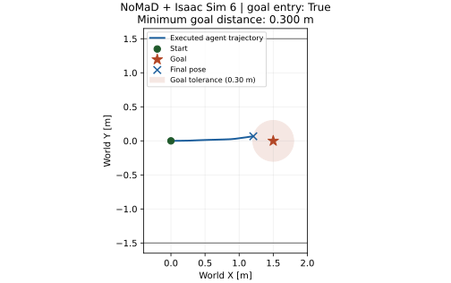

# Isaac Sim 6 + NoMaD 최소 closed-loop navigation

작업일: 2026-10-16 (Asia/Seoul). 기존 preflight commit `517ab41eb4a1a0e1927c1e62753172714f1c8507`에서 `research/isaac6-minimal-navigation` branch를 만들었다. 초기 adapter는 `2761d9a`, 자료형 수정 후 실행 코드는 `5cda940ed0fa07137e1549ce165560b757475ca5`로 고정했다. 실행 시 미추적 파일은 작성 중인 이 문서뿐이며 실행 source의 SHA-256도 provenance에 저장했다. 공식 upstream 기준은 `dca79815b704e5aa9c6bdc3082351f9e3b2848c2`다.

## 실제 결과

**연동 성공, 단일 bounded closed-loop 주행의 goal entry 성공.** 실제 Isaac RGB → NoMaD GPU inference → 원본 2D controller → USD agent 이동 → 다음 RGB feedback이 실행됐다. 아래 값은 `navigation_02`의 실제 실행 및 저장 파일 검증 결과다. 카메라 준비 검사와 이동 전에 중단된 `navigation_01`은 성공 주행으로 세지 않는다.

| 측정 항목 | 실제 결과 |
|---|---|
| 종료 사유 | `goal_entry`; timeout/경계 종료 아님 |
| 처음 / 최소·최종 goal 거리 | 1.500000 / **0.2999052545 m** (고정 tolerance 0.30 m 이내) |
| 마지막 world pose `(x,y,yaw)` | `(1.2078296845, 0.0676732474, 0.1360954405)`; m, rad |
| 실제 이동 경로 길이 | 1.2111110597 m |
| 종료 simulation time | **6.8333333333 s**; 초기 history 준비 0.75 s 포함 |
| Navigation wall time | 2.274563826 s; Isaac startup/goal 준비 제외, 최종 capture/worker 종료 포함 |
| NoMaD inference / 적용된 waypoint | **25 / 25** |
| Raw / cumulative / metric output | 각각 `(8,8,2)`, float32, finite; selected `(2,)` |
| 입력 | actual RGB `(240,320,3)` uint8; 25개 history stack hash, 고정 goal hash 1개 |
| Command 범위 | v = 0…0.2 m/s, w = −0.08249561…0.19790776 rad/s; 초기 정지 포함 |
| Observation→application simulation 지연 | 0…0.0833333333 s |
| 저장 데이터 대조 | 493 pose rows, 25 applied events, 62 controller refreshes 모두 검증 |
| 재적분과 실제 USD pose의 최대 절대 차이 | 4.9960×10⁻¹⁶ (x/y m, yaw rad 성분별 비교) |
| 실제 inference timer | 첫 호출 355.54 ms, 나머지 24개 median 28.86 / p95 30.49 ms |

World pose의 거리로 adapter가 종료시켰다. 모델 스스로 목표를 인식해 정지했다거나 goal yaw까지 맞췄다는 의미는 아니다. 단순한 근거리 직진 조건 한 번이므로 goal image 의존성 또는 일반적인 navigation 성능을 분리 입증하지 않는다. Simulation은 wall clock에 맞춰 sleep하지 않아 wall time이 simulation time보다 짧다. Inference timer는 두 GPU process가 공존한 이 주행의 기록이며 별도의 latency benchmark가 아니다.

저장된 raw output에서 normalization/cumsum/metric scaling/선택 point를 재계산하여 exact equality를 확인했다. 모든 적용 command도 원본 controller와 exact equality였다. Goal entry, 4 Hz history 순서, 9 Hz controller 주기, inference 동안 simulation time 정지, observation/application 순서를 기록으로 검사했다. 추가 주행이나 모델 튜닝은 하지 않았다.

[작은 결과 summary](../research/results/isaac6_minimal_20261016/summary.json), [검증 및 측정 기록](../research/results/isaac6_minimal_20261016/validation.json), [World XY 그림](../research/results/isaac6_minimal_20261016/world_xy.svg).



## 고정한 실험 조건

실행 전에 [scenario.json](../research/nomad_isaac/scenario.json)에 다음을 고정했다. 결과를 보고 scene, seed, goal, controller를 변경하거나 성공할 때까지 반복하지 않는다.

| 항목 | 값 |
|---|---|
| 시작 / 목표 pose `(x,y,yaw)` | `(0,0,0)` / `(1.5,0,0)`; m, rad |
| Goal entry | 실제 USD agent world XY와 목표 XY 거리 ≤ 0.30 m |
| 제한 | simulation time 30 s, navigation wall time 180 s, Isaac process wall time 600 s |
| Corridor | X −2…6 m, Y −1.5…1.5 m, 벽 높이 2.6 m |
| Agent | SE(2) kinematic point agent, wheel/PhysX dynamics 없음 |
| RGB camera | 320×240, uint8 RGB, 높이 0.5 m, horizontal FOV 90°, focal 18 mm, aperture 36×27 mm |
| Goal image | 동일 camera를 목표 pose에 놓고 실제 RTX로 렌더링; 실행 중 고정 |
| Integration / observation / controller refresh | 72 / 4 / 9 Hz |
| Controller 계산의 DT | 1/4 s; refresh 간격 1/9 s와 구별 |
| 속도 한계 | 원본 v ∈ [0,0.2] m/s, w ∈ [−0.4,0.4] rad/s |
| NoMaD | context_size=3, RGB history=4, image_size=96×96, DDPM 10 steps, 8 future XY points, 8 samples |
| 선택 | sample 0, waypoint index 2; smoothing/보정/재선택 없음 |
| RNG | request i의 initial-noise seed=101+2i, DDPM seed=102+2i; 한 번의 고정된 sequence |

회색 평면 바닥의 줄무늬, 측벽 색상 패널, 끝벽 문 모양으로 시각적 특징을 만들었다. 통행 공간에 장애물을 배치하지 않았다. 벽 안쪽 0.1 m 경계에 도달하면 종료한다. 이는 agent를 보호하는 종료 조건이며 장애물 회피 정책이나 waypoint 수정이 아니다. Goal yaw는 goal image 렌더링에 쓰고, 도달 판정에는 위치 거리만 쓴다.

## 공식 구현과 adapter 경계

공식 `train/`과 `deployment/` 파일 및 검증된 [native.py](../research/nomad_preflight/native.py)는 수정하지 않았다. 이번 코드는 [research/nomad_isaac](../research/nomad_isaac)에만 추가했다.

1. Isaac의 RGBA annotator에서 alpha만 제거하여 RGB를 얻는다. 목표 pose의 image를 먼저 저장하고 시작 pose로 이동한다. 최초 history는 실제 capture t=0, 0.25, 0.50, 0.75 s이며 oldest→newest 순서다. 초기 정지는 의도적이고, 동일 frame을 코드로 복제하지 않는다.
2. Unix domain socket으로 history와 고정 goal을 `.venv` worker에 전달한다. 길이 prefix + NPZ/JSON을 사용하고 `allow_pickle=False`로 읽는다. 별도 middleware/ROS가 없다.
3. worker는 기존 `native.infer(..., goal_mask=0)`를 그대로 호출한다. 공식 RGB resize/ImageNet normalization, channel-concatenated history `(1,12,96,96)`, goal `(1,3,96,96)`, encoder, 10-step diffusion을 재사용한다. Goal-conditioned encoder의 grad scope도 preflight에서 검증한 상태를 유지한다.
4. Raw normalized diffusion `(8,8,2)` → 원본 inverse min/max delta 복원 → cumsum → cumulative float32 → `max_v/frame_rate=0.05` scaling을 적용한 derived metric trajectory 순서를 유지한다. `metric[0,2]`를 그대로 선택한다. 세 배열의 의미는 [ACTION_SEMANTICS.md](ACTION_SEMANTICS.md)를 따른다.
5. controller는 원본 `deployment/src/pd_controller.py`의 함수 AST를 추출하여 그대로 실행한다. `v=dx/0.25`, `w=atan(dy/dx)/0.25`와 dx≈0 분기, clipping을 유지한다. 임의로 `atan2`나 heading controller로 바꾸지 않았다. 별도 2D 수식과 109개 입력을 수치 비교했다. 원본 ROS `Float32MultiArray.data`와 같이 선택한 float32 값들을 Python float list로 전달한다. `tolist()` 전후 float32 값이 같음을 검사한다.
6. SE(2) agent에 `(v,w)`를 적용하고, 일정 command 구간의 exact unicycle 식으로 pose를 72 Hz 갱신한다. 최신 waypoint를 다음 controller refresh부터 적용하고 다음 inference까지 유지한다. 선택한 point를 world goal로 바꿔 다시 tracking하거나 waypoint를 이동 보정하지 않는다.

원본 topomap localization/search 대신 이미 선택된 한 goal image를 입력한다. 모델의 distance head는 native inference에서 계산되지만 goal entry 판정에는 사용하지 않는다. ROS의 transport, watchdog, 실제 robot/wheel dynamics, 학습 시 camera calibration, full navigation 성공 판정은 재현 범위에 포함하지 않는다. Adapter에는 제한 시간·경계 종료·통신 오류 종료를 추가했다.

### 좌표, 색상, 시간

NoMaD local은 +X forward, +Y left다. Isaac world는 Z-up, 단위 m이고 agent yaw=0에서 forward=world +X, left=world +Y다. Local point의 world 변환은 `p_world = [x,y] + R(yaw) p_local`이다. 실제 제어는 local point를 원본 controller에 전달하므로 이 world 변환으로 출력을 재작성하지 않는다.

USD camera의 −Z forward/+Y up을 agent +X/+Z에 맞췄다. 실제 camera world matrix로 forward `(1,0,0)`, up `(0,0,1)`, image-right `(0,−1,0)`을 검사했다. +Y 벽의 빨간 패널이 image-left, −Y 벽의 파란 패널이 image-right에 나타나는지도 pixel 수와 중심 위치로 검사했다. 이는 좌우 반전 및 RGB/BGR 오류를 잡는 검사다.

Simulation time은 kinematic adapter가 관리하는 고정 1/72 s clock이다. PhysX 시간을 측정한 값이 아니다. Observation은 18 ticks마다, controller는 8 ticks마다 갱신한다. Render 때 timeline을 observation time으로 설정하고 Replicator `step(delta_time=0)`로 pose/time을 유지한다. Inference 대기 중에는 simulator loop와 agent가 정지한다. GPU worker 응답 전후 실제 USD pose와 timeline이 같음을 검사한다. 따라서 실시간 비동기 OLD 실행, inference 동안 이동하는 robot, stale-result handoff를 검증한 결과가 아니다.

Observation, inference start/end, receive, application의 host `monotonic_ns`와 별도 simulation time을 기록한다. Observation→application의 simulation 지연은 controller refresh 정렬로 0…1/9 s 미만이다. Agent trajectory의 yaw/time은 실제 adapter 실행 기록이다. NoMaD waypoint에 native yaw 또는 intrinsic timestamp를 만들어 붙이지 않았다.

## 실행 환경과 환경 보존

| 항목 | 실제 사용 값 |
|---|---|
| GPU / driver | RTX 5060 Ti 16 GB / 595.99.02 |
| 기존 Isaac 설치 | `/home/gpuadmin/isaacsim` |
| Isaac VERSION | `6.0.1-rc.7+release.42383.32955d8d.gl` |
| Isaac Python | 기존 bundled Python 3.12.13 |
| NoMaD Python | 기존 workspace `.venv`, Python 3.11.16 |
| NoMaD runtime | torch 2.7.0+cu128, torchvision 0.22.0+cu128, diffusers 0.11.1 |
| NumPy | NoMaD 1.26.4 / Isaac 2.3.1; 각 기존 환경 유지 |
| Checkpoint | `../artifacts/checkpoints/nomad.pth`, 76,473,631 bytes |
| Checkpoint SHA-256 | `70f79b8262527e20e56ced64a3e3d7ef91855bc9e7c3fa348d78edcb83c6a333` |
| Coverage | 645/645 state tensors; 19,049,675/19,049,675 parameter elements; missing/unexpected/shape mismatch = 0 |

Launcher의 깨끗한 parent에서 두 Python process를 독립 실행한다. Isaac에 `.venv`의 PYTHONPATH/site-packages/torch library를 주입하지 않는다. 기존 Isaac Python, system Python, CUDA, driver, `.venv` package와 다른 프로젝트 설정은 설치·업그레이드·수정하지 않았다. Raw data/checkpoint/preflight 결과도 덮어쓰지 않는다.

Isaac의 cache/config/log는 각 run 아래의 새 경로로 지정하고 persistent setting 저장을 끈다. Process-only `--/rtx/hydra/supportMultiTickRate=false`를 사용한다. 설치 파일이나 사용자 Isaac 설정을 편집하지 않는다. 종료 시 launcher가 시작한 process group만 정리한다.

### 렌더링 준비 중 확인된 문제

- `render_gate_01`: annotator 첫 반환이 empty `(0,)`라 실패. Navigation/inference 미실행.
- `render_gate_02`: bounded capture retry만 추가했으나 empty RGB가 계속되어 실패. Viewport tick-rate 120/engine 0 경고와 startup timeout을 확인했다. Navigation/inference 미실행.
- `render_gate_03`: process-only multi-tick-rate 설정, capture-on-play 비활성화, render-product 참조 유지 후 실제 RGB/좌표/색상 검사가 통과했다. Cold shader compilation 동안 `renderer failed to advance to the scheduled frame` 로그가 있었고 유효한 RGB가 준비된 뒤 gate를 통과했다. 초기화 오류 로그를 성공으로 숨기지 않았다.
- 완료 실행 `navigation_02`도 startup 약 19…23 s 구간에 같은 renderer error가 5회 있었다. 이후 실제 RGB gate와 모든 navigation 검사가 통과했고 정상 종료했다. 전체 Isaac process는 startup을 포함해 약 114 s였으며 navigation wall time 2.275 s와 구분한다.

이 조합의 수정으로 준비 검사가 성공했으며 각 변경의 단독 기여를 분리 실험하지 않았다. 반복 검사는 model/navigation 튜닝이 아닌 renderer adapter 검증이었다. 실패한 디렉터리와 로그도 보존한다. 사용한 Isaac은 6.0.1 RC build이므로 다른 6.x build에서 동일 renderer 동작을 보장하지 않는다.

### 이동 전 중단된 첫 연결 시도

`navigation_01`은 실제 RGB를 받아 첫 NoMaD forward까지 수행했지만 첫 command 적용 직전 t=0.777778 s에 assertion으로 중단됐다. Agent 이동 거리는 0이고 적용된 waypoint도 0이다. 이 시도를 완료된 navigation PASS로 세지 않는다. Worker의 EOF는 simulator 종료에 따른 후속 오류다.

기록된 첫 selected point는 `(0.10866975784301758, 0.0016813994152471423)` m였다. Isaac NumPy 2.3.1에서 float32 ndarray를 직접 controller에 전달하면 clip 결과도 float32여서 `v=0.20000000298023224`가 되어 Python float의 `v<=0.2` 검사에 실패했다. NoMaD 환경 NumPy 1.26.4에서는 같은 ndarray 입력에서 v=0.2가 나왔다. 원본 ROS처럼 Python float list로 전달하면 두 환경 모두 `v=0.2`, `w=0.061885304325358964`로 일치했다. Point 값, controller 식, clip limit, 모델, scene, goal, seed를 변경하지 않았다.

실제 기록된 point에 대한 회귀 검사를 추가하고 두 Python 환경에서 통과한 뒤 `navigation_02`로 실행했다. `navigation_01`의 raw output, CSV, FAILED.txt, log는 별도로 보존한다. 완주 성능을 개선하기 위한 재시도는 하지 않는다.

## 검증과 산출물

초기 host GPU/IPC 검사는 기존 9개 preflight + 새 4개 adapter tests가 13 passed, 0 skipped였다(2.02 s). 이 검사는 `.venv` NumPy 1.26.4만 사용했으므로 Isaac NumPy 2의 scalar 차이를 잡지 못했다. 자료형 회귀 검사 추가 후 **14 passed, 0 skipped**, 2.11 s였고, 기존 **Isaac Python에서도 adapter 5개 검사를 모두 직접 실행하여 통과**했다. Transformer nested-tensor 관련 경고 1개가 있었다. Checkpoint coverage, sm_120 kernel, 실제 GPU forward, 원본 denoising loop, fixed-noise 재현성, controller 비교, SE(2) 방향/적분, IPC/history round-trip, 고정 주기 검사를 포함한다. Sandbox 안에서의 초기 IPC 테스트는 socket 권한 때문에 실패했고 host 실행으로 구분 검증했다.

완료 실행은 `../artifacts/isaac6/navigation_02/`에 저장한다. 파일을 새로 생성하는 모드와 새 output directory를 사용한다.

| 경로 | 내용 |
|---|---|
| `agent_trajectory.csv` | 실제 USD world `(x,y,yaw)`, simulation time, applied `(v,w)`, goal 거리, host time |
| `events.jsonl`, `controller.jsonl` | observation/history/receive/application time, frame hash, selected point, controller refresh |
| `model/raw/*.npz` | initial diffusion noise, normalized raw diffusion output |
| `model/derived/*.npz` | unnormalized cumulative trajectory, derived metric trajectory, selected point |
| `model/inference.jsonl`, `model/environment.json` | RNG seed, inference time, input hash, checkpoint coverage/runtime |
| `goal.png`, `observation_start.png`, `observation_*.png`, `observation_final.png` | 실제 goal 및 대표 RGB; 모든 frame의 raw image를 저장하지는 않음 |
| `scene.usda`, `render_check.json`, `scenario.json` | 실제 scene, camera/color gate, 고정 실험 조건 |
| `summary.json`, `provenance.json`, runtime logs | 종료 결과, 실행 SHA/source hash, 장치 및 환경, 오류 로그 |

Git에는 adapter/tests/docs와 작은 summary 및 world XY 그림 한 장만 포함한다. Raw output, camera image, checkpoint, cache, 외부 repository, 가상환경은 포함하지 않는다.

재실행 방법(이번 작업에는 이동 전 중단된 01 시도와 자료형 수정 후 02 실행이 있으며, 추가 성능 실험은 하지 않음):

```bash
cd /home/gpuadmin/Workspace/NoMaD/visualnav-transformer
bash research/python.sh -m nomad_isaac.launch --output ../artifacts/isaac6/NEW_RUN_NAME
# 기존 system matplotlib로 저장된 실행만 분석; 새로운 inference는 하지 않음
PYTHONPATH=research python3 -m nomad_isaac.report \
  --run ../artifacts/isaac6/NEW_RUN_NAME --output research/results/NEW_SUMMARY_NAME
```

기존 output path를 다시 쓰면 실패하도록 했다. Tests는 `NOMAD_CHECKPOINT`와 `NOMAD_INPUTS`를 기존 preflight 경로로 지정하여 `bash research/python.sh -m pytest research/tests -q`로 실행한다. GPU/IPC 권한이 없는 sandbox 결과를 실제 host 검증과 혼동하지 않는다.

## 다음 단계와 미검증 사항

**다음의 제한된 장애물 회피 실험을 준비할 수 있다.** 근거는 실제 RGB feedback, 원본 의미의 waypoint/controller 실행, world pose 기반 goal entry가 모두 검증됐다는 점이다. 장애물 회피 능력이 검증됐다는 판정은 아니다. 다음 실험 전에 point agent의 footprint와 collision/clearance 판정, 고정 장애물 배치와 종료 기준을 정의해야 한다. 이번 scene에는 물리 충돌이나 obstacle handling이 없다.

다양한 scene/seed의 성공률, dynamic obstacles, physical robot dynamics는 미검증이다. Sim-to-real domain gap, camera FOV/높이와 학습 camera의 일치, 0.05 metric scale의 다른 로봇 적합성, goal 근처 policy 동작은 별도 uncertainty다. 실제 비동기 inference에서 이동 중 얻은 waypoint를 적용하는 시간·좌표 의미도 이번 동기식 실험으로 해결되지 않는다.

OLD/FRESH reconciliation, correspondence, SE(2) graph optimization, asynchronous execution/handoff, artificial inference delay, 모델 재학습은 구현하거나 실행하지 않았다.

참조: 공식 [`navigate.py`](../deployment/src/navigate.py), [`pd_controller.py`](../deployment/src/pd_controller.py), [Isaac Sim 6.0.1 camera 문서](https://docs.isaacsim.omniverse.nvidia.com/6.0.1/sensors/isaacsim_sensors_camera.html), [Replicator step API](https://docs.omniverse.nvidia.com/kit/docs/omni_replicator/1.13.30/source/extensions/omni.replicator.core/docs/API.html). Runtime에는 기존 설치의 Replicator 1.13.27을 사용했고 `delta_time=0` 동작을 실제 timeline/pose assertion으로 검사했다.
