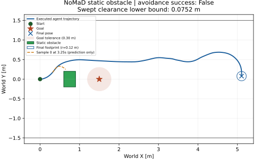

# Isaac Sim 6 정적 장애물 단일 실험

2026-10-16 (Asia/Seoul). **결과: 충돌 없이 목표 도달 실패 (`no_collision_goal_failure`).** 장애물을 왼쪽으로 통과했고 안전 clearance를 만족했지만, 30 simulation s 안에 목표 tolerance에 진입하지 못했다. 장애물 회피와 목표 도달을 합친 성공 조건은 **FAIL**이다. 기술적 실행 및 저장 결과의 수치 검증은 통과했다.

기준 commit: `35c435e3eb19471c8f678ae8387d6c641bcf7623`. 별도 branch: `research/isaac6-static-obstacle`. 실험 실행 SHA: `fe030579cecd9051f22655bc8fccc003be6775d4` (clean tree). 실행 전 scenario와 source hashes를 commit 및 provenance로 고정했다. 정상 navigation은 `static_obstacle_01` **한 번만** 실행했다. 장애물 없는 기존 성공 실험은 재실행하지 않았고, navigation 결과를 이유로 재시도하거나 튜닝하지 않았다.

## 고정 조건과 변경 범위

기존 [minimal navigation](ISAAC6_MINIMAL_NAVIGATION.md)의 시작 `(0,0,0)`, 목표 `(1.5,0,0)`, 0.30 m goal tolerance, 복도, camera, history/preprocessing, observation 4 Hz, controller refresh 9 Hz/계산 DT 0.25 s, 72 Hz SE(2) integration을 유지했다. v≤0.2 m/s, |w|≤0.4 rad/s, checkpoint, 10-step diffusion, 8 samples×8 XY waypoints, sample 0/waypoint index 2, synchronous inference 정지도 그대로다. Seed sequence도 기존 `101+2i` initial noise / `102+2i` DDPM RNG를 유지했다. Seed를 고른 추가 실험은 없다.

새 [obstacle_scenario.json](../research/nomad_isaac/obstacle_scenario.json)은 기존 scenario의 name 외 모든 기존 값을 유지하고 다음만 추가한다. 기존 `scenario.json` 자체는 수정하지 않았다.

| 항목 | 실행 전 고정값 |
|---|---|
| Obstacle 중심 XY | `(0.75,0)` m |
| 크기 X/Y/Z | `0.30 / 0.40 / 0.80` m |
| 실제 USD world AABB | min `(0.6,−0.2,0)`, max `(0.9,0.2,0.8)` m |
| 색상 | 녹색 RGB `(0.04,0.65,0.04)` material |
| Agent footprint | XY 원, 반경 0.12 m; yaw와 무관 |
| 필요한 obstacle clearance | ≥0.02 m |
| 성공 조건 | goal entry AND clearance 만족 AND geometric overlap 없음 AND corridor footprint 침범 없음 |
| 종료 조건 | 최초 contact 검출 tick / corridor footprint 경계 / 기존 boundary 조건 / goal entry / 기존 timeout |

Obstacle은 `/World/StaticObstacle` USD cube로 실제 RTX RGB에 렌더링된다. 시작 영상의 녹색 pixel **21,445개**와 실제 USD AABB를 inference 전에 확인했다. Goal은 장애물이 있는 동일 scene의 목표 pose에서 실제 렌더링했다. 목표 camera가 +X를 보므로 뒤쪽 장애물은 goal image에 나타나지 않는다.

공식 `train/`, `deployment/`, 기존 `nomad_preflight/native.py`, NoMaD worker, checkpoint, environment packages는 변경하지 않았다. `nomad_isaac`에는 scenario 선택, obstacle 렌더링, 수동 기하 계측/종료 검사, planning diagnostic과 보고서 확장만 추가했다. Planner, 회피 heuristic, safety steering/controller, smoothing, 재선택, graph optimization은 없다. Clearance/obstacle geometry는 NoMaD worker에 전달하지 않으며 RGB만 바뀐다.

## 실제 측정

| 항목 | 결과 |
|---|---|
| 기술적 연동 | PASS: 실제 RGB→NoMaD GPU→원본 controller→실제 USD pose feedback |
| 종료 | `simulation_timeout`, 30.000 simulation s |
| Goal entry | **false**; 0.30 m tolerance 미진입 |
| 최소 goal 거리 | **0.4688935153 m**, t=9.8472222222 s |
| 해당 world pose | `(1.5263061336, 0.4681550128, −0.0559779412)`; m, rad |
| 최종 world pose | `(5.1059076045, 0.0768653621, −1.6567289194)` |
| 최종 goal 거리 / 이동 길이 | 3.6067267620 / 5.7218782290 m |
| 최소 executed obstacle clearance | 보수적 하한 **0.0751954889 m**, 실제 arc witness 기반 상한 **0.0751987758 m** |
| Geometric overlap / 최초 발생 위치 | **없음 / 해당 없음** |
| Clearance 0.02 m 기준 | **만족** |
| 최소 corridor footprint clearance 하한 | 0.6919456151 m; 침범 없음 |
| 장애물 통과 | **왼쪽(+Y)**; footprint가 far X face를 완전히 지난 t=7.3194444444 s, pose `(1.0215358735,0.4958056511,−0.0222914109)` |
| Inference / 적용 waypoint | **117 / 117**, 모든 출력 `(8,8,2)` float32 finite |
| Controller command 범위 | v=0…0.2 m/s, w=−0.4…0.4 rad/s; 초기 정지 포함 |
| Inference latency | 첫 호출 324.57 ms; 전체 117개 median **29.13 ms**, p95 **32.89 ms** |
| Navigation wall time | 9.81450195 s; startup/goal 렌더 준비 제외 |

Simulation을 wall clock에 맞춰 sleep하지 않는다. Inference 중 pose/clock은 정지하므로 wall time과 simulation time은 서로 다른 값이다. 위 latency는 단일 주행 중 실제 기록이며 별도의 benchmark가 아니다.

[전체 작은 summary](../research/results/isaac6_static_obstacle_20261016/summary.json) · [검증 기록](../research/results/isaac6_static_obstacle_20261016/validation.json)



그림의 파란 선은 **실제 실행 경로**, 주황 점선은 최소 predicted clearance를 보인 **t=3.25 s의 sample 0 예측 polyline**이다. 주황 선 전체를 실행했다는 뜻이 아니다. 두 경로에 같은 0.12 m footprint를 사용한다.

## Swept clearance 정의와 검증

[clearance.py](../research/nomad_isaac/clearance.py)는 XY center의 closed obstacle AABB까지 Euclidean distance에서 radius를 뺀 gap을 사용한다. Center가 box 안이면 −radius다. 음수의 절댓값을 PhysX penetration depth로 해석하지 않는다. Expanded rectangular AABB만 사용하는 방식과 달리 모서리의 원형 footprint 거리를 계산한다.

각 1/72 s command 구간은 일정 `(v,w)`의 실제 unicycle 원호다. 먼저 chord와 AABB의 최소 거리를 piecewise quadratic으로 구한다. 원호와 chord 사이 최대 오차인 sagitta `|v/w|·(1−cos(|w|·dt/2))`를 빼서 **원호 전체의 clearance 하한**을 얻는다. 실제 원호상의 점을 평가해 상한도 기록한다. Distance의 1-Lipschitz 성질을 사용하며 1e−12 m 수치 여유를 뺀다. 0 또는 0.02 m 판정 경계를 가로지르면 최대 256개 subarc로 세분한다. 단순 endpoint sampling만으로 충돌을 판정하지 않는다. 여기서 최소 clearance 구간의 상·하한 차이는 약 3.29 µm다.

모든 실제 pose interval을 기록 후 검사하고 첫 contact 검출 tick에서 다음 이동을 하지 않는다. 최대 tick 검출 지연은 13.889 ms이며, 연속 원호 내 최초 가능한 contact time bracket과 witness pose를 저장하도록 구현했다. 하한만 0 이하이고 실제 witness overlap이 확인되지 않는 경우는 `conservative_contact_stop`으로 구별해 실제 overlap이라고 주장하지 않는다. 0<gap<0.02인 경우 controller를 수정하지 않고 margin 실패를 기록한다. Corridor에도 footprint와 원호 sagitta를 적용한다.

이번 주행에는 contact가 없어 **실제 collision-stop branch와 최초 contact 위치 기록은 NOT EXERCISED**다. 합성 기하 단위 테스트에서 tunnelling, 둥근 corner, margin, 원호 bound, 최초 contact bracket을 검사했다. PhysX collision은 실행·평가하지 않았다.

검증 결과:

- 실행 전 기존 GPU/controller/IPC + 새 기하 tests: **19 passed, 0 skipped**, 2.02 s. 실행 후 goal entry와 safety 조건의 분류 회귀 검사를 추가한 최종 검사는 **20 passed, 0 skipped**, 2.10 s, 기존 Transformer 경고 1개였다. 추가 navigation은 없다.
- 기존 Isaac Python 3.12.13/NumPy 2.3.1에서도 최종 adapter/기하 검사 **11개 통과**.
- 실제 기록의 2,161 pose/clearance records(초기 t=0 포함), 270 controller refreshes, 117 applied events와 planning diagnostics를 재계산했다.
- normalization/cumsum/scaling/selected point 및 원본 controller exact equality, 4 Hz history, synchronous clock, goal entry 판정 검증 통과. 실제 pose와 command 재적분 최대 절대 차이 1.7764e−15.
- 원본 model/controller, native preprocessing/inference, worker, 기존 scenario에 대한 기준 SHA와의 Git diff는 비어 있다. CUDA/driver/Isaac/다른 프로젝트 설치 변경 없음.

## 예측과 실행을 구분한 실패 분석

전체 sample 0의 8개 metric point와 observation origin을 이은 polyline은 **3회** footprint overlap을 예측했다. 이는 모델 trajectory에 임의 timestamp를 붙인 실행 예측이 아니라 spatial planning diagnostic이다. Observation pose로 local→world 변환했으며 command에는 사용하지 않았다.

| observation time | 전체 sample-0 polyline 최소 clearance | index 2까지의 prefix 최소 clearance |
|---|---:|---:|
| 3.25 s | −0.0705104214 m | +0.0869294716 m |
| 3.50 s | −0.0059833612 m | +0.0886811856 m |
| 3.75 s | −0.0649430067 m | +0.0831301061 m |

117개 prefix 전체의 최소 clearance는 +0.0752091987 m였다. 원본 loop는 index 2를 controller에 전달하고 새 RGB에서 재예측하므로, full predicted polyline의 overlap과 실제 collision은 같지 않다. 실제 executed path는 safety margin을 지켰다. 모든 8-point chunk가 collision-free라고 가정해서는 안 된다.

Goal 근처 t=9.75 s의 pose는 `(1.5069,0.4693,−0.0552)`였다. 선택 waypoint는 local `(0.165742,0.000871)` m여서 원본 controller가 `(v,w)=(0.2,0.0210202)`를 출력했다. 실제 경로는 목표 왼쪽을 지나 계속 전진했다. RGB/좌표/통신/controller 계산 오류는 이번 검증에서 발견하지 못했다. **이 고정 goal adapter와 원본 policy/controller 조합의 목표 접근 실패**로 분류한다. 단일 실험만으로 camera/domain gap, 목표 image 해석, topomap search 생략 등의 원인을 분리할 수 없다.

## 저장 위치, GUI, 미검증 사항

Raw run: `/home/gpuadmin/Workspace/NoMaD/artifacts/isaac6/static_obstacle_01/`. 기존 raw/derived NPZ, timestamps, controller/events, 실제 pose CSV, goal/대표 RGB 저장을 유지했다. `obstacle_geometry.json`, 매 tick `clearance.jsonl`, 매 inference `planning.jsonl`과 장애물을 포함한 `scene.usda`를 추가했다. 기존 checkpoint/raw data/preflight/장애물 없는 결과는 덮어쓰지 않았다. Git에는 source/tests/docs와 작은 JSON/SVG만 포함한다.

실행 환경은 기존 Isaac `6.0.1-rc.7+release.42383.32955d8d.gl`, Python 3.12.13/NumPy 2.3.1과 별도 `.venv` Python 3.11.16/NumPy 1.26.4/torch 2.7.0+cu128/diffusers 0.11.1, RTX 5060 Ti/driver 595.99.02다. Checkpoint SHA-256은 `70f79b8262527e20e56ced64a3e3d7ef91855bc9e7c3fa348d78edcb83c6a333`; coverage 645/645, parameter 100%다. Cold renderer 준비 중 기존과 같은 transient step error가 있었지만 RGB gate 이후 전체 주행과 정상 종료가 완료됐다. 중단된 navigation 시도는 없다.

이 단계의 GUI 확인은 기존 설치의 `isaac-sim.sh`와 **이미 설치된** `omni.usd/.../scripts/open_stage.py`를 사용했다. 당시 새로운 viewer/replay 프로그램은 작성하지 않았다. `scene_gui.usda`는 시작 pose의 **정적 scene**이며 recorded trajectory animation을 포함하지 않는다. 이 파일의 Play 버튼으로 이번 NoMaD 주행이 재생되지 않는다. 이후 사용자의 주행 영상 요청에 따른 별도 산출물은 아래 절에 기록한다.

원본 `scene.usda`는 inference용 `/Render`와 `/Orchestrator` 그래프도 포함하여 GUI에서는 반복 `OgnSdOnNewFrame` 오류를 냈다. 원본을 덮어쓰지 않고 `/World`만 복사한 **`scene_gui.usda`**를 후처리로 저장했다. 원본과 보기용 파일의 **98개 World prim, 모든 attribute 및 relationship이 동일**함을 검사했다. Camera, geometry, material, light, 시작 pose가 모두 보존된다. 이후 실행에도 같은 정적 USD를 저장하도록 기존 export 부분만 확장했으며 이번 navigation을 재실행하지 않았다.

기존 GUI로 `scene_gui.usda`를 실제 열고 창 제목과 Kit log의 `opened successfully`를 확인했다(13:35:37 KST). 최종 확인 log의 Error는 0개였다. 초기 GUI의 기본 ROS bridge 자동 시작은 process 옵션으로 비활성화했다. 기존 Isaac/ROS 설치나 설정 파일은 수정하지 않았다. 검증 전후 기록된 raw 파일 SHA-256도 동일했다. GUI 검증 3회는 scene 표시만 확인했으며 모델 inference/navigation 실험이 아니다.

아래 한 줄은 후속 CUDA library 충돌 수정이 반영된 launcher를 통해 기존 GUI/설치된 opener 및 생성된 절대 USD 경로를 사용한다. `--exec`는 [설치된 Kit help 및 공식 CLI 문서](https://docs.omniverse.nvidia.com/kit/docs/carbonite/latest/docs/Kernel/CommandLineOptions.html)와 대조했고, startup/renderer 옵션은 설치된 Isaac source와 실제 실행으로 확인했다. Portable root는 이번 작업의 GUI 검증 cache 경로이며 이미 존재한다. 이 명령은 당시 정적 scene을 여는 명령이다.

```bash
bash /home/gpuadmin/Workspace/NoMaD/visualnav-transformer/research/nomad_isaac/open_scene.sh /home/gpuadmin/Workspace/NoMaD/artifacts/isaac6/static_obstacle_01/scene_gui.usda
```

남은 uncertainty: 다른 scene/seed의 일반적인 장애물 회피·goal 성공률, full 8-point chunk의 안전성, 물리 접촉/robot dynamics, 비동기 waypoint 적용, OLD/FRESH reconciliation과 graph optimization은 미검증이다. 이번 결과를 완전한 obstacle navigation 성공으로 간주하지 않는다. 추가 실험·모델 튜닝은 수행하지 않았다.

## 후속 요청: 실제 실행 기록을 보여주는 영상

사용자는 정적 scene 대신 **agent가 움직이며 장애물을 회피하는 영상**을 요청했다. 원래 단일 실험에서는 연속 동영상이 저장되지 않았으므로, [render_recorded.py](../research/nomad_isaac/render_recorded.py)로 실제 실행 pose CSV를 기존 Isaac Sim 6 RTX renderer에서 다시 렌더링했다. **당시 실시간 녹화본이 아닌, 기록된 실제 실행의 시각적 재생 영상**이다. 새 NoMaD inference, controller 실행, navigation 또는 성능 재시도는 없다.

- 최종 MP4: `/home/gpuadmin/Workspace/NoMaD/artifacts/isaac6/static_obstacle_video_02/nomad_static_obstacle.mp4`
- 원본 입력: `static_obstacle_01/scene_gui.usda`, `agent_trajectory.csv`, `scenario.json`, `summary.json`. 해당 입력은 변경하지 않았다.
- 1280×720, H.264, 24 fps. 72 Hz의 2,161개 실제 pose 중 매 3번째를 선택한 721 frames이며 위치/heading을 보간하거나 경로를 수정하지 않았다. t=0…30 s를 포함하므로 마지막 frame 표시까지 encoded duration은 30.041667 s다.
- 재생 속도는 **simulation time 기준 1배**다. 원래 navigation wall time 9.8145 s를 그대로 재현한 영상이 아니다. 동기식 inference 대기 시간도 추가하지 않았다.
- 파란 원반은 반경 0.12 m의 agent footprint, 흰 화살표는 실행 yaw, 녹색 box는 기존 장애물, 주황 원은 실제 goal tolerance 0.30 m, 하늘색 선은 그 시점까지의 실행 기록이다. 원래 agent는 mesh 없는 Xform이었다. 이 표시와 관찰용 camera, 자막은 영상에만 추가한 시각 보조이며 실제 NoMaD 입력이나 주행에 사용하지 않았다.
- 처음 만든 `static_obstacle_video_01`도 보존했다. 장애물 뒤에 agent가 가려져 관찰 camera의 Y 위치만 −2→+2 m로 바꿔 `video_02`를 렌더링했다. 두 영상의 pose/seed/모델/주행 결과는 같다. 설치된 `omni.videoencoding`을 사용했으며 ffmpeg나 새 Python package를 설치하지 않았다.

영상은 **왼쪽 통과, 최소 clearance 7.52 cm, goal 미도달**이라는 실제 결과 전체를 보여준다. Goal 성공처럼 편집하지 않았다. MP4 및 frame별 source row mapping, renderer source snapshot, PNG previews, source/video SHA-256과 검증 기록은 `static_obstacle_video_02/`에 보관한다. Git에는 renderer, 문서와 작은 검증 JSON만 추가한다.

동일 pose 2,161개를 USD time samples로 넣은 `recorded_motion.usda`도 별도로 저장했다. 이 파일은 기존 Isaac GUI의 native timeline으로 재생할 수 있는 **기록 animation**이며, NoMaD를 다시 실행하는 scene이 아니다. GUI에서는 전체 기록 경로를 고정 표시하고 MP4는 진행한 경로만 표시한다. 기존 `scene_gui.usda`는 그대로 정적 scene이다.

검증: **MP4 721 frames 모두 정상 decode**, H.264/24 fps/1280×720 확인. 모든 video frame의 source CSV row와 `(x,y,yaw,time)`이 정확히 일치했다. USD animation의 2,161 pose 모두 원본과 비교해 최대 절대 오차 **4.44×10⁻¹⁶**이었다. 원래 World prim 98개, default attributes 643개, relationships 72개가 그대로 보존됐고 기존 camera/obstacle/corridor geometry를 수정하지 않았다. 시작·회피 구간·goal 근접 구간·마지막 frame을 시각 확인했다. [작은 영상 검증 기록](../research/results/isaac6_static_obstacle_20261016/video.json)에 실제 hash/파일 크기/검증 결과를 기록했다.

영상 생성 뒤 관찰 camera를 기본으로 여는 Kit의 기존 `cameraSettings:boundCamera` metadata만 더한 **`recorded_motion_gui.usda`**를 새 파일로 저장했다. 원래 animation/MP4는 보존했다. 같은 metadata export를 renderer의 마지막 부분에도 추가했다. 실제 실행한 renderer snapshot은 영상 폴더의 `render_recorded_source.py`이며 이 마지막 GUI metadata export가 추가되기 전 버전이다.

환경 변수를 분리한 process에서 기존 GUI로 `recorded_motion_gui.usda`를 열어 **opened successfully / Error 0개**를 확인했다. 최초 안내 명령은 그 환경 분리 처리가 누락되어 아래와 같이 launcher 명령으로 정정했다. Camera는 OverviewCamera이며 native timeline의 **Play**로 기록 animation을 볼 수 있다. GUI Play 버튼의 수동 조작 자체는 이번 검증에 포함하지 않았고, 모든 animation time sample의 pose 일치 및 MP4 전체 재생 가능성을 별도로 확인했다. GUI 표시는 실험 재실행이나 실제 controller 제어가 아니다.

```bash
bash /home/gpuadmin/Workspace/NoMaD/visualnav-transformer/research/nomad_isaac/open_scene.sh
```

## GUI 실행 시 CUDA library 충돌 수정

사용자가 최초 안내 명령을 그대로 실행한 `kit_20261016_140832.log`에서 `libcusparse.so.12: undefined symbol: __nvJitLinkCreate_12_8`로 종료됐다. 당시 GUI 검증은 Python launcher에서 환경을 분리했으나, 사용자에게 제공한 한 줄 명령에는 그 처리가 누락됐다. 설치 문제로 처리하지 않고 안내와 launcher를 수정했다.

실제 원인은 상속된 `LD_LIBRARY_PATH`의 `/usr/local/cuda/lib64`였다. 이 symlink는 **CUDA 12.6**을 가리켰다. `ldd`는 Isaac에 포함된 cuSPARSE가 이 경로의 `libnvJitLink.so.12`를 먼저 선택함을 보였다. `readelf`로 해당 library에 `__nvJitLinkCreate_12_6`만 있고 필요한 `__nvJitLinkCreate_12_8`은 없음을 확인했다. Isaac 내부 `nvidia/nvjitlink/lib/libnvJitLink.so.12`에는 12.8 심볼이 있고, `LD_LIBRARY_PATH`를 제거하면 cuSPARSE의 기존 RUNPATH를 통해 그 library가 선택된다. 이 의존 관계는 [NVIDIA cuSPARSE 문서](https://docs.nvidia.com/cuda/archive/12.6.2/pdf/CUSPARSE_Library.pdf)의 nvJitLink 설명과도 일치한다.

`isaacsim.core.deprecation_manager/api.py`는 `ModuleNotFoundError`뿐 아니라 `ImportError`에도 동일한 PyTorch 설치 안내를 출력한다. 이번에는 이미 존재하는 bundled torch의 동적 library import가 실패한 것이므로 torch/CUDA/driver를 설치·업그레이드하지 않았다.

[open_scene.sh](../research/nomad_isaac/open_scene.sh)는 **자식 GUI process에만** `LD_LIBRARY_PATH`, `LD_PRELOAD`, `PYTHONPATH`, `PYTHONHOME`, `VIRTUAL_ENV`를 제거한 뒤 기존 Isaac launcher를 실행한다. `--no-ros-env`는 ROS 자동 설정만 생략하며 이미 상속된 library 경로를 지우지 않기 때문에 환경 분리가 별도로 필요하다. 현재 shell, `.bashrc`, 시스템 CUDA, Isaac 설치, NoMaD `.venv`는 변경하지 않는다. 기본 scene은 recorded animation이고 optional 인자로 기존 USD 경로 하나를 지정할 수 있다.

실제 검증: 기존 CUDA 12.6/ROS 환경을 parent에서 그대로 상속하고 **새 launcher 자체만** 실행했다. 2026-10-16 14:13:21 KST에 scene open 성공, GUI log Error **0개**를 확인했다. `/proc/<pid>/maps`에서 Isaac 내부 `libtorch_python.so`, cuSPARSE, nvJitLink가 로드되고 `/usr/local/cuda`의 nvJitLink는 로드되지 않았음을 확인했다. Parent 환경과 scene SHA-256이 유지됐으며, shell syntax와 잘못된 입력 경로의 종료 동작도 확인했다. 검증 후 이번에 시작한 GUI process만 종료했다. 새 navigation은 0회다. [작은 검증 기록](../research/results/isaac6_static_obstacle_20261016/gui_environment_fix.json), 전체 log는 `../artifacts/isaac6/gui_environment_fix_01/`에 보관한다.
