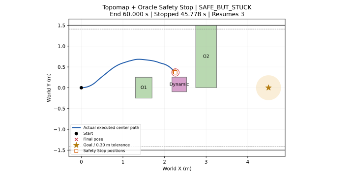

# Topomap + Oracle Safety Stop

2026-10-20. Base `830728850b5f4fc6725c3c33894bf26e1d26df1d`;
branch `research/isaac6-topomap-oracle-stop`. This protocol is committed before
the single allowed navigation. No retry or outcome-dependent parameter change.

## Frozen execution

Unchanged `old_rollout_obstacle_scenario.json`, 14-node 2-second reference
Topomap, checkpoint, sample 0/index 2, original PD, seed schedule, 4/9/72 Hz,
one-second receive-based timeout, and zero extra delivery delay.
Dynamic position comes from the actual OLD command at tick 970.
The existing rendering and collision monitor use that same resolved geometry.

The opt-in `--oracle-safety-stop` runs after `WaypointExecution.control()`.
After successful dynamic spawn, each controller tick evaluates its freshly
computed nominal command over 16 exact 72 Hz intervals. All static and active
dynamic obstacle swept-clearance lower bounds must be at least 0.02 m; corridor
footprint containment must also hold. Otherwise only the actual integration
command becomes `(0,0)`. Next tick re-evaluates; RGB/inference and waypoint
receipt/switch clocks keep running. Missing/expired waypoint stops are separate.
Before spawn, commands pass through unchanged.

`controller.jsonl` and `events.jsonl` retain nominal `v_m_s,w_rad_s`; new
`applied_v_m_s,applied_w_rad_s` fields describe the command actually integrated.
A waypoint switch can occur while its execution is blocked. `safety_stop.jsonl`
stores every controller tick, pose, validity, nominal/actual commands, current
and predicted clearance, reasons, and evaluation times. `agent_trajectory.csv`
retains incoming actual interval commands. An already violated current margin
is explicitly flagged and cannot be repaired by STOP.

This is an exact-scene-geometry **oracle baseline**, not camera-based safety
perception, trajectory reconciliation, or PhysX/real robot dynamics.
Classification and all numerical settings are frozen in
`research/nomad_isaac/oracle_safety_stop_protocol.json`.

## Pre-run validation

Saved baseline B52, same 16/72 s horizon:

| Command | Minimum swept clearance | 2 cm decision |
|---|---:|---|
| RAW `(0.1668959856,+0.4)` | 0.002653804024 m | block |
| STOP `(0,0)` | 0.023340344453 m | safe |

RAW replay matches all 16 stored 72 Hz poses exactly (maximum error 0).
Two new focused gate tests plus existing asynchronous/placement/combination
tests: **23 passed**. Original timeout, safe FRESH resume, unchanged waypoint,
and preexisting violation semantics are covered. Reference 14 node RGB/pose
hashes pass; 745 prior preservation entries remain unchanged.

Preflight artifact: `artifacts/isaac6/topomap_oracle_stop_preflight_01/`.
Single navigation output: `artifacts/isaac6/topomap_oracle_stop_01/`.

```bash
env -u LD_LIBRARY_PATH -u LD_PRELOAD -u PYTHONHOME -u VIRTUAL_ENV bash research/python.sh -m nomad_isaac.launch --asynchronous --oracle-safety-stop --topomap /home/gpuadmin/Workspace/NoMaD/artifacts/isaac6/topomap_reference_2s_01/topomap/manifest.json --scenario research/nomad_isaac/old_rollout_obstacle_scenario.json --output /home/gpuadmin/Workspace/NoMaD/artifacts/isaac6/topomap_oracle_stop_01
```

## Actual single-run result: SAFE_BUT_STUCK

Clean execution SHA `32ca832a41df316f3f0569c63d7f059bd865f7f1`.
Navigation 1회, 재시도 0회. **안전 여유를 유지했으나 60.000 s timeout으로
목표 도달 실패**. 첫 장애물은 왼쪽으로 통과했고, 두 번째는 미통과다.
최종 pose `(2.262323894, 0.367545396, −0.622285012)`,
최소/최종 목표 거리 `2.267660463 m`.

| 실제 평가 | 결과 |
|---|---:|
| Static 1 / Static 2 최소 swept clearance | 0.300221010 / 0.397675365 m |
| Dynamic 최소 swept clearance | **0.024828160 m** |
| Corridor 최소 footprint clearance | 0.725852269 m |
| Geometric overlap / 기존 2 cm margin 위반 | 없음 / 없음 |
| 현재 pose가 이미 margin을 위반한 Safety Stop 검사 | 0 |
| 활성 검사 / 차단 controller tick | 418 / 412 |
| Safety Stop episode / 일시 재출발 | 4 / 3 |
| 누적 Safety Stop | 45.777778 simulation s / 45.774330 wall s |
| 정지 중 RGB capture / 새 FRESH receive | 183 / 184 |
| Request / receive / waypoint switch | 236 / 236 / 236 |
| Waypoint timeout / busy skip / missed capture | 0 / 1 / 0 |

Waypoint switch 수는 controller가 최신 waypoint를 선택한 횟수다.
차단된 waypoint도 switch되며 실제 이동을 의미하지 않는다.

동적 장애물은 tick970/13.472222 s에 실제 OLD49에서 결정한
`(2.354396712, 0.077716494)`에 등장했다. 최초 활성 controller 검사는
tick976/13.555556 s다. 첫 visible RGB54는 13.486111 s이며 저장 RGB,
worker input history hash, render/monitor geometry가 일치한다.

첫 STOP은 tick1000/13.888889 s, waypoint51에서 발생했다. 당시 현재
clearance 46.871 mm는 안전했지만 nominal 명령의 16/72 s 예상
clearance가 17.869 mm여서 차단했다.

| STOP 시작 → 종료 (sim s) | 종료 시 FRESH | 재출발 nominal `(v,w)` | 해당 16/72 s 예측 clearance |
|---|---:|---|---:|
| 13.888889 → 14.666667 | 54 | `(0.135309353,+0.4)` | 0.027249427 m |
| 14.777778 → 15.111111 | 56 | `(0.096941471,+0.4)` | 0.023488848 m |
| 15.222222 → 18.666667 | 70 | `(0.076879933,+0.4)` | 0.020004817 m |
| 18.777778 → 60.000000 | 재출발 없음 | actual `(0,0)` | nominal은 모두 미달 |

재출발마다 1 controller interval(8/72 s) 이동한 뒤 다음 검사에서 다시
차단됐다. 마지막 정지 중 FRESH71–235가 계속 수신됐지만,
nominal rollout 최소 clearance는 −2.649~15.499 mm로 모두 20 mm 미만이었다.
정지 episode 안에서 실제 pose 변화는 정확히 0이다.
따라서 실패 원인은 observation/inference 중단이나 waypoint timeout이
아니라, sample0/index2의 새 nominal PD 명령으로 안전 검사를 통과하며
계속 진행할 수 없었던 것이다. 전체 8-point native 경로의 안전성과는
별개이며, 다른 sample이나 recovery 가능성은 평가하지 않았다.

## Timing and validation

- Warm GPU inference median/p95 **35.543/37.311 ms**.
  Observation→ready **74.642/132.961 ms**, →switch **138.708/194.352 ms**.
- 1배속 RTF **0.999989570**; pacing 절대오차 p95/max **0.153/1.412 ms**.
  기존 async protocol의 pacing/clock mapping 검사 PASS.
- Safety 검사 wall 실행시간 median/p95/max **2.631/3.458/5.637 ms**.
  이는 controller-side 계산 비용이며 추가 GPU/delivery latency가 아니다.
- 4,321개 pose/540 controller tick, 모든 nominal PD·actual interval command 연결,
  normalization/cumsum/metric/sample0/index2, observation world anchor 검증 PASS.
  Pose, 실제 clearance, Safety Stop 예측 재계산 최대 오차 모두 **0**.
- 14-node map, 모든 Topomap candidate/score 선택 및 worker input RGB hash PASS.
  Adaptive placement 재계산 및 USD/monitor geometry 일치.
- 기존 745개 preservation 항목 유지. 공식 model/controller, worker,
  Topomap, scenario, placement, geometry/coordinate 함수 diff 없음.
  Natural waypoint timeout은 0회라 실주행에서 NOT_EXERCISED이며,
  사전 synthetic timeout 검증만 PASS다.
- Startup renderer error 4건은 로그에 보존했다. 이후 기존 RGB gate를 통과해
  주행과 종료가 정상 완료됐다. 재시작이나 추가 navigation은 수행하지 않았다.

## Baseline comparison and limits

| 결과 | 기존 Topomap sudden | 이번 Oracle STOP |
|---|---:|---:|
| 종료 | 14.375 s, geometric collision | 60.000 s, timeout |
| Dynamic 최소 clearance | −0.000941281 m | +0.024828160 m |
| Goal | 실패 | 실패 |
| Dynamic 중심 | `(2.372279542,0.110674603)` | `(2.354396712,0.077716494)` |

이번 실행에서는 정지로 위험 명령을 차단하며 충돌과 margin 위반을 피했다.
하지만 주행·관측·diffusion seed와 입력의 대응·adaptive placement가 달라
두 주행을 paired causal comparison으로 해석할 수 없다.
안전한 단기 명령이 일부 생성돼 재출발하는 기능은 확인했으나 지속적인
우회와 목표 도달은 확보하지 못했다. 정확한 geometry를 아는 oracle STOP의
안전성과 진행성 한계를 보여주며 Graph의 필요성·우월성 근거는 아니다.
실제 로봇/PhysX 또는 카메라 기반 안전 인식으로 일반화하지 않는다.

## Saved outputs

- Raw: `artifacts/isaac6/topomap_oracle_stop_01/`
- Offline audit: `artifacts/isaac6/topomap_oracle_stop_01_validation/`
- Small tracked results: `research/results/isaac6_topomap_oracle_stop_20261020/`
  (`summary.json`, `stop_episodes.csv`, `navigation_xy.svg`, B52 validation).
- Source: `oracle_safety_stop.py` + fixed protocol; opt-in wiring in
  `async_runtime.py`, `launch.py`, `simulator.py`; offline
  `oracle_stop_report.py` and a small explicit actual-command option in
  `async_report.py`; two focused tests. No runtime changes after the run.


