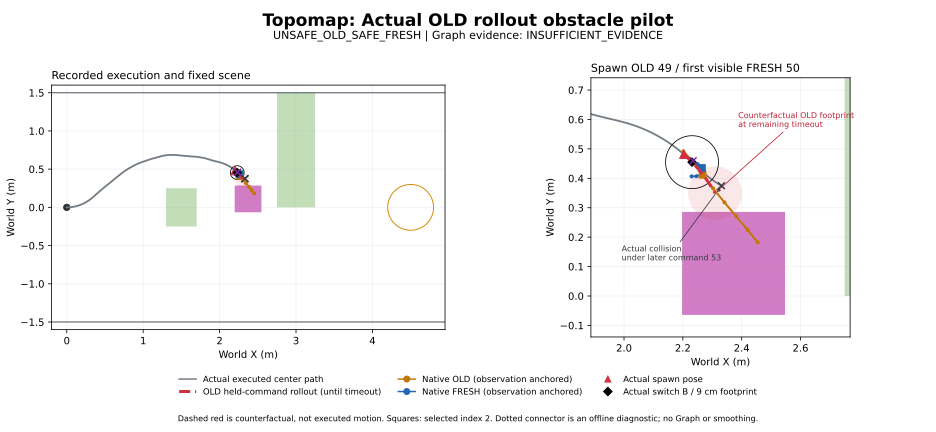

# 2초 Topomap + 실제 OLD rollout 장애물: 단일 pilot

2026-10-19. 기준 `62809c09d1dd3e43bf539645ff34779ffed281e5`, branch `research/isaac6-topomap-sudden-obstacle`. 사전 protocol/실행 SHA **`be51bb45c6a2d6755a1d8bfc05d3d67b90451712`**, clean tree에서 navigation **1회, 재시도 0회**. 실제 OLD 경로 차단과 첫 안전한 FRESH 생성은 확인했다. 이후 **안전한 native prediction 52의 실제 PD 실행에서 2cm margin을 잃고, margin이 부족한 prediction 53 실행 중 14.375s에 충돌**했다. Goal entry는 실패했다.

판정은 시간 순서에 따라 **`UNSAFE_OLD_SAFE_FRESH` → `LATER_UNSAFE_FRESH` + `HANDOFF_OR_EXECUTION_FAILURE`**다. 마지막 분류는 실제 실행 실패를 뜻하며 IPC나 switch 구현 오류를 발견했다는 뜻이 아니다.

## 고정 조건과 변경 범위

`launch.py`/`simulator.py`의 조합 제한만 좁혀, 사전 고정한 14-node/2초 정적 map과 원래 OLD-rollout scenario의 **async/추가 지연 없음** 조합을 허용했다. Sync, prepare-only, delay 옵션, 변경된 scenario/map은 거부한다. 공식 closest/subgoal, worker의 선택 condition 및 diffusion, 원본 PD, placement/geometry, 4/9/72Hz, 1초 timeout, radius .09m/margin .02m, sample 0/index 2와 seed schedule은 그대로다. Topomap에 동적 장애물은 없다.

- Map SHA-256: `5b720e71b03b9809488ca81c340bfe691f39542371bad03eddf7a40246285f36`
- 원래 scenario SHA-256: `9d3785d811b2ecb0c879c62bcf849799a04511eda34887f6e70c9facdcc09589`
- `topomap_sudden_protocol.json`을 실행 전에 commit했다. CPU tests **33 passed**. Model/encoder/decoder에는 변경이 없어 기존 2초 map GPU 동등성 검증을 재사용했고, 이번에는 실제 navigation GPU inference와 raw/output 검증을 수행했다.
- 기존 static 성공 run, 14개 map RGB/manifest, fixed-goal pilot 등을 포함한 사전 **488개 hash**, 새 run **257개 hash**가 분석 후에도 일치했다. Checkpoint와 가상환경/Isaac 설치는 변경하지 않았다.

## 등장 당시 OLD와 첫 관측

Tick **970 / 13.472222222 simulation s**, pose `(2.203111614, .481687809, −.722995466)`에서 실제 OLD **49**, PD `(.2, −.4)`, timeout 잔여 **.852955462s**를 사용했다. 고정 후보 중 첫 **.42m**가 통과하여 box 중심은 **`(2.372279542, .110674603)`m**로 결정됐다. 크기는 `.35 × .35 × .8m`다. FRESH/미래 pose/goal 결과는 배치에 사용하지 않았다.

상대 중심은 forward/left `(.372322, −.166269)m`, bearing **−24.064°**, 등장 순간 footprint clearance **.106013m**. 기존 .55s 반응 구간의 보수적 최소 clearance는 **.021761m**로 통과했다. 동일 OLD 명령을 계속 유지하는 counterfactual은 **약 .699936s 후 접촉**, timeout 안에서 overlap witness를 가진다. 실제 미래 실행이 아니라 사전 배치 검사용 rollout이다. OLD native full은 새 box에 **−.09m**, index-2 prefix는 **+.036213m**로 서로 다르다.

Collision monitor는 tick970부터 활성화됐다. Main thread는 동일 resolved box와 논리적 activation timestamp로 USD를 갱신했고, 첫 저장 RGB는 **observation 54 / tick971 / 13.486111111s**다. 독립 execution thread는 renderer를 기다리지 않았다. 이는 두 host thread가 같은 순간 실행됐다는 주장이 아니다. 출현 전 RGB에는 magenta가 없었고, 첫 관측에는 **46,570 pixels**가 검출됐다. 원본 RGB 53/54를 육안으로도 확인했다. Instance mask 새 기능은 사용하지 않았다.

첫 visible FRESH는 이벤트로 식별한 **50**이며 실제 history는 **[51,52,53,54]**, 그중 visible frame은 54다. Worker history hash는 `3d9554d28bb259adf9f778b746e17d4c61e22521e3395be1e618c91f98f231e8`. ID가 기존 fixed-goal pilot과 우연히 같지만 ID를 대응 조건으로 쓰지 않았다.

| 사건 | Simulation s | Host monotonic epoch 이후 s |
|---|---:|---:|
| Spawn | 13.472222222 | 13.472295651 |
| 첫 FRESH observation pose / capture start | 13.486111111 | 13.501982964 |
| GPU ready | 13.583700989 (trace에서 보간) | 13.583799945 |
| 실제 FRESH switch | 13.666666667 | 13.667144752 |

Simulation pose 시각과 실제 RGB capture 시작 시각을 구분했다. Ready의 simulation 값은 보간치다. 원시 host ns도 JSON에 보존했으며 서로 다른 clock을 직접 빼지 않았다. 출현부터 첫 switch까지 OLD는 **.038889m / −4.4563°** 이동했고 실제 dynamic swept clearance **.079174m**, overlap 없음이었다. 첫 switch B는 `(2.231242055, .454850117, −.800773244)`다.

## 첫 FRESH와 이후 실제 적용

모든 native world path는 **각 observation pose**에서 변환했다. Full은 native 8-point polyline, prefix는 0–2, origin-prefix는 observation origin을 추가한 경로다. 아래 값은 dynamic clearance이며 이 구간에서는 전체 obstacle minimum과도 같다. 안전은 2cm 이상 및 corridor containment 기준이다. 실제 PD swept arc는 native polyline과 별도로 평가했다.

| ID / 역할 | 실제 switch s | closest / subgoal | 원본 `(v,w)` m/s,rad/s | Native full / prefix m | 실제 다음 switch/종료까지 최소 m |
|---|---:|---:|---|---:|---:|
| 49 / 출현 OLD | 13.333333 | 2 / 2 | (.2, −.4) | −.090000 / +.036213 | +.079174 (출현 이후만) |
| 50 / 첫 visible FRESH | 13.666667 | 2 / 2 | (.2, +.340089) | +.030975 / +.059524 | **+.048466 안전** |
| 51 | 13.888889 | 6 / 6 | (.179720, +.4) | +.052852 / +.052852 | **+.023339 안전** |
| 52 | 14.111111 | 9 / 9 | (.166896, +.4) | **+.026485 / +.026485 안전** | **+.002654 margin 미달**, overlap 없음 |
| 53 | 14.333333 | 9 / 9 | (.168077, +.4) | **+.002057 / +.002057 margin 미달** | **−.000941 overlap** |

첫 FRESH 50의 8 samples는 **full 안전 4/8 (0,1,5,6)**, prefix 안전 **8/8**, origin-prefix 안전 **8/8**. PD 각속도는 좌회전 4/우회전 4다. Sample 0만 실제 실행했고 나머지 7개는 정확한 geometry를 이용한 offline native safety 및 명령 비교다. 다른 sample의 closed-loop 안전성이나 온라인 선택 기준을 검증하지 않았다.

OLD49→첫 FRESH50은 **같은 subgoal 2**에서 `−.4→+.340089`로 반전했으나 첫 prediction과 실행 모두 안전했다. **FRESH50→51→52→53 사이에는 부호 반전이 없다.** Subgoal은 **2→6→9→9**, 이 구간의 node 후퇴도 없다. 52→53은 subgoal 9가 유지된 채 native margin이 미달로 바뀌었다. RGB/history/pose와 diffusion seed가 함께 바뀌므로 subgoal 또는 sampling 하나를 원인으로 확정하지 않는다. 회전 부호와 실제 우회 방향도 동일시하지 않는다.

54개 inference 전부에서 후보 range, score argmin, strict close-threshold, 선택 image hash 및 worker/received/switch metadata가 공식 규칙과 일치했다. OLD49와 FRESH50은 후보 **0–7**, 최소 score **12.218715 / 15.141713**로 closest/SG **2/2**였다. 각 후보 score와 이후 선택은 CSV에 보존했다. Score는 meter가 아니다. 실제 world pose를 online localization에 넣지 않았다.

## 실패 위치와 handoff 근거

첫 FRESH50에서 B→entry 거리는 **.005640m**, 유효 tangent와 B yaw 차이 **10.127°**, 단순 connector clearance **.079176m**이며 검사한 **5/5 entry**가 안전했다. 기존 correspondence는 `nonmonotone_forward_station`으로 invalid여서 position/heading revision 통계를 만들지 않았다.

FRESH52도 검사한 entry 중 **4개가 안전**했다. 선택 entry 거리 **.013428m**, tangent 차이 **54.214°**, connector clearance **.023340m**, corridor containment 충족이다. 하지만 원래 local index 2를 원본 PD로 적용한 실제 arc는 **14.152777778s에 2cm margin을 처음 잃었다**. Connector는 실행하지 않은 offline diagnostic이며 원본 PD가 그 선을 따라갔다고 해석하지 않는다. Native path·단순 connector의 안전성이 실제 PD 안전성을 보장하지 않는 사례다.

FRESH53은 observation anchor에서부터 full/prefix margin이 부족하다. **+.002057m이므로 native geometric overlap과는 구분**한다. 적용 당시에도 안전 여유가 이미 소진됐고, 실제 execution은 **14.375s**에 dynamic overlap으로 중단됐다(보수적 lower −.000941m, witness upper −.000940m). 최종 pose `(2.331162352, .374734943, −.530753459)`, 최소 goal 거리 **2.200973m**. 첫 정적 장애물은 왼쪽으로 통과했고 두 번째는 미통과다. Static minimum **.316768/.328836m**, 전체 corridor minimum **+.723817m**, 정적 box overlap/corridor 침범은 없다. PhysX collision이 아니라 기존 SE(2) swept footprint/AABB 판정이다.

즉, **52의 native/PD 실행 안전성 차이**와 **53의 upstream prediction margin 미달**이 관측됐다. Switch tick·명령·pose 기록 오류는 발견하지 못했다. Observation→switch 이동과 PD의 local point 해석이 각각 얼마나 기여했는지는 별도의 counterfactual 없이 확정할 수 없다. 유효 correspondence가 부족하고, 안전한 FRESH의 검사한 staging은 안전했으므로 **qualified reconciliation case는 확인되지 않았다 / Graph 근거는 `INSUFFICIENT_EVIDENCE`**다. 새 correspondence나 Graph를 만들지 않았다.

## 검증과 기존 fixed-goal 비교

Runtime async 검증 PASS, 원본 PD/raw normalization/metric selection/observation anchor 일치, **72Hz pose integration 오차 0**, dynamic/static swept/corridor 재계산 일치. Request/receive/switch **54/54/54**, 미적용 prediction 없음. Warm GPU median/p95 **35.536/53.096ms**, observation→ready **73.614/108.879ms**, observation→switch **138.287/193.884ms** (host 기준). RTF **.999993035**, pacing p95/max **.147790/1.082767ms**, 1tick 초과 지연 0. Busy skip1, missed0, timeout0(실제 자연 timeout은 NOT_EXERCISED, 기존 synthetic test 통과). GPU inference 중 유효 OLD 이동은 53개 request에서 관측됐다. Startup renderer error5개는 로그에 보존했으며 이후 RGB gate와 실행 검증은 통과했다.

기존 fixed-goal pilot도 첫 FRESH는 안전했지만 이후 margin 미달과 충돌이 있었다. 그 run은 51 실행부터 margin 미달, 51→52의 `−.4→+.4` 반전 및 unsafe52 실행 중 **14.305556s** 충돌, 53 미적용이었다. 이번에는 52부터 margin 미달, 이후 FRESH 부호 반전 없이 unsafe53 실행 중 충돌했다. **같은 event 순서로 기술한 비교이며 RGB/경로/seed 대응/장애물 world 위치가 달라 Topomap의 인과적 개선 효과나 성공률 차이로 해석하지 않는다.** 기존 정적 2초 Topomap 성공 run은 재실행하지 않았다.

Raw: `../artifacts/isaac6/topomap_sudden_01/`, offline audit: `../artifacts/isaac6/topomap_sudden_01_validation/`. 이전 raw/results는 그대로다. 추가 코드는 좁은 조합 gate와 offline 보고서이며 post-run 변경은 분석/표기뿐이다. 새 Graph, reranking, smoothing, recovery, 영상, parameter sweep은 없다.

[Summary JSON](../research/results/isaac6_topomap_sudden_20261019/summary.json) · [첫 FRESH 8 samples](../research/results/isaac6_topomap_sudden_20261019/first_fresh_samples.csv) · [Successive FRESH](../research/results/isaac6_topomap_sudden_20261019/successive_fresh.csv) · [Topomap 선택/score](../research/results/isaac6_topomap_sudden_20261019/topomap_selection.csv) · [Fixed-goal 비교](../research/results/isaac6_topomap_sudden_20261019/fixed_goal_comparison.csv) · [검증 요약](../research/results/isaac6_topomap_sudden_20261019/review.json)



기존 plotting 함수로 만든 그림 **한 장**이다. 주황/파랑은 observation-anchored OLD/첫 FRESH, 회색은 실제 전체 실행, 붉은 점선은 미실행 OLD continuation이다. 이후 prediction별 수치는 CSV에 구분했다.

실행한 명령(기존 output 재사용/추가 실행 금지):

```bash
env -u LD_LIBRARY_PATH -u LD_PRELOAD -u PYTHONHOME -u VIRTUAL_ENV bash research/python.sh -m nomad_isaac.launch --asynchronous --topomap /home/gpuadmin/Workspace/NoMaD/artifacts/isaac6/topomap_reference_2s_01/topomap/manifest.json --scenario research/nomad_isaac/old_rollout_obstacle_scenario.json --output /home/gpuadmin/Workspace/NoMaD/artifacts/isaac6/topomap_sudden_01
```

Offline 분석만 재현할 때는 새 output 경로를 지정한다:

```bash
PYTHONPATH=research MPLCONFIGDIR=/tmp/nomad-topomap-mpl /usr/bin/python3 -m nomad_isaac.topomap_sudden_report --run ../artifacts/isaac6/topomap_sudden_01 --topomap ../artifacts/isaac6/topomap_reference_2s_01/topomap/manifest.json --preservation ../artifacts/isaac6/topomap_sudden_preservation_01.json --out /tmp/nomad-topomap-sudden-audit-new
```
