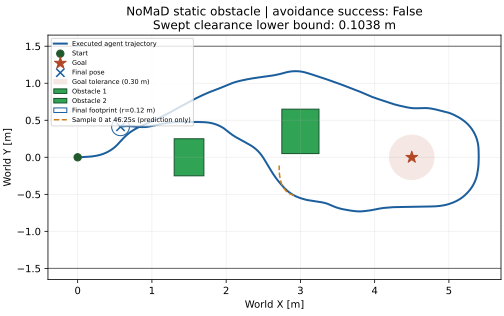

# Isaac Sim 6: 두 정적 장애물과 늘어난 시작 거리

2026-10-16. 사용자의 새 요청에 따라 기존 단일 장애물 실험 이후 **새 조건 한 번의 bounded navigation**을 수행한다. 이전 실패를 성공할 때까지 반복하는 실험이 아니다. 기존 결과를 보존하며 별도 `research/isaac6-two-obstacles` branch를 사용한다. 기준 commit은 `45b6026`이다.

## 실행 전에 고정한 조건

| 항목 | 새 값 |
|---|---|
| 시작 pose | `(0,0,0)`; m, rad |
| 장애물 1 | `StaticObstacle1`, 중심 `(1.50,0.00)`, 크기 X/Y/Z `(0.40,0.50,0.80)` m |
| 장애물 2 | `StaticObstacle2`, 중심 `(3.00,0.35)`, 크기 `(0.50,0.60,1.00)` m |
| 목표 pose | 두 장애물 뒤 `(4.50,0,0)` |
| 목표 tolerance | 기존 0.30 m |
| Timeout | simulation 60 s; navigation wall 180 s; process 600 s |
| 첫 장애물 앞면까지 거리 | 시작 center에서 1.30 m; footprint 기준 gap 1.18 m |
| 이전 실험의 동일 거리 | 0.60 m / 0.48 m |
| Collision proxy / safety margin | 반경 0.12 m 원형 footprint / 0.02 m |

두 장애물은 기존과 같은 녹색이다. 복도·RGB camera·goal-conditioned 원본 checkpoint, observation 4 Hz/controller 9 Hz/integration 72 Hz, max v=0.2 m/s/max w=0.4 rad/s, 원본 controller DT=0.25 s, sample 0/point index 2, 10 diffusion steps, 8 samples×8 points, seed schedule 101+2i/102+2i, normalization/scaling과 synchronous 동작을 유지한다. Goal image는 새 목표 pose에서 실제 렌더링한다. 이 요청에서는 목표가 두 장애물 뒤에 있어야 하므로 goal과 timeout도 실행 전에 변경했다. 크기·거리·goal이 함께 바뀌므로 개별 효과를 분리한 대조 실험은 아니다.

성공 조건은 두 장애물 모두와 접촉 없이 clearance 기준 및 corridor containment를 지키고 goal tolerance에 진입하는 것이다. 어느 장애물이든 최초 geometric contact 검출 tick에서 멈춘다. 보수적 하한만 contact를 가리키는 경우는 별도 conservative contact stop으로 구분한다. NoMaD waypoint를 수정하거나 planner/safety steering/smoothing을 추가하지 않는다. Kinematic geometry 평가이며 PhysX collision 실험이 아니다.

## 코드 변경과 실행 전 검증

- 기존 `ObstacleMonitor`의 단일 AABB/원호 geometry를 각 장애물에 적용한다. Root에는 두 장애물 최소값을 기록하고 `obstacles/<id>/`에는 각각의 geometry/clearance/planning log를 저장한다. 전체 선택 trajectory의 clearance는 실행 결과와 별도 diagnostic이다.
- 기존 단일 scenario와 파일 형식을 보존한다. Scene builder는 명시된 장애물 목록을 렌더링하며 각 USD world AABB를 입력 geometry와 비교한다.
- 초기 goal 거리의 고정값 1.5를 실제 시작·목표 거리로 계산하도록 기록 버그를 수정했다. Controller/integration 계산은 그대로다.
- 영상은 조기 종료가 24 fps sampling grid에 맞지 않아도 마지막 실제 pose를 보존한다. 이때 마지막 frame만 다음 video slot에 배치하며 timestamp 차이를 manifest에 기록한다. GUI yaw는 같은 회전의 unwrapped 표현으로 저장해 ±π 경계에서 역회전하는 보간을 피한다. Raw yaw/pose는 바꾸지 않는다.
- 실행 전 `.venv` GPU/checkpoint/controller/IPC/geometry tests **25 passed, 0 skipped**, 2.09 s, 기존 Transformer warning 1개. 기존 Isaac Python/NumPy에서도 adapter/geometry **16개 통과**. 최초 sandbox 검사 중 socket 송신 1개는 permission 제한으로 실패했고 실제 host 검사에서 통과했다. Model/controller source 변경 없음.

## 실행 결과

실행 코드는 **`bdd0970c1f9ab988f68dc83fbb04fd5b2967ee10`**, 실행 시작 시 Git tree는 clean이었다. 기존 Isaac 6.0.1-rc.7, RTX 5060 Ti, torch 2.7.0+cu128/diffusers 0.11.1 및 동일 checkpoint를 사용했다. 새 raw run은 `../artifacts/isaac6/two_obstacles_01/`이다. 정상 navigation **한 번**, 중단된 navigation 시도/조건 변경/성능 재시도 **0회**다.

**판정: 두 장애물 모두 충돌 없이 통과했지만 목표 도달 실패.**

| 실제 측정 | 결과 |
|---|---|
| 종료 | simulation timeout, 60.000 s |
| Goal entry | false; 최소 거리 **0.6630545578 m**, t=25.25 s |
| Goal 최근접 pose | `(4.5281095088,0.6624584531,−0.0467017947)` |
| 장애물 1 최소 swept clearance | 하한 **0.1038404395 m**, 상한 0.1038415243 m |
| 장애물 2 최소 swept clearance | 하한 **0.1227064645 m**, 상한 0.1227070335 m |
| 장애물 1 첫 통과 | 왼쪽(+Y), footprint 전체 far face 통과 t=11.111111 s |
| 장애물 2 첫 통과 | 왼쪽(+Y), t=19.138889 s |
| Geometric overlap / 최초 접촉 | 없음 / 해당 없음 |
| Clearance 0.02 m / corridor | 만족 / 침범 없음; 최소 corridor clearance 하한 0.2171124082 m |
| 최종 pose / goal 거리 | `(0.5772303015,0.4114306270,−2.9419405799)` / 3.9442866616 m |
| 총 이동 길이 | 11.8444387567 m |
| 실제 pose / controller refresh / inference | 4,321 / 540 / 237 |
| Inference latency | 첫 호출 263.29 ms; 전체 median 29.60 ms, p95 32.46 ms |
| Navigation wall time | 20.723123252 s; renderer 준비 시간 제외 |

Agent는 두 장애물의 왼쪽을 지나 목표 위쪽 약 0.66 m까지 접근한 뒤 계속 진행하고, 복도 안에서 돌아와 시작점 쪽으로 복귀했다. 위 최소 clearance는 **되돌아오는 경로까지 포함한 전체 60초**의 값이다. 장애물 1의 최소 구간은 t=56.4583…56.4722 s, 장애물 2는 t=49.1667…49.1806 s였다. 추가적인 goal 접근 실험이나 튜닝은 하지 않았다.

237개 선택 sample-0 전체 polyline의 최소 clearance diagnostic은 장애물 1에서 0.0600688067 m, 장애물 2에서 0.0450152291 m였고 predicted overlap은 0회였다. 이는 모델이 예측한 spatial polyline이며 실행 path나 intrinsic timestamp가 아니다. 단일 조건 결과로 NoMaD의 일반적인 회피/목표 성공률을 주장하지 않는다. Goal 실패의 원인을 camera/domain gap/fixed-goal adapter/topomap 생략 중 하나로 분리하지 않았다.

실제 원본 RGB와 goal image, raw diffusion/derived trajectories, 모든 실행·제어 timestamp를 보존했다. 실제 USD obstacle AABB는 각각 `[1.30,−0.25,0]…[1.70,0.25,0.80]`, `[2.75,0.05,0]…[3.25,0.65,1.00]`으로 고정 geometry와 일치했다. 기존과 같은 renderer 준비 중 transient step 오류가 있었으나 RGB gate 이후 전체 주행 및 정상 종료가 완료됐다.

[작은 summary](../research/results/isaac6_two_obstacles_20261016/summary.json) · [검증 기록](../research/results/isaac6_two_obstacles_20261016/validation.json)



## 저장 결과 검증 및 보존

Checkpoint coverage 645/645 state tensors, parameter 100%, missing/unexpected/mismatch 0이다. 모든 237 outputs는 `(8,8,2)` float32 finite였으며 정규화/cumsum/metric scaling/sample 0/index 2 선택 및 원본 controller와 일치했다. Observation history 순서와 4 Hz 주기, synchronous clock을 확인했다. 모든 pose를 command로 재적분한 최대 절대 차이는 **2.6645e−15**였다.

각 장애물의 4,321 swept intervals와 237 planning diagnostics를 다시 계산하고 전체 최소값/판정과 대조했다. 실제 contact가 없어 runtime collision-stop branch는 **NOT EXERCISED**이며 synthetic geometry tests에서만 확인했다. 기존 단일 장애물 보고서도 새 report 코드로 offline 재검증해 통과했다. `.venv`에는 matplotlib가 없어 보고서 생성은 이미 matplotlib가 있던 시스템 Python을 사용했으며 package 설치는 없다.

기존 원본 model/controller/worker와 두 이전 scenario의 Git diff는 비어 있다. 이전 단일 장애물 raw files 10개 및 MP4 hash가 그대로임을 최종 확인했다. 이전 실험을 재주행하지 않았으며 checkpoint, 원본 입력/출력, 시스템 Python/CUDA/driver/Isaac/.venv를 변경하지 않았다.

## 영상 및 실제 GUI 재생

MP4: `/home/gpuadmin/Workspace/NoMaD/artifacts/isaac6/two_obstacles_video_01/nomad_static_obstacle.mp4`. 1280×720 H.264/24 fps, **1,441 frames / 60.041667 s**, 47,921,080 bytes다. 실제 실행 기록의 매 3번째 pose를 1배 simulation time으로 다시 렌더링한 영상이며, inference 당시의 실시간 녹화본이나 wall-clock 재생은 아니다. 추가 navigation 없이 렌더링 한 번으로 생성했다. 마지막 t=60 frame을 포함한다. 파란 footprint/흰 heading/주황 goal tolerance/하늘색 trail은 시각 보조다.

전체 1,441 frames decode와 원본 row mapping을 확인했다. GUI animation의 **4,321개 pose**도 원본과 비교해 yaw modulo 2π 기준 최대 절대 차이 1.3323e−15였다. 원본 World prim 101개, default attributes 662개, relationships 74개를 보존했다. Goal image와 inference camera geometry는 바꾸지 않았다. 영상의 실제 두 장애물 통과 및 돌아오는 구간을 시각 확인했다. [영상/GUI 검증 기록](../research/results/isaac6_two_obstacles_20261016/video.json).

`open_scene.sh`에 optional `--play`를 추가했다. 기존 Isaac native USD/timeline을 여는 짧은 `play_recorded.py`이며 새 inference/controller 실행이나 별도 replay framework가 아니다. 이전 CUDA 충돌 방지를 위한 child-process 환경 분리를 유지한다. Default 동작은 이전처럼 open-only이고, `--play`는 OverviewCamera에서 **저장된 60초 기록을 반복 재생**한다. 마지막에 시작으로 되감기는 것은 replay loop다. GUI에는 전체 기록 trail이 고정 표시되고 MP4에는 그 시점까지의 trail만 표시된다.

실제 GUI open 및 **Error 0개**, `playing=true`, timeline t=2.013888889 s의 pose가 원본 145번 row와 최대 1.61e−15 차이로 일치함을 확인했다. Process maps에서 올바른 Isaac bundled nvJitLink를 확인했고 scene hash도 유지됐다. GUI는 사용자가 볼 수 있도록 열어 두었다. 아래 명령으로 다시 열면 자동 재생된다.

```bash
bash /home/gpuadmin/Workspace/NoMaD/visualnav-transformer/research/nomad_isaac/open_scene.sh /home/gpuadmin/Workspace/NoMaD/artifacts/isaac6/two_obstacles_video_01/recorded_motion_gui.usda --play
```

미검증: 다른 seed/scene의 성공률, PhysX/실제 로봇 dynamics, 비동기 OLD/FRESH 실행과 reconciliation/graph optimization. 이번 결과의 전체 navigation 성공 판정은 **FAIL**이다.
