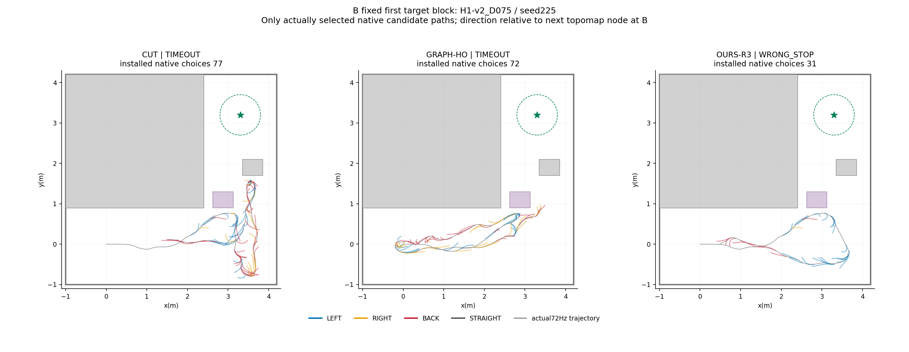
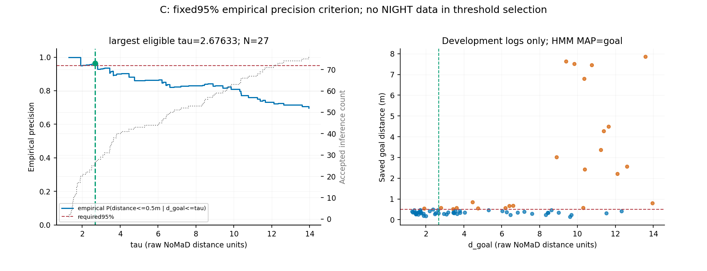

# NIGHT 로그 진단 — 20261111

범위는 A·B·C뿐이다. E1(D075)·E3(D150) 저장결과를 사용했다. 시뮬레이션·solver·EC 재검사·HMM 재생은 없고 기존 성공/실패/통과 수는 수정하지 않았다. E2는 이 분석에서 제외했다(잘못된 도착21건=E1 14+E3 7).

## A. R3 trigger153건의 처리 결과

| 지연 | 트리거 | 적용 | 해 없음 | 인증 실패 | EC 거절 | 새 chunk에 밀림 | 계산 늦음 | 기타 | 적용지연_p50_s | 적용지연_p95_s |
|---|---|---|---|---|---|---|---|---|---|---|
| D075 | 53 | 15 | 35 | 2 | 1 | 0 | 0 | 0 | 0.4444 | 0.7 |
| D150 | 100 | 24 | 72 | 1 | 3 | 0 | 0 | 0 | 0.4444 | 0.6667 |

분류 우선순위: APPLIED 기록 → SUPERSEDED → TIMEOUT/LATE → 수치 수락 해가 있지만 EC가 전부 거절 → APPLICATION_UNSAFE 또는 수렴·제약 통과 뒤 certificate 실패 → 허용 해 없음(비수렴/진전 미달 포함) → 기타. 실패한 초기값의 certificate=False만으로 job을 인증 실패라 세지 않는다. 최종 적용 여부를 기준으로 trigger마다 한 범주만 부여했다. 적용 지연은 저장 simulation_time_s의 APPLIED−TRIGGER이며 적용된15/24건만 p50/p95에 포함한다.

### 적용된 우회의 상자 통과와 시간상 연관

| 지연 | 적용 | 실행중통과 | 넘김후다음우회전통과 | 미통과 | 해당상자없음 |
|---|---|---|---|---|---|
| D075 | 15 | 1 | 7 | 3 | 4 |
| D150 | 24 | 0 | 8 | 6 | 10 |

적용 시 이미 출현했고 아직 통과하지 않은 상자만 대상이다. `R3_ACTIVE_PASS`는 적용 이후~저장 END(없으면run종료) 사이에 통과한 경우, `AFTER_HANDOVER_PASS`는 END 뒤~다음 R3 적용/run종료 사이에 통과한 경우다. 둘 다 없으면 미통과, 대상 상자가 없으면 N/A다. **이는 로그의 시간상 동반 여부이며, 우회를 쓰지 않았을 반사실이 없어 인과적 기여를 확정하지 않는다.**

| 지연 | run | job | 적용_s | 종료_s | 종료사유 | 적용시_미통과상자 | 실행중_통과상자 | 넘김후_다음우회전_통과상자 | 관측연관 |
|---|---|---|---|---|---|---|---|---|---|
| D075 | H1-v2_D075_225_OURS-R3 | 0 | 19.67 | 20 | PATH_BECAME_UNSAFE | 1 |  |  | NO_OBSERVED_PASS |
| D075 | H1-v2_D075_225_OURS-R3 | 1 | 23.56 | 26.33 | PATH_BECAME_UNSAFE | 1 |  |  | NO_OBSERVED_PASS |
| D075 | H1-v2_D075_226_OURS-R3 | 0 | 26 | 26.33 | PATH_BECAME_UNSAFE | 1 |  | 1 | AFTER_HANDOVER_PASS |
| D075 | H1-v2_D075_226_OURS-R3 | 11 | 74.22 | 74.33 | PATH_BECAME_UNSAFE |  |  |  | NO_UNPASSED_SPAWNED_BOX |
| D075 | H1-v2_D075_226_OURS-R3 | 12 | 77.78 | 78.33 | PATH_BECAME_UNSAFE |  |  |  | NO_UNPASSED_SPAWNED_BOX |
| D075 | H1_D075_225_OURS-R3 | 5 | 26.56 | 27.56 | PATH_BECAME_UNSAFE | 1 |  |  | NO_OBSERVED_PASS |
| D075 | H1_D075_225_OURS-R3 | 7 | 28.78 | 30.57 | RUN_END_NO_END_RECORD | 1 | 1 |  | R3_ACTIVE_PASS |
| D075 | H2_D075_225_OURS-R3 | 1 | 18.78 | 21.33 | PATH_BECAME_UNSAFE | 1 |  | 1 | AFTER_HANDOVER_PASS |
| D075 | H2_D075_225_OURS-R3 | 2 | 37.11 | 39 | PATH_BECAME_UNSAFE | 2 |  | 2 | AFTER_HANDOVER_PASS |
| D075 | H2_D075_226_OURS-R3 | 1 | 18.44 | 19.44 | NO_NEW_OBSTACLE_AHEAD | 1 |  | 1 | AFTER_HANDOVER_PASS |
| D075 | H2_D075_226_OURS-R3 | 2 | 33.89 | 36.11 | NO_NEW_OBSTACLE_AHEAD | 2 |  | 2 | AFTER_HANDOVER_PASS |
| D075 | L2_D075_225_OURS-R3 | 3 | 23.22 | 23.89 | NO_NEW_OBSTACLE_AHEAD | 1 |  | 1 | AFTER_HANDOVER_PASS |
| D075 | L2_D075_226_OURS-R3 | 0 | 14.33 | 17 | PATH_BECAME_UNSAFE | 1 |  | 1 | AFTER_HANDOVER_PASS |
| D075 | LC_D075_225_OURS-R3 | 0 | 19.56 | 21.33 | PATH_BECAME_UNSAFE |  |  |  | NO_UNPASSED_SPAWNED_BOX |
| D075 | LC_D075_226_OURS-R3 | 0 | 20.78 | 22.33 | PATH_BECAME_UNSAFE |  |  |  | NO_UNPASSED_SPAWNED_BOX |
| D150 | H1-v2_D150_225_OURS-R3 | 0 | 21.78 | 24.33 | PATH_BECAME_UNSAFE | 1 |  |  | NO_OBSERVED_PASS |
| D150 | H1-v2_D150_225_OURS-R3 | 3 | 30.22 | 32.56 | PATH_BECAME_UNSAFE | 1 |  | 1 | AFTER_HANDOVER_PASS |
| D150 | H1-v2_D150_225_OURS-R3 | 29 | 86.67 | 88 | PATH_BECAME_UNSAFE |  |  |  | NO_UNPASSED_SPAWNED_BOX |
| D150 | H1-v2_D150_226_OURS-R3 | 0 | 21.78 | 22.78 | NO_NEW_OBSTACLE_AHEAD | 1 |  |  | NO_OBSERVED_PASS |
| D150 | H1-v2_D150_226_OURS-R3 | 2 | 32.33 | 34.78 | PATH_BECAME_UNSAFE | 1 |  | 1 | AFTER_HANDOVER_PASS |
| D150 | H1_D150_225_OURS-R3 | 9 | 58.67 | 59.11 | NO_NEW_OBSTACLE_AHEAD | 1 |  | 1 | AFTER_HANDOVER_PASS |
| D150 | H1_D150_226_OURS-R3 | 6 | 57 | 57.44 | NO_NEW_OBSTACLE_AHEAD | 1 |  | 1 | AFTER_HANDOVER_PASS |
| D150 | H2_D150_225_OURS-R3 | 0 | 20.44 | 21 | PATH_BECAME_UNSAFE | 1 |  |  | NO_OBSERVED_PASS |
| D150 | H2_D150_225_OURS-R3 | 1 | 24.44 | 25.67 | NO_NEW_OBSTACLE_AHEAD | 1 |  | 1 | AFTER_HANDOVER_PASS |
| D150 | H2_D150_225_OURS-R3 | 2 | 44.22 | 46.33 | PATH_BECAME_UNSAFE | 2 |  | 2 | AFTER_HANDOVER_PASS |
| D150 | H2_D150_226_OURS-R3 | 2 | 29.78 | 32.33 | PATH_BECAME_UNSAFE | 1 |  |  | NO_OBSERVED_PASS |
| D150 | L2_D150_225_OURS-R3 | 0 | 20 | 22.56 | PATH_BECAME_UNSAFE | 1 |  |  | NO_OBSERVED_PASS |
| D150 | L2_D150_225_OURS-R3 | 1 | 26.22 | 26.44 | NO_NEW_OBSTACLE_AHEAD | 1 |  | 1 | AFTER_HANDOVER_PASS |
| D150 | L2_D150_226_OURS-R3 | 0 | 21.78 | 24.56 | PATH_BECAME_UNSAFE | 1 |  |  | NO_OBSERVED_PASS |
| D150 | L2_D150_226_OURS-R3 | 2 | 25.33 | 25.56 | PATH_BECAME_UNSAFE | 1 |  | 1 | AFTER_HANDOVER_PASS |
| D150 | L2_D150_226_OURS-R3 | 3 | 41.78 | 43.56 | PATH_BECAME_UNSAFE |  |  |  | NO_UNPASSED_SPAWNED_BOX |
| D150 | L2_D150_226_OURS-R3 | 4 | 46.89 | 49.56 | PATH_BECAME_UNSAFE |  |  |  | NO_UNPASSED_SPAWNED_BOX |
| D150 | LC_D150_225_OURS-R3 | 0 | 32.67 | 34.33 | PATH_BECAME_UNSAFE |  |  |  | NO_UNPASSED_SPAWNED_BOX |
| D150 | LC_D150_225_OURS-R3 | 1 | 38 | 38.67 | NO_NEW_OBSTACLE_AHEAD |  |  |  | NO_UNPASSED_SPAWNED_BOX |
| D150 | LC_D150_226_OURS-R3 | 0 | 29.11 | 30.78 | PATH_BECAME_UNSAFE |  |  |  | NO_UNPASSED_SPAWNED_BOX |
| D150 | SLW_D150_225_OURS-R3 | 11 | 37.44 | 40 | PATH_BECAME_UNSAFE |  |  |  | NO_UNPASSED_SPAWNED_BOX |
| D150 | SLW_D150_225_OURS-R3 | 12 | 43.67 | 44.11 | NO_NEW_OBSTACLE_AHEAD |  |  |  | NO_UNPASSED_SPAWNED_BOX |
| D150 | SLW_D150_225_OURS-R3 | 15 | 80.67 | 81.33 | NO_NEW_OBSTACLE_AHEAD |  |  |  | NO_UNPASSED_SPAWNED_BOX |
| D150 | SLW_D150_226_OURS-R3 | 30 | 88.89 | 89 | PATH_BECAME_UNSAFE |  |  |  | NO_UNPASSED_SPAWNED_BOX |

A 전체153 trigger 원장

| 지연 | run | job | trigger | trigger_s | 결과 | raw_disposition | 적용지연_s | numeric_accepted | EC_tested |
|---|---|---|---|---|---|---|---|---|---|
| D075 | H1-v2_D075_225_OURS-R3 | 0 | B | 19.33 | 적용 | ACCEPTED | 0.3333 | 4 | 4 |
| D075 | H1-v2_D075_225_OURS-R3 | 1 | B | 23 | 적용 | ACCEPTED | 0.5556 | 3 | 3 |
| D075 | H1-v2_D075_225_OURS-R3 | 2 | B | 29.33 | 해 없음 | REJECTED | — | 0 | 0 |
| D075 | H1-v2_D075_225_OURS-R3 | 3 | B | 32.78 | 해 없음 | REJECTED | — | 0 | 0 |
| D075 | H1-v2_D075_226_OURS-R3 | 0 | B | 25.56 | 적용 | ACCEPTED | 0.4444 | 2 | 2 |
| D075 | H1-v2_D075_226_OURS-R3 | 1 | B | 29.33 | 해 없음 | REJECTED | — | 0 | 0 |
| D075 | H1-v2_D075_226_OURS-R3 | 2 | B | 32.78 | 해 없음 | REJECTED | — | 0 | 0 |
| D075 | H1-v2_D075_226_OURS-R3 | 3 | B | 36.89 | 해 없음 | REJECTED | — | 0 | 0 |
| D075 | H1-v2_D075_226_OURS-R3 | 4 | B | 40.33 | 해 없음 | REJECTED | — | 0 | 0 |
| D075 | H1-v2_D075_226_OURS-R3 | 5 | B | 43.78 | 해 없음 | REJECTED | — | 0 | 0 |
| D075 | H1-v2_D075_226_OURS-R3 | 6 | B | 47.33 | 해 없음 | REJECTED | — | 0 | 0 |
| D075 | H1-v2_D075_226_OURS-R3 | 7 | B | 50.78 | 해 없음 | REJECTED | — | 0 | 0 |
| D075 | H1-v2_D075_226_OURS-R3 | 8 | B | 54.33 | 해 없음 | REJECTED | — | 0 | 0 |
| D075 | H1-v2_D075_226_OURS-R3 | 9 | B | 57.89 | 해 없음 | REJECTED | — | 0 | 0 |
| D075 | H1-v2_D075_226_OURS-R3 | 10 | B | 61.44 | 해 없음 | REJECTED | — | 0 | 0 |
| D075 | H1-v2_D075_226_OURS-R3 | 11 | B | 73.78 | 적용 | ACCEPTED | 0.4444 | 4 | 4 |
| D075 | H1-v2_D075_226_OURS-R3 | 12 | B | 77.33 | 적용 | ACCEPTED | 0.4444 | 2 | 2 |
| D075 | H1-v2_D075_226_OURS-R3 | 13 | B | 81.33 | 해 없음 | REJECTED | — | 0 | 0 |
| D075 | H1-v2_D075_226_OURS-R3 | 14 | B | 85.33 | 해 없음 | REJECTED | — | 0 | 0 |
| D075 | H1-v2_D075_226_OURS-R3 | 15 | B | 88.89 | 해 없음 | REJECTED | — | 0 | 0 |
| D075 | H1_D075_225_OURS-R3 | 0 | B | 19 | 해 없음 | REJECTED | — | 0 | 0 |
| D075 | H1_D075_225_OURS-R3 | 1 | B | 22.44 | 해 없음 | REJECTED | — | 0 | 0 |
| D075 | H1_D075_225_OURS-R3 | 5 | A | 25.89 | 적용 | ACCEPTED | 0.6667 | 2 | 2 |
| D075 | H1_D075_225_OURS-R3 | 7 | A | 28 | 적용 | ACCEPTED | 0.7778 | 3 | 3 |
| D075 | H1_D075_226_OURS-R3 | 0 | B | 20.56 | 해 없음 | REJECTED | — | 0 | 0 |
| D075 | H1_D075_226_OURS-R3 | 1 | B | 24.11 | 해 없음 | REJECTED | — | 0 | 0 |
| D075 | H2_D075_225_OURS-R3 | 0 | B | 14.89 | 해 없음 | REJECTED | — | 0 | 0 |
| D075 | H2_D075_225_OURS-R3 | 1 | B | 18.33 | 적용 | ACCEPTED | 0.4444 | 5 | 5 |
| D075 | H2_D075_225_OURS-R3 | 2 | B | 36.56 | 적용 | ACCEPTED | 0.5556 | 6 | 6 |
| D075 | H2_D075_226_OURS-R3 | 1 | B | 17.78 | 적용 | ACCEPTED | 0.6667 | 4 | 4 |
| D075 | H2_D075_226_OURS-R3 | 2 | B | 33.33 | 적용 | ACCEPTED | 0.5556 | 3 | 3 |
| D075 | L2_D075_225_OURS-R3 | 1 | A | 19.22 | EC 거절 | REJECTED | — | 3 | 3 |
| D075 | L2_D075_225_OURS-R3 | 3 | B | 22.78 | 적용 | ACCEPTED | 0.4444 | 6 | 6 |
| D075 | L2_D075_226_OURS-R3 | 0 | B | 13.89 | 적용 | ACCEPTED | 0.4444 | 5 | 5 |
| D075 | LC_D075_225_OURS-R3 | 0 | B | 19.11 | 적용 | ACCEPTED | 0.4444 | 2 | 2 |
| D075 | LC_D075_226_OURS-R3 | 0 | B | 20.33 | 적용 | ACCEPTED | 0.4444 | 2 | 2 |
| D075 | SLW_D075_225_OURS-R3 | 0 | B | 12.89 | 해 없음 | REJECTED | — | 0 | 0 |
| D075 | SLW_D075_225_OURS-R3 | 1 | B | 18.56 | 해 없음 | REJECTED | — | 0 | 0 |
| D075 | SLW_D075_225_OURS-R3 | 2 | B | 22.22 | 해 없음 | REJECTED | — | 0 | 0 |
| D075 | SLW_D075_225_OURS-R3 | 3 | B | 26.67 | 해 없음 | REJECTED | — | 0 | 0 |
| D075 | SLW_D075_225_OURS-R3 | 4 | B | 30.11 | 해 없음 | REJECTED | — | 0 | 0 |
| D075 | SLW_D075_225_OURS-R3 | 5 | B | 33.67 | 해 없음 | REJECTED | — | 0 | 0 |
| D075 | SLW_D075_225_OURS-R3 | 6 | B | 39.33 | 해 없음 | REJECTED | — | 0 | 0 |
| D075 | SLW_D075_225_OURS-R3 | 7 | B | 43 | 해 없음 | REJECTED | — | 0 | 0 |
| D075 | SLW_D075_225_OURS-R3 | 8 | B | 46.89 | 해 없음 | REJECTED | — | 0 | 0 |
| D075 | SLW_D075_226_OURS-R3 | 1 | A | 10.22 | 인증 실패 | APPLICATION_UNSAFE | — | 3 | 3 |
| D075 | SLW_D075_226_OURS-R3 | 3 | A | 11.11 | 인증 실패 | APPLICATION_UNSAFE | — | 1 | 1 |
| D075 | SLW_D075_226_OURS-R3 | 7 | B | 17.78 | 해 없음 | REJECTED | — | 0 | 0 |
| D075 | SLW_D075_226_OURS-R3 | 8 | B | 21.33 | 해 없음 | REJECTED | — | 0 | 0 |
| D075 | SLW_D075_226_OURS-R3 | 9 | B | 24.89 | 해 없음 | REJECTED | — | 0 | 0 |
| D075 | SLW_D075_226_OURS-R3 | 11 | A | 29.11 | 해 없음 | REJECTED | — | 0 | 0 |
| D075 | SLW_D075_226_OURS-R3 | 13 | A | 32.11 | 해 없음 | REJECTED | — | 0 | 0 |
| D075 | SLW_D075_226_OURS-R3 | 14 | B | 35.78 | 해 없음 | REJECTED | — | 0 | 0 |
| D150 | H1-v2_D150_225_OURS-R3 | 0 | B | 21.33 | 적용 | ACCEPTED | 0.4444 | 5 | 5 |
| D150 | H1-v2_D150_225_OURS-R3 | 3 | B | 29.78 | 적용 | ACCEPTED | 0.4444 | 3 | 3 |
| D150 | H1-v2_D150_225_OURS-R3 | 4 | B | 35.56 | 해 없음 | REJECTED | — | 0 | 0 |
| D150 | H1-v2_D150_225_OURS-R3 | 5 | B | 39.11 | 해 없음 | REJECTED | — | 0 | 0 |
| D150 | H1-v2_D150_225_OURS-R3 | 6 | B | 42.56 | 해 없음 | REJECTED | — | 0 | 0 |
| D150 | H1-v2_D150_225_OURS-R3 | 8 | A | 45.44 | 해 없음 | REJECTED | — | 0 | 0 |
| D150 | H1-v2_D150_225_OURS-R3 | 10 | A | 47.11 | 해 없음 | REJECTED | — | 0 | 0 |
| D150 | H1-v2_D150_225_OURS-R3 | 12 | A | 50.56 | 해 없음 | REJECTED | — | 0 | 0 |
| D150 | H1-v2_D150_225_OURS-R3 | 14 | A | 52.33 | 해 없음 | REJECTED | — | 0 | 0 |
| D150 | H1-v2_D150_225_OURS-R3 | 16 | B | 56.11 | 해 없음 | REJECTED | — | 0 | 0 |
| D150 | H1-v2_D150_225_OURS-R3 | 17 | B | 59.89 | 해 없음 | REJECTED | — | 0 | 0 |
| D150 | H1-v2_D150_225_OURS-R3 | 19 | B | 63.67 | 해 없음 | REJECTED | — | 0 | 0 |
| D150 | H1-v2_D150_225_OURS-R3 | 20 | B | 67.56 | 해 없음 | REJECTED | — | 0 | 0 |
| D150 | H1-v2_D150_225_OURS-R3 | 22 | A | 69.89 | 해 없음 | REJECTED | — | 0 | 0 |
| D150 | H1-v2_D150_225_OURS-R3 | 24 | A | 73.33 | 해 없음 | REJECTED | — | 0 | 0 |
| D150 | H1-v2_D150_225_OURS-R3 | 26 | A | 75.11 | 해 없음 | REJECTED | — | 0 | 0 |
| D150 | H1-v2_D150_225_OURS-R3 | 27 | B | 78.67 | 해 없음 | REJECTED | — | 0 | 0 |
| D150 | H1-v2_D150_225_OURS-R3 | 28 | B | 82.44 | 해 없음 | REJECTED | — | 0 | 0 |
| D150 | H1-v2_D150_225_OURS-R3 | 29 | B | 86.11 | 적용 | ACCEPTED | 0.5556 | 3 | 3 |
| D150 | H1-v2_D150_226_OURS-R3 | 0 | B | 21.33 | 적용 | ACCEPTED | 0.4444 | 6 | 6 |
| D150 | H1-v2_D150_226_OURS-R3 | 1 | B | 28.44 | EC 거절 | REJECTED | — | 5 | 5 |
| D150 | H1-v2_D150_226_OURS-R3 | 2 | B | 31.89 | 적용 | ACCEPTED | 0.4444 | 2 | 2 |
| D150 | H1-v2_D150_226_OURS-R3 | 3 | B | 37.78 | 해 없음 | REJECTED | — | 0 | 0 |
| D150 | H1-v2_D150_226_OURS-R3 | 4 | B | 41.33 | 해 없음 | REJECTED | — | 0 | 0 |
| D150 | H1-v2_D150_226_OURS-R3 | 5 | B | 44.78 | 해 없음 | REJECTED | — | 0 | 0 |
| D150 | H1-v2_D150_226_OURS-R3 | 6 | B | 48.22 | 해 없음 | REJECTED | — | 0 | 0 |
| D150 | H1-v2_D150_226_OURS-R3 | 7 | B | 51.89 | 해 없음 | REJECTED | — | 0 | 0 |
| D150 | H1-v2_D150_226_OURS-R3 | 8 | B | 55.56 | 해 없음 | REJECTED | — | 0 | 0 |
| D150 | H1-v2_D150_226_OURS-R3 | 10 | A | 58 | 해 없음 | REJECTED | — | 0 | 0 |
| D150 | H1-v2_D150_226_OURS-R3 | 12 | A | 61.33 | 해 없음 | REJECTED | — | 0 | 0 |
| D150 | H1-v2_D150_226_OURS-R3 | 13 | B | 65 | 해 없음 | REJECTED | — | 0 | 0 |
| D150 | H1-v2_D150_226_OURS-R3 | 14 | B | 68.78 | 해 없음 | REJECTED | — | 0 | 0 |
| D150 | H1-v2_D150_226_OURS-R3 | 15 | B | 72.56 | 해 없음 | REJECTED | — | 0 | 0 |
| D150 | H1-v2_D150_226_OURS-R3 | 19 | A | 84.22 | 해 없음 | REJECTED | — | 0 | 0 |
| D150 | H1-v2_D150_226_OURS-R3 | 21 | A | 85.89 | 해 없음 | REJECTED | — | 0 | 0 |
| D150 | H1_D150_225_OURS-R3 | 0 | B | 39 | 해 없음 | REJECTED | — | 0 | 0 |
| D150 | H1_D150_225_OURS-R3 | 1 | B | 42.56 | 해 없음 | REJECTED | — | 0 | 0 |
| D150 | H1_D150_225_OURS-R3 | 2 | B | 46 | 해 없음 | REJECTED | — | 0 | 0 |
| D150 | H1_D150_225_OURS-R3 | 4 | A | 48.89 | EC 거절 | REJECTED | — | 2 | 2 |
| D150 | H1_D150_225_OURS-R3 | 6 | A | 50.78 | EC 거절 | REJECTED | — | 2 | 2 |
| D150 | H1_D150_225_OURS-R3 | 8 | B | 54.56 | 해 없음 | REJECTED | — | 0 | 0 |
| D150 | H1_D150_225_OURS-R3 | 9 | B | 58.22 | 적용 | ACCEPTED | 0.4444 | 6 | 6 |
| D150 | H1_D150_226_OURS-R3 | 0 | B | 39.67 | 해 없음 | REJECTED | — | 0 | 0 |
| D150 | H1_D150_226_OURS-R3 | 1 | B | 43.11 | 해 없음 | REJECTED | — | 0 | 0 |
| D150 | H1_D150_226_OURS-R3 | 2 | B | 46.78 | 해 없음 | REJECTED | — | 0 | 0 |
| D150 | H1_D150_226_OURS-R3 | 4 | A | 49.33 | 해 없음 | REJECTED | — | 0 | 0 |
| D150 | H1_D150_226_OURS-R3 | 5 | B | 53 | 해 없음 | REJECTED | — | 0 | 0 |
| D150 | H1_D150_226_OURS-R3 | 6 | B | 56.56 | 적용 | ACCEPTED | 0.4444 | 5 | 5 |
| D150 | H2_D150_225_OURS-R3 | 0 | B | 19.89 | 적용 | ACCEPTED | 0.5556 | 4 | 4 |
| D150 | H2_D150_225_OURS-R3 | 1 | B | 24 | 적용 | ACCEPTED | 0.4444 | 5 | 5 |
| D150 | H2_D150_225_OURS-R3 | 2 | B | 43.67 | 적용 | ACCEPTED | 0.5556 | 5 | 5 |
| D150 | H2_D150_226_OURS-R3 | 0 | B | 22.22 | 해 없음 | REJECTED | — | 0 | 0 |
| D150 | H2_D150_226_OURS-R3 | 1 | B | 25.67 | 해 없음 | REJECTED | — | 0 | 0 |
| D150 | H2_D150_226_OURS-R3 | 2 | B | 29.22 | 적용 | ACCEPTED | 0.5556 | 1 | 1 |
| D150 | H2_D150_226_OURS-R3 | 3 | B | 35.33 | 해 없음 | REJECTED | — | 0 | 0 |
| D150 | H2_D150_226_OURS-R3 | 4 | B | 39.78 | 해 없음 | REJECTED | — | 0 | 0 |
| D150 | H2_D150_226_OURS-R3 | 5 | B | 43.44 | 해 없음 | REJECTED | — | 0 | 0 |
| D150 | H2_D150_226_OURS-R3 | 6 | B | 47.22 | 해 없음 | REJECTED | — | 0 | 0 |
| D150 | L2_D150_225_OURS-R3 | 0 | B | 19.56 | 적용 | ACCEPTED | 0.4444 | 6 | 6 |
| D150 | L2_D150_225_OURS-R3 | 1 | B | 25.56 | 적용 | ACCEPTED | 0.6667 | 3 | 3 |
| D150 | L2_D150_226_OURS-R3 | 0 | B | 21.33 | 적용 | ACCEPTED | 0.4444 | 4 | 4 |
| D150 | L2_D150_226_OURS-R3 | 2 | A | 24.89 | 적용 | ACCEPTED | 0.4444 | 4 | 4 |
| D150 | L2_D150_226_OURS-R3 | 3 | B | 41.33 | 적용 | ACCEPTED | 0.4444 | 6 | 6 |
| D150 | L2_D150_226_OURS-R3 | 4 | B | 46.56 | 적용 | ACCEPTED | 0.3333 | 7 | 7 |
| D150 | LC_D150_225_OURS-R3 | 0 | B | 32.22 | 적용 | ACCEPTED | 0.4444 | 3 | 3 |
| D150 | LC_D150_225_OURS-R3 | 1 | B | 37.33 | 적용 | ACCEPTED | 0.6667 | 4 | 4 |
| D150 | LC_D150_226_OURS-R3 | 0 | B | 28.67 | 적용 | ACCEPTED | 0.4444 | 2 | 2 |
| D150 | LC_D150_226_OURS-R3 | 1 | B | 33.78 | 인증 실패 | APPLICATION_UNSAFE | — | 3 | 3 |
| D150 | SLW_D150_225_OURS-R3 | 1 | A | 16.22 | 해 없음 | REJECTED | — | 0 | 0 |
| D150 | SLW_D150_225_OURS-R3 | 2 | B | 19.78 | 해 없음 | REJECTED | — | 0 | 0 |
| D150 | SLW_D150_225_OURS-R3 | 3 | B | 23.22 | 해 없음 | REJECTED | — | 0 | 0 |
| D150 | SLW_D150_225_OURS-R3 | 7 | A | 28.11 | 해 없음 | REJECTED | — | 0 | 0 |
| D150 | SLW_D150_225_OURS-R3 | 9 | A | 29.89 | 해 없음 | REJECTED | — | 0 | 0 |
| D150 | SLW_D150_225_OURS-R3 | 10 | B | 33.33 | 해 없음 | REJECTED | — | 0 | 0 |
| D150 | SLW_D150_225_OURS-R3 | 11 | B | 36.89 | 적용 | ACCEPTED | 0.5556 | 3 | 3 |
| D150 | SLW_D150_225_OURS-R3 | 12 | B | 43 | 적용 | ACCEPTED | 0.6667 | 2 | 2 |
| D150 | SLW_D150_225_OURS-R3 | 13 | B | 73 | 해 없음 | REJECTED | — | 0 | 0 |
| D150 | SLW_D150_225_OURS-R3 | 14 | B | 76.67 | 해 없음 | REJECTED | — | 0 | 0 |
| D150 | SLW_D150_225_OURS-R3 | 15 | B | 80.11 | 적용 | ACCEPTED | 0.5556 | 2 | 2 |
| D150 | SLW_D150_226_OURS-R3 | 1 | B | 18 | 해 없음 | REJECTED | — | 0 | 0 |
| D150 | SLW_D150_226_OURS-R3 | 3 | A | 24.89 | 해 없음 | REJECTED | — | 0 | 0 |
| D150 | SLW_D150_226_OURS-R3 | 5 | A | 28.44 | 해 없음 | REJECTED | — | 0 | 0 |
| D150 | SLW_D150_226_OURS-R3 | 7 | A | 30.22 | 해 없음 | REJECTED | — | 0 | 0 |
| D150 | SLW_D150_226_OURS-R3 | 9 | A | 33.67 | 해 없음 | REJECTED | — | 0 | 0 |
| D150 | SLW_D150_226_OURS-R3 | 11 | A | 37.22 | 해 없음 | REJECTED | — | 0 | 0 |
| D150 | SLW_D150_226_OURS-R3 | 12 | B | 41.44 | 해 없음 | REJECTED | — | 0 | 0 |
| D150 | SLW_D150_226_OURS-R3 | 14 | A | 42.44 | 해 없음 | REJECTED | — | 0 | 0 |
| D150 | SLW_D150_226_OURS-R3 | 16 | A | 45.56 | 해 없음 | REJECTED | — | 0 | 0 |
| D150 | SLW_D150_226_OURS-R3 | 18 | B | 49 | 해 없음 | REJECTED | — | 0 | 0 |
| D150 | SLW_D150_226_OURS-R3 | 20 | B | 52.44 | 해 없음 | REJECTED | — | 0 | 0 |
| D150 | SLW_D150_226_OURS-R3 | 21 | B | 56.11 | 해 없음 | REJECTED | — | 0 | 0 |
| D150 | SLW_D150_226_OURS-R3 | 22 | B | 59.56 | 해 없음 | REJECTED | — | 0 | 0 |
| D150 | SLW_D150_226_OURS-R3 | 23 | B | 63.11 | 해 없음 | REJECTED | — | 0 | 0 |
| D150 | SLW_D150_226_OURS-R3 | 24 | B | 66.56 | 해 없음 | REJECTED | — | 0 | 0 |
| D150 | SLW_D150_226_OURS-R3 | 25 | B | 70 | 해 없음 | REJECTED | — | 0 | 0 |
| D150 | SLW_D150_226_OURS-R3 | 26 | B | 73.89 | 해 없음 | REJECTED | — | 0 | 0 |
| D150 | SLW_D150_226_OURS-R3 | 27 | B | 77.56 | 해 없음 | REJECTED | — | 0 | 0 |
| D150 | SLW_D150_226_OURS-R3 | 28 | B | 81.22 | 해 없음 | REJECTED | — | 0 | 0 |
| D150 | SLW_D150_226_OURS-R3 | 29 | B | 84.89 | 해 없음 | REJECTED | — | 0 | 0 |
| D150 | SLW_D150_226_OURS-R3 | 30 | B | 88.44 | 적용 | ACCEPTED | 0.4444 | 3 | 3 |

## B. 상자 미통과 시간초과와 같은 블록 비교

대상은 기존 primary_cause=DETOUR_FAIL AND classification=TIMEOUT AND box_passage=False인13run, 해당9블록의 세 방법27run이다. 예시는 결과로 고르지 않고 E1→E3, 블록명·seed 정렬의 첫 블록 **H1-v2_D075 / 225**로 고정했다.

첫 상자 출현 이후 controller에 전달된 chunk를 모두 센다(종료 후 미적용 결과 제외). 각 후보의 진행 방향은 현재 FRESH 적용 B(미적용이면 저장 latch pose)→원 후보 끝점, 기준은 B→min(로그 HMM closest+1,goal) Topomap node다. 각도는−180~180°, 좌양수/우음수, |각도|>90°는뒤. 영벡터는미정. 선택각도는 EC가 실제 설치한 원 후보 index이며, KEEP/R3/회복 등으로 새 후보를 설치하지 않은 chunk는NONE으로 둔다. 실제 선택이 연속한두chunk에서LEFT↔RIGHT일 때만 전환을 센다(BACK/NONE은연속을끊음). Graph 보정 경로를 원후보로 오인하지 않는다.

depth SAFE 수는 저장 selection.candidates의8개 판정이다. EC는 조기 종료하므로8개 모두의 판정이 보존된 것이 아니다. 같은 적용tick의 INSTALL 검사에서 원 후보 path hash를 연결했다. world좌표 변환의 NumPy 마지막비트 차이는 저장된 원후보 좌표와1e−12m 이내인 경우 해당 저장path hash를 연결해 처리했다. 좌표가 없는 미매칭 검사 경로 수는 별도 표기하며, EC검사/PASS후보수는 식별된 것의 하한, SAFE미검사는상한이다. 전속도/0.1m/s PASS는 구분하고 전체 PASS는 합집합이다. 검사되지 않은SAFE는 **미검사**, 선택을보류해depth판정이없는chunk는—이다. 새 EC 계산으로 빈 값을 메우지 않았다.

| 지연 | run | 역할 | 분류 | 상자통과 | 출현후chunk | 각도표본 | 후보_abs20미만 | 후보_20to45 | 후보_45to90 | 후보_90초과 | 후보_abs각도_p50 | 후보_abs각도_p95 | depth_SAFE중앙값 | EC검사후보합 | EC_PASS관측합 | EC_미매칭경로합 | SAFE_EC미검사_상한합 | 선택chunk | 좌선택 | 우선택 | 뒤선택 | 좌우전환 | 선택없음 | 첫spawn_s |
|---|---|---|---|---|---|---|---|---|---|---|---|---|---|---|---|---|---|---|---|---|---|---|---|---|
| D075 | H1-v2_D075_225_CUT | 같은블록비교 | TIMEOUT | True | 79 | 632 | 65 | 136 | 189 | 242 | 71.98 | 149.4 | 8 | 82 | 77 | 0 | 480 | 77 | 29 | 17 | 31 | 12 | 2 | 12.56 |
| D075 | H1-v2_D075_225_GRAPH-HO | DETOUR_FAIL | TIMEOUT | False | 77 | 616 | 168 | 139 | 109 | 200 | 45.59 | 170.1 | 8 | 88 | 72 | 2 | 472 | 72 | 21 | 25 | 26 | 15 | 5 | 13.75 |
| D075 | H1-v2_D075_225_OURS-R3 | 같은블록비교 | WRONG_STOP | False | 36 | 288 | 31 | 63 | 122 | 72 | 62.1 | 156.9 | 8 | 32 | 31 | 1 | 208 | 31 | 21 | 1 | 9 | 2 | 5 | 12.67 |
| D075 | H2_D075_225_CUT | DETOUR_FAIL | TIMEOUT | False | 81 | 648 | 154 | 112 | 158 | 224 | 60.1 | 162.2 | 8 | 82 | 79 | 2 | 541 | 79 | 29 | 22 | 28 | 23 | 2 | 10.17 |
| D075 | H2_D075_225_GRAPH-HO | DETOUR_FAIL | TIMEOUT | False | 81 | 648 | 71 | 85 | 115 | 377 | 110.8 | 175.3 | 8 | 84 | 79 | 13 | 532 | 79 | 10 | 25 | 44 | 4 | 2 | 10.74 |
| D075 | H2_D075_225_OURS-R3 | 같은블록비교 | WRONG_STOP | True | 38 | 304 | 13 | 41 | 125 | 125 | 76.55 | 161.2 | 8 | 33 | 33 | 0 | 224 | 33 | 18 | 2 | 13 | 2 | 5 | 10.36 |
| D075 | H2_D075_226_CUT | DETOUR_FAIL | TIMEOUT | False | 81 | 648 | 120 | 98 | 186 | 244 | 73.94 | 167.3 | 8 | 82 | 74 | 7 | 502 | 74 | 21 | 31 | 22 | 10 | 7 | 10.22 |
| D075 | H2_D075_226_GRAPH-HO | 같은블록비교 | SUCCESS | True | 65 | 520 | 88 | 167 | 149 | 116 | 45.57 | 155.1 | 8 | 66 | 64 | 0 | 433 | 64 | 28 | 20 | 16 | 10 | 1 | 10.11 |
| D075 | H2_D075_226_OURS-R3 | 같은블록비교 | WRONG_STOP | True | 41 | 328 | 93 | 101 | 85 | 49 | 39.94 | 147.3 | 8 | 42 | 37 | 6 | 248 | 37 | 16 | 19 | 2 | 5 | 4 | 10.51 |
| D150 | H1-v2_D150_226_CUT | DETOUR_FAIL | TIMEOUT | False | 40 | 320 | 27 | 61 | 112 | 120 | 74.43 | 166.1 | 8 | 43 | 40 | 0 | 263 | 40 | 9 | 14 | 17 | 3 | 0 | 20.72 |
| D150 | H1-v2_D150_226_GRAPH-HO | 같은블록비교 | WRONG_STOP | False | 11 | 88 | 20 | 18 | 10 | 40 | 86.26 | 177.9 | 8 | 12 | 11 | 0 | 59 | 11 | 3 | 2 | 6 | 0 | 0 | 23.53 |
| D150 | H1-v2_D150_226_OURS-R3 | 같은블록비교 | TIMEOUT | True | 42 | 336 | 57 | 60 | 91 | 128 | 73.84 | 157.9 | 8 | 46 | 29 | 2 | 157 | 29 | 9 | 11 | 9 | 2 | 13 | 16.96 |
| D150 | H1_D150_225_CUT | 같은블록비교 | SUCCESS | True | 10 | 80 | 38 | 17 | 6 | 19 | 23.24 | 137.3 | 8 | 11 | 10 | 0 | 62 | 10 | 7 | 1 | 2 | 1 | 0 | 32.68 |
| D150 | H1_D150_225_GRAPH-HO | DETOUR_FAIL | TIMEOUT | False | 23 | 184 | 97 | 33 | 29 | 25 | 17.46 | 130.7 | 0 | 18 | 7 | 0 | 23 | 7 | 1 | 5 | 1 | 0 | 16 | 49.35 |
| D150 | H1_D150_225_OURS-R3 | 같은블록비교 | WRONG_STOP | True | 13 | 104 | 60 | 17 | 2 | 25 | 16.49 | 154.9 | 3.5 | 9 | 6 | 0 | 31 | 6 | 4 | 0 | 2 | 0 | 7 | 37.5 |
| D150 | H1_D150_226_CUT | 같은블록비교 | SUCCESS | True | 10 | 80 | 38 | 10 | 20 | 12 | 24.72 | 121.9 | 8 | 15 | 8 | 0 | 41 | 8 | 6 | 1 | 1 | 0 | 2 | 31.82 |
| D150 | H1_D150_226_GRAPH-HO | DETOUR_FAIL | TIMEOUT | False | 30 | 240 | 29 | 43 | 33 | 135 | 114.6 | 174.2 | 3 | 33 | 18 | 0 | 89 | 18 | 4 | 2 | 12 | 0 | 12 | 37.19 |
| D150 | H1_D150_226_OURS-R3 | 같은블록비교 | WRONG_STOP | True | 11 | 88 | 31 | 15 | 17 | 25 | 31.51 | 145.9 | 8 | 9 | 8 | 1 | 39 | 8 | 4 | 1 | 3 | 1 | 3 | 39.42 |
| D150 | H2_D150_225_CUT | DETOUR_FAIL | TIMEOUT | False | 44 | 352 | 48 | 71 | 84 | 149 | 77.15 | 151 | 8 | 43 | 38 | 2 | 236 | 38 | 11 | 14 | 13 | 7 | 6 | 15.24 |
| D150 | H2_D150_225_GRAPH-HO | DETOUR_FAIL | TIMEOUT | False | 42 | 336 | 13 | 30 | 82 | 211 | 106.9 | 172 | 8 | 48 | 38 | 15 | 265 | 38 | 9 | 5 | 24 | 1 | 4 | 16.89 |
| D150 | H2_D150_225_OURS-R3 | 같은블록비교 | SUCCESS | True | 27 | 216 | 27 | 25 | 76 | 88 | 70.79 | 163.3 | 8 | 24 | 24 | 0 | 168 | 24 | 12 | 2 | 10 | 1 | 3 | 14.11 |
| D150 | H2_D150_226_CUT | DETOUR_FAIL | TIMEOUT | False | 42 | 336 | 17 | 32 | 68 | 219 | 111.1 | 163.2 | 8 | 42 | 42 | 0 | 293 | 42 | 3 | 13 | 26 | 3 | 0 | 16.65 |
| D150 | H2_D150_226_GRAPH-HO | 같은블록비교 | SUCCESS | True | 37 | 296 | 53 | 98 | 88 | 57 | 44.88 | 146.2 | 8 | 39 | 34 | 2 | 233 | 34 | 14 | 13 | 7 | 4 | 3 | 16.6 |
| D150 | H2_D150_226_OURS-R3 | DETOUR_FAIL | TIMEOUT | False | 42 | 336 | 38 | 95 | 122 | 81 | 61.11 | 160.1 | 8 | 37 | 37 | 0 | 252 | 37 | 7 | 21 | 9 | 8 | 5 | 16.65 |
| D150 | L2_D150_226_CUT | DETOUR_FAIL | TIMEOUT | False | 42 | 336 | 33 | 85 | 79 | 139 | 61.22 | 171.6 | 8 | 44 | 39 | 2 | 259 | 39 | 14 | 10 | 15 | 5 | 3 | 16.43 |
| D150 | L2_D150_226_GRAPH-HO | DETOUR_FAIL | TIMEOUT | False | 42 | 336 | 48 | 88 | 55 | 145 | 63.4 | 176.3 | 8 | 42 | 35 | 0 | 235 | 35 | 6 | 18 | 11 | 6 | 7 | 16.44 |
| D150 | L2_D150_226_OURS-R3 | 같은블록비교 | WRONG_STOP | True | 28 | 224 | 26 | 38 | 62 | 98 | 80.94 | 160.6 | 8 | 23 | 23 | 0 | 161 | 23 | 9 | 4 | 10 | 2 | 5 | 16.03 |

B 출현 후 chunk별 원장:8후보 각도·depth/EC·실제 선택

| 지연 | run | chunk | 시각_s | B_x | B_y | next_node | 후보각도_0to7 | depth_SAFE | EC_검사후보 | EC_미매칭경로 | EC_PASS | EC_full_PASS | EC_slow_PASS | SAFE_EC미검사_상한 | 선택후보 | 선택각도 | 방향 | 좌우전환 | 설치경로 | 선택없음상태 |
|---|---|---|---|---|---|---|---|---|---|---|---|---|---|---|---|---|---|---|---|---|
| D075 | H1-v2_D075_225_CUT | 10 | 12.89 | 2.22 | 0.3161 | 7 | 46.4, 33.9, 59.2, 58.6, 13.2, 35.1, 39.5, 42.4 | 8 | 1 | 0 | 1 | 1 | 0 | 7 | 0 | 46.36 | LEFT | False | SAFE | — |
| D075 | H1-v2_D075_225_CUT | 11 | 13.89 | 2.298 | 0.3919 | 7 | -61.9, -32.3, -11.4, -48.3, -34.3, -34.1, -0.1, -20.4 | 8 | 1 | 0 | 1 | 1 | 0 | 7 | 7 | -20.42 | RIGHT | True | SAFE | — |
| D075 | H1-v2_D075_225_CUT | 12 | 14.89 | 2.345 | 0.4406 | 7 | 22.5, 8.2, 25.2, 14.8, 14.4, 6.5, 19.3, 16.4 | 8 | 1 | 0 | 1 | 1 | 0 | 7 | 0 | 22.48 | LEFT | True | SAFE | — |
| D075 | H1-v2_D075_225_CUT | 13 | 15.89 | 2.523 | 0.5841 | 7 | 45.5, 60.6, 48.1, 13.3, 49.4, 30.3, 51.5, 41.8 | 8 | 1 | 0 | 1 | 1 | 0 | 7 | 1 | 60.56 | LEFT | False | SAFE | — |
| D075 | H1-v2_D075_225_CUT | 14 | 16.89 | 2.783 | 0.7302 | 7 | 88.4, 50.8, 47.4, 94.1, 98.9, 26.3, 57.6, 62.8 | 8 | 1 | 0 | 1 | 1 | 0 | 7 | 4 | 98.94 | BACK | False | SAFE | — |
| D075 | H1-v2_D075_225_CUT | 15 | 17.89 | 3.074 | 0.7625 | 8 | 6.9, 20.4, 53.9, 82.9, -33.1, 75.8, 73.9, 65.9 | 5 | 1 | 0 | 1 | 1 | 0 | 4 | 6 | 73.9 | LEFT | False | SAFE | — |
| D075 | H1-v2_D075_225_CUT | 16 | 18.89 | 3.147 | 0.7507 | 7 | 29.0, -31.8, -13.1, -111.6, -119.3, -106.6, -114.4, -97.7 | 3 | 1 | 0 | 1 | 1 | 0 | 2 | 1 | -31.81 | RIGHT | True | SAFE | — |
| D075 | H1-v2_D075_225_CUT | 17 | 19.89 | 3.147 | 0.7507 | 6 | 50.1, 60.8, 70.0, 59.2, 76.0, 49.7, 42.1, 55.5 | 8 | 1 | 0 | 1 | 1 | 0 | 7 | 5 | 49.71 | LEFT | True | SAFE | — |
| D075 | H1-v2_D075_225_CUT | 18 | 20.89 | 3.177 | 0.7104 | 6 | 21.8, 30.8, 29.9, 14.4, 43.7, 23.9, 35.9, 36.0 | 8 | 1 | 0 | 1 | 1 | 0 | 7 | 4 | 43.73 | LEFT | False | SAFE | — |
| D075 | H1-v2_D075_225_CUT | 19 | 21.89 | 3.199 | 0.6534 | 5 | 26.0, 24.4, 54.8, 23.8, 18.3, 31.3, 24.8, 21.4 | 8 | 1 | 0 | 1 | 1 | 0 | 7 | 1 | 24.35 | LEFT | False | SAFE | — |
| D075 | H1-v2_D075_225_CUT | 20 | 22.89 | 3.203 | 0.5867 | 7 | 71.8, 93.4, 84.5, 86.5, 87.0, 96.3, 67.1, 87.4 | 8 | 1 | 0 | 1 | 1 | 0 | 7 | 0 | 71.83 | LEFT | False | SAFE | — |
| D075 | H1-v2_D075_225_CUT | 21 | 23.89 | 3.18 | 0.4485 | 6 | 93.6, 95.0, 114.1, 124.2, 124.0, 38.0, 15.5, 93.5 | 8 | 1 | 0 | 1 | 1 | 0 | 7 | 0 | 93.65 | BACK | False | SAFE | — |
| D075 | H1-v2_D075_225_CUT | 22 | 24.89 | 3.178 | 0.1968 | 6 | 36.1, 38.3, 45.7, 40.4, 48.6, 41.7, 41.5, 33.9 | 8 | 1 | 0 | 1 | 1 | 0 | 7 | 5 | 41.67 | LEFT | False | SAFE | — |
| D075 | H1-v2_D075_225_CUT | 23 | 25.89 | 3.168 | -0.07192 | 7 | -112.4, -104.9, -105.6, -121.9, -110.3, -108.4, -105.5, -103.5 | 8 | 1 | 0 | 1 | 1 | 0 | 7 | 6 | -105.5 | BACK | False | SAFE | — |
| D075 | H1-v2_D075_225_CUT | 24 | 26.89 | 3.157 | -0.1447 | 8 | 54.8, -102.9, -137.7, -98.0, 57.5, -119.3, 64.9, 65.7 | 8 | 1 | 0 | 1 | 1 | 0 | 7 | 2 | -137.7 | BACK | False | SAFE | — |
| D075 | H1-v2_D075_225_CUT | 25 | 27.89 | 3.171 | -0.2013 | 8 | -81.3, -82.1, -90.7, -43.5, -76.6, -86.2, -96.8, -93.8 | 8 | 1 | 0 | 1 | 1 | 0 | 7 | 6 | -96.82 | BACK | False | SAFE | — |
| D075 | H1-v2_D075_225_CUT | 26 | 28.89 | 3.199 | -0.2422 | 7 | -147.3, -161.6, -149.5, -156.4, -146.1, -133.2, -138.3, -145.1 | 8 | 1 | 0 | 1 | 1 | 0 | 7 | 2 | -149.5 | BACK | False | SAFE | — |
| D075 | H1-v2_D075_225_CUT | 27 | 29.89 | 3.258 | -0.2886 | 8 | -128.1, -147.0, -70.3, -94.4, 145.5, -27.3, -154.6, -177.5 | 8 | 1 | 0 | 1 | 1 | 0 | 7 | 4 | 145.5 | BACK | False | SAFE | — |
| D075 | H1-v2_D075_225_CUT | 28 | 30.89 | 3.317 | -0.3432 | 8 | 8.8, 95.3, 94.6, 0.4, 107.2, 21.0, 99.3, 71.0 | 8 | 1 | 0 | 1 | 1 | 0 | 7 | 4 | 107.2 | BACK | False | SAFE | — |
| D075 | H1-v2_D075_225_CUT | 29 | 31.89 | 3.337 | -0.3886 | 8 | 64.5, 73.9, -27.8, 100.4, 69.8, 79.2, 88.2, 71.4 | 8 | 1 | 0 | 1 | 1 | 0 | 7 | 1 | 73.89 | LEFT | False | SAFE | — |
| D075 | H1-v2_D075_225_CUT | 30 | 32.89 | 3.338 | -0.4383 | 6 | 88.3, 87.7, 101.2, 112.7, 86.4, 82.1, 115.5, 101.3 | 8 | 1 | 0 | 1 | 1 | 0 | 7 | 1 | 87.69 | LEFT | False | SAFE | — |
| D075 | H1-v2_D075_225_CUT | 31 | 33.67 | 3.326 | -0.4882 | 5 | 110.7, 152.8, 99.6, 149.1, 164.1, 139.0, 166.1, 116.3 | 8 | 1 | 0 | 1 | 1 | 0 | 7 | 4 | 164.1 | BACK | False | SAFE | — |
| D075 | H1-v2_D075_225_CUT | 32 | 34.56 | 3.319 | -0.5507 | 8 | -167.9, -138.1, -133.1, -149.5, -131.6, -137.0, -173.5, -135.7 | 8 | 1 | 0 | 1 | 1 | 0 | 7 | 3 | -149.5 | BACK | False | SAFE | — |
| D075 | H1-v2_D075_225_CUT | 33 | 35.67 | 3.343 | -0.6432 | 6 | -144.2, -154.7, -148.2, -161.9, -153.5, -151.6, -152.8, -147.7 | 8 | 1 | 0 | 1 | 1 | 0 | 7 | 1 | -154.7 | BACK | False | SAFE | — |
| D075 | H1-v2_D075_225_CUT | 34 | 36.44 | 3.384 | -0.7009 | 6 | -134.8, -116.1, -155.5, -134.1, -138.6, -145.7, -135.8, -124.7 | 8 | 1 | 0 | 1 | 1 | 0 | 7 | 5 | -145.7 | BACK | False | SAFE | — |
| D075 | H1-v2_D075_225_CUT | 35 | 37.33 | 3.451 | -0.7508 | 7 | 51.6, 74.5, 50.4, -74.7, 56.0, -37.9, -11.2, 44.2 | 8 | 1 | 0 | 1 | 1 | 0 | 7 | 1 | 74.46 | LEFT | False | SAFE | — |
| D075 | H1-v2_D075_225_CUT | 36 | 38.33 | 3.456 | -0.7535 | 3 | 36.2, -72.5, 16.3, 13.8, -55.2, -72.8, -74.9, 71.6 | 8 | 1 | 0 | 1 | 1 | 0 | 7 | 6 | -74.86 | RIGHT | True | SAFE | — |
| D075 | H1-v2_D075_225_CUT | 37 | 39.33 | 3.495 | -0.7844 | 3 | -123.7, -91.3, -105.5, -118.2, -125.0, -105.5, -98.3, -101.8 | 8 | 1 | 0 | 1 | 1 | 0 | 7 | 0 | -123.7 | BACK | False | SAFE | — |
| D075 | H1-v2_D075_225_CUT | 38 | 40.33 | 3.546 | -0.8012 | 3 | -39.2, -65.8, 4.1, 29.7, 3.0, -6.3, 19.4, 35.0 | 8 | 1 | 0 | 1 | 1 | 0 | 7 | 1 | -65.77 | RIGHT | False | SAFE | — |
| D075 | H1-v2_D075_225_CUT | 39 | 41.33 | 3.595 | -0.7986 | 3 | 9.6, -20.4, -13.1, 45.3, 11.2, -22.5, 40.2, 60.4 | 7 | 1 | 0 | 1 | 1 | 0 | 6 | 5 | -22.52 | RIGHT | False | SAFE | — |
| D075 | H1-v2_D075_225_CUT | 40 | 42.33 | 3.595 | -0.7986 | 1 | -56.7, -60.6, -42.4, -63.6, -83.7, -70.8, -56.5, -56.7 | 8 | 1 | 0 | 1 | 1 | 0 | 7 | 1 | -60.6 | RIGHT | False | SAFE | — |
| D075 | H1-v2_D075_225_CUT | 41 | 43.33 | 3.636 | -0.755 | 2 | -85.9, -77.6, -84.1, -71.6, -80.4, -82.2, -67.6, -77.4 | 8 | 1 | 0 | 1 | 1 | 0 | 7 | 3 | -71.56 | RIGHT | False | SAFE | — |
| D075 | H1-v2_D075_225_CUT | 42 | 44.33 | 3.67 | -0.6723 | 2 | -58.7, -47.4, -60.1, -57.9, -50.1, -64.2, -66.4, -64.8 | 8 | 1 | 0 | 1 | 1 | 0 | 7 | 7 | -64.84 | RIGHT | False | SAFE | — |
| D075 | H1-v2_D075_225_CUT | 43 | 45.33 | 3.676 | -0.5162 | 1 | -75.8, -44.3, -74.7, -63.7, -50.6, -71.9, -78.6, -64.0 | 8 | 1 | 0 | 1 | 1 | 0 | 7 | 5 | -71.89 | RIGHT | False | SAFE | — |
| D075 | H1-v2_D075_225_CUT | 44 | 46.33 | 3.632 | -0.2218 | 2 | -97.7, -109.6, -123.7, -131.5, -102.6, -127.3, -140.9, -113.7 | 8 | 1 | 0 | 1 | 1 | 0 | 7 | 2 | -123.7 | BACK | False | SAFE | — |
| D075 | H1-v2_D075_225_CUT | 45 | 47.33 | 3.628 | -0.1024 | 1 | -101.3, -92.4, -100.7, -120.2, -177.4, -153.3, -85.9, -120.1 | 8 | 1 | 0 | 1 | 1 | 0 | 7 | 7 | -120.1 | BACK | False | SAFE | — |
| D075 | H1-v2_D075_225_CUT | 46 | 48.22 | 3.654 | -0.02828 | 2 | -101.3, -94.1, -99.5, -104.7, -98.0, -91.8, -95.4, -99.8 | 8 | 1 | 0 | 1 | 1 | 0 | 7 | 7 | -99.78 | BACK | False | SAFE | — |
| D075 | H1-v2_D075_225_CUT | 47 | 49.11 | 3.719 | 0.1905 | 1 | -42.5, -62.7, -35.0, -24.0, -33.2, -28.5, -26.6, -46.6 | 8 | 1 | 0 | 1 | 1 | 0 | 7 | 3 | -24.05 | RIGHT | False | SAFE | — |
| D075 | H1-v2_D075_225_CUT | 48 | 50.22 | 3.715 | 0.3129 | 2 | -78.5, -90.0, -112.2, -72.1, -77.1, -78.0, -105.8, -41.5 | 8 | 1 | 0 | 1 | 1 | 0 | 7 | 3 | -72.07 | RIGHT | False | SAFE | — |
| D075 | H1-v2_D075_225_CUT | 49 | 51.11 | 3.65 | 0.4839 | 2 | -89.4, -91.2, -84.8, -83.8, -93.3, -94.5, -92.9, -101.0 | 8 | 1 | 0 | 1 | 1 | 0 | 7 | 7 | -101 | BACK | False | SAFE | — |
| D075 | H1-v2_D075_225_CUT | 50 | 52.11 | 3.58 | 0.7736 | 2 | -62.9, -44.3, -67.1, -64.5, -69.5, -51.4, -57.0, -56.4 | 8 | 1 | 0 | 1 | 1 | 0 | 7 | 0 | -62.85 | RIGHT | False | SAFE | — |
| D075 | H1-v2_D075_225_CUT | 51 | 53.11 | 3.532 | 1.008 | 2 | -109.2, -94.3, -102.7, -111.6, -106.3, -96.7, -104.2, -119.5 | 8 | 2 | 0 | 1 | 1 | 0 | 6 | 1 | -94.32 | BACK | False | SAFE | — |
| D075 | H1-v2_D075_225_CUT | 52 | 54.11 | 3.466 | 1.263 | 1 | -71.0, -96.4, -77.8, -66.6, -141.4, -81.0, -75.4, -87.9 | 8 | 2 | 0 | 1 | 1 | 0 | 6 | 4 | -141.4 | BACK | False | SAFE | — |
| D075 | H1-v2_D075_225_CUT | 53 | 55.11 | 3.476 | 1.4 | 2 | -114.5, -120.4, -93.7, -162.6, -94.2, -80.4, -148.9, -108.6 | 3 | 2 | 0 | 1 | 1 | 0 | 1 | 0 | -114.5 | BACK | False | SAFE | — |
| D075 | H1-v2_D075_225_CUT | 54 | 56.11 | 3.489 | 1.489 | 2 | 101.8, 145.3, 98.7, 151.6, 121.9, 98.1, 118.5, 125.7 | 8 | 2 | 0 | 1 | 1 | 0 | 6 | 0 | 101.8 | BACK | False | SAFE | — |
| D075 | H1-v2_D075_225_CUT | 55 | 57.11 | 3.489 | 1.489 | 2 | -110.5, -71.0, -137.2, -57.2, -79.3, -94.6, -96.1, -77.6 | 0 | 0 | 0 | — | — | — | 0 | — | — | NONE | False | — | STOP_WAIT |
| D075 | H1-v2_D075_225_CUT | 56 | 58.11 | 3.489 | 1.489 | 2 | -31.3, 168.4, 132.7, 157.2, 108.7, 137.3, 117.7, 135.8 | 8 | 1 | 0 | 1 | 1 | 0 | 7 | 7 | 135.8 | BACK | False | SAFE | — |
| D075 | H1-v2_D075_225_CUT | 57 | 59.11 | 3.51 | 1.534 | 2 | 111.5, 73.0, 110.4, 120.4, 118.4, 55.8, 110.4, 103.9 | 8 | 1 | 0 | 1 | 1 | 0 | 7 | 7 | 103.9 | BACK | False | SAFE | — |
| D075 | H1-v2_D075_225_CUT | 58 | 60.11 | 3.548 | 1.567 | 2 | -30.4, 1.7, -2.4, -86.7, 51.3, -35.7, 41.2, -21.1 | 6 | 1 | 0 | 1 | 1 | 0 | 5 | 0 | -30.45 | RIGHT | False | SAFE | — |
| D075 | H1-v2_D075_225_CUT | 59 | 61.11 | 3.548 | 1.567 | 3 | -72.7, -43.4, -80.4, -77.8, 3.9, -48.1, -68.3, -40.2 | 1 | 1 | 0 | 1 | 1 | 0 | 0 | 4 | 3.862 | LEFT | True | SAFE | — |
| D075 | H1-v2_D075_225_CUT | 60 | 62.11 | 3.548 | 1.567 | 2 | -52.0, 81.7, -40.0, 23.6, -22.7, -39.6, -39.4, 5.4 | 1 | 1 | 0 | 0 | 0 | 0 | 0 | — | — | NONE | False | — | STOP_WAIT |
| D075 | H1-v2_D075_225_CUT | 61 | 63.11 | 3.548 | 1.567 | 2 | -23.3, 3.0, -24.1, -30.9, -9.9, 59.7, 108.7, -37.7 | 1 | 1 | 0 | 1 | 1 | 0 | 0 | 5 | 59.74 | LEFT | False | SAFE | — |
| D075 | H1-v2_D075_225_CUT | 62 | 64.11 | 3.548 | 1.567 | 2 | 70.5, 47.7, 104.7, -15.6, 118.7, 7.2, -25.4, -8.7 | 1 | 1 | 0 | 1 | 1 | 0 | 0 | 1 | 47.7 | LEFT | False | SAFE | — |
| D075 | H1-v2_D075_225_CUT | 63 | 65.11 | 3.548 | 1.567 | 2 | -26.9, -70.3, 0.0, -23.8, -59.6, -26.5, -41.5, -27.6 | 1 | 1 | 0 | 1 | 1 | 0 | 0 | 2 | 0.001025 | LEFT | False | SAFE | — |
| D075 | H1-v2_D075_225_CUT | 64 | 66.11 | 3.548 | 1.567 | 3 | 111.3, -7.9, 64.2, 63.9, 43.1, 33.3, 58.4, -80.8 | 5 | 1 | 0 | 1 | 1 | 0 | 4 | 4 | 43.12 | LEFT | False | SAFE | — |
| D075 | H1-v2_D075_225_CUT | 65 | 67.11 | 3.597 | 1.561 | 3 | -60.6, -50.9, -74.8, -81.2, -92.5, -18.9, -44.6, -80.8 | 1 | 1 | 0 | 1 | 1 | 0 | 0 | 5 | -18.88 | RIGHT | True | SAFE | — |
| D075 | H1-v2_D075_225_CUT | 66 | 68.11 | 3.597 | 1.561 | 3 | -19.9, -52.3, 25.2, -4.4, 95.2, 0.3, 17.1, -14.2 | 7 | 1 | 0 | 1 | 1 | 0 | 6 | 3 | -4.373 | RIGHT | False | SAFE | — |
| D075 | H1-v2_D075_225_CUT | 67 | 69.11 | 3.629 | 1.522 | 2 | 20.4, -10.1, 29.4, 40.5, 46.8, 29.1, 14.7, 25.3 | 8 | 1 | 0 | 1 | 1 | 0 | 7 | 2 | 29.42 | LEFT | True | SAFE | — |
| D075 | H1-v2_D075_225_CUT | 68 | 70.11 | 3.645 | 1.475 | 6 | 34.9, 44.7, 46.8, 26.6, 32.2, 30.1, 44.2, 37.5 | 8 | 1 | 0 | 1 | 1 | 0 | 7 | 2 | 46.81 | LEFT | False | SAFE | — |
| D075 | H1-v2_D075_225_CUT | 69 | 71.11 | 3.655 | 1.402 | 5 | 26.7, 50.1, 14.6, 33.9, 35.8, 35.0, 26.2, 31.3 | 8 | 1 | 0 | 1 | 1 | 0 | 7 | 4 | 35.82 | LEFT | False | SAFE | — |
| D075 | H1-v2_D075_225_CUT | 70 | 72.11 | 3.64 | 1.237 | 5 | 17.3, -1.0, -2.0, -11.6, -1.7, -4.5, 27.4, -3.2 | 8 | 1 | 0 | 1 | 1 | 0 | 7 | 5 | -4.467 | RIGHT | True | SAFE | — |
| D075 | H1-v2_D075_225_CUT | 71 | 73.11 | 3.596 | 1.143 | 5 | 25.1, 14.1, 17.8, 11.9, 8.7, 21.0, 20.3, 24.2 | 8 | 1 | 0 | 1 | 1 | 0 | 7 | 7 | 24.23 | LEFT | True | SAFE | — |
| D075 | H1-v2_D075_225_CUT | 72 | 74.11 | 3.467 | 0.929 | 5 | 105.6, 94.7, 125.1, 99.4, 126.1, 115.5, 101.2, 115.9 | 8 | 1 | 0 | 1 | 1 | 0 | 7 | 1 | 94.67 | BACK | False | SAFE | — |
| D075 | H1-v2_D075_225_CUT | 73 | 75.11 | 3.43 | 0.8375 | 5 | 149.8, -159.4, 132.1, 116.5, 134.1, 138.8, 129.1, 168.9 | 8 | 1 | 0 | 1 | 1 | 0 | 7 | 7 | 168.9 | BACK | False | SAFE | — |
| D075 | H1-v2_D075_225_CUT | 74 | 76.11 | 3.434 | 0.788 | 6 | 34.9, 17.6, 28.8, 37.4, 25.7, 27.5, 37.3, 29.5 | 8 | 1 | 0 | 1 | 1 | 0 | 7 | 5 | 27.53 | LEFT | False | SAFE | — |
| D075 | H1-v2_D075_225_CUT | 75 | 77.11 | 3.444 | 0.6641 | 5 | 47.8, 104.0, 43.4, 47.5, 49.5, 27.6, 57.7, 65.0 | 8 | 1 | 0 | 1 | 1 | 0 | 7 | 2 | 43.45 | LEFT | False | SAFE | — |
| D075 | H1-v2_D075_225_CUT | 76 | 78.22 | 3.412 | 0.5291 | 6 | 154.2, 154.4, 160.9, 138.7, 161.5, -4.1, 162.8, 141.3 | 8 | 1 | 0 | 1 | 1 | 0 | 7 | 3 | 138.7 | BACK | False | SAFE | — |
| D075 | H1-v2_D075_225_CUT | 77 | 79.11 | 3.392 | 0.4617 | 6 | 26.3, 13.3, 22.3, 34.8, 8.5, 34.7, 12.7, 31.8 | 8 | 1 | 0 | 1 | 1 | 0 | 7 | 7 | 31.79 | LEFT | False | SAFE | — |
| D075 | H1-v2_D075_225_CUT | 78 | 80.11 | 3.315 | 0.2372 | 6 | 139.4, 35.7, 10.5, 43.1, 74.1, 94.8, 30.4, 64.4 | 8 | 1 | 0 | 1 | 1 | 0 | 7 | 2 | 10.49 | LEFT | False | SAFE | — |
| D075 | H1-v2_D075_225_CUT | 79 | 81.11 | 3.229 | 0.1411 | 6 | 29.4, 30.0, 44.6, 45.3, 28.7, 37.6, 30.8, 38.5 | 8 | 1 | 0 | 1 | 1 | 0 | 7 | 6 | 30.81 | LEFT | False | SAFE | — |
| D075 | H1-v2_D075_225_CUT | 80 | 82.11 | 3.103 | 0.05518 | 5 | -75.7, -82.6, -54.7, -81.8, -32.3, -67.0, -59.5, -78.9 | 8 | 1 | 0 | 1 | 1 | 0 | 7 | 2 | -54.65 | RIGHT | True | SAFE | — |
| D075 | H1-v2_D075_225_CUT | 81 | 83.22 | 3.034 | 0.03024 | 8 | 66.8, 74.6, 71.1, 71.1, 73.0, 61.8, 61.7, 74.4 | 8 | 1 | 0 | 1 | 1 | 0 | 7 | 0 | 66.75 | LEFT | True | SAFE | — |
| D075 | H1-v2_D075_225_CUT | 82 | 84.11 | 2.938 | 0.02057 | 8 | 68.1, 61.9, 39.6, 82.5, 72.5, 74.9, 63.0, 45.2 | 8 | 1 | 0 | 1 | 1 | 0 | 7 | 6 | 63.05 | LEFT | False | SAFE | — |
| D075 | H1-v2_D075_225_CUT | 83 | 85.11 | 2.754 | 0.04568 | 8 | 93.9, 95.2, 96.8, 97.0, 91.9, 85.3, 95.5, 95.4 | 8 | 1 | 0 | 1 | 1 | 0 | 7 | 5 | 85.26 | LEFT | False | SAFE | — |
| D075 | H1-v2_D075_225_CUT | 84 | 86 | 2.515 | 0.09146 | 10 | 109.0, -12.6, 100.0, 96.0, 120.8, 89.8, 92.4, 92.1 | 8 | 1 | 0 | 1 | 1 | 0 | 7 | 0 | 109 | BACK | False | SAFE | — |
| D075 | H1-v2_D075_225_CUT | 85 | 86.89 | 2.257 | 0.05871 | 10 | 115.3, 95.7, 102.1, 96.8, 118.1, 111.3, 110.5, 121.2 | 8 | 1 | 0 | 1 | 1 | 0 | 7 | 0 | 115.3 | BACK | False | SAFE | — |
| D075 | H1-v2_D075_225_CUT | 86 | 87.89 | 1.997 | 0.03882 | 8 | 122.8, 140.9, 135.5, 126.8, 132.4, 125.4, 149.3, 120.3 | 8 | 1 | 0 | 1 | 1 | 0 | 7 | 7 | 120.3 | BACK | False | SAFE | — |
| D075 | H1-v2_D075_225_CUT | 87 | 88.89 | 1.849 | 0.07126 | 10 | 116.8, 108.1, 116.6, 127.5, 122.7, 111.1, 122.4, 116.7 | 8 | 1 | 0 | 1 | 1 | 0 | 7 | 2 | 116.6 | BACK | False | SAFE | — |
| D075 | H1-v2_D075_225_CUT | 88 | 89.89 | 1.564 | 0.1152 | 10 | 145.1, 171.6, 107.9, 138.3, 137.1, 135.0, 145.3, 140.6 | 8 | 1 | 0 | 1 | 1 | 0 | 7 | 4 | 137.1 | BACK | False | SAFE | — |
| D075 | H1-v2_D075_225_GRAPH-HO | 11 | 13.89 | 2.199 | 0.2555 | 7 | 12.3, 19.7, 20.6, 7.0, 11.9, 11.2, 19.5, 8.2 | 8 | 1 | 0 | 1 | 1 | 0 | 7 | 7 | 8.152 | LEFT | False | SAFE | — |
| D075 | H1-v2_D075_225_GRAPH-HO | 12 | 14.89 | 2.433 | 0.4339 | 7 | -144.7, -132.7, -179.8, -149.0, -151.4, -147.8, -156.1, -151.3 | 8 | 1 | 0 | 1 | 1 | 0 | 7 | 3 | -149 | BACK | False | SAFE | — |
| D075 | H1-v2_D075_225_GRAPH-HO | 13 | 15.89 | 2.517 | 0.4858 | 7 | 13.5, 6.4, -4.3, -10.4, 2.3, -17.2, 1.7, -3.2 | 8 | 1 | 0 | 1 | 1 | 0 | 7 | 1 | 6.384 | LEFT | False | SAFE | — |
| D075 | H1-v2_D075_225_GRAPH-HO | 14 | 16.89 | 2.745 | 0.5895 | 8 | 37.0, 106.1, 80.3, 13.9, -6.8, 85.3, 68.9, 60.1 | 8 | 1 | 0 | 1 | 1 | 0 | 7 | 3 | 13.9 | LEFT | False | SAFE | — |
| D075 | H1-v2_D075_225_GRAPH-HO | 15 | 17.89 | 2.828 | 0.6442 | 8 | 41.8, 50.3, 38.2, -0.1, 21.8, -0.7, 26.5, 16.4 | 6 | 1 | 0 | 1 | 1 | 0 | 5 | 1 | 50.29 | LEFT | False | SAFE | — |
| D075 | H1-v2_D075_225_GRAPH-HO | 16 | 18.89 | 2.852 | 0.6874 | 5 | 134.8, 127.7, 132.5, 150.1, 154.2, 146.5, 146.9, 147.3 | 8 | 1 | 0 | 1 | 1 | 0 | 7 | 6 | 146.9 | BACK | False | SAFE | — |
| D075 | H1-v2_D075_225_GRAPH-HO | 17 | 19.89 | 2.877 | 0.733 | 7 | 45.6, 46.1, -54.7, -1.4, -61.6, -3.3, 3.9, -40.4 | 5 | 1 | 0 | 1 | 1 | 0 | 4 | 6 | 3.914 | LEFT | False | SAFE | — |
| D075 | H1-v2_D075_225_GRAPH-HO | 18 | 20.89 | 2.877 | 0.733 | 5 | 128.7, 136.7, 172.6, 115.8, 144.4, 134.1, 171.1, -169.8 | 3 | 3 | 0 | 0 | 0 | 0 | 0 | — | — | NONE | False | — | STOP_WAIT |
| D075 | H1-v2_D075_225_GRAPH-HO | 19 | 21.89 | 2.877 | 0.733 | 4 | -37.0, -32.5, -54.8, -36.2, 29.1, -46.9, -37.9, 103.5 | 2 | 2 | 0 | 1 | 1 | 0 | 0 | 4 | 29.13 | LEFT | False | SAFE | — |
| D075 | H1-v2_D075_225_GRAPH-HO | 20 | 22.89 | 2.877 | 0.733 | 4 | 170.1, -64.5, -62.1, -84.9, -75.9, -78.5, -47.7, -66.1 | 0 | 0 | 0 | — | — | — | 0 | — | — | NONE | False | — | STOP_WAIT |
| D075 | H1-v2_D075_225_GRAPH-HO | 21 | 23.89 | 2.877 | 0.733 | 4 | -49.5, -35.7, -41.5, -36.9, -24.3, -69.0, -10.8, -24.8 | 2 | 2 | 0 | 0 | 0 | 0 | 0 | — | — | NONE | False | — | RECOVER_ROTATE |
| D075 | H1-v2_D075_225_GRAPH-HO | 22 | 24.89 | 2.877 | 0.733 | 4 | -11.7, -39.2, -27.8, -26.9, -43.6, -37.4, -42.8, -56.6 | — | 0 | 0 | — | — | — | — | — | — | NONE | False | — | RECOVER_ROTATE |
| D075 | H1-v2_D075_225_GRAPH-HO | 23 | 25.89 | 2.877 | 0.733 | 3 | -16.9, -13.3, -12.6, -30.1, -18.2, -17.8, -8.9, -6.4 | 5 | 4 | 1 | 0 | 0 | 0 | 1 | — | — | NONE | False | — | STOP_WAIT |
| D075 | H1-v2_D075_225_GRAPH-HO | 24 | 26.89 | 2.877 | 0.733 | 2 | 55.1, 34.5, 5.4, 44.9, 85.1, 23.3, 59.8, 31.2 | 8 | 7 | 0 | 1 | 1 | 0 | 1 | 6 | 59.75 | LEFT | False | SAFE | — |
| D075 | H1-v2_D075_225_GRAPH-HO | 25 | 27.89 | 2.877 | 0.733 | 2 | 35.1, 32.0, 12.6, 86.7, 41.2, 22.5, 18.9, 10.3 | 8 | 1 | 0 | 1 | 1 | 0 | 7 | 0 | 35.1 | LEFT | False | SAFE | — |
| D075 | H1-v2_D075_225_GRAPH-HO | 26 | 28.89 | 2.831 | 0.7522 | 1 | 18.6, 2.5, 2.1, -1.8, 20.2, 53.2, 22.7, 6.2 | 8 | 1 | 0 | 1 | 1 | 0 | 7 | 2 | 2.092 | LEFT | False | SAFE | — |
| D075 | H1-v2_D075_225_GRAPH-HO | 27 | 29.89 | 2.765 | 0.754 | 4 | -10.2, -14.9, -6.1, -16.5, -33.8, -7.8, -11.5, -25.1 | 8 | 1 | 0 | 1 | 1 | 0 | 7 | 0 | -10.17 | RIGHT | True | SAFE | — |
| D075 | H1-v2_D075_225_GRAPH-HO | 28 | 30.89 | 2.574 | 0.691 | 4 | 39.2, -4.2, -10.5, 27.3, -102.3, 12.0, -2.7, 26.7 | 8 | 1 | 0 | 1 | 1 | 0 | 7 | 5 | 12 | LEFT | True | SAFE | — |
| D075 | H1-v2_D075_225_GRAPH-HO | 29 | 31.89 | 2.464 | 0.6222 | 5 | -19.2, -38.7, 1.4, -28.4, -10.7, -16.3, -22.6, -23.8 | 8 | 1 | 0 | 1 | 1 | 0 | 7 | 7 | -23.79 | RIGHT | True | SAFE | — |
| D075 | H1-v2_D075_225_GRAPH-HO | 30 | 32.89 | 2.244 | 0.4893 | 4 | -63.8, -63.5, -45.5, -35.3, -64.7, -67.6, -44.0, -42.1 | 8 | 1 | 0 | 1 | 1 | 0 | 7 | 1 | -63.54 | RIGHT | False | SAFE | — |
| D075 | H1-v2_D075_225_GRAPH-HO | 31 | 33.89 | 2.111 | 0.4565 | 6 | -174.6, -159.1, -145.8, -122.1, -62.4, -117.4, -77.4, -142.9 | 8 | 1 | 0 | 1 | 1 | 0 | 7 | 7 | -142.9 | BACK | False | SAFE | — |
| D075 | H1-v2_D075_225_GRAPH-HO | 32 | 34.89 | 1.982 | 0.4713 | 5 | -77.2, -69.5, -68.3, -63.2, -53.6, -57.0, -85.6, -68.2 | 8 | 1 | 0 | 1 | 1 | 0 | 7 | 3 | -63.2 | RIGHT | False | SAFE | — |
| D075 | H1-v2_D075_225_GRAPH-HO | 33 | 35.89 | 1.833 | 0.485 | 5 | -27.0, -57.6, -38.9, -71.2, -59.6, 88.0, -56.2, -39.6 | 8 | 1 | 0 | 1 | 1 | 0 | 7 | 1 | -57.55 | RIGHT | False | SAFE | — |
| D075 | H1-v2_D075_225_GRAPH-HO | 34 | 36.89 | 1.744 | 0.455 | 5 | -54.8, -22.9, -98.5, -78.2, -79.6, -73.2, -57.7, -53.8 | 8 | 1 | 0 | 1 | 1 | 0 | 7 | 2 | -98.5 | BACK | False | SAFE | — |
| D075 | H1-v2_D075_225_GRAPH-HO | 35 | 37.89 | 1.5 | 0.3345 | 5 | -150.8, -161.1, 169.0, -114.3, -170.2, -112.7, -117.4, -138.5 | 8 | 1 | 0 | 1 | 1 | 0 | 7 | 3 | -114.3 | BACK | False | SAFE | — |
| D075 | H1-v2_D075_225_GRAPH-HO | 36 | 38.89 | 1.241 | 0.1959 | 5 | 153.6, -174.2, 164.2, -177.0, -175.7, -177.4, -165.1, 178.1 | 8 | 1 | 0 | 1 | 1 | 0 | 7 | 7 | 178.1 | BACK | False | SAFE | — |
| D075 | H1-v2_D075_225_GRAPH-HO | 37 | 39.89 | 1.008 | 0.1165 | 6 | -178.7, 109.0, 61.3, 136.2, 164.0, 138.0, 141.5, 73.6 | 8 | 1 | 0 | 1 | 1 | 0 | 7 | 6 | 141.5 | BACK | False | SAFE | — |
| D075 | H1-v2_D075_225_GRAPH-HO | 38 | 40.67 | 0.926 | 0.1145 | 7 | 161.8, 169.9, 152.2, 138.7, 142.6, 142.5, 121.5, 143.1 | 8 | 1 | 0 | 1 | 1 | 0 | 7 | 3 | 138.7 | BACK | False | SAFE | — |
| D075 | H1-v2_D075_225_GRAPH-HO | 39 | 41.67 | 0.8098 | 0.1542 | 5 | -119.2, -150.5, -142.5, -154.7, -151.3, -115.2, -152.8, -156.4 | 8 | 1 | 0 | 1 | 1 | 0 | 7 | 1 | -150.5 | BACK | False | SAFE | — |
| D075 | H1-v2_D075_225_GRAPH-HO | 40 | 42.67 | 0.6945 | 0.1973 | 5 | -144.4, -114.9, -162.5, -118.1, -150.5, -131.0, -114.0, -104.2 | 8 | 1 | 0 | 1 | 1 | 0 | 7 | 1 | -114.9 | BACK | False | SAFE | — |
| D075 | H1-v2_D075_225_GRAPH-HO | 41 | 43.67 | 0.6378 | 0.1935 | 5 | -139.5, -121.0, -136.7, -111.0, -127.5, -133.8, -86.4, -124.4 | 8 | 1 | 0 | 1 | 1 | 0 | 7 | 3 | -111 | BACK | False | SAFE | — |
| D075 | H1-v2_D075_225_GRAPH-HO | 42 | 44.67 | 0.5924 | 0.173 | 6 | -156.9, -88.6, -175.7, -163.8, -120.7, -149.9, -153.8, -152.4 | 8 | 1 | 0 | 1 | 1 | 0 | 7 | 6 | -153.8 | BACK | False | SAFE | — |
| D075 | H1-v2_D075_225_GRAPH-HO | 43 | 45.67 | 0.4229 | 0.06046 | 6 | 42.6, -8.4, 47.6, 28.6, -6.8, 2.3, 52.0, 10.2 | 8 | 1 | 0 | 1 | 1 | 0 | 7 | 1 | -8.384 | RIGHT | False | SAFE | — |
| D075 | H1-v2_D075_225_GRAPH-HO | 44 | 46.67 | 0.4078 | 0.04967 | 6 | -157.3, -178.6, 153.8, 71.6, -145.6, 137.6, 128.7, -179.4 | 8 | 1 | 0 | 1 | 1 | 0 | 7 | 6 | 128.7 | BACK | False | SAFE | — |
| D075 | H1-v2_D075_225_GRAPH-HO | 45 | 47.67 | 0.3693 | 0.0183 | 5 | -131.1, -79.3, -116.2, -170.1, 87.5, 141.7, -105.9, -168.5 | 8 | 1 | 0 | 1 | 1 | 0 | 7 | 5 | 141.7 | BACK | False | SAFE | — |
| D075 | H1-v2_D075_225_GRAPH-HO | 46 | 48.67 | 0.3216 | 0.004388 | 6 | 87.0, -179.2, 152.1, 133.8, 133.4, 7.1, 80.4, 155.5 | 8 | 1 | 0 | 1 | 1 | 0 | 7 | 3 | 133.8 | BACK | False | SAFE | — |
| D075 | H1-v2_D075_225_GRAPH-HO | 47 | 49.67 | 0.2721 | 0.009235 | 6 | -172.3, 126.6, 161.0, -98.2, -155.2, 123.3, -179.8, -160.2 | 8 | 1 | 0 | 1 | 1 | 0 | 7 | 1 | 126.6 | BACK | False | SAFE | — |
| D075 | H1-v2_D075_225_GRAPH-HO | 48 | 50.67 | 0.2264 | 0.02901 | 5 | -160.4, -165.9, 164.2, -169.4, -176.8, -163.1, 166.4, -132.2 | 8 | 1 | 0 | 1 | 1 | 0 | 7 | 6 | 166.4 | BACK | False | SAFE | — |
| D075 | H1-v2_D075_225_GRAPH-HO | 49 | 51.67 | 0.1233 | 0.07028 | 5 | -159.3, -176.4, -119.6, -136.3, -144.1, -120.5, -164.1, 157.7 | 8 | 1 | 0 | 1 | 1 | 0 | 7 | 0 | -159.3 | BACK | False | SAFE | — |
| D075 | H1-v2_D075_225_GRAPH-HO | 50 | 52.67 | 0.06756 | 0.06783 | 5 | 171.5, -130.1, 135.2, 156.9, 153.8, -171.8, 174.8, 178.8 | 8 | 1 | 0 | 1 | 1 | 0 | 7 | 0 | 171.5 | BACK | False | SAFE | — |
| D075 | H1-v2_D075_225_GRAPH-HO | 51 | 53.67 | -0.07531 | 0.05598 | 5 | -9.8, -37.6, -20.7, -7.4, -15.3, -18.7, -25.9, 51.0 | 8 | 1 | 0 | 1 | 1 | 0 | 7 | 1 | -37.59 | RIGHT | False | SAFE | — |
| D075 | H1-v2_D075_225_GRAPH-HO | 52 | 54.67 | -0.07714 | 0.0562 | 6 | -83.9, -93.5, -81.1, -99.6, 70.5, -67.6, -74.1, -179.2 | 8 | 1 | 0 | 1 | 1 | 0 | 7 | 4 | 70.53 | LEFT | True | SAFE | — |
| D075 | H1-v2_D075_225_GRAPH-HO | 53 | 55.67 | -0.1268 | 0.05652 | 6 | -49.1, -52.0, -51.3, -30.8, -54.9, -62.7, -32.3, -50.3 | 8 | 1 | 0 | 1 | 1 | 0 | 7 | 1 | -51.96 | RIGHT | True | SAFE | — |
| D075 | H1-v2_D075_225_GRAPH-HO | 54 | 56.67 | -0.1268 | 0.05652 | 6 | -73.5, -117.0, -92.3, -136.9, -104.0, -95.9, -95.2, -102.7 | 8 | 1 | 0 | 1 | 1 | 0 | 7 | 5 | -95.87 | BACK | False | SAFE | — |
| D075 | H1-v2_D075_225_GRAPH-HO | 55 | 57.67 | -0.1735 | 0.03952 | 5 | -30.3, -36.0, 21.1, -55.8, -23.6, -3.3, -2.7, -39.4 | 8 | 1 | 0 | 1 | 1 | 0 | 7 | 3 | -55.75 | RIGHT | False | SAFE | — |
| D075 | H1-v2_D075_225_GRAPH-HO | 56 | 58.67 | -0.1735 | 0.03952 | 6 | -38.6, -42.6, 0.1, -42.3, -20.3, -33.2, 1.9, 40.5 | 8 | 1 | 0 | 1 | 1 | 0 | 7 | 0 | -38.56 | RIGHT | False | SAFE | — |
| D075 | H1-v2_D075_225_GRAPH-HO | 57 | 59.67 | -0.1958 | -0.004848 | 7 | -19.9, -11.8, -1.2, -29.7, -22.5, -35.3, -10.8, 2.2 | 8 | 1 | 0 | 1 | 1 | 0 | 7 | 0 | -19.94 | RIGHT | False | SAFE | — |
| D075 | H1-v2_D075_225_GRAPH-HO | 58 | 60.67 | -0.1991 | -0.05441 | 8 | 2.7, 12.1, 11.6, -19.4, 46.2, 0.7, 21.6, 4.7 | 8 | 1 | 0 | 1 | 1 | 0 | 7 | 5 | 0.6753 | LEFT | True | SAFE | — |
| D075 | H1-v2_D075_225_GRAPH-HO | 59 | 61.67 | -0.1828 | -0.1013 | 6 | 2.8, 36.3, 1.9, 2.3, 67.1, 30.6, 12.4, 26.8 | 8 | 1 | 0 | 1 | 1 | 0 | 7 | 2 | 1.877 | LEFT | False | SAFE | — |
| D075 | H1-v2_D075_225_GRAPH-HO | 60 | 62.67 | -0.151 | -0.1397 | 6 | -0.1, -0.7, 3.1, 5.2, 8.3, 10.4, 10.7, 6.8 | 8 | 1 | 0 | 1 | 1 | 0 | 7 | 5 | 10.38 | LEFT | False | SAFE | — |
| D075 | H1-v2_D075_225_GRAPH-HO | 61 | 63.67 | -0.1095 | -0.1673 | 5 | -13.1, -9.2, -8.0, -9.9, -10.7, -9.0, -18.9, -6.9 | 8 | 1 | 0 | 1 | 1 | 0 | 7 | 3 | -9.886 | RIGHT | True | SAFE | — |
| D075 | H1-v2_D075_225_GRAPH-HO | 62 | 64.67 | 0.001441 | -0.2059 | 4 | 7.3, 8.8, 7.4, 11.4, -4.5, 13.3, 4.8, 6.7 | 8 | 1 | 0 | 1 | 1 | 0 | 7 | 0 | 7.278 | LEFT | True | SAFE | — |
| D075 | H1-v2_D075_225_GRAPH-HO | 63 | 65.67 | 0.157 | -0.2141 | 4 | -3.2, 10.1, -3.9, -4.3, -1.9, -1.8, -0.9, -2.6 | 8 | 1 | 0 | 1 | 1 | 0 | 7 | 1 | 10.12 | LEFT | False | SAFE | — |
| D075 | H1-v2_D075_225_GRAPH-HO | 64 | 66.67 | 0.4067 | -0.1456 | 2 | -35.3, -26.2, -48.1, -37.8, -46.2, -39.5, -36.2, -23.7 | 8 | 1 | 0 | 1 | 1 | 0 | 7 | 3 | -37.78 | RIGHT | True | SAFE | — |
| D075 | H1-v2_D075_225_GRAPH-HO | 65 | 67.67 | 0.679 | -0.0841 | 2 | -43.1, -46.0, -40.2, -34.9, -30.4, -52.1, -70.7, -32.2 | 8 | 1 | 0 | 1 | 1 | 0 | 7 | 5 | -52.14 | RIGHT | False | SAFE | — |
| D075 | H1-v2_D075_225_GRAPH-HO | 66 | 68.67 | 0.9533 | -0.1334 | 3 | 11.3, 19.4, -1.3, 8.7, -2.0, 3.4, 1.3, 5.3 | 8 | 1 | 0 | 1 | 1 | 0 | 7 | 4 | -1.961 | RIGHT | False | SAFE | — |
| D075 | H1-v2_D075_225_GRAPH-HO | 67 | 69.67 | 1.204 | -0.1758 | 4 | -52.2, 30.8, -44.5, -55.0, -50.9, -15.5, -21.3, -42.8 | 8 | 1 | 0 | 1 | 1 | 0 | 7 | 1 | 30.8 | LEFT | True | SAFE | — |
| D075 | H1-v2_D075_225_GRAPH-HO | 68 | 70.67 | 1.337 | -0.1478 | 4 | -29.5, -28.9, -26.7, -31.4, -30.5, -31.1, -25.4, -28.9 | 8 | 1 | 0 | 1 | 1 | 0 | 7 | 2 | -26.73 | RIGHT | True | SAFE | — |
| D075 | H1-v2_D075_225_GRAPH-HO | 69 | 71.67 | 1.613 | -0.08122 | 5 | -8.2, 18.1, -25.5, 1.6, 2.5, 6.8, -3.2, -3.3 | 8 | 1 | 0 | 1 | 1 | 0 | 7 | 4 | 2.487 | LEFT | True | SAFE | — |
| D075 | H1-v2_D075_225_GRAPH-HO | 70 | 72.67 | 1.759 | -0.08373 | 5 | -11.1, -14.3, -15.5, -19.6, -19.4, -27.2, -3.4, -16.3 | 8 | 1 | 0 | 1 | 1 | 0 | 7 | 6 | -3.382 | RIGHT | True | SAFE | — |
| D075 | H1-v2_D075_225_GRAPH-HO | 71 | 73.67 | 1.96 | -0.06581 | 5 | -34.2, -23.4, -43.2, -43.0, -40.6, -44.6, -39.7, -44.7 | 8 | 1 | 0 | 1 | 1 | 0 | 7 | 7 | -44.71 | RIGHT | False | SAFE | — |
| D075 | H1-v2_D075_225_GRAPH-HO | 72 | 74.67 | 2.225 | 0.03774 | 6 | -71.4, -43.7, -41.1, -63.6, -19.4, -66.3, -53.6, -67.1 | 8 | 1 | 0 | 1 | 1 | 0 | 7 | 1 | -43.7 | RIGHT | False | SAFE | — |
| D075 | H1-v2_D075_225_GRAPH-HO | 73 | 75.67 | 2.435 | 0.1505 | 6 | 169.3, 155.5, -158.3, -153.5, -161.0, 173.1, -170.1, 94.9 | 8 | 1 | 0 | 1 | 1 | 0 | 7 | 3 | -153.5 | BACK | False | SAFE | — |
| D075 | H1-v2_D075_225_GRAPH-HO | 74 | 76.67 | 2.522 | 0.1824 | 6 | -143.2, 165.5, -153.7, -146.6, -162.5, -163.9, -142.8, -161.3 | 8 | 1 | 0 | 1 | 1 | 0 | 7 | 5 | -163.9 | BACK | False | SAFE | — |
| D075 | H1-v2_D075_225_GRAPH-HO | 75 | 77.67 | 2.631 | 0.1864 | 7 | 15.5, -7.7, 134.2, 115.2, 10.0, 142.1, 94.9, -6.3 | 8 | 1 | 0 | 1 | 1 | 0 | 7 | 1 | -7.733 | RIGHT | False | SAFE | — |
| D075 | H1-v2_D075_225_GRAPH-HO | 76 | 78.67 | 2.682 | 0.1942 | 8 | -12.6, 1.9, 20.1, -10.7, 18.5, -12.8, 25.3, -12.0 | 8 | 1 | 0 | 1 | 1 | 0 | 7 | 2 | 20.09 | LEFT | True | SAFE | — |
| D075 | H1-v2_D075_225_GRAPH-HO | 77 | 79.67 | 2.725 | 0.2189 | 8 | 3.0, 26.8, -6.8, 26.0, 52.2, 16.3, 54.1, -6.8 | 8 | 1 | 0 | 1 | 1 | 0 | 7 | 3 | 26.05 | LEFT | False | SAFE | — |
| D075 | H1-v2_D075_225_GRAPH-HO | 78 | 80.67 | 2.758 | 0.2563 | 9 | 32.0, 0.3, -38.1, -17.4, 28.7, 21.4, 14.8, 35.0 | 8 | 1 | 0 | 1 | 1 | 0 | 7 | 0 | 32.02 | LEFT | False | SAFE | — |
| D075 | H1-v2_D075_225_GRAPH-HO | 79 | 81.67 | 2.778 | 0.3017 | 8 | -46.2, -47.0, -34.4, -36.6, -45.0, -42.6, -47.3, -37.7 | 8 | 1 | 0 | 1 | 1 | 0 | 7 | 3 | -36.61 | RIGHT | True | SAFE | — |
| D075 | H1-v2_D075_225_GRAPH-HO | 80 | 82.67 | 2.83 | 0.4185 | 8 | -35.3, -29.4, -33.3, -34.2, -22.2, -18.6, -29.8, -26.8 | 8 | 1 | 1 | 1 | 1 | 0 | 7 | 2 | -33.35 | RIGHT | False | SAFE | — |
| D075 | H1-v2_D075_225_GRAPH-HO | 81 | 83.67 | 2.967 | 0.5899 | 8 | -99.0, -91.3, -94.4, -88.2, -88.6, -103.6, -107.7, -93.0 | 8 | 1 | 0 | 1 | 1 | 0 | 7 | 0 | -98.96 | BACK | False | SAFE | — |
| D075 | H1-v2_D075_225_GRAPH-HO | 82 | 84.67 | 3.049 | 0.6414 | 8 | -89.2, -108.4, -179.4, -80.2, -86.0, -87.4, -100.5, 179.4 | 6 | 1 | 0 | 1 | 1 | 0 | 5 | 1 | -108.4 | BACK | False | SAFE | — |
| D075 | H1-v2_D075_225_GRAPH-HO | 83 | 85.67 | 3.227 | 0.6791 | 9 | 1.6, 3.6, -2.2, 0.4, -9.0, -27.5, 16.1, 15.4 | 1 | 1 | 0 | 1 | 1 | 0 | 0 | 5 | -27.55 | RIGHT | False | SAFE | — |
| D075 | H1-v2_D075_225_GRAPH-HO | 84 | 86.67 | 3.244 | 0.6802 | 7 | -128.4, -70.6, -119.1, -125.7, -94.6, -111.2, -98.2, -121.5 | 7 | 1 | 0 | 1 | 1 | 0 | 6 | 0 | -128.4 | BACK | False | SAFE | — |
| D075 | H1-v2_D075_225_GRAPH-HO | 85 | 87.67 | 3.289 | 0.7097 | 9 | -38.1, -36.8, 1.6, -0.2, -25.2, -27.8, -19.0, -26.4 | 5 | 1 | 0 | 1 | 1 | 0 | 4 | 0 | -38.1 | RIGHT | False | SAFE | — |
| D075 | H1-v2_D075_225_GRAPH-HO | 86 | 88.67 | 3.327 | 0.7574 | 9 | -70.9, -50.0, -47.6, -57.3, -14.3, -40.6, -25.9, -75.2 | 6 | 1 | 0 | 1 | 1 | 0 | 5 | 1 | -49.95 | RIGHT | False | SAFE | — |
| D075 | H1-v2_D075_225_GRAPH-HO | 87 | 89.67 | 3.374 | 0.8765 | 9 | -159.7, -177.1, -108.6, 102.0, -174.1, -157.5, -120.2, -171.5 | 8 | 1 | 0 | 1 | 1 | 0 | 7 | 2 | -108.6 | BACK | False | SAFE | — |
| D075 | H1-v2_D075_225_OURS-R3 | 10 | 12.89 | 2.191 | 0.3152 | 7 | 41.7, 28.3, 48.8, 47.9, 11.4, 31.4, 31.8, 34.2 | 8 | 1 | 0 | 1 | 1 | 0 | 7 | 0 | 41.71 | LEFT | False | SAFE | — |
| D075 | H1-v2_D075_225_OURS-R3 | 11 | 13.89 | 2.291 | 0.4126 | 7 | -69.1, -41.7, -15.5, -53.6, -42.2, -38.4, -4.0, -22.8 | 8 | 1 | 0 | 1 | 1 | 0 | 7 | 7 | -22.76 | RIGHT | True | SAFE | — |
| D075 | H1-v2_D075_225_OURS-R3 | 12 | 14.89 | 2.336 | 0.4599 | 7 | 27.9, 14.3, 29.9, 20.8, 20.7, 13.6, 24.6, 22.1 | 8 | 2 | 1 | 1 | 1 | 0 | 6 | 6 | 24.6 | LEFT | True | SAFE | — |
| D075 | H1-v2_D075_225_OURS-R3 | 13 | 15.89 | 2.475 | 0.5653 | 7 | 59.2, 48.3, 42.7, 36.9, 48.3, 31.1, 46.2, 42.4 | 8 | 1 | 0 | 1 | 1 | 0 | 7 | 1 | 48.26 | LEFT | False | SAFE | — |
| D075 | H1-v2_D075_225_OURS-R3 | 14 | 16.89 | 2.728 | 0.7063 | 7 | 83.4, 41.0, 37.7, 88.4, 93.2, 19.1, 47.9, 53.5 | 8 | 1 | 0 | 1 | 1 | 0 | 7 | 4 | 93.15 | BACK | False | SAFE | — |
| D075 | H1-v2_D075_225_OURS-R3 | 15 | 17.89 | 3.017 | 0.7638 | 8 | -5.3, 8.7, 43.4, -80.1, -36.3, -28.0, 79.4, 31.9 | 3 | 1 | 0 | 1 | 1 | 0 | 2 | 6 | 79.37 | LEFT | False | SAFE | — |
| D075 | H1-v2_D075_225_OURS-R3 | 16 | 18.89 | 3.115 | 0.7507 | 7 | 48.1, 30.9, 45.0, -0.8, -78.2, -79.7, 37.3, -59.6 | 5 | 1 | 0 | 1 | 1 | 0 | 4 | 1 | 30.95 | LEFT | False | SAFE | — |
| D075 | H1-v2_D075_225_OURS-R3 | 17 | 19.89 | 3.151 | 0.7305 | 6 | 44.5, 56.6, 67.4, 54.0, 76.0, 44.1, 35.3, 49.1 | — | 0 | 0 | — | — | — | — | — | — | NONE | False | — | DETOUR |
| D075 | H1-v2_D075_225_OURS-R3 | 18 | 20.89 | 3.183 | 0.7126 | 6 | 67.4, 73.7, 88.9, 54.1, 77.0, 71.9, 97.1, 121.5 | 8 | 1 | 0 | 1 | 1 | 0 | 7 | 4 | 76.95 | LEFT | False | SAFE | — |
| D075 | H1-v2_D075_225_OURS-R3 | 19 | 21.89 | 3.231 | 0.6773 | 6 | 63.7, 61.8, 107.8, 62.7, 56.3, 71.5, 68.1, 57.2 | 8 | 1 | 0 | 1 | 1 | 0 | 7 | 7 | 57.21 | LEFT | False | SAFE | — |
| D075 | H1-v2_D075_225_OURS-R3 | 20 | 22.89 | 3.265 | 0.6312 | 6 | 66.8, 70.9, 62.2, 72.2, 72.4, 79.3, 48.2, 65.4 | 8 | 1 | 0 | 1 | 1 | 0 | 7 | 0 | 66.78 | LEFT | False | SAFE | — |
| D075 | H1-v2_D075_225_OURS-R3 | 21 | 23.89 | 3.285 | 0.5888 | 5 | 64.5, 63.7, 53.3, 56.3, 47.4, 54.1, 37.5, 49.2 | — | 0 | 0 | — | — | — | — | — | — | NONE | False | — | DETOUR |
| D075 | H1-v2_D075_225_OURS-R3 | 22 | 24.89 | 3.416 | 0.3312 | 5 | 15.5, 29.6, 11.8, 18.2, 34.9, 35.1, 30.8, 22.8 | — | 0 | 0 | — | — | — | — | — | — | NONE | False | — | DETOUR |
| D075 | H1-v2_D075_225_OURS-R3 | 23 | 25.89 | 3.551 | 0.06329 | 5 | 63.0, 68.8, 82.2, 66.5, 74.5, 67.2, 86.8, 48.3 | — | 0 | 0 | — | — | — | — | — | — | NONE | False | — | DETOUR |
| D075 | H1-v2_D075_225_OURS-R3 | 24 | 26.89 | 3.642 | -0.1227 | 5 | 33.2, -38.6, 120.0, 32.8, 24.4, 143.0, 39.9, 57.7 | 8 | 1 | 0 | 1 | 1 | 0 | 7 | 4 | 24.39 | LEFT | False | SAFE | — |
| D075 | H1-v2_D075_225_OURS-R3 | 25 | 27.89 | 3.655 | -0.1708 | 5 | 54.9, 51.9, 56.5, 18.1, 35.1, 54.5, 63.9, 62.0 | 8 | 1 | 0 | 1 | 1 | 0 | 7 | 2 | 56.54 | LEFT | False | SAFE | — |
| D075 | H1-v2_D075_225_OURS-R3 | 26 | 28.89 | 3.651 | -0.2205 | 5 | 56.0, 57.5, 80.5, 68.6, 50.2, 32.9, 55.9, 71.1 | 8 | 1 | 0 | 1 | 1 | 0 | 7 | 3 | 68.64 | LEFT | False | SAFE | — |
| D075 | H1-v2_D075_225_OURS-R3 | 27 | 29.89 | 3.642 | -0.2625 | 5 | 90.1, 75.8, 86.7, 90.3, 42.6, 48.1, 80.8, 73.8 | 8 | 1 | 0 | 1 | 1 | 0 | 7 | 4 | 42.6 | LEFT | False | SAFE | — |
| D075 | H1-v2_D075_225_OURS-R3 | 28 | 30.89 | 3.61 | -0.3342 | 5 | 67.1, 53.3, 32.7, 72.9, 14.4, 75.1, 60.8, 26.4 | 8 | 1 | 0 | 1 | 1 | 0 | 7 | 4 | 14.36 | LEFT | False | SAFE | — |
| D075 | H1-v2_D075_225_OURS-R3 | 29 | 31.89 | 3.537 | -0.4108 | 6 | 1.8, -16.2, -38.1, 18.8, 15.9, 8.3, 17.2, 10.3 | 8 | 1 | 0 | 1 | 1 | 0 | 7 | 3 | 18.84 | LEFT | False | SAFE | — |
| D075 | H1-v2_D075_225_OURS-R3 | 30 | 32.89 | 3.389 | -0.4669 | 5 | -1.7, -1.8, 10.1, 19.8, -5.7, -9.8, 18.2, 11.4 | — | 0 | 0 | — | — | — | — | — | — | NONE | False | — | DETOUR_WAIT |
| D075 | H1-v2_D075_225_OURS-R3 | 31 | 33.89 | 3.365 | -0.4726 | 8 | 35.7, 40.0, 46.7, 54.7, 87.7, 58.5, 62.5, 48.2 | 8 | 1 | 0 | 1 | 1 | 0 | 7 | 2 | 46.67 | LEFT | False | SAFE | — |
| D075 | H1-v2_D075_225_OURS-R3 | 32 | 34.89 | 3.287 | -0.4823 | 8 | 48.8, 44.4, 44.2, 59.8, 58.1, 63.2, 36.8, 45.4 | 8 | 1 | 0 | 1 | 1 | 0 | 7 | 0 | 48.83 | LEFT | False | SAFE | — |
| D075 | H1-v2_D075_225_OURS-R3 | 33 | 35.89 | 3.185 | -0.4735 | 8 | 83.3, 86.2, 82.7, 77.3, 77.2, 62.9, 76.9, 88.1 | 8 | 1 | 0 | 1 | 1 | 0 | 7 | 1 | 86.22 | LEFT | False | SAFE | — |
| D075 | H1-v2_D075_225_OURS-R3 | 34 | 36.89 | 2.912 | -0.4807 | 8 | 36.4, 26.6, 41.5, 28.4, 30.6, 48.0, 47.7, 19.4 | 8 | 1 | 0 | 1 | 1 | 0 | 7 | 2 | 41.54 | LEFT | False | SAFE | — |
| D075 | H1-v2_D075_225_OURS-R3 | 35 | 37.89 | 2.614 | -0.4843 | 8 | 33.1, 40.0, 20.7, 89.0, 26.0, 56.0, 42.7, 43.9 | 8 | 1 | 0 | 1 | 1 | 0 | 7 | 1 | 39.98 | LEFT | False | SAFE | — |
| D075 | H1-v2_D075_225_OURS-R3 | 36 | 38.89 | 2.484 | -0.4349 | 9 | 80.2, 89.5, 81.9, 86.8, 88.5, 86.0, 92.6, 83.3 | 8 | 1 | 0 | 1 | 1 | 0 | 7 | 7 | 83.32 | LEFT | False | SAFE | — |
| D075 | H1-v2_D075_225_OURS-R3 | 37 | 39.89 | 2.225 | -0.3304 | 9 | 86.7, 80.9, 94.2, 81.0, 85.6, 85.1, 76.6, 88.9 | 8 | 1 | 0 | 1 | 1 | 0 | 7 | 0 | 86.69 | LEFT | False | SAFE | — |
| D075 | H1-v2_D075_225_OURS-R3 | 38 | 40.89 | 1.951 | -0.2126 | 10 | 114.0, 114.1, 109.0, 99.7, 107.4, 107.3, 97.9, 103.1 | 8 | 1 | 0 | 1 | 1 | 0 | 7 | 1 | 114.1 | BACK | False | SAFE | — |
| D075 | H1-v2_D075_225_OURS-R3 | 39 | 41.89 | 1.678 | -0.09482 | 9 | 123.5, 119.3, 120.5, 106.9, 115.4, 140.4, 114.1, 84.1 | 8 | 1 | 0 | 1 | 1 | 0 | 7 | 1 | 119.3 | BACK | False | SAFE | — |
| D075 | H1-v2_D075_225_OURS-R3 | 40 | 42.89 | 1.431 | -0.03675 | 10 | 109.0, 137.6, 95.5, 113.5, 116.9, 125.6, 132.7, 121.7 | 8 | 1 | 0 | 1 | 1 | 0 | 7 | 4 | 116.9 | BACK | False | SAFE | — |
| D075 | H1-v2_D075_225_OURS-R3 | 41 | 43.89 | 1.209 | 0.01914 | 10 | 116.5, 110.3, 114.0, 131.6, 96.6, 123.7, 98.9, 128.0 | 8 | 1 | 0 | 1 | 1 | 0 | 7 | 0 | 116.5 | BACK | False | SAFE | — |
| D075 | H1-v2_D075_225_OURS-R3 | 42 | 44.89 | 0.9523 | 0.1151 | 10 | 169.1, -125.9, -18.8, -152.7, -154.6, 170.2, 166.0, 166.3 | 8 | 1 | 0 | 1 | 1 | 0 | 7 | 6 | 166 | BACK | False | SAFE | — |
| D075 | H1-v2_D075_225_OURS-R3 | 43 | 45.89 | 0.811 | 0.1649 | 11 | 173.8, -144.3, -160.6, -133.1, -147.9, 175.7, -153.9, -157.6 | 8 | 1 | 0 | 1 | 1 | 0 | 7 | 4 | -147.9 | BACK | False | SAFE | — |
| D075 | H1-v2_D075_225_OURS-R3 | 44 | 46.89 | 0.7605 | 0.1585 | 13 | 176.8, 165.4, 165.5, -147.7, -172.8, 175.9, 176.1, -178.2 | 8 | 1 | 0 | 1 | 1 | 0 | 7 | 4 | -172.8 | BACK | False | SAFE | — |
| D075 | H1-v2_D075_225_OURS-R3 | 45 | 47.89 | 0.7029 | 0.1263 | 14 | 149.0, 155.7, 150.3, 147.2, 133.8, 129.6, 153.3, 141.4 | 8 | 1 | 0 | 1 | 1 | 0 | 7 | 7 | 141.4 | BACK | False | SAFE | — |
| D075 | H2_D075_225_CUT | 8 | 10.89 | 2.213 | 0.2082 | 4 | 161.0, 169.7, 167.4, 176.4, 159.3, 150.4, 166.8, -175.3 | 8 | 1 | 0 | 1 | 1 | 0 | 7 | 5 | 150.4 | BACK | False | SAFE | — |
| D075 | H2_D075_225_CUT | 9 | 11.89 | 2.504 | 0.1622 | 4 | 1.3, -4.8, -46.5, -32.3, -28.8, 0.3, -48.8, -38.6 | 8 | 1 | 0 | 1 | 1 | 0 | 7 | 3 | -32.29 | RIGHT | False | SAFE | — |
| D075 | H2_D075_225_CUT | 10 | 12.89 | 2.598 | 0.129 | 6 | 123.8, 99.2, 91.5, 96.9, 98.1, 108.5, 92.7, 99.9 | 8 | 1 | 0 | 1 | 1 | 0 | 7 | 4 | 98.11 | BACK | False | SAFE | — |
| D075 | H2_D075_225_CUT | 11 | 13.89 | 2.691 | 0.07594 | 6 | 100.3, 120.3, 133.7, 102.4, 113.9, 111.5, 148.5, 119.2 | 8 | 1 | 0 | 1 | 1 | 0 | 7 | 7 | 119.2 | BACK | False | SAFE | — |
| D075 | H2_D075_225_CUT | 12 | 14.89 | 2.842 | -0.07396 | 6 | -8.3, 7.2, -41.9, -13.3, -18.4, -10.5, -26.6, -19.7 | 8 | 1 | 0 | 1 | 1 | 0 | 7 | 5 | -10.5 | RIGHT | False | SAFE | — |
| D075 | H2_D075_225_CUT | 13 | 15.89 | 2.866 | -0.1063 | 5 | 35.5, 113.4, 58.8, 39.6, 43.4, 59.8, 53.0, 49.4 | 8 | 1 | 0 | 1 | 1 | 0 | 7 | 5 | 59.84 | LEFT | True | SAFE | — |
| D075 | H2_D075_225_CUT | 14 | 16.89 | 2.878 | -0.1547 | 6 | -167.3, -125.2, -135.2, 177.0, 164.6, -128.4, -150.8, -162.8 | 0 | 0 | 0 | — | — | — | 0 | — | — | NONE | False | — | KEEP_ACTIVE |
| D075 | H2_D075_225_CUT | 15 | 17.89 | 2.874 | -0.2044 | 4 | -179.0, -167.6, -176.0, 155.0, 167.3, 159.9, 178.1, 165.7 | 3 | 1 | 0 | 1 | 1 | 0 | 2 | 4 | 167.3 | BACK | False | SAFE | — |
| D075 | H2_D075_225_CUT | 16 | 18.89 | 2.873 | -0.2796 | 5 | 45.2, 37.0, 45.2, 56.0, 57.2, 53.5, 54.6, 53.7 | 8 | 1 | 0 | 1 | 1 | 0 | 7 | 6 | 54.6 | LEFT | False | SAFE | — |
| D075 | H2_D075_225_CUT | 17 | 19.89 | 2.871 | -0.3596 | 4 | 169.6, 159.1, 165.0, 166.4, 165.2, -177.9, -159.1, -178.9 | 8 | 1 | 0 | 1 | 1 | 0 | 7 | 4 | 165.2 | BACK | False | SAFE | — |
| D075 | H2_D075_225_CUT | 18 | 20.89 | 2.869 | -0.4793 | 1 | 0.1, 9.0, 9.8, -7.3, 26.1, 2.4, 8.2, 4.3 | 8 | 1 | 0 | 1 | 1 | 0 | 7 | 4 | 26.11 | LEFT | False | SAFE | — |
| D075 | H2_D075_225_CUT | 19 | 21.89 | 2.868 | -0.5404 | 1 | -33.1, -68.6, -137.0, -67.3, -39.1, -59.8, -110.4, -18.9 | 8 | 1 | 0 | 1 | 1 | 0 | 7 | 2 | -137 | BACK | False | SAFE | — |
| D075 | H2_D075_225_CUT | 20 | 22.89 | 2.868 | -0.5414 | 1 | 17.9, 6.0, 3.6, 12.0, 16.3, 14.6, -4.4, 2.4 | 8 | 1 | 0 | 1 | 1 | 0 | 7 | 2 | 3.623 | LEFT | False | SAFE | — |
| D075 | H2_D075_225_CUT | 21 | 23.89 | 2.863 | -0.5909 | 1 | 6.4, -17.9, -15.0, -42.9, -43.7, 11.6, -13.0, -33.5 | 8 | 1 | 0 | 1 | 1 | 0 | 7 | 5 | 11.55 | LEFT | False | SAFE | — |
| D075 | H2_D075_225_CUT | 22 | 24.89 | 2.839 | -0.6344 | 1 | -14.0, -4.2, -25.8, -22.3, 6.0, -2.8, -1.3, -1.6 | 8 | 1 | 0 | 1 | 1 | 0 | 7 | 7 | -1.613 | RIGHT | True | SAFE | — |
| D075 | H2_D075_225_CUT | 23 | 25.89 | 2.801 | -0.6663 | 2 | 24.5, 31.6, 41.3, 29.1, 35.9, 35.1, 38.4, 16.2 | 8 | 1 | 0 | 1 | 1 | 0 | 7 | 3 | 29.13 | LEFT | True | SAFE | — |
| D075 | H2_D075_225_CUT | 24 | 26.89 | 2.725 | -0.7039 | 3 | -7.8, -1.7, 29.9, -7.6, -13.0, 24.7, -6.3, 1.6 | 8 | 1 | 0 | 1 | 1 | 0 | 7 | 6 | -6.332 | RIGHT | True | SAFE | — |
| D075 | H2_D075_225_CUT | 25 | 27.89 | 2.675 | -0.7162 | 3 | 11.4, 6.2, 6.6, -8.5, 10.3, 5.2, 22.1, 10.8 | 8 | 1 | 0 | 1 | 1 | 0 | 7 | 5 | 5.164 | LEFT | True | SAFE | — |
| D075 | H2_D075_225_CUT | 26 | 28.89 | 2.581 | -0.715 | 3 | 68.7, 47.2, 68.9, 65.6, 77.0, 35.7, 72.2, 74.0 | 8 | 1 | 0 | 1 | 1 | 0 | 7 | 2 | 68.93 | LEFT | False | SAFE | — |
| D075 | H2_D075_225_CUT | 27 | 29.89 | 2.42 | -0.728 | 4 | 25.7, 19.8, 25.2, 20.8, 1.3, 8.8, 16.5, 14.9 | 8 | 1 | 0 | 1 | 1 | 0 | 7 | 4 | 1.319 | LEFT | False | SAFE | — |
| D075 | H2_D075_225_CUT | 28 | 30.89 | 2.225 | -0.7414 | 4 | 105.5, 45.7, 31.6, 83.4, 9.8, 72.7, 51.8, 38.3 | 8 | 1 | 0 | 1 | 1 | 0 | 7 | 4 | 9.821 | LEFT | False | SAFE | — |
| D075 | H2_D075_225_CUT | 29 | 31.89 | 2.113 | -0.7054 | 3 | 15.2, -5.3, 27.3, 12.2, 25.5, 21.6, 17.0, 16.4 | 8 | 1 | 0 | 1 | 1 | 0 | 7 | 7 | 16.39 | LEFT | False | SAFE | — |
| D075 | H2_D075_225_CUT | 30 | 32.89 | 1.875 | -0.6118 | 4 | 0.0, -9.3, 14.7, 24.7, 1.2, -7.3, 31.4, 17.1 | 8 | 1 | 0 | 1 | 1 | 0 | 7 | 3 | 24.66 | LEFT | False | SAFE | — |
| D075 | H2_D075_225_CUT | 31 | 33.89 | 1.639 | -0.4686 | 4 | -0.7, 4.7, 15.1, 29.7, 93.8, 32.4, 41.2, 17.3 | 8 | 1 | 0 | 1 | 1 | 0 | 7 | 7 | 17.32 | LEFT | False | SAFE | — |
| D075 | H2_D075_225_CUT | 32 | 34.89 | 1.576 | -0.3881 | 4 | -3.9, -13.5, -13.5, 21.2, 22.8, 16.3, -18.7, -12.2 | 8 | 1 | 0 | 1 | 1 | 0 | 7 | 0 | -3.902 | RIGHT | True | SAFE | — |
| D075 | H2_D075_225_CUT | 33 | 35.89 | 1.545 | -0.2987 | 4 | 85.9, 78.4, 69.9, 54.0, 66.0, -2.4, 74.1, 88.2 | 8 | 1 | 0 | 1 | 1 | 0 | 7 | 1 | 78.37 | LEFT | True | SAFE | — |
| D075 | H2_D075_225_CUT | 34 | 36.89 | 1.492 | -0.1674 | 4 | 129.1, 145.4, 103.4, 130.6, 128.8, 121.4, 127.8, 140.5 | 8 | 1 | 0 | 1 | 1 | 0 | 7 | 1 | 145.4 | BACK | False | SAFE | — |
| D075 | H2_D075_225_CUT | 35 | 37.89 | 1.44 | -0.1136 | 4 | 146.6, 120.9, 177.4, 127.0, 137.0, 156.2, 160.0, 142.0 | 8 | 1 | 0 | 1 | 1 | 0 | 7 | 3 | 127 | BACK | False | SAFE | — |
| D075 | H2_D075_225_CUT | 36 | 38.89 | 1.289 | -0.03402 | 4 | -103.6, -127.4, -124.7, -141.0, -123.5, -133.7, -121.1, -151.9 | 8 | 1 | 0 | 1 | 1 | 0 | 7 | 6 | -121.1 | BACK | False | SAFE | — |
| D075 | H2_D075_225_CUT | 37 | 39.89 | 1.208 | -0.01684 | 4 | -138.0, -128.5, -129.5, -139.3, -135.7, -132.2, -149.8, -119.7 | 8 | 1 | 0 | 1 | 1 | 0 | 7 | 4 | -135.7 | BACK | False | SAFE | — |
| D075 | H2_D075_225_CUT | 38 | 40.89 | 1.122 | -0.03289 | 4 | -86.9, -90.5, -82.7, -71.9, -71.6, -80.9, -59.0, -81.8 | 8 | 1 | 0 | 1 | 1 | 0 | 7 | 1 | -90.46 | BACK | False | SAFE | — |
| D075 | H2_D075_225_CUT | 39 | 41.89 | 1.064 | -0.06917 | 4 | 93.5, 149.4, 132.9, 117.8, 136.0, 41.5, 117.7, 108.2 | 8 | 1 | 0 | 1 | 1 | 0 | 7 | 7 | 108.2 | BACK | False | SAFE | — |
| D075 | H2_D075_225_CUT | 40 | 42.89 | 1.021 | -0.09543 | 4 | 165.7, -87.4, 154.6, 158.5, -171.3, -159.7, -139.8, 154.1 | 8 | 1 | 0 | 1 | 1 | 0 | 7 | 2 | 154.6 | BACK | False | SAFE | — |
| D075 | H2_D075_225_CUT | 41 | 43.89 | 0.9549 | -0.1087 | 4 | 140.9, 125.1, 136.3, 169.9, 115.7, 147.1, 107.5, 165.0 | 8 | 1 | 0 | 1 | 1 | 0 | 7 | 4 | 115.7 | BACK | False | SAFE | — |
| D075 | H2_D075_225_CUT | 42 | 44.89 | 0.9061 | -0.09937 | 3 | 83.3, 43.2, 71.3, 78.5, 86.6, 110.3, 130.3, 113.4 | 8 | 1 | 0 | 1 | 1 | 0 | 7 | 3 | 78.5 | LEFT | False | SAFE | — |
| D075 | H2_D075_225_CUT | 43 | 45.89 | 0.8644 | -0.07233 | 4 | -127.2, -96.9, -100.1, -85.1, -100.6, -134.6, -90.2, -103.1 | 8 | 1 | 0 | 1 | 1 | 0 | 7 | 4 | -100.6 | BACK | False | SAFE | — |
| D075 | H2_D075_225_CUT | 44 | 46.89 | 0.8226 | -0.04546 | 4 | -130.6, -137.8, -117.3, -105.4, -122.3, -109.1, -96.4, -120.7 | 8 | 1 | 0 | 1 | 1 | 0 | 7 | 4 | -122.3 | BACK | False | SAFE | — |
| D075 | H2_D075_225_CUT | 45 | 47.89 | 0.7737 | -0.03696 | 4 | -102.1, -97.1, -91.7, -88.9, -69.6, -74.8, -103.4, -99.0 | 8 | 1 | 0 | 1 | 1 | 0 | 7 | 4 | -69.57 | RIGHT | False | SAFE | — |
| D075 | H2_D075_225_CUT | 46 | 48.89 | 0.7253 | -0.04819 | 3 | 48.2, -35.9, 87.8, 87.9, 85.1, 36.2, -23.3, 94.8 | 8 | 1 | 0 | 1 | 1 | 0 | 7 | 7 | 94.77 | BACK | False | SAFE | — |
| D075 | H2_D075_225_CUT | 47 | 49.89 | 0.6769 | -0.05943 | 3 | -85.9, -145.4, -73.3, -61.1, -75.6, -55.7, -65.0, -89.9 | 8 | 1 | 0 | 1 | 1 | 0 | 7 | 4 | -75.57 | RIGHT | False | SAFE | — |
| D075 | H2_D075_225_CUT | 48 | 50.89 | 0.6192 | -0.07282 | 3 | 82.2, 85.1, 85.6, 98.8, 111.2, 89.8, 86.1, -68.6 | 8 | 1 | 0 | 1 | 1 | 0 | 7 | 6 | 86.11 | LEFT | True | SAFE | — |
| D075 | H2_D075_225_CUT | 49 | 51.89 | 0.5709 | -0.08405 | 3 | 64.0, 104.0, -36.0, -49.6, -38.5, 59.9, -23.7, 117.9 | 8 | 1 | 0 | 1 | 1 | 0 | 7 | 7 | 117.9 | BACK | False | SAFE | — |
| D075 | H2_D075_225_CUT | 50 | 52.89 | 0.5219 | -0.07556 | 4 | 127.7, -56.3, 69.6, 83.4, 81.5, -61.0, 77.8, -38.1 | 8 | 1 | 0 | 1 | 1 | 0 | 7 | 2 | 69.64 | LEFT | False | SAFE | — |
| D075 | H2_D075_225_CUT | 51 | 53.89 | 0.4802 | -0.04868 | 3 | 49.8, 73.8, 81.6, 55.9, 56.0, 50.6, 78.9, 72.3 | 8 | 1 | 0 | 1 | 1 | 0 | 7 | 7 | 72.32 | LEFT | False | SAFE | — |
| D075 | H2_D075_225_CUT | 52 | 54.89 | 0.4521 | -0.007706 | 4 | -143.4, 92.4, -160.5, -151.5, 58.0, 154.4, -125.5, 126.4 | 8 | 1 | 0 | 1 | 1 | 0 | 7 | 4 | 58.01 | LEFT | False | SAFE | — |
| D075 | H2_D075_225_CUT | 53 | 55.67 | 0.4425 | 0.02981 | 4 | -130.5, -131.0, -132.3, 35.5, -136.6, -138.3, -99.6, -133.9 | 8 | 1 | 0 | 1 | 1 | 0 | 7 | 0 | -130.5 | BACK | False | SAFE | — |
| D075 | H2_D075_225_CUT | 54 | 56.67 | 0.4281 | 0.07736 | 3 | 86.4, 156.6, 169.1, 105.5, 164.8, 175.7, 121.2, 65.6 | 8 | 1 | 0 | 1 | 1 | 0 | 7 | 5 | 175.7 | BACK | False | SAFE | — |
| D075 | H2_D075_225_CUT | 55 | 57.67 | 0.3837 | 0.1327 | 4 | 63.1, 171.2, 54.3, -138.1, 113.6, 57.3, 70.6, 77.9 | 8 | 1 | 0 | 1 | 1 | 0 | 7 | 2 | 54.3 | LEFT | False | SAFE | — |
| D075 | H2_D075_225_CUT | 56 | 58.67 | 0.3464 | 0.1783 | 4 | -99.7, -110.0, -83.3, -99.9, -89.9, -101.9, -78.2, -75.6 | 8 | 1 | 0 | 1 | 1 | 0 | 7 | 0 | -99.68 | BACK | False | SAFE | — |
| D075 | H2_D075_225_CUT | 57 | 59.67 | 0.3462 | 0.1787 | 4 | -143.7, -126.0, -118.2, -155.1, -147.9, -154.6, -133.9, -100.5 | 8 | 1 | 0 | 1 | 1 | 0 | 7 | 5 | -154.6 | BACK | False | SAFE | — |
| D075 | H2_D075_225_CUT | 58 | 60.67 | 0.3044 | 0.2055 | 4 | -108.9, -120.5, -127.7, -157.9, -69.3, -111.3, -131.7, -126.6 | 8 | 1 | 0 | 1 | 1 | 0 | 7 | 5 | -111.3 | BACK | False | SAFE | — |
| D075 | H2_D075_225_CUT | 59 | 61.67 | 0.2555 | 0.214 | 4 | -98.1, -58.0, -83.2, -75.9, -9.7, -67.0, -73.8, -40.0 | 8 | 1 | 0 | 1 | 1 | 0 | 7 | 6 | -73.78 | RIGHT | False | SAFE | — |
| D075 | H2_D075_225_CUT | 60 | 62.67 | 0.2071 | 0.2027 | 4 | -61.3, 36.6, -55.8, -20.0, -42.9, -53.8, -52.7, -37.2 | 8 | 1 | 0 | 1 | 1 | 0 | 7 | 5 | -53.76 | RIGHT | False | SAFE | — |
| D075 | H2_D075_225_CUT | 61 | 63.67 | 0.1669 | 0.1735 | 4 | -35.2, -26.6, -31.9, -54.1, 37.3, 40.0, 100.0, -49.6 | 8 | 1 | 0 | 1 | 1 | 0 | 7 | 6 | 99.96 | BACK | False | SAFE | — |
| D075 | H2_D075_225_CUT | 62 | 64.67 | 0.1669 | 0.1735 | 4 | -45.0, -22.9, -24.3, -35.0, -55.9, -22.4, -47.5, -36.9 | 8 | 1 | 0 | 1 | 1 | 0 | 7 | 6 | -47.55 | RIGHT | False | SAFE | — |
| D075 | H2_D075_225_CUT | 63 | 65.44 | 0.1356 | 0.1507 | 4 | -43.7, -63.5, -39.9, -46.0, -60.3, -44.0, -53.5, -50.3 | 8 | 1 | 0 | 1 | 1 | 0 | 7 | 1 | -63.51 | RIGHT | False | SAFE | — |
| D075 | H2_D075_225_CUT | 64 | 66.44 | 0.1079 | 0.1095 | 4 | -72.5, -48.4, -42.2, -63.1, -8.7, -16.7, -50.6, -34.3 | 8 | 1 | 0 | 1 | 1 | 0 | 7 | 7 | -34.3 | RIGHT | False | SAFE | — |
| D075 | H2_D075_225_CUT | 65 | 67.33 | 0.09833 | 0.06631 | 3 | -6.7, 9.9, -2.2, 5.9, -18.1, 16.5, 31.2, -15.8 | 8 | 1 | 0 | 1 | 1 | 0 | 7 | 3 | 5.855 | LEFT | True | SAFE | — |
| D075 | H2_D075_225_CUT | 66 | 68.22 | 0.1044 | 0.02252 | 3 | 7.9, 3.5, -46.6, 5.3, -45.4, -22.3, -36.2, -18.2 | 8 | 1 | 0 | 1 | 1 | 0 | 7 | 4 | -45.38 | RIGHT | True | SAFE | — |
| D075 | H2_D075_225_CUT | 67 | 69.11 | 0.1258 | -0.02493 | 3 | 4.0, 13.8, -14.9, -22.7, -19.8, -6.3, 4.5, -4.9 | 8 | 1 | 0 | 1 | 1 | 0 | 7 | 1 | 13.78 | LEFT | True | SAFE | — |
| D075 | H2_D075_225_CUT | 68 | 70.22 | 0.1631 | -0.06569 | 4 | -17.2, -19.7, -32.2, -9.2, -20.7, -24.3, -6.6, -20.3 | 8 | 1 | 0 | 1 | 1 | 0 | 7 | 2 | -32.24 | RIGHT | True | SAFE | — |
| D075 | H2_D075_225_CUT | 69 | 71.11 | 0.2969 | -0.1649 | 5 | -16.5, 1.4, -25.3, -7.5, -13.3, -0.5, -3.1, -10.5 | 8 | 1 | 0 | 1 | 1 | 0 | 7 | 1 | 1.396 | LEFT | True | SAFE | — |
| D075 | H2_D075_225_CUT | 70 | 72.11 | 0.5547 | -0.2702 | 5 | -15.6, -18.8, -26.6, -31.3, -30.0, -59.9, -3.1, -24.2 | 8 | 1 | 0 | 1 | 1 | 0 | 7 | 6 | -3.086 | RIGHT | True | SAFE | — |
| D075 | H2_D075_225_CUT | 71 | 72.89 | 0.7587 | -0.2781 | 6 | 5.5, 19.0, -8.5, -12.7, -9.5, -8.5, -2.6, -7.1 | 8 | 1 | 0 | 1 | 1 | 0 | 7 | 7 | -7.116 | RIGHT | False | SAFE | — |
| D075 | H2_D075_225_CUT | 72 | 73.89 | 1.052 | -0.2689 | 8 | -6.8, 9.3, 10.0, -0.2, 18.5, -0.7, 2.6, -1.9 | 8 | 1 | 0 | 1 | 1 | 0 | 7 | 1 | 9.284 | LEFT | True | SAFE | — |
| D075 | H2_D075_225_CUT | 73 | 74.89 | 1.345 | -0.2164 | 8 | -48.2, -58.6, -39.4, -37.8, -43.5, -47.2, -40.5, -60.8 | 8 | 1 | 0 | 1 | 1 | 0 | 7 | 3 | -37.8 | RIGHT | True | SAFE | — |
| D075 | H2_D075_225_CUT | 74 | 75.89 | 1.639 | -0.1639 | 8 | 27.4, -14.7, 18.7, 17.2, 14.8, -2.1, 24.7, 8.5 | 8 | 1 | 0 | 1 | 1 | 0 | 7 | 5 | -2.095 | RIGHT | False | SAFE | — |
| D075 | H2_D075_225_CUT | 75 | 76.89 | 1.925 | -0.1115 | 9 | -50.5, -24.7, -50.4, -44.9, -48.3, -60.5, -35.9, -45.3 | 8 | 1 | 0 | 1 | 1 | 0 | 7 | 1 | -24.71 | RIGHT | False | SAFE | — |
| D075 | H2_D075_225_CUT | 76 | 77.89 | 2.218 | -0.05907 | 8 | 61.5, 84.5, 108.0, 88.3, 103.8, 70.7, 106.5, 80.0 | 8 | 1 | 0 | 1 | 1 | 0 | 7 | 3 | 88.29 | LEFT | True | SAFE | — |
| D075 | H2_D075_225_CUT | 77 | 78.89 | 2.292 | -0.05533 | 7 | -15.4, -24.9, -21.6, 9.4, -30.2, -3.4, -29.5, -11.9 | 8 | 1 | 0 | 1 | 1 | 0 | 7 | 7 | -11.87 | RIGHT | True | SAFE | — |
| D075 | H2_D075_225_CUT | 78 | 79.89 | 2.446 | -0.03492 | 9 | 27.9, 15.0, 1.6, 13.5, 29.3, 19.9, 15.5, 21.6 | 8 | 3 | 2 | 1 | 1 | 0 | 5 | 0 | 27.89 | LEFT | True | SAFE | — |
| D075 | H2_D075_225_CUT | 79 | 80.89 | 2.591 | -0.0182 | 11 | -75.7, -67.2, -10.2, -23.4, -92.0, -50.6, -64.8, -35.3 | 8 | 1 | 0 | 1 | 1 | 0 | 7 | 6 | -64.78 | RIGHT | True | SAFE | — |
| D075 | H2_D075_225_CUT | 80 | 81.89 | 2.666 | -0.007027 | 10 | 119.1, 129.3, 37.4, 131.2, 80.5, 90.0, 90.6, 126.6 | 8 | 1 | 0 | 1 | 1 | 0 | 7 | 5 | 89.97 | LEFT | True | SAFE | — |
| D075 | H2_D075_225_CUT | 81 | 82.89 | 2.666 | -0.007027 | 11 | -33.4, 49.0, 61.3, 15.1, 43.1, -9.5, -66.5, 55.7 | 8 | 1 | 0 | 1 | 1 | 0 | 7 | 0 | -33.44 | RIGHT | True | SAFE | — |
| D075 | H2_D075_225_CUT | 82 | 83.89 | 2.754 | 0.003013 | 10 | 93.0, 82.1, 122.8, 86.8, 94.4, 86.1, 87.2, 120.2 | 8 | 1 | 0 | 1 | 1 | 0 | 7 | 3 | 86.8 | LEFT | True | SAFE | — |
| D075 | H2_D075_225_CUT | 83 | 84.89 | 2.754 | 0.003013 | 10 | 117.1, 98.7, 94.6, 103.9, 98.0, 72.4, 110.2, 108.9 | 8 | 1 | 0 | 1 | 1 | 0 | 7 | 7 | 108.9 | BACK | False | SAFE | — |
| D075 | H2_D075_225_CUT | 84 | 85.89 | 2.799 | 0.02441 | 10 | 77.2, 117.7, 84.4, 84.0, 102.2, 87.1, 94.9, 83.9 | 8 | 2 | 0 | 1 | 1 | 0 | 6 | 2 | 84.43 | LEFT | False | SAFE | — |
| D075 | H2_D075_225_CUT | 85 | 86.89 | 2.848 | 0.07977 | 13 | 100.5, 97.3, 115.8, 109.3, 107.8, 103.9, 110.3, 107.9 | 8 | 1 | 0 | 1 | 1 | 0 | 7 | 0 | 100.5 | BACK | False | SAFE | — |
| D075 | H2_D075_225_CUT | 86 | 87.89 | 2.899 | 0.2249 | 14 | -46.9, 154.2, -164.0, -126.0, -149.9, -75.9, 172.4, -42.9 | 6 | 1 | 0 | 1 | 1 | 0 | 5 | 6 | 172.4 | BACK | False | SAFE | — |
| D075 | H2_D075_225_CUT | 87 | 88.89 | 2.904 | 0.2736 | 15 | 112.2, 7.5, 94.2, -154.2, 173.3, 44.6, 106.9, 118.0 | 6 | 1 | 0 | 1 | 1 | 0 | 5 | 6 | 106.9 | BACK | False | SAFE | — |
| D075 | H2_D075_225_CUT | 88 | 89.89 | 2.87 | 0.4239 | 18 | -29.8, -37.2, 5.0, -15.1, 7.6, -15.4, -15.1, -13.6 | 0 | 0 | 0 | — | — | — | 0 | — | — | NONE | False | — | STOP_WAIT |
| D075 | H2_D075_225_GRAPH-HO | 8 | 10.89 | 2.049 | 0.1631 | 6 | 22.1, 16.3, 27.8, 26.1, 17.3, 13.2, 23.3, 50.2 | 8 | 1 | 0 | 1 | 1 | 0 | 7 | 5 | 13.2 | LEFT | False | SAFE | — |
| D075 | H2_D075_225_GRAPH-HO | 9 | 11.89 | 2.241 | 0.1494 | 6 | -51.5, -53.4, -45.1, -179.2, -172.3, -52.0, 156.1, -173.8 | 8 | 1 | 0 | 1 | 1 | 0 | 7 | 3 | -179.2 | BACK | False | SAFE | — |
| D075 | H2_D075_225_GRAPH-HO | 10 | 12.89 | 2.291 | 0.1389 | 6 | 43.0, -4.6, -64.4, -43.9, 0.6, 18.3, -24.2, -14.1 | 8 | 1 | 0 | 1 | 1 | 0 | 7 | 4 | 0.6438 | LEFT | False | SAFE | — |
| D075 | H2_D075_225_GRAPH-HO | 11 | 13.89 | 2.342 | 0.1308 | 7 | 23.5, 29.8, 31.7, 15.1, 24.8, 17.7, 40.5, 19.9 | 8 | 1 | 0 | 1 | 1 | 0 | 7 | 7 | 19.89 | LEFT | False | SAFE | — |
| D075 | H2_D075_225_GRAPH-HO | 12 | 14.89 | 2.471 | 0.1019 | 6 | 88.4, 61.6, 92.2, 72.6, 71.0, 52.6, 80.9, 73.6 | 8 | 1 | 0 | 1 | 1 | 0 | 7 | 0 | 88.43 | LEFT | False | SAFE | — |
| D075 | H2_D075_225_GRAPH-HO | 13 | 15.89 | 2.618 | 0.06385 | 7 | 169.2, -12.7, -52.4, -141.2, -151.0, -64.9, -57.4, -79.8 | 8 | 1 | 0 | 1 | 1 | 0 | 7 | 5 | -64.9 | RIGHT | True | SAFE | — |
| D075 | H2_D075_225_GRAPH-HO | 14 | 16.89 | 2.658 | 0.03446 | 8 | -31.3, -55.1, -36.4, -33.9, -40.1, -26.8, -36.8, -34.1 | 8 | 1 | 0 | 1 | 1 | 0 | 7 | 4 | -40.13 | RIGHT | False | SAFE | — |
| D075 | H2_D075_225_GRAPH-HO | 15 | 17.89 | 2.81 | -0.1287 | 9 | 122.5, 122.9, 149.8, -77.9, 65.6, -143.7, 164.0, -168.5 | 8 | 1 | 0 | 1 | 1 | 0 | 7 | 3 | -77.88 | RIGHT | False | SAFE | — |
| D075 | H2_D075_225_GRAPH-HO | 16 | 18.89 | 2.949 | -0.3919 | 9 | -47.8, 25.5, -37.3, -39.6, -31.5, -35.2, -49.5, -26.9 | 6 | 1 | 0 | 1 | 1 | 0 | 5 | 4 | -31.51 | RIGHT | False | SAFE | — |
| D075 | H2_D075_225_GRAPH-HO | 17 | 19.89 | 2.997 | -0.4959 | 8 | -82.1, -88.5, -86.3, -81.0, -86.1, -77.4, -66.6, -75.9 | 8 | 1 | 0 | 1 | 1 | 0 | 7 | 4 | -86.12 | RIGHT | False | SAFE | — |
| D075 | H2_D075_225_GRAPH-HO | 18 | 20.89 | 3.075 | -0.5657 | 13 | -14.0, -16.5, -11.5, -11.6, -24.9, -13.0, -13.4, -5.9 | 8 | 1 | 0 | 1 | 1 | 0 | 7 | 7 | -5.907 | RIGHT | False | SAFE | — |
| D075 | H2_D075_225_GRAPH-HO | 19 | 21.89 | 3.14 | -0.5955 | 12 | -19.4, -20.3, -8.1, -13.6, -15.8, -17.1, -7.5, -28.6 | 8 | 1 | 0 | 1 | 1 | 0 | 7 | 2 | -8.057 | RIGHT | False | SAFE | — |
| D075 | H2_D075_225_GRAPH-HO | 20 | 22.89 | 3.218 | -0.6101 | 11 | -27.1, -22.5, -23.7, -25.6, -24.4, -23.1, -21.5, -23.6 | 8 | 1 | 0 | 1 | 1 | 0 | 7 | 5 | -23.06 | RIGHT | False | SAFE | — |
| D075 | H2_D075_225_GRAPH-HO | 21 | 23.89 | 3.476 | -0.6055 | 11 | -5.8, 1.4, -7.5, 3.8, 22.9, -22.3, -9.0, 9.4 | 8 | 1 | 0 | 1 | 1 | 0 | 7 | 0 | -5.755 | RIGHT | False | SAFE | — |
| D075 | H2_D075_225_GRAPH-HO | 22 | 24.89 | 3.687 | -0.5379 | 10 | -14.2, -26.7, 2.9, -2.3, -22.6, -21.1, -24.8, -43.3 | 8 | 1 | 0 | 1 | 1 | 0 | 7 | 6 | -24.85 | RIGHT | False | SAFE | — |
| D075 | H2_D075_225_GRAPH-HO | 23 | 25.89 | 3.919 | -0.3786 | 9 | -143.6, -136.0, -131.1, -140.5, -134.4, -135.7, -131.8, -150.2 | 8 | 1 | 0 | 1 | 1 | 0 | 7 | 3 | -140.5 | BACK | False | SAFE | — |
| D075 | H2_D075_225_GRAPH-HO | 24 | 26.89 | 4.065 | -0.2953 | 10 | -88.9, -75.4, -69.8, -86.2, -94.9, -69.9, -91.0, -85.1 | 8 | 1 | 0 | 1 | 1 | 0 | 7 | 2 | -69.79 | RIGHT | False | SAFE | — |
| D075 | H2_D075_225_GRAPH-HO | 25 | 27.89 | 4.331 | -0.1807 | 12 | -29.6, -32.5, -34.8, -47.4, -25.7, -35.5, -21.4, -29.8 | 8 | 1 | 0 | 1 | 1 | 0 | 7 | 2 | -34.81 | RIGHT | False | SAFE | — |
| D075 | H2_D075_225_GRAPH-HO | 26 | 28.89 | 4.573 | -0.1147 | 11 | -146.9, -148.9, -130.8, -139.5, -152.0, -169.4, -146.5, -138.2 | 8 | 1 | 0 | 1 | 1 | 0 | 7 | 3 | -139.5 | BACK | False | SAFE | — |
| D075 | H2_D075_225_GRAPH-HO | 27 | 29.89 | 4.867 | -0.1112 | 12 | -107.7, -113.2, -107.9, -114.1, -127.2, -116.0, -114.0, -117.5 | 8 | 1 | 0 | 1 | 1 | 0 | 7 | 0 | -107.7 | BACK | False | SAFE | — |
| D075 | H2_D075_225_GRAPH-HO | 28 | 30.89 | 5.157 | -0.07339 | 13 | -24.5, -56.3, -57.1, -40.0, -78.9, -45.3, -55.1, -48.0 | 8 | 1 | 0 | 1 | 1 | 0 | 7 | 5 | -45.3 | RIGHT | False | SAFE | — |
| D075 | H2_D075_225_GRAPH-HO | 29 | 31.89 | 5.413 | 0.02995 | 13 | 172.1, 88.9, -138.4, 152.4, -177.4, 176.8, 171.3, 169.1 | 8 | 4 | 3 | 1 | 1 | 0 | 4 | 1 | 88.9 | LEFT | True | SAFE | — |
| D075 | H2_D075_225_GRAPH-HO | 30 | 32.89 | 5.538 | 0.06767 | 14 | 32.8, 30.6, 64.1, 64.0, 30.0, 31.9, 58.3, 65.1 | 8 | 1 | 0 | 1 | 1 | 0 | 7 | 3 | 64.01 | LEFT | False | SAFE | — |
| D075 | H2_D075_225_GRAPH-HO | 31 | 33.89 | 5.698 | 0.07554 | 14 | 9.3, 2.6, 27.2, -2.4, -72.2, 8.5, -40.5, 21.8 | 8 | 1 | 0 | 1 | 1 | 0 | 7 | 7 | 21.85 | LEFT | False | SAFE | — |
| D075 | H2_D075_225_GRAPH-HO | 32 | 34.89 | 5.703 | 0.07569 | 13 | -125.7, -104.4, -102.3, -120.0, -105.5, -103.5, 75.7, -105.3 | 8 | 1 | 0 | 1 | 1 | 0 | 7 | 3 | -120 | BACK | False | SAFE | — |
| D075 | H2_D075_225_GRAPH-HO | 33 | 35.89 | 5.753 | 0.07041 | 17 | -60.6, -45.4, -56.3, -52.9, -57.1, -70.4, -56.6, -49.0 | 6 | 1 | 0 | 1 | 1 | 0 | 5 | 4 | -57.08 | RIGHT | False | SAFE | — |
| D075 | H2_D075_225_GRAPH-HO | 34 | 36.89 | 5.802 | 0.06463 | 17 | 87.2, 107.1, 63.6, 91.1, 81.0, 73.5, 85.7, 98.5 | 7 | 1 | 0 | 1 | 1 | 0 | 6 | 5 | 73.49 | LEFT | True | SAFE | — |
| D075 | H2_D075_225_GRAPH-HO | 35 | 37.89 | 5.839 | 0.05733 | 14 | -120.7, -144.6, -101.6, -150.3, 21.1, -127.5, -119.2, -128.1 | 6 | 1 | 2 | 1 | 1 | 0 | 5 | 0 | -120.7 | BACK | False | SAFE | — |
| D075 | H2_D075_225_GRAPH-HO | 36 | 38.89 | 5.866 | 0.06054 | 14 | 6.2, -118.1, -110.6, -120.6, -110.1, -119.7, -106.2, -138.2 | 7 | 2 | 2 | 1 | 1 | 0 | 5 | 4 | -110.1 | BACK | False | SAFE | — |
| D075 | H2_D075_225_GRAPH-HO | 37 | 39.89 | 5.91 | 0.08519 | 14 | -104.7, -87.5, -88.6, -101.9, -106.9, -90.7, -104.8, -90.7 | 8 | 1 | 6 | 1 | 1 | 0 | 7 | 1 | -87.5 | RIGHT | False | SAFE | — |
| D075 | H2_D075_225_GRAPH-HO | 38 | 40.89 | 5.943 | 0.122 | 13 | -49.1, -58.9, -34.9, 7.3, -11.1, -22.5, 26.6, 5.4 | 8 | 1 | 0 | 1 | 1 | 0 | 7 | 1 | -58.94 | RIGHT | False | SAFE | — |
| D075 | H2_D075_225_GRAPH-HO | 39 | 41.67 | 5.959 | 0.1575 | 13 | -33.1, -76.1, -61.4, -61.4, -64.9, -43.8, -56.7, -12.9 | 8 | 1 | 0 | 1 | 1 | 0 | 7 | 1 | -76.1 | RIGHT | False | SAFE | — |
| D075 | H2_D075_225_GRAPH-HO | 40 | 42.67 | 5.964 | 0.2071 | 16 | 88.6, 158.7, 65.7, 93.4, 101.4, 118.1, 142.2, 163.4 | 1 | 1 | 0 | 1 | 1 | 0 | 0 | 7 | 163.4 | BACK | False | SAFE | — |
| D075 | H2_D075_225_GRAPH-HO | 41 | 43.67 | 5.951 | 0.2621 | 18 | 54.2, 42.6, 50.2, 60.0, 35.6, 64.8, 26.9, 75.4 | 0 | 0 | 0 | — | — | — | 0 | — | — | NONE | False | — | STOP_WAIT |
| D075 | H2_D075_225_GRAPH-HO | 42 | 44.67 | 5.951 | 0.2621 | 18 | 172.2, -169.1, 167.9, 168.1, -178.6, 168.8, 165.7, 167.6 | 8 | 1 | 0 | 1 | 1 | 0 | 7 | 7 | 167.6 | BACK | False | SAFE | — |
| D075 | H2_D075_225_GRAPH-HO | 43 | 45.67 | 5.911 | 0.3217 | 18 | 156.4, -170.1, 160.4, 174.7, -178.8, 161.8, 154.8, 172.3 | 8 | 1 | 0 | 1 | 1 | 0 | 7 | 5 | 161.8 | BACK | False | SAFE | — |
| D075 | H2_D075_225_GRAPH-HO | 44 | 46.67 | 5.795 | 0.4187 | 17 | -159.9, -164.8, -164.4, -136.1, -151.5, -158.0, -154.3, -153.4 | 8 | 1 | 0 | 1 | 1 | 0 | 7 | 0 | -159.9 | BACK | False | SAFE | — |
| D075 | H2_D075_225_GRAPH-HO | 45 | 47.67 | 5.675 | 0.467 | 17 | -161.2, -142.8, -152.6, -151.7, -89.0, 176.1, -148.5, -173.6 | 8 | 1 | 0 | 1 | 1 | 0 | 7 | 6 | -148.5 | BACK | False | SAFE | — |
| D075 | H2_D075_225_GRAPH-HO | 46 | 48.67 | 5.512 | 0.4772 | 17 | 147.9, 168.6, 158.1, 155.2, 158.3, 163.2, 164.8, 161.8 | 8 | 1 | 0 | 1 | 1 | 0 | 7 | 3 | 155.2 | BACK | False | SAFE | — |
| D075 | H2_D075_225_GRAPH-HO | 47 | 49.67 | 5.39 | 0.4846 | 13 | -57.3, -79.3, -60.8, -43.2, -55.7, -67.8, -61.1, -54.9 | 8 | 1 | 0 | 1 | 1 | 0 | 7 | 7 | -54.87 | RIGHT | False | SAFE | — |
| D075 | H2_D075_225_GRAPH-HO | 48 | 50.67 | 5.174 | 0.5074 | 17 | -149.5, 179.7, 101.8, -156.2, -167.0, -152.1, 103.8, -88.3 | 8 | 1 | 0 | 1 | 1 | 0 | 7 | 3 | -156.2 | BACK | False | SAFE | — |
| D075 | H2_D075_225_GRAPH-HO | 49 | 51.67 | 5.035 | 0.4847 | 13 | -74.3, -84.1, -63.8, -66.6, -75.8, -79.6, -82.3, -100.1 | 8 | 1 | 0 | 1 | 1 | 0 | 7 | 1 | -84.07 | RIGHT | False | SAFE | — |
| D075 | H2_D075_225_GRAPH-HO | 50 | 52.67 | 4.829 | 0.3949 | 12 | -97.5, -107.3, -139.6, -124.8, -126.5, -92.4, -116.3, -108.4 | 8 | 1 | 0 | 1 | 1 | 0 | 7 | 0 | -97.49 | BACK | False | SAFE | — |
| D075 | H2_D075_225_GRAPH-HO | 51 | 53.67 | 4.704 | 0.3411 | 12 | 14.3, -0.8, -17.1, 16.9, 20.4, 19.2, -23.6, -31.3 | 8 | 1 | 0 | 1 | 1 | 0 | 7 | 1 | -0.8074 | RIGHT | False | SAFE | — |
| D075 | H2_D075_225_GRAPH-HO | 52 | 54.67 | 4.635 | 0.3152 | 11 | 7.0, -33.4, -5.7, 10.3, -75.4, -13.0, 14.2, -32.5 | 8 | 1 | 0 | 1 | 1 | 0 | 7 | 7 | -32.49 | RIGHT | False | SAFE | — |
| D075 | H2_D075_225_GRAPH-HO | 53 | 55.67 | 4.439 | 0.1953 | 12 | -23.1, -26.4, -35.1, -70.7, -47.5, -41.3, -60.9, -43.1 | 8 | 1 | 0 | 1 | 1 | 0 | 7 | 5 | -41.31 | RIGHT | False | SAFE | — |
| D075 | H2_D075_225_GRAPH-HO | 54 | 56.67 | 4.362 | 0.1386 | 11 | 21.2, -10.9, 13.1, -17.5, -2.0, 9.6, 7.5, 2.7 | 8 | 1 | 0 | 1 | 1 | 0 | 7 | 5 | 9.604 | LEFT | True | SAFE | — |
| D075 | H2_D075_225_GRAPH-HO | 55 | 57.67 | 4.333 | 0.08951 | 10 | 94.5, 123.2, 69.5, 124.9, 114.5, 113.7, 109.7, 122.5 | 8 | 1 | 0 | 1 | 1 | 0 | 7 | 3 | 124.9 | BACK | False | SAFE | — |
| D075 | H2_D075_225_GRAPH-HO | 56 | 58.67 | 4.322 | 0.04081 | 11 | -122.3, -128.1, -141.8, -130.5, -139.3, -130.0, -149.7, -141.3 | 8 | 1 | 0 | 1 | 1 | 0 | 7 | 7 | -141.3 | BACK | False | SAFE | — |
| D075 | H2_D075_225_GRAPH-HO | 57 | 59.67 | 4.305 | -0.02767 | 10 | -5.6, -120.4, -8.3, 5.7, 0.8, -173.0, -5.8, -16.3 | 8 | 1 | 0 | 1 | 1 | 0 | 7 | 7 | -16.29 | RIGHT | False | SAFE | — |
| D075 | H2_D075_225_GRAPH-HO | 58 | 60.67 | 4.275 | -0.06742 | 12 | 145.9, 162.9, 158.7, -176.9, 147.8, 150.0, 165.5, 161.3 | 8 | 1 | 0 | 1 | 1 | 0 | 7 | 3 | -176.9 | BACK | False | SAFE | — |
| D075 | H2_D075_225_GRAPH-HO | 59 | 61.67 | 4.197 | -0.1201 | 14 | -160.5, -171.3, -144.0, -164.8, -179.6, -171.2, -144.3, -169.7 | 8 | 1 | 0 | 1 | 1 | 0 | 7 | 4 | -179.6 | BACK | False | SAFE | — |
| D075 | H2_D075_225_GRAPH-HO | 60 | 62.67 | 4.049 | -0.1653 | 14 | 153.3, 117.6, 174.0, 114.6, 97.0, -51.9, 110.9, 100.8 | 8 | 1 | 0 | 1 | 1 | 0 | 7 | 1 | 117.6 | BACK | False | SAFE | — |
| D075 | H2_D075_225_GRAPH-HO | 61 | 63.67 | 3.987 | -0.1618 | 15 | -148.5, -167.8, -130.6, -139.2, -157.0, 119.2, 100.5, -127.2 | 8 | 2 | 0 | 1 | 1 | 0 | 6 | 7 | -127.2 | BACK | False | SAFE | — |
| D075 | H2_D075_225_GRAPH-HO | 62 | 64.67 | 3.937 | -0.1582 | 14 | -145.2, -135.6, -149.0, -136.1, -166.6, -124.7, -151.5, -144.2 | 8 | 1 | 0 | 1 | 1 | 0 | 7 | 0 | -145.2 | BACK | False | SAFE | — |
| D075 | H2_D075_225_GRAPH-HO | 63 | 65.67 | 3.886 | -0.1672 | 16 | -95.8, -111.9, -94.8, -103.0, -113.0, -97.2, -112.5, -105.6 | 8 | 1 | 0 | 1 | 1 | 0 | 7 | 1 | -111.9 | BACK | False | SAFE | — |
| D075 | H2_D075_225_GRAPH-HO | 64 | 66.67 | 3.84 | -0.1871 | 17 | -167.8, -164.0, -177.7, -171.3, -170.6, -169.2, -168.0, -159.0 | 0 | 0 | 0 | — | — | — | 0 | — | — | NONE | False | — | KEEP_ACTIVE |
| D075 | H2_D075_225_GRAPH-HO | 65 | 67.67 | 3.793 | -0.2252 | 17 | -154.2, -156.7, -147.6, -123.1, -147.1, -163.0, -154.7, -148.4 | 7 | 1 | 0 | 1 | 1 | 0 | 6 | 4 | -147.1 | BACK | False | SAFE | — |
| D075 | H2_D075_225_GRAPH-HO | 66 | 68.67 | 3.62 | -0.4106 | 17 | -9.2, -16.2, -11.8, -9.3, -55.8, -29.5, -15.5, -24.9 | 8 | 1 | 0 | 1 | 1 | 0 | 7 | 4 | -55.78 | RIGHT | False | SAFE | — |
| D075 | H2_D075_225_GRAPH-HO | 67 | 69.67 | 3.563 | -0.5171 | 17 | 170.7, -174.8, -179.9, -177.3, -174.6, -176.1, 173.8, 177.0 | 8 | 1 | 0 | 1 | 1 | 0 | 7 | 3 | -177.3 | BACK | False | SAFE | — |
| D075 | H2_D075_225_GRAPH-HO | 68 | 70.67 | 3.53 | -0.5847 | 18 | -166.8, -114.3, -142.1, -177.5, -153.9, -172.3, -151.1, -157.8 | 8 | 1 | 0 | 1 | 1 | 0 | 7 | 5 | -172.3 | BACK | False | SAFE | — |
| D075 | H2_D075_225_GRAPH-HO | 69 | 71.44 | 3.485 | -0.6342 | 18 | 175.9, -170.1, 169.8, 178.0, -175.4, 175.5, 170.1, 178.3 | 8 | 1 | 0 | 1 | 1 | 0 | 7 | 3 | 178 | BACK | False | SAFE | — |
| D075 | H2_D075_225_GRAPH-HO | 70 | 72.33 | 3.426 | -0.6778 | 17 | -168.8, -177.3, 179.5, 171.7, 177.9, 172.4, -161.2, 177.3 | 8 | 1 | 0 | 1 | 1 | 0 | 7 | 5 | 172.4 | BACK | False | SAFE | — |
| D075 | H2_D075_225_GRAPH-HO | 71 | 73.33 | 3.32 | -0.7231 | 16 | 160.1, 21.0, 120.6, 104.5, 93.2, 138.4, 149.5, 161.3 | 8 | 1 | 0 | 1 | 1 | 0 | 7 | 7 | 161.3 | BACK | False | SAFE | — |
| D075 | H2_D075_225_GRAPH-HO | 72 | 74.33 | 3.228 | -0.7338 | 15 | -157.9, -163.5, -127.0, 144.0, -121.7, 146.2, -142.0, -179.4 | 8 | 1 | 0 | 1 | 1 | 0 | 7 | 1 | -163.5 | BACK | False | SAFE | — |
| D075 | H2_D075_225_GRAPH-HO | 73 | 75.33 | 3.01 | -0.7723 | 15 | 123.4, 111.0, 129.6, 129.4, 124.1, 117.5, 123.5, 116.5 | 8 | 1 | 0 | 1 | 1 | 0 | 7 | 3 | 129.4 | BACK | False | SAFE | — |
| D075 | H2_D075_225_GRAPH-HO | 74 | 76.33 | 2.853 | -0.8022 | 15 | 173.4, 140.5, 162.6, 173.5, 156.3, 156.0, 177.2, 159.4 | 8 | 1 | 0 | 1 | 1 | 0 | 7 | 5 | 156 | BACK | False | SAFE | — |
| D075 | H2_D075_225_GRAPH-HO | 75 | 77.33 | 2.671 | -0.7784 | 15 | 164.0, -167.2, 161.6, 168.2, 162.4, 151.7, 171.8, 168.8 | 8 | 1 | 0 | 1 | 1 | 0 | 7 | 1 | -167.2 | BACK | False | SAFE | — |
| D075 | H2_D075_225_GRAPH-HO | 76 | 78.22 | 2.435 | -0.7671 | 15 | 91.8, 100.4, 92.1, 151.3, 91.4, 97.0, 93.9, 121.9 | 8 | 1 | 0 | 1 | 1 | 0 | 7 | 0 | 91.81 | BACK | False | SAFE | — |
| D075 | H2_D075_225_GRAPH-HO | 77 | 79.11 | 2.308 | -0.763 | 16 | 155.8, 140.2, 148.9, 177.6, 138.4, 175.3, 141.7, 164.1 | 8 | 1 | 0 | 1 | 1 | 0 | 7 | 7 | 164.1 | BACK | False | SAFE | — |
| D075 | H2_D075_225_GRAPH-HO | 78 | 80.11 | 2.033 | -0.7082 | 16 | 157.3, 118.6, 93.4, 120.7, 144.9, 129.3, 116.3, 127.4 | 8 | 1 | 0 | 1 | 1 | 0 | 7 | 2 | 93.38 | BACK | False | SAFE | — |
| D075 | H2_D075_225_GRAPH-HO | 79 | 81.11 | 1.919 | -0.6682 | 17 | 137.8, 135.2, 164.2, 157.1, 137.8, 144.8, 134.4, 153.2 | 8 | 1 | 0 | 1 | 1 | 0 | 7 | 6 | 134.4 | BACK | False | SAFE | — |
| D075 | H2_D075_225_GRAPH-HO | 80 | 82.11 | 1.754 | -0.5455 | 17 | 111.7, 124.6, 114.2, 116.0, 133.4, 144.7, 120.4, 127.7 | 8 | 1 | 0 | 1 | 1 | 0 | 7 | 4 | 133.4 | BACK | False | SAFE | — |
| D075 | H2_D075_225_GRAPH-HO | 81 | 83.11 | 1.6 | -0.42 | 18 | 114.5, 129.7, 129.2, 126.7, 131.6, 121.5, 118.3, 129.8 | 8 | 1 | 0 | 1 | 1 | 0 | 7 | 0 | 114.5 | BACK | False | SAFE | — |
| D075 | H2_D075_225_GRAPH-HO | 82 | 84.11 | 1.465 | -0.2815 | 17 | 150.8, 119.3, 46.6, 162.4, 148.7, 152.7, 132.0, 50.7 | 8 | 1 | 0 | 1 | 1 | 0 | 7 | 3 | 162.4 | BACK | False | SAFE | — |
| D075 | H2_D075_225_GRAPH-HO | 83 | 85.11 | 1.336 | -0.1436 | 18 | 31.4, 73.7, 81.1, 45.5, 69.6, 46.0, 8.8, -33.6 | 8 | 1 | 0 | 1 | 1 | 0 | 7 | 5 | 45.99 | LEFT | False | SAFE | — |
| D075 | H2_D075_225_GRAPH-HO | 84 | 85.89 | 1.298 | -0.1102 | 17 | 179.8, 153.4, 180.0, 175.5, -159.0, 156.3, -166.5, 171.1 | 8 | 1 | 0 | 1 | 1 | 0 | 7 | 4 | -159 | BACK | False | SAFE | — |
| D075 | H2_D075_225_GRAPH-HO | 85 | 86.89 | 1.246 | -0.06635 | 18 | -178.0, 142.2, -176.3, 140.3, -173.4, -171.5, -164.9, -165.2 | 8 | 1 | 0 | 1 | 1 | 0 | 7 | 7 | -165.2 | BACK | False | SAFE | — |
| D075 | H2_D075_225_GRAPH-HO | 86 | 87.89 | 1.184 | -0.04262 | 19 | -156.9, -147.0, -142.0, -141.0, -125.5, -134.1, -138.0, -160.6 | 8 | 1 | 0 | 1 | 1 | 0 | 7 | 1 | -147 | BACK | False | SAFE | — |
| D075 | H2_D075_225_GRAPH-HO | 87 | 88.89 | 1.097 | -0.03652 | 19 | -132.2, -141.7, -151.4, -96.4, -112.8, 177.8, -135.5, -121.9 | 8 | 1 | 0 | 1 | 1 | 0 | 7 | 3 | -96.39 | BACK | False | SAFE | — |
| D075 | H2_D075_225_GRAPH-HO | 88 | 89.89 | 1.049 | -0.04971 | 19 | -57.2, -63.6, 112.0, -76.1, -106.7, -69.8, -85.3, -83.7 | 8 | 1 | 0 | 1 | 1 | 0 | 7 | 3 | -76.12 | RIGHT | False | SAFE | — |
| D075 | H2_D075_225_OURS-R3 | 8 | 10.89 | 2.145 | 0.327 | 5 | 107.7, 100.2, 114.9, 112.0, 102.2, 98.8, 109.1, 137.5 | 8 | 1 | 0 | 1 | 1 | 0 | 7 | 5 | 98.79 | BACK | False | SAFE | — |
| D075 | H2_D075_225_OURS-R3 | 9 | 11.89 | 2.351 | 0.3101 | 6 | 52.7, 112.0, 102.0, -173.0, 172.1, 100.5, 161.1, 151.6 | 8 | 1 | 0 | 1 | 1 | 0 | 7 | 4 | 172.1 | BACK | False | SAFE | — |
| D075 | H2_D075_225_OURS-R3 | 10 | 12.89 | 2.419 | 0.2969 | 6 | 93.2, 66.1, 83.2, 83.5, 59.8, 73.8, 59.8, 75.6 | 8 | 1 | 0 | 1 | 1 | 0 | 7 | 4 | 59.77 | LEFT | False | SAFE | — |
| D075 | H2_D075_225_OURS-R3 | 11 | 13.89 | 2.522 | 0.2832 | 7 | 120.6, 106.5, 106.4, 99.7, 105.1, 73.8, 113.8, 91.2 | 8 | 1 | 0 | 1 | 1 | 0 | 7 | 6 | 113.8 | BACK | False | SAFE | — |
| D075 | H2_D075_225_OURS-R3 | 12 | 14.89 | 2.529 | 0.281 | 6 | 62.9, 50.9, 71.6, 47.1, 44.7, 36.1, 56.5, 51.3 | 8 | 1 | 0 | 1 | 1 | 0 | 7 | 1 | 50.91 | LEFT | False | SAFE | — |
| D075 | H2_D075_225_OURS-R3 | 13 | 15.89 | 2.529 | 0.281 | 6 | -139.7, 175.0, -159.2, -128.1, -138.5, 159.5, -141.8, -138.4 | 8 | 1 | 0 | 1 | 1 | 0 | 7 | 0 | -139.7 | BACK | False | SAFE | — |
| D075 | H2_D075_225_OURS-R3 | 14 | 16.89 | 2.578 | 0.2904 | 6 | -130.4, -75.8, -95.5, -129.0, -149.7, -102.6, -102.9, -115.5 | 8 | 1 | 0 | 1 | 1 | 0 | 7 | 5 | -102.6 | BACK | False | SAFE | — |
| D075 | H2_D075_225_OURS-R3 | 15 | 17.89 | 2.578 | 0.2904 | 7 | 179.6, -159.6, -54.2, 103.6, 153.8, 108.1, -24.5, 101.1 | 8 | 1 | 0 | 1 | 1 | 0 | 7 | 4 | 153.8 | BACK | False | SAFE | — |
| D075 | H2_D075_225_OURS-R3 | 16 | 18.89 | 2.597 | 0.3116 | 7 | -116.8, -128.0, -120.4, -141.7, -149.0, -140.4, -139.2, -135.5 | — | 0 | 0 | — | — | — | — | — | — | NONE | False | — | DETOUR |
| D075 | H2_D075_225_OURS-R3 | 17 | 19.89 | 2.74 | 0.5163 | 7 | 23.7, 132.1, 148.7, 156.4, 154.5, 21.1, -20.0, -148.6 | — | 0 | 0 | — | — | — | — | — | — | NONE | False | — | DETOUR |
| D075 | H2_D075_225_OURS-R3 | 18 | 20.89 | 2.846 | 0.7726 | 8 | -27.7, 15.7, -85.6, 5.2, 40.8, -22.1, -94.3, -81.9 | — | 0 | 0 | — | — | — | — | — | — | NONE | False | — | DETOUR |
| D075 | H2_D075_225_OURS-R3 | 19 | 21.89 | 2.905 | 0.928 | 5 | 103.8, 102.4, -42.2, 96.6, 97.0, 105.4, 88.6, 104.7 | 1 | 1 | 0 | 1 | 1 | 0 | 0 | 2 | -42.25 | RIGHT | False | SAFE | — |
| D075 | H2_D075_225_OURS-R3 | 20 | 22.89 | 2.905 | 0.928 | 6 | 147.3, 152.1, 146.8, 155.2, 154.5, 161.3, 134.3, 150.9 | 8 | 1 | 0 | 1 | 1 | 0 | 7 | 0 | 147.3 | BACK | False | SAFE | — |
| D075 | H2_D075_225_OURS-R3 | 21 | 23.89 | 2.917 | 0.99 | 6 | 150.8, 137.5, 138.7, 133.5, 119.3, 144.1, 124.5, 123.0 | 8 | 1 | 0 | 1 | 1 | 0 | 7 | 0 | 150.8 | BACK | False | SAFE | — |
| D075 | H2_D075_225_OURS-R3 | 22 | 24.89 | 2.958 | 1.063 | 6 | 117.9, 126.6, 122.7, 117.1, 138.4, 128.9, 128.4, 122.3 | 8 | 1 | 0 | 1 | 1 | 0 | 7 | 1 | 126.6 | BACK | False | SAFE | — |
| D075 | H2_D075_225_OURS-R3 | 23 | 25.67 | 2.994 | 1.098 | 5 | 149.1, 161.6, 175.4, 152.6, 168.2, 164.9, 172.5, 141.5 | 8 | 1 | 0 | 1 | 1 | 0 | 7 | 3 | 152.6 | BACK | False | SAFE | — |
| D075 | H2_D075_225_OURS-R3 | 24 | 26.67 | 3.072 | 1.148 | 6 | 110.2, 124.8, 140.2, 113.5, 103.8, 138.8, 110.2, 116.3 | 8 | 1 | 0 | 1 | 1 | 0 | 7 | 6 | 110.2 | BACK | False | SAFE | — |
| D075 | H2_D075_225_OURS-R3 | 25 | 27.44 | 3.124 | 1.169 | 9 | 73.4, 68.0, 67.2, 55.5, 72.5, 66.8, 77.7, 71.9 | 8 | 1 | 0 | 1 | 1 | 0 | 7 | 7 | 71.86 | LEFT | False | SAFE | — |
| D075 | H2_D075_225_OURS-R3 | 26 | 28.33 | 3.253 | 1.196 | 9 | 73.4, 71.1, 82.3, 76.9, 72.8, 59.9, 73.8, 79.8 | 8 | 1 | 0 | 1 | 1 | 0 | 7 | 3 | 76.93 | LEFT | False | SAFE | — |
| D075 | H2_D075_225_OURS-R3 | 27 | 29.33 | 3.548 | 1.218 | 9 | 83.8, 79.5, 82.3, 77.8, 67.3, 71.3, 76.5, 76.0 | 8 | 1 | 0 | 1 | 1 | 0 | 7 | 4 | 67.28 | LEFT | False | SAFE | — |
| D075 | H2_D075_225_OURS-R3 | 28 | 30.33 | 3.839 | 1.165 | 10 | 77.1, 68.1, 62.5, 77.2, 46.6, 75.4, 69.4, 64.2 | 8 | 1 | 0 | 1 | 1 | 0 | 7 | 5 | 75.43 | LEFT | False | SAFE | — |
| D075 | H2_D075_225_OURS-R3 | 29 | 31.33 | 4.133 | 1.113 | 11 | 53.5, 46.7, 64.9, 53.0, 62.6, 58.1, 53.4, 52.8 | 8 | 1 | 0 | 1 | 1 | 0 | 7 | 3 | 53.04 | LEFT | False | SAFE | — |
| D075 | H2_D075_225_OURS-R3 | 30 | 32.33 | 4.426 | 1.06 | 12 | 45.5, 42.5, 59.3, 61.1, 47.5, 47.5, 60.6, 61.6 | 8 | 1 | 0 | 1 | 1 | 0 | 7 | 3 | 61.13 | LEFT | False | SAFE | — |
| D075 | H2_D075_225_OURS-R3 | 31 | 33.33 | 4.719 | 1.008 | 12 | 58.4, 60.9, 60.7, 64.7, 81.9, 65.5, 74.6, 57.5 | 8 | 1 | 0 | 1 | 1 | 0 | 7 | 5 | 65.53 | LEFT | False | SAFE | — |
| D075 | H2_D075_225_OURS-R3 | 32 | 34.33 | 5.013 | 0.9552 | 13 | 46.5, 43.1, 43.8, 61.4, 60.3, 66.8, 31.6, 45.9 | 8 | 1 | 0 | 1 | 1 | 0 | 7 | 0 | 46.46 | LEFT | False | SAFE | — |
| D075 | H2_D075_225_OURS-R3 | 33 | 35.44 | 5.256 | 0.796 | 13 | 137.3, 130.2, 132.9, 113.0, 120.3, 66.7, 122.5, 139.4 | 8 | 1 | 0 | 1 | 1 | 0 | 7 | 7 | 139.4 | BACK | False | SAFE | — |
| D075 | H2_D075_225_OURS-R3 | 34 | 36.33 | 5.292 | 0.7664 | 14 | 76.0, 94.3, 52.9, 70.7, 70.2, 70.8, 78.9, 82.5 | 8 | 1 | 0 | 1 | 1 | 0 | 7 | 5 | 70.8 | LEFT | False | SAFE | — |
| D075 | H2_D075_225_OURS-R3 | 35 | 37.44 | 5.349 | 0.7427 | 13 | 64.5, 54.9, 57.2, 88.8, 55.1, 102.9, 83.6, 73.6 | — | 0 | 0 | — | — | — | — | — | — | NONE | False | — | DETOUR |
| D075 | H2_D075_225_OURS-R3 | 36 | 38.33 | 5.601 | 0.7078 | 14 | -57.2, -46.9, -50.4, -38.3, -49.5, -34.0, -85.1, -10.3 | — | 0 | 0 | — | — | — | — | — | — | NONE | False | — | DETOUR |
| D075 | H2_D075_225_OURS-R3 | 37 | 39.33 | 5.863 | 0.731 | 15 | 77.7, 68.8, 80.3, 71.0, 75.2, 74.4, 67.6, 77.1 | 8 | 1 | 0 | 1 | 1 | 0 | 7 | 6 | 67.64 | LEFT | False | SAFE | — |
| D075 | H2_D075_225_OURS-R3 | 38 | 40.44 | 6.161 | 0.7214 | 17 | 56.3, 61.9, 50.4, 37.9, 47.7, 50.7, 36.3, 41.6 | 8 | 1 | 0 | 1 | 1 | 0 | 7 | 0 | 56.27 | LEFT | False | SAFE | — |
| D075 | H2_D075_225_OURS-R3 | 39 | 41.33 | 6.393 | 0.7522 | 18 | 9.7, 25.4, 18.9, 11.8, 21.3, 20.8, 18.0, 0.1 | 8 | 1 | 0 | 1 | 1 | 0 | 7 | 1 | 25.36 | LEFT | False | SAFE | — |
| D075 | H2_D075_225_OURS-R3 | 40 | 42.33 | 6.691 | 0.7735 | 19 | -13.9, -17.0, -26.1, -33.4, 3.1, -3.3, -31.2, -59.7 | 8 | 1 | 0 | 1 | 1 | 0 | 7 | 2 | -26.08 | RIGHT | True | SAFE | — |
| D075 | H2_D075_225_OURS-R3 | 41 | 43.33 | 6.79 | 0.7463 | 19 | 29.3, 27.1, 27.1, 39.6, 19.2, 36.6, 20.4, 37.0 | 8 | 1 | 0 | 1 | 1 | 0 | 7 | 0 | 29.31 | LEFT | True | SAFE | — |
| D075 | H2_D075_225_OURS-R3 | 42 | 44.33 | 7.03 | 0.6662 | 19 | 25.7, 56.6, 20.1, 33.5, 47.8, 32.8, 31.1, 34.4 | 8 | 1 | 0 | 1 | 1 | 0 | 7 | 7 | 34.36 | LEFT | False | SAFE | — |
| D075 | H2_D075_225_OURS-R3 | 43 | 45.33 | 7.316 | 0.5814 | 19 | 76.6, 153.2, 85.3, 135.5, 132.8, 85.7, 69.8, 101.8 | 8 | 1 | 0 | 1 | 1 | 0 | 7 | 5 | 85.7 | LEFT | False | SAFE | — |
| D075 | H2_D075_225_OURS-R3 | 44 | 46.33 | 7.417 | 0.5518 | 20 | 57.1, 48.1, 39.7, 76.4, 62.2, 39.9, 35.2, 52.4 | 8 | 1 | 0 | 1 | 1 | 0 | 7 | 1 | 48.06 | LEFT | False | SAFE | — |
| D075 | H2_D075_225_OURS-R3 | 45 | 47.33 | 7.597 | 0.5173 | 20 | 173.1, -176.1, -171.1, -169.5, -149.4, -153.1, 178.7, 175.8 | 8 | 1 | 0 | 1 | 1 | 0 | 7 | 4 | -149.4 | BACK | False | SAFE | — |
| D075 | H2_D075_226_CUT | 8 | 10.89 | 2.124 | 0.134 | 5 | 133.6, 148.4, 149.5, 140.5, 132.7, 142.5, 132.9, 134.0 | 8 | 1 | 0 | 1 | 1 | 0 | 7 | 4 | 132.7 | BACK | False | SAFE | — |
| D075 | H2_D075_226_CUT | 9 | 11.89 | 2.419 | 0.1467 | 6 | 164.0, -142.8, -95.6, -103.3, -123.6, 153.4, -160.8, -74.4 | 8 | 2 | 0 | 1 | 1 | 0 | 6 | 1 | -142.8 | BACK | False | SAFE | — |
| D075 | H2_D075_226_CUT | 10 | 12.89 | 2.493 | 0.1407 | 7 | 2.9, -4.6, -2.9, 23.2, -7.6, -9.0, -7.8, -1.6 | 8 | 1 | 0 | 1 | 1 | 0 | 7 | 6 | -7.763 | RIGHT | False | SAFE | — |
| D075 | H2_D075_226_CUT | 11 | 13.89 | 2.605 | 0.1356 | 6 | 129.7, 131.9, -48.9, -151.6, 138.2, 135.5, -75.0, 128.3 | 8 | 1 | 0 | 1 | 1 | 0 | 7 | 4 | 138.2 | BACK | False | SAFE | — |
| D075 | H2_D075_226_CUT | 12 | 14.89 | 2.779 | 0.11 | 6 | 139.8, 122.8, 116.1, 134.5, 131.7, 131.0, 132.2, 136.7 | 8 | 4 | 3 | 1 | 1 | 0 | 4 | 1 | 122.8 | BACK | False | SAFE | — |
| D075 | H2_D075_226_CUT | 13 | 15.89 | 2.871 | 0.09203 | 6 | -98.4, -78.7, -65.7, -57.9, 27.3, -44.9, -72.2, -89.7 | 8 | 1 | 0 | 1 | 1 | 0 | 7 | 6 | -72.21 | RIGHT | False | SAFE | — |
| D075 | H2_D075_226_CUT | 14 | 16.89 | 2.871 | 0.09203 | 6 | 102.0, 80.1, 109.5, 97.9, 102.6, 83.6, 99.9, 105.5 | 4 | 1 | 0 | 1 | 1 | 0 | 3 | 1 | 80.14 | LEFT | True | SAFE | — |
| D075 | H2_D075_226_CUT | 15 | 17.89 | 2.918 | 0.07721 | 6 | -45.4, -12.3, -75.0, -96.8, -87.6, 82.5, -85.6, 73.6 | 8 | 1 | 2 | 1 | 1 | 0 | 7 | 4 | -87.59 | RIGHT | True | SAFE | — |
| D075 | H2_D075_226_CUT | 16 | 19 | 2.918 | 0.07721 | 6 | 95.8, 94.7, 88.6, 140.9, 113.5, 87.3, 128.9, 90.8 | 0 | 0 | 0 | — | — | — | 0 | — | — | NONE | False | — | STOP_WAIT |
| D075 | H2_D075_226_CUT | 17 | 19.89 | 2.918 | 0.07721 | 6 | 41.0, 118.0, -77.8, -115.7, -96.8, -108.1, -79.2, -71.6 | 5 | 3 | 2 | 0 | 0 | 0 | 2 | — | — | NONE | False | — | RECOVER_ROTATE |
| D075 | H2_D075_226_CUT | 18 | 20.89 | 2.918 | 0.07721 | 6 | -106.3, -92.4, -83.1, -94.7, -81.1, 86.8, -77.9, -95.9 | — | 0 | 0 | — | — | — | — | — | — | NONE | False | — | RECOVER_ROTATE |
| D075 | H2_D075_226_CUT | 19 | 21.89 | 2.918 | 0.07721 | 6 | 85.1, 100.5, 113.7, 129.5, 91.6, 102.0, 71.8, 78.3 | 1 | 1 | 0 | 1 | 1 | 0 | 0 | 6 | 71.8 | LEFT | False | SAFE | — |
| D075 | H2_D075_226_CUT | 20 | 22.89 | 2.951 | 0.03936 | 6 | 98.8, -151.4, 107.1, 91.8, 103.9, 84.1, 136.3, 109.3 | 0 | 0 | 0 | — | — | — | 0 | — | — | NONE | False | — | STOP_WAIT |
| D075 | H2_D075_226_CUT | 21 | 23.89 | 2.951 | 0.03936 | 6 | -0.4, -10.5, -143.0, 30.2, 168.4, 173.2, 158.6, 67.8 | 0 | 0 | 0 | — | — | — | 0 | — | — | NONE | False | — | RECOVER_ROTATE |
| D075 | H2_D075_226_CUT | 22 | 24.89 | 2.951 | 0.03936 | 6 | 153.1, 135.8, 52.0, -177.7, 134.5, 168.1, 54.1, -156.7 | — | 0 | 0 | — | — | — | — | — | — | NONE | False | — | RECOVER_ROTATE |
| D075 | H2_D075_226_CUT | 23 | 25.89 | 2.951 | 0.03936 | 4 | 142.0, 164.0, 138.1, 160.5, 161.9, 164.0, 167.9, 171.3 | 0 | 0 | 0 | — | — | — | 0 | — | — | NONE | False | — | STOP_WAIT |
| D075 | H2_D075_226_CUT | 24 | 26.89 | 2.951 | 0.03936 | 6 | 69.9, 74.7, 79.2, 86.2, 79.4, 75.1, 79.2, 86.4 | 8 | 1 | 0 | 1 | 1 | 0 | 7 | 2 | 79.21 | LEFT | False | SAFE | — |
| D075 | H2_D075_226_CUT | 25 | 27.89 | 2.938 | -0.1862 | 2 | 88.4, 91.6, 72.1, 77.4, 78.1, 86.9, 78.7, 78.3 | 8 | 1 | 0 | 1 | 1 | 0 | 7 | 5 | 86.88 | LEFT | False | SAFE | — |
| D075 | H2_D075_226_CUT | 26 | 28.67 | 2.908 | -0.4174 | 1 | 58.4, 58.3, 64.2, 42.6, 82.8, 78.8, 59.0, 61.2 | 8 | 1 | 0 | 1 | 1 | 0 | 7 | 6 | 59.05 | LEFT | False | SAFE | — |
| D075 | H2_D075_226_CUT | 27 | 29.67 | 2.808 | -0.6675 | 1 | -2.9, 0.6, -34.9, -14.6, -29.7, -42.9, -46.5, -56.8 | 8 | 1 | 0 | 1 | 1 | 0 | 7 | 4 | -29.65 | RIGHT | True | SAFE | — |
| D075 | H2_D075_226_CUT | 28 | 30.67 | 2.769 | -0.7203 | 2 | 19.7, 18.9, 40.0, 27.7, 28.6, 18.3, 28.0, 30.3 | 8 | 1 | 0 | 1 | 1 | 0 | 7 | 6 | 28.03 | LEFT | True | SAFE | — |
| D075 | H2_D075_226_CUT | 29 | 31.67 | 2.686 | -0.777 | 3 | 19.0, 13.2, 8.8, -5.4, -0.9, 1.1, -15.7, 8.2 | 8 | 1 | 0 | 1 | 1 | 0 | 7 | 5 | 1.115 | LEFT | False | SAFE | — |
| D075 | H2_D075_226_CUT | 30 | 32.67 | 2.628 | -0.7948 | 3 | 2.9, 24.8, 10.6, 13.9, 21.4, 2.4, -8.4, -8.4 | 8 | 1 | 0 | 1 | 1 | 0 | 7 | 3 | 13.86 | LEFT | False | SAFE | — |
| D075 | H2_D075_226_CUT | 31 | 33.67 | 2.52 | -0.7972 | 3 | 13.1, -7.4, 30.2, 7.7, 82.7, 6.2, 17.6, -11.9 | 8 | 1 | 0 | 1 | 1 | 0 | 7 | 6 | 17.6 | LEFT | False | SAFE | — |
| D075 | H2_D075_226_CUT | 32 | 34.67 | 2.347 | -0.7717 | 3 | -0.8, 14.4, 28.9, 21.5, 13.6, 31.2, 9.3, 24.1 | 8 | 1 | 0 | 1 | 1 | 0 | 7 | 4 | 13.63 | LEFT | False | SAFE | — |
| D075 | H2_D075_226_CUT | 33 | 35.67 | 2.091 | -0.6762 | 5 | 42.3, 56.3, 55.6, 55.3, 95.1, 39.0, 42.6, 46.7 | 8 | 1 | 0 | 1 | 1 | 0 | 7 | 6 | 42.64 | LEFT | False | SAFE | — |
| D075 | H2_D075_226_CUT | 34 | 36.67 | 1.86 | -0.4992 | 4 | -16.0, 36.2, 13.7, 35.6, 14.1, 13.8, 24.3, -16.9 | 8 | 1 | 0 | 1 | 1 | 0 | 7 | 0 | -16.04 | RIGHT | True | SAFE | — |
| D075 | H2_D075_226_CUT | 35 | 37.67 | 1.728 | -0.2726 | 4 | -26.5, -32.1, -28.7, -27.7, -20.4, -42.3, 30.0, -30.1 | 8 | 1 | 0 | 1 | 1 | 0 | 7 | 4 | -20.39 | RIGHT | False | SAFE | — |
| D075 | H2_D075_226_CUT | 36 | 38.67 | 1.7 | -0.12 | 4 | -117.7, -117.3, 103.0, -75.3, 35.6, -62.0, 23.2, -104.2 | 8 | 1 | 0 | 1 | 1 | 0 | 7 | 4 | 35.62 | LEFT | True | SAFE | — |
| D075 | H2_D075_226_CUT | 37 | 39.67 | 1.679 | -0.02009 | 3 | -155.1, -17.1, -42.5, -18.2, -30.8, -26.1, 6.2, -15.1 | 8 | 1 | 0 | 1 | 1 | 0 | 7 | 1 | -17.1 | RIGHT | True | SAFE | — |
| D075 | H2_D075_226_CUT | 38 | 40.67 | 1.626 | 0.05273 | 4 | -78.1, -77.2, -68.6, -72.2, -63.1, -66.9, -76.0, -69.6 | 8 | 1 | 0 | 1 | 1 | 0 | 7 | 7 | -69.6 | RIGHT | False | SAFE | — |
| D075 | H2_D075_226_CUT | 39 | 41.67 | 1.543 | 0.1059 | 4 | -91.2, -97.9, -111.6, -85.1, -86.7, -102.0, -90.4, -85.4 | 8 | 1 | 0 | 1 | 1 | 0 | 7 | 3 | -85.12 | RIGHT | False | SAFE | — |
| D075 | H2_D075_226_CUT | 40 | 42.67 | 1.45 | 0.1251 | 4 | -80.6, -97.2, -76.8, -146.1, -138.4, -75.3, -151.1, -117.6 | 8 | 1 | 0 | 1 | 1 | 0 | 7 | 0 | -80.63 | RIGHT | False | SAFE | — |
| D075 | H2_D075_226_CUT | 41 | 43.67 | 1.377 | 0.1099 | 4 | 124.5, 127.1, 150.6, 127.4, 138.4, 133.2, 128.2, -3.8 | 8 | 1 | 0 | 1 | 1 | 0 | 7 | 2 | 150.6 | BACK | False | SAFE | — |
| D075 | H2_D075_226_CUT | 42 | 44.67 | 1.28 | 0.08984 | 4 | 145.2, 146.9, 115.3, 169.0, 140.1, 144.0, 133.2, 153.3 | 8 | 1 | 0 | 1 | 1 | 0 | 7 | 4 | 140.1 | BACK | False | SAFE | — |
| D075 | H2_D075_226_CUT | 43 | 45.67 | 1.224 | 0.1009 | 3 | -158.3, -95.9, -149.0, -23.5, -79.3, 23.4, -140.2, -143.3 | 8 | 1 | 0 | 1 | 1 | 0 | 7 | 0 | -158.3 | BACK | False | SAFE | — |
| D075 | H2_D075_226_CUT | 44 | 46.44 | 1.187 | 0.1221 | 4 | -98.6, -92.6, -87.0, -82.1, -83.1, -97.4, -88.9, -73.5 | 8 | 1 | 0 | 1 | 1 | 0 | 7 | 6 | -88.93 | RIGHT | False | SAFE | — |
| D075 | H2_D075_226_CUT | 45 | 47.33 | 1.143 | 0.1439 | 4 | -140.3, -145.6, -153.2, -130.1, -150.9, -133.0, -144.0, -127.1 | 8 | 1 | 0 | 1 | 1 | 0 | 7 | 7 | -127.1 | BACK | False | SAFE | — |
| D075 | H2_D075_226_CUT | 46 | 48.33 | 1.069 | 0.1534 | 4 | -74.2, 146.8, 115.0, -115.1, -85.1, -108.0, -170.7, -94.8 | 8 | 1 | 0 | 1 | 1 | 0 | 7 | 4 | -85.11 | RIGHT | False | SAFE | — |
| D075 | H2_D075_226_CUT | 47 | 49.33 | 1.013 | 0.1398 | 4 | 109.2, -32.6, 106.2, 109.3, -163.7, 107.2, 104.9, -59.0 | 8 | 1 | 0 | 1 | 1 | 0 | 7 | 7 | -59 | RIGHT | False | SAFE | — |
| D075 | H2_D075_226_CUT | 48 | 50.33 | 0.9733 | 0.1101 | 4 | -137.9, 141.6, 149.2, 129.1, 151.1, 153.3, 109.2, -153.4 | 8 | 1 | 0 | 1 | 1 | 0 | 7 | 1 | 141.6 | BACK | False | SAFE | — |
| D075 | H2_D075_226_CUT | 49 | 51.33 | 0.9335 | 0.0804 | 3 | -59.3, -107.1, -66.8, -23.5, 175.9, -63.6, -66.9, -111.2 | 8 | 1 | 0 | 1 | 1 | 0 | 7 | 3 | -23.54 | RIGHT | False | SAFE | — |
| D075 | H2_D075_226_CUT | 50 | 52.33 | 0.8936 | 0.05071 | 4 | -139.0, 163.3, -140.8, 179.9, -163.6, 174.4, 171.8, -156.7 | 8 | 1 | 0 | 1 | 1 | 0 | 7 | 5 | 174.4 | BACK | False | SAFE | — |
| D075 | H2_D075_226_CUT | 51 | 53.33 | 0.8181 | -0.006038 | 4 | -125.6, -142.6, -161.0, -172.2, -168.8, 173.2, -104.4, -107.4 | 8 | 1 | 0 | 1 | 1 | 0 | 7 | 3 | -172.2 | BACK | False | SAFE | — |
| D075 | H2_D075_226_CUT | 52 | 54.33 | 0.7176 | -0.03651 | 4 | 145.6, -128.6, -170.5, -143.4, -67.5, -91.4, -103.5, -172.3 | 8 | 1 | 0 | 1 | 1 | 0 | 7 | 6 | -103.5 | BACK | False | SAFE | — |
| D075 | H2_D075_226_CUT | 53 | 55.33 | 0.6127 | -0.06494 | 4 | -55.9, 82.5, 59.6, 58.3, 101.8, 104.8, 82.1, 97.0 | 8 | 1 | 0 | 1 | 1 | 0 | 7 | 7 | 96.99 | BACK | False | SAFE | — |
| D075 | H2_D075_226_CUT | 54 | 56.33 | 0.565 | -0.07877 | 3 | -52.6, -39.0, 115.6, -60.0, 62.6, -76.9, -34.6, -45.5 | 8 | 1 | 0 | 1 | 1 | 0 | 7 | 0 | -52.64 | RIGHT | False | SAFE | — |
| D075 | H2_D075_226_CUT | 55 | 57.33 | 0.5173 | -0.09259 | 4 | 93.3, 81.0, 103.6, 88.8, -58.9, -150.1, -39.9, -62.9 | 8 | 1 | 0 | 1 | 1 | 0 | 7 | 0 | 93.32 | BACK | False | SAFE | — |
| D075 | H2_D075_226_CUT | 56 | 58.33 | 0.4696 | -0.1063 | 4 | -62.1, -45.2, -59.1, -52.3, -68.9, -44.2, -69.2, -56.3 | 8 | 1 | 0 | 1 | 1 | 0 | 7 | 0 | -62.08 | RIGHT | False | SAFE | — |
| D075 | H2_D075_226_CUT | 57 | 59.33 | 0.4215 | -0.1191 | 4 | 173.1, -51.7, -56.0, -125.9, -98.9, -64.1, 149.4, -68.7 | 8 | 1 | 0 | 1 | 1 | 0 | 7 | 5 | -64.14 | RIGHT | False | SAFE | — |
| D075 | H2_D075_226_CUT | 58 | 60.33 | 0.3816 | -0.1486 | 3 | -39.6, -36.9, -37.7, -51.5, -60.1, -45.3, -44.3, -91.5 | 8 | 1 | 0 | 1 | 1 | 0 | 7 | 4 | -60.08 | RIGHT | False | SAFE | — |
| D075 | H2_D075_226_CUT | 59 | 61.33 | 0.3563 | -0.1913 | 3 | -39.7, 134.5, 16.1, -48.9, -4.2, -83.7, -19.4, -40.1 | 8 | 1 | 0 | 1 | 1 | 0 | 7 | 7 | -40.1 | RIGHT | False | SAFE | — |
| D075 | H2_D075_226_CUT | 60 | 62.33 | 0.3496 | -0.2405 | 3 | -15.9, 45.6, -13.8, -34.1, 172.8, -74.7, -9.7, -47.8 | 8 | 1 | 0 | 1 | 1 | 0 | 7 | 6 | -9.67 | RIGHT | False | SAFE | — |
| D075 | H2_D075_226_CUT | 61 | 63.33 | 0.3626 | -0.2885 | 2 | -9.6, -22.5, -12.7, -30.6, -47.2, -5.5, -33.0, -3.3 | 8 | 1 | 0 | 1 | 1 | 0 | 7 | 5 | -5.46 | RIGHT | False | SAFE | — |
| D075 | H2_D075_226_CUT | 62 | 64.33 | 0.3933 | -0.3275 | 4 | -9.1, -26.4, -31.0, -15.9, -23.6, -25.3, -16.6, -16.3 | 8 | 1 | 0 | 1 | 1 | 0 | 7 | 0 | -9.073 | RIGHT | False | SAFE | — |
| D075 | H2_D075_226_CUT | 63 | 65.33 | 0.4584 | -0.3664 | 4 | -37.8, -13.3, -15.0, -34.4, -27.8, -19.0, -14.3, -9.4 | 8 | 1 | 0 | 1 | 1 | 0 | 7 | 3 | -34.38 | RIGHT | False | SAFE | — |
| D075 | H2_D075_226_CUT | 64 | 66.11 | 0.6434 | -0.4338 | 5 | -25.6, -16.3, -10.6, -25.4, -21.3, -13.2, -25.0, -10.1 | 8 | 1 | 0 | 1 | 1 | 0 | 7 | 3 | -25.41 | RIGHT | False | SAFE | — |
| D075 | H2_D075_226_CUT | 65 | 67.22 | 0.9657 | -0.4752 | 5 | -5.3, -41.2, -26.5, -16.3, -23.1, -11.0, -12.7, -48.0 | 8 | 1 | 0 | 1 | 1 | 0 | 7 | 0 | -5.339 | RIGHT | False | SAFE | — |
| D075 | H2_D075_226_CUT | 66 | 68.11 | 1.224 | -0.4151 | 6 | -25.1, -15.3, -26.7, -33.0, -58.8, -32.8, -10.0, -1.1 | 8 | 1 | 0 | 1 | 1 | 0 | 7 | 2 | -26.7 | RIGHT | False | SAFE | — |
| D075 | H2_D075_226_CUT | 67 | 69.11 | 1.516 | -0.3541 | 7 | -12.8, 5.4, 9.1, -6.5, 13.6, 8.5, 13.0, 1.8 | 8 | 1 | 0 | 1 | 1 | 0 | 7 | 7 | 1.797 | LEFT | True | SAFE | — |
| D075 | H2_D075_226_CUT | 68 | 70.11 | 1.807 | -0.2931 | 5 | -91.7, -87.0, -99.2, -82.5, -93.9, -84.4, -89.4, -95.8 | 8 | 1 | 0 | 1 | 1 | 0 | 7 | 4 | -93.93 | BACK | False | SAFE | — |
| D075 | H2_D075_226_CUT | 69 | 71.11 | 2.005 | -0.249 | 8 | -0.8, 1.0, 9.7, -9.3, 7.9, 7.1, -1.8, 3.3 | 8 | 1 | 0 | 1 | 1 | 0 | 7 | 6 | -1.84 | RIGHT | False | SAFE | — |
| D075 | H2_D075_226_CUT | 70 | 72.11 | 2.248 | -0.2048 | 6 | -83.4, -71.5, -54.8, -75.0, -62.5, -84.1, -75.1, -82.8 | 8 | 1 | 0 | 1 | 1 | 0 | 7 | 5 | -84.12 | RIGHT | False | SAFE | — |
| D075 | H2_D075_226_CUT | 71 | 73.11 | 2.542 | -0.1593 | 5 | 81.8, 62.2, 56.7, -51.5, 5.6, 167.8, 23.7, 72.9 | 8 | 1 | 0 | 1 | 1 | 0 | 7 | 5 | 167.8 | BACK | False | SAFE | — |
| D075 | H2_D075_226_CUT | 72 | 74 | 2.801 | -0.2184 | 8 | 73.1, 65.7, 113.4, 131.5, 89.8, 98.9, 92.7, 18.3 | 8 | 1 | 0 | 1 | 1 | 0 | 7 | 7 | 18.26 | LEFT | False | SAFE | — |
| D075 | H2_D075_226_CUT | 73 | 74.89 | 3.031 | -0.2744 | 8 | -78.6, -47.4, -52.5, -41.8, -43.4, -11.7, -44.1, -42.7 | 7 | 2 | 0 | 1 | 1 | 0 | 5 | 2 | -52.49 | RIGHT | True | SAFE | — |
| D075 | H2_D075_226_CUT | 74 | 75.89 | 3.315 | -0.2344 | 8 | -117.3, -110.4, -121.5, -112.4, -118.9, -116.5, -112.4, -114.5 | 8 | 1 | 0 | 1 | 1 | 0 | 7 | 7 | -114.5 | BACK | False | SAFE | — |
| D075 | H2_D075_226_CUT | 75 | 76.89 | 3.612 | -0.2028 | 9 | -81.0, -78.6, -68.2, -78.5, -89.5, -89.4, -68.2, -74.6 | 8 | 1 | 0 | 1 | 1 | 0 | 7 | 0 | -80.96 | RIGHT | False | SAFE | — |
| D075 | H2_D075_226_CUT | 76 | 77.89 | 3.908 | -0.1712 | 9 | -107.2, -120.1, -63.9, -119.1, -124.1, -102.9, -68.1, -100.1 | 8 | 1 | 0 | 1 | 1 | 0 | 7 | 4 | -124.1 | BACK | False | SAFE | — |
| D075 | H2_D075_226_CUT | 77 | 78.89 | 4.1 | -0.07811 | 9 | -171.1, -172.1, -174.4, -169.1, -176.6, -172.6, 179.9, -165.5 | 8 | 1 | 0 | 1 | 1 | 0 | 7 | 3 | -169.1 | BACK | False | SAFE | — |
| D075 | H2_D075_226_CUT | 78 | 79.89 | 4.325 | 0.0188 | 10 | 177.2, -171.9, -161.5, -163.3, -171.6, -170.9, 166.3, -176.1 | 8 | 1 | 0 | 1 | 1 | 0 | 7 | 0 | 177.2 | BACK | False | SAFE | — |
| D075 | H2_D075_226_CUT | 79 | 80.89 | 4.486 | 0.03419 | 12 | 7.6, 5.5, 2.4, 4.4, 7.8, -0.0, 6.5, -10.4 | 8 | 1 | 0 | 1 | 1 | 0 | 7 | 4 | 7.752 | LEFT | False | SAFE | — |
| D075 | H2_D075_226_CUT | 80 | 81.89 | 4.777 | 0.04014 | 12 | 56.8, 61.8, 59.3, 65.6, 62.0, 54.0, 67.4, 65.0 | 8 | 1 | 0 | 1 | 1 | 0 | 7 | 3 | 65.58 | LEFT | False | SAFE | — |
| D075 | H2_D075_226_CUT | 81 | 82.89 | 5.074 | 0.07422 | 13 | 31.6, 25.4, 22.2, 25.3, 32.1, 20.9, 37.9, 28.7 | 8 | 1 | 0 | 1 | 1 | 0 | 7 | 0 | 31.59 | LEFT | False | SAFE | — |
| D075 | H2_D075_226_CUT | 82 | 83.89 | 5.372 | 0.07064 | 13 | -124.3, -133.8, -122.1, -124.7, -133.2, -142.3, -104.8, -107.5 | 8 | 1 | 0 | 1 | 1 | 0 | 7 | 3 | -124.7 | BACK | False | SAFE | — |
| D075 | H2_D075_226_CUT | 83 | 84.89 | 5.446 | 0.06043 | 14 | -9.4, -26.4, -5.4, -9.1, -3.4, -14.8, -14.2, -6.5 | 8 | 1 | 0 | 1 | 1 | 0 | 7 | 6 | -14.22 | RIGHT | False | SAFE | — |
| D075 | H2_D075_226_CUT | 84 | 85.89 | 5.528 | 0.05283 | 15 | 15.6, 2.2, -48.0, 2.2, 13.7, -44.0, 11.3, 12.1 | 8 | 1 | 0 | 1 | 1 | 0 | 7 | 7 | 12.12 | LEFT | True | SAFE | — |
| D075 | H2_D075_226_CUT | 85 | 86.89 | 5.688 | 0.03798 | 16 | -152.4, 175.6, -151.4, -143.3, -154.5, -134.7, -150.7, -148.7 | 8 | 1 | 0 | 1 | 1 | 0 | 7 | 2 | -151.4 | BACK | False | SAFE | — |
| D075 | H2_D075_226_CUT | 86 | 87.89 | 5.691 | 0.03837 | 17 | 67.0, 66.2, 77.4, 54.5, 60.7, 57.8, 46.1, 73.0 | 8 | 1 | 0 | 1 | 1 | 0 | 7 | 2 | 77.42 | LEFT | False | SAFE | — |
| D075 | H2_D075_226_CUT | 87 | 88.89 | 5.74 | 0.03867 | 18 | 52.9, 38.9, 31.9, 34.3, 42.4, 34.2, 38.1, 34.7 | 7 | 1 | 0 | 1 | 1 | 0 | 6 | 6 | 38.12 | LEFT | False | SAFE | — |
| D075 | H2_D075_226_CUT | 88 | 89.67 | 5.785 | 0.05095 | 18 | 48.7, 47.6, 46.7, 52.3, 47.6, 58.6, 54.7, 56.9 | 8 | 1 | 0 | 1 | 1 | 0 | 7 | 2 | 46.74 | LEFT | False | SAFE | — |
| D075 | H2_D075_226_GRAPH-HO | 8 | 10.89 | 2.234 | 0.1214 | 6 | 45.5, 75.8, 75.3, 64.8, 40.8, 63.9, 42.6, 45.6 | 8 | 1 | 0 | 1 | 1 | 0 | 7 | 2 | 75.29 | LEFT | False | SAFE | — |
| D075 | H2_D075_226_GRAPH-HO | 9 | 11.89 | 2.483 | 0.2035 | 6 | 24.2, -55.5, -21.7, -9.7, -30.2, 54.8, -13.7, -21.8 | 8 | 2 | 0 | 1 | 1 | 0 | 6 | 0 | 24.17 | LEFT | False | SAFE | — |
| D075 | H2_D075_226_GRAPH-HO | 10 | 12.89 | 2.61 | 0.2812 | 5 | -141.3, -174.7, 174.9, -128.8, 177.0, 179.1, 173.4, -134.8 | 8 | 1 | 0 | 1 | 1 | 0 | 7 | 1 | -174.7 | BACK | False | SAFE | — |
| D075 | H2_D075_226_GRAPH-HO | 11 | 13.89 | 2.771 | 0.3683 | 5 | 19.6, -11.3, -1.4, -29.7, 37.8, 42.0, -11.6, 48.9 | 8 | 1 | 0 | 1 | 1 | 0 | 7 | 3 | -29.66 | RIGHT | False | SAFE | — |
| D075 | H2_D075_226_GRAPH-HO | 12 | 14.89 | 2.773 | 0.3692 | 6 | -131.0, -127.6, -143.8, -152.6, -158.2, -138.7, -142.0, -140.1 | 8 | 1 | 0 | 1 | 1 | 0 | 7 | 3 | -152.6 | BACK | False | SAFE | — |
| D075 | H2_D075_226_GRAPH-HO | 13 | 15.89 | 2.842 | 0.4559 | 5 | -99.1, -106.0, -104.0, -105.9, 58.1, -93.8, -80.1, -96.9 | 8 | 1 | 0 | 1 | 1 | 0 | 7 | 0 | -99.1 | BACK | False | SAFE | — |
| D075 | H2_D075_226_GRAPH-HO | 14 | 16.89 | 2.872 | 0.5378 | 4 | -89.8, 138.2, -120.1, -62.9, -69.2, -62.2, -85.7, -53.3 | 7 | 1 | 0 | 1 | 1 | 0 | 6 | 2 | -120.1 | BACK | False | SAFE | — |
| D075 | H2_D075_226_GRAPH-HO | 15 | 17.89 | 2.879 | 0.7182 | 4 | 56.8, 71.4, 71.7, 55.2, 38.6, 91.3, 41.0, 87.0 | 6 | 1 | 0 | 1 | 1 | 0 | 5 | 1 | 71.41 | LEFT | False | SAFE | — |
| D075 | H2_D075_226_GRAPH-HO | 16 | 18.89 | 2.877 | 0.7888 | 2 | 10.3, 9.7, 17.3, -8.0, 2.5, 32.3, -5.0, 26.0 | 8 | 1 | 0 | 1 | 1 | 0 | 7 | 3 | -8 | RIGHT | True | SAFE | — |
| D075 | H2_D075_226_GRAPH-HO | 17 | 19.89 | 2.877 | 0.7888 | 2 | 147.3, -165.8, 143.4, -175.8, 178.2, -177.2, 158.7, 137.2 | 0 | 0 | 0 | — | — | — | 0 | — | — | NONE | False | — | ALIGN_ROTATE |
| D075 | H2_D075_226_GRAPH-HO | 18 | 20.89 | 2.877 | 0.7888 | 1 | -14.6, -2.5, 11.3, 1.9, 11.8, -142.2, 23.6, 1.8 | 8 | 1 | 0 | 1 | 1 | 0 | 7 | 7 | 1.792 | LEFT | False | SAFE | — |
| D075 | H2_D075_226_GRAPH-HO | 19 | 21.89 | 2.839 | 0.8211 | 1 | -32.3, -33.0, -28.9, -34.4, -30.0, -27.3, -26.3, -45.5 | 8 | 1 | 0 | 1 | 1 | 0 | 7 | 3 | -34.37 | RIGHT | True | SAFE | — |
| D075 | H2_D075_226_GRAPH-HO | 20 | 22.89 | 2.696 | 0.8875 | 3 | -2.1, 26.9, -4.3, 13.7, -17.9, 21.6, 12.7, -5.0 | 8 | 1 | 0 | 1 | 1 | 0 | 7 | 7 | -4.969 | RIGHT | False | SAFE | — |
| D075 | H2_D075_226_GRAPH-HO | 21 | 23.89 | 2.578 | 0.9069 | 3 | -8.5, 2.9, -3.5, -12.2, -18.8, -16.2, -14.7, -15.4 | 8 | 1 | 0 | 1 | 1 | 0 | 7 | 6 | -14.74 | RIGHT | False | SAFE | — |
| D075 | H2_D075_226_GRAPH-HO | 22 | 24.89 | 2.392 | 0.8738 | 3 | -2.7, -8.1, -0.1, 4.2, -8.9, 2.2, -6.4, 10.2 | 8 | 1 | 0 | 1 | 1 | 0 | 7 | 5 | 2.215 | LEFT | True | SAFE | — |
| D075 | H2_D075_226_GRAPH-HO | 23 | 25.89 | 2.222 | 0.7853 | 5 | -60.0, -32.3, -53.2, -29.8, -22.0, -30.8, -33.3, -30.9 | 8 | 1 | 0 | 1 | 1 | 0 | 7 | 4 | -21.99 | RIGHT | True | SAFE | — |
| D075 | H2_D075_226_GRAPH-HO | 24 | 26.89 | 2.086 | 0.647 | 4 | -63.1, -49.6, -26.8, 37.8, -30.5, -35.2, 39.8, 34.7 | 8 | 1 | 0 | 1 | 1 | 0 | 7 | 0 | -63.08 | RIGHT | False | SAFE | — |
| D075 | H2_D075_226_GRAPH-HO | 25 | 27.89 | 2.014 | 0.575 | 3 | -23.7, -2.4, -23.5, -29.5, -25.0, -7.6, -18.5, -20.1 | 8 | 1 | 0 | 1 | 1 | 0 | 7 | 7 | -20.09 | RIGHT | False | SAFE | — |
| D075 | H2_D075_226_GRAPH-HO | 26 | 28.89 | 1.889 | 0.5218 | 3 | -24.3, 13.4, 30.7, -61.0, 25.9, 42.0, -23.3, -1.1 | 8 | 1 | 0 | 1 | 1 | 0 | 7 | 4 | 25.92 | LEFT | True | SAFE | — |
| D075 | H2_D075_226_GRAPH-HO | 27 | 29.89 | 1.79 | 0.476 | 3 | 47.5, 51.3, 57.8, 50.1, 68.6, 56.7, 75.8, 68.8 | 8 | 1 | 0 | 1 | 1 | 0 | 7 | 5 | 56.67 | LEFT | False | SAFE | — |
| D075 | H2_D075_226_GRAPH-HO | 28 | 30.89 | 1.745 | 0.426 | 3 | 96.2, 93.9, 53.4, 76.0, 61.3, 99.8, 31.5, 78.6 | 8 | 1 | 0 | 1 | 1 | 0 | 7 | 2 | 53.41 | LEFT | False | SAFE | — |
| D075 | H2_D075_226_GRAPH-HO | 29 | 31.89 | 1.697 | 0.3159 | 4 | 75.5, -5.3, 33.3, 54.7, -55.2, 9.5, -166.6, 56.8 | 8 | 1 | 0 | 1 | 1 | 0 | 7 | 0 | 75.48 | LEFT | False | SAFE | — |
| D075 | H2_D075_226_GRAPH-HO | 30 | 32.89 | 1.694 | 0.2653 | 3 | 114.9, 107.9, 118.5, 103.2, 122.8, 131.7, 136.5, 136.2 | 8 | 1 | 0 | 1 | 1 | 0 | 7 | 1 | 107.9 | BACK | False | SAFE | — |
| D075 | H2_D075_226_GRAPH-HO | 31 | 33.89 | 1.705 | 0.2113 | 4 | 61.6, 62.3, 88.4, 49.9, 111.7, 47.7, 59.7, -33.9 | 8 | 1 | 0 | 1 | 1 | 0 | 7 | 4 | 111.7 | BACK | False | SAFE | — |
| D075 | H2_D075_226_GRAPH-HO | 32 | 34.89 | 1.728 | 0.1672 | 4 | 156.5, 79.0, 84.3, 55.3, 59.4, 74.9, 42.5, 114.3 | 8 | 1 | 0 | 1 | 1 | 0 | 7 | 2 | 84.25 | LEFT | False | SAFE | — |
| D075 | H2_D075_226_GRAPH-HO | 33 | 35.89 | 1.866 | 0.01879 | 8 | -13.3, 3.3, 4.3, -4.4, 8.2, -13.7, -20.2, 4.3 | 8 | 1 | 0 | 1 | 1 | 0 | 7 | 4 | 8.197 | LEFT | False | SAFE | — |
| D075 | H2_D075_226_GRAPH-HO | 34 | 36.89 | 1.972 | -0.03576 | 8 | -29.6, -13.4, -19.4, -6.2, -20.6, -16.7, -10.4, -28.4 | 8 | 1 | 0 | 1 | 1 | 0 | 7 | 2 | -19.4 | RIGHT | True | SAFE | — |
| D075 | H2_D075_226_GRAPH-HO | 35 | 37.89 | 2.229 | -0.09822 | 9 | -43.9, -51.2, -40.8, -41.8, -41.0, -52.6, -28.5, -39.7 | 8 | 1 | 0 | 1 | 1 | 0 | 7 | 4 | -41.02 | RIGHT | False | SAFE | — |
| D075 | H2_D075_226_GRAPH-HO | 36 | 38.89 | 2.47 | -0.2025 | 9 | -18.5, -18.9, -16.9, -14.4, -14.5, -21.0, -17.6, -20.6 | 8 | 1 | 0 | 1 | 1 | 0 | 7 | 3 | -14.36 | RIGHT | False | SAFE | — |
| D075 | H2_D075_226_GRAPH-HO | 37 | 39.89 | 2.731 | -0.3146 | 9 | 143.1, 19.0, 2.5, 21.5, 11.3, 10.6, 43.5, 22.8 | 8 | 1 | 0 | 1 | 1 | 0 | 7 | 1 | 19.05 | LEFT | True | SAFE | — |
| D075 | H2_D075_226_GRAPH-HO | 38 | 40.89 | 2.821 | -0.3246 | 8 | -44.3, -53.3, -40.9, -42.4, -44.0, -41.0, -46.1, -41.0 | 8 | 1 | 0 | 1 | 1 | 0 | 7 | 0 | -44.26 | RIGHT | True | SAFE | — |
| D075 | H2_D075_226_GRAPH-HO | 39 | 41.89 | 3.047 | -0.3277 | 8 | -78.6, -67.3, -60.0, -11.1, -61.3, -51.1, -58.0, -41.8 | 7 | 1 | 0 | 1 | 1 | 0 | 6 | 5 | -51.15 | RIGHT | False | SAFE | — |
| D075 | H2_D075_226_GRAPH-HO | 40 | 42.89 | 3.309 | -0.3147 | 8 | -62.9, -89.7, -68.3, -97.3, -90.4, -67.1, -93.2, -83.5 | 7 | 1 | 0 | 1 | 1 | 0 | 6 | 3 | -97.33 | BACK | False | SAFE | — |
| D075 | H2_D075_226_GRAPH-HO | 41 | 43.89 | 3.593 | -0.2512 | 9 | -116.8, -106.2, -101.9, -82.3, -95.5, -112.9, -90.5, -88.5 | 8 | 1 | 0 | 1 | 1 | 0 | 7 | 2 | -101.9 | BACK | False | SAFE | — |
| D075 | H2_D075_226_GRAPH-HO | 42 | 44.89 | 3.748 | -0.2371 | 10 | -42.6, -33.5, -52.8, -35.0, -50.5, -47.7, -45.8, -35.7 | 8 | 1 | 0 | 1 | 1 | 0 | 7 | 3 | -34.97 | RIGHT | False | SAFE | — |
| D075 | H2_D075_226_GRAPH-HO | 43 | 45.89 | 4.025 | -0.2353 | 9 | -127.6, -112.2, -125.5, -103.8, -112.2, -89.3, -126.4, -135.3 | 8 | 1 | 0 | 1 | 1 | 0 | 7 | 1 | -112.2 | BACK | False | SAFE | — |
| D075 | H2_D075_226_GRAPH-HO | 44 | 46.89 | 4.165 | -0.1964 | 11 | -36.8, -40.0, -38.7, -30.8, -38.4, -28.8, -21.6, -39.7 | 8 | 1 | 0 | 1 | 1 | 0 | 7 | 0 | -36.77 | RIGHT | False | SAFE | — |
| D075 | H2_D075_226_GRAPH-HO | 45 | 47.89 | 4.43 | -0.1196 | 11 | -116.6, -99.7, -106.7, -103.0, -110.5, -105.6, -105.2, -97.3 | 8 | 1 | 0 | 1 | 1 | 0 | 7 | 4 | -110.5 | BACK | False | SAFE | — |
| D075 | H2_D075_226_GRAPH-HO | 46 | 48.89 | 4.609 | -0.1309 | 12 | -23.0, -28.6, -37.9, -25.5, -1.7, -24.6, -28.8, -19.2 | 8 | 1 | 0 | 1 | 1 | 0 | 7 | 1 | -28.64 | RIGHT | False | SAFE | — |
| D075 | H2_D075_226_GRAPH-HO | 47 | 49.67 | 4.837 | -0.1492 | 12 | -86.5, -66.5, -81.7, -84.2, -77.4, -80.0, -113.8, -58.5 | 8 | 1 | 0 | 1 | 1 | 0 | 7 | 4 | -77.39 | RIGHT | False | SAFE | — |
| D075 | H2_D075_226_GRAPH-HO | 48 | 50.67 | 4.997 | -0.1149 | 13 | -24.3, -43.7, -26.7, -28.7, -33.4, -35.7, -13.1, -19.5 | 8 | 1 | 0 | 1 | 1 | 0 | 7 | 7 | -19.52 | RIGHT | False | SAFE | — |
| D075 | H2_D075_226_GRAPH-HO | 49 | 51.67 | 5.264 | -0.0264 | 13 | -177.9, -168.9, -164.8, -136.3, 167.3, 179.0, -175.8, 175.3 | 8 | 1 | 0 | 1 | 1 | 0 | 7 | 7 | 175.3 | BACK | False | SAFE | — |
| D075 | H2_D075_226_GRAPH-HO | 50 | 52.67 | 5.393 | -0.01576 | 14 | 13.6, -7.1, 15.8, 0.5, 7.2, -1.9, 3.9, 9.0 | 8 | 1 | 0 | 1 | 1 | 0 | 7 | 5 | -1.943 | RIGHT | False | SAFE | — |
| D075 | H2_D075_226_GRAPH-HO | 51 | 53.67 | 5.658 | -0.005898 | 14 | 99.7, 97.1, 114.4, 104.9, 79.7, 71.3, 50.3, 64.1 | 8 | 2 | 0 | 1 | 1 | 0 | 6 | 3 | 104.9 | BACK | False | SAFE | — |
| D075 | H2_D075_226_GRAPH-HO | 52 | 54.67 | 5.757 | 0.002534 | 15 | -155.0, 132.4, 140.5, 122.4, 139.1, 111.5, 105.5, 130.6 | 8 | 1 | 0 | 1 | 1 | 0 | 7 | 6 | 105.5 | BACK | False | SAFE | — |
| D075 | H2_D075_226_GRAPH-HO | 53 | 55.67 | 5.757 | 0.002534 | 14 | -134.1, -114.3, -115.5, -115.3, -132.5, -135.2, -110.7, -134.0 | 8 | 1 | 0 | 1 | 1 | 0 | 7 | 5 | -135.2 | BACK | False | SAFE | — |
| D075 | H2_D075_226_GRAPH-HO | 54 | 56.67 | 5.805 | 0.0166 | 16 | 89.0, 74.1, 39.3, 59.9, 65.9, 50.8, 71.9, 74.5 | 8 | 1 | 0 | 1 | 1 | 0 | 7 | 0 | 88.96 | LEFT | False | SAFE | — |
| D075 | H2_D075_226_GRAPH-HO | 55 | 57.67 | 5.846 | 0.04464 | 17 | 36.4, 41.0, 37.6, 42.6, 53.6, 44.3, 43.8, 53.7 | 6 | 1 | 0 | 1 | 1 | 0 | 5 | 7 | 53.73 | LEFT | False | SAFE | — |
| D075 | H2_D075_226_GRAPH-HO | 56 | 58.67 | 5.916 | 0.1248 | 17 | 42.8, 23.0, 25.4, 26.6, 26.8, 19.8, 34.0, 33.0 | 2 | 1 | 0 | 1 | 1 | 0 | 1 | 6 | 33.96 | LEFT | False | SAFE | — |
| D075 | H2_D075_226_GRAPH-HO | 57 | 59.67 | 5.986 | 0.2292 | 18 | 28.0, 23.0, 27.5, 36.0, 34.7, 39.3, 31.6, 27.4 | 8 | 1 | 0 | 1 | 1 | 0 | 7 | 0 | 27.95 | LEFT | False | SAFE | — |
| D075 | H2_D075_226_GRAPH-HO | 58 | 60.67 | 6.063 | 0.3081 | 18 | 38.4, 37.5, 39.1, 38.1, 48.5, 37.5, 36.1, 41.9 | 8 | 1 | 0 | 1 | 1 | 0 | 7 | 7 | 41.9 | LEFT | False | SAFE | — |
| D075 | H2_D075_226_GRAPH-HO | 59 | 61.67 | 6.225 | 0.4018 | 18 | 70.6, 11.5, 32.6, 81.6, 43.4, 72.4, 38.2, 126.6 | 8 | 1 | 0 | 1 | 1 | 0 | 7 | 5 | 72.41 | LEFT | False | SAFE | — |
| D075 | H2_D075_226_GRAPH-HO | 60 | 62.67 | 6.42 | 0.5481 | 18 | -34.7, -46.1, -43.9, -31.2, -29.7, -30.7, -43.2, -23.9 | 8 | 1 | 0 | 1 | 1 | 0 | 7 | 1 | -46.14 | RIGHT | True | SAFE | — |
| D075 | H2_D075_226_GRAPH-HO | 61 | 63.67 | 6.496 | 0.6117 | 19 | 35.7, 47.3, 46.3, 45.5, 44.1, 42.7, 54.5, 35.0 | 8 | 1 | 0 | 1 | 1 | 0 | 7 | 3 | 45.48 | LEFT | True | SAFE | — |
| D075 | H2_D075_226_GRAPH-HO | 62 | 64.67 | 6.571 | 0.64 | 18 | 77.7, 10.2, 31.1, 24.9, 42.2, 56.3, 43.5, 6.5 | 8 | 1 | 0 | 1 | 1 | 0 | 7 | 7 | 6.479 | LEFT | False | SAFE | — |
| D075 | H2_D075_226_GRAPH-HO | 63 | 65.67 | 6.63 | 0.6464 | 18 | 34.0, 44.6, 31.6, 40.6, 14.7, 35.4, 36.8, 25.7 | 8 | 1 | 0 | 1 | 1 | 0 | 7 | 0 | 34.02 | LEFT | False | SAFE | — |
| D075 | H2_D075_226_GRAPH-HO | 64 | 66.67 | 6.766 | 0.621 | 18 | 50.9, 56.5, 69.4, 52.9, 55.4, 60.4, 50.4, 64.9 | 8 | 1 | 0 | 1 | 1 | 0 | 7 | 2 | 69.44 | LEFT | False | SAFE | — |
| D075 | H2_D075_226_GRAPH-HO | 65 | 67.67 | 6.935 | 0.5972 | 18 | 76.6, 49.6, 61.1, 67.3, 58.4, 75.9, 75.4, 45.5 | 8 | 1 | 0 | 1 | 1 | 0 | 7 | 2 | 61.11 | LEFT | False | SAFE | — |
| D075 | H2_D075_226_GRAPH-HO | 66 | 68.67 | 7.143 | 0.6145 | 19 | 86.0, -172.1, 32.9, -13.8, -125.2, 72.8, 176.3, 149.4 | 8 | 1 | 0 | 1 | 1 | 0 | 7 | 1 | -172.1 | BACK | False | SAFE | — |
| D075 | H2_D075_226_GRAPH-HO | 67 | 69.67 | 7.153 | 0.616 | 19 | 32.8, 42.7, 41.3, 36.8, 44.3, 44.0, 45.1, 43.3 | 8 | 1 | 0 | 1 | 1 | 0 | 7 | 7 | 43.33 | LEFT | False | SAFE | — |
| D075 | H2_D075_226_GRAPH-HO | 68 | 70.67 | 7.317 | 0.6561 | 19 | 51.2, 53.8, 35.5, 61.2, 42.1, 61.0, 48.3, 40.0 | 8 | 1 | 0 | 1 | 1 | 0 | 7 | 4 | 42.08 | LEFT | False | SAFE | — |
| D075 | H2_D075_226_GRAPH-HO | 69 | 71.67 | 7.432 | 0.6457 | 19 | 46.2, 49.4, 71.1, 32.2, 61.2, 66.1, 48.2, 53.2 | 8 | 1 | 0 | 1 | 1 | 0 | 7 | 6 | 48.2 | LEFT | False | SAFE | — |
| D075 | H2_D075_226_GRAPH-HO | 70 | 72.67 | 7.569 | 0.5912 | 20 | 77.5, 168.5, 163.8, 124.9, 154.6, 60.3, 174.1, 77.5 | 8 | 1 | 0 | 1 | 1 | 0 | 7 | 2 | 163.8 | BACK | False | SAFE | — |
| D075 | H2_D075_226_GRAPH-HO | 71 | 73.67 | 7.615 | 0.5725 | 20 | 28.4, 48.4, 27.3, 70.7, 59.0, 33.0, 65.1, 43.7 | 8 | 1 | 0 | 1 | 1 | 0 | 7 | 5 | 33 | LEFT | False | SAFE | — |
| D075 | H2_D075_226_GRAPH-HO | 72 | 74.67 | 7.788 | 0.5067 | 20 | 37.4, -178.9, -84.6, -89.2, 26.8, -129.7, -142.2, 81.5 | 8 | 1 | 0 | 1 | 1 | 0 | 7 | 7 | 81.48 | LEFT | False | SAFE | — |
| D075 | H2_D075_226_OURS-R3 | 8 | 10.89 | 2.047 | 0.2017 | 6 | 29.8, 43.6, 50.7, 36.7, 29.9, 41.6, 27.5, 28.3 | 8 | 1 | 0 | 1 | 1 | 0 | 7 | 4 | 29.9 | LEFT | False | SAFE | — |
| D075 | H2_D075_226_OURS-R3 | 9 | 11.89 | 2.173 | 0.2162 | 6 | 29.3, 109.2, -32.1, -19.5, -13.5, 43.5, 91.4, -36.5 | 8 | 1 | 0 | 1 | 1 | 0 | 7 | 5 | 43.51 | LEFT | False | SAFE | — |
| D075 | H2_D075_226_OURS-R3 | 10 | 12.67 | 2.391 | 0.2182 | 8 | -168.4, -15.9, -19.6, 85.0, -33.2, -48.0, -30.0, -149.3 | 8 | 1 | 0 | 1 | 1 | 0 | 7 | 6 | -29.98 | RIGHT | True | SAFE | — |
| D075 | H2_D075_226_OURS-R3 | 11 | 13.67 | 2.519 | 0.1947 | 8 | -11.8, -7.5, 40.8, 28.6, -5.2, -6.7, 103.5, -13.7 | 8 | 1 | 0 | 1 | 1 | 0 | 7 | 4 | -5.171 | RIGHT | False | SAFE | — |
| D075 | H2_D075_226_OURS-R3 | 12 | 14.67 | 2.66 | 0.1381 | 8 | -13.4, -16.6, -19.8, -13.2, -15.1, -13.9, -12.0, -11.7 | 5 | 4 | 1 | 1 | 1 | 0 | 1 | 1 | -16.63 | RIGHT | False | SAFE | — |
| D075 | H2_D075_226_OURS-R3 | 13 | 15.67 | 2.886 | 0.01009 | 8 | 2.5, -40.9, -34.8, -41.7, -51.7, -51.1, 40.9, -26.1 | 5 | 2 | 3 | 1 | 0 | 1 | 3 | 5 | -51.05 | RIGHT | False | SAFE | — |
| D075 | H2_D075_226_OURS-R3 | 14 | 16.67 | 2.954 | -0.06994 | 8 | -37.6, -84.4, -40.3, -34.1, -32.6, -36.4, -38.7, -33.5 | 0 | 0 | 0 | — | — | — | 0 | — | — | NONE | False | — | REPAIR_WAIT |
| D075 | H2_D075_226_OURS-R3 | 15 | 17.67 | 2.987 | -0.119 | 8 | -38.9, -40.2, -52.4, -52.1, -42.7, -53.1, -39.1, -51.3 | 8 | 1 | 0 | 1 | 1 | 0 | 7 | 4 | -42.65 | RIGHT | False | SAFE | — |
| D075 | H2_D075_226_OURS-R3 | 16 | 18.67 | 3.016 | -0.1517 | 11 | -11.7, -4.5, -9.2, -3.0, -1.5, -18.0, -3.8, -10.9 | — | 0 | 0 | — | — | — | — | — | — | NONE | False | — | DETOUR |
| D075 | H2_D075_226_OURS-R3 | 17 | 19.67 | 3.109 | -0.2774 | 14 | -3.2, -24.0, 1.2, -12.4, -6.5, -5.6, -0.7, 5.3 | 8 | 1 | 0 | 1 | 1 | 0 | 7 | 4 | -6.471 | RIGHT | False | SAFE | — |
| D075 | H2_D075_226_OURS-R3 | 18 | 20.67 | 3.233 | -0.3879 | 14 | -25.4, -29.0, -24.2, -21.1, -16.0, -33.1, -15.9, -18.4 | 8 | 1 | 0 | 1 | 1 | 0 | 7 | 0 | -25.41 | RIGHT | False | SAFE | — |
| D075 | H2_D075_226_OURS-R3 | 19 | 21.67 | 3.418 | -0.4695 | 14 | -1.9, -1.2, 5.0, -1.7, 2.8, 7.9, 7.3, -22.1 | 8 | 1 | 0 | 1 | 1 | 0 | 7 | 3 | -1.687 | RIGHT | False | SAFE | — |
| D075 | H2_D075_226_OURS-R3 | 20 | 22.67 | 3.712 | -0.4863 | 12 | -16.2, 4.2, -14.2, -3.3, -21.0, -6.2, -2.9, -12.9 | 8 | 1 | 0 | 1 | 1 | 0 | 7 | 4 | -21.02 | RIGHT | False | SAFE | — |
| D075 | H2_D075_226_OURS-R3 | 21 | 23.67 | 4.005 | -0.4728 | 11 | 6.7, 34.8, 18.4, -2.5, -16.9, -3.8, -5.4, -6.5 | 8 | 1 | 0 | 1 | 1 | 0 | 7 | 5 | -3.812 | RIGHT | False | SAFE | — |
| D075 | H2_D075_226_OURS-R3 | 22 | 24.67 | 4.297 | -0.4218 | 10 | -66.2, -79.1, -57.8, -59.8, -83.2, -67.1, -62.1, -48.5 | 8 | 1 | 0 | 1 | 1 | 0 | 7 | 5 | -67.1 | RIGHT | False | SAFE | — |
| D075 | H2_D075_226_OURS-R3 | 23 | 25.67 | 4.473 | -0.3046 | 11 | -127.8, -123.6, -117.9, -111.1, -108.1, -119.3, -131.3, -124.6 | 8 | 1 | 0 | 1 | 1 | 0 | 7 | 0 | -127.8 | BACK | False | SAFE | — |
| D075 | H2_D075_226_OURS-R3 | 24 | 26.67 | 4.589 | -0.227 | 12 | -31.1, -25.0, -21.8, -18.9, -23.6, -29.3, -29.4, -15.8 | 8 | 1 | 0 | 1 | 1 | 0 | 7 | 0 | -31.11 | RIGHT | False | SAFE | — |
| D075 | H2_D075_226_OURS-R3 | 25 | 27.67 | 4.744 | -0.1692 | 12 | -69.8, -62.8, -75.0, -72.8, -72.8, -65.4, -70.6, -72.0 | 8 | 1 | 0 | 1 | 1 | 0 | 7 | 5 | -65.37 | RIGHT | False | SAFE | — |
| D075 | H2_D075_226_OURS-R3 | 26 | 28.67 | 5.035 | -0.1258 | 13 | -40.9, -42.2, -39.3, -53.9, -28.8, -27.8, -41.4, -40.8 | 8 | 1 | 0 | 1 | 1 | 0 | 7 | 6 | -41.41 | RIGHT | False | SAFE | — |
| D075 | H2_D075_226_OURS-R3 | 27 | 29.67 | 5.331 | -0.1517 | 14 | -9.9, -12.0, -3.2, -10.2, -13.6, 0.1, 5.6, 7.6 | 8 | 2 | 2 | 1 | 1 | 0 | 6 | 5 | 0.08651 | LEFT | True | SAFE | — |
| D075 | H2_D075_226_OURS-R3 | 28 | 30.67 | 5.575 | -0.1426 | 13 | 48.9, 88.5, -160.2, 179.1, 151.0, 37.7, 143.1, -172.0 | 8 | 1 | 0 | 1 | 1 | 0 | 7 | 6 | 143.1 | BACK | False | SAFE | — |
| D075 | H2_D075_226_OURS-R3 | 29 | 31.67 | 5.626 | -0.134 | 13 | -40.4, 100.6, 38.3, 53.3, 81.7, 62.1, 73.3, -16.1 | 8 | 1 | 0 | 1 | 1 | 0 | 7 | 0 | -40.41 | RIGHT | False | SAFE | — |
| D075 | H2_D075_226_OURS-R3 | 30 | 32.44 | 5.626 | -0.134 | 13 | -80.7, -95.6, -82.3, -96.6, -79.1, -69.3, -59.9, -59.2 | 8 | 1 | 0 | 1 | 1 | 0 | 7 | 4 | -79.06 | RIGHT | False | SAFE | — |
| D075 | H2_D075_226_OURS-R3 | 31 | 33.33 | 5.667 | -0.1183 | 14 | -27.7, -8.1, -17.6, -27.4, -8.0, -32.6, -37.1, -10.8 | 8 | 1 | 0 | 1 | 1 | 0 | 7 | 4 | -8.021 | RIGHT | False | SAFE | — |
| D075 | H2_D075_226_OURS-R3 | 32 | 34.44 | 5.743 | -0.06578 | 15 | 154.8, 130.0, 114.3, 117.1, 118.5, 118.7, 135.0, 134.3 | — | 0 | 0 | — | — | — | — | — | — | NONE | False | — | DETOUR |
| D075 | H2_D075_226_OURS-R3 | 33 | 35.33 | 5.922 | 0.1307 | 16 | -154.8, -165.9, -163.1, -170.8, -178.5, -153.3, -157.0, -159.8 | — | 0 | 0 | — | — | — | — | — | — | NONE | False | — | DETOUR |
| D075 | H2_D075_226_OURS-R3 | 34 | 36.33 | 6.086 | 0.3595 | 18 | 12.9, 31.2, 26.7, 26.5, 26.0, 23.3, 23.5, 14.7 | 8 | 1 | 0 | 1 | 1 | 0 | 7 | 0 | 12.91 | LEFT | False | SAFE | — |
| D075 | H2_D075_226_OURS-R3 | 35 | 37.33 | 6.102 | 0.3797 | 18 | 43.0, 40.0, 44.3, 44.2, 45.6, 38.6, 50.6, 44.0 | 8 | 1 | 0 | 1 | 1 | 0 | 7 | 4 | 45.65 | LEFT | False | SAFE | — |
| D075 | H2_D075_226_OURS-R3 | 36 | 38.33 | 6.209 | 0.4561 | 18 | 56.8, 54.7, 68.7, 65.7, 69.3, 55.8, 63.8, 52.7 | 8 | 1 | 0 | 1 | 1 | 0 | 7 | 4 | 69.33 | LEFT | False | SAFE | — |
| D075 | H2_D075_226_OURS-R3 | 37 | 39.33 | 6.364 | 0.5951 | 18 | -28.0, 73.3, 32.9, -7.5, 10.7, 52.3, -13.3, 72.4 | 8 | 1 | 0 | 1 | 1 | 0 | 7 | 0 | -27.96 | RIGHT | True | SAFE | — |
| D075 | H2_D075_226_OURS-R3 | 38 | 40.33 | 6.367 | 0.5986 | 19 | 53.0, 40.8, 52.8, 53.4, 48.8, 52.9, 50.8, 54.0 | 8 | 1 | 0 | 1 | 1 | 0 | 7 | 1 | 40.83 | LEFT | True | SAFE | — |
| D075 | H2_D075_226_OURS-R3 | 39 | 41.33 | 6.435 | 0.6357 | 18 | 7.5, 18.4, 30.7, 58.3, 20.8, 41.3, 19.2, 18.9 | 8 | 1 | 0 | 1 | 1 | 0 | 7 | 0 | 7.547 | LEFT | False | SAFE | — |
| D075 | H2_D075_226_OURS-R3 | 40 | 42.33 | 6.483 | 0.6496 | 18 | -0.7, 9.8, -1.7, 20.5, 22.8, -8.0, 0.2, 17.9 | 8 | 1 | 0 | 1 | 1 | 0 | 7 | 6 | 0.1787 | LEFT | False | SAFE | — |
| D075 | H2_D075_226_OURS-R3 | 41 | 43.33 | 6.535 | 0.6469 | 18 | 27.2, 32.1, 33.1, 42.2, 34.9, 29.5, 37.6, 37.2 | 8 | 1 | 0 | 1 | 1 | 0 | 7 | 2 | 33.11 | LEFT | False | SAFE | — |
| D075 | H2_D075_226_OURS-R3 | 42 | 44.33 | 6.764 | 0.6073 | 18 | 58.1, 81.3, 103.9, 60.5, 45.9, 47.1, 67.3, 67.1 | 8 | 1 | 0 | 1 | 1 | 0 | 7 | 3 | 60.47 | LEFT | False | SAFE | — |
| D075 | H2_D075_226_OURS-R3 | 43 | 45.33 | 6.937 | 0.6059 | 19 | -8.8, 40.6, 19.4, 55.5, 42.4, 93.7, 21.7, 2.6 | 8 | 1 | 0 | 1 | 1 | 0 | 7 | 7 | 2.638 | LEFT | False | SAFE | — |
| D075 | H2_D075_226_OURS-R3 | 44 | 46.33 | 7.092 | 0.6051 | 19 | 48.2, 35.8, 67.4, 143.8, 57.9, 92.2, 108.7, 150.3 | 8 | 1 | 0 | 1 | 1 | 0 | 7 | 0 | 48.23 | LEFT | False | SAFE | — |
| D075 | H2_D075_226_OURS-R3 | 45 | 47.33 | 7.296 | 0.588 | 19 | 52.5, 66.5, 47.4, 67.3, 44.9, 64.8, 55.9, 101.9 | 8 | 1 | 0 | 1 | 1 | 0 | 7 | 1 | 66.47 | LEFT | False | SAFE | — |
| D075 | H2_D075_226_OURS-R3 | 46 | 48.22 | 7.39 | 0.5931 | 19 | 36.8, 43.5, 28.8, 39.9, 121.6, 43.0, 37.4, 61.8 | 8 | 1 | 0 | 1 | 1 | 0 | 7 | 2 | 28.76 | LEFT | False | SAFE | — |
| D075 | H2_D075_226_OURS-R3 | 47 | 49.22 | 7.479 | 0.5816 | 19 | 50.2, 75.6, 51.7, 44.7, 76.3, 51.8, 19.9, 119.2 | 8 | 1 | 0 | 1 | 1 | 0 | 7 | 6 | 19.88 | LEFT | False | SAFE | — |
| D075 | H2_D075_226_OURS-R3 | 48 | 50.11 | 7.525 | 0.5584 | 20 | 108.6, -5.2, 60.4, 72.3, 41.8, 19.4, 163.4, 108.8 | 8 | 1 | 0 | 1 | 1 | 0 | 7 | 1 | -5.206 | RIGHT | True | SAFE | — |
| D150 | H1-v2_D150_226_CUT | 10 | 21.11 | 2.127 | 0.326 | 7 | 25.3, -3.8, -0.9, 43.6, -6.8, -11.2, -15.8, 18.1 | 8 | 1 | 0 | 1 | 1 | 0 | 7 | 3 | 43.62 | LEFT | False | SAFE | — |
| D150 | H1-v2_D150_226_CUT | 11 | 22.89 | 2.196 | 0.4181 | 7 | -38.7, -42.1, -80.9, -51.2, -24.6, -33.4, -83.7, -38.2 | 8 | 1 | 0 | 1 | 1 | 0 | 7 | 4 | -24.62 | RIGHT | True | SAFE | — |
| D150 | H1-v2_D150_226_CUT | 12 | 24.67 | 2.23 | 0.461 | 7 | 18.4, 12.9, 14.7, 29.6, 29.7, 22.1, 27.3, 20.8 | 8 | 1 | 0 | 1 | 1 | 0 | 7 | 4 | 29.74 | LEFT | True | SAFE | — |
| D150 | H1-v2_D150_226_CUT | 13 | 26.33 | 2.372 | 0.5809 | 7 | 51.5, 41.8, 42.2, 41.0, 37.9, 37.9, 48.0, 45.7 | 8 | 3 | 0 | 1 | 1 | 0 | 5 | 2 | 42.22 | LEFT | False | SAFE | — |
| D150 | H1-v2_D150_226_CUT | 14 | 28.11 | 2.636 | 0.7196 | 7 | -86.0, -23.8, -130.0, -75.0, -75.7, -60.9, -75.6, -89.4 | 8 | 2 | 0 | 1 | 1 | 0 | 6 | 1 | -23.83 | RIGHT | True | SAFE | — |
| D150 | H1-v2_D150_226_CUT | 15 | 29.89 | 2.876 | 0.7443 | 8 | 56.0, 71.8, -40.8, -76.8, -28.0, -121.1, -4.8, -108.3 | 5 | 1 | 0 | 1 | 1 | 0 | 4 | 5 | -121.1 | BACK | False | SAFE | — |
| D150 | H1-v2_D150_226_CUT | 16 | 31.67 | 3.143 | 0.6623 | 8 | 37.3, 20.0, 39.6, -15.6, 1.7, 41.6, -11.2, 37.6 | 5 | 1 | 0 | 1 | 1 | 0 | 4 | 7 | 37.58 | LEFT | False | SAFE | — |
| D150 | H1-v2_D150_226_CUT | 17 | 33.33 | 3.143 | 0.6623 | 6 | 62.5, 88.7, 81.0, 85.6, 90.3, 92.8, 81.0, 74.2 | 8 | 1 | 0 | 1 | 1 | 0 | 7 | 0 | 62.55 | LEFT | False | SAFE | — |
| D150 | H1-v2_D150_226_CUT | 18 | 35.11 | 3.173 | 0.6224 | 6 | 50.1, 36.5, 32.8, 36.7, 26.1, 42.9, 26.0, 35.6 | 8 | 1 | 0 | 1 | 1 | 0 | 7 | 5 | 42.9 | LEFT | False | SAFE | — |
| D150 | H1-v2_D150_226_CUT | 19 | 36.89 | 3.194 | 0.5729 | 5 | 63.0, 68.5, 83.2, 84.5, 69.2, 80.1, 59.3, 48.9 | 8 | 1 | 0 | 1 | 1 | 0 | 7 | 7 | 48.91 | LEFT | False | SAFE | — |
| D150 | H1-v2_D150_226_CUT | 20 | 38.67 | 3.205 | 0.4778 | 6 | 67.5, 79.4, 81.1, 70.3, 72.0, 60.9, 88.9, 78.5 | 8 | 1 | 0 | 1 | 1 | 0 | 7 | 4 | 72.01 | LEFT | False | SAFE | — |
| D150 | H1-v2_D150_226_CUT | 21 | 40.33 | 3.197 | 0.3194 | 6 | 153.8, 166.1, 157.1, 141.5, 133.4, 139.3, 134.0, 136.2 | 8 | 1 | 0 | 1 | 1 | 0 | 7 | 6 | 134 | BACK | False | SAFE | — |
| D150 | H1-v2_D150_226_CUT | 22 | 42.11 | 3.268 | 0.03176 | 6 | -151.5, -161.6, -147.2, -154.5, -168.2, -162.1, -143.1, -148.3 | 8 | 1 | 0 | 1 | 1 | 0 | 7 | 7 | -148.3 | BACK | False | SAFE | — |
| D150 | H1-v2_D150_226_CUT | 23 | 43.89 | 3.268 | 0.03176 | 5 | 94.8, 102.2, 100.6, 107.2, 109.9, 104.1, 101.0, 102.3 | 8 | 1 | 0 | 1 | 1 | 0 | 7 | 0 | 94.75 | BACK | False | SAFE | — |
| D150 | H1-v2_D150_226_CUT | 24 | 45.67 | 3.37 | -0.1361 | 5 | -40.2, -64.6, -71.4, -91.7, -75.4, -52.8, -58.4, -95.6 | 8 | 1 | 0 | 1 | 1 | 0 | 7 | 6 | -58.4 | RIGHT | False | SAFE | — |
| D150 | H1-v2_D150_226_CUT | 25 | 47.33 | 3.386 | -0.1832 | 4 | 126.2, 117.3, 96.9, 107.9, 106.4, 113.2, 103.6, 104.6 | 8 | 1 | 0 | 1 | 1 | 0 | 7 | 5 | 113.2 | BACK | False | SAFE | — |
| D150 | H1-v2_D150_226_CUT | 26 | 49.11 | 3.476 | -0.4696 | 3 | 151.5, 170.1, -173.6, 148.8, 172.9, 174.6, 149.7, 154.2 | 8 | 1 | 0 | 1 | 1 | 0 | 7 | 5 | 174.6 | BACK | False | SAFE | — |
| D150 | H1-v2_D150_226_CUT | 27 | 50.89 | 3.542 | -0.5788 | 4 | 82.3, -177.4, -174.2, 154.7, 43.0, 170.7, -137.8, 70.9 | 8 | 1 | 0 | 1 | 1 | 0 | 7 | 6 | -137.8 | BACK | False | SAFE | — |
| D150 | H1-v2_D150_226_CUT | 28 | 52.67 | 3.587 | -0.6145 | 3 | 56.5, 54.5, 129.5, 77.2, 92.8, 24.2, 95.7, 68.9 | 8 | 1 | 0 | 1 | 1 | 0 | 7 | 6 | 95.7 | BACK | False | SAFE | — |
| D150 | H1-v2_D150_226_CUT | 29 | 54.33 | 3.639 | -0.6564 | 2 | -28.7, 41.9, 31.8, 23.4, 34.2, 36.6, 29.5, 20.3 | 8 | 1 | 0 | 1 | 1 | 0 | 7 | 5 | 36.6 | LEFT | False | SAFE | — |
| D150 | H1-v2_D150_226_CUT | 30 | 56.11 | 3.663 | -0.6999 | 2 | -90.2, -118.2, -103.9, -102.5, -106.7, -96.1, -86.6, -85.3 | 8 | 1 | 0 | 1 | 1 | 0 | 7 | 4 | -106.7 | BACK | False | SAFE | — |
| D150 | H1-v2_D150_226_CUT | 31 | 57.89 | 3.686 | -0.7441 | 1 | -100.0, -28.2, -129.3, 0.8, -118.2, 4.6, -174.4, 12.7 | 8 | 1 | 0 | 1 | 1 | 0 | 7 | 4 | -118.2 | BACK | False | SAFE | — |
| D150 | H1-v2_D150_226_CUT | 32 | 59.67 | 3.686 | -0.7441 | 2 | -88.9, -139.8, -146.8, -149.3, -163.8, -135.2, -137.0, -119.6 | 8 | 1 | 0 | 1 | 1 | 0 | 7 | 2 | -146.8 | BACK | False | SAFE | — |
| D150 | H1-v2_D150_226_CUT | 33 | 61.33 | 3.733 | -0.7598 | 1 | 97.6, 113.4, 103.1, 117.3, -141.5, 100.3, 107.1, 86.2 | 5 | 1 | 0 | 1 | 1 | 0 | 4 | 3 | 117.3 | BACK | False | SAFE | — |
| D150 | H1-v2_D150_226_CUT | 34 | 63.11 | 3.781 | -0.7755 | 1 | 46.8, -77.7, -92.3, -69.4, -88.2, -71.5, -74.7, 49.8 | 8 | 1 | 0 | 1 | 1 | 0 | 7 | 3 | -69.38 | RIGHT | False | SAFE | — |
| D150 | H1-v2_D150_226_CUT | 35 | 64.89 | 3.781 | -0.7755 | 1 | -132.1, -130.1, -121.8, -131.8, -137.5, -118.6, -124.4, -119.1 | 4 | 1 | 0 | 1 | 1 | 0 | 3 | 7 | -119.1 | BACK | False | SAFE | — |
| D150 | H1-v2_D150_226_CUT | 36 | 66.67 | 3.836 | -0.7751 | 1 | 15.8, 18.0, -1.9, -17.2, -18.8, 25.1, -9.3, 37.3 | 8 | 1 | 0 | 1 | 1 | 0 | 7 | 2 | -1.882 | RIGHT | False | SAFE | — |
| D150 | H1-v2_D150_226_CUT | 37 | 68.33 | 3.836 | -0.7751 | 1 | 16.1, -63.9, -60.1, -32.9, -46.1, -68.0, -35.5, -59.4 | 8 | 1 | 0 | 1 | 1 | 0 | 7 | 1 | -63.9 | RIGHT | False | SAFE | — |
| D150 | H1-v2_D150_226_CUT | 38 | 70.11 | 3.874 | -0.7435 | 1 | -28.1, 44.7, -30.5, -28.1, -8.7, -24.6, -16.0, -30.2 | 8 | 1 | 0 | 1 | 1 | 0 | 7 | 7 | -30.23 | RIGHT | False | SAFE | — |
| D150 | H1-v2_D150_226_CUT | 39 | 71.89 | 3.897 | -0.6997 | 2 | -71.9, -70.5, -72.7, -59.7, -66.5, -69.8, -67.6, -59.7 | 8 | 1 | 0 | 1 | 1 | 0 | 7 | 3 | -59.66 | RIGHT | False | SAFE | — |
| D150 | H1-v2_D150_226_CUT | 40 | 73.67 | 3.911 | -0.617 | 1 | -52.7, -64.5, -55.4, -68.3, -64.5, -54.6, -63.7, -60.8 | 8 | 1 | 0 | 1 | 1 | 0 | 7 | 7 | -60.84 | RIGHT | False | SAFE | — |
| D150 | H1-v2_D150_226_CUT | 41 | 75.33 | 3.89 | -0.4368 | 2 | -106.0, -99.8, -99.7, -90.9, -96.9, -105.3, -90.5, -89.9 | 8 | 1 | 0 | 1 | 1 | 0 | 7 | 2 | -99.74 | BACK | False | SAFE | — |
| D150 | H1-v2_D150_226_CUT | 42 | 77.22 | 3.888 | -0.2179 | 2 | -133.3, -129.2, -176.3, -106.9, -145.9, -140.4, -153.1, -119.7 | 8 | 1 | 0 | 1 | 1 | 0 | 7 | 4 | -145.9 | BACK | False | SAFE | — |
| D150 | H1-v2_D150_226_CUT | 43 | 78.89 | 3.916 | -0.1426 | 2 | -87.9, -80.6, -85.6, -78.3, -82.0, -76.9, -83.8, -87.0 | 8 | 1 | 0 | 1 | 1 | 0 | 7 | 6 | -83.76 | RIGHT | False | SAFE | — |
| D150 | H1-v2_D150_226_CUT | 44 | 80.67 | 3.998 | 0.144 | 1 | -52.4, -54.4, -42.6, -29.7, -42.6, -41.4, -31.5, -29.2 | 8 | 1 | 0 | 1 | 1 | 0 | 7 | 6 | -31.48 | RIGHT | False | SAFE | — |
| D150 | H1-v2_D150_226_CUT | 45 | 82.33 | 3.988 | 0.2784 | 2 | -71.4, -65.2, -80.1, -61.8, -80.7, -63.7, -70.2, -50.8 | 8 | 1 | 0 | 1 | 1 | 0 | 7 | 7 | -50.77 | RIGHT | False | SAFE | — |
| D150 | H1-v2_D150_226_CUT | 46 | 84.11 | 3.932 | 0.392 | 2 | -122.1, -113.8, -129.5, -114.5, -91.8, -113.4, -118.3, -102.8 | 7 | 1 | 0 | 1 | 1 | 0 | 6 | 1 | -113.8 | BACK | False | SAFE | — |
| D150 | H1-v2_D150_226_CUT | 47 | 85.67 | 3.883 | 0.5137 | 1 | -53.4, -30.0, -49.9, -52.6, -39.7, -49.8, -107.7, -15.9 | 8 | 1 | 0 | 1 | 1 | 0 | 7 | 4 | -39.65 | RIGHT | False | SAFE | — |
| D150 | H1-v2_D150_226_CUT | 48 | 87.33 | 3.744 | 0.7773 | 2 | -162.7, -179.8, -167.0, 175.9, -171.3, -171.5, 173.2, -156.8 | 8 | 1 | 0 | 1 | 1 | 0 | 7 | 1 | -179.8 | BACK | False | SAFE | — |
| D150 | H1-v2_D150_226_CUT | 49 | 89.11 | 3.744 | 0.7773 | 1 | -68.7, -68.7, -66.9, -56.4, -73.5, -66.8, -67.7, -72.1 | 8 | 1 | 0 | 1 | 1 | 0 | 7 | 2 | -66.87 | RIGHT | False | SAFE | — |
| D150 | H1-v2_D150_226_GRAPH-HO | 12 | 24.67 | 2.279 | 0.3422 | 7 | 29.5, 29.7, 10.5, 23.2, 20.8, 23.7, 25.4, 25.6 | 8 | 2 | 0 | 1 | 1 | 0 | 6 | 3 | 23.16 | LEFT | False | SAFE | — |
| D150 | H1-v2_D150_226_GRAPH-HO | 13 | 26.33 | 2.525 | 0.5134 | 7 | -94.4, -87.1, -87.8, -88.7, -94.2, -85.4, -133.1, -84.4 | 8 | 1 | 0 | 1 | 1 | 0 | 7 | 4 | -94.24 | BACK | False | SAFE | — |
| D150 | H1-v2_D150_226_GRAPH-HO | 14 | 28.11 | 2.765 | 0.5825 | 8 | 147.5, -173.6, 164.0, 136.9, 132.1, 141.7, 143.7, 136.2 | 8 | 1 | 0 | 1 | 1 | 0 | 7 | 1 | -173.6 | BACK | False | SAFE | — |
| D150 | H1-v2_D150_226_GRAPH-HO | 15 | 29.89 | 2.765 | 0.5825 | 8 | 29.0, 32.3, 17.3, 8.5, 16.9, 11.2, 20.6, 11.9 | 4 | 1 | 0 | 1 | 1 | 0 | 3 | 1 | 32.33 | LEFT | False | SAFE | — |
| D150 | H1-v2_D150_226_GRAPH-HO | 16 | 31.67 | 2.815 | 0.5799 | 8 | -176.5, 178.2, -179.6, -101.1, 175.5, -179.8, -153.6, 177.2 | 8 | 1 | 0 | 1 | 1 | 0 | 7 | 2 | -179.6 | BACK | False | SAFE | — |
| D150 | H1-v2_D150_226_GRAPH-HO | 17 | 33.33 | 2.864 | 0.5773 | 8 | 21.6, -35.9, 6.9, -9.1, -4.5, -5.3, 5.8, 14.8 | 2 | 1 | 0 | 1 | 1 | 0 | 1 | 0 | 21.57 | LEFT | False | SAFE | — |
| D150 | H1-v2_D150_226_GRAPH-HO | 18 | 35 | 2.914 | 0.5747 | 8 | -152.9, -177.3, 178.5, -169.1, 174.4, -177.2, 168.6, -88.6 | 8 | 1 | 0 | 1 | 1 | 0 | 7 | 5 | -177.2 | BACK | False | SAFE | — |
| D150 | H1-v2_D150_226_GRAPH-HO | 19 | 36.67 | 2.966 | 0.572 | 9 | -8.0, -15.7, -13.1, -23.3, -9.4, -9.5, 0.4, -35.0 | 1 | 1 | 0 | 1 | 1 | 0 | 0 | 7 | -35.02 | RIGHT | False | SAFE | — |
| D150 | H1-v2_D150_226_GRAPH-HO | 20 | 38.33 | 3.02 | 0.5692 | 14 | -136.4, -6.5, -112.3, -114.8, -131.5, -160.2, -44.3, -109.6 | 8 | 1 | 0 | 1 | 1 | 0 | 7 | 4 | -131.5 | BACK | False | SAFE | — |
| D150 | H1-v2_D150_226_GRAPH-HO | 21 | 40.11 | 3.107 | 0.5631 | 14 | -24.7, 35.9, -4.2, -46.8, -69.7, -37.6, -45.6, -51.6 | 8 | 1 | 0 | 1 | 1 | 0 | 7 | 5 | -37.61 | RIGHT | False | SAFE | — |
| D150 | H1-v2_D150_226_GRAPH-HO | 22 | 41.89 | 3.186 | 0.5597 | 14 | 170.9, 177.0, 156.3, 157.2, -179.2, -155.0, 162.8, 135.2 | 8 | 1 | 0 | 1 | 1 | 0 | 7 | 6 | 162.8 | BACK | False | SAFE | — |
| D150 | H1-v2_D150_226_OURS-R3 | 8 | 17.67 | 2.178 | 0.3171 | 7 | 3.2, 50.9, 48.7, 31.2, -1.8, 32.4, -1.5, 0.8 | 8 | 2 | 1 | 1 | 1 | 0 | 6 | 4 | -1.796 | RIGHT | False | SAFE | — |
| D150 | H1-v2_D150_226_OURS-R3 | 9 | 19.33 | 2.447 | 0.4463 | 7 | -89.3, 174.0, -138.4, -129.7, -152.8, -38.5, -150.2, -136.4 | 8 | 1 | 0 | 1 | 1 | 0 | 7 | 7 | -136.4 | BACK | False | SAFE | — |
| D150 | H1-v2_D150_226_OURS-R3 | 10 | 21.11 | 2.447 | 0.4463 | 8 | 1.8, -15.4, -17.9, 7.0, -19.6, -19.7, -22.1, -1.0 | 8 | 1 | 0 | 1 | 1 | 0 | 7 | 3 | 7.041 | LEFT | False | SAFE | — |
| D150 | H1-v2_D150_226_OURS-R3 | 11 | 22.89 | 2.724 | 0.4526 | 7 | -0.0, -7.9, 0.2, -16.8, -37.8, -13.7, -5.2, 3.3 | 8 | 1 | 0 | 1 | 1 | 0 | 7 | 6 | -5.163 | RIGHT | True | SAFE | — |
| D150 | H1-v2_D150_226_OURS-R3 | 12 | 24.67 | 2.771 | 0.4569 | 7 | -73.1, -70.7, -76.9, -105.2, -113.6, -78.3, -84.6, -73.5 | 8 | 1 | 0 | 1 | 1 | 0 | 7 | 0 | -73.09 | RIGHT | False | SAFE | — |
| D150 | H1-v2_D150_226_OURS-R3 | 13 | 26.33 | 2.814 | 0.4823 | 8 | 18.6, 19.4, 24.5, 24.7, 31.8, 22.7, 34.6, 21.1 | 7 | 1 | 0 | 1 | 1 | 0 | 6 | 6 | 34.61 | LEFT | True | SAFE | — |
| D150 | H1-v2_D150_226_OURS-R3 | 14 | 28.11 | 2.844 | 0.5221 | 7 | -147.7, 177.6, -145.1, -144.5, -141.2, -175.2, -151.0, -144.1 | 8 | 1 | 0 | 1 | 1 | 0 | 7 | 2 | -145.1 | BACK | False | SAFE | — |
| D150 | H1-v2_D150_226_OURS-R3 | 15 | 29.89 | 2.872 | 0.5696 | 8 | -65.9, -71.0, -63.3, -63.2, -60.2, -67.7, -60.6, -65.7 | 8 | 1 | 0 | 1 | 1 | 0 | 7 | 5 | -67.7 | RIGHT | False | SAFE | — |
| D150 | H1-v2_D150_226_OURS-R3 | 16 | 31.67 | 2.924 | 0.6312 | 8 | -78.9, -69.7, -84.6, -56.7, -61.7, -89.5, -57.3, -81.0 | 4 | 1 | 0 | 1 | 1 | 0 | 3 | 5 | -89.54 | RIGHT | False | SAFE | — |
| D150 | H1-v2_D150_226_OURS-R3 | 17 | 33.22 | 3.103 | 0.7402 | 5 | 76.5, 173.4, -120.9, -179.3, -164.0, -158.8, -158.0, -26.1 | — | 0 | 0 | — | — | — | — | — | — | NONE | False | — | DETOUR |
| D150 | H1-v2_D150_226_OURS-R3 | 18 | 34.89 | 3.556 | 0.9365 | 7 | -27.3, -10.1, -12.8, -20.4, -18.2, -4.6, -11.4, -26.7 | 4 | 1 | 0 | 1 | 1 | 0 | 3 | 0 | -27.28 | RIGHT | False | SAFE | — |
| D150 | H1-v2_D150_226_OURS-R3 | 19 | 36.67 | 3.595 | 0.9617 | 7 | -95.6, -105.0, -101.7, -112.9, -96.4, -95.8, -84.2, -95.5 | 8 | 1 | 0 | 1 | 1 | 0 | 7 | 3 | -112.9 | BACK | False | SAFE | — |
| D150 | H1-v2_D150_226_OURS-R3 | 20 | 38.33 | 3.63 | 1.013 | 9 | 64.5, 34.2, -27.6, 42.9, -107.6, 55.8, 2.1, -19.3 | — | 0 | 0 | — | — | — | — | — | — | NONE | False | — | STOP_WAIT |
| D150 | H1-v2_D150_226_OURS-R3 | 21 | 40.11 | 3.63 | 1.013 | 9 | -102.6, 112.2, -56.1, -106.3, -113.7, -72.4, -94.9, -106.5 | 8 | 1 | 0 | 1 | 1 | 0 | 7 | 5 | -72.41 | RIGHT | False | SAFE | — |
| D150 | H1-v2_D150_226_OURS-R3 | 22 | 41.89 | 3.649 | 1.088 | 9 | 125.4, 125.7, 111.3, 81.7, 135.2, 63.3, 125.9, 74.2 | 8 | 1 | 0 | 1 | 1 | 0 | 7 | 6 | 125.9 | BACK | False | SAFE | — |
| D150 | H1-v2_D150_226_OURS-R3 | 23 | 43.67 | 3.649 | 1.088 | 10 | -109.7, -45.3, -71.2, -19.4, -15.1, -40.1, -95.6, -45.9 | 8 | 1 | 0 | 1 | 1 | 0 | 7 | 4 | -15.07 | RIGHT | False | SAFE | — |
| D150 | H1-v2_D150_226_OURS-R3 | 24 | 45.33 | 3.664 | 1.135 | 9 | -96.4, -90.7, -89.9, -80.6, -88.5, -84.9, -87.0, -84.3 | 8 | 4 | 1 | 1 | 1 | 0 | 4 | 0 | -96.36 | BACK | False | SAFE | — |
| D150 | H1-v2_D150_226_OURS-R3 | 25 | 47.11 | 3.729 | 1.427 | 10 | 82.5, 77.6, 91.2, 87.1, 87.0, 83.4, 89.5, 88.6 | 8 | 1 | 0 | 1 | 1 | 0 | 7 | 0 | 82.46 | LEFT | False | SAFE | — |
| D150 | H1-v2_D150_226_OURS-R3 | 26 | 48.89 | 3.741 | 1.476 | 9 | 30.0, 10.5, 8.3, 86.4, -28.1, -9.3, 18.6, 0.5 | — | 0 | 0 | — | — | — | — | — | — | NONE | False | — | STOP_WAIT |
| D150 | H1-v2_D150_226_OURS-R3 | 27 | 50.67 | 3.741 | 1.476 | 9 | -96.6, -86.1, -44.3, -82.9, 134.9, -38.7, 1.0, -1.7 | 8 | 1 | 0 | 1 | 1 | 0 | 7 | 6 | 1.042 | LEFT | False | SAFE | — |
| D150 | H1-v2_D150_226_OURS-R3 | 28 | 52.33 | 3.745 | 1.503 | 9 | 67.7, 92.4, -66.2, 14.7, -24.5, 22.2, -178.9, 4.7 | — | 0 | 0 | — | — | — | — | — | — | NONE | False | — | DETOUR_WAIT |
| D150 | H1-v2_D150_226_OURS-R3 | 29 | 54.11 | 3.745 | 1.503 | 9 | 5.9, 153.4, 76.6, 131.0, 147.2, 82.6, 134.4, 46.3 | 8 | 6 | 0 | 1 | 1 | 0 | 2 | 7 | 46.27 | LEFT | False | SAFE | — |
| D150 | H1-v2_D150_226_OURS-R3 | 30 | 55.89 | 3.745 | 1.503 | 9 | 42.1, -17.3, -2.3, 0.7, -1.2, 9.3, 30.9, 43.3 | — | 0 | 0 | — | — | — | — | — | — | NONE | False | — | DETOUR_WAIT |
| D150 | H1-v2_D150_226_OURS-R3 | 31 | 57.67 | 3.745 | 1.503 | 9 | -63.1, -66.2, -43.3, -69.6, -30.4, -68.2, -58.7, -105.8 | 0 | 0 | 0 | — | — | — | 0 | — | — | NONE | False | — | REPAIR_WAIT |
| D150 | H1-v2_D150_226_OURS-R3 | 32 | 59.44 | 3.745 | 1.503 | 9 | -44.3, -56.9, -52.4, -62.0, -61.9, -53.1, -68.0, -43.0 | — | 0 | 0 | — | — | — | — | — | — | NONE | False | — | RECOVER_ROTATE |
| D150 | H1-v2_D150_226_OURS-R3 | 33 | 61.11 | 3.745 | 1.503 | 9 | -40.8, -30.4, -26.5, -34.9, -24.8, -42.9, -44.8, -32.1 | 0 | 0 | 0 | — | — | — | 0 | — | — | NONE | False | — | REPAIR_WAIT |
| D150 | H1-v2_D150_226_OURS-R3 | 34 | 62.89 | 3.745 | 1.503 | 10 | 7.5, 38.0, 20.4, 47.4, 20.0, 28.8, 38.7, 1.0 | 8 | 1 | 0 | 1 | 1 | 0 | 7 | 3 | 47.39 | LEFT | False | SAFE | — |
| D150 | H1-v2_D150_226_OURS-R3 | 35 | 64.67 | 3.698 | 1.52 | 10 | 34.5, 36.9, 49.5, 32.2, 22.8, 51.9, 52.5, 57.0 | 8 | 1 | 0 | 1 | 1 | 0 | 7 | 6 | 52.49 | LEFT | False | SAFE | — |
| D150 | H1-v2_D150_226_OURS-R3 | 36 | 66.33 | 3.681 | 1.521 | 11 | 15.0, 17.0, 18.0, 25.4, 25.9, 16.1, 23.3, 14.5 | 4 | 1 | 0 | 1 | 1 | 0 | 3 | 3 | 25.38 | LEFT | False | SAFE | — |
| D150 | H1-v2_D150_226_OURS-R3 | 37 | 68.11 | 3.468 | 1.542 | 10 | -57.8, 12.2, -7.2, -34.1, -20.8, 2.7, -20.9, 11.5 | 3 | 1 | 0 | 1 | 1 | 0 | 2 | 5 | 2.696 | LEFT | False | SAFE | — |
| D150 | H1-v2_D150_226_OURS-R3 | 38 | 69.89 | 3.269 | 1.562 | 11 | -111.4, -88.7, -132.8, -123.3, -119.9, -134.1, -107.2, -140.2 | 4 | 1 | 0 | 1 | 1 | 0 | 3 | 7 | -140.2 | BACK | False | SAFE | — |
| D150 | H1-v2_D150_226_OURS-R3 | 39 | 71.67 | 3.219 | 1.563 | 11 | -79.7, -78.6, -68.2, 164.2, -130.2, 157.9, -169.0, -176.5 | 5 | 1 | 0 | 1 | 1 | 0 | 4 | 3 | 164.2 | BACK | False | SAFE | — |
| D150 | H1-v2_D150_226_OURS-R3 | 40 | 73.33 | 3.175 | 1.554 | 12 | 152.2, 132.0, 149.4, 122.8, 130.7, 154.1, 136.3, 136.3 | 0 | 0 | 0 | — | — | — | 0 | — | — | NONE | False | — | REPAIR_WAIT |
| D150 | H1-v2_D150_226_OURS-R3 | 41 | 75.11 | 3.111 | 1.519 | 11 | -83.6, -91.8, -70.6, -112.5, -92.9, -77.9, -109.8, -109.2 | 8 | 1 | 0 | 1 | 1 | 0 | 7 | 7 | -109.2 | BACK | False | SAFE | — |
| D150 | H1-v2_D150_226_OURS-R3 | 42 | 76.89 | 3.075 | 1.485 | 12 | -118.1, -119.3, -89.2, -150.8, -82.5, -80.6, -107.3, -135.5 | 6 | 1 | 0 | 1 | 1 | 0 | 5 | 1 | -119.3 | BACK | False | SAFE | — |
| D150 | H1-v2_D150_226_OURS-R3 | 43 | 78.67 | 3.075 | 1.485 | 12 | 15.8, -106.1, -22.0, -102.7, -99.2, -98.6, -24.5, 30.3 | 8 | 7 | 0 | 1 | 1 | 0 | 1 | 2 | -21.98 | RIGHT | False | SAFE | — |
| D150 | H1-v2_D150_226_OURS-R3 | 44 | 80.33 | 3.075 | 1.485 | 12 | -160.3, -161.8, -156.0, -145.9, -155.5, -155.1, -148.6, -148.2 | 0 | 0 | 0 | — | — | — | 0 | — | — | NONE | False | — | REPAIR_WAIT |
| D150 | H1-v2_D150_226_OURS-R3 | 45 | 82.11 | 3.075 | 1.485 | 12 | 14.2, -97.1, 35.8, -75.4, 33.0, -96.5, -66.5, -118.2 | 7 | 3 | 0 | 1 | 1 | 0 | 4 | 3 | -75.38 | RIGHT | False | SAFE | — |
| D150 | H1-v2_D150_226_OURS-R3 | 46 | 83.89 | 3.075 | 1.485 | 12 | -134.8, -165.4, -166.8, -149.3, -136.8, -149.4, -157.8, -148.7 | 0 | 0 | 0 | — | — | — | 0 | — | — | NONE | False | — | REPAIR_WAIT |
| D150 | H1-v2_D150_226_OURS-R3 | 47 | 85.67 | 3.075 | 1.485 | 11 | -150.1, -132.1, -145.5, -147.5, -148.1, -144.0, -179.9, -133.1 | 0 | 0 | 0 | — | — | — | 0 | — | — | NONE | False | — | REPAIR_WAIT |
| D150 | H1-v2_D150_226_OURS-R3 | 48 | 87.44 | 3.075 | 1.485 | 12 | -133.8, -156.8, -137.7, -126.4, -143.2, -151.3, -113.0, -131.7 | — | 0 | 0 | — | — | — | — | — | — | NONE | False | — | RECOVER_ROTATE |
| D150 | H1-v2_D150_226_OURS-R3 | 49 | 89.11 | 3.075 | 1.485 | 12 | -74.1, -123.1, -110.2, -67.4, -57.9, -71.8, -97.6, -113.9 | 7 | 1 | 0 | 1 | 1 | 0 | 6 | 3 | -67.41 | RIGHT | False | SAFE | — |
| D150 | H1_D150_225_CUT | 17 | 33.33 | 2.759 | 1.272 | 10 | 4.8, 15.5, 21.2, 19.6, 25.0, 1.3, 1.6, 19.8 | 8 | 1 | 0 | 1 | 1 | 0 | 7 | 4 | 24.98 | LEFT | False | SAFE | — |
| D150 | H1_D150_225_CUT | 18 | 35.11 | 2.772 | 1.538 | 10 | -137.3, -136.4, -139.1, -134.2, -134.4, -137.8, -139.5, -148.0 | 8 | 1 | 0 | 1 | 1 | 0 | 7 | 7 | -148 | BACK | False | SAFE | — |
| D150 | H1_D150_225_CUT | 19 | 36.89 | 2.77 | 1.588 | 11 | 17.3, 14.7, 30.9, 19.8, 22.8, 18.5, 29.4, 6.2 | 8 | 1 | 0 | 1 | 1 | 0 | 7 | 5 | 18.51 | LEFT | False | SAFE | — |
| D150 | H1_D150_225_CUT | 20 | 38.67 | 2.761 | 1.697 | 12 | 6.7, 8.5, 7.3, 7.1, 7.8, 11.4, 6.4, 6.9 | 8 | 2 | 0 | 1 | 1 | 0 | 6 | 5 | 11.43 | LEFT | False | SAFE | — |
| D150 | H1_D150_225_CUT | 21 | 40.44 | 2.778 | 1.996 | 12 | 23.7, 42.2, 12.6, 26.0, 130.3, 2.7, -43.9, 90.6 | 8 | 1 | 0 | 1 | 1 | 0 | 7 | 0 | 23.69 | LEFT | False | SAFE | — |
| D150 | H1_D150_225_CUT | 22 | 42.11 | 2.765 | 2.17 | 12 | 1.1, 3.7, 19.4, 7.6, 19.2, 11.4, 8.1, -5.5 | 6 | 1 | 0 | 1 | 1 | 0 | 5 | 6 | 8.111 | LEFT | False | SAFE | — |
| D150 | H1_D150_225_CUT | 23 | 43.89 | 2.764 | 2.272 | 13 | 19.1, 25.6, 31.4, 19.8, 26.8, 26.2, 31.5, 15.9 | 5 | 1 | 0 | 1 | 1 | 0 | 4 | 4 | 26.75 | LEFT | False | SAFE | — |
| D150 | H1_D150_225_CUT | 24 | 45.67 | 2.801 | 2.496 | 12 | 103.9, 117.7, 113.7, 106.6, 100.1, 117.4, 104.5, 104.1 | 8 | 1 | 0 | 1 | 1 | 0 | 7 | 2 | 113.7 | BACK | False | SAFE | — |
| D150 | H1_D150_225_CUT | 25 | 47.33 | 2.808 | 2.795 | 13 | 50.1, 45.0, 42.8, -5.1, 48.6, 41.4, 63.4, 49.6 | 6 | 1 | 0 | 1 | 1 | 0 | 5 | 2 | 42.77 | LEFT | False | SAFE | — |
| D150 | H1_D150_225_CUT | 26 | 49.11 | 2.876 | 3.085 | 14 | -14.0, 13.2, 120.2, 50.1, -13.8, -17.9, -38.5, -12.4 | 8 | 1 | 0 | 1 | 1 | 0 | 7 | 5 | -17.87 | RIGHT | True | SAFE | — |
| D150 | H1_D150_225_GRAPH-HO | 27 | 50.89 | 3.264 | 1.461 | 10 | 16.6, 60.2, 72.0, 50.0, -174.8, 109.3, 74.2, -59.4 | 8 | 1 | 0 | 1 | 1 | 0 | 7 | 0 | 16.59 | LEFT | False | SAFE | — |
| D150 | H1_D150_225_GRAPH-HO | 28 | 52.67 | 3.157 | 1.739 | 10 | -95.5, -109.3, -120.7, -102.5, -131.8, -100.9, -108.1, -121.1 | 8 | 4 | 0 | 1 | 1 | 0 | 4 | 0 | -95.54 | BACK | False | SAFE | — |
| D150 | H1_D150_225_GRAPH-HO | 29 | 54.33 | 3.083 | 2.022 | 11 | 148.7, 148.2, 110.8, -155.0, 124.1, 152.1, 178.6, -164.1 | 8 | 8 | 0 | 0 | 0 | 0 | 0 | — | — | NONE | False | — | STOP_WAIT |
| D150 | H1_D150_225_GRAPH-HO | 30 | 56.11 | 3.083 | 2.022 | 11 | -90.3, -91.3, -86.1, -85.7, -89.6, -89.4, -85.8, -85.1 | 0 | 0 | 0 | — | — | — | 0 | — | — | NONE | False | — | RECOVER_ROTATE |
| D150 | H1_D150_225_GRAPH-HO | 31 | 57.89 | 3.083 | 2.022 | 11 | -90.3, -88.3, -88.2, -84.9, -78.8, -84.5, -83.1, -88.9 | 0 | 0 | 0 | — | — | — | 0 | — | — | NONE | False | — | STOP_WAIT |
| D150 | H1_D150_225_GRAPH-HO | 32 | 59.56 | 3.083 | 2.022 | 12 | 3.0, 1.7, 2.7, 8.3, 7.3, 8.4, -3.8, 3.0 | 0 | 0 | 0 | — | — | — | 0 | — | — | NONE | False | — | RECOVER_ROTATE |
| D150 | H1_D150_225_GRAPH-HO | 33 | 61.44 | 3.083 | 2.022 | 12 | 7.5, 11.1, 9.8, 7.6, 7.1, 1.0, 5.9, 10.8 | 0 | 0 | 0 | — | — | — | 0 | — | — | NONE | False | — | STOP_WAIT |
| D150 | H1_D150_225_GRAPH-HO | 34 | 63.11 | 3.083 | 2.022 | 12 | -50.0, -136.3, -7.4, -46.6, -41.1, 2.0, -152.8, -63.7 | 7 | 1 | 0 | 1 | 1 | 0 | 6 | 4 | -41.08 | RIGHT | False | SAFE | — |
| D150 | H1_D150_225_GRAPH-HO | 35 | 64.89 | 3.041 | 2.049 | 12 | -67.6, -43.7, -63.6, -4.8, -66.2, -113.6, -95.7, -67.3 | 6 | 1 | 0 | 1 | 1 | 0 | 5 | 4 | -66.21 | RIGHT | False | SAFE | — |
| D150 | H1_D150_225_GRAPH-HO | 36 | 66.67 | 3.041 | 2.049 | 12 | -5.2, 6.4, -0.9, 3.6, 5.3, 3.3, 4.3, 2.7 | 0 | 0 | 0 | — | — | — | 0 | — | — | NONE | False | — | STOP_WAIT |
| D150 | H1_D150_225_GRAPH-HO | 37 | 68.44 | 3.041 | 2.049 | 12 | -9.3, -15.8, -9.1, -14.3, -10.7, -12.7, -15.2, -14.1 | 0 | 0 | 0 | — | — | — | 0 | — | — | NONE | False | — | RECOVER_ROTATE |
| D150 | H1_D150_225_GRAPH-HO | 38 | 70.11 | 3.041 | 2.049 | 12 | -7.8, -6.7, -11.3, -16.1, -13.8, -12.9, -21.3, -16.2 | — | 0 | 0 | — | — | — | — | — | — | NONE | False | — | RECOVER_ROTATE |
| D150 | H1_D150_225_GRAPH-HO | 39 | 71.89 | 3.041 | 2.049 | 12 | -12.1, 7.6, 0.7, -5.8, 3.2, -0.4, -1.9, -12.7 | 0 | 0 | 0 | — | — | — | 0 | — | — | NONE | False | — | STOP_WAIT |
| D150 | H1_D150_225_GRAPH-HO | 40 | 73.67 | 3.041 | 2.049 | 12 | -16.6, -13.3, -20.7, -21.1, -4.8, -10.0, -17.3, -27.7 | 0 | 0 | 0 | — | — | — | 0 | — | — | NONE | False | — | RECOVER_ROTATE |
| D150 | H1_D150_225_GRAPH-HO | 41 | 75.33 | 3.041 | 2.049 | 12 | -12.2, -22.9, -16.0, -13.6, -30.2, -7.2, -38.8, -5.9 | — | 0 | 0 | — | — | — | — | — | — | NONE | False | — | RECOVER_ROTATE |
| D150 | H1_D150_225_GRAPH-HO | 42 | 77.11 | 3.041 | 2.049 | 12 | -23.9, -78.1, -27.9, -22.1, -36.9, -2.1, 30.3, 5.3 | 2 | 1 | 0 | 1 | 1 | 0 | 1 | 1 | -78.07 | RIGHT | False | SAFE | — |
| D150 | H1_D150_225_GRAPH-HO | 43 | 78.89 | 3.041 | 2.049 | 12 | -10.7, -64.3, -17.6, -38.7, -42.9, 2.6, -18.9, -26.1 | 1 | 1 | 0 | 1 | 1 | 0 | 0 | 1 | -64.34 | RIGHT | False | SAFE | — |
| D150 | H1_D150_225_GRAPH-HO | 44 | 80.67 | 3.041 | 2.049 | 12 | -14.7, -15.7, -30.0, -68.8, -29.4, -38.8, -46.4, -34.6 | 1 | 1 | 0 | 1 | 1 | 0 | 0 | 3 | -68.78 | RIGHT | False | SAFE | — |
| D150 | H1_D150_225_GRAPH-HO | 45 | 82.33 | 3.019 | 2.093 | 12 | 9.0, 12.0, 9.6, 7.5, -1.7, -2.2, 11.8, 6.7 | 0 | 0 | 0 | — | — | — | 0 | — | — | NONE | False | — | STOP_WAIT |
| D150 | H1_D150_225_GRAPH-HO | 46 | 84.11 | 3.019 | 2.093 | 12 | -25.0, -19.9, -22.3, -24.7, -21.6, -22.6, -21.0, -21.4 | 0 | 0 | 0 | — | — | — | 0 | — | — | NONE | False | — | RECOVER_ROTATE |
| D150 | H1_D150_225_GRAPH-HO | 47 | 85.67 | 3.019 | 2.093 | 12 | -18.5, -27.6, -24.1, -16.6, -21.5, -26.1, -24.8, -17.6 | — | 0 | 0 | — | — | — | — | — | — | NONE | False | — | RECOVER_ROTATE |
| D150 | H1_D150_225_GRAPH-HO | 48 | 87.33 | 3.019 | 2.093 | 12 | 3.2, 3.4, -4.2, 6.6, 4.8, 5.6, -3.2, 7.9 | 0 | 0 | 0 | — | — | — | 0 | — | — | NONE | False | — | STOP_WAIT |
| D150 | H1_D150_225_GRAPH-HO | 49 | 89.11 | 3.019 | 2.093 | 12 | 2.3, 4.3, 3.5, 5.7, 0.9, 0.8, 2.7, 1.4 | 0 | 0 | 0 | — | — | — | 0 | — | — | NONE | False | — | RECOVER_ROTATE |
| D150 | H1_D150_225_OURS-R3 | 20 | 38.33 | 2.759 | 1.292 | 9 | 98.5, 117.7, 107.8, 103.4, 110.4, 115.5, 141.4, 110.6 | 8 | 1 | 0 | 1 | 1 | 0 | 7 | 5 | 115.5 | BACK | False | SAFE | — |
| D150 | H1_D150_225_OURS-R3 | 21 | 40 | 2.764 | 1.481 | 10 | 24.9, 29.5, 16.4, 19.3, 33.9, 12.7, 1.8, 23.9 | 8 | 1 | 0 | 1 | 1 | 0 | 7 | 5 | 12.73 | LEFT | False | SAFE | — |
| D150 | H1_D150_225_OURS-R3 | 22 | 41.67 | 2.783 | 1.58 | 11 | 16.7, 15.1, 21.7, 18.5, 17.7, 16.7, 16.5, 13.2 | 8 | 1 | 0 | 1 | 1 | 0 | 7 | 5 | 16.66 | LEFT | False | SAFE | — |
| D150 | H1_D150_225_OURS-R3 | 23 | 43.33 | 2.824 | 1.842 | 10 | 144.3, 151.6, 154.9, 142.7, 148.1, 149.7, 154.6, 147.0 | 8 | 3 | 0 | 1 | 1 | 0 | 5 | 4 | 148.1 | BACK | False | SAFE | — |
| D150 | H1_D150_225_OURS-R3 | 24 | 45.11 | 2.905 | 2.13 | 11 | 179.3, -147.4, -155.0, -171.1, 163.9, -148.3, 179.9, -174.5 | 1 | 1 | 0 | 0 | 0 | 0 | 0 | — | — | NONE | False | — | STOP_WAIT |
| D150 | H1_D150_225_OURS-R3 | 25 | 46.89 | 2.905 | 2.13 | 12 | 6.6, -1.7, -2.5, -3.4, 9.3, -3.6, 8.9, -1.5 | — | 0 | 0 | — | — | — | — | — | — | NONE | False | — | RECOVER_ROTATE |
| D150 | H1_D150_225_OURS-R3 | 26 | 48.67 | 2.905 | 2.13 | 12 | 1.5, -0.4, 7.5, 3.1, 1.2, -4.4, 6.0, 7.4 | 0 | 0 | 0 | — | — | — | 0 | — | — | NONE | False | — | REPAIR_WAIT |
| D150 | H1_D150_225_OURS-R3 | 27 | 50.44 | 2.905 | 2.13 | 12 | -8.7, -11.9, -11.9, -13.6, -20.0, -23.5, -15.2, -13.2 | 0 | 0 | 0 | — | — | — | 0 | — | — | NONE | False | — | REPAIR_WAIT |
| D150 | H1_D150_225_OURS-R3 | 28 | 52.11 | 2.905 | 2.13 | 12 | 1.3, -7.1, -10.2, 1.8, -19.6, -1.3, -6.0, -8.3 | — | 0 | 0 | — | — | — | — | — | — | NONE | False | — | RECOVER_ROTATE |
| D150 | H1_D150_225_OURS-R3 | 29 | 53.89 | 2.905 | 2.13 | 12 | 2.6, -4.0, 5.9, 2.9, 7.2, 5.3, 4.1, 3.6 | 0 | 0 | 0 | — | — | — | 0 | — | — | NONE | False | — | REPAIR_WAIT |
| D150 | H1_D150_225_OURS-R3 | 30 | 55.67 | 2.853 | 2.214 | 12 | 16.1, 14.4, 27.0, 29.7, 13.9, 13.1, 30.4, 30.0 | 3 | 1 | 0 | 1 | 1 | 0 | 2 | 3 | 29.71 | LEFT | False | SAFE | — |
| D150 | H1_D150_225_OURS-R3 | 31 | 57.33 | 2.798 | 2.407 | 13 | -9.3, 9.9, 21.3, 32.3, 99.1, 39.5, 35.8, 22.0 | 4 | 1 | 0 | 1 | 1 | 0 | 3 | 5 | 39.53 | LEFT | False | SAFE | — |
| D150 | H1_D150_225_OURS-R3 | 32 | 59.11 | 2.81 | 2.766 | 13 | 31.4, 8.3, 9.8, 58.2, 20.8, 55.3, 4.5, 10.9 | — | 0 | 0 | — | — | — | — | — | — | NONE | False | — | STOP_WAIT |
| D150 | H1_D150_226_CUT | 17 | 33.22 | 2.941 | 1.48 | 10 | -38.7, -31.9, -2.4, -18.1, -7.5, -10.2, -9.5, 15.0 | 8 | 1 | 0 | 1 | 1 | 0 | 7 | 5 | -10.17 | RIGHT | False | SAFE | — |
| D150 | H1_D150_226_CUT | 18 | 34.89 | 2.898 | 1.788 | 10 | 148.1, 121.0, 122.2, 121.9, 90.0, 128.3, 96.7, 133.0 | 8 | 8 | 0 | 1 | 0 | 1 | 0 | 0 | 148.1 | BACK | False | SAFE | — |
| D150 | H1_D150_226_CUT | 19 | 36.67 | 2.894 | 1.887 | 11 | -4.5, -2.6, 2.5, 1.8, -2.3, 0.2, -3.4, -12.1 | 5 | 1 | 0 | 1 | 1 | 0 | 4 | 3 | 1.802 | LEFT | False | SAFE | — |
| D150 | H1_D150_226_CUT | 20 | 38.33 | 2.869 | 2.185 | 12 | -3.0, -23.2, 0.1, -6.8, 0.9, -26.2, 0.7, 2.4 | 0 | 0 | 0 | — | — | — | 0 | — | — | NONE | False | — | STOP_WAIT |
| D150 | H1_D150_226_CUT | 21 | 40.11 | 2.869 | 2.185 | 12 | 11.3, 7.4, 13.4, 10.3, 8.5, 14.9, 11.9, 10.7 | 0 | 0 | 0 | — | — | — | 0 | — | — | NONE | False | — | RECOVER_ROTATE |
| D150 | H1_D150_226_CUT | 22 | 41.89 | 2.869 | 2.185 | 12 | 13.0, 13.8, 12.0, 16.3, 15.3, 18.7, 9.4, 17.9 | 3 | 1 | 0 | 1 | 1 | 0 | 2 | 5 | 18.7 | LEFT | False | SAFE | — |
| D150 | H1_D150_226_CUT | 23 | 43.67 | 2.747 | 2.455 | 12 | 60.1, 56.5, 72.2, 69.8, 91.7, 56.7, 39.2, 40.9 | 8 | 1 | 0 | 1 | 1 | 0 | 7 | 0 | 60.09 | LEFT | False | SAFE | — |
| D150 | H1_D150_226_CUT | 24 | 45.33 | 2.74 | 2.754 | 13 | 48.2, 58.3, 63.9, 74.4, 61.6, 40.2, 44.9, 82.4 | 8 | 1 | 0 | 1 | 1 | 0 | 7 | 0 | 48.25 | LEFT | False | SAFE | — |
| D150 | H1_D150_226_CUT | 25 | 47.11 | 2.848 | 3.032 | 14 | -86.4, 109.9, 10.7, -46.6, -4.1, 73.1, 30.1, 20.8 | 8 | 1 | 0 | 1 | 1 | 0 | 7 | 6 | 30.11 | LEFT | False | SAFE | — |
| D150 | H1_D150_226_CUT | 26 | 48.89 | 2.898 | 3.091 | 14 | 78.6, 85.2, 114.2, 46.2, 91.0, 96.2, 80.0, 81.6 | 8 | 1 | 0 | 1 | 1 | 0 | 7 | 7 | 81.61 | LEFT | False | SAFE | — |
| D150 | H1_D150_226_GRAPH-HO | 20 | 38.67 | 3.225 | 1.44 | 10 | -41.5, -17.6, -38.7, -28.4, -48.9, -28.3, -26.2, -38.1 | 8 | 1 | 0 | 1 | 1 | 0 | 7 | 7 | -38.08 | RIGHT | False | SAFE | — |
| D150 | H1_D150_226_GRAPH-HO | 21 | 40.33 | 3.137 | 1.725 | 10 | -124.9, -135.9, -120.1, -119.3, -122.0, -115.9, -116.3, -120.4 | 8 | 8 | 0 | 1 | 0 | 1 | 0 | 5 | -115.9 | BACK | False | SAFE | — |
| D150 | H1_D150_226_GRAPH-HO | 22 | 42.11 | 3.117 | 1.822 | 11 | -167.1, -143.2, 168.9, 135.4, -74.7, 76.5, -170.6, 131.9 | 8 | 1 | 0 | 1 | 1 | 0 | 7 | 6 | -170.6 | BACK | False | SAFE | — |
| D150 | H1_D150_226_GRAPH-HO | 23 | 43.89 | 3.126 | 1.871 | 11 | -65.2, -60.3, -61.8, -58.1, -56.0, -59.7, -60.7, -60.3 | 0 | 0 | 0 | — | — | — | 0 | — | — | NONE | False | — | STOP_WAIT |
| D150 | H1_D150_226_GRAPH-HO | 24 | 45.67 | 3.126 | 1.871 | 12 | 30.0, 16.2, 35.2, 49.1, 51.7, 59.6, 64.3, 49.7 | 8 | 1 | 0 | 1 | 1 | 0 | 7 | 3 | 49.13 | LEFT | False | SAFE | — |
| D150 | H1_D150_226_GRAPH-HO | 25 | 47.33 | 3.135 | 1.92 | 12 | 87.5, 51.8, 151.5, 93.6, 81.1, 54.3, 77.7, 74.9 | 8 | 1 | 0 | 1 | 1 | 0 | 7 | 0 | 87.54 | LEFT | False | SAFE | — |
| D150 | H1_D150_226_GRAPH-HO | 26 | 49.11 | 3.125 | 1.969 | 12 | -18.4, -17.8, -16.9, -19.9, -17.2, -16.9, -18.2, -17.8 | 0 | 0 | 0 | — | — | — | 0 | — | — | NONE | False | — | STOP_WAIT |
| D150 | H1_D150_226_GRAPH-HO | 27 | 50.89 | 3.125 | 1.969 | 12 | -20.0, -21.3, -20.4, -22.9, -43.3, -17.3, -36.7, -33.6 | 2 | 1 | 0 | 1 | 1 | 0 | 1 | 6 | -36.7 | RIGHT | False | SAFE | — |
| D150 | H1_D150_226_GRAPH-HO | 28 | 52.67 | 3.113 | 2.026 | 11 | -141.0, -139.1, -84.7, -110.9, -104.2, -155.3, -104.3, -109.4 | 3 | 2 | 0 | 1 | 1 | 0 | 1 | 7 | -109.4 | BACK | False | SAFE | — |
| D150 | H1_D150_226_GRAPH-HO | 29 | 54.33 | 3.122 | 2.082 | 12 | 5.0, -20.1, -16.3, -9.4, -16.3, -24.5, -24.8, -9.5 | 1 | 1 | 0 | 0 | 0 | 0 | 0 | — | — | NONE | False | — | STOP_WAIT |
| D150 | H1_D150_226_GRAPH-HO | 30 | 56.11 | 3.122 | 2.082 | 12 | 17.0, 12.2, 23.3, 4.2, 29.2, 37.1, 43.3, 42.7 | 2 | 2 | 0 | 0 | 0 | 0 | 0 | — | — | NONE | False | — | RECOVER_ROTATE |
| D150 | H1_D150_226_GRAPH-HO | 31 | 57.89 | 3.122 | 2.082 | 12 | 15.3, 35.1, 23.5, 14.1, 35.5, 11.5, 5.9, 1.4 | 1 | 1 | 0 | 1 | 1 | 0 | 0 | 7 | 1.419 | LEFT | False | SAFE | — |
| D150 | H1_D150_226_GRAPH-HO | 32 | 59.67 | 3.141 | 2.102 | 12 | 86.9, -82.6, -43.3, -105.4, -119.3, -36.8, -150.5, 34.9 | 7 | 1 | 0 | 1 | 1 | 0 | 6 | 0 | 86.86 | LEFT | False | SAFE | — |
| D150 | H1_D150_226_GRAPH-HO | 33 | 61.33 | 3.141 | 2.102 | 12 | -116.7, -111.4, -101.0, -105.6, -38.0, -119.3, -113.6, -119.1 | 0 | 0 | 0 | — | — | — | 0 | — | — | NONE | False | — | STOP_WAIT |
| D150 | H1_D150_226_GRAPH-HO | 34 | 63.11 | 3.141 | 2.102 | 12 | 24.0, 32.7, 17.5, 37.5, 16.3, 25.2, 33.8, -79.2 | 2 | 2 | 0 | 0 | 0 | 0 | 0 | — | — | NONE | False | — | RECOVER_ROTATE |
| D150 | H1_D150_226_GRAPH-HO | 35 | 64.89 | 3.141 | 2.102 | 12 | 24.5, 28.2, 37.9, 25.5, 15.5, 47.7, 31.6, 44.1 | 0 | 0 | 0 | — | — | — | 0 | — | — | NONE | False | — | STOP_WAIT |
| D150 | H1_D150_226_GRAPH-HO | 36 | 66.67 | 3.141 | 2.102 | 12 | -134.1, -132.2, -137.8, -116.1, -110.0, -118.9, -115.7, -125.5 | 0 | 0 | 0 | — | — | — | 0 | — | — | NONE | False | — | RECOVER_ROTATE |
| D150 | H1_D150_226_GRAPH-HO | 37 | 68.33 | 3.141 | 2.102 | 12 | -161.1, -78.6, -131.1, -151.1, -141.2, -118.5, -150.2, -1.8 | — | 0 | 0 | — | — | — | — | — | — | NONE | False | — | RECOVER_ROTATE |
| D150 | H1_D150_226_GRAPH-HO | 38 | 70.11 | 3.141 | 2.102 | 12 | 135.3, 146.7, 44.2, 96.1, 107.1, 54.0, 131.8, 40.3 | 8 | 2 | 0 | 1 | 1 | 0 | 6 | 4 | 107.1 | BACK | False | SAFE | — |
| D150 | H1_D150_226_GRAPH-HO | 39 | 71.89 | 3.141 | 2.102 | 12 | 148.7, 146.7, 153.8, 26.4, 134.2, 129.3, 125.9, 90.4 | 7 | 1 | 0 | 1 | 1 | 0 | 6 | 0 | 148.7 | BACK | False | SAFE | — |
| D150 | H1_D150_226_GRAPH-HO | 40 | 73.67 | 3.168 | 2.096 | 12 | 45.1, 115.9, 80.4, 135.8, 122.7, 69.7, 116.1, 112.9 | 8 | 1 | 0 | 1 | 1 | 0 | 7 | 6 | 116.1 | BACK | False | SAFE | — |
| D150 | H1_D150_226_GRAPH-HO | 41 | 75.44 | 3.206 | 2.065 | 14 | -172.2, -163.4, -149.3, -148.2, -149.7, -166.2, -152.2, -154.1 | 0 | 0 | 0 | — | — | — | 0 | — | — | NONE | False | — | STOP_WAIT |
| D150 | H1_D150_226_GRAPH-HO | 42 | 77.11 | 3.206 | 2.065 | 14 | 174.7, 176.3, 146.7, -170.0, 169.3, 173.3, 169.9, -173.1 | 1 | 1 | 0 | 0 | 0 | 0 | 0 | — | — | NONE | False | — | RECOVER_ROTATE |
| D150 | H1_D150_226_GRAPH-HO | 43 | 78.89 | 3.206 | 2.065 | 14 | 161.2, -173.2, 174.2, -179.0, 178.1, 177.0, 179.7, 172.5 | 0 | 0 | 0 | — | — | — | 0 | — | — | NONE | False | — | STOP_WAIT |
| D150 | H1_D150_226_GRAPH-HO | 44 | 80.67 | 3.206 | 2.065 | 13 | 162.2, 155.3, 159.2, 163.2, 158.0, 174.0, 175.9, 150.7 | 2 | 1 | 0 | 1 | 1 | 0 | 1 | 1 | 155.3 | BACK | False | SAFE | — |
| D150 | H1_D150_226_GRAPH-HO | 45 | 82.33 | 3.21 | 1.977 | 13 | 142.4, 157.9, 147.6, 152.4, 147.3, 146.0, 152.6, -165.6 | 7 | 1 | 0 | 1 | 1 | 0 | 6 | 4 | 147.3 | BACK | False | SAFE | — |
| D150 | H1_D150_226_GRAPH-HO | 46 | 84.11 | 3.18 | 1.859 | 14 | -175.3, 176.5, 166.2, -178.3, -156.0, -177.6, 176.7, -168.9 | 7 | 1 | 0 | 1 | 1 | 0 | 6 | 1 | 176.5 | BACK | False | SAFE | — |
| D150 | H1_D150_226_GRAPH-HO | 47 | 85.89 | 3.132 | 1.564 | 13 | 160.6, -146.4, 168.2, 160.2, -172.2, 169.8, 84.8, -133.9 | 8 | 1 | 0 | 1 | 1 | 0 | 7 | 7 | -133.9 | BACK | False | SAFE | — |
| D150 | H1_D150_226_GRAPH-HO | 48 | 87.44 | 3.197 | 1.274 | 14 | 149.1, 117.0, 140.2, 130.1, 131.7, 127.2, 143.7, 154.5 | 8 | 1 | 0 | 1 | 1 | 0 | 7 | 1 | 117 | BACK | False | SAFE | — |
| D150 | H1_D150_226_GRAPH-HO | 49 | 89.11 | 3.212 | 1.173 | 14 | 130.4, 147.5, 152.6, 140.4, 124.4, 125.4, 134.1, 130.8 | 8 | 1 | 0 | 1 | 1 | 0 | 7 | 7 | 130.8 | BACK | False | SAFE | — |
| D150 | H1_D150_226_OURS-R3 | 21 | 40.33 | 2.877 | 1.35 | 10 | 30.7, 127.9, 48.0, 16.6, 4.3, 32.3, 17.6, 17.2 | 8 | 1 | 0 | 1 | 1 | 0 | 7 | 4 | 4.264 | LEFT | False | SAFE | — |
| D150 | H1_D150_226_OURS-R3 | 22 | 42.11 | 2.829 | 1.644 | 10 | -65.9, -65.9, -65.7, -70.7, -65.2, -67.7, -65.2, -72.7 | 8 | 1 | 0 | 1 | 1 | 0 | 7 | 2 | -65.65 | RIGHT | True | SAFE | — |
| D150 | H1_D150_226_OURS-R3 | 23 | 43.89 | 2.815 | 1.692 | 10 | 120.4, 127.7, 127.3, 134.2, 137.6, 129.5, 124.4, 125.9 | 8 | 1 | 0 | 1 | 1 | 0 | 7 | 2 | 127.3 | BACK | False | SAFE | — |
| D150 | H1_D150_226_OURS-R3 | 24 | 45.67 | 2.789 | 1.887 | 10 | 140.8, 148.3, 151.5, 155.8, 149.3, 141.6, 141.2, 159.6 | 8 | 2 | 1 | 1 | 1 | 0 | 6 | 1 | 148.3 | BACK | False | SAFE | — |
| D150 | H1_D150_226_OURS-R3 | 25 | 47.33 | 2.847 | 2.18 | 12 | 48.9, 28.1, 7.0, 21.9, 17.1, 22.0, 13.6, 12.5 | — | 0 | 0 | — | — | — | — | — | — | NONE | False | — | DETOUR_WAIT |
| D150 | H1_D150_226_OURS-R3 | 26 | 49.11 | 2.847 | 2.18 | 13 | 8.4, 8.5, 9.5, 6.6, 9.4, 9.9, 8.6, 8.7 | 0 | 0 | 0 | — | — | — | 0 | — | — | NONE | False | — | REPAIR_WAIT |
| D150 | H1_D150_226_OURS-R3 | 27 | 50.89 | 2.847 | 2.18 | 13 | 8.7, 8.3, 9.2, 8.6, 7.7, 10.1, 8.5, 10.4 | — | 0 | 0 | — | — | — | — | — | — | NONE | False | — | RECOVER_ROTATE |
| D150 | H1_D150_226_OURS-R3 | 28 | 52.67 | 2.847 | 2.18 | 12 | 10.8, 9.0, 20.4, 16.5, 16.4, 25.7, 11.5, 21.2 | 4 | 1 | 0 | 1 | 1 | 0 | 3 | 2 | 20.45 | LEFT | False | SAFE | — |
| D150 | H1_D150_226_OURS-R3 | 29 | 54.33 | 2.837 | 2.235 | 13 | 29.3, 23.3, 23.4, 23.3, 21.0, 19.8, 16.7, 25.8 | 2 | 1 | 0 | 1 | 1 | 0 | 1 | 7 | 25.75 | LEFT | False | SAFE | — |
| D150 | H1_D150_226_OURS-R3 | 30 | 56.11 | 2.827 | 2.524 | 12 | 103.0, 125.0, 115.6, 112.9, 131.0, 116.4, 101.2, 100.2 | 2 | 1 | 0 | 1 | 1 | 0 | 1 | 1 | 125 | BACK | False | SAFE | — |
| D150 | H1_D150_226_OURS-R3 | 31 | 57.89 | 2.828 | 2.721 | 13 | 54.6, 46.0, 52.8, 50.2, 57.1, 50.8, 52.9, 36.8 | 8 | 1 | 0 | 1 | 1 | 0 | 7 | 6 | 52.89 | LEFT | False | SAFE | — |
| D150 | H2_D150_225_CUT | 7 | 15.89 | 2.035 | -0.1513 | 5 | -86.9, -86.7, -98.1, -83.7, -80.9, -76.1, -91.5, -87.0 | 8 | 1 | 0 | 1 | 1 | 0 | 7 | 0 | -86.95 | RIGHT | False | SAFE | — |
| D150 | H2_D150_225_CUT | 8 | 17.67 | 2.317 | -0.05606 | 4 | 63.2, 37.6, 52.9, 46.9, 74.0, 82.4, 59.4, 31.9 | 8 | 1 | 0 | 1 | 1 | 0 | 7 | 5 | 82.39 | LEFT | True | SAFE | — |
| D150 | H2_D150_225_CUT | 9 | 19.33 | 2.317 | -0.05606 | 5 | -150.9, -151.9, -149.7, -149.7, -149.9, -151.8, -148.2, -149.1 | 8 | 1 | 0 | 1 | 1 | 0 | 7 | 2 | -149.7 | BACK | False | SAFE | — |
| D150 | H2_D150_225_CUT | 10 | 21.11 | 2.605 | 0.02269 | 4 | 151.6, 126.5, 100.2, 104.6, 134.2, 144.5, 115.7, 115.7 | 8 | 6 | 2 | 1 | 0 | 1 | 2 | 4 | 134.2 | BACK | False | SAFE | — |
| D150 | H2_D150_225_CUT | 11 | 22.89 | 2.703 | 0.03874 | 4 | -35.5, -66.1, -81.9, -60.7, -73.3, -91.2, -77.9, -100.5 | 8 | 1 | 0 | 1 | 1 | 0 | 7 | 6 | -77.92 | RIGHT | False | SAFE | — |
| D150 | H2_D150_225_CUT | 12 | 24.56 | 2.703 | 0.03874 | 6 | -96.7, -104.9, -100.8, -78.2, -69.3, -54.6, -92.9, -83.6 | 8 | 1 | 0 | 1 | 1 | 0 | 7 | 6 | -92.87 | BACK | False | SAFE | — |
| D150 | H2_D150_225_CUT | 13 | 26.33 | 2.745 | 0.06586 | 6 | -85.3, -117.9, -107.4, -77.6, -88.7, -112.9, -91.2, -84.1 | 8 | 1 | 0 | 1 | 1 | 0 | 7 | 1 | -117.9 | BACK | False | SAFE | — |
| D150 | H2_D150_225_CUT | 14 | 28.11 | 2.835 | 0.2064 | 4 | -91.4, -66.2, -54.5, -102.5, -114.0, -50.1, -72.7, -81.2 | 8 | 1 | 0 | 1 | 1 | 0 | 7 | 4 | -114 | BACK | False | SAFE | — |
| D150 | H2_D150_225_CUT | 15 | 29.89 | 2.897 | 0.4034 | 4 | -134.1, -133.3, -136.2, -136.8, -128.0, -139.9, -139.5, -138.3 | 0 | 0 | 0 | — | — | — | 0 | — | — | NONE | False | — | STOP_WAIT |
| D150 | H2_D150_225_CUT | 16 | 31.67 | 2.897 | 0.4034 | 4 | 134.9, 115.4, 132.4, 129.5, 118.4, 102.2, 134.6, 84.7 | 2 | 1 | 0 | 1 | 1 | 0 | 1 | 7 | 84.69 | LEFT | False | SAFE | — |
| D150 | H2_D150_225_CUT | 17 | 33.44 | 2.905 | 0.4299 | 2 | 126.3, 135.8, 128.7, 121.8, 39.5, 123.7, 115.4, 47.9 | 2 | 1 | 0 | 1 | 1 | 0 | 1 | 7 | 47.88 | LEFT | False | SAFE | — |
| D150 | H2_D150_225_CUT | 18 | 35.11 | 2.905 | 0.4299 | 3 | -131.0, -131.3, -126.9, -132.6, -133.4, -130.1, -128.3, -122.8 | 0 | 0 | 0 | — | — | — | 0 | — | — | NONE | False | — | STOP_WAIT |
| D150 | H2_D150_225_CUT | 19 | 36.89 | 2.905 | 0.4299 | 2 | 134.7, 134.7, 39.7, 126.4, 123.2, 134.2, 107.6, 134.7 | 2 | 1 | 0 | 1 | 1 | 0 | 1 | 6 | 107.6 | BACK | False | SAFE | — |
| D150 | H2_D150_225_CUT | 20 | 38.56 | 2.912 | 0.4567 | 2 | 149.0, 120.1, 130.0, 134.7, 139.6, 128.3, 121.6, 125.5 | 0 | 0 | 0 | — | — | — | 0 | — | — | NONE | False | — | STOP_WAIT |
| D150 | H2_D150_225_CUT | 21 | 40.33 | 2.912 | 0.4567 | 2 | 131.4, 79.1, 112.9, 46.8, 46.8, 157.6, 126.0, 69.9 | 6 | 1 | 0 | 1 | 1 | 0 | 5 | 4 | 46.79 | LEFT | False | SAFE | — |
| D150 | H2_D150_225_CUT | 22 | 42.11 | 2.912 | 0.4567 | 2 | 134.2, 149.0, 47.8, 109.4, 123.7, 153.7, 151.2, 154.4 | 3 | 1 | 0 | 1 | 1 | 0 | 2 | 3 | 109.4 | BACK | False | SAFE | — |
| D150 | H2_D150_225_CUT | 23 | 43.89 | 2.914 | 0.5064 | 2 | -142.1, -138.2, -130.0, -139.3, -133.4, -135.8, -131.9, -151.0 | 0 | 0 | 0 | — | — | — | 0 | — | — | NONE | False | — | STOP_WAIT |
| D150 | H2_D150_225_CUT | 24 | 45.67 | 2.914 | 0.5064 | 2 | 145.7, 117.5, -177.7, 137.7, 145.2, 143.7, 152.0, 159.5 | 0 | 0 | 0 | — | — | — | 0 | — | — | NONE | False | — | RECOVER_ROTATE |
| D150 | H2_D150_225_CUT | 25 | 47.33 | 2.914 | 0.5064 | 2 | 114.7, 150.3, 158.3, 121.1, 98.7, 156.9, 6.5, 156.1 | — | 0 | 0 | — | — | — | — | — | — | NONE | False | — | RECOVER_ROTATE |
| D150 | H2_D150_225_CUT | 26 | 49.11 | 2.914 | 0.5064 | 1 | -44.2, -55.7, -46.8, -50.8, -41.5, -18.0, -34.0, -44.0 | 8 | 1 | 0 | 1 | 1 | 0 | 7 | 2 | -46.77 | RIGHT | False | SAFE | — |
| D150 | H2_D150_225_CUT | 27 | 50.89 | 2.869 | 0.595 | 1 | -36.0, -39.5, -28.4, -37.1, -61.2, -25.5, -35.4, -50.3 | 8 | 1 | 0 | 1 | 1 | 0 | 7 | 0 | -36.01 | RIGHT | False | SAFE | — |
| D150 | H2_D150_225_CUT | 28 | 52.67 | 2.8 | 0.6621 | 1 | -21.2, -35.4, -39.9, -28.4, -54.0, -31.0, -37.3, -31.1 | 8 | 1 | 0 | 1 | 1 | 0 | 7 | 5 | -31.04 | RIGHT | False | SAFE | — |
| D150 | H2_D150_225_CUT | 29 | 54.22 | 2.651 | 0.7433 | 3 | 7.7, 16.1, 19.4, -7.0, 6.3, 4.5, 0.2, 0.9 | 8 | 1 | 0 | 1 | 1 | 0 | 7 | 4 | 6.299 | LEFT | True | SAFE | — |
| D150 | H2_D150_225_CUT | 30 | 55.89 | 2.549 | 0.7607 | 3 | -5.4, -12.6, 2.9, -7.3, 0.8, 11.4, -9.7, -0.9 | 8 | 1 | 0 | 1 | 1 | 0 | 7 | 3 | -7.29 | RIGHT | True | SAFE | — |
| D150 | H2_D150_225_CUT | 31 | 57.67 | 2.401 | 0.7386 | 3 | -1.8, 10.4, -6.2, 6.1, 18.1, 4.2, 18.5, -1.6 | 8 | 1 | 0 | 1 | 1 | 0 | 7 | 4 | 18.08 | LEFT | True | SAFE | — |
| D150 | H2_D150_225_CUT | 32 | 59.22 | 2.27 | 0.672 | 3 | -14.7, -7.8, -7.0, 1.7, 12.1, 8.9, -26.5, -6.2 | 8 | 1 | 0 | 1 | 1 | 0 | 7 | 0 | -14.66 | RIGHT | True | SAFE | — |
| D150 | H2_D150_225_CUT | 33 | 60.89 | 1.993 | 0.5614 | 4 | -91.6, -32.6, -78.4, -66.3, -86.7, -101.7, -88.2, -56.9 | 8 | 1 | 0 | 1 | 1 | 0 | 7 | 5 | -101.7 | BACK | False | SAFE | — |
| D150 | H2_D150_225_CUT | 34 | 62.67 | 1.793 | 0.5584 | 3 | 50.5, 66.0, 17.9, 46.1, 45.1, 42.0, 49.6, 57.5 | 8 | 1 | 0 | 1 | 1 | 0 | 7 | 1 | 65.99 | LEFT | False | SAFE | — |
| D150 | H2_D150_225_CUT | 35 | 64.33 | 1.793 | 0.5584 | 4 | -35.6, -46.1, -31.2, -44.3, -34.7, -30.4, -30.0, -33.9 | 8 | 1 | 0 | 1 | 1 | 0 | 7 | 3 | -44.28 | RIGHT | True | SAFE | — |
| D150 | H2_D150_225_CUT | 36 | 66.11 | 1.638 | 0.5163 | 3 | 92.1, 66.0, 71.6, 48.0, 67.5, 57.6, 70.6, 37.1 | 8 | 1 | 0 | 1 | 1 | 0 | 7 | 6 | 70.6 | LEFT | True | SAFE | — |
| D150 | H2_D150_225_CUT | 37 | 67.89 | 1.588 | 0.4904 | 3 | 42.0, 56.4, 54.3, 43.6, 44.2, 53.4, 35.4, 64.2 | 8 | 1 | 0 | 1 | 1 | 0 | 7 | 2 | 54.32 | LEFT | False | SAFE | — |
| D150 | H2_D150_225_CUT | 38 | 69.67 | 1.552 | 0.4494 | 3 | 32.4, 34.2, 24.8, 19.7, 38.7, 30.3, 60.4, 4.4 | 8 | 1 | 0 | 1 | 1 | 0 | 7 | 1 | 34.21 | LEFT | False | SAFE | — |
| D150 | H2_D150_225_CUT | 39 | 71.33 | 1.511 | 0.3477 | 3 | 25.0, 26.1, 26.9, 10.2, 21.0, 47.6, 16.0, -1.7 | 8 | 1 | 0 | 1 | 1 | 0 | 7 | 1 | 26.11 | LEFT | False | SAFE | — |
| D150 | H2_D150_225_CUT | 40 | 73 | 1.458 | 0.1494 | 3 | 135.8, 143.8, 136.0, 143.9, 123.9, 134.9, 143.7, 152.6 | 8 | 1 | 0 | 1 | 1 | 0 | 7 | 5 | 134.9 | BACK | False | SAFE | — |
| D150 | H2_D150_225_CUT | 41 | 74.67 | 1.458 | 0.1494 | 2 | 126.8, 142.3, 130.2, 139.3, 146.3, 122.5, 161.6, 130.6 | 8 | 1 | 0 | 1 | 1 | 0 | 7 | 3 | 139.3 | BACK | False | SAFE | — |
| D150 | H2_D150_225_CUT | 42 | 76.22 | 1.472 | 0.08978 | 3 | 79.0, 138.2, 63.5, 86.5, 117.8, 99.5, 98.3, 94.7 | 8 | 1 | 0 | 1 | 1 | 0 | 7 | 6 | 98.27 | BACK | False | SAFE | — |
| D150 | H2_D150_225_CUT | 43 | 77.89 | 1.551 | -0.09766 | 4 | -139.4, -13.8, -152.9, 85.3, -85.8, -126.0, 178.3, -126.9 | 8 | 1 | 0 | 1 | 1 | 0 | 7 | 5 | -126 | BACK | False | SAFE | — |
| D150 | H2_D150_225_CUT | 44 | 79.67 | 1.638 | -0.2659 | 4 | -99.1, -107.2, -96.9, -67.6, -86.0, -81.3, -76.6, -77.8 | 8 | 1 | 0 | 1 | 1 | 0 | 7 | 4 | -85.98 | RIGHT | False | SAFE | — |
| D150 | H2_D150_225_CUT | 45 | 81.33 | 1.709 | -0.3471 | 4 | -126.1, -102.0, -107.3, -101.8, 102.4, 127.7, -105.9, -124.9 | 8 | 1 | 0 | 1 | 1 | 0 | 7 | 6 | -105.9 | BACK | False | SAFE | — |
| D150 | H2_D150_225_CUT | 46 | 83 | 1.811 | -0.3988 | 8 | -34.9, -32.9, -36.9, -39.7, -34.4, -29.6, -35.0, -38.2 | 8 | 1 | 0 | 1 | 1 | 0 | 7 | 7 | -38.16 | RIGHT | False | SAFE | — |
| D150 | H2_D150_225_CUT | 47 | 84.67 | 2.088 | -0.5128 | 8 | -30.7, -40.2, -31.8, -21.8, -30.5, -33.6, -31.5, -30.3 | 8 | 1 | 0 | 1 | 1 | 0 | 7 | 7 | -30.31 | RIGHT | False | SAFE | — |
| D150 | H2_D150_225_CUT | 48 | 86.33 | 2.38 | -0.5707 | 8 | -57.8, -57.7, -68.2, -56.6, -61.4, -56.3, -67.5, -44.6 | 8 | 1 | 0 | 1 | 1 | 0 | 7 | 4 | -61.4 | RIGHT | False | SAFE | — |
| D150 | H2_D150_225_CUT | 49 | 88.11 | 2.663 | -0.6666 | 9 | -15.0, -24.4, -12.0, -17.0, -19.5, -24.3, -25.1, -31.2 | 8 | 1 | 0 | 1 | 1 | 0 | 7 | 1 | -24.37 | RIGHT | False | SAFE | — |
| D150 | H2_D150_225_CUT | 50 | 89.89 | 2.956 | -0.7201 | 9 | -33.4, 5.1, -21.4, -28.2, -33.0, -15.3, -19.6, -14.9 | 8 | 1 | 0 | 1 | 1 | 0 | 7 | 0 | -33.41 | RIGHT | False | SAFE | — |
| D150 | H2_D150_225_GRAPH-HO | 8 | 17.67 | 2.074 | 0.2105 | 6 | 29.1, 26.4, 33.8, 35.0, 24.2, 18.0, 29.8, 57.7 | 8 | 1 | 0 | 1 | 1 | 0 | 7 | 5 | 18.01 | LEFT | False | SAFE | — |
| D150 | H2_D150_225_GRAPH-HO | 9 | 19.33 | 2.36 | 0.1251 | 6 | -111.0, -112.5, -127.5, -131.4, -128.3, -109.7, -136.4, -132.6 | 8 | 1 | 0 | 1 | 1 | 0 | 7 | 3 | -131.4 | BACK | False | SAFE | — |
| D150 | H2_D150_225_GRAPH-HO | 10 | 21.22 | 2.36 | 0.1251 | 6 | 51.7, 33.8, 37.3, 39.3, 30.6, 40.9, 31.4, 35.1 | 8 | 1 | 0 | 1 | 1 | 0 | 7 | 4 | 30.61 | LEFT | False | SAFE | — |
| D150 | H2_D150_225_GRAPH-HO | 11 | 22.89 | 2.446 | 0.1063 | 7 | 39.6, 40.8, 39.7, 17.7, 31.6, 19.9, 49.6, 21.8 | 8 | 2 | 0 | 1 | 1 | 0 | 6 | 5 | 19.87 | LEFT | False | SAFE | — |
| D150 | H2_D150_225_GRAPH-HO | 12 | 24.67 | 2.625 | 0.07775 | 6 | 126.9, 111.1, 128.9, 118.9, 117.9, 112.8, 122.9, 119.7 | 8 | 5 | 3 | 1 | 0 | 1 | 3 | 0 | 126.9 | BACK | False | SAFE | — |
| D150 | H2_D150_225_GRAPH-HO | 13 | 26.33 | 2.722 | 0.0572 | 6 | -84.8, -127.0, -95.1, -71.9, -82.7, -89.7, -87.3, -82.3 | 8 | 1 | 0 | 1 | 1 | 0 | 7 | 0 | -84.84 | RIGHT | False | SAFE | — |
| D150 | H2_D150_225_GRAPH-HO | 14 | 28.11 | 2.722 | 0.0572 | 6 | 110.4, 87.2, 90.3, 108.1, 107.9, -114.0, 95.7, 102.3 | 8 | 1 | 0 | 1 | 1 | 0 | 7 | 4 | 107.9 | BACK | False | SAFE | — |
| D150 | H2_D150_225_GRAPH-HO | 15 | 29.89 | 2.798 | 0.04279 | 6 | -95.3, -84.6, -86.2, -120.3, -109.3, -119.2, -90.5, -111.8 | 8 | 1 | 0 | 1 | 1 | 0 | 7 | 4 | -109.3 | BACK | False | SAFE | — |
| D150 | H2_D150_225_GRAPH-HO | 16 | 31.67 | 2.798 | 0.04279 | 6 | 80.3, 64.9, 80.6, 84.2, 84.6, 84.2, 88.8, 75.4 | 8 | 1 | 0 | 1 | 1 | 0 | 7 | 6 | 88.82 | LEFT | False | SAFE | — |
| D150 | H2_D150_225_GRAPH-HO | 17 | 33.44 | 2.847 | 0.03423 | 6 | -87.1, -104.7, -114.2, -96.4, -112.7, -90.2, -71.7, -98.2 | 6 | 1 | 0 | 1 | 1 | 0 | 5 | 7 | -98.23 | BACK | False | SAFE | — |
| D150 | H2_D150_225_GRAPH-HO | 18 | 35.11 | 2.847 | 0.03423 | 10 | -114.2, -106.0, -178.7, -120.1, -85.2, -122.8, 95.8, 110.9 | 8 | 1 | 0 | 1 | 1 | 0 | 7 | 4 | -85.15 | RIGHT | False | SAFE | — |
| D150 | H2_D150_225_GRAPH-HO | 19 | 36.89 | 2.896 | 0.02364 | 10 | 88.1, 94.9, 83.3, 90.7, 103.6, 83.6, 95.1, 105.9 | 8 | 1 | 0 | 1 | 1 | 0 | 7 | 2 | 83.26 | LEFT | True | SAFE | — |
| D150 | H2_D150_225_GRAPH-HO | 20 | 38.67 | 2.896 | 0.02364 | 10 | -84.8, 56.9, -107.9, -85.1, -76.9, -75.6, -109.3, -114.0 | 8 | 3 | 5 | 0 | 0 | 0 | 5 | — | — | NONE | False | — | STOP_WAIT |
| D150 | H2_D150_225_GRAPH-HO | 21 | 40.44 | 2.896 | 0.02364 | 10 | 65.6, 79.2, 72.8, 78.1, 89.7, 48.4, 96.1, 89.0 | 3 | 0 | 3 | — | — | — | 3 | — | — | NONE | False | — | RECOVER_ROTATE |
| D150 | H2_D150_225_GRAPH-HO | 22 | 42.11 | 2.896 | 0.02364 | 10 | 92.3, 69.3, 83.6, 83.0, 69.5, 72.7, 67.1, 57.7 | — | 0 | 0 | — | — | — | — | — | — | NONE | False | — | RECOVER_ROTATE |
| D150 | H2_D150_225_GRAPH-HO | 23 | 43.89 | 2.896 | 0.02364 | 10 | 100.0, 107.7, 109.0, 88.7, 103.1, 104.6, 111.1, 111.8 | 8 | 1 | 1 | 1 | 1 | 0 | 7 | 6 | 111.1 | BACK | False | SAFE | — |
| D150 | H2_D150_225_GRAPH-HO | 24 | 45.67 | 2.934 | 0.05569 | 10 | 115.0, 120.1, 96.7, 116.2, 127.0, 109.8, 110.8, 100.2 | 8 | 3 | 3 | 1 | 1 | 0 | 5 | 0 | 115 | BACK | False | SAFE | — |
| D150 | H2_D150_225_GRAPH-HO | 25 | 47.44 | 2.961 | 0.113 | 11 | 170.3, 177.8, 175.8, -153.3, 172.7, 172.0, 153.1, 173.0 | 8 | 1 | 0 | 1 | 1 | 0 | 7 | 6 | 153.1 | BACK | False | SAFE | — |
| D150 | H2_D150_225_GRAPH-HO | 26 | 49.11 | 2.966 | 0.1724 | 10 | -138.9, -132.7, -172.1, -164.5, -136.4, -108.1, -149.5, -155.8 | 8 | 1 | 0 | 1 | 1 | 0 | 7 | 2 | -172.1 | BACK | False | SAFE | — |
| D150 | H2_D150_225_GRAPH-HO | 27 | 50.89 | 2.951 | 0.22 | 9 | 24.4, 19.6, 3.6, 5.9, 35.1, -1.2, 12.0, 33.7 | 0 | 0 | 0 | — | — | — | 0 | — | — | NONE | False | — | STOP_WAIT |
| D150 | H2_D150_225_GRAPH-HO | 28 | 52.67 | 2.951 | 0.22 | 11 | 160.7, 144.3, 138.5, 153.2, 122.4, 150.7, 142.9, 146.4 | 8 | 1 | 0 | 1 | 1 | 0 | 7 | 5 | 150.7 | BACK | False | SAFE | — |
| D150 | H2_D150_225_GRAPH-HO | 29 | 54.33 | 2.809 | 0.3965 | 11 | 168.6, 149.4, -168.9, 145.5, 172.0, 167.3, 158.5, 158.8 | 8 | 1 | 0 | 1 | 1 | 0 | 7 | 5 | 167.3 | BACK | False | SAFE | — |
| D150 | H2_D150_225_GRAPH-HO | 30 | 56.11 | 2.649 | 0.495 | 15 | -138.5, -146.5, -134.6, -148.6, -130.3, -120.3, -148.2, -139.5 | 8 | 1 | 0 | 1 | 1 | 0 | 7 | 2 | -134.6 | BACK | False | SAFE | — |
| D150 | H2_D150_225_GRAPH-HO | 31 | 57.89 | 2.563 | 0.5121 | 15 | -179.0, -171.3, 179.2, -171.7, -159.1, -172.1, -160.1, -178.4 | 8 | 1 | 0 | 1 | 1 | 0 | 7 | 5 | -172.1 | BACK | False | SAFE | — |
| D150 | H2_D150_225_GRAPH-HO | 32 | 59.67 | 2.273 | 0.5279 | 16 | -150.6, -137.3, -135.9, -129.2, -116.2, -119.6, -163.6, -135.4 | 8 | 1 | 0 | 1 | 1 | 0 | 7 | 4 | -116.2 | BACK | False | SAFE | — |
| D150 | H2_D150_225_GRAPH-HO | 33 | 61.44 | 1.988 | 0.4577 | 16 | -148.8, -150.1, -147.6, -167.3, -160.4, 178.9, -163.1, -139.3 | 8 | 1 | 0 | 1 | 1 | 0 | 7 | 1 | -150.1 | BACK | False | SAFE | — |
| D150 | H2_D150_225_GRAPH-HO | 34 | 63.11 | 1.716 | 0.3323 | 17 | -45.6, -33.2, -72.7, -44.7, -47.0, -54.3, -46.6, -35.9 | 8 | 1 | 0 | 1 | 1 | 0 | 7 | 1 | -33.19 | RIGHT | False | SAFE | — |
| D150 | H2_D150_225_GRAPH-HO | 35 | 64.89 | 1.716 | 0.3323 | 17 | -111.6, -145.9, -77.5, -113.2, -169.0, -85.5, -86.1, -107.4 | 8 | 1 | 0 | 1 | 1 | 0 | 7 | 3 | -113.2 | BACK | False | SAFE | — |
| D150 | H2_D150_225_GRAPH-HO | 36 | 66.67 | 1.639 | 0.237 | 17 | -154.1, -119.3, -143.8, -127.9, -113.9, -129.2, -86.0, -141.5 | 8 | 1 | 0 | 1 | 1 | 0 | 7 | 7 | -141.5 | BACK | False | SAFE | — |
| D150 | H2_D150_225_GRAPH-HO | 37 | 68.33 | 1.413 | 0.06726 | 17 | 3.0, 24.2, 16.6, 20.1, 9.8, 19.1, 21.6, 27.8 | 8 | 1 | 0 | 1 | 1 | 0 | 7 | 0 | 3.045 | LEFT | False | SAFE | — |
| D150 | H2_D150_225_GRAPH-HO | 38 | 70.11 | 1.208 | -0.1485 | 17 | 78.5, 72.3, 81.6, 90.7, 78.3, 82.0, 77.6, 89.9 | 8 | 1 | 0 | 1 | 1 | 0 | 7 | 6 | 77.61 | LEFT | False | SAFE | — |
| D150 | H2_D150_225_GRAPH-HO | 39 | 71.89 | 1.208 | -0.1485 | 18 | -160.9, -143.5, -149.9, -159.5, -149.1, -146.1, -154.5, -171.4 | 8 | 1 | 0 | 1 | 1 | 0 | 7 | 7 | -171.4 | BACK | False | SAFE | — |
| D150 | H2_D150_225_GRAPH-HO | 40 | 73.67 | 1.138 | -0.1871 | 17 | 129.9, -14.9, 123.4, 106.7, 162.0, 145.1, 40.0, 69.5 | 8 | 1 | 0 | 1 | 1 | 0 | 7 | 2 | 123.4 | BACK | False | SAFE | — |
| D150 | H2_D150_225_GRAPH-HO | 41 | 75.33 | 1.09 | -0.2008 | 17 | 158.0, 146.5, 154.8, 167.4, 136.8, 161.1, 129.3, 169.4 | 8 | 1 | 0 | 1 | 1 | 0 | 7 | 4 | 136.8 | BACK | False | SAFE | — |
| D150 | H2_D150_225_GRAPH-HO | 42 | 77.11 | 1.04 | -0.1971 | 18 | 104.5, -67.1, 86.7, 102.7, -89.6, -138.0, -127.9, -176.2 | 8 | 1 | 0 | 1 | 1 | 0 | 7 | 4 | -89.61 | RIGHT | False | SAFE | — |
| D150 | H2_D150_225_GRAPH-HO | 43 | 78.89 | 0.9886 | -0.1956 | 19 | -124.8, -85.6, -93.9, -73.4, -89.3, -129.3, -82.1, -94.7 | 8 | 1 | 0 | 1 | 1 | 0 | 7 | 4 | -89.3 | RIGHT | False | SAFE | — |
| D150 | H2_D150_225_GRAPH-HO | 44 | 80.67 | 0.9423 | -0.2136 | 19 | 122.6, 120.9, 116.5, 94.3, 118.8, 110.4, 104.0, 119.3 | 8 | 1 | 0 | 1 | 1 | 0 | 7 | 6 | 104 | BACK | False | SAFE | — |
| D150 | H2_D150_225_GRAPH-HO | 45 | 82.33 | 0.896 | -0.2316 | 18 | -175.0, -167.6, -174.3, 175.3, 147.6, 155.6, -165.6, 175.6 | 8 | 1 | 0 | 1 | 1 | 0 | 7 | 7 | 175.6 | BACK | False | SAFE | — |
| D150 | H2_D150_225_GRAPH-HO | 46 | 84.11 | 0.7695 | -0.2447 | 19 | 82.0, 103.1, 101.0, 105.7, 97.9, 73.3, 89.3, 110.5 | 8 | 1 | 0 | 1 | 1 | 0 | 7 | 2 | 101 | BACK | False | SAFE | — |
| D150 | H2_D150_225_GRAPH-HO | 47 | 85.89 | 0.7084 | -0.2282 | 20 | 129.4, 113.1, 107.1, 104.3, 118.8, 101.5, 105.3, 141.0 | 8 | 1 | 0 | 1 | 1 | 0 | 7 | 1 | 113.1 | BACK | False | SAFE | — |
| D150 | H2_D150_225_GRAPH-HO | 48 | 87.67 | 0.6678 | -0.1987 | 20 | 76.6, 79.4, 70.9, 104.5, 97.8, 91.8, 68.2, -133.1 | 8 | 1 | 0 | 1 | 1 | 0 | 7 | 6 | 68.21 | LEFT | False | SAFE | — |
| D150 | H2_D150_225_GRAPH-HO | 49 | 89.33 | 0.6381 | -0.1577 | 19 | 49.8, 65.1, -37.7, -122.3, -106.0, 47.1, 61.8, 67.5 | 8 | 1 | 0 | 1 | 1 | 0 | 7 | 7 | 67.45 | LEFT | False | SAFE | — |
| D150 | H2_D150_225_OURS-R3 | 7 | 14.89 | 2.073 | 0.197 | 5 | 134.7, 143.4, 107.7, -170.2, -173.3, -134.4, -93.6, 161.7 | 8 | 1 | 0 | 1 | 1 | 0 | 7 | 0 | 134.7 | BACK | False | SAFE | — |
| D150 | H2_D150_225_OURS-R3 | 8 | 16.67 | 2.323 | 0.3385 | 6 | 133.2, 163.2, 143.3, 154.2, 114.3, 101.1, 135.9, 153.0 | 8 | 1 | 0 | 1 | 1 | 0 | 7 | 7 | 153 | BACK | False | SAFE | — |
| D150 | H2_D150_225_OURS-R3 | 9 | 18.44 | 2.512 | 0.5697 | 5 | 18.2, 15.9, 11.1, -11.2, -6.5, 19.1, -12.3, -9.8 | 8 | 1 | 0 | 1 | 1 | 0 | 7 | 3 | -11.18 | RIGHT | False | SAFE | — |
| D150 | H2_D150_225_OURS-R3 | 10 | 20.11 | 2.512 | 0.5697 | 5 | -89.8, -92.4, -70.9, -71.6, -147.8, -118.0, -80.9, -81.9 | — | 0 | 0 | — | — | — | — | — | — | NONE | False | — | DETOUR_WAIT |
| D150 | H2_D150_225_OURS-R3 | 11 | 21.89 | 2.559 | 0.7164 | 5 | 79.5, 82.9, 93.0, 94.7, 94.8, 114.2, -7.0, 137.4 | 8 | 1 | 0 | 1 | 1 | 0 | 7 | 5 | 114.2 | BACK | False | SAFE | — |
| D150 | H2_D150_225_OURS-R3 | 12 | 23.67 | 2.594 | 0.7709 | 2 | -174.8, 175.6, -168.4, 174.9, 173.1, 165.9, -179.7, 176.9 | 8 | 1 | 0 | 1 | 1 | 0 | 7 | 0 | -174.8 | BACK | False | SAFE | — |
| D150 | H2_D150_225_OURS-R3 | 13 | 25.33 | 2.763 | 0.9162 | 2 | 150.5, 163.6, 152.4, 140.1, 150.3, 143.3, 151.6, 144.1 | — | 0 | 0 | — | — | — | — | — | — | NONE | False | — | DETOUR |
| D150 | H2_D150_225_OURS-R3 | 14 | 27.11 | 2.911 | 1.008 | 6 | 116.1, 97.7, 101.7, 115.6, 114.4, 103.3, 106.7, 112.1 | 8 | 1 | 0 | 1 | 1 | 0 | 7 | 4 | 114.4 | BACK | False | SAFE | — |
| D150 | H2_D150_225_OURS-R3 | 15 | 28.89 | 3.074 | 1.056 | 6 | 128.6, 121.7, 119.6, 129.4, 142.6, 123.8, 120.4, 123.4 | 8 | 1 | 0 | 1 | 1 | 0 | 7 | 5 | 123.8 | BACK | False | SAFE | — |
| D150 | H2_D150_225_OURS-R3 | 16 | 30.67 | 3.287 | 1.076 | 6 | 125.1, 127.5, 126.2, 129.6, 133.0, 131.4, 128.5, 134.0 | 8 | 1 | 0 | 1 | 1 | 0 | 7 | 3 | 129.6 | BACK | False | SAFE | — |
| D150 | H2_D150_225_OURS-R3 | 17 | 32.33 | 3.587 | 1.079 | 9 | 51.0, 60.9, 68.8, 63.8, 74.7, 49.2, 47.1, 66.6 | 8 | 1 | 0 | 1 | 1 | 0 | 7 | 0 | 51.04 | LEFT | False | SAFE | — |
| D150 | H2_D150_225_OURS-R3 | 18 | 34.11 | 3.873 | 0.9959 | 10 | 68.7, 70.3, 82.2, 59.2, 66.8, 73.9, 80.2, 91.4 | 8 | 1 | 0 | 1 | 1 | 0 | 7 | 4 | 66.76 | LEFT | False | SAFE | — |
| D150 | H2_D150_225_OURS-R3 | 19 | 35.89 | 4.163 | 0.9217 | 10 | 106.3, 103.0, 128.3, 118.9, 115.4, 111.3, 130.6, 84.4 | 8 | 1 | 0 | 1 | 1 | 0 | 7 | 2 | 128.3 | BACK | False | SAFE | — |
| D150 | H2_D150_225_OURS-R3 | 20 | 37.67 | 4.397 | 0.9479 | 12 | 42.5, 45.0, 43.1, 43.8, 43.7, 47.5, 40.9, 42.4 | 8 | 1 | 0 | 1 | 1 | 0 | 7 | 0 | 42.49 | LEFT | False | SAFE | — |
| D150 | H2_D150_225_OURS-R3 | 21 | 39.44 | 4.695 | 0.9401 | 13 | 57.4, 59.7, 51.0, 51.6, 53.3, 48.6, 40.9, 53.9 | 8 | 1 | 0 | 1 | 1 | 0 | 7 | 0 | 57.38 | LEFT | False | SAFE | — |
| D150 | H2_D150_225_OURS-R3 | 22 | 41.11 | 4.958 | 0.9213 | 13 | 50.2, 48.6, 55.4, 52.2, 54.3, 52.2, 51.1, 45.0 | 8 | 1 | 0 | 1 | 1 | 0 | 7 | 5 | 52.21 | LEFT | False | SAFE | — |
| D150 | H2_D150_225_OURS-R3 | 23 | 42.89 | 5.245 | 0.8417 | 14 | 59.0, 68.9, 73.6, 59.4, 67.1, 68.0, 73.4, 58.3 | 8 | 1 | 0 | 1 | 1 | 0 | 7 | 0 | 58.97 | LEFT | False | SAFE | — |
| D150 | H2_D150_225_OURS-R3 | 24 | 44.67 | 5.544 | 0.7851 | 13 | -15.6, -35.8, 37.4, -19.9, -17.5, -7.2, -11.0, -2.9 | — | 0 | 0 | — | — | — | — | — | — | NONE | False | — | DETOUR |
| D150 | H2_D150_225_OURS-R3 | 25 | 46.44 | 6.07 | 0.8174 | 17 | 64.6, -19.6, -19.3, -55.6, 99.1, -22.4, 98.5, -10.9 | 8 | 1 | 0 | 1 | 1 | 0 | 7 | 7 | -10.92 | RIGHT | False | SAFE | — |
| D150 | H2_D150_225_OURS-R3 | 26 | 48.11 | 6.436 | 0.7559 | 18 | 62.5, 30.0, 72.4, 52.2, 2.3, -71.1, 87.1, 69.7 | 8 | 1 | 0 | 1 | 1 | 0 | 7 | 2 | 72.42 | LEFT | True | SAFE | — |
| D150 | H2_D150_225_OURS-R3 | 27 | 49.89 | 6.68 | 0.7409 | 17 | 59.8, 53.0, 59.4, 52.8, 38.4, 46.9, 50.8, 48.6 | 8 | 1 | 0 | 1 | 1 | 0 | 7 | 4 | 38.38 | LEFT | False | SAFE | — |
| D150 | H2_D150_225_OURS-R3 | 28 | 51.67 | 6.919 | 0.697 | 18 | 90.3, 61.5, 58.8, 76.5, 40.5, 71.2, 63.1, 64.5 | 8 | 1 | 0 | 1 | 1 | 0 | 7 | 5 | 71.24 | LEFT | False | SAFE | — |
| D150 | H2_D150_225_OURS-R3 | 29 | 53.33 | 7.196 | 0.6746 | 19 | 12.2, -13.3, 24.1, 21.2, 37.0, 26.6, 18.3, 17.2 | 8 | 1 | 0 | 1 | 1 | 0 | 7 | 3 | 21.19 | LEFT | False | SAFE | — |
| D150 | H2_D150_225_OURS-R3 | 30 | 55.11 | 7.486 | 0.6054 | 19 | 14.0, 17.0, 37.0, 51.3, 12.9, 2.1, 61.4, 45.5 | 8 | 1 | 0 | 1 | 1 | 0 | 7 | 3 | 51.27 | LEFT | False | SAFE | — |
| D150 | H2_D150_225_OURS-R3 | 31 | 56.89 | 7.652 | 0.5119 | 20 | -118.5, 102.1, 69.7, 96.6, 142.1, 93.7, 154.7, 61.8 | 8 | 1 | 0 | 1 | 1 | 0 | 7 | 4 | 142.1 | BACK | False | SAFE | — |
| D150 | H2_D150_225_OURS-R3 | 32 | 58.67 | 7.652 | 0.5119 | 20 | 39.0, 40.8, 39.4, 56.8, 66.3, 70.7, 23.0, 42.7 | 8 | 1 | 0 | 1 | 1 | 0 | 7 | 0 | 38.97 | LEFT | False | SAFE | — |
| D150 | H2_D150_225_OURS-R3 | 33 | 60.22 | 7.907 | 0.3838 | 20 | -98.3, -114.2, -103.1, -103.5, -104.2, -75.2, -100.1, -107.5 | 8 | 1 | 0 | 1 | 1 | 0 | 7 | 0 | -98.25 | BACK | False | SAFE | — |
| D150 | H2_D150_226_CUT | 8 | 17.67 | 2.108 | 0.3343 | 6 | 31.4, 51.8, 65.2, 39.7, 34.7, 48.4, 31.2, 30.3 | 8 | 1 | 0 | 1 | 1 | 0 | 7 | 6 | 31.17 | LEFT | False | SAFE | — |
| D150 | H2_D150_226_CUT | 9 | 19.33 | 2.395 | 0.3318 | 6 | 121.3, 131.3, 122.1, 118.8, 126.1, 121.9, 123.3, 121.1 | 8 | 1 | 0 | 1 | 1 | 0 | 7 | 5 | 121.9 | BACK | False | SAFE | — |
| D150 | H2_D150_226_CUT | 10 | 21.11 | 2.558 | 0.3437 | 7 | -84.6, -34.6, -26.1, -114.9, -32.5, -36.1, -33.2, -84.0 | 8 | 1 | 0 | 1 | 1 | 0 | 7 | 4 | -32.51 | RIGHT | False | SAFE | — |
| D150 | H2_D150_226_CUT | 11 | 22.89 | 2.558 | 0.3437 | 7 | 54.1, 66.4, 25.2, 89.2, 65.4, 52.8, 120.9, 38.3 | 8 | 1 | 0 | 1 | 1 | 0 | 7 | 4 | 65.4 | LEFT | True | SAFE | — |
| D150 | H2_D150_226_CUT | 12 | 24.67 | 2.607 | 0.3397 | 6 | -112.1, -107.3, -86.9, -149.0, 142.7, -116.1, -118.0, -106.7 | 8 | 1 | 0 | 1 | 1 | 0 | 7 | 0 | -112.1 | BACK | False | SAFE | — |
| D150 | H2_D150_226_CUT | 13 | 26.33 | 2.607 | 0.3397 | 6 | 156.2, 133.1, 142.1, 133.4, 117.1, 131.6, 165.7, 147.5 | 8 | 1 | 0 | 1 | 1 | 0 | 7 | 0 | 156.2 | BACK | False | SAFE | — |
| D150 | H2_D150_226_CUT | 14 | 28.11 | 2.698 | 0.3823 | 7 | -154.1, -26.6, -171.0, -130.0, -140.8, -120.3, -133.2, -151.1 | 8 | 1 | 0 | 1 | 1 | 0 | 7 | 1 | -26.56 | RIGHT | False | SAFE | — |
| D150 | H2_D150_226_CUT | 15 | 29.89 | 2.698 | 0.3823 | 6 | -140.9, -128.1, -145.7, -157.8, -148.9, -162.5, -142.0, -157.8 | 8 | 1 | 0 | 1 | 1 | 0 | 7 | 4 | -148.9 | BACK | False | SAFE | — |
| D150 | H2_D150_226_CUT | 16 | 31.67 | 2.746 | 0.3959 | 6 | -152.6, -144.9, -152.0, -146.4, -142.4, -152.2, -147.1, -141.7 | 8 | 1 | 0 | 1 | 1 | 0 | 7 | 3 | -146.4 | BACK | False | SAFE | — |
| D150 | H2_D150_226_CUT | 17 | 33.44 | 2.807 | 0.4455 | 6 | -4.7, -144.5, -85.1, -111.2, -104.9, -110.7, -93.5, -78.8 | 8 | 1 | 0 | 1 | 1 | 0 | 7 | 5 | -110.7 | BACK | False | SAFE | — |
| D150 | H2_D150_226_CUT | 18 | 35.11 | 2.832 | 0.4906 | 6 | -116.4, -100.7, -96.3, -99.5, -91.7, -120.9, -78.4, -94.4 | 8 | 1 | 0 | 1 | 1 | 0 | 7 | 0 | -116.4 | BACK | False | SAFE | — |
| D150 | H2_D150_226_CUT | 19 | 36.89 | 2.843 | 0.5426 | 8 | 3.5, -23.7, -90.7, -118.9, -34.7, -98.2, -12.0, 25.3 | 7 | 1 | 0 | 1 | 1 | 0 | 6 | 5 | -98.24 | BACK | False | SAFE | — |
| D150 | H2_D150_226_CUT | 20 | 38.67 | 2.838 | 0.592 | 7 | -44.8, -47.1, -60.8, -28.2, 52.2, -25.0, -62.8, -65.0 | 8 | 1 | 0 | 1 | 1 | 0 | 7 | 1 | -47.13 | RIGHT | False | SAFE | — |
| D150 | H2_D150_226_CUT | 21 | 40.33 | 2.838 | 0.592 | 5 | -63.6, -57.1, -60.0, -66.6, -71.1, -68.9, -68.5, -67.9 | 8 | 1 | 0 | 1 | 1 | 0 | 7 | 5 | -68.92 | RIGHT | False | SAFE | — |
| D150 | H2_D150_226_CUT | 22 | 42.11 | 2.781 | 0.6527 | 5 | -19.1, -24.5, -11.5, -16.3, -28.5, -23.4, -10.3, -9.3 | 8 | 1 | 0 | 1 | 1 | 0 | 7 | 5 | -23.4 | RIGHT | False | SAFE | — |
| D150 | H2_D150_226_CUT | 23 | 43.89 | 2.724 | 0.6879 | 4 | -45.1, -17.8, -45.3, -20.3, -16.2, -17.2, -16.7, -10.7 | 8 | 1 | 0 | 1 | 1 | 0 | 7 | 4 | -16.23 | RIGHT | False | SAFE | — |
| D150 | H2_D150_226_CUT | 24 | 45.67 | 2.626 | 0.7101 | 8 | -118.6, -121.2, -117.3, -105.3, -110.9, -111.0, -105.4, -108.3 | 8 | 1 | 0 | 1 | 1 | 0 | 7 | 7 | -108.3 | BACK | False | SAFE | — |
| D150 | H2_D150_226_CUT | 25 | 47.33 | 2.459 | 0.6985 | 8 | -95.9, -108.3, -119.5, -104.7, -108.2, -112.5, -114.4, -110.4 | 8 | 1 | 0 | 1 | 1 | 0 | 7 | 1 | -108.3 | BACK | False | SAFE | — |
| D150 | H2_D150_226_CUT | 26 | 49.11 | 2.251 | 0.6197 | 9 | -127.9, -115.9, -111.6, -135.1, -116.7, -113.3, -127.0, -124.8 | 8 | 1 | 0 | 1 | 1 | 0 | 7 | 6 | -127 | BACK | False | SAFE | — |
| D150 | H2_D150_226_CUT | 27 | 50.89 | 1.986 | 0.4781 | 8 | -98.1, -80.5, -68.4, -97.1, -149.6, -68.2, -33.3, -54.5 | 8 | 1 | 0 | 1 | 1 | 0 | 7 | 1 | -80.47 | RIGHT | False | SAFE | — |
| D150 | H2_D150_226_CUT | 28 | 52.67 | 1.801 | 0.2916 | 8 | 24.9, 43.4, -93.0, -24.1, -111.8, 4.2, -176.6, -21.3 | 8 | 1 | 0 | 1 | 1 | 0 | 7 | 2 | -92.97 | BACK | False | SAFE | — |
| D150 | H2_D150_226_CUT | 29 | 54.33 | 1.769 | 0.2324 | 8 | -82.4, -117.1, -115.1, -102.2, -117.9, -117.6, -121.1, -99.4 | 8 | 1 | 0 | 1 | 1 | 0 | 7 | 1 | -117.1 | BACK | False | SAFE | — |
| D150 | H2_D150_226_CUT | 30 | 56.11 | 1.631 | -0.007021 | 7 | 178.8, -150.4, -174.4, -166.8, -168.1, 170.1, 162.5, 162.1 | 8 | 1 | 0 | 1 | 1 | 0 | 7 | 0 | 178.8 | BACK | False | SAFE | — |
| D150 | H2_D150_226_CUT | 31 | 57.89 | 1.519 | -0.09627 | 8 | -146.8, 152.9, -136.8, -165.6, -6.9, -165.7, -150.8, 146.6 | 8 | 1 | 0 | 1 | 1 | 0 | 7 | 6 | -150.8 | BACK | False | SAFE | — |
| D150 | H2_D150_226_CUT | 32 | 59.67 | 1.465 | -0.1295 | 8 | 93.0, 146.9, -177.4, 167.2, 156.4, 174.7, 144.7, 135.2 | 8 | 1 | 0 | 1 | 1 | 0 | 7 | 4 | 156.4 | BACK | False | SAFE | — |
| D150 | H2_D150_226_CUT | 33 | 61.33 | 1.415 | -0.1489 | 11 | 146.3, 149.1, 142.0, 153.8, 160.9, 146.3, 151.6, 140.7 | 8 | 1 | 0 | 1 | 1 | 0 | 7 | 5 | 146.3 | BACK | False | SAFE | — |
| D150 | H2_D150_226_CUT | 34 | 63.11 | 1.354 | -0.1497 | 11 | 116.4, 137.6, 135.6, 129.6, 133.9, 127.1, 126.5, 119.1 | 8 | 1 | 0 | 1 | 1 | 0 | 7 | 2 | 135.6 | BACK | False | SAFE | — |
| D150 | H2_D150_226_CUT | 35 | 64.89 | 1.266 | -0.1248 | 11 | -13.8, 6.3, -64.0, 60.5, -84.8, -26.8, -87.5, -71.8 | 8 | 1 | 0 | 1 | 1 | 0 | 7 | 6 | -87.48 | RIGHT | False | SAFE | — |
| D150 | H2_D150_226_CUT | 36 | 66.67 | 1.218 | -0.1133 | 15 | -129.5, -130.9, -123.2, -137.3, -145.3, -147.3, -145.0, -138.7 | 8 | 1 | 0 | 1 | 1 | 0 | 7 | 3 | -137.3 | BACK | False | SAFE | — |
| D150 | H2_D150_226_CUT | 37 | 68.33 | 1.108 | -0.1272 | 15 | 59.7, -86.7, -95.9, -58.2, -63.5, -89.3, -54.6, -83.4 | 8 | 1 | 0 | 1 | 1 | 0 | 7 | 1 | -86.75 | RIGHT | False | SAFE | — |
| D150 | H2_D150_226_CUT | 38 | 70.11 | 1.055 | -0.1557 | 17 | 152.6, 127.4, 162.9, 161.5, 135.1, 156.6, 147.5, 164.3 | 8 | 1 | 0 | 1 | 1 | 0 | 7 | 1 | 127.4 | BACK | False | SAFE | — |
| D150 | H2_D150_226_CUT | 39 | 71.89 | 1.006 | -0.182 | 17 | 147.5, 155.4, 169.2, -149.5, 154.3, -177.0, 153.8, 146.7 | 8 | 1 | 0 | 1 | 1 | 0 | 7 | 0 | 147.5 | BACK | False | SAFE | — |
| D150 | H2_D150_226_CUT | 40 | 73.67 | 0.9558 | -0.1888 | 17 | 102.0, 130.7, 111.4, 142.7, 142.7, 100.7, 120.1, 138.0 | 8 | 1 | 0 | 1 | 1 | 0 | 7 | 6 | 120.1 | BACK | False | SAFE | — |
| D150 | H2_D150_226_CUT | 41 | 75.33 | 0.9074 | -0.178 | 19 | -128.9, -83.3, -176.9, -88.1, -117.7, 128.5, -86.2, -77.3 | 8 | 1 | 0 | 1 | 1 | 0 | 7 | 7 | -77.32 | RIGHT | False | SAFE | — |
| D150 | H2_D150_226_CUT | 42 | 77.11 | 0.8589 | -0.1671 | 20 | -101.2, -98.2, -74.7, -124.3, -101.9, -104.4, -92.8, -111.7 | 8 | 1 | 0 | 1 | 1 | 0 | 7 | 1 | -98.16 | BACK | False | SAFE | — |
| D150 | H2_D150_226_CUT | 43 | 78.89 | 0.81 | -0.1757 | 19 | 100.2, 159.7, 114.7, -137.0, 151.6, -78.6, 124.2, 116.3 | 8 | 1 | 0 | 1 | 1 | 0 | 7 | 0 | 100.2 | BACK | False | SAFE | — |
| D150 | H2_D150_226_CUT | 44 | 80.67 | 0.7611 | -0.1843 | 20 | -113.1, -137.1, -92.0, -74.3, -90.1, -94.2, -82.9, -69.5 | 8 | 1 | 0 | 1 | 1 | 0 | 7 | 6 | -82.93 | RIGHT | False | SAFE | — |
| D150 | H2_D150_226_CUT | 45 | 82.33 | 0.6986 | -0.1956 | 19 | 106.8, 118.7, 117.9, 112.9, 115.9, 111.8, 117.7, -160.4 | 8 | 1 | 0 | 1 | 1 | 0 | 7 | 0 | 106.8 | BACK | False | SAFE | — |
| D150 | H2_D150_226_CUT | 46 | 84.11 | 0.6365 | -0.2062 | 20 | -47.5, -135.7, 143.8, -71.9, -61.1, -70.2, -86.8, -71.8 | 8 | 1 | 0 | 1 | 1 | 0 | 7 | 4 | -61.07 | RIGHT | False | SAFE | — |
| D150 | H2_D150_226_CUT | 47 | 85.67 | 0.5875 | -0.2146 | 20 | 100.2, 87.0, 98.2, 96.2, 128.2, 97.5, 89.8, -99.9 | 8 | 1 | 0 | 1 | 1 | 0 | 7 | 6 | 89.81 | LEFT | True | SAFE | — |
| D150 | H2_D150_226_CUT | 48 | 87.33 | 0.5385 | -0.2226 | 20 | -68.7, 108.5, -141.2, 26.6, 110.1, 124.6, -38.4, -71.8 | 8 | 1 | 0 | 1 | 1 | 0 | 7 | 7 | -71.77 | RIGHT | True | SAFE | — |
| D150 | H2_D150_226_CUT | 49 | 89.11 | 0.4894 | -0.2305 | 20 | 86.0, 107.5, 122.0, -43.3, 89.1, 82.1, 94.4, 95.0 | 8 | 1 | 0 | 1 | 1 | 0 | 7 | 7 | 94.97 | BACK | False | SAFE | — |
| D150 | H2_D150_226_GRAPH-HO | 8 | 17.67 | 2.111 | 0.2855 | 6 | 36.8, 57.7, 66.8, 46.2, 37.9, 53.8, 34.8, 35.2 | 8 | 1 | 0 | 1 | 1 | 0 | 7 | 4 | 37.88 | LEFT | False | SAFE | — |
| D150 | H2_D150_226_GRAPH-HO | 9 | 19.33 | 2.404 | 0.2473 | 6 | 175.4, -156.6, -135.8, -146.5, -143.4, 159.7, -165.8, -117.8 | 8 | 1 | 0 | 1 | 1 | 0 | 7 | 5 | 159.7 | BACK | False | SAFE | — |
| D150 | H2_D150_226_GRAPH-HO | 10 | 21.11 | 2.404 | 0.2473 | 6 | 69.0, 63.4, 63.3, 81.5, 60.4, 60.0, 60.6, 66.4 | 8 | 1 | 0 | 1 | 1 | 0 | 7 | 2 | 63.3 | LEFT | False | SAFE | — |
| D150 | H2_D150_226_GRAPH-HO | 11 | 22.89 | 2.469 | 0.2472 | 6 | 105.1, 108.1, 111.1, 117.3, 106.1, 105.5, 118.6, 102.9 | 0 | 0 | 0 | — | — | — | 0 | — | — | NONE | False | — | STOP_WAIT |
| D150 | H2_D150_226_GRAPH-HO | 12 | 24.44 | 2.469 | 0.2472 | 7 | 21.2, 14.1, 9.2, 16.8, 16.0, 17.5, 17.3, 19.8 | 8 | 1 | 0 | 1 | 1 | 0 | 7 | 4 | 16.03 | LEFT | False | SAFE | — |
| D150 | H2_D150_226_GRAPH-HO | 13 | 26.11 | 2.666 | 0.1903 | 7 | 86.8, -29.9, -34.4, -39.0, -46.9, -32.1, -145.1, -15.0 | 8 | 1 | 0 | 1 | 1 | 0 | 7 | 4 | -46.92 | RIGHT | True | SAFE | — |
| D150 | H2_D150_226_GRAPH-HO | 14 | 27.89 | 2.863 | 0.04933 | 8 | -61.6, -94.5, -44.1, -77.3, -84.9, -140.2, -77.7, -51.2 | 8 | 1 | 0 | 1 | 1 | 0 | 7 | 1 | -94.53 | BACK | False | SAFE | — |
| D150 | H2_D150_226_GRAPH-HO | 15 | 29.67 | 3.015 | -0.2063 | 8 | 39.8, 45.1, 26.3, 21.6, 23.7, 32.8, 25.2, 26.0 | 0 | 0 | 0 | — | — | — | 0 | — | — | NONE | False | — | STOP_WAIT |
| D150 | H2_D150_226_GRAPH-HO | 16 | 31.33 | 3.015 | -0.2063 | 8 | -69.5, -61.1, -67.5, -58.0, -55.9, -80.1, -59.0, -67.4 | 8 | 1 | 0 | 1 | 1 | 0 | 7 | 3 | -58.03 | RIGHT | False | SAFE | — |
| D150 | H2_D150_226_GRAPH-HO | 17 | 33.11 | 3.062 | -0.2725 | 9 | -38.6, -59.9, -30.2, -45.3, -38.6, -36.8, -32.4, -24.6 | 8 | 1 | 0 | 1 | 1 | 0 | 7 | 5 | -36.83 | RIGHT | False | SAFE | — |
| D150 | H2_D150_226_GRAPH-HO | 18 | 34.89 | 3.134 | -0.3224 | 13 | -15.0, -16.6, -11.6, -8.7, -2.7, -23.5, -0.1, -5.1 | 8 | 1 | 0 | 1 | 1 | 0 | 7 | 0 | -15.02 | RIGHT | False | SAFE | — |
| D150 | H2_D150_226_GRAPH-HO | 19 | 36.67 | 3.291 | -0.3763 | 11 | -9.4, -8.6, -2.7, -8.4, -5.2, -0.5, -1.2, -27.5 | 8 | 1 | 0 | 1 | 1 | 0 | 7 | 3 | -8.393 | RIGHT | False | SAFE | — |
| D150 | H2_D150_226_GRAPH-HO | 20 | 38.33 | 3.589 | -0.3705 | 11 | -2.7, 28.6, -3.8, 17.7, -14.0, 16.5, 14.7, -0.4 | 8 | 1 | 0 | 1 | 1 | 0 | 7 | 4 | -13.97 | RIGHT | False | SAFE | — |
| D150 | H2_D150_226_GRAPH-HO | 21 | 40.11 | 3.883 | -0.3125 | 10 | -73.0, -86.9, -64.4, -75.3, -80.3, -66.6, -76.5, -75.1 | 8 | 1 | 0 | 1 | 1 | 0 | 7 | 5 | -66.63 | RIGHT | False | SAFE | — |
| D150 | H2_D150_226_GRAPH-HO | 22 | 41.89 | 4.149 | -0.3036 | 11 | -52.6, -44.9, -52.7, -36.6, -43.8, -32.5, -64.7, -32.6 | 8 | 1 | 0 | 1 | 1 | 0 | 7 | 5 | -32.49 | RIGHT | False | SAFE | — |
| D150 | H2_D150_226_GRAPH-HO | 23 | 43.67 | 4.393 | -0.2638 | 11 | -88.6, -58.5, -84.1, -58.4, -49.8, -59.0, -58.0, -53.6 | 8 | 1 | 0 | 1 | 1 | 0 | 7 | 4 | -49.82 | RIGHT | False | SAFE | — |
| D150 | H2_D150_226_GRAPH-HO | 24 | 45.44 | 4.519 | -0.1938 | 12 | -41.3, -36.7, -33.2, -29.5, -33.4, -39.7, -36.1, -25.8 | 8 | 1 | 0 | 1 | 1 | 0 | 7 | 2 | -33.19 | RIGHT | False | SAFE | — |
| D150 | H2_D150_226_GRAPH-HO | 25 | 47.11 | 4.794 | -0.07768 | 12 | -58.3, -48.4, -79.8, -73.8, -71.6, -54.2, -67.5, -70.1 | 8 | 1 | 0 | 1 | 1 | 0 | 7 | 1 | -48.36 | RIGHT | False | SAFE | — |
| D150 | H2_D150_226_GRAPH-HO | 26 | 48.89 | 4.973 | 0.02349 | 13 | -10.8, -13.0, -11.0, -20.0, -2.9, -2.3, -11.1, -11.1 | 8 | 1 | 0 | 1 | 1 | 0 | 7 | 6 | -11.13 | RIGHT | False | SAFE | — |
| D150 | H2_D150_226_GRAPH-HO | 27 | 50.67 | 5.226 | 0.1257 | 14 | 19.5, 18.0, 18.7, 12.2, -29.6, 30.4, -56.5, -65.2 | 8 | 1 | 0 | 1 | 1 | 0 | 7 | 1 | 17.97 | LEFT | True | SAFE | — |
| D150 | H2_D150_226_GRAPH-HO | 28 | 52.33 | 5.525 | 0.1274 | 15 | 59.6, 45.6, 56.3, 53.6, 53.3, 82.0, 46.8, 63.6 | 8 | 1 | 0 | 1 | 1 | 0 | 7 | 2 | 56.3 | LEFT | False | SAFE | — |
| D150 | H2_D150_226_GRAPH-HO | 29 | 54.11 | 5.819 | 0.1746 | 16 | 178.1, -122.2, -136.1, -145.8, -133.1, -124.6, -134.0, -152.7 | 8 | 1 | 0 | 1 | 1 | 0 | 7 | 6 | -134 | BACK | False | SAFE | — |
| D150 | H2_D150_226_GRAPH-HO | 30 | 55.89 | 5.819 | 0.1746 | 17 | 21.9, 31.0, 27.9, 23.0, 35.0, 32.0, 25.0, 24.1 | 8 | 6 | 2 | 1 | 0 | 1 | 2 | 1 | 31.03 | LEFT | False | SAFE | — |
| D150 | H2_D150_226_GRAPH-HO | 31 | 57.67 | 5.919 | 0.1786 | 17 | 71.9, 168.2, 145.5, 125.1, 144.5, 50.0, 25.6, -138.7 | 8 | 1 | 0 | 1 | 1 | 0 | 7 | 4 | 144.5 | BACK | False | SAFE | — |
| D150 | H2_D150_226_GRAPH-HO | 32 | 59.33 | 5.965 | 0.1972 | 18 | 21.8, 19.8, 24.5, 22.9, 20.4, 24.9, 21.1, 24.4 | 0 | 0 | 0 | — | — | — | 0 | — | — | NONE | False | — | STOP_WAIT |
| D150 | H2_D150_226_GRAPH-HO | 33 | 61.11 | 5.965 | 0.1972 | 18 | 30.0, 34.2, 33.8, 33.7, 44.9, 29.2, 30.1, 31.5 | 8 | 1 | 0 | 1 | 1 | 0 | 7 | 6 | 30.12 | LEFT | False | SAFE | — |
| D150 | H2_D150_226_GRAPH-HO | 34 | 62.89 | 6.231 | 0.3337 | 18 | 17.5, 49.1, 42.2, 50.4, 40.3, 41.6, 45.0, 21.0 | 8 | 1 | 0 | 1 | 1 | 0 | 7 | 2 | 42.21 | LEFT | False | SAFE | — |
| D150 | H2_D150_226_GRAPH-HO | 35 | 64.67 | 6.506 | 0.4532 | 18 | -80.9, -84.0, -94.3, -79.3, -70.6, -82.4, -102.8, -90.8 | 8 | 1 | 0 | 1 | 1 | 0 | 7 | 5 | -82.37 | RIGHT | True | SAFE | — |
| D150 | H2_D150_226_GRAPH-HO | 36 | 66.44 | 6.506 | 0.4532 | 18 | 6.8, 11.9, 5.4, 28.9, 29.6, 22.3, 27.6, 16.3 | 8 | 1 | 0 | 1 | 1 | 0 | 7 | 0 | 6.769 | LEFT | True | SAFE | — |
| D150 | H2_D150_226_GRAPH-HO | 37 | 68.11 | 6.574 | 0.4478 | 18 | -30.7, 54.8, 26.4, 4.9, 20.7, 39.4, 34.1, 59.3 | 8 | 1 | 0 | 1 | 1 | 0 | 7 | 2 | 26.36 | LEFT | False | SAFE | — |
| D150 | H2_D150_226_GRAPH-HO | 38 | 69.89 | 6.781 | 0.4136 | 18 | 40.0, 24.0, 41.3, 38.8, 38.5, 42.6, 35.8, 42.9 | 8 | 1 | 0 | 1 | 1 | 0 | 7 | 3 | 38.76 | LEFT | False | SAFE | — |
| D150 | H2_D150_226_GRAPH-HO | 39 | 71.67 | 7.037 | 0.3907 | 18 | 18.5, 49.5, 56.4, 146.3, 72.7, 81.3, 91.9, 127.5 | 8 | 1 | 0 | 1 | 1 | 0 | 7 | 3 | 146.3 | BACK | False | SAFE | — |
| D150 | H2_D150_226_GRAPH-HO | 40 | 73.44 | 7.133 | 0.4081 | 19 | 97.3, 52.3, 90.9, 38.1, 44.9, 91.3, 35.9, 53.1 | 8 | 1 | 0 | 1 | 1 | 0 | 7 | 4 | 44.94 | LEFT | False | SAFE | — |
| D150 | H2_D150_226_GRAPH-HO | 41 | 75.11 | 7.327 | 0.44 | 19 | 0.8, 8.8, 33.4, 24.5, 27.8, 11.6, 13.6, -8.1 | 8 | 1 | 0 | 1 | 1 | 0 | 7 | 2 | 33.44 | LEFT | False | SAFE | — |
| D150 | H2_D150_226_GRAPH-HO | 42 | 76.89 | 7.411 | 0.4225 | 20 | 146.1, 148.3, 168.6, 125.9, 135.3, 111.3, 153.2, 136.8 | 8 | 1 | 0 | 1 | 1 | 0 | 7 | 1 | 148.3 | BACK | False | SAFE | — |
| D150 | H2_D150_226_GRAPH-HO | 43 | 78.67 | 7.48 | 0.4096 | 20 | 27.4, 48.1, 42.5, 56.9, 50.5, 62.0, 39.0, 30.8 | 8 | 1 | 0 | 1 | 1 | 0 | 7 | 6 | 39.01 | LEFT | False | SAFE | — |
| D150 | H2_D150_226_GRAPH-HO | 44 | 80.33 | 7.713 | 0.3585 | 20 | -151.0, -138.2, -141.3, -140.8, -139.2, -153.1, -147.9, -132.4 | 8 | 1 | 0 | 1 | 1 | 0 | 7 | 6 | -147.9 | BACK | False | SAFE | — |
| D150 | H2_D150_226_OURS-R3 | 8 | 17.67 | 2.107 | 0.3341 | 4 | 128.9, 149.3, 162.9, 137.3, 132.1, 145.9, 128.6, 127.6 | 8 | 1 | 0 | 1 | 1 | 0 | 7 | 6 | 128.6 | BACK | False | SAFE | — |
| D150 | H2_D150_226_OURS-R3 | 9 | 19.33 | 2.391 | 0.3301 | 6 | 117.7, 126.5, 118.0, 115.1, 121.7, 118.3, 119.3, 117.0 | 8 | 1 | 0 | 1 | 1 | 0 | 7 | 5 | 118.3 | BACK | False | SAFE | — |
| D150 | H2_D150_226_OURS-R3 | 10 | 21.22 | 2.554 | 0.341 | 7 | -78.5, -29.7, -22.1, -98.7, -29.0, -32.4, -28.4, -77.9 | 8 | 1 | 0 | 1 | 1 | 0 | 7 | 4 | -28.96 | RIGHT | False | SAFE | — |
| D150 | H2_D150_226_OURS-R3 | 11 | 22.89 | 2.554 | 0.341 | 7 | 72.1, 75.7, 75.7, 89.6, 73.7, 72.3, 101.4, 65.6 | 8 | 1 | 0 | 1 | 1 | 0 | 7 | 4 | 73.66 | LEFT | True | SAFE | — |
| D150 | H2_D150_226_OURS-R3 | 12 | 24.56 | 2.683 | 0.3464 | 6 | -86.9, -82.8, -67.6, -85.9, -84.6, -86.0, -86.4, -82.1 | 8 | 1 | 0 | 1 | 1 | 0 | 7 | 0 | -86.91 | RIGHT | True | SAFE | — |
| D150 | H2_D150_226_OURS-R3 | 13 | 26.44 | 2.683 | 0.3464 | 6 | -168.5, -174.3, -171.6, -174.4, -177.2, -174.2, -159.8, -169.7 | 1 | 1 | 0 | 1 | 1 | 0 | 0 | 6 | -159.8 | BACK | False | SAFE | — |
| D150 | H2_D150_226_OURS-R3 | 14 | 28.11 | 2.771 | 0.4464 | 5 | -87.5, -72.1, -99.4, -75.0, -76.4, -66.6, -80.8, -84.2 | 8 | 1 | 0 | 1 | 1 | 0 | 7 | 2 | -99.36 | BACK | False | SAFE | — |
| D150 | H2_D150_226_OURS-R3 | 15 | 29.89 | 2.803 | 0.5378 | 4 | -134.6, -145.1, -141.0, -141.5, -136.1, -147.3, -134.0, -145.7 | — | 0 | 0 | — | — | — | — | — | — | NONE | False | — | DETOUR |
| D150 | H2_D150_226_OURS-R3 | 16 | 31.67 | 2.827 | 0.8305 | 7 | 42.5, 32.0, 42.1, -45.8, 22.8, 42.0, 6.2, 41.4 | — | 0 | 0 | — | — | — | — | — | — | NONE | False | — | DETOUR |
| D150 | H2_D150_226_OURS-R3 | 17 | 33.44 | 2.819 | 0.9514 | 7 | -25.9, -106.0, -61.0, -80.3, -77.8, -80.2, -65.6, -56.0 | 8 | 1 | 0 | 1 | 1 | 0 | 7 | 5 | -80.17 | RIGHT | False | SAFE | — |
| D150 | H2_D150_226_OURS-R3 | 18 | 35.22 | 2.819 | 0.9514 | 6 | 174.7, 160.9, 159.4, 163.9, 164.9, 162.1, 152.2, -97.2 | 8 | 1 | 0 | 1 | 1 | 0 | 7 | 5 | 162.1 | BACK | False | SAFE | — |
| D150 | H2_D150_226_OURS-R3 | 19 | 36.89 | 2.816 | 0.957 | 5 | -70.5, -71.4, -67.5, -73.2, -68.7, -66.6, -64.0, -81.5 | 8 | 1 | 0 | 1 | 1 | 0 | 7 | 3 | -73.23 | RIGHT | False | SAFE | — |
| D150 | H2_D150_226_OURS-R3 | 20 | 38.67 | 2.76 | 1.037 | 5 | -81.6, -64.4, -82.7, -71.5, -90.8, -71.1, -71.7, -81.1 | 8 | 1 | 0 | 1 | 1 | 0 | 7 | 4 | -90.84 | BACK | False | SAFE | — |
| D150 | H2_D150_226_OURS-R3 | 21 | 40.33 | 2.531 | 1.229 | 5 | -19.4, -8.4, -18.0, -30.6, -37.1, -32.9, -35.2, -32.5 | — | 0 | 0 | — | — | — | — | — | — | NONE | False | — | DETOUR_WAIT |
| D150 | H2_D150_226_OURS-R3 | 22 | 42.11 | 2.531 | 1.229 | 4 | -42.0, -45.0, -34.7, -34.8, -46.0, -39.1, -42.2, -27.5 | 8 | 1 | 0 | 1 | 1 | 0 | 7 | 5 | -39.08 | RIGHT | False | SAFE | — |
| D150 | H2_D150_226_OURS-R3 | 23 | 43.89 | 2.484 | 1.255 | 4 | -70.2, -26.4, -58.0, -28.2, -25.8, -28.7, -17.5, -18.1 | — | 0 | 0 | — | — | — | — | — | — | NONE | False | — | DETOUR_WAIT |
| D150 | H2_D150_226_OURS-R3 | 24 | 45.67 | 2.484 | 1.255 | 4 | -44.6, -46.2, -43.9, -36.8, -40.4, -40.5, -38.3, -39.6 | 8 | 1 | 0 | 1 | 1 | 0 | 7 | 3 | -36.85 | RIGHT | False | SAFE | — |
| D150 | H2_D150_226_OURS-R3 | 25 | 47.33 | 2.354 | 1.277 | 4 | -23.3, -40.0, -47.8, -32.4, -37.2, -43.1, -44.8, -40.2 | — | 0 | 0 | — | — | — | — | — | — | NONE | False | — | DETOUR_WAIT |
| D150 | H2_D150_226_OURS-R3 | 26 | 49.11 | 2.354 | 1.277 | 4 | -59.9, -54.6, -52.0, -67.8, -49.5, -47.9, -59.7, -57.2 | 8 | 1 | 0 | 1 | 1 | 0 | 7 | 4 | -49.46 | RIGHT | False | SAFE | — |
| D150 | H2_D150_226_OURS-R3 | 27 | 50.89 | 2.056 | 1.244 | 4 | -66.9, -67.9, -52.4, -70.0, -96.8, -42.5, -25.8, -24.8 | 8 | 1 | 0 | 1 | 1 | 0 | 7 | 0 | -66.93 | RIGHT | False | SAFE | — |
| D150 | H2_D150_226_OURS-R3 | 28 | 52.67 | 1.763 | 1.245 | 4 | -24.3, -73.9, -24.0, -20.7, -39.1, -6.4, -69.6, -17.3 | 8 | 1 | 0 | 1 | 1 | 0 | 7 | 2 | -24.02 | RIGHT | False | SAFE | — |
| D150 | H2_D150_226_OURS-R3 | 29 | 54.33 | 1.47 | 1.191 | 4 | -16.2, -53.1, -43.2, -23.4, -40.5, -41.2, -28.5, -26.6 | 8 | 1 | 0 | 1 | 1 | 0 | 7 | 0 | -16.21 | RIGHT | False | SAFE | — |
| D150 | H2_D150_226_OURS-R3 | 30 | 56.11 | 1.229 | 1.033 | 4 | 162.5, 5.2, 32.6, -178.5, 31.7, 44.5, 113.0, 143.6 | 8 | 1 | 0 | 1 | 1 | 0 | 7 | 4 | 31.67 | LEFT | True | SAFE | — |
| D150 | H2_D150_226_OURS-R3 | 31 | 57.67 | 1.229 | 1.033 | 3 | 32.3, 47.7, 40.7, 33.6, 48.0, 28.6, 27.1, 46.2 | 8 | 1 | 0 | 1 | 1 | 0 | 7 | 4 | 47.99 | LEFT | False | SAFE | — |
| D150 | H2_D150_226_OURS-R3 | 32 | 59.44 | 1.214 | 0.9857 | 4 | -83.5, -73.1, -64.1, -66.9, -72.3, -63.7, -74.4, -69.1 | 8 | 1 | 0 | 1 | 1 | 0 | 7 | 4 | -72.33 | RIGHT | True | SAFE | — |
| D150 | H2_D150_226_OURS-R3 | 33 | 61.11 | 1.165 | 0.8536 | 4 | -68.3, -66.5, -63.2, -55.1, -3.4, -73.9, -65.7, -72.2 | 8 | 1 | 0 | 1 | 1 | 0 | 7 | 6 | -65.68 | RIGHT | False | SAFE | — |
| D150 | H2_D150_226_OURS-R3 | 34 | 62.89 | 1.066 | 0.6954 | 4 | -8.1, 11.3, -4.4, 20.9, -5.4, 4.0, 14.2, -0.2 | 8 | 1 | 0 | 1 | 1 | 0 | 7 | 6 | 14.15 | LEFT | True | SAFE | — |
| D150 | H2_D150_226_OURS-R3 | 35 | 64.67 | 1.035 | 0.627 | 4 | -23.3, -21.9, -10.5, -24.3, -30.4, -8.0, -12.4, -11.3 | 8 | 1 | 0 | 1 | 1 | 0 | 7 | 6 | -12.4 | RIGHT | True | SAFE | — |
| D150 | H2_D150_226_OURS-R3 | 36 | 66.44 | 1.03 | 0.5398 | 4 | -0.1, -4.1, 5.4, -8.5, -12.1, -19.9, -14.3, -13.6 | 8 | 1 | 0 | 1 | 1 | 0 | 7 | 3 | -8.529 | RIGHT | False | SAFE | — |
| D150 | H2_D150_226_OURS-R3 | 37 | 68.11 | 1.061 | 0.4334 | 4 | -120.8, -57.4, -88.5, -109.5, -100.5, -72.5, -106.9, -35.5 | 8 | 1 | 0 | 1 | 1 | 0 | 7 | 2 | -88.46 | RIGHT | False | SAFE | — |
| D150 | H2_D150_226_OURS-R3 | 38 | 69.89 | 1.082 | 0.3322 | 4 | -8.2, -28.5, 6.0, 1.3, 5.9, 6.4, -7.0, 5.5 | 8 | 1 | 0 | 1 | 1 | 0 | 7 | 5 | 6.384 | LEFT | True | SAFE | — |
| D150 | H2_D150_226_OURS-R3 | 39 | 71.67 | 1.119 | 0.1941 | 5 | -124.4, -119.2, -110.4, -24.5, -119.2, -67.1, -77.9, -80.1 | 8 | 1 | 0 | 1 | 1 | 0 | 7 | 1 | -119.2 | BACK | False | SAFE | — |
| D150 | H2_D150_226_OURS-R3 | 40 | 73.33 | 1.142 | 0.08615 | 4 | -20.1, -41.0, -29.2, -44.0, -38.2, -26.4, -46.1, -35.4 | 8 | 1 | 0 | 1 | 1 | 0 | 7 | 3 | -43.98 | RIGHT | False | SAFE | — |
| D150 | H2_D150_226_OURS-R3 | 41 | 75.11 | 1.227 | -0.1996 | 2 | 33.8, 39.8, 53.0, 44.3, 50.4, 38.8, 43.3, 38.4 | 8 | 1 | 0 | 1 | 1 | 0 | 7 | 0 | 33.76 | LEFT | True | SAFE | — |
| D150 | H2_D150_226_OURS-R3 | 42 | 76.89 | 1.227 | -0.1996 | 3 | -112.8, -103.6, -84.5, -119.0, -120.7, -125.5, -100.1, -111.8 | 8 | 1 | 0 | 1 | 1 | 0 | 7 | 3 | -119 | BACK | False | SAFE | — |
| D150 | H2_D150_226_OURS-R3 | 43 | 78.67 | 1.241 | -0.2628 | 2 | 53.8, 140.9, 61.5, -162.8, -169.6, -151.2, 71.8, 65.2 | 8 | 1 | 0 | 1 | 1 | 0 | 7 | 7 | 65.21 | LEFT | False | SAFE | — |
| D150 | H2_D150_226_OURS-R3 | 44 | 80.33 | 1.253 | -0.3247 | 3 | -108.2, -107.8, -100.1, -89.5, -99.1, -101.9, -93.8, -88.0 | 8 | 1 | 0 | 1 | 1 | 0 | 7 | 6 | -93.81 | BACK | False | SAFE | — |
| D150 | H2_D150_226_OURS-R3 | 45 | 82.11 | 1.267 | -0.3896 | 3 | 76.7, -89.8, -79.3, -73.4, 87.9, -76.5, -88.6, -87.1 | 8 | 1 | 0 | 1 | 1 | 0 | 7 | 7 | -87.1 | RIGHT | False | SAFE | — |
| D150 | H2_D150_226_OURS-R3 | 46 | 83.89 | 1.295 | -0.4306 | 3 | -75.3, -115.7, -114.0, -94.2, -82.5, -94.3, -106.2, -94.9 | 8 | 1 | 0 | 1 | 1 | 0 | 7 | 4 | -82.52 | RIGHT | False | SAFE | — |
| D150 | H2_D150_226_OURS-R3 | 47 | 85.67 | 1.336 | -0.4596 | 4 | -50.5, -34.7, -45.7, -45.6, -50.1, -44.4, -68.6, -34.8 | 8 | 1 | 0 | 1 | 1 | 0 | 7 | 7 | -34.83 | RIGHT | False | SAFE | — |
| D150 | H2_D150_226_OURS-R3 | 48 | 87.44 | 1.4 | -0.4785 | 6 | -39.7, -48.9, -41.2, -41.9, -43.4, -45.8, -37.6, -37.4 | 8 | 1 | 0 | 1 | 1 | 0 | 7 | 7 | -37.36 | RIGHT | False | SAFE | — |
| D150 | H2_D150_226_OURS-R3 | 49 | 89.11 | 1.686 | -0.5357 | 6 | -46.9, -47.0, -42.8, -10.9, -61.3, -41.4, -44.3, -56.2 | 8 | 1 | 0 | 1 | 1 | 0 | 7 | 2 | -42.82 | RIGHT | False | SAFE | — |
| D150 | L2_D150_226_CUT | 8 | 17.67 | 2.208 | 0.2901 | 6 | 37.5, 74.1, 84.9, 51.4, 41.6, 63.5, 38.4, 36.5 | 8 | 1 | 0 | 1 | 1 | 0 | 7 | 4 | 41.62 | LEFT | False | SAFE | — |
| D150 | L2_D150_226_CUT | 9 | 19.33 | 2.503 | 0.2536 | 6 | 137.4, 162.6, 162.6, 138.4, 165.4, 135.6, 141.8, 165.3 | 8 | 6 | 2 | 1 | 0 | 1 | 2 | 5 | 135.6 | BACK | False | SAFE | — |
| D150 | L2_D150_226_CUT | 10 | 21.11 | 2.603 | 0.2498 | 6 | 35.4, 49.3, 50.6, 32.2, 48.2, 46.7, 40.8, 24.8 | 8 | 1 | 0 | 1 | 1 | 0 | 7 | 6 | 40.83 | LEFT | False | SAFE | — |
| D150 | L2_D150_226_CUT | 11 | 22.89 | 2.652 | 0.247 | 6 | -159.4, -135.1, -68.9, -119.9, 152.9, 86.7, -92.5, 62.1 | 8 | 1 | 0 | 1 | 1 | 0 | 7 | 3 | -119.9 | BACK | False | SAFE | — |
| D150 | L2_D150_226_CUT | 12 | 24.44 | 2.652 | 0.247 | 6 | -130.4, -129.4, 41.7, 154.9, 104.7, -154.2, -162.3, 21.4 | 8 | 1 | 0 | 1 | 1 | 0 | 7 | 6 | -162.3 | BACK | False | SAFE | — |
| D150 | L2_D150_226_CUT | 13 | 26.11 | 2.699 | 0.2641 | 6 | -168.6, -175.7, -174.1, -176.0, -178.4, -176.8, -160.4, -171.6 | 1 | 1 | 0 | 1 | 1 | 0 | 0 | 6 | -160.4 | BACK | False | SAFE | — |
| D150 | L2_D150_226_CUT | 14 | 27.89 | 2.807 | 0.3664 | 5 | -65.4, 5.2, -86.5, -45.6, -52.5, -38.0, -52.5, -55.7 | 8 | 1 | 0 | 1 | 1 | 0 | 7 | 0 | -65.45 | RIGHT | False | SAFE | — |
| D150 | L2_D150_226_CUT | 15 | 29.67 | 2.831 | 0.4096 | 7 | 148.9, 147.9, 147.7, 146.3, 148.5, 143.9, 150.1, 145.7 | 0 | 0 | 0 | — | — | — | 0 | — | — | NONE | False | — | STOP_WAIT |
| D150 | L2_D150_226_CUT | 16 | 31.33 | 2.831 | 0.4096 | 6 | 154.6, 152.2, 151.3, 163.1, 155.4, 149.9, 164.3, 150.5 | 0 | 0 | 0 | — | — | — | 0 | — | — | NONE | False | — | RECOVER_ROTATE |
| D150 | L2_D150_226_CUT | 17 | 33.11 | 2.831 | 0.4096 | 6 | 149.7, 171.6, 153.8, 165.5, 165.4, 163.6, 160.4, 151.8 | 0 | 0 | 0 | — | — | — | 0 | — | — | NONE | False | — | STOP_WAIT |
| D150 | L2_D150_226_CUT | 18 | 34.89 | 2.831 | 0.4096 | 4 | -53.6, -55.4, -51.3, -45.4, -38.9, -65.2, -38.1, -41.5 | 8 | 1 | 0 | 1 | 1 | 0 | 7 | 0 | -53.62 | RIGHT | False | SAFE | — |
| D150 | L2_D150_226_CUT | 19 | 36.67 | 2.8 | 0.492 | 4 | -31.1, -36.8, -32.8, -43.5, -30.2, -28.4, -20.6, -57.8 | 8 | 1 | 0 | 1 | 1 | 0 | 7 | 3 | -43.51 | RIGHT | False | SAFE | — |
| D150 | L2_D150_226_CUT | 20 | 38.33 | 2.725 | 0.574 | 4 | -63.4, -49.3, -63.7, -54.0, -68.9, -57.1, -54.2, -61.2 | 8 | 1 | 0 | 1 | 1 | 0 | 7 | 4 | -68.94 | RIGHT | False | SAFE | — |
| D150 | L2_D150_226_CUT | 21 | 40.11 | 2.506 | 0.7789 | 4 | 2.0, 11.9, 4.6, 0.2, -4.0, -7.4, -0.6, -0.8 | 8 | 1 | 0 | 1 | 1 | 0 | 7 | 3 | 0.1605 | LEFT | True | SAFE | — |
| D150 | L2_D150_226_CUT | 22 | 41.89 | 2.506 | 0.7789 | 4 | -34.7, -38.6, -32.5, -32.3, -40.1, -35.6, -33.2, -28.6 | 8 | 1 | 0 | 1 | 1 | 0 | 7 | 5 | -35.58 | RIGHT | True | SAFE | — |
| D150 | L2_D150_226_CUT | 23 | 43.67 | 2.402 | 0.8073 | 4 | -61.3, -30.5, -52.9, -27.3, -21.6, -28.0, -31.3, -26.1 | 8 | 1 | 0 | 1 | 1 | 0 | 7 | 4 | -21.63 | RIGHT | False | SAFE | — |
| D150 | L2_D150_226_CUT | 24 | 45.33 | 2.247 | 0.8016 | 4 | -50.3, -49.7, -48.0, -39.6, -44.4, -46.7, -43.5, -41.6 | 8 | 1 | 0 | 1 | 1 | 0 | 7 | 0 | -50.35 | RIGHT | False | SAFE | — |
| D150 | L2_D150_226_CUT | 25 | 47.11 | 1.948 | 0.7942 | 4 | 39.1, 10.4, -13.5, 29.2, 18.3, 7.6, 1.5, 12.6 | 8 | 1 | 0 | 1 | 1 | 0 | 7 | 0 | 39.08 | LEFT | True | SAFE | — |
| D150 | L2_D150_226_CUT | 26 | 48.89 | 1.948 | 0.7942 | 4 | -40.9, -30.7, -26.1, -44.6, -36.0, -31.1, -37.9, -40.3 | 8 | 1 | 0 | 1 | 1 | 0 | 7 | 4 | -36.02 | RIGHT | True | SAFE | — |
| D150 | L2_D150_226_CUT | 27 | 50.67 | 1.788 | 0.7309 | 4 | 25.4, 29.0, 34.9, 28.0, 44.2, 33.8, 51.7, 44.9 | 8 | 1 | 0 | 1 | 1 | 0 | 7 | 6 | 51.73 | LEFT | True | SAFE | — |
| D150 | L2_D150_226_CUT | 28 | 52.33 | 1.735 | 0.6951 | 3 | 46.9, 48.5, 26.8, 39.7, 34.8, 52.6, 23.4, 40.7 | 8 | 1 | 0 | 1 | 1 | 0 | 7 | 2 | 26.81 | LEFT | False | SAFE | — |
| D150 | L2_D150_226_CUT | 29 | 54.11 | 1.658 | 0.5974 | 4 | 32.7, -56.4, -48.9, -49.5, -77.9, -59.5, -95.8, -24.9 | 8 | 1 | 0 | 1 | 1 | 0 | 7 | 0 | 32.73 | LEFT | False | SAFE | — |
| D150 | L2_D150_226_CUT | 30 | 55.89 | 1.636 | 0.5353 | 4 | 17.0, 28.0, 35.8, 5.9, 42.5, 50.4, 45.6, 42.7 | 8 | 1 | 0 | 1 | 1 | 0 | 7 | 4 | 42.49 | LEFT | False | SAFE | — |
| D150 | L2_D150_226_CUT | 31 | 57.67 | 1.637 | 0.4651 | 3 | 14.3, -1.4, 31.4, 9.6, 52.6, 8.5, 18.0, -5.0 | 8 | 1 | 0 | 1 | 1 | 0 | 7 | 6 | 18.03 | LEFT | False | SAFE | — |
| D150 | L2_D150_226_CUT | 32 | 59.33 | 1.623 | 0.2241 | 4 | 106.1, 57.0, 67.2, 63.3, 53.2, 69.2, 61.7, 80.8 | 8 | 1 | 0 | 1 | 1 | 0 | 7 | 2 | 67.21 | LEFT | False | SAFE | — |
| D150 | L2_D150_226_CUT | 33 | 61.11 | 1.625 | 0.1081 | 3 | 18.3, 19.9, 16.9, 21.9, 58.8, 16.5, 20.2, 15.9 | 8 | 1 | 0 | 1 | 1 | 0 | 7 | 6 | 20.24 | LEFT | False | SAFE | — |
| D150 | L2_D150_226_CUT | 34 | 62.89 | 1.623 | 0.009669 | 3 | 74.3, 116.7, 103.5, 121.2, 102.5, 104.8, 112.1, 72.7 | 8 | 1 | 0 | 1 | 1 | 0 | 7 | 2 | 103.5 | BACK | False | SAFE | — |
| D150 | L2_D150_226_CUT | 35 | 64.67 | 1.627 | -0.2025 | 4 | 99.4, 95.1, 98.4, 101.4, 105.0, 94.2, 103.6, 94.7 | 8 | 1 | 0 | 1 | 1 | 0 | 7 | 5 | 94.24 | BACK | False | SAFE | — |
| D150 | L2_D150_226_CUT | 36 | 66.33 | 1.627 | -0.2025 | 3 | -116.7, -123.0, -106.1, -155.7, -157.9, -168.9, -163.2, -152.0 | 8 | 1 | 0 | 1 | 1 | 0 | 7 | 0 | -116.7 | BACK | False | SAFE | — |
| D150 | L2_D150_226_CUT | 37 | 68.11 | 1.626 | -0.2521 | 1 | 30.6, 51.4, 49.1, 36.3, 42.4, 52.7, 38.8, 49.7 | 8 | 1 | 0 | 1 | 1 | 0 | 7 | 3 | 36.27 | LEFT | False | SAFE | — |
| D150 | L2_D150_226_CUT | 38 | 69.89 | 1.624 | -0.3346 | 1 | 178.5, -132.8, -168.6, -175.9, -157.4, -166.1, -176.7, -172.6 | 8 | 1 | 0 | 1 | 1 | 0 | 7 | 7 | -172.6 | BACK | False | SAFE | — |
| D150 | L2_D150_226_CUT | 39 | 71.67 | 1.624 | -0.3346 | 1 | 42.9, 46.0, 52.2, 57.5, 45.7, 56.9, 44.5, 41.1 | 8 | 1 | 0 | 1 | 1 | 0 | 7 | 0 | 42.91 | LEFT | False | SAFE | — |
| D150 | L2_D150_226_CUT | 40 | 73.33 | 1.622 | -0.4153 | 1 | -162.9, 166.3, -165.1, 156.1, 163.6, -157.9, 168.3, 170.0 | 8 | 1 | 0 | 1 | 1 | 0 | 7 | 4 | 163.6 | BACK | False | SAFE | — |
| D150 | L2_D150_226_CUT | 41 | 75.11 | 1.624 | -0.5313 | 1 | 22.3, 26.5, 46.1, 25.8, 36.8, 30.3, 28.1, 17.6 | 8 | 1 | 0 | 1 | 1 | 0 | 7 | 2 | 46.08 | LEFT | False | SAFE | — |
| D150 | L2_D150_226_CUT | 42 | 76.89 | 1.624 | -0.6163 | 1 | 151.5, 156.7, 161.5, 149.9, 143.5, 145.5, 154.9, 155.4 | 8 | 1 | 0 | 1 | 1 | 0 | 7 | 3 | 149.9 | BACK | False | SAFE | — |
| D150 | L2_D150_226_CUT | 43 | 78.67 | 1.632 | -0.8223 | 1 | -16.7, -25.9, -17.7, -47.0, -34.6, -58.2, -15.4, -10.1 | 8 | 1 | 0 | 1 | 1 | 0 | 7 | 0 | -16.73 | RIGHT | False | SAFE | — |
| D150 | L2_D150_226_CUT | 44 | 80.33 | 1.632 | -0.8223 | 2 | 166.5, 154.8, 171.8, -169.8, 171.8, -179.5, -170.8, 179.4 | 8 | 1 | 0 | 1 | 1 | 0 | 7 | 5 | -179.5 | BACK | False | SAFE | — |
| D150 | L2_D150_226_CUT | 45 | 81.89 | 1.633 | -0.9454 | 2 | -109.6, -117.9, -115.5, -109.1, -112.2, -110.3, -118.2, -120.8 | 8 | 1 | 0 | 1 | 1 | 0 | 7 | 7 | -120.8 | BACK | False | SAFE | — |
| D150 | L2_D150_226_CUT | 46 | 83.56 | 1.65 | -0.9921 | 2 | -102.4, 165.0, 113.6, -141.2, -114.8, -139.1, -171.6, -130.9 | 8 | 1 | 0 | 1 | 1 | 0 | 7 | 4 | -114.8 | BACK | False | SAFE | — |
| D150 | L2_D150_226_CUT | 47 | 85.44 | 1.683 | -1.029 | 2 | -172.0, -140.8, -172.0, 158.7, -162.4, 174.7, 125.2, -134.5 | 6 | 1 | 0 | 1 | 1 | 0 | 5 | 7 | -134.5 | BACK | False | SAFE | — |
| D150 | L2_D150_226_CUT | 48 | 87.11 | 1.777 | -1.081 | 2 | -100.0, -101.4, -99.5, -87.9, -103.7, -112.3, -83.1, -97.5 | 8 | 1 | 0 | 1 | 1 | 0 | 7 | 7 | -97.52 | BACK | False | SAFE | — |
| D150 | L2_D150_226_CUT | 49 | 88.89 | 1.86 | -1.095 | 5 | -87.5, -89.5, -86.8, -75.9, -91.4, -85.5, -87.3, -90.8 | 8 | 1 | 0 | 1 | 1 | 0 | 7 | 2 | -86.76 | RIGHT | False | SAFE | — |
| D150 | L2_D150_226_GRAPH-HO | 8 | 17.67 | 2.206 | 0.2359 | 5 | 128.6, -169.6, -170.9, 174.7, 120.0, 171.8, 122.5, 124.3 | 8 | 1 | 0 | 1 | 1 | 0 | 7 | 2 | -170.9 | BACK | False | SAFE | — |
| D150 | L2_D150_226_GRAPH-HO | 9 | 19.44 | 2.465 | 0.3834 | 5 | 135.6, 139.4, 128.1, 129.6, 128.8, 138.2, 133.8, 123.4 | 8 | 8 | 0 | 1 | 0 | 1 | 0 | 5 | 138.2 | BACK | False | SAFE | — |
| D150 | L2_D150_226_GRAPH-HO | 10 | 21.11 | 2.544 | 0.4221 | 5 | -125.2, -176.8, 172.2, -132.5, 171.7, 161.8, 168.7, -120.2 | 8 | 1 | 0 | 1 | 1 | 0 | 7 | 6 | 168.7 | BACK | False | SAFE | — |
| D150 | L2_D150_226_GRAPH-HO | 11 | 22.89 | 2.66 | 0.4771 | 5 | 10.1, -57.0, -35.9, -71.3, 70.9, 55.0, -39.6, 55.9 | 8 | 1 | 0 | 1 | 1 | 0 | 7 | 3 | -71.32 | RIGHT | False | SAFE | — |
| D150 | L2_D150_226_GRAPH-HO | 12 | 24.67 | 2.66 | 0.4771 | 5 | -78.3, -77.0, -71.1, -116.1, -145.0, -86.0, -89.7, -74.1 | 8 | 1 | 0 | 1 | 1 | 0 | 7 | 1 | -76.97 | RIGHT | False | SAFE | — |
| D150 | L2_D150_226_GRAPH-HO | 13 | 26.33 | 2.679 | 0.5228 | 5 | 171.3, 160.0, 159.8, 158.8, 152.4, 157.3, 162.2, 163.0 | 0 | 0 | 0 | — | — | — | 0 | — | — | NONE | False | — | STOP_WAIT |
| D150 | L2_D150_226_GRAPH-HO | 14 | 28.11 | 2.679 | 0.5228 | 2 | -176.6, 175.7, -168.6, 179.5, -179.7, 166.7, 179.8, -174.3 | 7 | 1 | 0 | 1 | 1 | 0 | 6 | 2 | -168.6 | BACK | False | SAFE | — |
| D150 | L2_D150_226_GRAPH-HO | 15 | 29.89 | 2.706 | 0.5945 | 1 | 156.8, 152.1, 166.9, 173.8, 168.8, 171.4, 163.6, 169.1 | 7 | 1 | 0 | 1 | 1 | 0 | 6 | 7 | 169.1 | BACK | False | SAFE | — |
| D150 | L2_D150_226_GRAPH-HO | 16 | 31.67 | 2.738 | 0.6331 | 2 | 170.6, 168.3, 165.7, -174.3, 175.0, 165.3, -174.4, 166.5 | 0 | 0 | 0 | — | — | — | 0 | — | — | NONE | False | — | KEEP_ACTIVE |
| D150 | L2_D150_226_GRAPH-HO | 17 | 33.33 | 2.783 | 0.6603 | 2 | 153.8, 169.1, 159.7, 165.3, 166.9, 164.6, 163.2, 159.0 | 0 | 0 | 0 | — | — | — | 0 | — | — | NONE | False | — | STOP_WAIT |
| D150 | L2_D150_226_GRAPH-HO | 18 | 35.11 | 2.783 | 0.6603 | 2 | 178.2, 174.6, 174.3, 177.1, 173.9, 172.6, 173.3, 179.3 | 0 | 0 | 0 | — | — | — | 0 | — | — | NONE | False | — | RECOVER_ROTATE |
| D150 | L2_D150_226_GRAPH-HO | 19 | 36.89 | 2.783 | 0.6603 | 1 | 176.2, 179.8, -174.5, -174.5, 179.1, -176.3, 174.3, 158.9 | 0 | 0 | 0 | — | — | — | 0 | — | — | NONE | False | — | STOP_WAIT |
| D150 | L2_D150_226_GRAPH-HO | 20 | 38.67 | 2.783 | 0.6603 | 2 | 172.2, 165.2, 179.1, 166.2, 178.0, 162.3, -179.9, -179.4 | 0 | 0 | 0 | — | — | — | 0 | — | — | NONE | False | — | RECOVER_ROTATE |
| D150 | L2_D150_226_GRAPH-HO | 21 | 40.33 | 2.783 | 0.6603 | 2 | -176.2, 175.9, -173.0, -176.9, -178.1, -167.0, -173.4, -176.1 | — | 0 | 0 | — | — | — | — | — | — | NONE | False | — | RECOVER_ROTATE |
| D150 | L2_D150_226_GRAPH-HO | 22 | 42.11 | 2.783 | 0.6603 | 2 | -33.9, -40.6, -24.8, -37.7, -45.4, -44.7, -17.4, -28.8 | 8 | 1 | 0 | 1 | 1 | 0 | 7 | 5 | -44.68 | RIGHT | False | SAFE | — |
| D150 | L2_D150_226_GRAPH-HO | 23 | 43.67 | 2.782 | 0.7139 | 2 | 157.6, -20.7, -171.3, -32.1, -31.0, -20.1, 78.4, 113.8 | 7 | 1 | 0 | 1 | 1 | 0 | 6 | 3 | -32.12 | RIGHT | False | SAFE | — |
| D150 | L2_D150_226_GRAPH-HO | 24 | 45.44 | 2.763 | 0.7601 | 1 | 175.5, -160.6, -42.2, -27.6, -29.4, -27.8, -14.0, -25.0 | 8 | 1 | 0 | 1 | 1 | 0 | 7 | 3 | -27.57 | RIGHT | False | SAFE | — |
| D150 | L2_D150_226_GRAPH-HO | 25 | 47.11 | 2.707 | 0.8182 | 1 | -23.6, -40.1, -52.4, -32.3, -37.5, -43.0, -46.9, -41.3 | 8 | 1 | 0 | 1 | 1 | 0 | 7 | 1 | -40.11 | RIGHT | False | SAFE | — |
| D150 | L2_D150_226_GRAPH-HO | 26 | 48.89 | 2.543 | 0.9171 | 1 | 1.0, 9.5, 11.8, 4.9, 2.7, 6.0, -0.5, 0.7 | 8 | 1 | 0 | 1 | 1 | 0 | 7 | 5 | 6.034 | LEFT | True | SAFE | — |
| D150 | L2_D150_226_GRAPH-HO | 27 | 50.67 | 2.411 | 0.9468 | 3 | -28.3, -27.6, -20.5, -29.0, -29.5, -19.5, -3.4, -11.0 | 8 | 1 | 0 | 1 | 1 | 0 | 7 | 0 | -28.3 | RIGHT | True | SAFE | — |
| D150 | L2_D150_226_GRAPH-HO | 28 | 52.33 | 2.156 | 0.9273 | 3 | -20.5, -20.7, -16.4, -15.9, -19.5, -1.1, -27.3, -10.1 | 8 | 1 | 0 | 1 | 1 | 0 | 7 | 2 | -16.43 | RIGHT | False | SAFE | — |
| D150 | L2_D150_226_GRAPH-HO | 29 | 54.11 | 1.939 | 0.842 | 3 | 36.9, -2.5, 6.9, 23.8, 7.0, 6.3, 16.1, 21.4 | 8 | 1 | 0 | 1 | 1 | 0 | 7 | 1 | -2.455 | RIGHT | False | SAFE | — |
| D150 | L2_D150_226_GRAPH-HO | 30 | 55.89 | 1.83 | 0.7576 | 3 | 40.7, 42.7, 51.1, 30.6, 57.4, 65.8, 65.3, 63.4 | 8 | 1 | 0 | 1 | 1 | 0 | 7 | 4 | 57.39 | LEFT | True | SAFE | — |
| D150 | L2_D150_226_GRAPH-HO | 31 | 57.67 | 1.785 | 0.6871 | 4 | -31.4, -43.0, -1.5, -40.1, 32.2, -40.0, -33.2, -74.8 | 8 | 1 | 0 | 1 | 1 | 0 | 7 | 6 | -33.16 | RIGHT | True | SAFE | — |
| D150 | L2_D150_226_GRAPH-HO | 32 | 59.33 | 1.679 | 0.5251 | 3 | 159.5, 136.7, 120.5, 124.5, 128.9, 126.6, 137.7, 142.9 | 8 | 1 | 0 | 1 | 1 | 0 | 7 | 2 | 120.5 | BACK | False | SAFE | — |
| D150 | L2_D150_226_GRAPH-HO | 33 | 61.11 | 1.679 | 0.5251 | 4 | 2.1, 30.9, 39.0, 17.1, 31.3, -0.6, -9.6, 37.9 | 8 | 1 | 0 | 1 | 1 | 0 | 7 | 4 | 31.27 | LEFT | False | SAFE | — |
| D150 | L2_D150_226_GRAPH-HO | 34 | 62.89 | 1.664 | 0.4479 | 5 | 31.1, 29.3, 19.1, 35.8, 18.3, 25.5, 30.6, 38.4 | 8 | 1 | 0 | 1 | 1 | 0 | 7 | 6 | 30.62 | LEFT | False | SAFE | — |
| D150 | L2_D150_226_GRAPH-HO | 35 | 64.67 | 1.675 | 0.3803 | 4 | 32.6, 34.8, 54.7, 38.1, 36.2, 47.2, 59.5, 57.2 | 8 | 1 | 0 | 1 | 1 | 0 | 7 | 6 | 59.52 | LEFT | False | SAFE | — |
| D150 | L2_D150_226_GRAPH-HO | 36 | 66.33 | 1.738 | 0.2608 | 4 | 111.0, 106.6, 116.1, 104.4, 96.4, 88.9, 95.4, 97.4 | 8 | 1 | 0 | 1 | 1 | 0 | 7 | 3 | 104.4 | BACK | False | SAFE | — |
| D150 | L2_D150_226_GRAPH-HO | 37 | 68.11 | 1.829 | 0.1763 | 8 | -75.4, -6.2, -34.1, -32.7, -37.9, -19.1, -13.3, -5.4 | 8 | 1 | 0 | 1 | 1 | 0 | 7 | 1 | -6.225 | RIGHT | False | SAFE | — |
| D150 | L2_D150_226_GRAPH-HO | 38 | 69.89 | 1.998 | 0.1006 | 8 | -58.8, -81.3, -57.7, -60.4, -67.7, -58.3, -63.4, -54.8 | 8 | 1 | 0 | 1 | 1 | 0 | 7 | 1 | -81.26 | RIGHT | False | SAFE | — |
| D150 | L2_D150_226_GRAPH-HO | 39 | 71.67 | 2.085 | 0.04977 | 5 | 47.1, 49.5, 63.8, 2.8, 41.8, 69.7, 38.5, 29.5 | 8 | 1 | 0 | 1 | 1 | 0 | 7 | 0 | 47.07 | LEFT | True | SAFE | — |
| D150 | L2_D150_226_GRAPH-HO | 40 | 73.33 | 2.118 | 0.01099 | 8 | -38.4, -59.0, -53.0, -57.5, -51.7, -49.2, -67.3, -51.9 | 8 | 1 | 0 | 1 | 1 | 0 | 7 | 3 | -57.45 | RIGHT | True | SAFE | — |
| D150 | L2_D150_226_GRAPH-HO | 41 | 75.11 | 2.225 | -0.151 | 8 | 166.4, 131.4, -112.6, 67.0, -20.4, -175.5, 52.9, 52.3 | 8 | 1 | 0 | 1 | 1 | 0 | 7 | 5 | -175.5 | BACK | False | SAFE | — |
| D150 | L2_D150_226_GRAPH-HO | 42 | 76.89 | 2.225 | -0.151 | 8 | -31.4, -26.1, -24.2, -33.5, -35.9, -36.8, -26.9, -29.2 | 8 | 1 | 0 | 1 | 1 | 0 | 7 | 3 | -33.55 | RIGHT | False | SAFE | — |
| D150 | L2_D150_226_GRAPH-HO | 43 | 78.67 | 2.288 | -0.297 | 9 | -153.8, -129.1, -142.9, -132.6, -135.3, -138.2, -135.0, -141.6 | 8 | 1 | 0 | 1 | 1 | 0 | 7 | 2 | -142.9 | BACK | False | SAFE | — |
| D150 | L2_D150_226_GRAPH-HO | 44 | 80.33 | 2.321 | -0.3876 | 8 | -35.6, -42.0, -30.3, -15.9, -30.5, -26.0, -17.3, -20.7 | 8 | 1 | 0 | 1 | 1 | 0 | 7 | 6 | -17.28 | RIGHT | False | SAFE | — |
| D150 | L2_D150_226_GRAPH-HO | 45 | 82.11 | 2.354 | -0.4678 | 9 | -120.9, -103.8, -115.3, -109.9, -118.2, -124.6, -112.3, -76.7 | 8 | 1 | 0 | 1 | 1 | 0 | 7 | 4 | -118.2 | BACK | False | SAFE | — |
| D150 | L2_D150_226_GRAPH-HO | 46 | 83.89 | 2.395 | -0.5716 | 8 | 6.4, -34.0, -29.4, -14.2, -1.1, -13.8, -24.6, -14.2 | 8 | 1 | 0 | 1 | 1 | 0 | 7 | 4 | -1.084 | RIGHT | False | SAFE | — |
| D150 | L2_D150_226_GRAPH-HO | 47 | 85.67 | 2.395 | -0.5716 | 7 | 140.0, 74.5, 134.5, 133.9, 174.5, 133.1, 132.0, -29.9 | 8 | 1 | 0 | 1 | 1 | 0 | 7 | 6 | 132 | BACK | False | SAFE | — |
| D150 | L2_D150_226_GRAPH-HO | 48 | 87.33 | 2.413 | -0.6179 | 8 | -30.3, -54.5, -30.8, -7.3, -39.3, -50.4, 2.4, -25.6 | 8 | 1 | 0 | 1 | 1 | 0 | 7 | 7 | -25.59 | RIGHT | False | SAFE | — |
| D150 | L2_D150_226_GRAPH-HO | 49 | 89.11 | 2.431 | -0.6642 | 7 | 58.9, -4.5, -26.0, -18.1, 113.7, 52.9, -4.8, 93.6 | 8 | 1 | 0 | 1 | 1 | 0 | 7 | 3 | -18.14 | RIGHT | False | SAFE | — |
| D150 | L2_D150_226_OURS-R3 | 8 | 17.67 | 2.28 | 0.2113 | 5 | 136.2, -175.6, -172.2, 167.4, 134.6, 168.7, 139.4, 135.5 | 8 | 1 | 0 | 1 | 1 | 0 | 7 | 4 | 134.6 | BACK | False | SAFE | — |
| D150 | L2_D150_226_OURS-R3 | 9 | 19.33 | 2.568 | 0.2768 | 5 | -71.1, -64.8, -48.2, -46.5, -54.3, -82.3, -63.8, -37.8 | 8 | 1 | 0 | 1 | 1 | 0 | 7 | 1 | -64.79 | RIGHT | False | SAFE | — |
| D150 | L2_D150_226_OURS-R3 | 10 | 21.11 | 2.568 | 0.2768 | 5 | -74.5, -84.4, 110.5, -80.5, 92.4, 106.4, 75.6, -71.1 | 8 | 1 | 0 | 1 | 1 | 0 | 7 | 3 | -80.54 | RIGHT | False | SAFE | — |
| D150 | L2_D150_226_OURS-R3 | 11 | 22.89 | 2.742 | 0.4771 | 4 | 21.2, 8.0, 6.1, -7.9, 27.3, 23.4, -1.8, 36.7 | — | 0 | 0 | — | — | — | — | — | — | NONE | False | — | DETOUR |
| D150 | L2_D150_226_OURS-R3 | 12 | 24.67 | 2.947 | 0.9083 | 4 | 82.5, 79.0, 89.6, 97.6, 105.2, 87.9, 91.6, 83.8 | 0 | 0 | 0 | — | — | — | 0 | — | — | NONE | False | — | REPAIR_WAIT |
| D150 | L2_D150_226_OURS-R3 | 13 | 26.44 | 2.976 | 0.958 | 5 | 130.6, 128.6, 118.9, 123.1, 114.8, 124.1, 101.1, 123.9 | 8 | 1 | 0 | 1 | 1 | 0 | 7 | 4 | 114.8 | BACK | False | SAFE | — |
| D150 | L2_D150_226_OURS-R3 | 14 | 28.11 | 3.01 | 0.9937 | 2 | 149.3, 135.4, 160.6, 141.8, 143.4, 123.2, 144.1, 151.7 | 8 | 1 | 0 | 1 | 1 | 0 | 7 | 1 | 135.4 | BACK | False | SAFE | — |
| D150 | L2_D150_226_OURS-R3 | 15 | 29.89 | 3.055 | 1.015 | 2 | 160.7, 156.9, 161.6, 161.8, 163.1, 158.8, 162.4, 160.5 | 8 | 1 | 0 | 1 | 1 | 0 | 7 | 3 | 161.8 | BACK | False | SAFE | — |
| D150 | L2_D150_226_OURS-R3 | 16 | 31.67 | 3.16 | 1.043 | 6 | 127.0, 130.3, 123.1, 137.3, 134.6, 122.2, 137.9, 126.2 | 8 | 1 | 0 | 1 | 1 | 0 | 7 | 0 | 127 | BACK | False | SAFE | — |
| D150 | L2_D150_226_OURS-R3 | 17 | 33.33 | 3.426 | 1.071 | 6 | 115.8, 132.1, 135.8, 134.9, 139.7, 139.6, 134.0, 136.3 | 8 | 1 | 0 | 1 | 1 | 0 | 7 | 1 | 132.1 | BACK | False | SAFE | — |
| D150 | L2_D150_226_OURS-R3 | 18 | 35.11 | 3.723 | 1.063 | 6 | 124.9, 113.2, 111.4, 119.6, 111.7, 110.4, 104.5, 124.8 | 8 | 1 | 0 | 1 | 1 | 0 | 7 | 5 | 110.4 | BACK | False | SAFE | — |
| D150 | L2_D150_226_OURS-R3 | 19 | 36.89 | 3.967 | 0.9829 | 8 | 116.9, 122.2, 133.3, 131.0, 122.3, 128.3, 122.0, 97.8 | 8 | 1 | 0 | 1 | 1 | 0 | 7 | 3 | 131 | BACK | False | SAFE | — |
| D150 | L2_D150_226_OURS-R3 | 20 | 38.67 | 4.261 | 0.9292 | 10 | 84.3, 108.7, 90.7, 98.0, 83.4, 89.2, 103.8, 91.3 | 8 | 1 | 0 | 1 | 1 | 0 | 7 | 4 | 83.44 | LEFT | False | SAFE | — |
| D150 | L2_D150_226_OURS-R3 | 21 | 40.33 | 4.544 | 0.8353 | 12 | 74.4, 56.5, 90.8, 65.4, 56.9, 81.3, 66.9, 67.4 | 8 | 1 | 0 | 1 | 1 | 0 | 7 | 5 | 81.34 | LEFT | False | SAFE | — |
| D150 | L2_D150_226_OURS-R3 | 22 | 41.89 | 4.85 | 0.7872 | 12 | 91.8, 89.0, 100.5, 106.3, 89.7, 102.1, 85.4, 117.7 | — | 0 | 0 | — | — | — | — | — | — | NONE | False | — | DETOUR |
| D150 | L2_D150_226_OURS-R3 | 23 | 43.67 | 5.34 | 0.9157 | 14 | -11.5, -8.5, -5.1, 1.4, 4.0, -4.4, -14.6, -10.8 | 8 | 1 | 0 | 1 | 1 | 0 | 7 | 0 | -11.46 | RIGHT | False | SAFE | — |
| D150 | L2_D150_226_OURS-R3 | 24 | 45.33 | 5.385 | 0.9284 | 16 | 24.5, 30.5, 33.4, 37.2, 31.6, 24.4, 24.5, 40.7 | 8 | 1 | 0 | 1 | 1 | 0 | 7 | 0 | 24.52 | LEFT | True | SAFE | — |
| D150 | L2_D150_226_OURS-R3 | 25 | 47.11 | 5.499 | 0.9225 | 16 | 31.7, 36.1, 26.6, 28.8, 28.4, 33.6, 29.7, 28.9 | — | 0 | 0 | — | — | — | — | — | — | NONE | False | — | DETOUR |
| D150 | L2_D150_226_OURS-R3 | 26 | 48.89 | 6.006 | 0.8984 | 16 | -16.9, -44.5, -93.7, -46.0, 111.0, 112.3, -13.1, -15.1 | — | 0 | 0 | — | — | — | — | — | — | NONE | False | — | DETOUR |
| D150 | L2_D150_226_OURS-R3 | 27 | 50.67 | 6.28 | 0.8892 | 17 | 40.4, 37.1, 49.5, 37.9, 7.1, 59.6, 36.6, 52.4 | 8 | 1 | 0 | 1 | 1 | 0 | 7 | 1 | 37.11 | LEFT | False | SAFE | — |
| D150 | L2_D150_226_OURS-R3 | 28 | 52.33 | 6.566 | 0.8072 | 17 | -114.8, -67.8, 101.2, -163.7, 78.0, -132.7, 45.5, -156.4 | 8 | 1 | 0 | 1 | 1 | 0 | 7 | 2 | 101.2 | BACK | False | SAFE | — |
| D150 | L2_D150_226_OURS-R3 | 29 | 54.11 | 6.647 | 0.7899 | 17 | 74.4, 46.8, 48.1, 48.0, 37.9, 47.4, 34.9, 56.8 | 8 | 1 | 0 | 1 | 1 | 0 | 7 | 1 | 46.83 | LEFT | False | SAFE | — |
| D150 | L2_D150_226_OURS-R3 | 30 | 55.89 | 6.885 | 0.724 | 18 | 59.1, 74.5, 75.9, 63.3, 100.1, 106.1, 75.3, 72.1 | 8 | 1 | 0 | 1 | 1 | 0 | 7 | 1 | 74.46 | LEFT | False | SAFE | — |
| D150 | L2_D150_226_OURS-R3 | 31 | 57.67 | 7.181 | 0.6881 | 19 | 25.4, 11.5, 23.2, 19.0, 63.7, 21.7, 15.1, -7.0 | 8 | 1 | 0 | 1 | 1 | 0 | 7 | 6 | 15.12 | LEFT | False | SAFE | — |
| D150 | L2_D150_226_OURS-R3 | 32 | 59.33 | 7.296 | 0.6652 | 19 | 35.5, 41.8, 51.8, 49.8, 43.5, 49.2, 43.1, 49.1 | 8 | 1 | 0 | 1 | 1 | 0 | 7 | 4 | 43.49 | LEFT | False | SAFE | — |
| D150 | L2_D150_226_OURS-R3 | 33 | 61.22 | 7.481 | 0.593 | 19 | 121.2, 150.7, 159.9, 127.7, 143.2, 112.1, 84.0, 172.6 | 8 | 1 | 0 | 1 | 1 | 0 | 7 | 4 | 143.2 | BACK | False | SAFE | — |
| D150 | L2_D150_226_OURS-R3 | 34 | 62.89 | 7.531 | 0.5843 | 20 | 41.7, 68.8, 56.2, 74.4, 55.6, 57.1, 64.9, 40.1 | 8 | 1 | 0 | 1 | 1 | 0 | 7 | 2 | 56.21 | LEFT | False | SAFE | — |
| D150 | L2_D150_226_OURS-R3 | 35 | 64.67 | 7.746 | 0.5451 | 20 | 11.8, -10.6, -12.7, 17.9, 34.3, -3.8, 51.7, -7.8 | 8 | 1 | 0 | 1 | 1 | 0 | 7 | 5 | -3.815 | RIGHT | True | SAFE | — |

## C. 개발 로그의 목표 정밀도 임계값

거리 시점 가정: 선언 규칙에 직접 대응하는 **수신·선언 시점**을 사용했다. 해당 id의 declared_arrival이 있으면 선언tick, 아니면실제latched tick의72Hz 저장 goal_distance_m를 사용한다. 전달되지 않은 추론은 동시점pose가없어 제외한다. 비HMM 방법은 제외한다.

개발은 Phase47-C·52-P·53-P·H1-v2 trial의 게시된 선택attempt만 사용했고 NIGHT seed225·226은금지했다. HMM MAP=goal일 때 candidate_ids 중 goal의 저장 distance값을 d_goal로 읽었다. d_goal은미터가아닌 NoMaD 원출력단위다. 중복output은제외한다.

| phase | registered_runs | HMM_MAP_goal_points | qualified_runs | 비HMM추론 | 전달pose없음 | 목표거리미기록 | 기술실패run |
|---|---|---|---|---|---|---|---|
| phase47c | 60 | 18 | 18 | 942 | 0 | 0 | 0 |
| phase52p | 40 | 25 | 25 | 0 | 0 | 0 | 0 |
| phase53p | 40 | 30 | 30 | 0 | 0 | 0 | 0 |
| h1v2_trial | 4 | 3 | 3 | 0 | 0 | 0 | 0 |

선택 τ = **2.676325559616089** (NoMaD 원거리 출력 단위). 선택 범위 n=27, 실제0.5m 이내=26, 밖=1, 경험 정밀도=96.296%.

규칙은관측된서로다른유한d_goal값을cutoff후보로해 d_goal≤τ의경험정밀도≥95%인값중가장큰값이다. 동점값은함께포함한다. 최소표본수·장면별튜닝·NIGHT성적에따른재조정은추가하지않았다. 95%는관측비율이며신뢰구간하한이아니다. 표본범위밖으로τ를외삽하지않는다.

| tau | n | within_05 | outside_05 | precision | eligible |
|---|---|---|---|---|---|
| 1.282 | 1 | 1 | 0 | 1 | True |
| 1.319 | 2 | 2 | 0 | 1 | True |
| 1.396 | 3 | 3 | 0 | 1 | True |
| 1.423 | 4 | 4 | 0 | 1 | True |
| 1.484 | 5 | 5 | 0 | 1 | True |
| 1.487 | 6 | 6 | 0 | 1 | True |
| 1.493 | 7 | 7 | 0 | 1 | True |
| 1.498 | 8 | 8 | 0 | 1 | True |
| 1.511 | 9 | 9 | 0 | 1 | True |
| 1.544 | 10 | 10 | 0 | 1 | True |
| 1.609 | 11 | 11 | 0 | 1 | True |
| 1.641 | 12 | 12 | 0 | 1 | True |
| 1.696 | 13 | 13 | 0 | 1 | True |
| 1.696 | 14 | 14 | 0 | 1 | True |
| 1.712 | 15 | 15 | 0 | 1 | True |
| 1.74 | 16 | 16 | 0 | 1 | True |
| 1.754 | 17 | 17 | 0 | 1 | True |
| 1.881 | 18 | 18 | 0 | 1 | True |
| 1.895 | 19 | 19 | 0 | 1 | True |
| 1.92 | 20 | 19 | 1 | 0.95 | True |
| 2.012 | 21 | 20 | 1 | 0.9524 | True |
| 2.207 | 22 | 21 | 1 | 0.9545 | True |
| 2.386 | 23 | 22 | 1 | 0.9565 | True |
| 2.484 | 24 | 23 | 1 | 0.9583 | True |
| 2.522 | 25 | 24 | 1 | 0.96 | True |
| 2.652 | 26 | 25 | 1 | 0.9615 | True |
| 2.676 | 27 | 26 | 1 | 0.963 | True |
| 2.804 | 28 | 26 | 2 | 0.9286 | False |
| 2.96 | 29 | 27 | 2 | 0.931 | False |
| 3.096 | 30 | 28 | 2 | 0.9333 | False |
| 3.183 | 31 | 29 | 2 | 0.9355 | False |
| 3.441 | 32 | 29 | 3 | 0.9062 | False |
| 3.459 | 33 | 30 | 3 | 0.9091 | False |
| 3.462 | 34 | 31 | 3 | 0.9118 | False |
| 3.501 | 35 | 32 | 3 | 0.9143 | False |
| 3.565 | 36 | 33 | 3 | 0.9167 | False |
| 3.629 | 37 | 33 | 4 | 0.8919 | False |
| 3.66 | 38 | 34 | 4 | 0.8947 | False |
| 3.796 | 39 | 35 | 4 | 0.8974 | False |
| 3.81 | 40 | 36 | 4 | 0.9 | False |
| 4.06 | 41 | 37 | 4 | 0.9024 | False |
| 4.47 | 42 | 37 | 5 | 0.881 | False |
| 4.757 | 43 | 37 | 6 | 0.8605 | False |
| 5.317 | 44 | 38 | 6 | 0.8636 | False |
| 6.039 | 45 | 39 | 6 | 0.8667 | False |
| 6.201 | 46 | 39 | 7 | 0.8478 | False |
| 6.27 | 47 | 40 | 7 | 0.8511 | False |
| 6.409 | 48 | 40 | 8 | 0.8333 | False |
| 6.469 | 49 | 41 | 8 | 0.8367 | False |
| 6.611 | 50 | 41 | 9 | 0.82 | False |
| 6.849 | 51 | 42 | 9 | 0.8235 | False |
| 7.198 | 52 | 43 | 9 | 0.8269 | False |
| 7.607 | 53 | 44 | 9 | 0.8302 | False |
| 8.333 | 54 | 45 | 9 | 0.8333 | False |
| 8.434 | 55 | 46 | 9 | 0.8364 | False |
| 8.462 | 56 | 47 | 9 | 0.8393 | False |
| 8.632 | 57 | 48 | 9 | 0.8421 | False |
| 8.902 | 58 | 48 | 10 | 0.8276 | False |
| 9.011 | 59 | 49 | 10 | 0.8305 | False |
| 9.401 | 60 | 49 | 11 | 0.8167 | False |
| 9.61 | 61 | 50 | 11 | 0.8197 | False |
| 9.684 | 62 | 51 | 11 | 0.8226 | False |
| 9.837 | 63 | 51 | 12 | 0.8095 | False |
| 10.3 | 64 | 51 | 13 | 0.7969 | False |
| 10.36 | 65 | 51 | 14 | 0.7846 | False |
| 10.39 | 66 | 51 | 15 | 0.7727 | False |
| 10.76 | 67 | 51 | 16 | 0.7612 | False |
| 11.24 | 68 | 51 | 17 | 0.75 | False |
| 11.39 | 69 | 51 | 18 | 0.7391 | False |
| 11.53 | 70 | 52 | 18 | 0.7429 | False |
| 11.64 | 71 | 52 | 19 | 0.7324 | False |
| 12.11 | 72 | 52 | 20 | 0.7222 | False |
| 12.33 | 73 | 53 | 20 | 0.726 | False |
| 12.62 | 74 | 53 | 21 | 0.7162 | False |
| 13.59 | 75 | 53 | 22 | 0.7067 | False |
| 13.96 | 76 | 53 | 23 | 0.6974 | False |

### 동결 τ의 NIGHT 선언시점 적용(탐색적)

| 지연 | 기존잘못된도착 | 그시점선언차단 | 기존성공 | 성공선언차단_지연또는소실가능 | 임계값적용불가 |
|---|---|---|---|---|---|
| D075 | 14 | 12 | 14 | 4 | 0 |
| D150 | 7 | 6 | 13 | 7 | 0 |
| ALL | 21 | 18 | 27 | 11 | 0 |

기존 잘못된 도착21건과 기존 성공27건의 선언을 일으킨 같은 inference의 d_goal에만 τ를 적용했다. 기존 성공에서 d_goal>τ면 **기존시점선언차단 → 지연또는소실가능**으로센다. 원run이이미그때끝나므로그이후경로·새추론은없으며지연과영구소실은구분할수없다. 잘못된선언차단을새성공으로간주하지않고성공수도다시계산하지않았다.

| 지연 | run | 기존분류 | 기존성공 | 기존잘못된도착 | 선언_s | d_goal | 기존선언거리_m | 기존시점선언차단 | 성공수재판정 |
|---|---|---|---|---|---|---|---|---|---|
| D075 | H1-v2_D075_225_OURS-R3 | WRONG_STOP | False | True | 48.83 | 12.15 | 4.245 | True | False |
| D075 | H1-v2_D075_226_CUT | SUCCESS | True | False | 41.83 | 5.091 | 0.2788 | True | False |
| D075 | H1-v2_D075_226_GRAPH-HO | SUCCESS | True | False | 44.58 | 2.159 | 0.1537 | False | False |
| D075 | H1_D075_225_CUT | WRONG_STOP | False | True | 29.58 | 6.831 | 0.5936 | True | False |
| D075 | H1_D075_225_GRAPH-HO | SUCCESS | True | False | 34.83 | 11.24 | 0.3702 | True | False |
| D075 | H1_D075_225_OURS-R3 | WRONG_STOP | False | True | 30.57 | 10.33 | 0.6189 | True | False |
| D075 | H1_D075_226_CUT | SUCCESS | True | False | 29.58 | 2.212 | 0.3454 | False | False |
| D075 | H1_D075_226_GRAPH-HO | WRONG_STOP | False | True | 61.33 | 9.039 | 2.619 | True | False |
| D075 | H1_D075_226_OURS-R3 | WRONG_STOP | False | True | 30.58 | 8.201 | 0.6112 | True | False |
| D075 | H2_D075_225_OURS-R3 | WRONG_STOP | False | True | 48.33 | 2.134 | 0.6518 | False | False |
| D075 | H2_D075_226_GRAPH-HO | SUCCESS | True | False | 75.58 | 2.629 | 0.487 | False | False |
| D075 | H2_D075_226_OURS-R3 | WRONG_STOP | False | True | 51.08 | 2.898 | 0.6717 | True | False |
| D075 | L2_D075_225_CUT | WRONG_STOP | False | True | 46.33 | 9.819 | 0.5323 | True | False |
| D075 | L2_D075_225_GRAPH-HO | WRONG_STOP | False | True | 47.08 | 3.352 | 0.5109 | True | False |
| D075 | L2_D075_225_OURS-R3 | SUCCESS | True | False | 44.58 | 2.396 | 0.4726 | False | False |
| D075 | L2_D075_226_CUT | SUCCESS | True | False | 47.58 | 1.717 | 0.3837 | False | False |
| D075 | L2_D075_226_GRAPH-HO | WRONG_STOP | False | True | 40.83 | 2.666 | 0.571 | False | False |
| D075 | L2_D075_226_OURS-R3 | SUCCESS | True | False | 43.58 | 2.128 | 0.4372 | False | False |
| D075 | LC_D075_225_CUT | SUCCESS | True | False | 26.83 | 2.471 | 0.4295 | False | False |
| D075 | LC_D075_225_GRAPH-HO | SUCCESS | True | False | 30.33 | 1.38 | 0.3614 | False | False |
| D075 | LC_D075_225_OURS-R3 | WRONG_STOP | False | True | 25.83 | 7.633 | 0.5218 | True | False |
| D075 | LC_D075_226_CUT | SUCCESS | True | False | 25.33 | 7.065 | 0.296 | True | False |
| D075 | LC_D075_226_GRAPH-HO | SUCCESS | True | False | 26.58 | 1.516 | 0.1799 | False | False |
| D075 | LC_D075_226_OURS-R3 | SUCCESS | True | False | 26.83 | 2.986 | 0.4901 | True | False |
| D075 | SLW_D075_225_CUT | SUCCESS | True | False | 53.32 | 1.818 | 0.3008 | False | False |
| D075 | SLW_D075_225_GRAPH-HO | WRONG_STOP | False | True | 42.32 | 10.63 | 3.376 | True | False |
| D075 | SLW_D075_225_OURS-R3 | WRONG_STOP | False | True | 48.11 | 8.264 | 3.142 | True | False |
| D075 | SLW_D075_226_OURS-R3 | WRONG_STOP | False | True | 39.58 | 12.59 | 3.591 | True | False |
| D150 | H1-v2_D150_225_CUT | SUCCESS | True | False | 85.58 | 6.839 | 0.2885 | True | False |
| D150 | H1-v2_D150_225_GRAPH-HO | WRONG_STOP | False | True | 42.08 | 12.82 | 2.478 | True | False |
| D150 | H1-v2_D150_226_GRAPH-HO | WRONG_STOP | False | True | 43.6 | 9.325 | 2.644 | True | False |
| D150 | H1_D150_225_CUT | SUCCESS | True | False | 50.83 | 2.536 | 0.4397 | False | False |
| D150 | H1_D150_225_OURS-R3 | WRONG_STOP | False | True | 60.83 | 8.99 | 0.6105 | True | False |
| D150 | H1_D150_226_CUT | SUCCESS | True | False | 50.58 | 3.885 | 0.364 | True | False |
| D150 | H1_D150_226_OURS-R3 | WRONG_STOP | False | True | 59.64 | 8.908 | 0.5378 | True | False |
| D150 | H2_D150_225_OURS-R3 | SUCCESS | True | False | 61.82 | 9.132 | 0.348 | True | False |
| D150 | H2_D150_226_GRAPH-HO | SUCCESS | True | False | 82.08 | 1.299 | 0.459 | False | False |
| D150 | L2_D150_225_CUT | WRONG_STOP | False | True | 67.83 | 3.68 | 0.5151 | True | False |
| D150 | L2_D150_225_GRAPH-HO | SUCCESS | True | False | 66.58 | 2.232 | 0.2966 | False | False |
| D150 | L2_D150_225_OURS-R3 | WRONG_STOP | False | True | 68.08 | 3.069 | 0.6156 | True | False |
| D150 | L2_D150_226_OURS-R3 | WRONG_STOP | False | True | 66.35 | 2.138 | 0.5604 | False | False |
| D150 | LC_D150_225_CUT | SUCCESS | True | False | 45.33 | 1.918 | 0.382 | False | False |
| D150 | LC_D150_225_GRAPH-HO | SUCCESS | True | False | 47.33 | 3.011 | 0.2477 | True | False |
| D150 | LC_D150_225_OURS-R3 | SUCCESS | True | False | 52.08 | 7.967 | 0.2057 | True | False |
| D150 | LC_D150_226_CUT | SUCCESS | True | False | 52.33 | 6.56 | 0.478 | True | False |
| D150 | LC_D150_226_GRAPH-HO | SUCCESS | True | False | 66.58 | 3.967 | 0.3871 | True | False |
| D150 | LC_D150_226_OURS-R3 | SUCCESS | True | False | 43.83 | 2.663 | 0.3695 | False | False |
| D150 | SLW_D150_225_GRAPH-HO | SUCCESS | True | False | 87.08 | 1.274 | 0.22 | False | False |

C 개발 MAP=goal 원장

| cohort | run | method | scene | seed | inference | d_goal | actual_goal_distance_m | within_05 | time_s | pose_time |
|---|---|---|---|---|---|---|---|---|---|---|
| phase47c | H1_221_OURS-DETOUR+HMM | OURS-DETOUR+HMM | H1 | 221 | 31 | 7.607 | 0.2829 | True | 33.83 | DECLARATION_SAVED_GOAL_DISTANCE |
| phase47c | H1_222_OURS-DETOUR+HMM | OURS-DETOUR+HMM | H1 | 222 | 27 | 4.06 | 0.3402 | True | 29.83 | DECLARATION_SAVED_GOAL_DISTANCE |
| phase47c | H1_223_OURS-DETOUR+HMM | OURS-DETOUR+HMM | H1 | 223 | 29 | 8.434 | 0.3307 | True | 31.58 | DECLARATION_SAVED_GOAL_DISTANCE |
| phase47c | H1_224_OURS-DETOUR+HMM | OURS-DETOUR+HMM | H1 | 224 | 27 | 11.53 | 0.3078 | True | 29.33 | DECLARATION_SAVED_GOAL_DISTANCE |
| phase47c | H2_221_OURS-DETOUR+HMM | OURS-DETOUR+HMM | H2 | 221 | 81 | 3.629 | 0.5624 | False | 83.33 | DECLARATION_SAVED_GOAL_DISTANCE |
| phase47c | H2_222_OURS-DETOUR+HMM | OURS-DETOUR+HMM | H2 | 222 | 46 | 2.386 | 0.4889 | True | 48.58 | DECLARATION_SAVED_GOAL_DISTANCE |
| phase47c | H2_223_OURS-DETOUR+HMM | OURS-DETOUR+HMM | H2 | 223 | 44 | 9.401 | 7.625 | False | 46.08 | DECLARATION_SAVED_GOAL_DISTANCE |
| phase47c | H2_224_OURS-DETOUR+HMM | OURS-DETOUR+HMM | H2 | 224 | 84 | 3.441 | 0.5086 | False | 85.83 | DECLARATION_SAVED_GOAL_DISTANCE |
| phase47c | L2_221_OURS-DETOUR+HMM | OURS-DETOUR+HMM | L2 | 221 | 41 | 12.33 | 0.4061 | True | 43.58 | DECLARATION_SAVED_GOAL_DISTANCE |
| phase47c | L2_222_OURS-DETOUR+HMM | OURS-DETOUR+HMM | L2 | 222 | 48 | 6.469 | 0.2269 | True | 50.58 | DECLARATION_SAVED_GOAL_DISTANCE |
| phase47c | L2_223_OURS-DETOUR+HMM | OURS-DETOUR+HMM | L2 | 223 | 63 | 9.837 | 7.505 | False | 65.83 | DECLARATION_SAVED_GOAL_DISTANCE |
| phase47c | L2_224_OURS-DETOUR+HMM | OURS-DETOUR+HMM | L2 | 224 | 50 | 1.754 | 0.3068 | True | 52.58 | DECLARATION_SAVED_GOAL_DISTANCE |
| phase47c | LC_221_OURS-DETOUR+HMM | OURS-DETOUR+HMM | LC | 221 | 26 | 2.484 | 0.2661 | True | 28.83 | DECLARATION_SAVED_GOAL_DISTANCE |
| phase47c | LC_222_OURS-DETOUR+HMM | OURS-DETOUR+HMM | LC | 222 | 26 | 8.632 | 0.4584 | True | 28.58 | DECLARATION_SAVED_GOAL_DISTANCE |
| phase47c | LC_223_OURS-DETOUR+HMM | OURS-DETOUR+HMM | LC | 223 | 27 | 1.696 | 0.336 | True | 29.58 | DECLARATION_SAVED_GOAL_DISTANCE |
| phase47c | LC_224_OURS-DETOUR+HMM | OURS-DETOUR+HMM | LC | 224 | 26 | 9.684 | 0.2263 | True | 28.83 | DECLARATION_SAVED_GOAL_DISTANCE |
| phase47c | SLW_221_OURS-DETOUR+HMM | OURS-DETOUR+HMM | SLW | 221 | 48 | 3.183 | 0.3486 | True | 50.58 | DECLARATION_SAVED_GOAL_DISTANCE |
| phase47c | SLW_224_OURS-DETOUR+HMM | OURS-DETOUR+HMM | SLW | 224 | 57 | 1.712 | 0.4657 | True | 58.83 | DECLARATION_SAVED_GOAL_DISTANCE |
| phase52p | H1_D075_221_CUT-HOLD | CUT-HOLD | H1_D075 | 221 | 25 | 6.201 | 0.5589 | False | 27.83 | DECLARATION_SAVED_GOAL_DISTANCE |
| phase52p | H1_D075_221_GRAPH-REC | GRAPH-REC | H1_D075 | 221 | 29 | 3.462 | 0.3535 | True | 31.85 | DECLARATION_SAVED_GOAL_DISTANCE |
| phase52p | H1_D075_222_CUT-HOLD | CUT-HOLD | H1_D075 | 222 | 25 | 1.881 | 0.2861 | True | 27.83 | DECLARATION_SAVED_GOAL_DISTANCE |
| phase52p | H1_D075_222_GRAPH-REC | GRAPH-REC | H1_D075 | 222 | 27 | 3.565 | 0.4059 | True | 29.89 | DECLARATION_SAVED_GOAL_DISTANCE |
| phase52p | H1_D150_221_CUT-HOLD | CUT-HOLD | H1_D150 | 221 | 32 | 5.317 | 0.4573 | True | 59.58 | DECLARATION_SAVED_GOAL_DISTANCE |
| phase52p | H1_D150_221_GRAPH-REC | GRAPH-REC | H1_D150 | 221 | 23 | 3.66 | 0.2755 | True | 43.86 | DECLARATION_SAVED_GOAL_DISTANCE |
| phase52p | H1_D150_222_CUT-HOLD | CUT-HOLD | H1_D150 | 222 | 17 | 13.96 | 0.7926 | False | 33.08 | DECLARATION_SAVED_GOAL_DISTANCE |
| phase52p | H1_D150_222_GRAPH-REC | GRAPH-REC | H1_D150 | 222 | 24 | 10.39 | 2.42 | False | 45.39 | DECLARATION_SAVED_GOAL_DISTANCE |
| phase52p | H2_D075_222_CUT-HOLD | CUT-HOLD | H2_D075 | 222 | 42 | 1.92 | 0.5372 | False | 44.33 | DECLARATION_SAVED_GOAL_DISTANCE |
| phase52p | H2_D150_222_CUT-HOLD | CUT-HOLD | H2_D150 | 222 | 44 | 2.207 | 0.4107 | True | 80.33 | DECLARATION_SAVED_GOAL_DISTANCE |
| phase52p | L2_D075_221_CUT-HOLD | CUT-HOLD | L2_D075 | 221 | 35 | 7.198 | 0.3803 | True | 37.83 | DECLARATION_SAVED_GOAL_DISTANCE |
| phase52p | L2_D075_222_GRAPH-REC | GRAPH-REC | L2_D075 | 222 | 61 | 13.59 | 7.852 | False | 63.88 | DECLARATION_SAVED_GOAL_DISTANCE |
| phase52p | L2_D150_221_GRAPH-REC | GRAPH-REC | L2_D150 | 221 | 28 | 1.493 | 0.2766 | True | 52.64 | DECLARATION_SAVED_GOAL_DISTANCE |
| phase52p | L2_D150_222_CUT-HOLD | CUT-HOLD | L2_D150 | 222 | 49 | 9.011 | 0.3364 | True | 89.33 | DECLARATION_SAVED_GOAL_DISTANCE |
| phase52p | LC_D075_221_CUT-HOLD | CUT-HOLD | LC_D075 | 221 | 26 | 1.609 | 0.2448 | True | 28.08 | DECLARATION_SAVED_GOAL_DISTANCE |
| phase52p | LC_D075_221_GRAPH-REC | GRAPH-REC | LC_D075 | 221 | 56 | 11.64 | 4.483 | False | 58.85 | DECLARATION_SAVED_GOAL_DISTANCE |
| phase52p | LC_D075_222_CUT-HOLD | CUT-HOLD | LC_D075 | 222 | 28 | 1.74 | 0.3638 | True | 30.83 | DECLARATION_SAVED_GOAL_DISTANCE |
| phase52p | LC_D075_222_GRAPH-REC | GRAPH-REC | LC_D075 | 222 | 26 | 1.423 | 0.328 | True | 28.89 | DECLARATION_SAVED_GOAL_DISTANCE |
| phase52p | LC_D150_221_CUT-HOLD | CUT-HOLD | LC_D150 | 221 | 18 | 3.459 | 0.3275 | True | 35.08 | DECLARATION_SAVED_GOAL_DISTANCE |
| phase52p | LC_D150_221_GRAPH-REC | GRAPH-REC | LC_D150 | 221 | 22 | 9.61 | 0.1351 | True | 42.1 | DECLARATION_SAVED_GOAL_DISTANCE |
| phase52p | LC_D150_222_CUT-HOLD | CUT-HOLD | LC_D150 | 222 | 47 | 4.47 | 0.8419 | False | 85.08 | DECLARATION_SAVED_GOAL_DISTANCE |
| phase52p | LC_D150_222_GRAPH-REC | GRAPH-REC | LC_D150 | 222 | 18 | 4.757 | 0.5442 | False | 35.1 | DECLARATION_SAVED_GOAL_DISTANCE |
| phase52p | SLW_D075_221_GRAPH-REC | GRAPH-REC | SLW_D075 | 221 | 63 | 8.902 | 3.01 | False | 65.88 | DECLARATION_SAVED_GOAL_DISTANCE |
| phase52p | SLW_D150_221_GRAPH-REC | GRAPH-REC | SLW_D150 | 221 | 36 | 2.652 | 0.464 | True | 66.38 | DECLARATION_SAVED_GOAL_DISTANCE |
| phase52p | SLW_D150_222_GRAPH-REC | GRAPH-REC | SLW_D150 | 222 | 41 | 3.796 | 0.4188 | True | 75.36 | DECLARATION_SAVED_GOAL_DISTANCE |
| phase53p | H1_D075_221_GRAPH-HO | GRAPH-HO | H1_D075 | 221 | 40 | 12.11 | 2.207 | False | 42.83 | DECLARATION_SAVED_GOAL_DISTANCE |
| phase53p | H1_D075_222_CUT | CUT | H1_D075 | 222 | 30 | 8.462 | 0.3296 | True | 32.58 | DECLARATION_SAVED_GOAL_DISTANCE |
| phase53p | H1_D075_222_GRAPH-HO | GRAPH-HO | H1_D075 | 222 | 29 | 2.96 | 0.2772 | True | 31.83 | DECLARATION_SAVED_GOAL_DISTANCE |
| phase53p | H1_D150_221_CUT | CUT | H1_D150 | 221 | 28 | 10.3 | 0.5673 | False | 52.33 | DECLARATION_SAVED_GOAL_DISTANCE |
| phase53p | H1_D150_221_GRAPH-HO | GRAPH-HO | H1_D150 | 221 | 26 | 6.611 | 0.6699 | False | 48.83 | DECLARATION_SAVED_GOAL_DISTANCE |
| phase53p | H1_D150_222_CUT | CUT | H1_D150 | 222 | 28 | 3.096 | 0.2522 | True | 52.33 | DECLARATION_SAVED_GOAL_DISTANCE |
| phase53p | H1_D150_222_GRAPH-HO | GRAPH-HO | H1_D150 | 222 | 25 | 2.522 | 0.3158 | True | 47.14 | DECLARATION_SAVED_GOAL_DISTANCE |
| phase53p | H2_D075_221_CUT | CUT | H2_D075 | 221 | 81 | 6.27 | 0.3593 | True | 83.58 | DECLARATION_SAVED_GOAL_DISTANCE |
| phase53p | H2_D075_222_CUT | CUT | H2_D075 | 222 | 75 | 1.641 | 0.3557 | True | 77.08 | DECLARATION_SAVED_GOAL_DISTANCE |
| phase53p | L2_D075_221_CUT | CUT | L2_D075 | 221 | 39 | 1.498 | 0.2905 | True | 41.58 | DECLARATION_SAVED_GOAL_DISTANCE |
| phase53p | L2_D075_221_GRAPH-HO | GRAPH-HO | L2_D075 | 221 | 74 | 1.484 | 0.2579 | True | 76.33 | DECLARATION_SAVED_GOAL_DISTANCE |
| phase53p | L2_D075_222_CUT | CUT | L2_D075 | 222 | 71 | 10.36 | 6.788 | False | 73.08 | DECLARATION_SAVED_GOAL_DISTANCE |
| phase53p | L2_D075_222_GRAPH-HO | GRAPH-HO | L2_D075 | 222 | 60 | 10.76 | 7.448 | False | 61.83 | DECLARATION_SAVED_GOAL_DISTANCE |
| phase53p | L2_D150_221_CUT | CUT | L2_D150 | 221 | 45 | 1.396 | 0.4557 | True | 82.08 | DECLARATION_SAVED_GOAL_DISTANCE |
| phase53p | L2_D150_221_GRAPH-HO | GRAPH-HO | L2_D150 | 221 | 45 | 3.501 | 0.3117 | True | 81.89 | DECLARATION_SAVED_GOAL_DISTANCE |
| phase53p | LC_D075_221_CUT | CUT | LC_D075 | 221 | 27 | 1.895 | 0.1833 | True | 29.58 | DECLARATION_SAVED_GOAL_DISTANCE |
| phase53p | LC_D075_221_GRAPH-HO | GRAPH-HO | LC_D075 | 221 | 27 | 1.487 | 0.2678 | True | 29.85 | DECLARATION_SAVED_GOAL_DISTANCE |
| phase53p | LC_D075_222_CUT | CUT | LC_D075 | 222 | 32 | 6.039 | 0.4122 | True | 34.83 | DECLARATION_SAVED_GOAL_DISTANCE |
| phase53p | LC_D075_222_GRAPH-HO | GRAPH-HO | LC_D075 | 222 | 27 | 3.81 | 0.329 | True | 29.58 | DECLARATION_SAVED_GOAL_DISTANCE |
| phase53p | LC_D150_221_CUT | CUT | LC_D150 | 221 | 26 | 1.544 | 0.335 | True | 48.83 | DECLARATION_SAVED_GOAL_DISTANCE |
| phase53p | LC_D150_221_GRAPH-HO | GRAPH-HO | LC_D150 | 221 | 25 | 6.849 | 0.3403 | True | 46.83 | DECLARATION_SAVED_GOAL_DISTANCE |
| phase53p | LC_D150_222_CUT | CUT | LC_D150 | 222 | 27 | 1.511 | 0.3058 | True | 50.83 | DECLARATION_SAVED_GOAL_DISTANCE |
| phase53p | LC_D150_222_GRAPH-HO | GRAPH-HO | LC_D150 | 222 | 23 | 1.696 | 0.4312 | True | 43.6 | DECLARATION_SAVED_GOAL_DISTANCE |
| phase53p | SLW_D075_221_CUT | CUT | SLW_D075 | 221 | 71 | 11.24 | 3.36 | False | 73.08 | DECLARATION_SAVED_GOAL_DISTANCE |
| phase53p | SLW_D075_221_GRAPH-HO | GRAPH-HO | SLW_D075 | 221 | 41 | 2.676 | 0.3066 | True | 43.83 | DECLARATION_SAVED_GOAL_DISTANCE |
| phase53p | SLW_D075_222_CUT | CUT | SLW_D075 | 222 | 40 | 1.319 | 0.3478 | True | 42.83 | DECLARATION_SAVED_GOAL_DISTANCE |
| phase53p | SLW_D075_222_GRAPH-HO | GRAPH-HO | SLW_D075 | 222 | 52 | 6.409 | 0.6595 | False | 54.33 | DECLARATION_SAVED_GOAL_DISTANCE |
| phase53p | SLW_D150_221_CUT | CUT | SLW_D150 | 221 | 49 | 2.012 | 0.171 | True | 88.83 | DECLARATION_SAVED_GOAL_DISTANCE |
| phase53p | SLW_D150_221_GRAPH-HO | GRAPH-HO | SLW_D150 | 221 | 47 | 2.804 | 0.5647 | False | 85.4 | DECLARATION_SAVED_GOAL_DISTANCE |
| phase53p | SLW_D150_222_GRAPH-HO | GRAPH-HO | SLW_D150 | 222 | 46 | 1.282 | 0.3908 | True | 83.83 | DECLARATION_SAVED_GOAL_DISTANCE |
| h1v2_trial | H1-v2_D075_221_CUT | CUT | H1-v2_D075 | 221 | 83 | 8.333 | 0.2279 | True | 85.58 | DECLARATION_SAVED_GOAL_DISTANCE |
| h1v2_trial | H1-v2_D075_221_GRAPH-HO | GRAPH-HO | H1-v2_D075 | 221 | 73 | 11.39 | 4.265 | False | 75.33 | DECLARATION_SAVED_GOAL_DISTANCE |
| h1v2_trial | H1-v2_D150_221_CUT | CUT | H1-v2_D150 | 221 | 22 | 12.62 | 2.558 | False | 42.08 | DECLARATION_SAVED_GOAL_DISTANCE |

검증: 읽은입력1055개 hash·크기·mtime 불변. 입력 SHA256 집계digest `4047ef9d24595197bceddf45c83e1e60362a15fc4663b10e19a3c1f1c57fab7f`. 원실험코드·프로토콜·결과문서는수정하지않았다. 생성명령: `PYTHONPATH=research /usr/bin/python3 -m nomad_night_diag --goal-pose-time delivery`.
