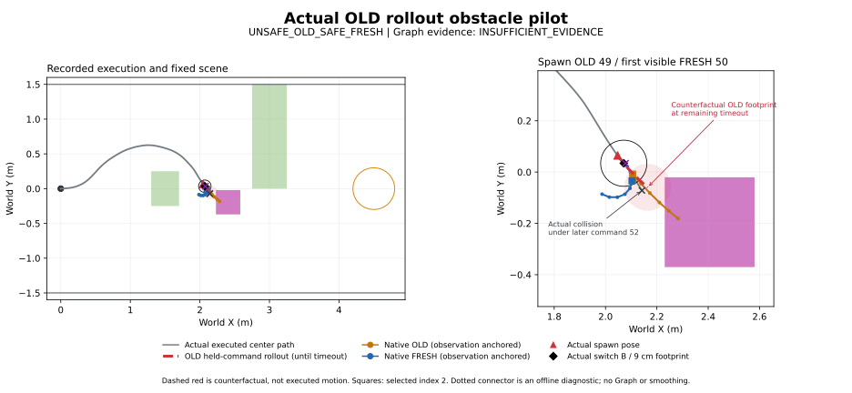

# 실제 OLD controller 경로를 차단하는 sudden-obstacle pilot

2026-10-18 KST. **배치 재현 성공, 최초 pair `UNSAFE_OLD_SAFE_FRESH`, Graph 판정 `INSUFFICIENT_EVIDENCE`.** OLD 49를 유지하면 남은 timeout 안에 충돌하는 장애물을 실제 RGB와 collision monitor에 동일하게 배치했다. 최초 FRESH 50은 안전했고 실제 전환도 안전했다. 이후 prediction 52 실행 중 충돌해 목표에는 도달하지 못했다. Navigation은 **1회**, 재시도·추가 inference·조건 변경 없음.

기준 `research/isaac6-sudden-obstacle` / `9792056`, 작업 branch `research/isaac6-old-rollout-obstacle`. [실행 전 protocol](OLD_ROLLOUT_OBSTACLE_PROTOCOL.md)과 [scenario](../research/nomad_isaac/old_rollout_obstacle_scenario.json)를 **84118c3**에 먼저 commit했다. 실제 실행 SHA는 **9dd129ddc97d3856827cd92be442da5539e090f7**, 실행 당시 Git clean. 이후 변경은 offline 분석과 문서뿐이다.

## 배치와 실제 관측

기존 정적 장애물, .35×.35×.8 m dynamic box, tick 970, radius .09 m, margin .02 m, fixed goal, model/checkpoint/seed schedule, sample 0/index 2, 원본 PD, 4/9/72 Hz 및 receive-based 1초 timeout을 유지했다. 추가 전달 지연은 0 ms. 실제 applied OLD 상태만 배치 함수에 전달하며 FRESH나 이후 주행은 참조하지 않는다.

| 항목 | 실제 값 |
|---|---|
| 출현 | tick 970, simulation 13.472222222 s |
| 실제 spawn pose `(x,y,yaw)` | `(2.046992309, 0.064840953, −0.930301271)` m,m,rad |
| OLD / 원본 command | ID 49 / `(v,w)=(0.2, +0.268792886)` m/s,rad/s |
| OLD 남은 timeout | 0.856371351 s |
| 선택된 장애물 중심 XY | **`(2.405633551, −0.195502975)` m** |
| agent 기준 중심 `(forward,left)` | `(0.423065064, 0.131978988)` m; bearing +17.326° |
| 등장 순간 footprint clearance | 0.112504 m |
| 최초 .55 s OLD continuation clearance 하한 | 0.021154 m, 사전 .02 m 기준 충족 |
| 남은 timeout까지 OLD continuation clearance | 하한 −0.028468 m / overlap witness −0.023545 m |
| counterfactual 최초 contact | 출현 후 약 **0.699605 s**, 남은 timeout 이내 |
| 배치 계산 wall time | 1.409 ms |

사전 후보 [.42,.45,.48] m 중 .42 m는 초기 거리와 반응 구간 조건을 위반해 거부됐고 **.45 m**를 채택했다. .48 m는 검사하지 않았다. 중심은 동일 command를 2.25초 유지한 arc 위에 있으나, 위험 판정·그림의 빨간 arc는 **현재 OLD의 남은 .856초까지만** 사용한다. 중심에 도달하기 전 원형 footprint가 box와 접촉한다. 이는 실제 미래 주행이 아닌 배치용 counterfactual이다.

Static box separation은 최소 .170603 m, 같은 OLD arc의 정적 장애물 clearance는 .252070 m였다. 고정된 네 side-strip 검사 중 세 곳이 비어 있었다. 이는 국소적인 회피 공간의 근거이며 원본 PD로 실행 가능한 회피를 보장하지 않는다.

Execution thread가 tick 970에서 geometry와 활성 상태를 함께 게시했다. Main thread는 **다음 snapshot tick 971**에서 같은 위치를 USD에 반영한 후 RGB를 캡처했다. USD AABB는 `(2.230634,−.370503,0)`…`(2.580634,−.020503,.8)`로 monitor와 일치한다. Logical activation source는 970이며 host 시각에 rendering까지 동시에 완료됐다는 뜻은 아니다. Execution은 render/inference를 기다리지 않았다.

최초 visible observation은 **54**, snapshot simulation 13.486111111 s였다. 원본 RGB의 magenta pixel **47,101개**, 모든 출현 전 RGB는 0개다. FRESH 50의 실제 worker history는 **[51,52,53,54]**, SHA-256 `d89917fa360f3bba7919a40ffd00d9fefb04d51785698ffda72712db22c5ca68`와 일치했다. 공식 preprocessing을 CPU에서 재적용해 `(1,12,96,96)` float32/finite와 마지막 image의 magenta **5,629 pixels**를 확인했다. 새 inference는 하지 않았다. Instance mask 계측은 사용·수정하지 않았다.

## 최초 OLD 49 → FRESH 50

모든 native prediction은 **자기 observation pose**로 world 변환했다. OLD observation pose는 `(2.019907880,.103516812,−.983274237)`, FRESH는 `(2.048656442,.062616835,−.926568037)`이다. Native yaw/timestamp를 만들거나 switch pose에 re-anchor하지 않았다.

| 시점 | Simulation s | Host monotonic elapsed s |
|---|---:|---:|
| Spawn | 13.472222222 | 13.472394498 |
| 최초 visible / FRESH observation | 13.486111111 (pose snapshot) | 13.502492537 (capture start) |
| FRESH ready | 13.578671445 (로그 보간값) | 13.578777412 |
| FRESH switch | 13.666666667 | 13.667034519 |

Elapsed host 값은 run epoch `465296795716396 ns`에 대한 값이다. 서로 다른 clock을 직접 빼지 않는다. Spawn→capture 30.098 ms, spawn→switch **194.640 ms**로 사전 .55 s 반응 budget 안에서 적용됐다. FRESH 50의 GPU inference는 31.770 ms. 실제 switch boundary **B = `(2.071036096,.034281212,−.878035988)`**.

| 경로/구간 | Dynamic clearance m | 해석 |
|---|---:|---|
| OLD 49 native full 8 points | −.090000 | Tail을 포함한 prediction unsafe |
| OLD 49 native prefix index 2까지 | +.035650 | Prefix는 safe; held-command arc와 다름 |
| FRESH 50 native full / prefix | +.037542 / +.037542 | 모든 장애물 및 corridor 검사 safe |
| 실제 spawn→FRESH 50 switch | +.078737 | OLD 49가 3.8889 cm 이동, yaw +2.9946°, 충돌 없음 |
| 실제 FRESH 50→다음 switch | +.044172 | 4.4444 cm 이동, yaw −5.0930°, 안전 |

Native clearance는 radius를 반영한 polyline diagnostic이며 −.09 m를 물리적 penetration depth로 해석하지 않는다. 실제 실행은 원형 footprint/box의 swept 검사이고 PhysX collision이 아니다.

기존 correspondence는 **`nonmonotone_forward_station`**으로 invalid였다. FRESH tail이 되돌아가므로 공통 구간 position/heading revision을 유효한 수치로 보고하지 않는다. 동일 waypoint index를 임의 대응점으로 쓰지 않았다. 별도로 유효한 entry tangent는 유지된다.

Entry `(2.077684753,.033989372)`까지 B의 거리는 **.006655 m**, B yaw 대비 tangent 차이는 **10.760°**, 단순 connector의 minimum clearance는 **.072366 m**다. 검사한 entry **10/10개가 안전**하며 corridor 안에 있다. Connector bearing/heading 수치는 6.7 mm의 매우 짧은 연결에 대한 diagnostic이다. 실제 PD가 그 connector를 실행한 것은 아니다.

Observation-anchored selected point와 원본 PD의 local point를 B에서 world로 표현한 점의 차이는 .037207 m였다. 원본 PD 계산은 그대로 `(v,w)=(.2,−.4)`를 출력했다. 이 차이만으로 Graph 후보로 삼지 않는다. **최초 FRESH가 안전하고 검사한 연결도 안전하므로 qualified reconciliation candidate는 확인되지 않았다.** 전체 pair 분류는 correspondence 부족을 반영해 `INSUFFICIENT_EVIDENCE`로 남긴다.

## 이후 실행과 최종 충돌

| 적용 ID | 적용 구간 sim s | Native full / prefix clearance m | 실제 구간 clearance m | 원본 `(v,w)` |
|---|---|---:|---:|---|
| 50 | 13.666667–13.888889 | +.037542 / +.037542 | +.044172 | `(.2,−.4)` |
| 51 | 13.888889–14.111111 | +.024909 / +.024909 | **+.019188** | `(.2,−.4)` |
| 52 | 14.111111–14.305556 | **−.071843 / −.038028** | **−.001262** | `(.2,+.4)` |

Prediction 51은 native 경로가 안전해도 실제 PD 구간 끝에서는 .02 m margin을 처음 미충족했다. Prediction 52는 full/prefix 자체가 unsafe였고, 실제 command 52 실행 중 dynamic obstacle과 겹쳐 **14.305556 s에 중단**했다. 검출 pose는 `(2.141893512,−.071857232,−.978035988)`이며 보수적 최초 contact bracket은 약 14.294241 s다. 당시 GPU에서는 FRESH 53이 진행 중이었다. 53은 종료 과정에서 수신됐지만 **실제 switch 없음**, full/prefix도 unsafe다.

이 후속 충돌을 출현 당시 OLD 49 또는 최초 FRESH 50의 충돌로 기록하지 않는다. 최초 pair의 실험 판정은 `UNSAFE_OLD_SAFE_FRESH`; 이후 사건은 **unsafe prediction 52의 실제 실행 충돌**이다. 51의 margin 미충족 또한 prediction 안전성과 실제 PD 안전성이 다르다는 증거이지 Graph 필요성의 증명은 아니다.

최종 goal entry false, 최소 goal 거리 2.359201 m. Static 1/2 최소 clearance .088121/.522335 m, corridor 침범 없음. 모델 성능 실패 후 위치·seed·controller를 변경하거나 재실행하지 않았다.

## 검증과 보존

실제 GPU inference 54 requests/54 received/53 switches, warm latency median/p95 **30.782/33.078 ms**. Real-time factor .999990, pacing absolute error p95/max **.154/1.423 ms**, 한 integration tick 초과 지연 0회. Observation→ready/switch host median .075439/.138375 s. Busy skip 1, missed capture 0, timeout 0; 실제 timeout은 `NOT_EXERCISED`, 기존 synthetic exact-timeout 검증만 PASS다.

최소 배치·timeout·pending result/actual OLD·RGB 및 기존 async/geometry tests **35 passed**. Actual raw normalization/cumsum/scaling, 원본 PD, observation anchor, SE(2) integration, clock mapping, dynamic activation와 clearance 재계산 PASS. 최초 RGB 준비 전 renderer step error 5개는 원본 로그에 보존했다. 이후 RGB/history와 runtime 검증은 통과했으며 정상적인 geometric-collision 종료였다.

기존 **1,266개**, 새 run **257개** 입력 hash 보존. 원본 train/deployment와 보호 source 9개, Isaac Sim·가상환경·checkpoint 불변. 새 runtime 변경은 배치 함수, activation/snapshot/main-thread USD 연결, RGB 계측에 한정했다. Offline analyzer는 기존 correspondence/entry/clearance/validator를 재사용한다.

- Raw: `/home/gpuadmin/Workspace/NoMaD/artifacts/isaac6/old_rollout_obstacle_01/`
- 최종 offline audit: `/home/gpuadmin/Workspace/NoMaD/artifacts/isaac6/old_rollout_obstacle_audit_02/` (audit 01도 보존)
- [작은 summary](../research/results/isaac6_old_rollout_obstacle_20261018/summary.json), [prediction CSV](../research/results/isaac6_old_rollout_obstacle_20261018/predictions.csv), [runtime 검증](../research/results/isaac6_old_rollout_obstacle_20261018/runtime_validation.json), [독립 보존 검증](../research/results/isaac6_old_rollout_obstacle_20261018/independent_review.json), [공식 preprocessing 확인](../research/results/isaac6_old_rollout_obstacle_20261018/preprocessing_check.json)

남은 불확실성: OLD/FRESH의 observation 및 noise/DDPM seed가 199/200→201/202로 달라져 revision을 장애물의 인과 효과로만 볼 수 없다. Fixed-goal adapter와 단일 실험이며 국소 여유 공간은 controller feasibility를 보장하지 않는다. Safe FRESH→실제 PD 안전성의 차이는 남지만, 이번 최초 handoff의 단순 연결은 안전하고 spatial correspondence가 invalid라 **Graph 비교에 사용할 qualified candidate를 입증하지 못했다**. Graph/Topomap/smoothing/추가 latency/영상은 구현하지 않았다.
