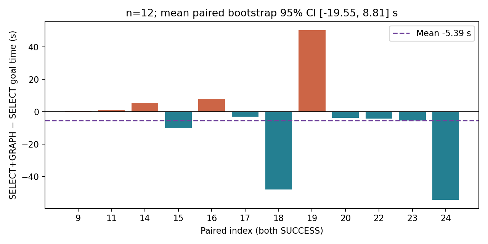
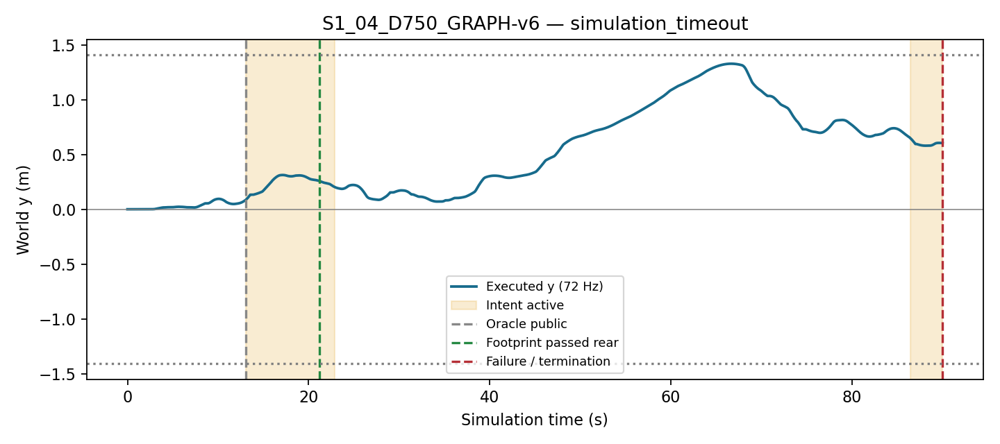

# Phase 10A — 저장 로그 기반 속도 및 GRAPH-v6 진단

입력 Git SHA: `f33f5b1ecb1468c74f8541062aef2eaf43c7bd77`. 분석 스크립트 SHA-256: `f46cb25e43022759f27059cfbe225b14a2cba0459cf2b7dbe8ffda0b936013ed`.
새 navigation, inference, Graph solve 없음. 원본 로그와 이전 결과는 변경하지 않았다. Oracle geometry / SE(2) kinematic Isaac Sim 범위의 사후 관찰 분석이다.

## Part 1 — 양쪽 성공 run의 paired 속도 비교

Index 9–24, D750. 기술 검증 PASS 및 양쪽 SUCCESS 교집합만 사용했다. 실패 run 시간을 90초로 대입하지 않았다. Paired index 단위 percentile bootstrap 20,000회, seed 20261025. 평균 차이와 차이의 median 모두 CI를 계산했다. 주 판정에는 **평균 goal 시간 차이의 CI**를 사용한다.

|pair|metric|n|indices|mean|median|mean_ci95|median_ci95|
|---|---|---|---|---|---|---|---|
|SELECT+GRAPH minus SELECT|goal_time_s|12|[9, 11, 14, 15, 16, 17, 18, 19, 20, 22, 23, 24]|-5.3900|-3.4375|[-19.553819444444446, 8.806828703703692]|[-7.861111111111114, 3.2569444444444446]|
|SELECT+GRAPH minus SELECT|mean_speed_m_s|12|[9, 11, 14, 15, 16, 17, 18, 19, 20, 22, 23, 24]|0.0154|0.0172|[0.0033501449056788503, 0.02743943812155302]|[-0.00019955986308493878, 0.03138580298031607]|
|GRAPH minus SELECT|goal_time_s|10|[9, 10, 11, 15, 16, 18, 19, 20, 22, 24]|-7.8139|0.3681|[-21.190347222222226, 3.35847222222221]|[-20.645833333333336, 5.270833333333332]|
|GRAPH minus SELECT|mean_speed_m_s|10|[9, 10, 11, 15, 16, 18, 19, 20, 22, 24]|-0.0002|-0.0027|[-0.01056838305680762, 0.010352103770804956]|[-0.012983884434620119, 0.014018702165909613]|
|SELECT+GRAPH minus GRAPH|goal_time_s|11|[9, 11, 12, 13, 15, 16, 18, 19, 20, 22, 24]|4.6869|-1.3194|[-3.595991161616161, 14.953409090909076]|[-3.2777777777777786, 7.736111111111114]|
|SELECT+GRAPH minus GRAPH|mean_speed_m_s|11|[9, 11, 12, 13, 15, 16, 18, 19, 20, 22, 24]|0.0167|0.0173|[0.004435522267450471, 0.028661819483919142]|[0.0010074420953112562, 0.03242411321253]|
|SELECT+GRAPH minus CURV|goal_time_s|7|[15, 16, 18, 19, 20, 21, 24]|-22.1567|-20.6389|[-47.62103174603175, 6.791666666666663]|[-60.20833333333334, 4.694444444444446]|
|SELECT+GRAPH minus CURV|mean_speed_m_s|7|[15, 16, 18, 19, 20, 21, 24]|0.0317|0.0377|[0.014688956934960822, 0.048906872495302865]|[0.005796112693831124, 0.045991123681603685]|

주 판정: **SPEED_NOT_SHOWN**. 기술 제외: [{"key": "S0_13_D750_SELECT", "reason": "TECHNICAL_FAILURE"}, {"key": "S0_23_D750_GRAPH", "reason": "TECHNICAL_FAILURE"}].
성공 조건부 분석이므로 전체 run의 인과적 속도 개선이나 실패율 효과와 동일하지 않다. 동일 index라도 closed-loop RGB와 prediction은 달라진다.

### 속도 메커니즘 (run별 원자료: speed_mechanisms.csv)

`|κ|>2`는 요청한 진단 기준이며 `|κ|>8` 포화 flag와 다르다. 비율은 실제 종료에서 자른 9Hz 명령 유지시간으로 가중하고 유효한 비정지 PP 시간으로 나눈다. CURV target<0.2와 실제 v<0.2를 분리했다. Heading/cross-track은 기존 20mm tangent 검사로 계산하며 FRESH switch와 보정 교체는 별도 저장했다.

|method|success|n|kappa_over2_fraction|endpoint_clamp_fraction|curv_target_below_point2_fraction|actual_speed_below_point2_fraction|heading_run_median_mean_rad|cross_track_run_median_mean_m|
|---|---|---|---|---|---|---|---|---|
|CURV|True|8|0.6505|0.6843|0.6505|0.6892|0.2713|0.0146|
|CURV|False|8|0.6725|0.7216|0.6725|0.7173|0.2644|0.0158|
|SELECT|True|13|0.5833|0.6268|0.5833|0.6116|0.2588|0.0165|
|SELECT|False|2|0.7668|0.4869|0.7668|0.7921|0.3859|0.0151|
|GRAPH|True|12|0.5313|0.7417|0.5313|0.5743|0.2455|0.0151|
|GRAPH|False|3|0.6340|0.6779|0.6340|0.6574|0.2464|0.0172|
|SELECT+GRAPH|True|15|0.5017|0.6748|0.5017|0.5226|0.2467|0.0179|
|SELECT+GRAPH|False|1|0.6162|0.8047|0.6162|0.6364|0.4365|0.0199|

주 paired 교집합의 SELECT+GRAPH − SELECT 메커니즘 차이:

|metric|mean_difference|mean_ci95|
|---|---|---|
|kappa_over2_fraction|-0.0801|[-0.1561868831063717, -0.005574792537781815]|
|endpoint_clamp_fraction|0.0477|[0.019070387392073857, 0.07417214150707037]|
|curv_target_below_point2_fraction|-0.0801|[-0.1561868831063717, -0.005574792537781815]|
|actual_speed_below_point2_fraction|-0.0863|[-0.1619070555800442, -0.01226515813974385]|
|switch_heading_median_rad|0.0004|[-0.028777395259903492, 0.03188265729174086]|
|switch_cross_track_median_m|0.0015|[-0.0002989937003222859, 0.0036725846738404305]|

## Part 2 — GRAPH-v6 실패 타임라인

12개 GRAPH-v6 run 전체를 분석했다. 실패 시각은 실제 종료 시각(충돌, 복도, timeout 구분)이다. 공개 monotonic 시각은 그 이후 첫 실제 72Hz pose에 매핑했다. 통과는 x>상자 뒷면+반경이며 안전 통과 판정이 아니다. 의도 해제는 x>뒷면+0.30; 재진입 시 의도 재활성 구간도 보존했다.

|key|termination|spawn_s|public_s|intent_intervals|pass_s|deactivate_s|failure_s|failure_pose|recross_after_pass|
|---|---|---|---|---|---|---|---|---|---|
|S1_04_D750_GRAPH-v6|simulation_timeout|12.5972|13.0417|[[13.041666666666666, 22.916666666666668], [86.45833333333333, 90.0]]|21.1944|22.9167|90.0000|[3.346675352465096, 0.6037216041507817, -2.979836440418536]|True|
|S1_06_D750_GRAPH-v6|corridor_footprint_stop|11.6528|12.0972|[[12.097222222222221, 24.083333333333332]]|22.7917|24.0833|57.6528|[7.941036202810319, 1.4109614688040613, 1.2963974500728535]|False|
|S1_01_D000_GRAPH-v6|corridor_footprint_stop|8.1389|8.5417|[[8.541666666666666, 15.194444444444445]]|14.4861|15.1944|41.3056|[8.076424076315593, 1.4102960868948002, 0.7304281832459925]|False|
|S1_02_D000_GRAPH-v6|simulation_timeout|8.0417|8.5417|[[8.541666666666666, 14.76388888888889], [67.36111111111111, 90.0]]|14.0556|14.7639|90.0000|[-0.32887410053776445, 0.9912741560288216, 2.385344569587458]|True|
|S1_03_D000_GRAPH-v6|corridor_footprint_stop|8.0417|8.5556|[[8.555555555555555, 15.027777777777779]]|14.3333|15.0278|43.4444|[8.112975463186102, 1.4103752973187962, 1.4372922092512006]|False|

### 통과 후 3초: 실제 복귀와 RAW fallback

|key|available|start_s|end_s|truncated|y_start_m|y_end_m|abs_y_change_m|centerward_heading_fraction|corrected_fraction_of_valid|raw_fraction_of_valid|fresh_calls|fresh_centerward|fresh_not_centerward|
|---|---|---|---|---|---|---|---|---|---|---|---|---|---|
|S1_04_D750_GRAPH-v6|True|21.1944|24.1944|False|0.2576|0.2004|-0.0572|0.8249|0.8519|0.1481|3|1|2|
|S1_06_D750_GRAPH-v6|True|22.7917|25.7917|False|-0.3124|-0.2686|-0.0437|0.6359|0.8889|0.1111|3|3|0|
|S1_01_D000_GRAPH-v6|True|14.4861|17.4861|False|-0.0279|0.0139|-0.0140|0.3687|0.4444|0.5556|12|4|8|
|S1_02_D000_GRAPH-v6|True|14.0556|17.0556|False|0.3274|0.2717|-0.0557|1.0000|0.5185|0.4815|12|11|1|
|S1_03_D000_GRAPH-v6|True|14.3333|17.3333|False|-0.0915|-0.0445|-0.0470|0.9631|0.5185|0.4815|13|10|3|

`centerward_heading_fraction`은 yaw의 횡방향 성분이 y=0을 향한 비율이다. FRESH 복귀 여부는 native endpoint−B의 횡방향 부호 진단이며 실제 PP rollout이라고 해석하지 않는다. 전체 y/yaw 표본은 post_pass_windows.json에 보존했다.

### 의도 해제 후 첫 5개 Graph 호출과 이전 prior

기존 `previous_stencil`(B의 prior 최근접 투영 + 현재 경로 정규화 arclength)을 그대로 사용했다. prior 경로가 없는 경우 거리를 만들지 않았다. 최종 solver 출력과 실제 ACCEPTED 적용을 분리한다.

|key|job_id|disposition|previous_prior_present|prior_minus_fresh_y_mean_m|prior_fresh_y_rms_m|result_fresh_y_rms_m|result_prior_y_rms_m|closer_to|result_sideward_shift_m|previous_prior_factor_cost|
|---|---|---|---|---|---|---|---|---|---|---|
|S1_04_D750_GRAPH-v6|22|ACCEPTED|True|0.0077|0.0116|0.0019|0.0105|FRESH|0.0015|0.7003|
|S1_04_D750_GRAPH-v6|23|ACCEPTED|True|0.0437|0.0477|0.0261|0.0230|PRIOR|0.0234|0.9580|
|S1_04_D750_GRAPH-v6|24|ACCEPTED|True|0.0018|0.0343|0.0299|0.0469|FRESH|-0.0297|2.4052|
|S1_04_D750_GRAPH-v6|25|ACCEPTED|True|-0.1066|0.1142|0.0874|0.0346|PRIOR|-0.0826|1.9668|
|S1_04_D750_GRAPH-v6|26|ACCEPTED|True|0.0538|0.0556|0.0162|0.0398|FRESH|0.0152|1.4686|
|S1_06_D750_GRAPH-v6|24|ACCEPTED|True|-0.0401|0.0469|0.0374|0.0136|PRIOR|0.0356|1.2534|
|S1_06_D750_GRAPH-v6|25|ACCEPTED|True|-0.0663|0.0928|0.0414|0.0558|FRESH|0.0350|1.9653|
|S1_06_D750_GRAPH-v6|26|ACCEPTED|True|-0.0074|0.0343|0.0253|0.0484|FRESH|-0.0249|3.1446|
|S1_06_D750_GRAPH-v6|27|ACCEPTED|True|0.0822|0.0900|0.0414|0.0541|FRESH|-0.0358|1.1863|
|S1_06_D750_GRAPH-v6|28|ACCEPTED|True|-0.0861|0.0969|0.0275|0.0703|FRESH|0.0263|2.6254|
|S1_01_D000_GRAPH-v6|57|ACCEPTED|True|-0.0204|0.0256|0.0053|0.0208|FRESH|0.0051|1.0750|
|S1_01_D000_GRAPH-v6|58|ACCEPTED|True|-0.0290|0.0430|0.0063|0.0376|FRESH|0.0059|0.6013|
|S1_01_D000_GRAPH-v6|59|ACCEPTED|True|0.0270|0.0495|0.0026|0.0496|FRESH|0.0021|0.2766|
|S1_01_D000_GRAPH-v6|60|ACCEPTED|True|-0.0519|0.0788|0.0101|0.0699|FRESH|0.0090|1.0309|
|S1_01_D000_GRAPH-v6|61|ACCEPTED|True|0.0115|0.0167|0.0032|0.0136|FRESH|-0.0025|0.5933|
|S1_02_D000_GRAPH-v6|55|ACCEPTED|True|0.0247|0.0398|0.0028|0.0371|FRESH|0.0016|0.4916|
|S1_02_D000_GRAPH-v6|56|SUPERSEDED|True|0.0043|0.0083|0.0017|0.0091|FRESH|-0.0016|0.2218|
|S1_02_D000_GRAPH-v6|57|ACCEPTED|True|-0.0046|0.0090|0.0029|0.0069|FRESH|-0.0027|1.0293|
|S1_02_D000_GRAPH-v6|58|ACCEPTED|True|-0.0087|0.0105|0.0045|0.0066|FRESH|-0.0044|0.1961|
|S1_02_D000_GRAPH-v6|59|ACCEPTED|True|0.0091|0.0123|0.0007|0.0124|FRESH|-0.0005|0.4353|
|S1_03_D000_GRAPH-v6|56|ACCEPTED|True|-0.0096|0.0204|0.0008|0.0198|FRESH|0.0004|0.4800|
|S1_03_D000_GRAPH-v6|57|ACCEPTED|True|-0.0009|0.0043|0.0013|0.0038|FRESH|0.0002|0.2949|
|S1_03_D000_GRAPH-v6|58|ACCEPTED|True|-0.0017|0.0096|0.0008|0.0092|FRESH|-0.0003|0.3717|
|S1_03_D000_GRAPH-v6|59|ACCEPTED|True|0.0324|0.0450|0.0041|0.0410|FRESH|-0.0023|0.1939|
|S1_03_D000_GRAPH-v6|60|SUPERSEDED|True|-0.0379|0.0541|0.0080|0.0472|FRESH|0.0075|0.6047|

### 측면 factor 코드/로그 근거

`nomad_phase9/graph.py`는 매 호출마다 Graph를 새로 만들고 `public_intent`가 있을 때만 heuristic XY와 강제 side를 추가한다. 해제 후에는 v4의 `side_labels(FRESH, public_geometry)`가 새로 계산된다. `previous_accepted` 경로는 해제 시 초기화되지 않으므로 prior는 남지만 강제 heuristic side 상태의 지속과는 다르다.
Inactive 호출 767개, heuristic factor 잔존 0개, native side 재판정 0개.
factor 적용/잔존은 초기화 성공 시 solver factor_costs와 교차 확인했다. 비용 0은 factor가 없다는 뜻으로 사용하지 않았다.

### D0 미수렴 분포

|stage|calls|solver_calls|nonconverged|nonconvergence_per_call|nonconvergence_per_solve|sdf_enforced|initialization_rejected|zero_speed_rejected|superseded|superseded_fraction|
|---|---|---|---|---|---|---|---|---|---|---|
|BEFORE_PUBLIC|120|116|1|0.0083|0.0086|0|4|4|5|0.0417|
|INTENT_ACTIVE|193|192|58|0.3005|0.3021|193|0|0|28|0.1451|
|INTENT_INACTIVE|497|492|185|0.3722|0.3760|497|2|0|100|0.2012|

D0 합계: 244/810 calls 미수렴, 실제 solver 800회. 초기화 거부와 SUPERSEDED는 solver 성공 여부와 별개다. 단계는 job dispatch 시점 기준이다.
SDF enabled는 공개 obstacle을 제약에 넣었음을 뜻한다. 최종 active-set SDF row는 로그에 없어 미수렴을 SDF 단독 원인으로 확정할 수 없다. 모든 미수렴의 이전/현재/다음 저장 호출 길이·clearance는 d0_nonconvergence.csv에 있다.

|stage|n|previous_fresh_length_m|fresh_length_m|result_length_m|next_fresh_length_m|previous_fresh_obstacle_clearance_m|fresh_obstacle_clearance_m|result_obstacle_clearance_m|next_fresh_obstacle_clearance_m|
|---|---|---|---|---|---|---|---|---|---|
|BEFORE_PUBLIC|1|0.3143|0.3404|0.3365|0.3499|N/A|N/A|N/A|N/A|
|INTENT_ACTIVE|58|0.3354|0.3359|0.3464|0.3451|2.0603|2.1011|2.0796|2.1494|
|INTENT_INACTIVE|185|0.1692|0.1644|0.1875|0.1723|4.2610|4.2787|4.2723|4.2939|

### s = −1 paired 조건 비교

D750 짝수 index 비교. 동일 seed여도 world 배치/RGB/선택 경로가 다르므로 같은 observation의 정책 반사실 비교가 아니다. native side는 장애물 중심 x에서 ±(반폭+반경) 밖의 분명한 교차만 분류하며 나머지는 UNDEFINED이다.

|index|method|success|termination|heuristic_side|pass_s|native_definite_count|native_conflict_count|native_undefined_count|
|---|---|---|---|---|---|---|---|---|
|2|CURV|True|goal_entry|1|23.6944|2|0|9|
|2|GRAPH-v6|True|goal_entry|1|20.5556|2|0|5|
|2|INTENT-SPLICE|True|goal_entry|1|18.3472|1|0|6|
|4|CURV|True|goal_entry|-1|22.2500|2|2|7|
|4|GRAPH-v6|False|simulation_timeout|1|21.1944|2|0|6|
|4|INTENT-SPLICE|False|simulation_timeout|-1|20.0000|0|0|7|
|6|CURV|True|goal_entry|1|25.1944|2|0|9|
|6|GRAPH-v6|False|corridor_footprint_stop|-1|22.7917|2|0|10|
|6|INTENT-SPLICE|False|corridor_footprint_stop|1|18.2500|2|0|4|
|8|CURV|False|simulation_timeout|-1|22.3472|2|2|7|
|8|GRAPH-v6|True|goal_entry|-1|23.0417|2|0|7|
|8|INTENT-SPLICE|True|goal_entry|1|19.9444|1|0|5|

### 원인 후보 판정 (독립)

|candidate|verdict|evidence|
|---|---|---|
|C1_PRIOR_DRAG|SUPPORTED|{"evidence": [{"key": "S1_06_D750_GRAPH-v6", "job_id": 24}], "causal_isolation": "not possible without new ablation"}|
|C2_SIDE_FACTOR_PERSISTS|NOT_SUPPORTED|{"inactive_calls": 767, "heuristic_factor_remaining": 0, "recomputed_native_side_defined": 0}|
|C3_NO_RECENTER|NOT_SUPPORTED|{"evidence_runs": []}|
|C4_D0_NONCONVERGENCE|SUPPORTED|{"peak_stage": "INTENT_INACTIVE"}|
|C5_INTENT_CONFLICT|NOT_SUPPORTED|{"conflict_calls": 0, "runs": [], "causal_success_attribution": "UNCLEAR"}|

SUPPORTED는 저장 로그에 해당 기제가 관찰됐다는 후보 근거다. prior 제거 실험이나 intent 반전 재실행 없이 실패의 단독 인과 원인/개선 효과는 확정할 수 없다. C3의 직선 복도 복귀는 solver 목표가 아니라 로그의 FRESH 방향 진단이다.

- **C1의 국소 근거:** D750 index 6, job 24에서 prior target이 RAW보다 회피 측면으로 평균 4.01cm 떨어져 있었고, 수락된 보정은 같은 쪽으로 3.56cm 이동했다. 보정의 lateral RMS는 prior까지 1.36cm, RAW까지 3.74cm였다. B의 y=−0.2617m에 대해 RAW endpoint는 −0.2229m(중심 방향), 보정 endpoint는 −0.2699m였다. 다음 job B는 −0.2700m로 바깥쪽 이동이 관찰됐다. 다만 이후 job 26/27의 B는 −0.2517/−0.1395m로 복귀했고, 벽 종료는 57.65초로 이 보정 적용(24.78초)보다 약 32.88초 뒤다. 따라서 **국소 prior 방향 끌림의 후보 근거**이며, 지속적 끌림이 최종 벽 이탈을 일으켰다는 인과 판단은 **UNCLEAR**다.
- **C2:** 의도 비활성 767호출에서 강제 heuristic factor와 native 재계산 side 모두 0건이다. prior가 남은 것과 side factor 잔존을 혼동하지 않는다.
- **C3:** 실패 5개 모두 최초 통과 후 3초 동안 최종 |y|가 시작보다 감소했다(약 1.40–5.72cm). 이 창에서는 복귀 부족 가설을 지지하지 않는다. 그래프의 훨씬 나중 재이탈/맴돌기까지 배제하는 결과는 아니다.
- **C4:** D0 미수렴은 공개 전 1/120(0.83%), intent 활성 58/193(30.05%), 비활성 185/497(37.22%)이다. 비활성 구간이 전체 호출의 61.36%, 미수렴의 75.82%를 차지한다. 따라서 **활성 intent 구간에만 몰린 현상이 아니다**. SDF 사용 여부와 함께 늘어나는 다른 상태/제약 차이의 인과 효과는 분리할 수 없다.
- **C5:** s=−1의 active GRAPH 호출 185개(D750 45, D0 140) 중 분명한 native side가 있는 28개(D750 10, D0 18)는 모두 heuristic과 일치했다. 나머지 157개는 side 불명확이므로 일치로 집계하지 않았다. 짧거나 중심 x를 가로지르지 않는 chunk에서 잠재적 의도 충돌은 판단할 수 없다.

주 paired 교집합에서는 평균 속도가 +0.0154m/s(95% CI +0.00335~+0.02744), |κ|>2 및 CURV target<0.2 시간 비율이 평균 8.01 percentage points 감소했다. 이는 감속 감소와 일관된 관찰이지만 goal 시간 CI는 0을 포함하므로 주장의 속도 이점 판정은 바뀌지 않는다.

### 수정안 후보 (미구현)

- 의도 해제 직후 prior를 제거/감쇠하는 대조군으로 이전 보정 prior의 독립 효과를 검증한다.
- 단계별 SDF·경계 equality·trust 제약의 위반 row를 기록해 D0 미수렴의 실제 제약 원인을 구분한다.

### 검증 및 한계

{"prior_provenance_hashes": 596, "run_duration_matches": 94, "logged_curv_targets": 19336, "application_poses": 3056, "previous_accepted_identity": 1264, "graph_observation_anchor_and_boundary": 1264, "graph_count_matches": 12, "inputs_unchanged_after_analysis": 616}. 입력 hash는 기존 Phase8/9 audit와 대조하고 분석 종료 전 불변을 다시 확인했다.
paired 유효 수, 제외 사유, 12개 GRAPH-v6 전체 호출 및 5개 실패를 저장했다. D0에는 INTENT-SPLICE comparator가 없으므로 생성/대체하지 않았다. 신규 solve·주행·추론, parameter 수정, 추가 시각화 없음.

실행 이력: 첫 시작은 초기 정지 tick의 `endpoint_clamped=null` 파싱에서 중단됐고 통계·결과 파일은 생성되지 않았다. 이 null 처리만 수정한 뒤 전체 분석은 1회 완료했다. 사전 기준이나 데이터·solver는 변경하지 않았다. 오류 로그와 완료 이력은 `analysis_preflight_error.txt`, `analysis_execution.json`에 보존했다. 위 해석 문단은 생성된 CSV/JSON의 수치를 검토해 덧붙였으며 통계나 판정 기준은 다시 계산·조정하지 않았다.
