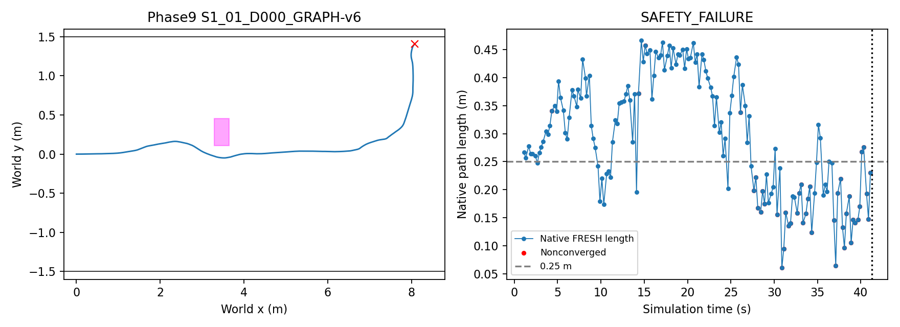
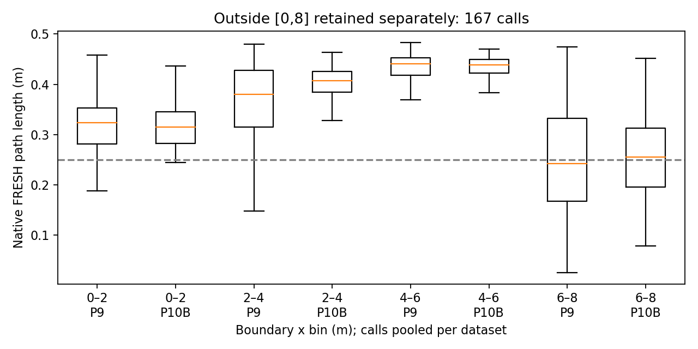

# Phase 10B — S1-v2 obstacle-free control

Execution commit: `3978e9e9f9964df876d99651752df93f4de7c2cf`; COMPLETE, 16/16 attempts.
Oracle geometry evaluation; SE(2) kinematic Isaac Sim; no claim of identical paired RGB

## Fixed conditions and technical validation

Only `--phase10b-no-obstacle` changes Phase9 runtime configuration: no spawn trigger, placement, dynamic monitor, oracle publication or heuristic intent. Original Graph-v6 / v4 factors, weights, worker, CURV fallback and timing remain unchanged. No obstacle means the unchanged worker chooses FreeField. **Phase9 after intent deactivation still retains its obstacle SDF; that geometry difference is part of this control.**
21-node Topomap, D0/D750, offsets10000×index1–4, vmax0.3, unchanged NoMaD scaling0.05, 4/9/72Hz, 1s timeout, 90s limit. Batch performs original command/pose/clearance/RGB/seed replay plus absence-of-obstacle checks. Technical failures are excluded and never retried.

## Table 1 — no-obstacle results

|delay_ms|method|valid|success|corridor|collision|timeout|other_stop|technical|backtracking_events|near_goal_max_abs_y_m|near_goal_left_time_mean_s|goal_time_median_s|mean_speed_m_s|curv_slow_fraction_mean|endpoint_clamp_fraction_mean|
|---|---|---|---|---|---|---|---|---|---|---|---|---|---|---|---|
|0|CURV|4|4|0|0|0|0|0|0|0.3569|0.0000|31.4931|0.2557|0.1501|0.2054|
|0|GRAPH-v6|4|4|0|0|0|0|0|0|0.3932|0.0000|31.6597|0.2544|0.1653|0.2012|
|750|CURV|4|2|2|0|0|0|0|0|1.4105|2.3333|46.3125|0.1574|0.5775|0.7755|
|750|GRAPH-v6|4|4|0|0|0|0|0|0|0.5091|0.0000|45.3750|0.1765|0.4453|0.7867|

Failure count = valid navigation non-success. Conservative contact stop is retained separately and is not relabeled as geometric collision. Goal times use successful runs only. Curvature slowdown is CURV target<0.2 over valid non-endpoint PP duration; actual v<0.2 is separately saved.

## Table 2 — matched indices, obstacle vs no obstacle

|index|delay_ms|method|obstacle_result|no_obstacle_result|obstacle_goal_s|no_obstacle_goal_s|obstacle_backtracking|no_obstacle_backtracking|
|---|---|---|---|---|---|---|---|---|
|1|0|CURV|SAFETY_FAILURE|SUCCESS|N/A|30.9722|0|0|
|1|0|GRAPH-v6|SAFETY_FAILURE|SUCCESS|N/A|31.5278|0|0|
|1|750|CURV|SAFETY_FAILURE|SAFETY_FAILURE|N/A|N/A|0|0|
|1|750|GRAPH-v6|SUCCESS|SUCCESS|70.5278|45.0000|0|0|
|2|0|CURV|SAFETY_FAILURE|SUCCESS|N/A|28.7639|0|0|
|2|0|GRAPH-v6|STUCK|SUCCESS|N/A|29.5278|2|0|
|2|750|CURV|SUCCESS|SUCCESS|54.8333|48.7639|0|0|
|2|750|GRAPH-v6|SUCCESS|SUCCESS|49.0556|45.7500|0|0|
|3|0|CURV|SUCCESS|SUCCESS|30.0556|32.0139|0|0|
|3|0|GRAPH-v6|SAFETY_FAILURE|SUCCESS|N/A|31.8889|0|0|
|3|750|CURV|SAFETY_FAILURE|SUCCESS|N/A|43.8611|0|0|
|3|750|GRAPH-v6|SUCCESS|SUCCESS|42.6944|43.9861|0|0|
|4|0|CURV|SUCCESS|SUCCESS|33.3889|32.2083|0|0|
|4|0|GRAPH-v6|SUCCESS|SUCCESS|31.7222|31.7917|0|0|
|4|750|CURV|SUCCESS|SAFETY_FAILURE|50.7500|N/A|0|0|
|4|750|GRAPH-v6|STUCK|SUCCESS|N/A|49.8472|3|0|

Paired seeds do not imply identical RGB, chunks or placement. Phase9 indices5–8 are included only in the full C6 Graph population.

## Route and Topomap failures

|key|classification|failure_time_s|failure_pose|backtracking_count|near_goal_max_abs_y_m|near_goal_left_time_s|closest_backwards|subgoal_backwards|
|---|---|---|---|---|---|---|---|---|
|S1_01_D000_CURV|SUCCESS|N/A|N/A|0|0.3005|0.0000|3|6|
|S1_01_D000_GRAPH-v6|SUCCESS|N/A|N/A|0|0.3932|0.0000|7|13|
|S1_01_D750_CURV|SAFETY_FAILURE|61.7639|[7.959022059963397, 1.4100700895446392, 1.12373903045967]|0|1.4101|4.3750|14|15|
|S1_01_D750_GRAPH-v6|SUCCESS|N/A|N/A|0|0.3865|0.0000|9|7|
|S1_02_D000_CURV|SUCCESS|N/A|N/A|0|0.2164|0.0000|3|6|
|S1_02_D000_GRAPH-v6|SUCCESS|N/A|N/A|0|0.2302|0.0000|2|6|
|S1_02_D750_CURV|SUCCESS|N/A|N/A|0|0.2394|0.0000|9|10|
|S1_02_D750_GRAPH-v6|SUCCESS|N/A|N/A|0|0.5091|0.0000|5|7|
|S1_03_D000_CURV|SUCCESS|N/A|N/A|0|0.3569|0.0000|3|10|
|S1_03_D000_GRAPH-v6|SUCCESS|N/A|N/A|0|0.2953|0.0000|4|12|
|S1_03_D750_CURV|SUCCESS|N/A|N/A|0|0.2481|0.0000|5|7|
|S1_03_D750_GRAPH-v6|SUCCESS|N/A|N/A|0|0.3906|0.0000|8|8|
|S1_04_D000_CURV|SUCCESS|N/A|N/A|0|0.3354|0.0000|6|10|
|S1_04_D000_GRAPH-v6|SUCCESS|N/A|N/A|0|0.3430|0.0000|6|11|
|S1_04_D750_CURV|SAFETY_FAILURE|65.5972|[7.973346880801153, 1.4105446720763635, 1.1157406761673316]|0|1.4105|4.9583|13|16|
|S1_04_D750_GRAPH-v6|SUCCESS|N/A|N/A|0|0.3385|0.0000|7|10|

Backtracking = |wrapped yaw from +x|≥150° for ≥2s; use recorded72Hz intervals with final sample excluded. Start time/x and full intervals: backtracking.csv. Near goal uses x>6.5; left-wall diagnostic is y>1.0, not the actual corridor collision threshold.
All inference closest/subgoal indices (observation and actual switch time) are in topomap.csv; failure-last10s indices in failure_last10_topomap.csv. Empty windows are reported, not synthesized.

## Table 3 — short-chunk diagnostics

|dataset|length_class|calls|solver_calls|nonconverged|nonconverged_rate|solver_only_nonconverged_rate|accepted|acceptance_rate|initialization_rejected|terminal_unapplied|progress_cost|endpoint_edit_forward_m|
|---|---|---|---|---|---|---|---|---|---|---|---|---|
|9|<0.25|348|328|223|0.6408|0.6799|102|0.2931|18|2|{'n': 328, 'median': 0.1582600050311628, 'p95': 0.613360398527079, 'min': 0.0, 'max': 5.67726896571964}|{'n': 328, 'median': 0.03425594178240174, 'p95': 0.1440790316531226, 'min': -0.6263879262770278, 'max': 0.2676439901730361}|
|9|>=0.25|916|832|77|0.0841|0.0925|721|0.7871|82|2|{'n': 832, 'median': 0.0, 'p95': 0.15863700175321566, 'min': 0.0, 'max': 4.4871418815355595}|{'n': 832, 'median': 0.008356178194116192, 'p95': 0.08710039077522971, 'min': -0.4341267126677448, 'max': 0.29005024831233583}|
|10B|<0.25|109|99|55|0.5046|0.5556|41|0.3761|7|3|{'n': 99, 'median': 0.06824774037083513, 'p95': 0.28763210751483315, 'min': 0.0, 'max': 0.4004955079436183}|{'n': 99, 'median': 0.01873454858421004, 'p95': 0.06513475459485574, 'min': -0.023979865558372764, 'max': 0.1555350829016226}|
|10B|>=0.25|555|516|15|0.0270|0.0291|485|0.8739|39|0|{'n': 516, 'median': 0.0, 'p95': 0.06071495599949659, 'min': 0.0, 'max': 0.30718845584564913}|{'n': 516, 'median': 0.006008379496188786, 'p95': 0.02976307909752461, 'min': -0.03224952204555833, 'max': 0.1348981018219623}|
|POOLED|<0.25|457|427|278|0.6083|0.6511|143|0.3129|25|5|{'n': 427, 'median': 0.1217215618378997, 'p95': 0.5450933573933615, 'min': 0.0, 'max': 5.67726896571964}|{'n': 427, 'median': 0.029062106003484304, 'p95': 0.13657471048340414, 'min': -0.6263879262770278, 'max': 0.2676439901730361}|
|POOLED|>=0.25|1471|1348|92|0.0625|0.0682|1206|0.8199|121|2|{'n': 1348, 'median': 0.0, 'p95': 0.13504375040547054, 'min': 0.0, 'max': 4.4871418815355595}|{'n': 1348, 'median': 0.007128378791078109, 'p95': 0.059994502266266875, 'min': -0.4341267126677448, 'max': 0.29005024831233583}|

Nonconvergence uses independent solver success, regardless of final ACCEPTED/SUPERSEDED/STALE disposition. Primary denominator is all submitted calls, matching Phase10A. Initialization rejection and terminal-unapplied are separate. Endpoint displacement is `(corrected−native)·B_forward`, available for returned solver output even if rejected; accepted-only distribution is also saved.
The 0.25m endpoint progress term is a **soft residual**, not a hard requirement. Native polyline length and endpoint progress from B are different quantities. C6 is descriptive association, not proof of causal conflict. No solve or inference is performed by this report.

### Length distribution by actual dispatch B x

|dataset|x_bin|calls|length_m|nonconverged_rate|acceptance_rate|
|---|---|---|---|---|---|
|9|0–2|247|{'n': 247, 'median': 0.3240291702083438, 'p95': 0.42787187772908, 'min': 0.10351518730554232, 'max': 0.4581048128632957}|0.1417|0.6802|
|9|2–4|246|{'n': 246, 'median': 0.38033164765561767, 'p95': 0.45913923570942117, 'min': 0.08660373330607854, 'max': 0.47945343868364143}|0.0813|0.8211|
|9|4–6|219|{'n': 219, 'median': 0.4401978215179694, 'p95': 0.46738841059768854, 'min': 0.3221817718621064, 'max': 0.4834288494095539}|0.0000|0.9178|
|9|6–8|385|{'n': 385, 'median': 0.24201525746795774, 'p95': 0.4427499402586753, 'min': 0.02561023057071461, 'max': 0.47387273871986857}|0.3558|0.5273|
|9|OUTSIDE|167|{'n': 167, 'median': 0.2154088262164995, 'p95': 0.38432650973888466, 'min': 0.060958687846944144, 'max': 0.4588263955961613}|0.6467|0.2934|
|10B|0–2|157|{'n': 157, 'median': 0.3145644845190061, 'p95': 0.3835286991812296, 'min': 0.24458216700380006, 'max': 0.436409224534455}|0.0000|0.8471|
|10B|2–4|149|{'n': 149, 'median': 0.4072501851386014, 'p95': 0.4489806490803752, 'min': 0.17549356169166597, 'max': 0.4640083780594243}|0.0000|0.9195|
|10B|4–6|142|{'n': 142, 'median': 0.43832847373121614, 'p95': 0.4632748944990338, 'min': 0.3470818271470131, 'max': 0.46948357903915916}|0.0070|0.9296|
|10B|6–8|216|{'n': 216, 'median': 0.25534439685760313, 'p95': 0.40777908999720264, 'min': 0.07833876899500379, 'max': 0.45184344322302034}|0.3194|0.5741|
|10B|OUTSIDE|0|{'n': 0}|N/A|N/A|
|POOLED|0–2|404|{'n': 404, 'median': 0.3195227048609387, 'p95': 0.4117328894257401, 'min': 0.10351518730554232, 'max': 0.4581048128632957}|0.0866|0.7450|
|POOLED|2–4|395|{'n': 395, 'median': 0.3991297220063523, 'p95': 0.4536833281606679, 'min': 0.08660373330607854, 'max': 0.47945343868364143}|0.0506|0.8582|
|POOLED|4–6|361|{'n': 361, 'median': 0.4393099995916925, 'p95': 0.46589416220739105, 'min': 0.3221817718621064, 'max': 0.4834288494095539}|0.0028|0.9224|
|POOLED|6–8|601|{'n': 601, 'median': 0.24747771159824766, 'p95': 0.43388367688750396, 'min': 0.02561023057071461, 'max': 0.47387273871986857}|0.3428|0.5441|
|POOLED|OUTSIDE|167|{'n': 167, 'median': 0.2154088262164995, 'p95': 0.38432650973888466, 'min': 0.060958687846944144, 'max': 0.4588263955961613}|0.6467|0.2934|

Intervals [0,2),[2,4),[4,6),[6,8]; OUTSIDE calls are preserved in pooled C6. Full call-level native length, solver result, progress cost and endpoint change: graph_calls.csv. Failure-last10s: failure_last10_graph.csv.

### Failure window majority

|dataset|key|termination|window_start_s|calls|short_calls|short_fraction|short_majority|
|---|---|---|---|---|---|---|---|
|9|S1_01_D000_GRAPH-v6|corridor_footprint_stop|31.3056|40|35|0.8750|True|
|9|S1_02_D000_GRAPH-v6|simulation_timeout|80.0000|40|13|0.3250|False|
|9|S1_03_D000_GRAPH-v6|corridor_footprint_stop|33.4444|40|31|0.7750|True|
|9|S1_04_D750_GRAPH-v6|simulation_timeout|80.0000|10|0|0.0000|False|
|9|S1_06_D750_GRAPH-v6|corridor_footprint_stop|47.6528|11|9|0.8182|True|

## Preregistered independent decisions

|name|verdict|
|---|---|
|ROUTE_FAILURE_WITHOUT_OBSTACLE|SUPPORTED|
|GRAPH_SPECIFIC_ROUTE_FAILURE|NOT_SUPPORTED|
|C6_SHORT_CHUNK_CONFLICT|SUPPORTED|

C6: a=True, short/long nonconvergence ratio=9.726429454856817; b=True, 3/5 failed Graph runs have >50% short calls in last10s.
Route verdicts require ≥3 valid runs in every relevant method×delay group. C6 requires ≥3 valid Graph runs per source×delay, both length classes, and at least one failed Graph run; otherwise INCONCLUSIVE. No-call failure windows do not satisfy majority. Missing/technical runs are not zero-valued scientific samples.

N=4 exploratory controls. Success does not imply ≥2cm margin; original margin measurements remain in runs.json. No recovery, parameter tuning, method changes or retries.
