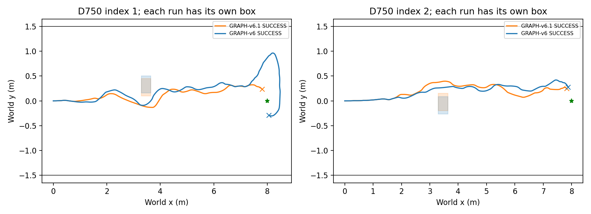
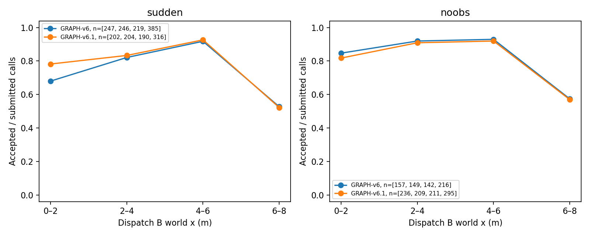

# Phase 11 — Graph-v6.1 adaptive progress

Execution commit: `524f063e48c27b83b027de7a5f1055b171a84ab7`; COMPLETE, 20/20 attempts.
Oracle geometry evaluation; SE(2) kinematic Isaac Sim; no claim of identical paired RGB

Only endpoint progress changes: p_native=(native FRESH endpoint−B.xy)·B-forward; target=min(0.25,0.9·max(p_native,0)). Target=0 removes that residual. The original 0.25m normalization, all other weights, initialization, constraints, solver, worker timing and CURV fallback are preserved. Observation anchoring is unchanged.

## Table 1 — sudden obstacle comparisons

|delay_ms|method|planned|valid|safe_passage|success|collision|corridor|timeout|other_stop|technical|placement_invalid|dynamic_minimum_clearance_m|backtracking_events|goal_time_median_s|mean_speed_m_s|
|---|---|---|---|---|---|---|---|---|---|---|---|---|---|---|---|
|750|GRAPH-v6.1|8|8|8|7|0|0|1|0|0|0|0.0308|5|48.0139|0.1700|
|0|GRAPH-v6.1|4|4|4|3|0|1|0|0|0|0|0.0527|0|32.0000|0.2429|
|750|CURV|8|8|4|3|4|0|1|0|0|0|-0.0030|4|52.5972|0.1517|
|0|CURV|4|4|2|2|2|0|0|0|0|0|-0.0021|0|31.7222|0.2537|
|750|SELECT|8|8|4|3|4|0|1|0|0|0|-0.0011|3|43.5000|0.1592|
|750|INTENT-SPLICE|8|8|8|5|0|1|2|0|0|0|0.0228|1|45.8194|0.1385|
|750|GRAPH-v6|8|8|8|6|0|1|1|0|0|0|0.0240|3|49.1597|0.1636|
|0|GRAPH-v6|4|4|4|1|0|2|1|0|0|0|0.0436|2|31.7222|0.2201|

Safe passage means footprint rear clears box rear with no dynamic geometric overlap through that tick; later corridor failure does not erase passage. It does not imply 2cm margin or goal success. Conservative contact stops are reported separately.

## Table 2 — placement side (+1 odd / −1 even)

|delay_ms|method|placement_s|planned|valid|safe_passage|success|collision|corridor|timeout|
|---|---|---|---|---|---|---|---|---|---|
|750|GRAPH-v6.1|1|4|4|4|3|0|0|1|
|750|GRAPH-v6.1|-1|4|4|4|4|0|0|0|
|0|GRAPH-v6.1|1|2|2|2|1|0|1|0|
|0|GRAPH-v6.1|-1|2|2|2|2|0|0|0|
|750|CURV|1|4|4|0|0|4|0|0|
|750|CURV|-1|4|4|4|3|0|0|1|
|0|CURV|1|2|2|1|1|1|0|0|
|0|CURV|-1|2|2|1|1|1|0|0|
|750|SELECT|1|4|4|1|1|3|0|0|
|750|SELECT|-1|4|4|3|2|1|0|1|
|750|INTENT-SPLICE|1|4|4|4|3|0|0|1|
|750|INTENT-SPLICE|-1|4|4|4|2|0|1|1|
|750|GRAPH-v6|1|4|4|4|4|0|0|0|
|750|GRAPH-v6|-1|4|4|4|2|0|1|1|
|0|GRAPH-v6|1|2|2|2|0|0|2|0|
|0|GRAPH-v6|-1|2|2|2|1|0|0|1|

## Table 3 — obstacle-free controls

|delay_ms|method|planned|valid|success|collision|corridor|timeout|other_stop|technical|placement_invalid|backtracking_events|goal_time_median_s|mean_speed_m_s|near_goal_max_abs_y_m|near_goal_left_time_mean_s|
|---|---|---|---|---|---|---|---|---|---|---|---|---|---|---|---|
|750|GRAPH-v6.1|4|4|2|0|0|2|0|0|0|5|44.3819|0.1739|0.9378|0.0000|
|0|GRAPH-v6.1|4|4|2|0|1|1|0|0|0|4|30.9236|0.2241|1.4104|2.4826|
|750|CURV|4|4|2|0|2|0|0|0|0|0|46.3125|0.1574|1.4105|2.3333|
|0|CURV|4|4|4|0|0|0|0|0|0|0|31.4931|0.2557|0.3569|0.0000|
|750|GRAPH-v6|4|4|4|0|0|0|0|0|0|0|45.3750|0.1765|0.5091|0.0000|
|0|GRAPH-v6|4|4|4|0|0|0|0|0|0|0|31.6597|0.2544|0.3932|0.0000|

## Table 4 — native chunk length diagnostics

|scene|method|length_class|calls|solver_calls|nonconverged|nonconverged_rate|solver_only_nonconverged_rate|accepted|acceptance_rate|initialization_rejected|terminal_unapplied|disabled_progress|progress_cost|
|---|---|---|---|---|---|---|---|---|---|---|---|---|---|
|sudden|GRAPH-v6|<0.25|348|328|223|0.6408|0.6799|102|0.2931|18|2|0|{'n': 328, 'median': 0.1582600050311628, 'p95': 0.613360398527079, 'min': 0.0, 'max': 5.67726896571964}|
|sudden|GRAPH-v6|>=0.25|916|832|77|0.0841|0.0925|721|0.7871|82|2|0|{'n': 832, 'median': 0.0, 'p95': 0.15863700175321566, 'min': 0.0, 'max': 4.4871418815355595}|
|noobs|GRAPH-v6|<0.25|109|99|55|0.5046|0.5556|41|0.3761|7|3|0|{'n': 99, 'median': 0.06824774037083513, 'p95': 0.28763210751483315, 'min': 0.0, 'max': 0.4004955079436183}|
|noobs|GRAPH-v6|>=0.25|555|516|15|0.0270|0.0291|485|0.8739|39|0|0|{'n': 516, 'median': 0.0, 'p95': 0.06071495599949659, 'min': 0.0, 'max': 0.30718845584564913}|
|POOLED|GRAPH-v6|<0.25|457|427|278|0.6083|0.6511|143|0.3129|25|5|0|{'n': 427, 'median': 0.1217215618378997, 'p95': 0.5450933573933615, 'min': 0.0, 'max': 5.67726896571964}|
|POOLED|GRAPH-v6|>=0.25|1471|1348|92|0.0625|0.0682|1206|0.8199|121|2|0|{'n': 1348, 'median': 0.0, 'p95': 0.13504375040547054, 'min': 0.0, 'max': 4.4871418815355595}|
|sudden|GRAPH-v6.1|<0.25|221|203|126|0.5701|0.6207|74|0.3348|15|3|27|{'n': 203, 'median': 0.0, 'p95': 0.0, 'min': 0.0, 'max': 0.03384422764639026}|
|sudden|GRAPH-v6.1|>=0.25|736|652|25|0.0340|0.0383|615|0.8356|84|0|6|{'n': 652, 'median': 0.0, 'p95': 0.0, 'min': 0.0, 'max': 1.6418790764921514}|
|noobs|GRAPH-v6.1|<0.25|249|236|166|0.6667|0.7034|65|0.2610|11|2|59|{'n': 236, 'median': 0.0, 'p95': 0.0, 'min': 0.0, 'max': 0.000990265873383464}|
|noobs|GRAPH-v6.1|>=0.25|827|780|31|0.0375|0.0397|719|0.8694|44|3|18|{'n': 780, 'median': 0.0, 'p95': 0.0, 'min': 0.0, 'max': 0.0}|
|POOLED|GRAPH-v6.1|<0.25|470|439|292|0.6213|0.6651|139|0.2957|26|5|86|{'n': 439, 'median': 0.0, 'p95': 0.0, 'min': 0.0, 'max': 0.03384422764639026}|
|POOLED|GRAPH-v6.1|>=0.25|1563|1432|56|0.0358|0.0391|1334|0.8535|128|3|24|{'n': 1432, 'median': 0.0, 'p95': 0.0, 'min': 0.0, 'max': 1.6418790764921514}|

Native length and forward endpoint projection are different quantities. Nonconvergence uses independent solver success over all submitted calls (matching Phase10B); solver-only rates and initialization failures remain separate. Disabled progress has cost0 only when a solver result exists. C6_FIXED uses the preregistered 61%/2=30.5% threshold, not a fitted threshold.

## Table 5 — Topomap backward transitions

|scene|delay_ms|method|valid|intent_stage|observations|closest_backwards|subgoal_backwards|
|---|---|---|---|---|---|---|---|
|sudden|750|GRAPH-v6.1|8|intent_active|77|23|23|
|sudden|750|GRAPH-v6.1|8|other|356|44|57|
|sudden|0|GRAPH-v6.1|4|intent_active|104|15|13|
|sudden|0|GRAPH-v6.1|4|other|428|16|29|
|noobs|750|GRAPH-v6.1|4|intent_active|0|0|0|
|noobs|750|GRAPH-v6.1|4|other|270|70|75|
|noobs|0|GRAPH-v6.1|4|intent_active|0|0|0|
|noobs|0|GRAPH-v6.1|4|other|811|76|92|
|sudden|750|CURV|8|intent_active|75|28|28|
|sudden|750|CURV|8|other|264|39|42|
|sudden|0|CURV|4|intent_active|83|13|13|
|sudden|0|CURV|4|other|256|6|16|
|sudden|750|SELECT|8|intent_active|89|28|29|
|sudden|750|SELECT|8|other|225|27|45|
|sudden|750|INTENT-SPLICE|8|intent_active|193|12|11|
|sudden|750|INTENT-SPLICE|8|other|292|38|48|
|sudden|750|GRAPH-v6|8|intent_active|90|27|27|
|sudden|750|GRAPH-v6|8|other|372|62|64|
|sudden|0|GRAPH-v6|4|intent_active|192|28|28|
|sudden|0|GRAPH-v6|4|other|619|47|60|
|noobs|750|CURV|4|intent_active|0|0|0|
|noobs|750|CURV|4|other|221|41|48|
|noobs|0|CURV|4|intent_active|0|0|0|
|noobs|0|CURV|4|other|480|15|32|
|noobs|750|GRAPH-v6|4|intent_active|0|0|0|
|noobs|750|GRAPH-v6|4|other|185|29|32|
|noobs|0|GRAPH-v6|4|intent_active|0|0|0|
|noobs|0|GRAPH-v6|4|other|484|19|42|

classify backwards transition by newer inference observation pose/time; active iff geometry published by observation_monotonic_ns and unchanged intention(config,pose) is non-null; no world pose used for localization. Phase10B backtracking (yaw≥150° for≥2s), near-goal diagnostics, passage time/side and all call p_native/targets are saved in CSV/JSON.

## Independent preregistered decisions

|name|verdict|actual|target|reference|required_increment|short_rate|threshold|
|---|---|---|---|---|---|---|---|
|V61_SAFE_PASSAGE|SUPPORTED|12|11|N/A|N/A|N/A|N/A|
|V61_GOAL_IMPROVES|SUPPORTED|10|N/A|7|3|N/A|N/A|
|V61_VS_SPLICE|SUPPORTED|7|N/A|5|2|N/A|N/A|
|C6_FIXED|NOT_SUPPORTED|N/A|N/A|N/A|N/A|0.6213|0.3050|
|NO_HARM_NOOBS|NOT_SUPPORTED|4|7|N/A|N/A|N/A|N/A|

Each involved scene×delay×method group requires ceil(87.5% of planned) valid runs: 7/8 and 4/4. Technical and PLACEMENT_INVALID runs are excluded from valid denominators; no retry. Missing short calls make C6 INCONCLUSIVE. Original Phase9 and Phase10B results are reused read-only, with input hashes verified.

Counts are exploratory; same seed does not guarantee identical RGB or obstacle placement. A reduction in short-chunk nonconvergence alone does not establish causality or navigation improvement. No method tuning or automatic further experiments.
