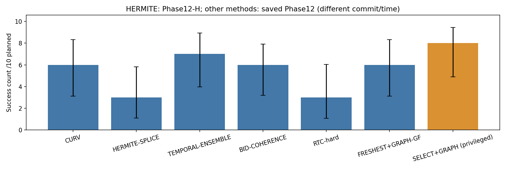

# Phase12-H — HERMITE-SPLICE follow-up

HERMITE execution commit: `3b5c1f956b4b315f754a92005f1a292444e72fc3`; saved Phase12 reference commit: `b767279cbdfc9700a497094873b7136a32f7e278`.
**These runs use a different commit and execution time from Phase12.** Same paired seed indices25–34 do not imply identical RGB, NoMaD predictions or asynchronous timing. Only the Hermite metadata bool serialization was fixed; the path definition and PP + CURV were not changed.
Original Phase12 HERMITE technical failure and9 gated skips remain preserved; they are not counted as new Phase12-H attempts. The combined table uses the new HERMITE row and60 saved non-HERMITE rows.

State: COMPLETE; attempts 10, skipped 0. No automatic retry or parameter changes.
S0 D750, vmax0.3, alpha inf, PP lookahead0.25m, 4/9/72Hz, 1s waypoint timeout,90s navigation limit. Oracle geometry is evaluation-only for main methods; SELECT+GRAPH is a privileged reference.
Success = goal entry without geometric overlap or corridor intrusion. Margin violations and conservative contact stops are reported separately; missing goal times are not imputed.

## Table1 — HERMITE

|method|source_phase|planned|valid|success|collision|corridor|timeout|technical|skipped|conservative_contact|goal_time_median_s|mean_speed_m_s|clearance_min_m|curv_slow_time_fraction|endpoint_clamp_fraction|
|---|---|---|---|---|---|---|---|---|---|---|---|---|---|---|---|
|HERMITE-SPLICE|12-H (new)|10|9|3|2|3|1|1|0|0|31.2639|0.1309|-0.0025|0.6972|0.6500|

## Table2 — combined seven methods

|method|source_phase|planned|valid|success|collision|corridor|timeout|technical|skipped|conservative_contact|goal_time_median_s|mean_speed_m_s|clearance_min_m|curv_slow_time_fraction|endpoint_clamp_fraction|
|---|---|---|---|---|---|---|---|---|---|---|---|---|---|---|---|
|CURV|12 (reused)|10|10|6|2|0|2|0|0|0|56.4792|0.1412|-0.0018|0.6464|0.6750|
|HERMITE-SPLICE|12-H (new)|10|9|3|2|3|1|1|0|0|31.2639|0.1309|-0.0025|0.6972|0.6500|
|TEMPORAL-ENSEMBLE|12 (reused)|10|10|7|0|2|1|0|0|0|32.2361|0.1412|0.0327|0.6551|0.6872|
|BID-COHERENCE|12 (reused)|10|9|6|0|2|1|1|0|0|32.6667|0.1368|0.0640|0.6614|0.6756|
|RTC-hard|12 (reused)|10|10|3|5|0|2|0|0|0|35.6250|0.1286|-0.0010|0.6866|0.6814|
|FRESHEST+GRAPH-GF|12 (reused)|10|10|6|2|0|2|0|0|0|30.4722|0.1674|-0.0004|0.5434|0.5787|
|SELECT+GRAPH|12 (reused)|10|10|8|0|2|0|0|0|0|26.7986|0.1714|0.0195|0.5224|0.6094|

## Table3 — paired outcomes

|index|CURV|HERMITE-SPLICE|TEMPORAL-ENSEMBLE|BID-COHERENCE|RTC-hard|FRESHEST+GRAPH-GF|SELECT+GRAPH|
|---|---|---|---|---|---|---|---|
|25|SUCCESS|SUCCESS|SUCCESS|SUCCESS|SAFETY_FAILURE|SUCCESS|SAFETY_FAILURE|
|26|STUCK|STUCK|SUCCESS|SUCCESS|SAFETY_FAILURE|SAFETY_FAILURE|SUCCESS|
|27|SUCCESS|TECHNICAL_FAILURE|SUCCESS|SAFETY_FAILURE|SAFETY_FAILURE|SUCCESS|SUCCESS|
|28|SUCCESS|SAFETY_FAILURE|SUCCESS|SUCCESS|STUCK|SUCCESS|SUCCESS|
|29|SAFETY_FAILURE|SAFETY_FAILURE|SUCCESS|SUCCESS|SAFETY_FAILURE|SUCCESS|SUCCESS|
|30|SUCCESS|SUCCESS|SUCCESS|STUCK|SUCCESS|STUCK|SAFETY_FAILURE|
|31|SUCCESS|SAFETY_FAILURE|SAFETY_FAILURE|SAFETY_FAILURE|STUCK|SUCCESS|SUCCESS|
|32|STUCK|SAFETY_FAILURE|SUCCESS|TECHNICAL_FAILURE|SUCCESS|SUCCESS|SUCCESS|
|33|SUCCESS|SAFETY_FAILURE|SAFETY_FAILURE|SUCCESS|SUCCESS|SAFETY_FAILURE|SUCCESS|
|34|SAFETY_FAILURE|SUCCESS|STUCK|SUCCESS|SAFETY_FAILURE|STUCK|SUCCESS|

## Mechanisms — unchanged Phase6 definitions

|method|outcome|runs|heading_abs_rad_median_run_mean|heading_abs_rad_p95_run_mean|cross_track_m_median_run_mean|cross_track_m_p95_run_mean|time_abs_y_over1_s|minimum_wall_footprint_clearance_lower_m|
|---|---|---|---|---|---|---|---|---|
|BID-COHERENCE|SUCCESS|6|0.2626|0.7136|0.0158|0.0704|1.9954|0.6848|
|BID-COHERENCE|NON_SUCCESS|3|0.3103|0.9221|0.0130|0.0419|10.8194|0.0372|
|CURV|SUCCESS|6|0.2760|0.6568|0.0146|0.0625|0.5764|0.6307|
|CURV|NON_SUCCESS|4|0.2607|0.6972|0.0152|0.0496|15.5035|0.1808|
|FRESHEST+GRAPH-GF|SUCCESS|6|0.1726|0.5606|0.0052|0.0485|1.5486|0.5989|
|FRESHEST+GRAPH-GF|NON_SUCCESS|4|0.1769|0.6447|0.0047|0.0565|12.9410|0.4395|
|HERMITE-SPLICE|SUCCESS|3|N/A|N/A|0.0000|0.0000|0.0000|0.8318|
|HERMITE-SPLICE|NON_SUCCESS|6|N/A|N/A|0.0000|0.0000|9.5671|0.1088|
|RTC-hard|SUCCESS|3|0.2607|0.7062|0.0240|0.0896|0.0000|0.8284|
|RTC-hard|NON_SUCCESS|7|0.3022|0.9168|0.0345|0.2067|6.4563|0.4595|
|SELECT+GRAPH|SUCCESS|8|0.1455|0.5353|0.0051|0.0540|1.7101|0.6812|
|SELECT+GRAPH|NON_SUCCESS|2|0.2028|0.8851|0.0111|0.0527|13.3681|-0.0004|
|TEMPORAL-ENSEMBLE|SUCCESS|7|0.2467|0.5849|0.0164|0.0586|3.7698|0.6907|
|TEMPORAL-ENSEMBLE|NON_SUCCESS|3|0.3194|0.7978|0.0160|0.0686|13.1944|0.1240|

Switch heading/cross-track summarize run medians/p95; |y|>1 time and wall footprint clearance use the original Phase6 evaluator. No new paths are inferred for skipped runs.

## Preregistered comparisons

|reference|role|reference_valid|hermite_valid|reference_success|hermite_success|BEATS_HERMITE_SPLICE|SPEED_VS_HERMITE_SPLICE|paired_n|mean_speed_difference_m_s|bootstrap95|
|---|---|---|---|---|---|---|---|---|---|---|
|FRESHEST+GRAPH-GF|main oracle-free|10|9|6|3|PASS|INCONCLUSIVE|1|0.0144|[0.014387685775709425, 0.014387685775709425]|
|SELECT+GRAPH|privileged reference only|10|9|8|3|PASS|INCONCLUSIVE|1|0.0249|[0.024850269779988665, 0.024850269779988665]|

Each method needs≥9 valid runs; speed also requires≥5 both-success pairs. Paired bootstrap20,000 replicates, seed20261026, run-index resampling. SELECT+GRAPH comparisons are reference-only. Wilson bars are descriptive.

## Technical failures and gated skips

|key|classification|error|
|---|---|---|
|S0_27_D750_HERMITE-SPLICE|TECHNICAL_FAILURE|RuntimeError('Launcher exit 1')|
