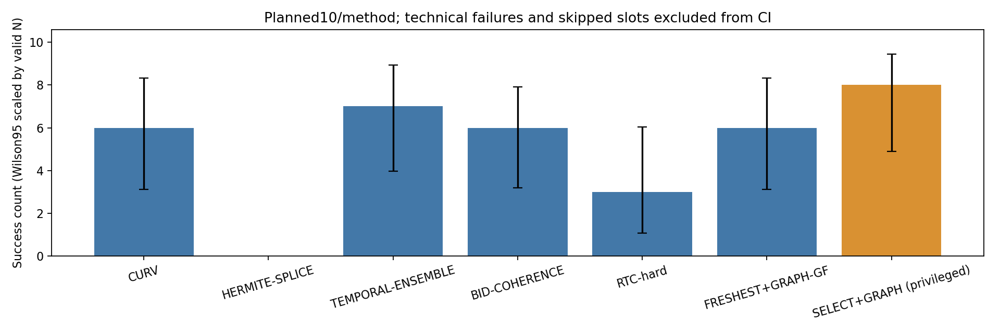
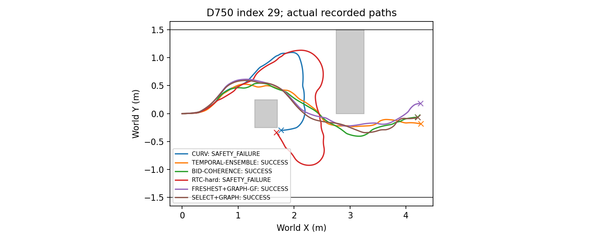

# Phase12 — oracle-free chunk transition baselines

## Fairness principles

1. Main methods1–6 use only RGB + Topomap for NoMaD, actual robot state, OLD/FRESH chunks and eight samples.
2. Obstacle and wall coordinates are never used by main-method control; identical oracle geometry is used only for collision/corridor evaluation.
3. SELECT+GRAPH alone uses oracle control and is a privileged reference, excluded from main decisions.
4. All methods share executor, delay, seed and timeout; computation latency is real and outputs are applied only after completion.

Execution commit: `b767279cbdfc9700a497094873b7136a32f7e278`; COMPLETE; attempted 61, skipped 9 /70 slots.
SE(2) kinematic Isaac Sim; oracle only SELECT+GRAPH control; all methods use oracle for post-hoc safety evaluation.

All methods: S0 D750, PP lookahead0.25m + unchanged CURV speed, vmax0.3, 4/9/72Hz, 1s timeout, 90s limit. Seeds25–34. No retries. Success is goal entry without geometric overlap or corridor intrusion. Conservative contact stops remain separate; 2cm margin violations do not automatically count as collisions.

HERMITE uses B heading and original FRESH tangent at the0.30m-ahead join; analytic cubic C1 continuity, sampled every2cm approximately in arclength. TEMPORAL-ENSEMBLE is **ACT temporal ensembling (spatial adaptation)**, not native action-time ensembling. BID is **BID backward-coherence only**, without forward contrast. RTC-hard is **RTC hard-masking ablation (DDPM adaptation)**. FRESHEST+GRAPH-GF selects the longest remaining path without safety filtering and retains v4 geometry-free factors/constraints. SDF, corridor constraints and exact certificate are disabled; obstacle-side residuals have no labels. SELECT+GRAPH retains original Phase8 selection and Graph v4 as a **privileged reference**, excluded from main decisions.

## Table1 — results

|method|role|planned|attempted|valid|success|collision|corridor|timeout|technical|skipped|conservative_contact|goal_time_median_s|mean_speed_m_s|clearance_min_m|success_wilson95|curv_slow_time_fraction|endpoint_clamp_fraction|
|---|---|---|---|---|---|---|---|---|---|---|---|---|---|---|---|---|---|
|CURV|main (oracle-free)|10|10|10|6|2|0|2|0|0|0|56.4792|0.1412|-0.0018|[0.31267376973365824, 0.8318196702937638]|0.6464|0.6750|
|HERMITE-SPLICE|main (oracle-free)|10|1|0|0|0|0|0|1|9|0|N/A|N/A|N/A|N/A|N/A|N/A|
|TEMPORAL-ENSEMBLE|main (oracle-free)|10|10|10|7|0|2|1|0|0|0|32.2361|0.1412|0.0327|[0.39677814746114537, 0.8922087325936989]|0.6551|0.6872|
|BID-COHERENCE|main (oracle-free)|10|10|9|6|0|2|1|1|0|0|32.6667|0.1368|0.0640|[0.3542021355803963, 0.879416181613089]|0.6614|0.6756|
|RTC-hard|main (oracle-free)|10|10|10|3|5|0|2|0|0|0|35.6250|0.1286|-0.0010|[0.10779126740630099, 0.6032218525388546]|0.6866|0.6814|
|FRESHEST+GRAPH-GF|main (oracle-free)|10|10|10|6|2|0|2|0|0|0|30.4722|0.1674|-0.0004|[0.31267376973365824, 0.8318196702937638]|0.5434|0.5787|
|SELECT+GRAPH|privileged reference|10|10|10|8|0|2|0|0|0|0|26.7986|0.1714|0.0195|[0.49016247153664183, 0.9433178485456247]|0.5224|0.6094|

## Table2 — paired index results

|index|CURV|HERMITE-SPLICE|TEMPORAL-ENSEMBLE|BID-COHERENCE|RTC-hard|FRESHEST+GRAPH-GF|SELECT+GRAPH|
|---|---|---|---|---|---|---|---|
|25|SUCCESS|TECHNICAL_FAILURE|SUCCESS|SUCCESS|SAFETY_FAILURE|SUCCESS|SAFETY_FAILURE|
|26|STUCK|SKIPPED_TECHNICAL_GATE|SUCCESS|SUCCESS|SAFETY_FAILURE|SAFETY_FAILURE|SUCCESS|
|27|SUCCESS|SKIPPED_TECHNICAL_GATE|SUCCESS|SAFETY_FAILURE|SAFETY_FAILURE|SUCCESS|SUCCESS|
|28|SUCCESS|SKIPPED_TECHNICAL_GATE|SUCCESS|SUCCESS|STUCK|SUCCESS|SUCCESS|
|29|SAFETY_FAILURE|SKIPPED_TECHNICAL_GATE|SUCCESS|SUCCESS|SAFETY_FAILURE|SUCCESS|SUCCESS|
|30|SUCCESS|SKIPPED_TECHNICAL_GATE|SUCCESS|STUCK|SUCCESS|STUCK|SAFETY_FAILURE|
|31|SUCCESS|SKIPPED_TECHNICAL_GATE|SAFETY_FAILURE|SAFETY_FAILURE|STUCK|SUCCESS|SUCCESS|
|32|STUCK|SKIPPED_TECHNICAL_GATE|SUCCESS|TECHNICAL_FAILURE|SUCCESS|SUCCESS|SUCCESS|
|33|SUCCESS|SKIPPED_TECHNICAL_GATE|SAFETY_FAILURE|SUCCESS|SUCCESS|SAFETY_FAILURE|SUCCESS|
|34|SAFETY_FAILURE|SKIPPED_TECHNICAL_GATE|STUCK|SUCCESS|SAFETY_FAILURE|STUCK|SUCCESS|

## Table3 — mechanisms (run means, success/failure separate)

|method|outcome|runs|heading_abs_rad_median_run_mean|heading_abs_rad_p95_run_mean|cross_track_m_median_run_mean|cross_track_m_p95_run_mean|time_abs_y_over1_s|minimum_wall_footprint_clearance_lower_m|
|---|---|---|---|---|---|---|---|---|
|BID-COHERENCE|SUCCESS|6|0.2626|0.7136|0.0158|0.0704|1.9954|0.6848|
|BID-COHERENCE|NON_SUCCESS|3|0.3103|0.9221|0.0130|0.0419|10.8194|0.0372|
|CURV|SUCCESS|6|0.2760|0.6568|0.0146|0.0625|0.5764|0.6307|
|CURV|NON_SUCCESS|4|0.2607|0.6972|0.0152|0.0496|15.5035|0.1808|
|FRESHEST+GRAPH-GF|SUCCESS|6|0.1726|0.5606|0.0052|0.0485|1.5486|0.5989|
|FRESHEST+GRAPH-GF|NON_SUCCESS|4|0.1769|0.6447|0.0047|0.0565|12.9410|0.4395|
|RTC-hard|SUCCESS|3|0.2607|0.7062|0.0240|0.0896|0.0000|0.8284|
|RTC-hard|NON_SUCCESS|7|0.3022|0.9168|0.0345|0.2067|6.4563|0.4595|
|SELECT+GRAPH|SUCCESS|8|0.1455|0.5353|0.0051|0.0540|1.7101|0.6812|
|SELECT+GRAPH|NON_SUCCESS|2|0.2028|0.8851|0.0111|0.0527|13.3681|-0.0004|
|TEMPORAL-ENSEMBLE|SUCCESS|7|0.2467|0.5849|0.0164|0.0586|3.7698|0.6907|
|TEMPORAL-ENSEMBLE|NON_SUCCESS|3|0.3194|0.7978|0.0160|0.0686|13.1944|0.1240|

Temporal ensemble has no unique applied polyline. Its switch cross-track and heading errors use weighted per-component Phase6 projections; heading is valid only when every component has a valid20mm tangent. This adaptation is not a fictitious averaged path. Other methods use the unchanged Phase6 metrics.

## Table4 — method statistics

|method|valid|selection_switches|selection_replacements|selection_replacement_ratio|ensemble_mean_chunks|inference_median_ms|graph_calls|graph_accepted|graph_nonconverged|graph_dispositions|graph_solve_pooled_s|corrected_run_fraction_mean|corrected_distance_fraction_mean|
|---|---|---|---|---|---|---|---|---|---|---|---|---|---|
|CURV|10|0|0|N/A|N/A|35.6801|0|0|0|{}|{'n': 0}|0.0000|0.0000|
|HERMITE-SPLICE|0|0|0|N/A|N/A|N/A|0|0|0|{}|{'n': 0}|N/A|N/A|
|TEMPORAL-ENSEMBLE|10|428|0|0.0000|1.0184|35.9596|0|0|0|{}|{'n': 0}|0.0000|0.0000|
|BID-COHERENCE|9|343|40|0.1166|N/A|36.0239|0|0|0|{}|{'n': 0}|0.0000|0.0000|
|RTC-hard|10|0|0|N/A|N/A|70.4894|0|0|0|{}|{'n': 0}|0.0000|0.0000|
|FRESHEST+GRAPH-GF|10|426|376|0.8826|N/A|35.9189|426|363|15|{'INITIALIZATION_REJECTED': 48, 'ACCEPTED': 363, 'NONCONVERGED': 15}|{'n': 378, 'median': 0.04751732648583129, 'p95': 0.05950345312594427, 'min': 0.03666558500844985, 'max': 0.1658029480604455}|0.7399|0.7666|
|SELECT+GRAPH|10|337|294|0.8724|N/A|35.9595|337|274|20|{'INITIALIZATION_REJECTED': 42, 'ACCEPTED': 274, 'NONCONVERGED': 20}|{'n': 294, 'median': 0.05702671245671809, 'p95': 0.08892084394465183, 'min': 0.041663506999611855, 'max': 0.22117204102687538}|0.7205|0.7673|

BID/FRESHEST sample replacement rate uses switched FRESH. Mean ensemble chunk count uses valid control ticks with live paths; endpoint clamp is any live component clamp. RTC inference is median of run medians. Original methods, weights, normalization, timing and raw data are preserved.

## Independent preregistered decisions

|name|verdict|
|---|---|
|BEATS_CURV|FAIL|
|SPEED_VS_CURV|INCONCLUSIVE|
|BEATS_HERMITE-SPLICE|INCONCLUSIVE|
|SPEED_VS_HERMITE-SPLICE|INCONCLUSIVE|
|BEATS_TEMPORAL-ENSEMBLE|FAIL|
|SPEED_VS_TEMPORAL-ENSEMBLE|FASTER|
|BEATS_BID-COHERENCE|FAIL|
|SPEED_VS_BID-COHERENCE|INCONCLUSIVE|
|BEATS_RTC-hard|PASS|
|SPEED_VS_RTC-hard|INCONCLUSIVE|

## Paired speed differences (FRESHEST+GRAPH-GF minus comparator)

|comparator|n|mean_speed_difference_m_s|bootstrap95|speed_verdict|fisher_exact_p_reference_only|
|---|---|---|---|---|---|
|CURV|4|0.0191|[0.008183103708390066, 0.031164102798960126]|INCONCLUSIVE|1.0000|
|HERMITE-SPLICE|0|N/A|N/A|INCONCLUSIVE|N/A|
|TEMPORAL-ENSEMBLE|5|0.0201|[0.005333636523016927, 0.035004371402905146]|FASTER|1.0000|
|BID-COHERENCE|3|0.0170|[-0.003027552032953157, 0.029659684808807013]|INCONCLUSIVE|1.0000|
|RTC-hard|1|0.0441|[0.04407580503568481, 0.04407580503568481]|INCONCLUSIVE|0.3698|

Each method requires≥9 valid runs; speed also requires≥5 both-success pairs. Paired bootstrap:20,000 replicates, seed20261026, run-index resampling. Missing goal times are not imputed. Fisher/Wilson are reference only. Same seed does not imply identical closed-loop RGB or predictions.

## ORACLE_GAP — report only

SELECT+GRAPH (privileged) minus FRESHEST+GRAPH-GF; not a main verdict.

|role|privileged_valid|oracle_free_valid|success_count_difference|both_success_indices|paired_n|paired_mean_speed_difference_m_s|
|---|---|---|---|---|---|---|
|descriptive only|10|10|2|[27, 28, 29, 31, 32]|5|0.0145|
## Technical failures and gated skips

|key|classification|error|
|---|---|---|
|S0_25_D750_HERMITE-SPLICE|TECHNICAL_FAILURE|RuntimeError('Launcher exit 1')|
|S0_26_D750_HERMITE-SPLICE|SKIPPED_TECHNICAL_GATE|New-method index25 technical gate|
|S0_27_D750_HERMITE-SPLICE|SKIPPED_TECHNICAL_GATE|New-method index25 technical gate|
|S0_28_D750_HERMITE-SPLICE|SKIPPED_TECHNICAL_GATE|New-method index25 technical gate|
|S0_29_D750_HERMITE-SPLICE|SKIPPED_TECHNICAL_GATE|New-method index25 technical gate|
|S0_30_D750_HERMITE-SPLICE|SKIPPED_TECHNICAL_GATE|New-method index25 technical gate|
|S0_31_D750_HERMITE-SPLICE|SKIPPED_TECHNICAL_GATE|New-method index25 technical gate|
|S0_32_D750_HERMITE-SPLICE|SKIPPED_TECHNICAL_GATE|New-method index25 technical gate|
|S0_32_D750_BID-COHERENCE|TECHNICAL_FAILURE|RuntimeError('Launcher exit 1')|
|S0_33_D750_HERMITE-SPLICE|SKIPPED_TECHNICAL_GATE|New-method index25 technical gate|
|S0_34_D750_HERMITE-SPLICE|SKIPPED_TECHNICAL_GATE|New-method index25 technical gate|
