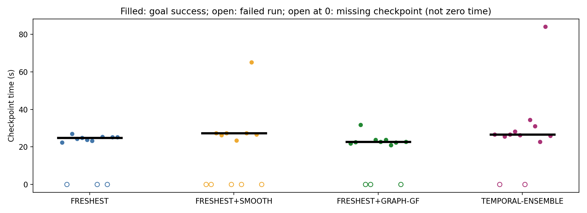
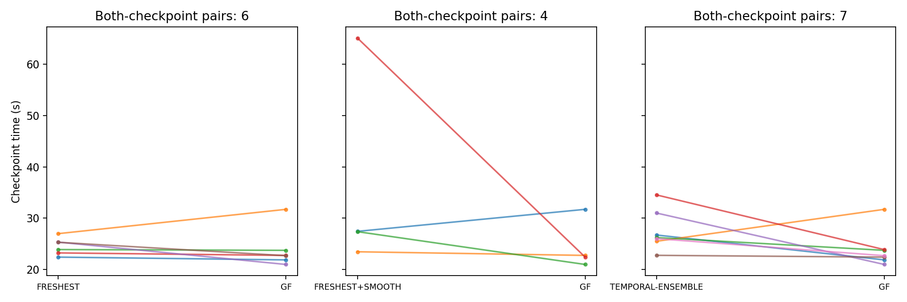
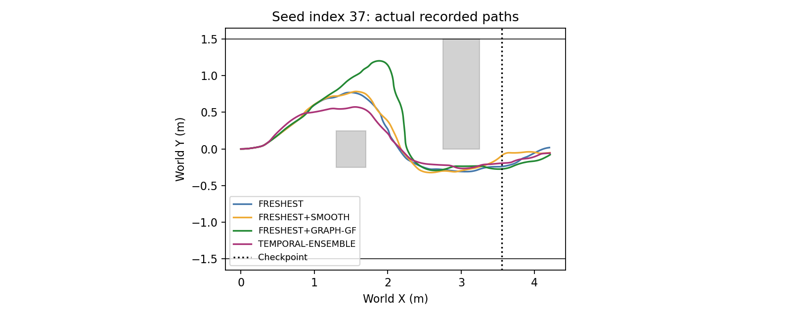

# Phase 13 — oracle-free speed decomposition

Execution SHA: `924a0382f48228a83ed3dd052645ecb13cc86aa7`. 48 serial attempts, 12 per method; no retries or skipped technical gates.

Same S0, D750, vmax0.3, alpha infinity, PP+CURV, 4/9/72Hz, 1s timeout, 90s limit. No obstacle or wall coordinates enter any controller. Oracle geometry is evaluation-only. GF and ACT temporal ensembling (spatial adaptation) reuse the unchanged Phase12 implementations.

Checkpoint: first recorded72Hz robot x >= StaticObstacle2 center_x + size_x/2 +0.30m, read from the scenario. Missing checkpoint/goal times are never replaced by timeout. Checkpoint average speed includes initial waiting. Curvature slowdown is the duration-weighted fraction of moving control intervals with target speed<0.2. Endpoint clamp retains the Phase12 control-tick definition. Minimum obstacle clearance includes the robot footprint.

## Method summary

|method|planned|attempted|valid|technical|success|success_wilson95|checkpoint_count|checkpoint_median_s|goal_time_median_s|checkpoint_mean_speed_m_s|curv_slow_time_fraction|endpoint_clamp_fraction|minimum_clearance_m|graph_calls|graph_accepted|graph_acceptance|solve_median_s|solve_p95_s|nonconverged|
|---|---|---|---|---|---|---|---|---|---|---|---|---|---|---|---|---|---|---|---|
|FRESHEST|12|12|12|0|9|[0.46769466506643426, 0.9110583316059453]|9|24.8611|29.0000|0.1672|0.6060|0.5584|0.0463|0|0|N/A|N/A|N/A|0|
|FRESHEST+SMOOTH|12|12|12|0|7|[0.31951131254954973, 0.8067396863412435]|7|27.3750|32.3611|0.1601|0.6363|0.4711|0.0685|0|0|N/A|N/A|N/A|0|
|FRESHEST+GRAPH-GF|12|12|12|0|9|[0.46769466506643426, 0.9110583316059453]|9|22.6944|27.0278|0.1785|0.5063|0.6014|-0.0008|292|241|0.8253|0.0475|0.0522|11|
|TEMPORAL-ENSEMBLE|12|12|12|0|10|[0.5519691377470266, 0.9530348578161463]|10|26.7222|31.6111|0.1502|0.6459|0.6950|0.0268|0|0|N/A|N/A|N/A|0|

## Seed × method

|index|FRESHEST|FRESHEST+SMOOTH|FRESHEST+GRAPH-GF|TEMPORAL-ENSEMBLE|
|---|---|---|---|---|
|35|SUCCESS|STUCK|SUCCESS|SUCCESS|
|36|SAFETY_FAILURE|SAFETY_FAILURE|SUCCESS|SAFETY_FAILURE|
|37|SUCCESS|SUCCESS|SUCCESS|SUCCESS|
|38|SUCCESS|SUCCESS|SAFETY_FAILURE|SUCCESS|
|39|SUCCESS|SUCCESS|SAFETY_FAILURE|SUCCESS|
|40|SUCCESS|STUCK|SUCCESS|SUCCESS|
|41|SUCCESS|SUCCESS|SUCCESS|SAFETY_FAILURE|
|42|STUCK|STUCK|SUCCESS|SUCCESS|
|43|SUCCESS|SUCCESS|SUCCESS|SUCCESS|
|44|SAFETY_FAILURE|SUCCESS|SUCCESS|SUCCESS|
|45|SUCCESS|SUCCESS|SAFETY_FAILURE|SUCCESS|
|46|SUCCESS|STUCK|SUCCESS|SUCCESS|

## Paired checkpoint difference

Difference = first method minus comparator, seconds. Both-checkpoint pairs only; 20,000 paired bootstrap replicates, seed20261026. FASTER: n>=8 and upper CI<0; SLOWER: n>=8 and lower CI>0; otherwise INCONCLUSIVE. NONINFERIOR is only the preregistered success-count tolerance, not a statistical noninferiority test. Wilson intervals describe valid-run success; technical failures are separate.

|method|comparator|n|mean_difference_s|ci95_s|verdict|noninferior|
|---|---|---|---|---|---|---|
|FRESHEST+GRAPH-GF|FRESHEST|6|-0.5671|[-2.6597222222222228, 1.8171296296296287]|INCONCLUSIVE|NONINFERIOR|
|FRESHEST+GRAPH-GF|FRESHEST+SMOOTH|4|-11.3681|[-32.17708333333333, 1.791666666666666]|INCONCLUSIVE|NONINFERIOR|
|FRESHEST+GRAPH-GF|TEMPORAL-ENSEMBLE|7|-3.6349|[-7.430555555555556, 0.3849206349206347]|INCONCLUSIVE|NONINFERIOR|
|FRESHEST|TEMPORAL-ENSEMBLE|8|-9.5243|[-24.01046006944444, -1.3680555555555554]|FASTER|NONINFERIOR|
|FRESHEST+SMOOTH|FRESHEST|6|1.4329|[0.7152777777777786, 2.081018518518519]|INCONCLUSIVE|NONINFERIOR|

## Preregistered conclusion

`SPEED_FROM_SELECTION`

Rules are evaluated in protocol order: GRAPH, SELECTION, SMOOTHING, otherwise MIXED. Matching seeds do not imply matching closed-loop RGB/predictions. These component comparisons are limited to this scene and seed set.

## Technical failures

None.

