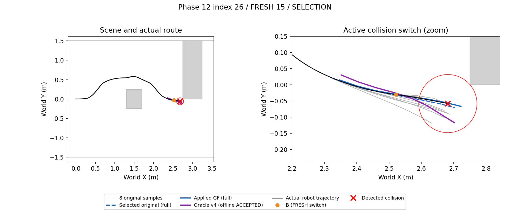
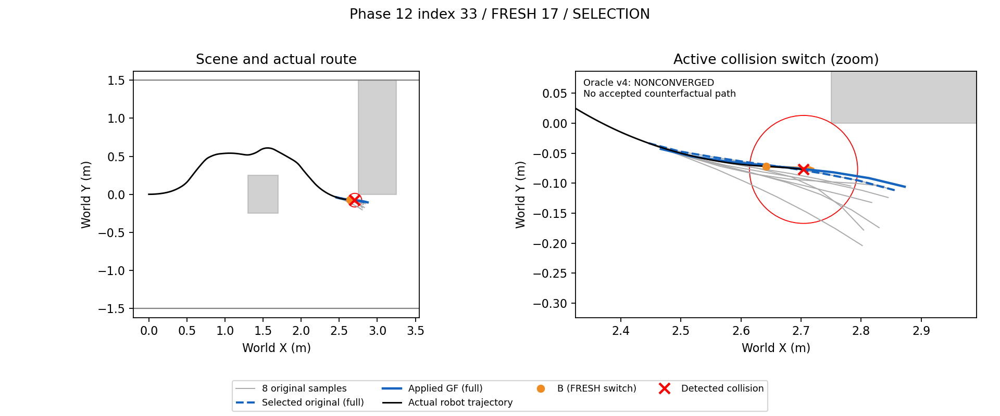
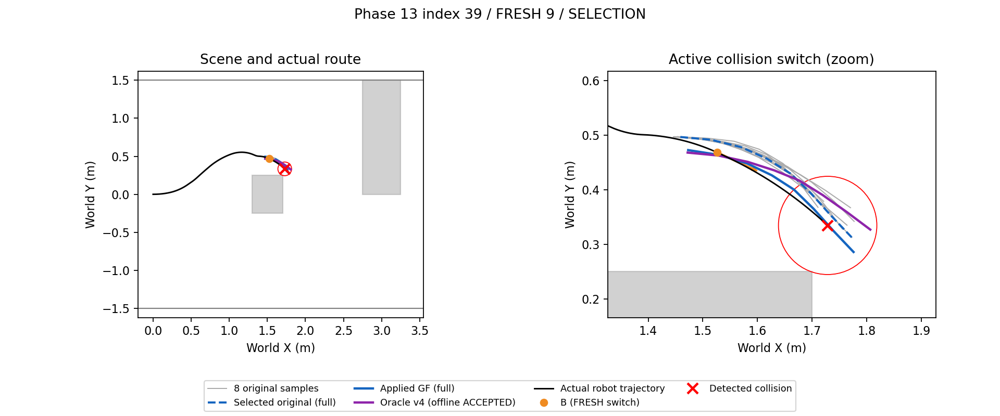
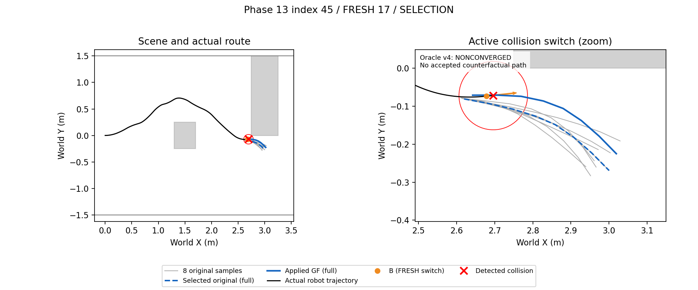
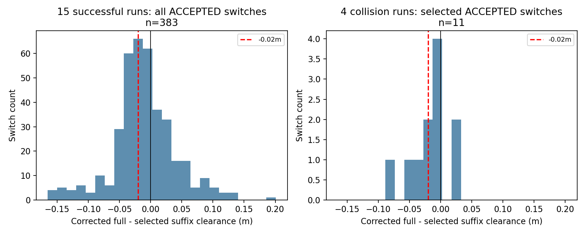

# Phase 14-D — GRAPH-GF collision diagnosis

Analysis source commit: `2ac53924eda656ff7d929af12e8d0a4877042ac0`; immutable input/source hashes in `research/results/phase14d/provenance.json`.
4 collision runs + 15 successful GF runs; 12 collision-window FRESH switches, 453 success switches. No navigation or NoMaD inference; 12 oracle v4 attempts / 11 solver calls, zero retries.

## Measurement rules

- Unit: actual FRESH switch and its GF result. For each collision, take the final three FRESH switches and union the FRESH that originated the active path; deduplicate by ID. Actual GF replacement ticks are logged separately. All 15 success runs contribute every actual FRESH switch; terminal received-but-unswitched predictions are excluded.
- Sample paths remain anchored to their observation pose. B is the recorded FRESH switch/Graph dispatch pose. RAW clearance uses the suffix starting at the existing nearest projection of B, without a fictitious B connector. Corrected clearance uses the entire ACCEPTED GF polyline, as requested. Thus delta compares different extents and alone is not proof that the overlapping path moved toward a box.
- Footprint clearance reuses exact segment/AABB distance and the Phase6 runtime swept-arc lower bound, with radius0.09m. No new collision-distance algorithm. Wall clearance is recorded separately. Native full path, remaining RAW suffix and actual PP arcs are distinct.
- Execution clearance is measured only while that actual path is active: GF replacement to next application/termination, or RAW switch to next application when GF is not accepted. RAW-before-GF intervals are separate columns. path_vs_footprint = executed clearance minus active-path clearance; a negative value means execution came closer, not necessarily a pure cross-track/corner-cutting measurement.
- Controls use no new geometry. Oracle geometry is used exclusively in this offline diagnosis and its explicitly privileged counterfactual solve. Protected GraphV4 and protocol are imported unchanged, including their geometry-dependent side factors. Original sample, B, previous command and stored previous accepted GF prior are identical; no chaining of counterfactual priors.
- Offline ACCEPTED means converged + protected constraints + exact certificate. No online STALE/SUPERSEDED gate is simulated. SDF_WOULD_FIX=YES only means an accepted full polyline with clearance>=0.025m: it does **not** prove safe PP execution, safe B-to-entry connection, or that the real collision would have been avoided.
- Cause priority: SELECTION, GRAPH_SHIFT, EXECUTION, OTHER; conclusion priority: ADD_CONSTRAINT, FIX_SELECTION, FIX_EXECUTION, MIXED. Safe sample counts are obstacle-only>=0.025m per request, not a controller-feasibility guarantee.

## Collision cases

|phase|index|id|execution_path_kind|raw_selected_clearance_m|corrected_clearance_m|delta_m|best_raw_clearance_m|safe_raw_samples|executed_clearance_m|path_vs_footprint_m|cause|counterfactual_disposition|counterfactual_clearance_m|SDF_WOULD_FIX|SAFE_SAMPLE_EXISTED|
|---|---|---|---|---|---|---|---|---|---|---|---|---|---|---|---|
|12|26|15|GRAPH-GF|-0.0051|-0.0177|-0.0126|0.0779|3|-0.0003|0.0174|SELECTION|ACCEPTED|0.0351|YES|YES|
|12|33|17|GRAPH-GF|-0.0051|-0.0090|-0.0040|0.0606|2|-0.0004|0.0087|SELECTION|NONCONVERGED|N/A|NO_SOLUTION|YES|
|13|39|9|GRAPH-GF|0.0056|-0.0104|-0.0160|0.0464|5|-0.0008|0.0096|SELECTION|ACCEPTED|0.0353|YES|YES|
|13|45|17|GRAPH-GF|0.0152|-0.0172|-0.0324|0.0180|0|-0.0001|0.0171|SELECTION|NONCONVERGED|N/A|NO_SOLUTION|NO|

- Phase 12 / 26: SELECTION; active GRAPH-GF from tick 1208 to 1239; RAW -0.005135m, GF -0.017691m, executed -0.000265m; safe originals 3/8, oracle ACCEPTED (YES).

- Phase 12 / 33: SELECTION; active GRAPH-GF from tick 1352 to 1359; RAW -0.005053m, GF -0.009010m, executed -0.000359m; safe originals 2/8, oracle NONCONVERGED (NO_SOLUTION).

- Phase 13 / 39: SELECTION; active GRAPH-GF from tick 792 to 848; RAW 0.005597m, GF -0.010434m, executed -0.000836m; safe originals 5/8, oracle ACCEPTED (YES).

- Phase 13 / 45: SELECTION; active GRAPH-GF from tick 1328 to 1331; RAW 0.015214m, GF -0.017236m, executed -0.000126m; safe originals 0/8, oracle NONCONVERGED (NO_SOLUTION).

## Success controls vs collision window

Fractions use ACCEPTED switches with defined delta as denominator. Windows differ (all successful switches vs last three before each collision); these are descriptive, not independent-run causal comparisons. A low-clearance prediction in a successful run does not imply that its unsafe segment was actually executed.

|cohort|runs|switches|accepted|delta_lt_minus_02_count|delta_lt_minus_02_fraction|delta_lt_0_fraction|delta_median_m|delta_p10_m|delta_p90_m|corrected_lt_025_count|corrected_lt_025_fraction|
|---|---|---|---|---|---|---|---|---|---|---|---|
|success_all|15|453|383|159|0.4151|0.6475|-0.0131|-0.0575|0.0508|4|0.0104|
|collision_last3|4|12|11|3|0.2727|0.7273|-0.0107|-0.0538|0.0191|5|0.4545|

## Figures

## Reproduction and limits

72Hz replay: maximum pose error 0; clearance recomputation vs logged intervals 1.11e-16m. Input and protected-code hashes checked before and after analysis.
Failed/infeasible solves and original unsafe samples are retained. One local SLSQP failure is not a proof that no feasible path exists. Counterfactual safety is path-level evidence only, with simulator oracle geometry; no online depth pipeline was implemented.

## Preregistered conclusion

Cause counts: {"SELECTION": 4}.

다음 단계 후보: depth 안전 필터 선택.

FIX_SELECTION
