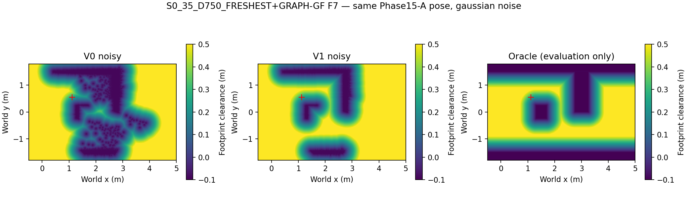
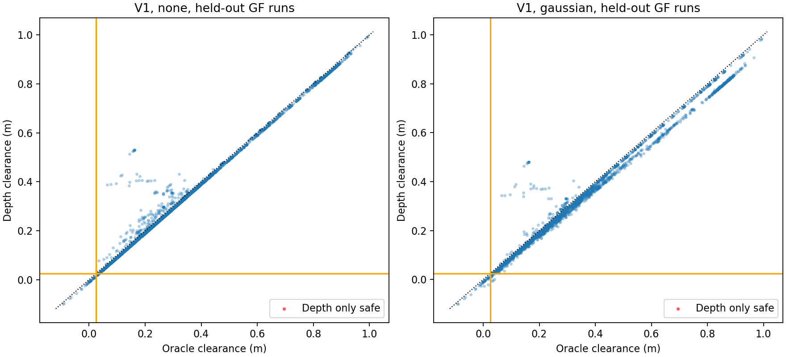

# Phase 15-A2 — Occupancy accumulation comparison

Selected variant: **V1**. Decision: **DEPTH_READY**. Execution SHA `c5616d0e0ab5a2710055fdf366750b4f9b42ad62`.

Saved Phase15-A depth/poses and existing predictions only; no rendering, navigation, inference or Graph solve. The original Phase15-A files and code are unchanged.

## Frozen selection

Twelve FRESHEST runs select on noisy data; twelve FRESHEST+GRAPH-GF runs supply the held-out decision. The choice was saved before held-out metrics were computed. Nonselected held-out variants below are descriptive only.

| Variant | Dangerous % | Conservative % | Update p95 ms | Eligible |
| --- | --- | --- | --- | --- |
| V0 | 0.000 | 45.099 | 20.787 | True |
| V1 | 0.000 | 0.783 | 26.130 | True |
| V2 | 0.000 | 0.783 | 25.967 | True |
| V3 | 0.000 | 0.783 | 24.898 | True |
| V4 | 0.000 | 0.783 | 24.733 | True |

Eligibility: dangerous ≤2%, update p95 ≤50ms. Lowest conservative fraction wins; lower variant number breaks ties. No parameter tuning/retries.

## All variants: descriptive table

| Variant | Noise | Split | Samples | Agreement % | Dangerous % | Conservative % | Error median / p5 / p95 m | Selection match % | Update median / p95 ms |
| --- | --- | --- | --- | --- | --- | --- | --- | --- | --- |
| V0 | none | selection | 3448 | 99.449 | 0.000 | 0.551 | -0.010 / -0.010 / 0.007 | 98.376 | 16.576 / 17.971 |
| V0 | none | judgment | 2336 | 99.401 | 0.000 | 0.599 | -0.010 / -0.010 / -0.007 | 97.260 | 16.605 / 18.157 |
| V0 | none | all | 5784 | 99.429 | 0.000 | 0.571 | -0.010 / -0.010 / 0.001 | 97.925 | 16.588 / 18.068 |
| V0 | gaussian | selection | 3448 | 54.901 | 0.000 | 45.099 | -0.179 / -0.886 / -0.019 | 51.740 | 18.588 / 20.787 |
| V0 | gaussian | judgment | 2336 | 70.120 | 0.000 | 29.880 | -0.089 / -0.539 / -0.014 | 65.068 | 18.303 / 20.692 |
| V0 | gaussian | all | 5784 | 61.048 | 0.000 | 38.952 | -0.140 / -0.732 / -0.016 | 57.123 | 18.437 / 20.745 |
| V1 | none | selection | 3448 | 99.478 | 0.000 | 0.522 | -0.010 / -0.010 / 0.062 | 98.376 | 19.379 / 21.783 |
| V1 | none | judgment | 2336 | 99.443 | 0.000 | 0.557 | -0.009 / -0.010 / 0.026 | 97.603 | 19.309 / 21.924 |
| V1 | none | all | 5784 | 99.464 | 0.000 | 0.536 | -0.009 / -0.010 / 0.040 | 98.064 | 19.350 / 21.819 |
| V1 | gaussian | selection | 3448 | 99.217 | 0.000 | 0.783 | -0.014 / -0.059 / 0.002 | 97.912 | 22.241 / 26.130 |
| V1 | gaussian | judgment | 2336 | 99.272 | 0.000 | 0.728 | -0.010 / -0.059 / -0.005 | 97.260 | 22.305 / 26.349 |
| V1 | gaussian | all | 5784 | 99.239 | 0.000 | 0.761 | -0.012 / -0.059 / -0.001 | 97.649 | 22.270 / 26.230 |
| V2 | none | selection | 3448 | 99.420 | 0.058 | 0.522 | -0.010 / -0.010 / 0.084 | 98.376 | 19.254 / 21.750 |
| V2 | none | judgment | 2336 | 99.401 | 0.043 | 0.557 | -0.009 / -0.010 / 0.043 | 97.603 | 19.221 / 21.918 |
| V2 | none | all | 5784 | 99.412 | 0.052 | 0.536 | -0.009 / -0.010 / 0.064 | 98.064 | 19.239 / 21.832 |
| V2 | gaussian | selection | 3448 | 99.217 | 0.000 | 0.783 | -0.014 / -0.059 / 0.052 | 97.912 | 22.213 / 25.967 |
| V2 | gaussian | judgment | 2336 | 99.272 | 0.000 | 0.728 | -0.010 / -0.059 / 0.016 | 97.260 | 22.276 / 26.321 |
| V2 | gaussian | all | 5784 | 99.239 | 0.000 | 0.761 | -0.012 / -0.059 / 0.034 | 97.649 | 22.232 / 26.114 |
| V3 | none | selection | 3448 | 99.478 | 0.000 | 0.522 | -0.010 / -0.010 / 0.062 | 98.376 | 18.701 / 21.156 |
| V3 | none | judgment | 2336 | 99.443 | 0.000 | 0.557 | -0.009 / -0.010 / 0.026 | 97.603 | 18.702 / 21.339 |
| V3 | none | all | 5784 | 99.464 | 0.000 | 0.536 | -0.009 / -0.010 / 0.040 | 98.064 | 18.702 / 21.233 |
| V3 | gaussian | selection | 3448 | 99.217 | 0.000 | 0.783 | -0.014 / -0.059 / 0.002 | 97.912 | 21.327 / 24.898 |
| V3 | gaussian | judgment | 2336 | 99.272 | 0.000 | 0.728 | -0.010 / -0.059 / -0.005 | 97.260 | 21.483 / 25.079 |
| V3 | gaussian | all | 5784 | 99.239 | 0.000 | 0.761 | -0.012 / -0.059 / -0.001 | 97.649 | 21.394 / 24.984 |
| V4 | none | selection | 3448 | 99.420 | 0.058 | 0.522 | -0.009 / -0.010 / 0.084 | 98.376 | 18.712 / 21.049 |
| V4 | none | judgment | 2336 | 99.401 | 0.043 | 0.557 | -0.009 / -0.010 / 0.043 | 97.603 | 18.696 / 21.339 |
| V4 | none | all | 5784 | 99.412 | 0.052 | 0.536 | -0.009 / -0.010 / 0.064 | 98.064 | 18.700 / 21.223 |
| V4 | gaussian | selection | 3448 | 99.217 | 0.000 | 0.783 | -0.014 / -0.059 / 0.052 | 97.912 | 21.378 / 24.733 |
| V4 | gaussian | judgment | 2336 | 99.272 | 0.000 | 0.728 | -0.010 / -0.059 / 0.016 | 97.260 | 21.476 / 25.173 |
| V4 | gaussian | all | 5784 | 99.239 | 0.000 | 0.761 | -0.012 / -0.059 / 0.034 | 97.649 | 21.429 / 24.977 |

Fractions pool sample decisions; timing pools observation updates, including all warmup/late frames. Selection match includes both-null; its count is stored separately in variants.csv.

## V0 regression

EXACT_NON_CLOCK_MATCH: 11568 sample rows and 6004 observation updates checked. All non-clock values match exactly. Re-executed wall-clock times cannot equal historic timings and are not asserted to do so.

| Noise | Original V0 update median / p95 ms | A2 V0 update median / p95 ms |
| --- | --- | --- |
| none | 16.421 / 18.040 | 16.588 / 18.068 |
| gaussian | 18.276 / 20.662 | 18.437 / 20.745 |

## Phantom occupancy (gaussian noise)

A phantom is an occupied lattice cell whose oracle footprint clearance is >0.20m. Counts are per independent run map; sums do not represent distinct physical locations. Full observation series is in phantom.csv.

| Variant | Split | Final phantom cells sum | Mean final per run | Peak per observation |
| --- | --- | --- | --- | --- |
| V0 | selection | 8921 | 743.4 | 1517 |
| V0 | judgment | 6396 | 533.0 | 715 |
| V0 | all | 15317 | 638.2 | 1517 |
| V1 | selection | 0 | 0.0 | 2 |
| V1 | judgment | 1 | 0.1 | 2 |
| V1 | all | 1 | 0.0 | 2 |
| V2 | selection | 0 | 0.0 | 0 |
| V2 | judgment | 0 | 0.0 | 0 |
| V2 | all | 0 | 0.0 | 0 |
| V3 | selection | 0 | 0.0 | 0 |
| V3 | judgment | 0 | 0.0 | 0 |
| V3 | all | 0 | 0.0 | 0 |
| V4 | selection | 0 | 0.0 | 0 |
| V4 | judgment | 0 | 0.0 | 0 |
| V4 | all | 0 | 0.0 | 0 |

## Unknown-risk diagnostic

Query counts use the unchanged 5mm path sampling, including duplicate segment vertices. Unknown points with exact oracle footprint clearance <0.025m are counted; these counts do not enter selection or the decision.

| Variant | Noise | Split | Unknown / all queries | Unknown and oracle unsafe queries |
| --- | --- | --- | --- | --- |
| V0 | none | selection | 20 / 199916 | 20 |
| V0 | none | judgment | 5 / 125625 | 5 |
| V0 | none | all | 25 / 325541 | 25 |
| V0 | gaussian | selection | 10 / 199916 | 10 |
| V0 | gaussian | judgment | 5 / 125625 | 5 |
| V0 | gaussian | all | 15 / 325541 | 15 |
| V1 | none | selection | 15 / 199916 | 15 |
| V1 | none | judgment | 5 / 125625 | 5 |
| V1 | none | all | 20 / 325541 | 20 |
| V1 | gaussian | selection | 7 / 199916 | 7 |
| V1 | gaussian | judgment | 5 / 125625 | 5 |
| V1 | gaussian | all | 12 / 325541 | 12 |
| V2 | none | selection | 15 / 199916 | 15 |
| V2 | none | judgment | 5 / 125625 | 5 |
| V2 | none | all | 20 / 325541 | 20 |
| V2 | gaussian | selection | 7 / 199916 | 7 |
| V2 | gaussian | judgment | 5 / 125625 | 5 |
| V2 | gaussian | all | 12 / 325541 | 12 |
| V3 | none | selection | 15 / 199916 | 15 |
| V3 | none | judgment | 5 / 125625 | 5 |
| V3 | none | all | 20 / 325541 | 20 |
| V3 | gaussian | selection | 7 / 199916 | 7 |
| V3 | gaussian | judgment | 5 / 125625 | 5 |
| V3 | gaussian | all | 12 / 325541 | 12 |
| V4 | none | selection | 15 / 199916 | 15 |
| V4 | none | judgment | 5 / 125625 | 5 |
| V4 | none | all | 20 / 325541 | 20 |
| V4 | gaussian | selection | 7 / 199916 | 7 |
| V4 | gaussian | judgment | 5 / 125625 | 5 |
| V4 | gaussian | all | 12 / 325541 | 12 |

## P13 collision-run counterfactual selections

The rows use the originating FRESH switch of the active path at collision, matching Phase15-A. Null means ALL_UNSAFE, not execution of a fallback. Counterfactual sample safety is not proof of collision prevention.

| Index | Variant | Noise | FRESH | Depth pick | Oracle pick | Depth pick oracle clearance m |
| --- | --- | --- | --- | --- | --- | --- |
| 39 | V0 | none | 9 | 6 | 0 | 0.046 |
| 39 | V0 | gaussian | 9 | None | 0 | — |
| 39 | V1 | none | 9 | 6 | 0 | 0.046 |
| 39 | V1 | gaussian | 9 | 6 | 0 | 0.046 |
| 39 | V2 | none | 9 | 6 | 0 | 0.046 |
| 39 | V2 | gaussian | 9 | 6 | 0 | 0.046 |
| 39 | V3 | none | 9 | 6 | 0 | 0.046 |
| 39 | V3 | gaussian | 9 | 6 | 0 | 0.046 |
| 39 | V4 | none | 9 | 6 | 0 | 0.046 |
| 39 | V4 | gaussian | 9 | 6 | 0 | 0.046 |
| 45 | V0 | none | 17 | None | None | — |
| 45 | V0 | gaussian | 17 | None | None | — |
| 45 | V1 | none | 17 | None | None | — |
| 45 | V1 | gaussian | 17 | None | None | — |
| 45 | V2 | none | 17 | None | None | — |
| 45 | V2 | gaussian | 17 | None | None | — |
| 45 | V3 | none | 17 | None | None | — |
| 45 | V3 | gaussian | 17 | None | None | — |
| 45 | V4 | none | 17 | None | None | — |
| 45 | V4 | gaussian | 17 | None | None | — |

## Implementation and limits

Each cell is updated at most once per depth frame: any eligible occupied endpoint gives +0.85; otherwise a traversing free ray gives -0.40. Occupied wins within a frame. V2 counts three distinct occupied frames. V3/V4 apply their occupied distance limit to each point before frame aggregation. V0 does not use these rules and remains the unmodified Phase15-A implementation.

V1–V4 update each cell once per captured frame, with occupied precedence over free. V2 counts distinct occupied frames. Log-odds uses exact integer hundredths (+85/−40, clipped −200..350, occupied >85). These fixed evidence semantics avoid treating correlated pixels in one image as independent confirmations.

Bresenham uses a serial C kernel; duplicate endpoint/type rays are removed without changing the union of traversed cells. Height/range filtering, noise realizations, grid allocation, EDT, radius, interpolation and path-clearance bound remain those of Phase15-A. V0 is the original class without changes. The map has no oracle obstacle/half-plane input.

V1–V4 unknown means no ray has visited a cell. V0 retains its original camera-height visibility coverage for exact regression. Endpoints outside the 2m occupied range but within 3m are observed, with free interior and no endpoint evidence update. Free rays are not extrapolated beyond measured endpoints.

Kernel: `cc (Ubuntu 13.3.0-6ubuntu2~24.04.1) 13.3.0`, one CPU thread; compile/load startup 0.031s excluded from update timing. Oracle diagnostics and disk I/O are outside mapping timings. No timing samples are discarded.

Simulator pose is exact (no odometry noise). Surface occupancy does not fill unseen interiors. Unknown is not occupied. h/√2 is an interpolation bound, not a sensing/occlusion error bound. The held-out split is by controller on the same scene, not cross-scene generalization.

## Selected-variant timing breakdown

| Noise | Component | Median ms | p95 ms |
| --- | --- | --- | --- |
| none | pointcloud_ms | 1.502 | 1.575 |
| none | accumulate_ms | 7.693 | 8.763 |
| none | sdf_ms | 10.319 | 11.725 |
| none | update_ms | 19.309 | 21.924 |
| gaussian | pointcloud_ms | 2.379 | 2.510 |
| gaussian | accumulate_ms | 8.847 | 10.983 |
| gaussian | sdf_ms | 11.127 | 13.063 |
| gaussian | update_ms | 22.305 | 26.349 |

`occupancy_protocol.json` records V1 as the next navigation default. This task performs no navigation; the held-out label and unknown-risk limitations remain applicable.

DEPTH_READY
