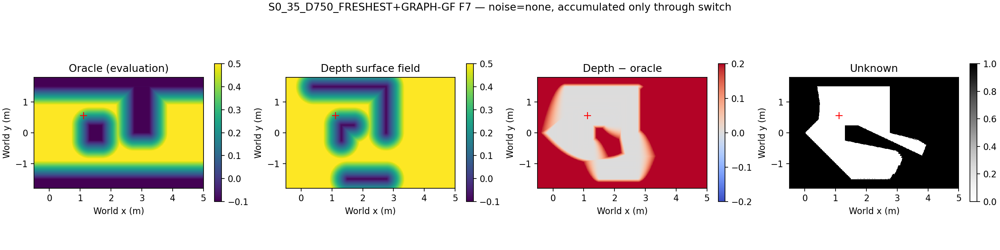
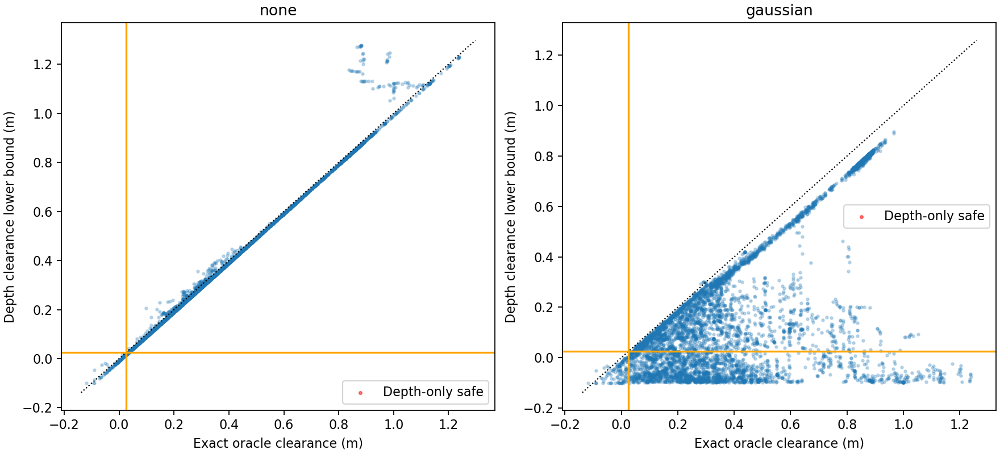

# Phase 15-A — Depth local SDF offline validation

**DEPTH_CONSERVATIVE**. Render SHA `0033986196eac1afb319e53099600e58344e7297`; report SHA `0033986196eac1afb319e53099600e58344e7297`.

24 Phase 13 runs; 3002 saved RGB capture poses replayed with depth only. No navigation, inference or Graph solve. Simulator pose is assumed exact (no odometry error).

| Noise | Samples | Agreement | Dangerous | Conservative | Error median m | p5 m | p95 m | Selection match |
| --- | --- | --- | --- | --- | --- | --- | --- | --- |
| none | 5784 | 99.429% | 0.000% | 0.571% | -0.010 | -0.010 | 0.001 | 97.925% |
| gaussian | 5784 | 61.048% | 0.000% | 38.952% | -0.140 | -0.732 | -0.016 | 57.123% |

## Confusion and dangerous decisions

| Noise | Both safe | Both unsafe | Depth only safe | Depth only unsafe |
| --- | --- | --- | --- | --- |
| none | 5625 | 126 | 0 | 33 |
| gaussian | 3405 | 126 | 0 | 2253 |

| Noise | Unknown | Height filter | Range exceeded | Other | Danger oracle median m | p5 m | p95 m |
| --- | --- | --- | --- | --- | --- | --- | --- |
| none | 0 | 0 | 0 | 0 | — | — | — |
| gaussian | 0 | 0 | 0 | 0 | — | — | — |

Attribution is diagnostic evidence at the oracle-limiting surface, not a causal proof. Height/range rejected-hit support within 2cm takes precedence over unknown; all support flags remain in switches.csv. The virtual xmin corridor boundary is not a rendered back wall.

## Timing

| Noise | Update component | Median ms | p95 ms |
| --- | --- | --- | --- |
| none | pointcloud_ms | 1.485 | 1.552 |
| none | accumulate_ms | 4.440 | 4.832 |
| none | sdf_ms | 10.599 | 11.951 |
| none | update_ms | 16.421 | 18.040 |
| gaussian | pointcloud_ms | 2.351 | 2.451 |
| gaussian | accumulate_ms | 4.433 | 4.824 |
| gaussian | sdf_ms | 11.543 | 13.774 |
| gaussian | update_ms | 18.276 | 20.662 |

Pointcloud includes noise injection/backprojection; accumulation includes occupancy/coverage; SDF includes the distance transform. Totals exclude renderer, disk I/O and sample evaluation. No warmup/timing observations are discarded.

## FRESHEST-SAFE counterfactual

All 8 native samples remain observation-anchored. Safety is evaluated on the nearest-B projection suffix, without a connector. Among safe suffixes choose maximum remaining arclength, tie low sample index. No safe candidate is null/ALL_UNSAFE. These are offline selections, not executed navigation.

| Noise | Selected | Selected oracle unsafe | Both null | Selected oracle clearance median / p5 / p95 m |
| --- | --- | --- | --- | --- |
| none | 716 | 0 | 6 | 0.294 / 0.063 / 0.843 |
| gaussian | 475 | 0 | 6 | 0.321 / 0.080 / 0.836 |

Collision-run rows identify the original FRESH switch of the path active at the saved collision; they do not move B to a later Graph application.

| Run | Noise | FRESH | Depth pick | Oracle pick | Depth pick oracle clearance m |
| --- | --- | --- | --- | --- | --- |
| S0_39_D750_FRESHEST+GRAPH-GF | none | 9 | 6 | 0 | 0.046 |
| S0_39_D750_FRESHEST+GRAPH-GF | gaussian | 9 | None | 0 | — |
| S0_45_D750_FRESHEST+GRAPH-GF | none | 17 | None | None | — |
| S0_45_D750_FRESHEST+GRAPH-GF | gaussian | 17 | None | None | — |

## Map and observation limits

| Noise | Points/observation median | Obstacle points median | Unknown grid median |
| --- | --- | --- | --- |
| none | 73703 | 19084 | 0.900 |
| gaussian | 73703 | 19096 | 0.892 |

The 1cm static occupancy map keeps observed surfaces, does not fill solid interiors, and never treats unknown as occupied. Coverage is camera-height line of sight plus observed hits, not a 3D free-space certificate. Depth-only safety can therefore be falsely optimistic. The h/√2 bound covers bilinear interpolation of grid-site distance only, not sensing, occlusion, float16 or occupancy quantization errors. Polyline clearance also subtracts half the sample spacing.

Depth includes visible walls, without oracle half-plane constraints. Oracle exact obstacle/corridor geometry is used only by evaluation. Grid allocation matches the prior padded SDF bounds. Noise is the prescribed independent Gaussian σ=0.01·d² on axial depth, not a calibrated stereo noise model.

Capture availability uses original capture-completion monotonic time, never a future frame or a mixed-clock subtraction. Busy-skipped inference captures still contribute depth. Saved pose-to-USD differences below 1µm are checked and actual USD extrinsics are stored.

[NVIDIA camera/annotator documentation](https://docs.isaacsim.omniverse.nvidia.com/6.0.1/sensors/isaacsim_sensors_camera.html).

## Pre-registered decision

Noisy condition, first matching rule only: dangerous >2% → DEPTH_NOT_READY; otherwise update p95 >50ms → TIMING_NOT_READY; otherwise conservative >20% → DEPTH_CONSERVATIVE; otherwise DEPTH_READY.

No label establishes closed-loop safety or navigation success. Unknown geometry and odometry assumptions remain material limits.

DEPTH_CONSERVATIVE
