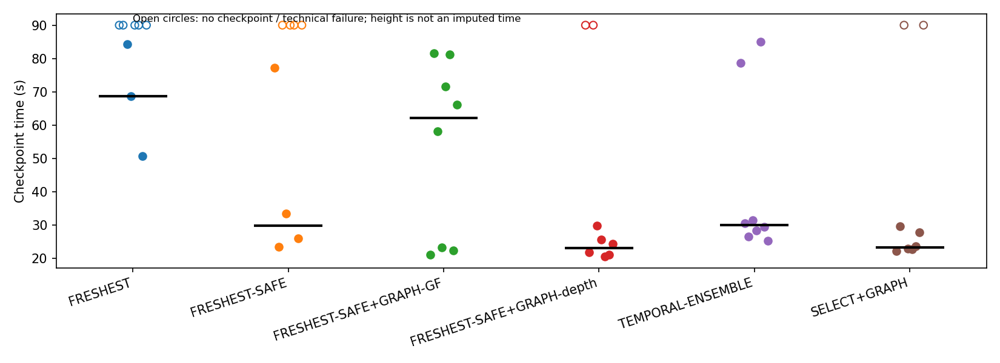
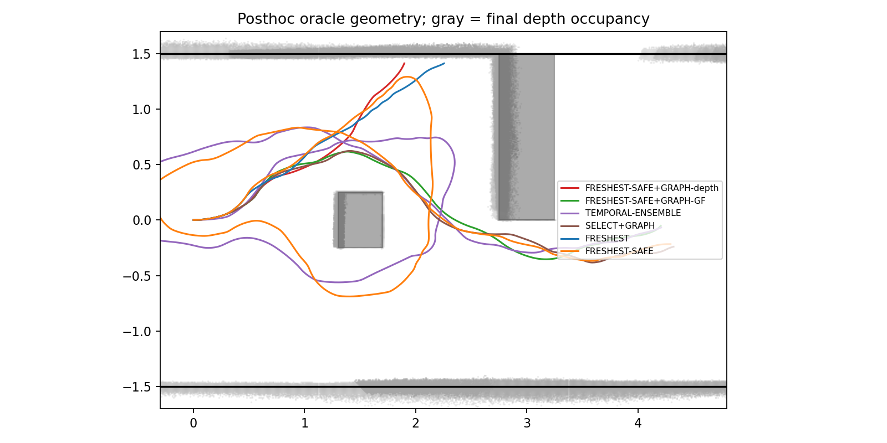
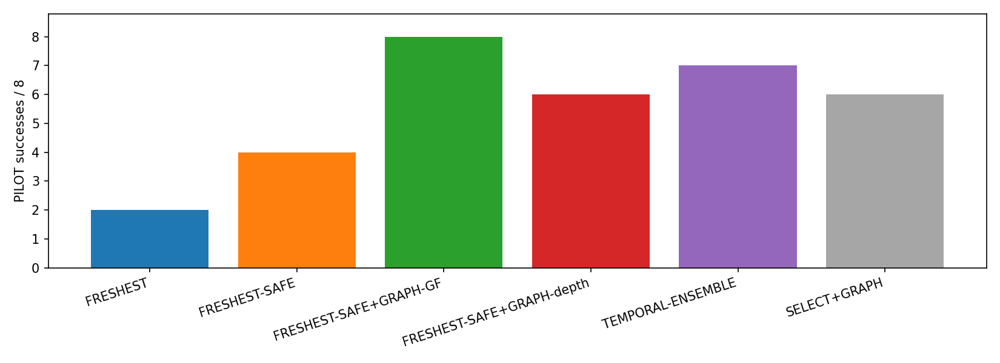

# Phase 15-B depth pilot

PILOT only. Isaac RGB closed-loop SE(2) kinematic navigation. Exact simulator odometry; no odometry error. NoMaD receives RGB only. Methods 1–5 receive no oracle geometry; SELECT+GRAPH is an oracle reference excluded from decisions.

Noise enabled: σ=0.01d². V1 one update/cell/frame; occupied priority; unknown is not occupied. Depth certificate covers occupied lattice sites, not unobserved physical geometry. Map allocation bounds encode no walls. Every captured observation is integrated in FIFO order, independently of control. Snapshot age uses capture simulation timestamp; publication time is separately logged. ALL_UNSAFE caps the CURV target at 0.10m/s, with existing acceleration limits.

Execution SHA: `c106f02c9c15c5924d122eadfa055648cdf2305e`. All methods include depth rendering/map CPU load. Timing tables average run-level median/p95 (not pooled percentiles).

|method|valid|technical|success|collision|corridor|stuck|goal_time_median_s|checkpoint_median_s|checkpoint_mean_speed_m_s|curv_slow_time_fraction|minimum_clearance_m|all_unsafe|fallback_cap_time_fraction|
|---|---|---|---|---|---|---|---|---|---|---|---|---|---|
|FRESHEST|8|0|2|0|3|3|65.7778|68.7083|0.1526|0.6455|0.0676|0|0.0000|
|FRESHEST-SAFE|8|0|4|0|3|1|35.4306|29.7569|0.1566|0.6540|0.0532|2|0.0051|
|FRESHEST-SAFE+GRAPH-GF|8|0|8|0|0|0|67.2292|62.1319|0.1725|0.5514|0.0179|3|0.0040|
|FRESHEST-SAFE+GRAPH-depth|8|0|6|0|2|0|28.1736|23.1806|0.1796|0.4916|0.0668|1|0.0031|
|TEMPORAL-ENSEMBLE|8|0|7|0|0|1|34.4583|30.0069|0.1472|0.6520|0.0386|0|0.0000|
|SELECT+GRAPH|7|1|6|0|0|1|28.5694|23.2639|0.1753|0.5515|0.0366|0|0.0000|

Seed × method

|index|method|classification|checkpoint_time_s|goal_time_s|minimum_obstacle_clearance_m|
|---|---|---|---|---|---|
|47|FRESHEST-SAFE+GRAPH-depth|SAFETY_FAILURE|N/A|N/A|0.2443|
|47|FRESHEST-SAFE+GRAPH-GF|SUCCESS|21.0278|26.5278|0.0688|
|47|TEMPORAL-ENSEMBLE|SUCCESS|78.7222|82.2500|0.0897|
|47|SELECT+GRAPH|SUCCESS|22.1944|28.4722|0.0366|
|47|FRESHEST|SAFETY_FAILURE|N/A|N/A|0.3473|
|47|FRESHEST-SAFE|SUCCESS|77.2778|82.4167|0.0532|
|48|SELECT+GRAPH|SUCCESS|29.7222|34.0139|0.2042|
|48|FRESHEST-SAFE+GRAPH-GF|SUCCESS|81.5694|86.0556|0.0354|
|48|TEMPORAL-ENSEMBLE|SUCCESS|30.4722|36.0000|0.1716|
|48|FRESHEST-SAFE|SUCCESS|23.4028|28.2083|0.0645|
|48|FRESHEST|SAFETY_FAILURE|N/A|N/A|0.3067|
|48|FRESHEST-SAFE+GRAPH-depth|SUCCESS|21.9167|25.4861|0.0793|
|49|FRESHEST-SAFE|SAFETY_FAILURE|N/A|N/A|0.3368|
|49|FRESHEST|STUCK|84.3333|N/A|0.0982|
|49|FRESHEST-SAFE+GRAPH-GF|SUCCESS|58.1944|61.5000|0.1134|
|49|TEMPORAL-ENSEMBLE|SUCCESS|26.4861|31.0972|0.0386|
|49|SELECT+GRAPH|STUCK|N/A|N/A|0.0680|
|49|FRESHEST-SAFE+GRAPH-depth|SAFETY_FAILURE|N/A|N/A|0.2876|
|50|FRESHEST-SAFE+GRAPH-GF|SUCCESS|23.3750|26.6389|0.1520|
|50|SELECT+GRAPH|SUCCESS|22.8750|28.6667|0.1027|
|50|TEMPORAL-ENSEMBLE|SUCCESS|31.4444|36.8194|0.2599|
|50|FRESHEST-SAFE|SUCCESS|33.4861|39.3194|0.2096|
|50|FRESHEST-SAFE+GRAPH-depth|SUCCESS|29.7778|34.4583|0.1353|
|50|FRESHEST|SUCCESS|68.7083|72.2083|0.1565|
|51|SELECT+GRAPH|SUCCESS|22.8333|26.7639|0.1126|
|51|TEMPORAL-ENSEMBLE|SUCCESS|28.3333|32.8194|0.1083|
|51|FRESHEST|SAFETY_FAILURE|N/A|N/A|0.3816|
|51|FRESHEST-SAFE|SAFETY_FAILURE|N/A|N/A|0.2739|
|51|FRESHEST-SAFE+GRAPH-depth|SUCCESS|25.6389|28.9028|0.2079|
|51|FRESHEST-SAFE+GRAPH-GF|SUCCESS|71.5833|75.2083|0.0820|
|52|FRESHEST|STUCK|N/A|N/A|0.0676|
|52|SELECT+GRAPH|SUCCESS|23.6528|27.8611|0.1199|
|52|TEMPORAL-ENSEMBLE|STUCK|85.0139|N/A|0.2897|
|52|FRESHEST-SAFE|SAFETY_FAILURE|N/A|N/A|0.3565|
|52|FRESHEST-SAFE+GRAPH-depth|SUCCESS|20.6250|24.9306|0.0668|
|52|FRESHEST-SAFE+GRAPH-GF|SUCCESS|81.2361|87.7500|0.0179|
|53|FRESHEST-SAFE|SUCCESS|26.0278|31.5417|0.0835|
|53|SELECT+GRAPH|SUCCESS|27.8889|33.4028|0.1773|
|53|FRESHEST-SAFE+GRAPH-depth|SUCCESS|21.1528|28.3056|0.0844|
|53|TEMPORAL-ENSEMBLE|SUCCESS|29.5417|34.4583|0.0554|
|53|FRESHEST|SUCCESS|50.7083|59.3472|0.3104|
|53|FRESHEST-SAFE+GRAPH-GF|SUCCESS|22.3333|27.0972|0.1011|
|54|TEMPORAL-ENSEMBLE|SUCCESS|25.2222|31.0972|0.0987|
|54|FRESHEST|STUCK|N/A|N/A|0.0988|
|54|FRESHEST-SAFE+GRAPH-depth|SUCCESS|24.4444|28.0417|0.1464|
|54|FRESHEST-SAFE|STUCK|N/A|N/A|0.0692|
|54|SELECT+GRAPH|TECHNICAL_FAILURE|N/A|N/A|N/A|
|54|FRESHEST-SAFE+GRAPH-GF|SUCCESS|66.0694|72.9583|0.1658|

Depth measurements

|method|depth_update_median_ms|depth_update_p95_ms|snapshot_age_median_s|snapshot_age_p95_s|depth_agreement|depth_dangerous_count|depth_sample_count|unknown_fraction|inference_median_ms|inference_p95_ms|
|---|---|---|---|---|---|---|---|---|---|---|
|FRESHEST|24.1801|28.1232|0.3811|0.4236|0.9912|2|3640|0.0000|36.8052|62.1192|
|FRESHEST-SAFE|24.0314|28.1753|0.3620|0.4236|0.9944|0|2848|0.0000|36.7195|53.5004|
|FRESHEST-SAFE+GRAPH-GF|25.1433|29.9895|0.3611|0.4201|0.9967|3|3680|0.0000|36.9022|54.3355|
|FRESHEST-SAFE+GRAPH-depth|24.5737|29.1766|0.3889|0.4164|0.9874|0|1672|0.0000|37.0245|64.9061|
|TEMPORAL-ENSEMBLE|24.7646|29.0886|0.3889|0.4167|0.9956|0|2952|N/A|37.0216|54.3110|
|SELECT+GRAPH|24.8042|29.1979|0.3988|0.4107|0.9809|6|2096|0.0000|36.9798|54.6334|

Preregistered pilot decisions

```json
{
  "F1": "PILOT_FILTER_REMOVES_COLLISIONS",
  "G": "PILOT_GRAPH_DEPTH_BETTER",
  "depth_vs_gf_collision_counts": [
    0,
    0
  ],
  "depth_vs_temporal_success_counts": [
    6,
    7
  ],
  "scope": "PILOT; auxiliary counts are descriptive, incomplete groups are not efficacy evidence"
}
```

Graph measurements

|method|graph_calls|graph_acceptance|graph_dispositions|nonconverged|solve_median_s|solve_p95_s|sdf_active_fraction|
|---|---|---|---|---|---|---|---|
|FRESHEST|0|N/A|{'ACCEPTED': 0, 'NONCONVERGED': 0, 'CONSTRAINT_FAILED': 0, 'INITIALIZATION_REJECTED': 0, 'STALE': 0, 'SUPERSEDED': 0, 'WAYPOINT_EXPIRED': 0}|0|N/A|N/A|N/A|
|FRESHEST-SAFE|0|N/A|{'ACCEPTED': 0, 'NONCONVERGED': 0, 'CONSTRAINT_FAILED': 0, 'INITIALIZATION_REJECTED': 0, 'STALE': 0, 'SUPERSEDED': 0, 'WAYPOINT_EXPIRED': 0}|0|N/A|N/A|N/A|
|FRESHEST-SAFE+GRAPH-GF|460|0.8783|{'ACCEPTED': 404, 'NONCONVERGED': 5, 'CONSTRAINT_FAILED': 0, 'INITIALIZATION_REJECTED': 50, 'STALE': 0, 'SUPERSEDED': 0, 'WAYPOINT_EXPIRED': 0}|5|0.0482|0.0581|N/A|
|FRESHEST-SAFE+GRAPH-depth|209|0.8230|{'ACCEPTED': 172, 'NONCONVERGED': 6, 'CONSTRAINT_FAILED': 0, 'INITIALIZATION_REJECTED': 31, 'STALE': 0, 'SUPERSEDED': 0, 'WAYPOINT_EXPIRED': 0}|6|0.0684|0.0988|0.0050|
|TEMPORAL-ENSEMBLE|0|N/A|{'ACCEPTED': 0, 'NONCONVERGED': 0, 'CONSTRAINT_FAILED': 0, 'INITIALIZATION_REJECTED': 0, 'STALE': 0, 'SUPERSEDED': 0, 'WAYPOINT_EXPIRED': 0}|0|N/A|N/A|N/A|
|SELECT+GRAPH|262|0.8473|{'ACCEPTED': 222, 'NONCONVERGED': 11, 'CONSTRAINT_FAILED': 0, 'INITIALIZATION_REJECTED': 27, 'STALE': 0, 'SUPERSEDED': 0, 'WAYPOINT_EXPIRED': 0}|11|0.0575|0.0697|N/A|

|method|comparator|n|indices|mean_difference_s|ci95_s|negative_pairs|
|---|---|---|---|---|---|---|
|FRESHEST-SAFE+GRAPH-depth|FRESHEST-SAFE|3|[48, 50, 53]|-3.3565|[-4.875, -1.4861111111111107]|3|

Paired checkpoint comparison uses only jointly observed checkpoint times, 20,000 bootstrap replicates, seed 20261027. Missing times are never replaced by timeout. Wilson intervals are descriptive.

Technical failures

|index|method|error|
|---|---|---|
|54|SELECT+GRAPH|RuntimeError('Launcher exit 1')|







