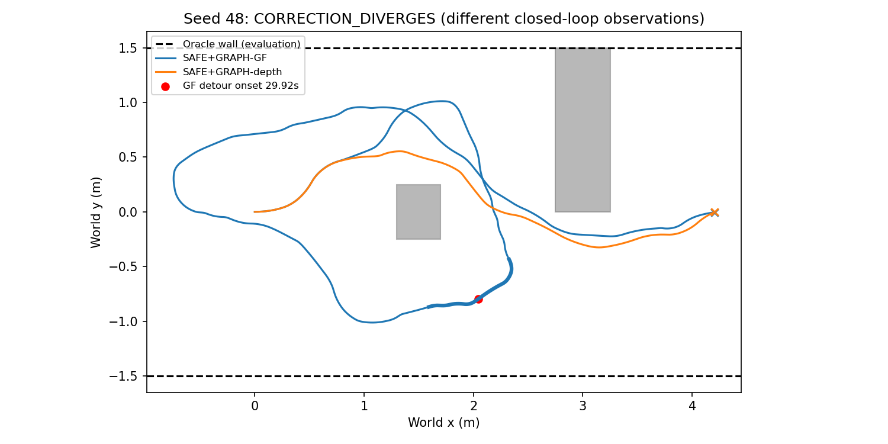
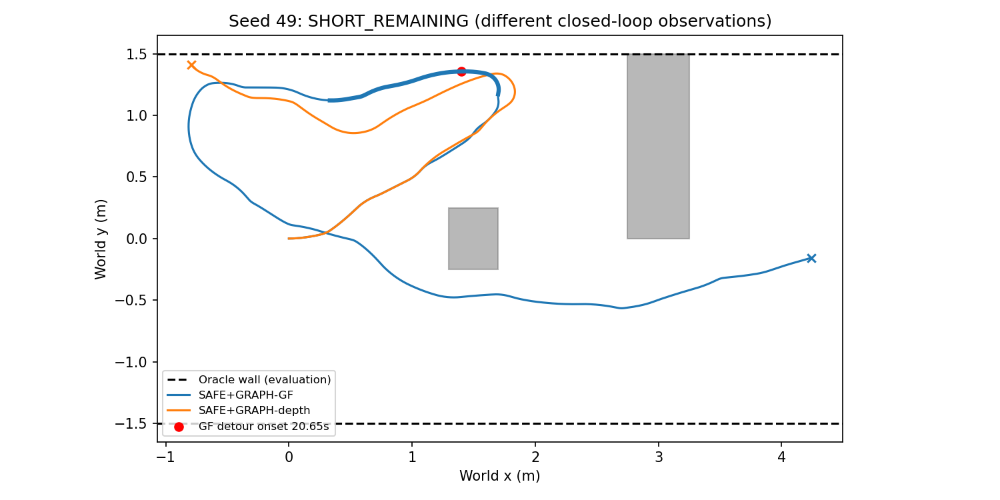
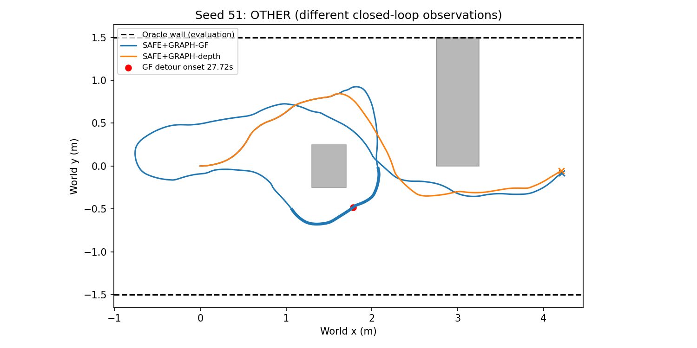
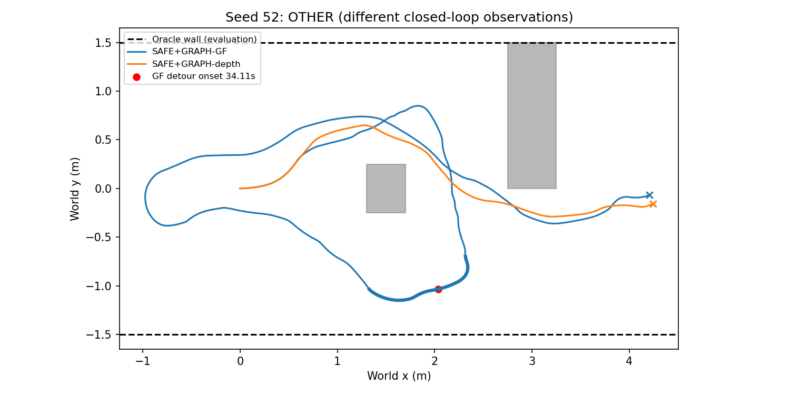
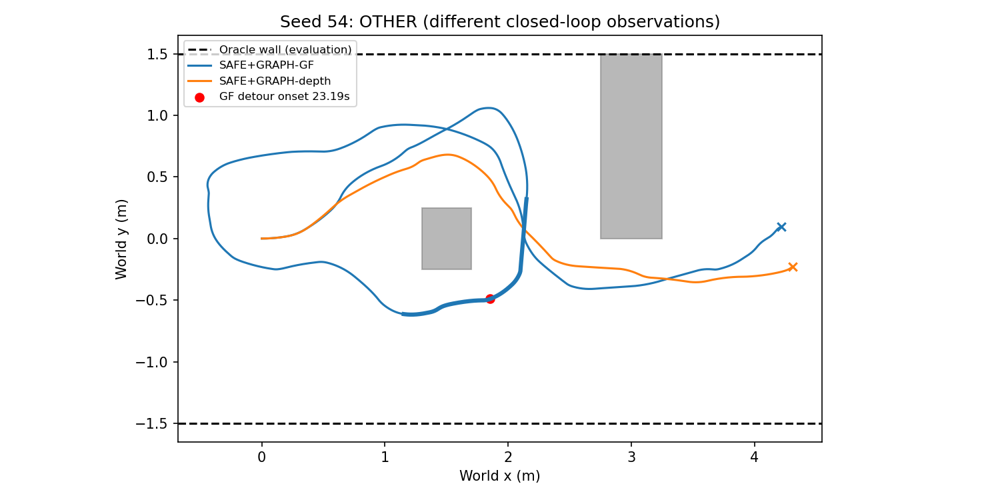
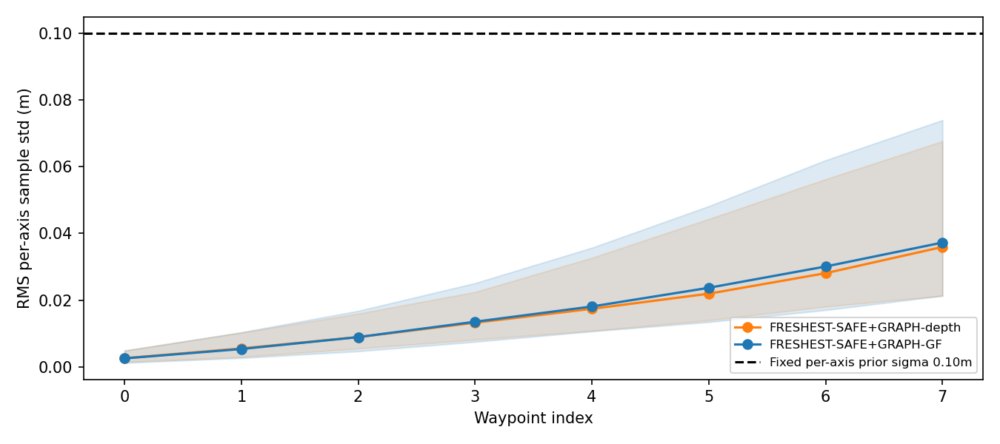
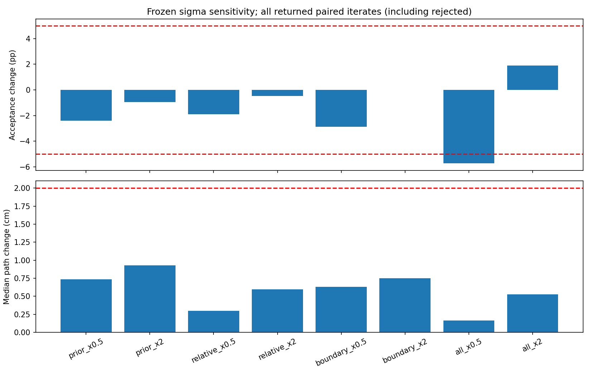
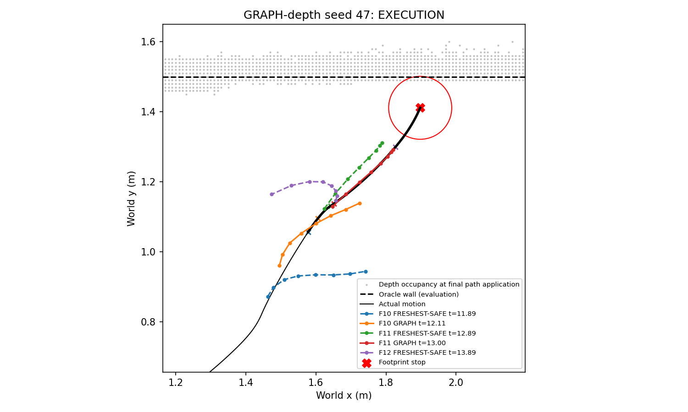
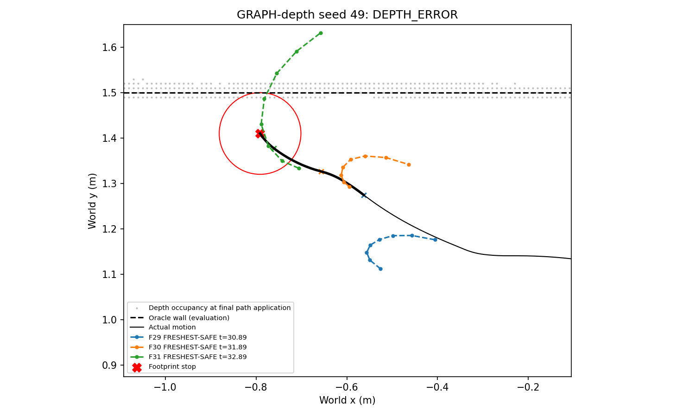

# Phase 15-C — depth Graph offline diagnosis

Offline path-level mechanism validation only. No navigation, NoMaD inference, rendering, controller rollout, tuning, or retries. Oracle boxes/walls are used only after solving, for evaluation and attribution. Actual historical execution remains distinct from counterfactual paths.

Execution Git SHA: `c1b37fd64e647b249b82d76b6c9cb8c3ddcc2d10`. Graph-depth 209 jobs and Graph-GF 460 jobs; 4348 single attempts. Each A variant solved once; D baseline reuses A FULL. Original selected sample, B, previous actual command, previous accepted path, and immutable snapshot are retained; no hypothetical prior propagation.

## Replay and measurement scope

Comparable saved worker results: 668; mismatches: 0/668 (0.000%); unavailable: 1 terminal-unapplied job without a saved worker result. Compare XY maximum point error ≤1e−6 m, numerical disposition, and logged disposition under the saved scheduling conditions. New offline solve times do not replace historical STALE/SUPERSEDED decisions. All comparisons carry regression flags; none are silently omitted. Full poses, solver diagnostics and errors are preserved in `solve_results.jsonl`.

CERT_ONLY changes only acceptance of the GF solution. CONSTRAINT_ONLY removes only the post-solve exact certificate; FULL is original DepthGraph. Sigma variants change only XY/yaw residual scales after unchanged native initialization. SLSQP, analytic derivatives, tolerances, constraints and all other weights are unchanged.

## A — constraint versus certificate

**NO_DANGEROUS_CORRECTIONS**. Fewer than five dangerous NEITHER corrections has priority and yields NO_DANGEROUS_CORRECTIONS. A dangerous correction is accepted NEITHER with full-path oracle clearance <0.025m, including walls.

| source_method | variant | jobs | accepted | oracle_unsafe_accepted | dangerous_neither | CERT_ONLY_rejected | CERT_ONLY_unsafe_accepted | CONSTRAINT_ONLY_safe | FULL_safe | label |
| --- | --- | --- | --- | --- | --- | --- | --- | --- | --- | --- |
| ALL | NEITHER | 669 | 578 | 2 | 2 | 2 | 0 | 1 | 1 | NO_DANGEROUS_CORRECTIONS |
| ALL | CERT_ONLY | 669 | 576 | 0 | 2 | 2 | 0 | 1 | 1 | NO_DANGEROUS_CORRECTIONS |
| ALL | CONSTRAINT_ONLY | 669 | 574 | 0 | 2 | 2 | 0 | 1 | 1 | NO_DANGEROUS_CORRECTIONS |
| ALL | FULL | 669 | 574 | 0 | 2 | 2 | 0 | 1 | 1 | NO_DANGEROUS_CORRECTIONS |
| FRESHEST-SAFE+GRAPH-depth | NEITHER | 209 | 173 | 1 | 1 | 1 | 0 | 0 | 0 | NO_DANGEROUS_CORRECTIONS |
| FRESHEST-SAFE+GRAPH-depth | CERT_ONLY | 209 | 172 | 0 | 1 | 1 | 0 | 0 | 0 | NO_DANGEROUS_CORRECTIONS |
| FRESHEST-SAFE+GRAPH-depth | CONSTRAINT_ONLY | 209 | 172 | 0 | 1 | 1 | 0 | 0 | 0 | NO_DANGEROUS_CORRECTIONS |
| FRESHEST-SAFE+GRAPH-depth | FULL | 209 | 172 | 0 | 1 | 1 | 0 | 0 | 0 | NO_DANGEROUS_CORRECTIONS |
| FRESHEST-SAFE+GRAPH-GF | NEITHER | 460 | 405 | 1 | 1 | 1 | 0 | 1 | 1 | NO_DANGEROUS_CORRECTIONS |
| FRESHEST-SAFE+GRAPH-GF | CERT_ONLY | 460 | 404 | 0 | 1 | 1 | 0 | 1 | 1 | NO_DANGEROUS_CORRECTIONS |
| FRESHEST-SAFE+GRAPH-GF | CONSTRAINT_ONLY | 460 | 402 | 0 | 1 | 1 | 0 | 1 | 1 | NO_DANGEROUS_CORRECTIONS |
| FRESHEST-SAFE+GRAPH-GF | FULL | 460 | 402 | 0 | 1 | 1 | 0 | 1 | 1 | NO_DANGEROUS_CORRECTIONS |

`ablation_jobs.csv` records every dangerous transfer (rejected, safe accepted, unsafe accepted), depth/oracle clearance, edit, curvature, endpoint progress and solve time. Failed final iterates are diagnostic only; accepted_* fields are empty for rejected solutions. These counts do not establish safer closed-loop navigation.

## B — wall stops

`nomad_isaac/clearance.py:115–120,153–169`: corridor lower bound = minimum endpoint distance to xmin/xmax/±half_width minus robot radius 0.09m, arc sagitta, and 1e−12m. `corridor_footprint_stop` occurs at bound ≤0, not at 2cm or 2.5cm. The 2cm required obstacle clearance is recorded separately and is not this stop threshold. Thus the evaluator does not require a larger wall margin than Graph-depth’s 0.025m constraint. A conservative lower bound can stop before exact overlap; it is not automatically a physical wall collision.

Rows cover the last three FRESH switches and all actual Graph replacements within them. Path metrics use the B-projected suffix; full-path depth clearance is also retained. Depth wall-site distance is an attribution diagnostic using occupied sites within 0.10m of the oracle wall, not a solver input. Unknown classification uses the exact nearest wall grid cell in the latest map published before stop; its 5×5 neighborhood is reported to expose discretization sensitivity.

| index | id | application_time_s | kind | is_final_active | all_unsafe | depth_clearance_m | depth_wall_sites_clearance_m | oracle_wall_clearance_m | path_unknown_fraction | wall_observed | wall_neighborhood_observed | actual_corridor_lower_m | path_minus_actual_wall_clearance_m | max_cross_track_m | run_cause |
| --- | --- | --- | --- | --- | --- | --- | --- | --- | --- | --- | --- | --- | --- | --- | --- |
| 47 | 10 | 11.8889 | FRESHEST-SAFE | False | False | 0.446008 | 0.446008 | 0.466004 | 0 | True | True | 0.314602 | 0.151402 | 0.161406 | EXECUTION |
| 47 | 10 | 12.1111 | GRAPH | False | False | 0.250903 | 0.250903 | 0.27087 | 0 | True | True | 0.278929 | -0.00805846 | 0.0260254 | EXECUTION |
| 47 | 11 | 12.8889 | FRESHEST-SAFE | False | False | 0.0792779 | 0.0792779 | 0.0992683 | 0 | True | True | 0.272263 | -0.172995 | 0.013824 | EXECUTION |
| 47 | 11 | 13 | GRAPH | False | False | 0.0982628 | 0.0982628 | 0.118262 | 0 | True | True | 0.110643 | 0.00761894 | 0.00999623 | EXECUTION |
| 47 | 12 | 13.8889 | FRESHEST-SAFE | True | False | 0.189721 | 0.189721 | 0.209611 | 0 | True | True | -0.00132744 | 0.210939 | 0.337139 | EXECUTION |
| 49 | 29 | 30.8889 | FRESHEST-SAFE | False | False | 0.223342 | 0.223342 | 0.233335 | 0 | True | True | 0.0836751 | 0.14966 | 0.194651 | DEPTH_ERROR |
| 49 | 30 | 31.8889 | FRESHEST-SAFE | False | False | 0.0406262 | 0.0406262 | 0.0494906 | 0 | True | True | 0.032466 | 0.0170247 | 0.157699 | DEPTH_ERROR |
| 49 | 31 | 32.8889 | FRESHEST-SAFE | True | True | -0.0899026 | -0.0899026 | -0.221678 | 0.438356 | True | True | -0.000111773 | -0.221566 | 0.0087406 | DEPTH_ERROR |

- Seed 47: **EXECUTION**, final active FRESHEST-SAFE F12; depth 0.1897m, oracle wall 0.2096m, actual corridor lower bound -0.0013m.
- Seed 49: **DEPTH_ERROR**, final active FRESHEST-SAFE F31; depth -0.0899m, oracle wall -0.2217m, actual corridor lower bound -0.0001m.

Same-seed methods at the nearest spatial position (not temporal or prediction correspondence):

| index | method | classification | nearest_time_s | nearest_pose | distance_to_diagnostic_location_m | minimum_corridor_clearance_m |
| --- | --- | --- | --- | --- | --- | --- |
| 47 | FRESHEST-SAFE+GRAPH-depth | SAFETY_FAILURE | 14.625 | [1.8974921041975599, 1.4113258507548556, 1.166042291524131] | 0 | -0.00132585 |
| 47 | FRESHEST-SAFE+GRAPH-GF | SUCCESS | 11.0833 | [1.5429506585228199, 0.5771226087022049, -0.40078242266793795] | 0.906419 | 0.793875 |
| 47 | TEMPORAL-ENSEMBLE | SUCCESS | 13.6528 | [1.8444676269202267, 0.7364332307676231, -0.07834738007575925] | 0.676972 | 0.575225 |
| 47 | SELECT+GRAPH | SUCCESS | 11.5694 | [1.5792999997696744, 0.5837853192187705, -0.3674751605304811] | 0.886606 | 0.787285 |
| 47 | FRESHEST | SAFETY_FAILURE | 19.5278 | [2.0117030546560755, 1.2690429934274985, 0.684614411263679] | 0.182452 | -0.000591712 |
| 47 | FRESHEST-SAFE | SUCCESS | 18.8472 | [1.9100113197761925, 1.290132644764765, 0.10770844801316404] | 0.121838 | 0.119143 |
| 49 | FRESHEST-SAFE | SAFETY_FAILURE | 0 | [0.0, 0.0, 0.0] | 1.61684 | -0.00076811 |
| 49 | FRESHEST | STUCK | 62.9028 | [-0.327960458863155, 0.38257024522069544, 0.4259390486119967] | 1.12707 | 0.182595 |
| 49 | FRESHEST-SAFE+GRAPH-GF | SUCCESS | 32.0139 | [-0.6807099103428196, 1.2376484576688624, -2.57272512477424] | 0.204738 | 0.053201 |
| 49 | TEMPORAL-ENSEMBLE | SUCCESS | 0 | [0.0, 0.0, 0.0] | 1.61684 | 0.617975 |
| 49 | SELECT+GRAPH | STUCK | 42.4861 | [-0.6527240795854409, 1.3258479678463242, 1.0201988747808217] | 0.161968 | 0.00490543 |
| 49 | FRESHEST-SAFE+GRAPH-depth | SAFETY_FAILURE | 33.7361 | [-0.7910474057986556, 1.410111254549143, 2.1475855793711007] | 0 | -0.000111255 |

## C — GF detours

Onset is first 0.30m backtrack from running maximum x, otherwise first accumulated absolute yaw change >2π. The ±5s window uses actual FRESH switches; consecutive tests operate on consecutive switches in this window. ALL_UNSAFE includes the 0.10m/s target cap and takes precedence. Rejected solver iterates are explicitly not executed paths. Labels are temporal associations under the requested priority, not proven causes.

| index | detour_start_s | detour_rule | cause | gf_distance_m | depth_result | depth_distance_m | depth_nearest_time_s | depth_nearest_pose | depth_nearest_distance_m | depth_same_elapsed_pose |
| --- | --- | --- | --- | --- | --- | --- | --- | --- | --- | --- |
| 48 | 29.9167 | X_BACKTRACK_0.30M | CORRECTION_DIVERGES | 13.2779 | SUCCESS | 4.71453 | 16.5 | [2.2864902280841104, -0.010148628604863203, -0.2931459235389511] | 0.822169 | [4.202730205752697, -0.003102820486761354, 0.41562860720426453] |
| 49 | 20.6528 | X_BACKTRACK_0.30M | SHORT_REMAINING | 10.7545 | SAFETY_FAILURE | 5.21394 | 19.75 | [1.4349073109250021, 1.27004301744029, -2.7702211565237516] | 0.0929506 | [1.1887029353334597, 1.1574604510533286, -2.6682622876701503] |
| 51 | 27.7222 | X_BACKTRACK_0.30M | OTHER | 12.3813 | SUCCESS | 5.16818 | 18.1944 | [2.2854331581153895, -0.10729062143012894, -0.9359533735268091] | 0.627403 | [3.9060046322747275, -0.22554248674274516, 0.39941575093010684] |
| 52 | 34.1111 | X_BACKTRACK_0.30M | OTHER | 13.7118 | SUCCESS | 4.7721 | 15.5417 | [2.4080805977212636, -0.09425447286370114, -0.3781747855887394] | 1.01046 | [4.246313808222378, -0.15660096395543055, 0.4670376931696971] |
| 54 | 23.1944 | X_BACKTRACK_0.30M | OTHER | 12.5781 | SUCCESS | 4.9147 | 17.4861 | [2.2877397162346496, -0.08555340804237915, -0.8184353178422996] | 0.593086 | [3.2398539590660786, -0.3236830924173208, -0.08333736291998939] |

| index | id | switch_time_s | disposition | previous_v | all_unsafe | remaining_length_m | endpoint_clamp_fraction | corrected_actually_applied | corrected_depth_clearance_m | corrected_oracle_clearance_m | endpoint_direction_change_deg | run_cause |
| --- | --- | --- | --- | --- | --- | --- | --- | --- | --- | --- | --- | --- |
| 48 | 24 | 25.8889 | ACCEPTED | 0.0780383 | False | 0.191002 | 1 | True | 0.531103 | 0.532815 | 30.477 | CORRECTION_DIVERGES |
| 48 | 25 | 26.8889 | ACCEPTED | 0.05 | False | 0.25095 | 0.666667 | True | 0.519966 | 0.527113 | 6.85972 | CORRECTION_DIVERGES |
| 48 | 26 | 27.8889 | ACCEPTED | 0.079408 | False | 0.301711 | 0 | True | 0.377 | 0.383003 | 16.9653 | CORRECTION_DIVERGES |
| 48 | 27 | 28.8889 | ACCEPTED | 0.0513751 | False | 0.29308 | 0.666667 | True | 0.551785 | 0.559855 | 8.66286 | CORRECTION_DIVERGES |
| 48 | 28 | 29.8889 | ACCEPTED | 0.3 | False | 0.221589 | 1 | True | 0.371258 | 0.380645 | 49.1833 | CORRECTION_DIVERGES |
| 48 | 29 | 30.8889 | ACCEPTED | 0.05 | False | 0.286107 | 0 | True | 0.319436 | 0.329041 | 11.7765 | CORRECTION_DIVERGES |
| 48 | 30 | 31.8889 | ACCEPTED | 0.0525613 | False | 0.387645 | 0 | True | 0.378658 | 0.407555 | 6.95114 | CORRECTION_DIVERGES |
| 48 | 31 | 33 | INITIALIZATION_REJECTED | 0 | False | 0.204832 | 1 | False | — | — | — | CORRECTION_DIVERGES |
| 48 | 32 | 33.8889 | ACCEPTED | 0.101332 | False | 0.273034 | 0.555556 | True | 0.406242 | 0.430337 | 6.10774 | CORRECTION_DIVERGES |
| 48 | 33 | 34.8889 | ACCEPTED | 0.105839 | False | 0.22913 | 1 | True | 0.459063 | 0.479062 | 6.70181 | CORRECTION_DIVERGES |
| 49 | 14 | 15.8889 | ACCEPTED | 0.05 | False | 0.339343 | 0 | True | 0.113119 | 0.123014 | 19.5966 | SHORT_REMAINING |
| 49 | 15 | 16.8889 | ACCEPTED | 0.05 | False | 0.332262 | 0 | True | 0.0881745 | 0.0881127 | 12.8765 | SHORT_REMAINING |
| 49 | 16 | 17.8889 | ACCEPTED | 0.0580688 | False | 0.310489 | 0 | True | 0.080842 | 0.0808336 | 17.2769 | SHORT_REMAINING |
| 49 | 17 | 18.8889 | ACCEPTED | 0.0521744 | False | 0.360872 | 0 | True | 0.0663616 | 0.066332 | 6.92054 | SHORT_REMAINING |
| 49 | 18 | 19.8889 | ACCEPTED | 0.0677762 | False | 0.455933 | 0.111111 | True | 0.053639 | 0.053571 | 3.23838 | SHORT_REMAINING |
| 49 | 19 | 20.8889 | ACCEPTED | 0.3 | False | 0.257581 | 0.888889 | True | 0.0561401 | 0.0561226 | 2.36604 | SHORT_REMAINING |
| 49 | 20 | 21.8889 | ACCEPTED | 0.3 | False | 0.220651 | 1 | True | 0.0758463 | 0.0758462 | 7.50584 | SHORT_REMAINING |
| 49 | 21 | 22.8889 | INITIALIZATION_REJECTED | 0 | False | 0.233559 | 1 | False | — | — | — | SHORT_REMAINING |
| 49 | 22 | 23.8889 | ACCEPTED | 0.243743 | False | 0.171772 | 1 | True | 0.19141 | 0.201388 | 24.7721 | SHORT_REMAINING |
| 49 | 23 | 24.6667 | ACCEPTED | 0.0553393 | False | 0.419901 | 0.222222 | True | 0.24109 | 0.251058 | 3.36154 | SHORT_REMAINING |
| 51 | 22 | 23.6667 | ACCEPTED | 0.105211 | False | 0.404947 | 0.111111 | True | 0.202333 | 0.209702 | 2.67139 | OTHER |
| 51 | 23 | 24.6667 | ACCEPTED | 0.185177 | False | 0.195916 | 1 | True | 0.058762 | 0.0628593 | 40.2904 | OTHER |
| 51 | 24 | 25.6667 | ACCEPTED | 0.05 | False | 0.392881 | 0 | True | 0.110338 | 0.120272 | 3.10221 | OTHER |
| 51 | 25 | 26.6667 | ACCEPTED | 0.214288 | False | 0.19661 | 1 | True | 0.138544 | 0.146545 | 42.8822 | OTHER |
| 51 | 26 | 27.6667 | ACCEPTED | 0.05 | False | 0.392247 | 0.333333 | True | 0.152389 | 0.161956 | 7.03462 | OTHER |
| 51 | 27 | 28.6667 | ACCEPTED | 0.3 | False | 0.270795 | 0.777778 | True | 0.172551 | 0.182551 | 13.0027 | OTHER |
| 51 | 28 | 29.6667 | ACCEPTED | 0.0930321 | False | 0.388405 | 0.111111 | True | 0.288501 | 0.297588 | 4.0597 | OTHER |
| 51 | 29 | 30.6667 | ACCEPTED | 0.153621 | False | 0.272751 | 0.555556 | True | 0.204136 | 0.221541 | 8.2502 | OTHER |
| 51 | 30 | 31.6667 | ACCEPTED | 0.100526 | False | 0.347767 | 0.333333 | True | 0.189625 | 0.223486 | 2.35746 | OTHER |
| 51 | 31 | 32.6667 | ACCEPTED | 0.182492 | False | 0.310527 | 0.555556 | True | 0.23159 | 0.253169 | 8.68929 | OTHER |
| 52 | 28 | 29.6667 | NONCONVERGED | 0.103161 | False | 0.252627 | 0 | False | 0.52488 | 0.554872 | 32.3516 | OTHER |
| 52 | 29 | 30.6667 | ACCEPTED | 0.0665853 | False | 0.320676 | 0 | True | 0.427368 | 0.457367 | 2.92855 | OTHER |
| 52 | 30 | 31.6667 | ACCEPTED | 0.0637718 | False | 0.244436 | 0.428571 | True | 0.417336 | 0.437322 | 5.31793 | OTHER |
| 52 | 31 | 32.4444 | ACCEPTED | 0.0578864 | False | 0.414817 | 0 | True | 0.402465 | 0.422457 | 1.2227 | OTHER |
| 52 | 32 | 33.3333 | ACCEPTED | 0.106213 | False | 0.362481 | 0.444444 | True | 0.332126 | 0.352126 | 2.72121 | OTHER |
| 52 | 33 | 34.3333 | ACCEPTED | 0.3 | False | 0.213145 | 1 | True | 0.25296 | 0.272941 | 8.40841 | OTHER |
| 52 | 34 | 35.3333 | ACCEPTED | 0.170209 | False | 0.320281 | 0.111111 | True | 0.259126 | 0.279118 | 13.3255 | OTHER |
| 52 | 35 | 36.3333 | ACCEPTED | 0.110954 | False | 0.443529 | 0 | True | 0.236516 | 0.246503 | 2.24987 | OTHER |
| 52 | 36 | 37.3333 | ACCEPTED | 0.195428 | False | 0.305917 | 0.5 | True | 0.261308 | 0.271302 | 0.867766 | OTHER |
| 52 | 37 | 38.4444 | INITIALIZATION_REJECTED | 0 | False | 0.233113 | 1 | False | — | — | — | OTHER |
| 54 | 17 | 18.2222 | ACCEPTED | 0.3 | False | 0.236949 | 1 | True | 0.341276 | 0.338105 | 29.7196 | OTHER |
| 54 | 18 | 19.1111 | ACCEPTED | 0.3 | False | 0.266695 | 0.8 | True | 0.303697 | 0.313683 | 2.28549 | OTHER |
| 54 | 19 | 20.2222 | INITIALIZATION_REJECTED | 0 | False | 0.15567 | 1 | False | — | — | — | OTHER |
| 54 | 20 | 21.1111 | ACCEPTED | 0.05 | False | 0.266381 | 0.888889 | True | 0.182946 | 0.182946 | 5.01315 | OTHER |
| 54 | 21 | 22.1111 | ACCEPTED | 0.103601 | False | 0.360975 | 0.333333 | True | 0.173298 | 0.182662 | 2.78543 | OTHER |
| 54 | 22 | 23.1111 | ACCEPTED | 0.194418 | False | 0.114692 | 1 | True | 0.142677 | 0.150896 | 28.2601 | OTHER |
| 54 | 23 | 24.1111 | ACCEPTED | 0.0609103 | False | 0.424405 | 0.222222 | True | 0.159328 | 0.167989 | 2.99641 | OTHER |
| 54 | 24 | 25.1111 | ACCEPTED | 0.3 | False | 0.216629 | 1 | True | 0.148777 | 0.158637 | 23.4581 | OTHER |
| 54 | 25 | 26.1111 | ACCEPTED | 0.0839524 | False | 0.320516 | 0 | True | 0.195912 | 0.201426 | 13.3472 | OTHER |
| 54 | 26 | 27.1111 | ACCEPTED | 0.0805637 | False | 0.396793 | 0.222222 | True | 0.260618 | 0.260613 | 5.19235 | OTHER |
| 54 | 27 | 28.1111 | ACCEPTED | 0.181113 | False | 0.275625 | 0.555556 | True | 0.261541 | 0.262335 | 7.27507 | OTHER |

- Seed 48: **CORRECTION_DIVERGES** at 29.917s; GF distance 13.28m, same-seed depth SUCCESS / 4.71m. Observations and timings differ across runs.
- Seed 49: **SHORT_REMAINING** at 20.653s; GF distance 10.75m, same-seed depth SAFETY_FAILURE / 5.21m. Observations and timings differ across runs.
- Seed 51: **OTHER** at 27.722s; GF distance 12.38m, same-seed depth SUCCESS / 5.17m. Observations and timings differ across runs.
- Seed 52: **OTHER** at 34.111s; GF distance 13.71m, same-seed depth SUCCESS / 4.77m. Observations and timings differ across runs.
- Seed 54: **OTHER** at 23.194s; GF distance 12.58m, same-seed depth SUCCESS / 4.91m. Observations and timings differ across runs.

## D — sigma sensitivity

**ROBUST**. Single-family settings exceeding a threshold: none. Acceptance denominator is all 209 jobs. Path differences use every pair of returned finite iterates (including rejected candidates); no path is invented for initialization rejection. Accepted-both subset is also shown. ROBUST requires all six single-family changes ≤5 percentage points and median per-job median point difference ≤0.02m. Combined-family settings are descriptive.

| sigma | jobs | accepted | acceptance_change_pp | changed_acceptance | path_pairs | path_difference_median_m | path_difference_max_m | accepted_pairs | accepted_pair_path_median_m | within_threshold |
| --- | --- | --- | --- | --- | --- | --- | --- | --- | --- | --- |
| baseline | 209 | 172 | 0 | 0 | 178 | 0 | 0 | 172 | 0 | True |
| prior_x0.5 | 209 | 167 | -2.39234 | 5 | 178 | 0.00737184 | 0.117364 | 167 | 0.00718264 | True |
| prior_x2 | 209 | 170 | -0.956938 | 2 | 178 | 0.00930537 | 0.145308 | 170 | 0.00896239 | True |
| relative_x0.5 | 209 | 168 | -1.91388 | 4 | 178 | 0.00298997 | 0.032256 | 168 | 0.00285306 | True |
| relative_x2 | 209 | 171 | -0.478469 | 3 | 178 | 0.00596184 | 0.0449368 | 170 | 0.00590874 | True |
| boundary_x0.5 | 209 | 166 | -2.87081 | 6 | 178 | 0.00631353 | 0.0848616 | 166 | 0.00597817 | True |
| boundary_x2 | 209 | 172 | 0 | 2 | 178 | 0.00748062 | 0.082587 | 171 | 0.00722864 | True |
| all_x0.5 | 209 | 160 | -5.74163 | 12 | 178 | 0.00166071 | 0.0223188 | 160 | 0.00161318 | False |
| all_x2 | 209 | 176 | 1.91388 | 4 | 178 | 0.00525098 | 0.0679559 | 172 | 0.00525098 | True |

Sample dispersion uses all actual FRESH switches of these 16 Graph runs, eight native samples per observation anchored to the same observation pose; ddof=0. RMS per-axis std = sqrt((std_x²+std_y²)/2), compared to per-axis sigma 0.10m. Radial std and separate x/y are in sample_dispersion.csv. This is preparation for a later adaptive-sigma design, not an adaptive policy.

| source_method | waypoint | n | median_m | p10_m | p90_m | fixed_sigma_m |
| --- | --- | --- | --- | --- | --- | --- |
| FRESHEST-SAFE+GRAPH-depth | 0 | 209 | 0.00263923 | 0.00152504 | 0.00498424 | 0.1 |
| FRESHEST-SAFE+GRAPH-depth | 1 | 209 | 0.00556106 | 0.00303142 | 0.0102935 | 0.1 |
| FRESHEST-SAFE+GRAPH-depth | 2 | 209 | 0.00896961 | 0.00553164 | 0.0159807 | 0.1 |
| FRESHEST-SAFE+GRAPH-depth | 3 | 209 | 0.013263 | 0.00818036 | 0.0224588 | 0.1 |
| FRESHEST-SAFE+GRAPH-depth | 4 | 209 | 0.0174365 | 0.0108722 | 0.0327051 | 0.1 |
| FRESHEST-SAFE+GRAPH-depth | 5 | 209 | 0.0219625 | 0.0139789 | 0.0443186 | 0.1 |
| FRESHEST-SAFE+GRAPH-depth | 6 | 209 | 0.0281036 | 0.0180837 | 0.0562403 | 0.1 |
| FRESHEST-SAFE+GRAPH-depth | 7 | 209 | 0.0359574 | 0.0213451 | 0.0676222 | 0.1 |
| FRESHEST-SAFE+GRAPH-GF | 0 | 460 | 0.00258064 | 0.0012576 | 0.00488462 | 0.1 |
| FRESHEST-SAFE+GRAPH-GF | 1 | 460 | 0.00539721 | 0.00271533 | 0.0104039 | 0.1 |
| FRESHEST-SAFE+GRAPH-GF | 2 | 460 | 0.00896293 | 0.00472184 | 0.0168103 | 0.1 |
| FRESHEST-SAFE+GRAPH-GF | 3 | 460 | 0.0135625 | 0.00755106 | 0.0251198 | 0.1 |
| FRESHEST-SAFE+GRAPH-GF | 4 | 460 | 0.0181294 | 0.0106879 | 0.0357141 | 0.1 |
| FRESHEST-SAFE+GRAPH-GF | 5 | 460 | 0.023729 | 0.013467 | 0.0481628 | 0.1 |
| FRESHEST-SAFE+GRAPH-GF | 6 | 460 | 0.0301079 | 0.0170609 | 0.0619211 | 0.1 |
| FRESHEST-SAFE+GRAPH-GF | 7 | 460 | 0.0372744 | 0.0213286 | 0.0739336 | 0.1 |

## Figures



















## Frozen measurement rules

```json
{
  "expected_jobs": {
    "FRESHEST-SAFE+GRAPH-depth": 209,
    "FRESHEST-SAFE+GRAPH-GF": 460
  },
  "safety_m": 0.025,
  "path_match_m": 1e-06,
  "variants": [
    "NEITHER",
    "CERT_ONLY",
    "CONSTRAINT_ONLY",
    "FULL"
  ],
  "sigma_variants": {
    "prior_x0.5": {
      "prior": 0.5
    },
    "prior_x2": {
      "prior": 2.0
    },
    "relative_x0.5": {
      "relative": 0.5
    },
    "relative_x2": {
      "relative": 2.0
    },
    "boundary_x0.5": {
      "boundary": 0.5
    },
    "boundary_x2": {
      "boundary": 2.0
    },
    "all_x0.5": {
      "prior": 0.5,
      "relative": 0.5,
      "boundary": 0.5
    },
    "all_x2": {
      "prior": 2.0,
      "relative": 2.0,
      "boundary": 2.0
    }
  },
  "sigma_path_statistic": "median of per-job median point distances; all pairs with finite returned iterates, including rejected iterates; accepted-only also reported",
  "sigma_acceptance": "absolute change in fraction accepted; all 209 jobs including initialization rejections",
  "certificate_tolerance_m": 1e-08,
  "regression": "A FULL/NEITHER baseline solve reused for depth/GF regression; stored scheduling dispositions retained separately; no new wall-time deadline imposed offline",
  "ablation_label_priority": [
    "NO_DANGEROUS_CORRECTIONS (<5)",
    "CONSTRAINT_MATTERS",
    "CERTIFICATE_SUFFICES",
    "MIXED"
  ],
  "wall_scope": "last three FRESH switches, all replacement applications within them, and final active application; full and B-suffix path metrics; exact stop-site wall cell plus 2-cell neighborhood diagnostics",
  "wall_site_band_m": 0.1,
  "wall_unknown_rule": "exact nearest wall cell in latest snapshot published by stop timestamp; neighborhood status also reported",
  "detour_window_s": 5.0,
  "detour_rule": "first x < running_max_x - .30; otherwise first cumulative absolute unwrapped yaw change > 2pi; no interpolation",
  "dispersion": "population std (ddof=0); scalar is RMS of x/y std, comparable to per-coordinate sigma=.10; radial std and per-axis std also retained",
  "oracle": "posthoc evaluation only; never passed into any solver",
  "navigation": 0,
  "inference": 0,
  "render": 0,
  "retries": 0,
  "tuning": 0,
  "scope": "Offline path-level counterfactuals, not closed-loop or causal performance evidence"
}
```

## Interpretation limits from the recorded execution

A contains 2 dangerous accepted NEITHER paths, not zero. The <5 evidence rule controls the label. CERT_ONLY rejects 2; constraints recover 1; this sample is too small for CONSTRAINT_MATTERS under the frozen rule.

Seed 47: the final active path is **FRESHEST-SAFE F12**, not an accepted Graph replacement; ALL_UNSAFE=False. Path-to-motion maximum cross-track is 0.337m. Path safety therefore does not certify the actual PP arc or its connection from the current robot pose. 

Seed 49: the final active path is **FRESHEST-SAFE F31**, not an accepted Graph replacement; ALL_UNSAFE=True. The depth map already marks this path unsafe: this is **not a depth-only-safe false acceptance**. ALL_UNSAFE still executes the least-unsafe original sample under its speed cap. In addition, occupied-site distance is not signed penetration into a solid wall: its minimum is bounded below by −robot_radius, whereas oracle half-plane clearance continues decreasing outside the corridor. The requested DEPTH_ERROR label includes this representation discrepancy and does not isolate sensor noise as the cause. 

C labels follow the requested priority in the ±5s onset window. OTHER does not establish that Graph was uninvolved; no causal intervention was run.

D ROBUST refers only to the six single-family settings and the specified aggregate median. Combined changes exceeding a descriptive threshold: all_x0.5 (-5.74pp acceptance). Individual path tails and combined perturbations are not guaranteed robust.

Labels: {"A": "NO_DANGEROUS_CORRECTIONS", "B": {"47": "EXECUTION", "49": "DEPTH_ERROR"}, "C": {"48": "CORRECTION_DIVERGES", "49": "SHORT_REMAINING", "51": "OTHER", "52": "OTHER", "54": "OTHER"}, "D": "ROBUST"}
