# Phase 16-D — STOP_WAIT deadlock diagnosis and offline rule selection

Saved inputs only: no simulation, NoMaD inference, rendering, Graph solve, controller execution, or rollout. Oracle boxes/walls enter only the evaluator. Candidate selection functions receive only depth clearances, remaining lengths and B depth clearance. All native paths remain observation-pose anchored.

Analysis Git SHA: `32859269492f917eb27e97a9dd7791741260c2e8`. Inventory: 72 main runs + 6 gate runs. A/D include 8 main runs with STOP_WAIT time fraction strictly >20%, plus 2 SL gates: 1110 STOP_WAIT events. Other runs remain in inventory.csv.

## A — run causes and persistence

STOP_WAIT is a controller decision, not proof that velocity is already zero: deceleration may still be in progress. B values and actual speed are recorded at the applied FRESH boundary. Depth clearance uses the existing selector’s conservative h/√2 bound; the B point has no segment-spacing allowance. B nominal/exact-site/oracle values are also retained. “Best oracle sample” means the maximum exact oracle clearance across all eight; the oracle value of the depth-best sample is separate.

| split | scene | index | method | stop_events | cause | marginal_fraction | true_block_fraction | near_start_fraction | depth_false_close_fraction | max_consecutive_STOP_WAIT | longest_chain_event_span_s | sample_change_consecutive_median_m | robot_movement_consecutive_median_m | active_path_short_rejections |
| --- | --- | --- | --- | --- | --- | --- | --- | --- | --- | --- | --- | --- | --- | --- |
| main | CL | 55 | FRESHEST-SAFE+GRAPH-depth | 69 | MARGINAL_DEADLOCK | 0.884058 | 0.0144928 | 1 | 0 | 69 | 67 | 0.0313634 | 0 | 69 |
| main | CL | 56 | FRESHEST-SAFE+GRAPH-depth | 39 | TRUE_BLOCK | 0 | 1 | 0 | 0 | 39 | 37.5556 | 0.0150856 | 0 | 39 |
| main | CL | 58 | FRESHEST-SAFE+GRAPH-depth | 75 | TRUE_BLOCK | 0 | 1 | 0 | 0 | 75 | 73.6667 | 0.0248603 | 0 | 75 |
| main | CL | 59 | FRESHEST-SAFE+GRAPH-GF | 74 | MARGINAL_DEADLOCK | 0.797297 | 0.202703 | 1 | 0 | 74 | 71.7778 | 0.0380186 | 0 | 74 |
| main | CL | 59 | FRESHEST-SAFE+GRAPH-depth | 49 | TRUE_BLOCK | 0 | 1 | 0 | 0 | 48 | 46.7778 | 0.0332197 | 0 | 49 |
| main | CL | 59 | FRESHEST-SAFE+TEMPORAL-ENSEMBLE | 74 | TRUE_BLOCK | 0 | 1 | 0 | 0 | 73 | 70.3333 | 0.0249681 | 0 | 0 |
| main | LC | 55 | FRESHEST-SAFE+TEMPORAL-ENSEMBLE | 50 | OTHER | 0.66 | 0.2 | 0.3 | 0 | 34 | 33 | 0.0314386 | 0 | 0 |
| main | LC | 55 | FRESHEST-SAFE | 23 | NEAR_START_POSE | 0.0434783 | 0 | 1 | 0 | 23 | 21.6667 | 0.0218348 | 0 | 23 |
| gate | SL | 901 | FRESHEST-SAFE+GRAPH-depth | 329 | TRUE_BLOCK | 0 | 1 | 0 | 0 | 329 | 82 | 0.0108644 | 0 | 329 |
| gate | SL | 902 | FRESHEST-SAFE+GRAPH-depth | 328 | TRUE_BLOCK | 0.00304878 | 0.996951 | 0 | 0 | 323 | 80.5556 | 0.0175943 | 0 | 328 |

Sample changes are mean distances between same-index 8×8 arrays in world coordinates, not physical trajectory correspondences. Consecutive medians exclude intervening NORMAL/KEEP_ACTIVE decisions; all-stop-pair and stationary-pair medians are retained in runs.csv. Near/far risk uses Euclidean radius 0.30m from B and can occur in both regions.

NEAR_START_POSE is a depth-map diagnosis, not automatically true physical proximity: depth_false_close_fraction reports events where depth B <2.5cm while oracle B ≥2.5cm. TRUE_BLOCK refers to the eight saved predictions, not geometric impossibility of the scene. MARGINAL_DEADLOCK establishes native nonpenetration, not a 2.5cm safety margin or safe PP execution.

- CL_055_D750_FRESHEST-SAFE+GRAPH-depth (main): **MARGINAL_DEADLOCK**, 69 stop decisions, longest consecutive chain 69; consecutive sample-change median 0.03136343455127326m, movement median 0.0m.
- CL_056_D750_FRESHEST-SAFE+GRAPH-depth (main): **TRUE_BLOCK**, 39 stop decisions, longest consecutive chain 39; consecutive sample-change median 0.015085618227848235m, movement median 0.0m.
- CL_058_D750_FRESHEST-SAFE+GRAPH-depth (main): **TRUE_BLOCK**, 75 stop decisions, longest consecutive chain 75; consecutive sample-change median 0.024860286772509788m, movement median 0.0m.
- CL_059_D750_FRESHEST-SAFE+GRAPH-GF (main): **MARGINAL_DEADLOCK**, 74 stop decisions, longest consecutive chain 74; consecutive sample-change median 0.03801857200072382m, movement median 0.0m.
- CL_059_D750_FRESHEST-SAFE+GRAPH-depth (main): **TRUE_BLOCK**, 49 stop decisions, longest consecutive chain 48; consecutive sample-change median 0.03321971829165469m, movement median 0.0m.
- CL_059_D750_FRESHEST-SAFE+TEMPORAL-ENSEMBLE (main): **TRUE_BLOCK**, 74 stop decisions, longest consecutive chain 73; consecutive sample-change median 0.02496807532531634m, movement median 0.0m.
- LC_055_D750_FRESHEST-SAFE+TEMPORAL-ENSEMBLE (main): **OTHER**, 50 stop decisions, longest consecutive chain 34; consecutive sample-change median 0.031438643156774956m, movement median 0.0m.
- LC_055_D750_FRESHEST-SAFE (main): **NEAR_START_POSE**, 23 stop decisions, longest consecutive chain 23; consecutive sample-change median 0.021834791628750908m, movement median 0.0m.
- SL_901_GRAPH-depth (gate): **TRUE_BLOCK**, 329 stop decisions, longest consecutive chain 329; consecutive sample-change median 0.010864433925343628m, movement median 0.0m.
- SL_902_GRAPH-depth (gate): **TRUE_BLOCK**, 328 stop decisions, longest consecutive chain 323; consecutive sample-change median 0.017594277584664718m, movement median 0.0m.

The current Phase16 implementation does not dispatch a new Graph job for ALL_UNSAFE/STOP_WAIT. Graph-dispatch counts during these stop events are recorded rather than assuming the optimizer attempted recovery. Short safe active suffixes (<0.25m) can also rule out KEEP_ACTIVE; these are reported separately without changing the requested label priority.

## B — CL matched-seed comparison

The first entry into the 0.30m neighborhood and the closest recorded pose are both logged. GRAPH_APPROACH_CLOSER uses the closest SAFE pose within that neighborhood, requires that the immediately preceding active path lineage was corrected, and compares point oracle footprint clearance at the actual first-stop B. Entry-only and nearest-point differences are both reported. This is a spatial diagnostic across different closed-loop observations, not an identical-state intervention.

| index | cause | first_stop_id | first_stop_time_s | B | prior_active_path_kind | B_oracle_clearance_m | B_depth_clearance_m | safe_closest_minus_graph_B_m | safe_entry_minus_graph_B_m | certificate_revert |
| --- | --- | --- | --- | --- | --- | --- | --- | --- | --- | --- |
| 55 | DIFFERENT_ROUTE | 20 | 22.8889 | [2.8952844841053462, -0.5527445547423895, -0.6658384199071659] | ORIGINAL | 0.0186436 | 0.0101844 | — | — | False |
| 56 | DIFFERENT_ROUTE | 49 | 51.6667 | [4.348461395105307, -1.3627124725857258, -2.7448140853954417] | CORRECTED | 0.0472875 | 0.0402165 | — | — | False |
| 58 | GRAPH_APPROACH_CLOSER | 13 | 15.4444 | [1.3164241662618787, 0.29022004649641636, -0.2867452769233303] | CORRECTED | 0.0867829 | 0.0765048 | 0.169773 | 0.257638 | False |
| 59 | DIFFERENT_ROUTE | 12 | 14.8889 | [1.2707294643760445, 0.3567407120566256, 0.4792167810297343] | CORRECTED | 0.132478 | 0.122199 | — | — | False |

| index | comparator_method | comparator_result | entered_radius | entry_time_s | entry_pose | entry_oracle_clearance_m | entry_depth_clearance_m | closest_time_s | closest_pose | closest_distance_to_B_m | closest_oracle_clearance_m | closest_depth_clearance_m |
| --- | --- | --- | --- | --- | --- | --- | --- | --- | --- | --- | --- | --- |
| 55 | FRESHEST-SAFE | SUCCESS | False | — | — | — | — | — | — | — | — | — |
| 55 | FRESHEST-SAFE+GRAPH-GF | SUCCESS | False | — | — | — | — | — | — | — | — | — |
| 56 | FRESHEST-SAFE | SUCCESS | False | — | — | — | — | — | — | — | — | — |
| 56 | FRESHEST-SAFE+GRAPH-GF | SUCCESS | False | — | — | — | — | — | — | — | — | — |
| 58 | FRESHEST-SAFE | SUCCESS | True | 12.8056 | [1.1132955109285132, 0.0697261179067814, -0.14796104475971994] | 0.344421 | 0.325652 | 13.3056 | [1.2399320830040639, 0.043868958891537566, -0.2993790611474676] | 0.257953 | 0.256555 | 0.239682 |
| 58 | FRESHEST-SAFE+GRAPH-GF | SUCCESS | True | 13.4861 | [1.0189077383693406, 0.3248438155184539, 0.386667165687677] | 0.384299 | 0.364021 | 17.125 | [1.2291012113421182, 0.4107051003185262, 0.6290964158273828] | 0.148802 | 0.174106 | 0.163828 |
| 59 | FRESHEST-SAFE | SUCCESS | False | — | — | — | — | — | — | — | — | — |
| 59 | FRESHEST-SAFE+GRAPH-GF | STUCK | True | 9.97222 | [0.9787338001866202, 0.291295892643734, 0.29622275453810154] | 0.424473 | 0.394284 | 14.2917 | [1.2513074903550256, 0.3999071167107162, 0.42400053231587886] | 0.0473345 | 0.1519 | 0.141621 |

Three preceding FRESH switches (original selection versus solver path; non-applied final iterates are diagnostic only):

| index | id | switch_time_s | actual_path_kinds | graph_disposition | corrected_actually_applied | raw_suffix_oracle_clearance_m | corrected_suffix_oracle_clearance_m | delta_oracle_clearance_m | delta_obstacle_clearance_m | corrected_execution_min_oracle_clearance_m | exact_certificate_pass | sole_certificate_rejection |
| --- | --- | --- | --- | --- | --- | --- | --- | --- | --- | --- | --- | --- |
| 55 | 17 | 19.8889 | ["ORIGINAL", "CORRECTED"] | ACCEPTED | True | 0.093634 | 0.0462875 | -0.0473465 | -0.0473465 | 0.0942999 | True | False |
| 55 | 18 | 20.8889 | ["ORIGINAL"] | NONCONVERGED | False | 0.0481508 | 0.034246 | -0.0139048 | -0.0139048 | — | True | False |
| 55 | 19 | 21.8889 | ["ORIGINAL"] | NONCONVERGED | False | 0.0810865 | 0.0353398 | -0.0457468 | -0.0457468 | — | True | False |
| 56 | 46 | 48.8889 | ["ORIGINAL", "CORRECTED"] | ACCEPTED | True | 0.0936867 | 0.120111 | 0.0264244 | -0.0315259 | 0.119959 | True | False |
| 56 | 47 | 49.8889 | ["ORIGINAL", "CORRECTED"] | ACCEPTED | True | 0.104902 | 0.0963793 | -0.00852281 | 0.00227961 | 0.0754602 | True | False |
| 56 | 48 | 50.6667 | ["ORIGINAL", "CORRECTED"] | ACCEPTED | True | 0.0646129 | 0.0477316 | -0.0168813 | 0.0107194 | 0.0472857 | True | False |
| 58 | 10 | 12.3333 | ["ORIGINAL", "CORRECTED"] | ACCEPTED | True | 0.119328 | 0.0565987 | -0.0627294 | -0.0627294 | 0.190304 | True | False |
| 58 | 11 | 13.3333 | ["ORIGINAL", "CORRECTED"] | ACCEPTED | True | 0.0450356 | 0.0375736 | -0.00746205 | -0.00746205 | 0.136263 | True | False |
| 58 | 12 | 14.3333 | ["ORIGINAL", "CORRECTED"] | ACCEPTED | True | 0.0432407 | 0.0376256 | -0.00561509 | -0.00561509 | 0.0867824 | True | False |
| 59 | 9 | 11.8889 | ["ORIGINAL", "CORRECTED"] | ACCEPTED | True | 0.163638 | 0.105199 | -0.0584393 | -0.0584393 | 0.230589 | True | False |
| 59 | 10 | 12.8889 | ["ORIGINAL"] | NONCONVERGED | False | 0.052627 | 0.0377405 | -0.0148865 | -0.0148865 | — | True | False |
| 59 | 11 | 13.8889 | ["ORIGINAL", "CORRECTED"] | ACCEPTED | True | 0.189273 | 0.110382 | -0.0788905 | -0.0788905 | 0.132477 | True | False |

CERTIFICATE_REVERT requires a converged, constraint-satisfied candidate rejected solely by exact depth certification and an original path active at first stop. A nonconverged solve with a failing certificate, a constraint failure, or a stale result alone does not establish certificate-caused reversion. Corrected/raw path changes use the same job B suffix; actual execution clearance uses the saved 72Hz swept intervals only after real application.

- CL 55: **DIFFERENT_ROUTE**, first stop F20 at 22.889s; prior path ORIGINAL.
- CL 56: **DIFFERENT_ROUTE**, first stop F49 at 51.667s; prior path CORRECTED.
- CL 58: **GRAPH_APPROACH_CLOSER**, first stop F13 at 15.444s; prior path CORRECTED.
- CL 59: **DIFFERENT_ROUTE**, first stop F12 at 14.889s; prior path CORRECTED.

## C — SL D0 gate

| index | stop_events | cause | gate_cause | nonpenetrating_sample_available_events | nonpenetrating_sample_available_fraction | max_consecutive_STOP_WAIT | sample_change_consecutive_median_m |
| --- | --- | --- | --- | --- | --- | --- | --- |
| 901 | 329 | TRUE_BLOCK | NOMAD_BLOCKED | 0 | 0 | 329 | 0.0108644 |
| 902 | 328 | TRUE_BLOCK | NOMAD_BLOCKED | 1 | 0.00304878 | 323 | 0.0175943 |

The gate labels are restricted to these saved D0 runs. Oracle-nonpenetrating sample availability is evaluated at every STOP_WAIT event, not assumed from a new search.

## D — fixed escape candidates

E1 uses min(0.025, c_B−0.005) literally, including negative thresholds. E1/E2 choose the longest eligible remaining suffix, ties by lower sample index. E3 chooses maximum depth clearance, ties by lower index, matching Phase15B. E0 never selects a path. The hypothetical 0.10m/s cap is recorded but not executed or validated; B→path connection, braking and PP swept motion are not evaluated here.

| split | candidate | events | selected | escape_fraction | penetrating_selections | near_selections | margin_met_selections |
| --- | --- | --- | --- | --- | --- | --- | --- |
| ALL | E0 | 1110 | 0 | 0 | 0 | 0 | 0 |
| ALL | E1 | 1110 | 121 | 0.109009 | 0 | 90 | 31 |
| ALL | E2 | 1110 | 58 | 0.0522523 | 0 | 26 | 32 |
| ALL | E3 | 1110 | 1110 | 1 | 919 | 155 | 36 |
| main | E0 | 453 | 0 | 0 | 0 | 0 | 0 |
| main | E1 | 453 | 121 | 0.267108 | 0 | 90 | 31 |
| main | E2 | 453 | 58 | 0.128035 | 0 | 26 | 32 |
| main | E3 | 453 | 453 | 1 | 263 | 154 | 36 |
| gate | E0 | 657 | 0 | 0 | 0 | 0 | 0 |
| gate | E1 | 657 | 0 | 0 | 0 | 0 | 0 |
| gate | E2 | 657 | 0 | 0 | 0 | 0 | 0 |
| gate | E3 | 657 | 657 | 1 | 656 | 1 | 0 |

Selection uses the pooled ALL rows, including higher-rate D0 gates; main/gate strata are descriptive only. A longer stop episode contributes more events. Zero oracle-negative paths is weaker than preserving the original 2.5cm safety margin. The explicit tie order is E1 > E2 > E3 > E0 (E0 is the zero-escape fallback).

```json
{
  "candidate": "E1",
  "escape_fraction": 0.109009009009009,
  "penetrating_selections": 0,
  "label": "INSUFFICIENT",
  "eligible": [
    "E0",
    "E1",
    "E2"
  ],
  "next_step": "Consider in-place-rotation recovery in a new study",
  "scope": "Offline same-data path selection, not execution safety, intervention causality, or navigation success. Nonpenetration is weaker than the 2.5cm margin. New-seed closed-loop validation required."
}
```

This is rule selection and evaluation on the **same stored data**, with no holdout. Effectiveness must be judged in a later closed-loop experiment with new seeds. If INSUFFICIENT, in-place rotation is a next-study candidate, not implemented or evaluated here.

## Figures

Every main STUCK run and both SL gates have a plot. Plot-only cases outside A are explicitly marked and do not enter A labels or D selection. Within A, the middle event of the earliest longest STOP_WAIT chain is used. The orange depth contour is the conservative pointwise 2.5cm threshold; native segment tests additionally subtract the sampling-spacing bound. Red circles show radius 0.09m and radius+0.025m.

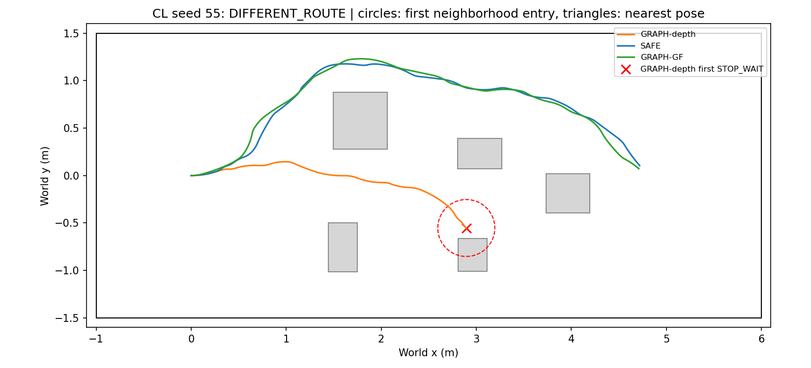

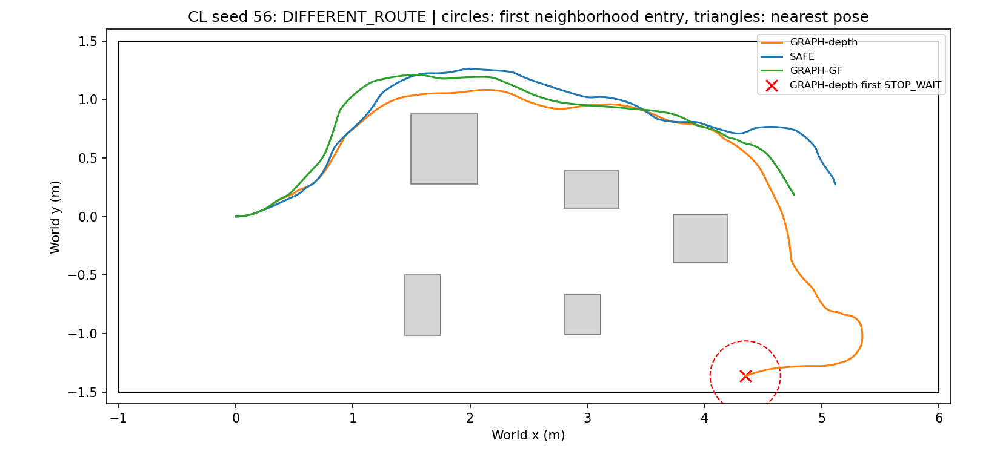

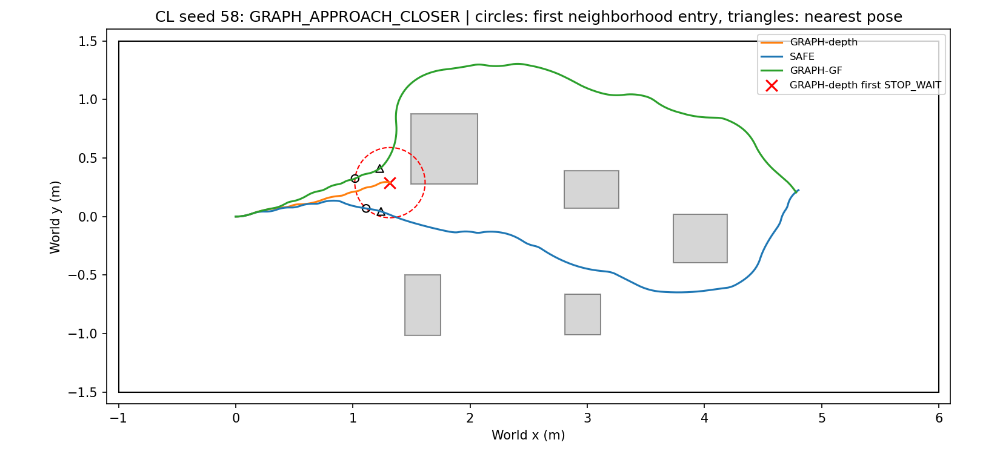

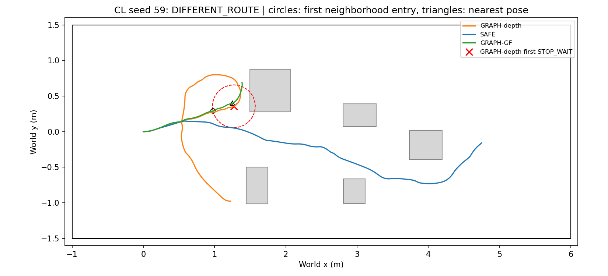

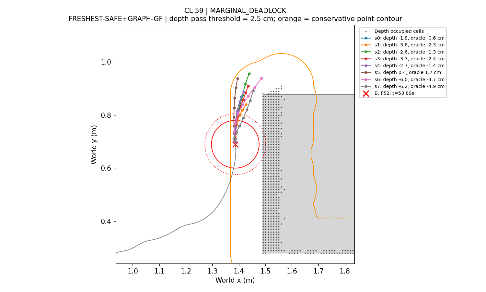

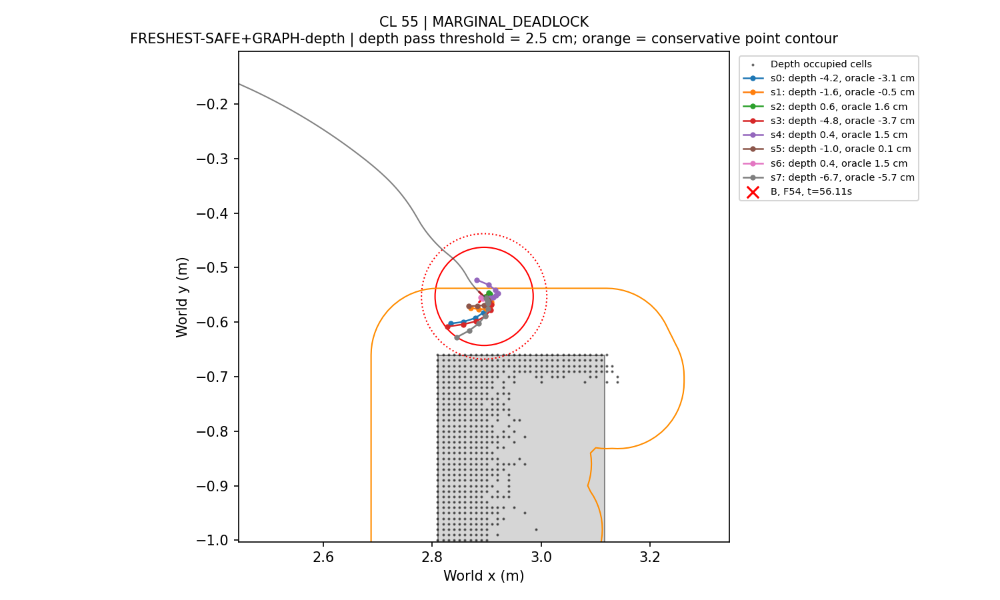

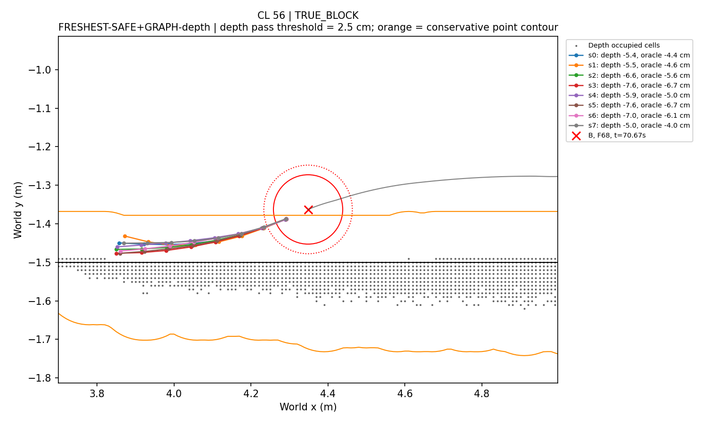

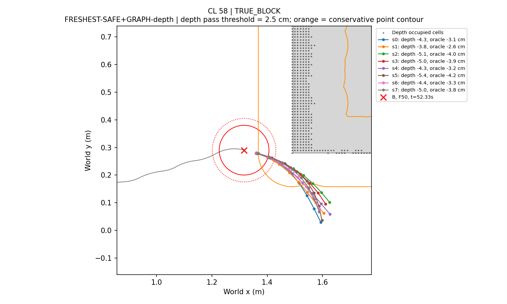

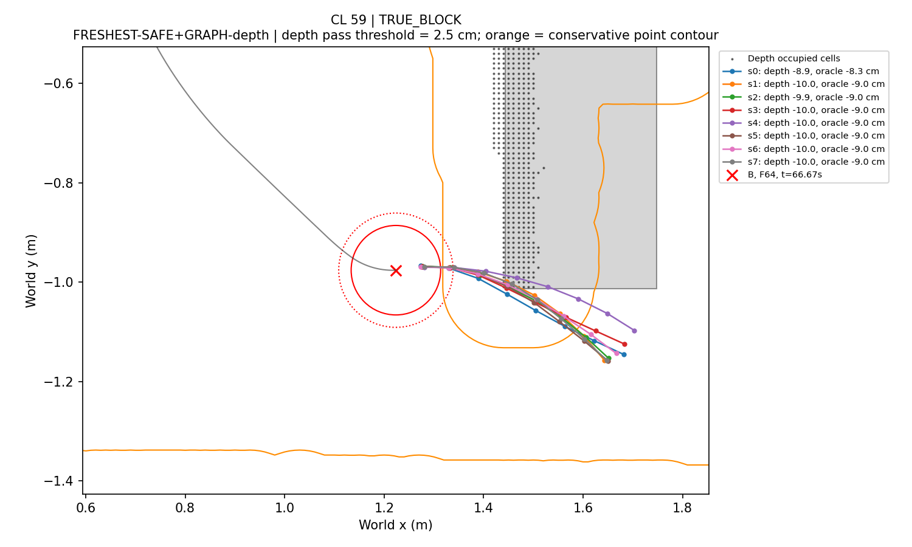

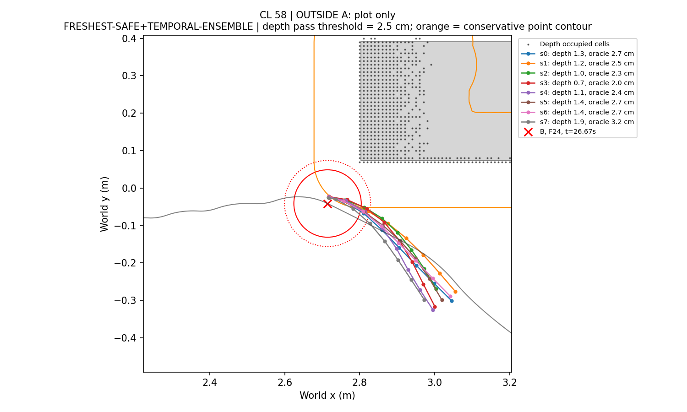

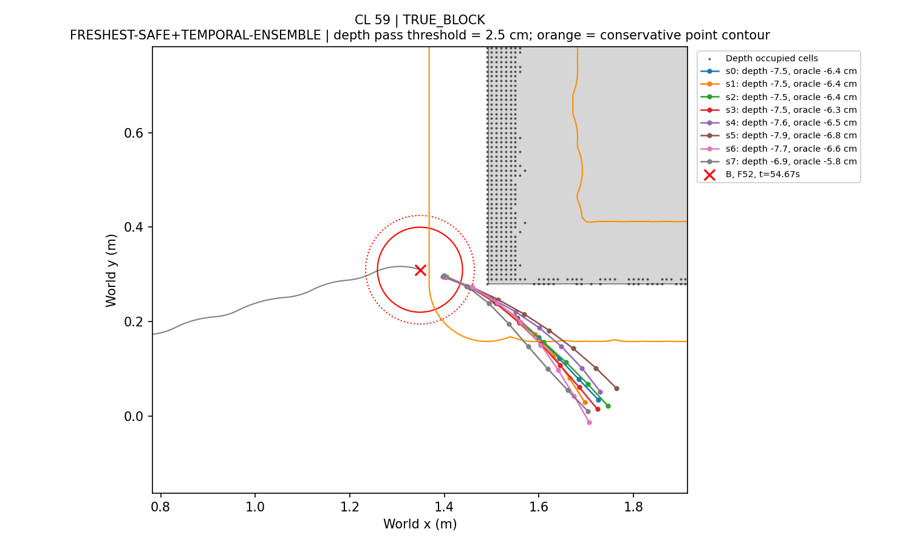

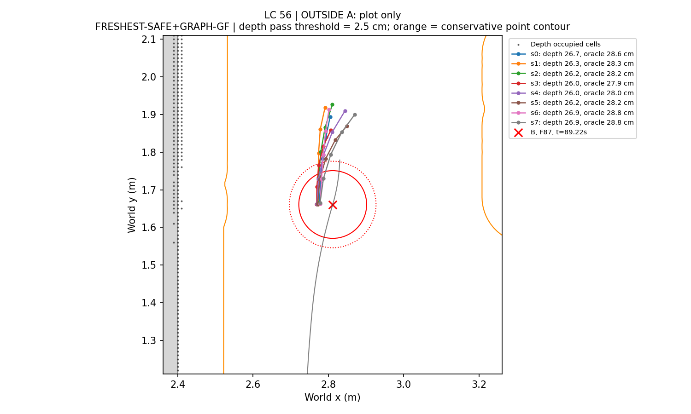

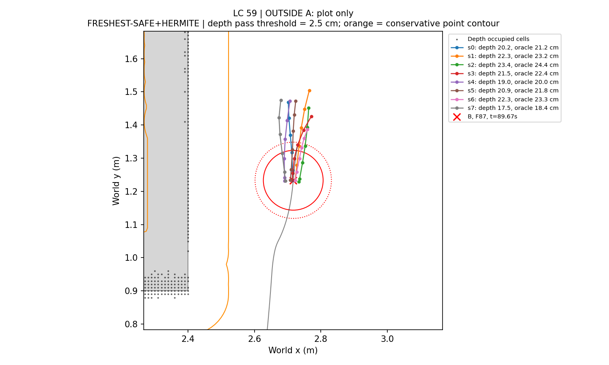

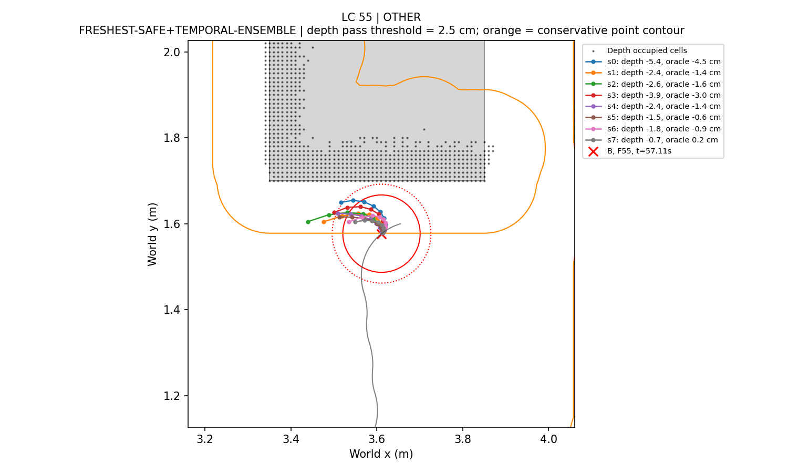

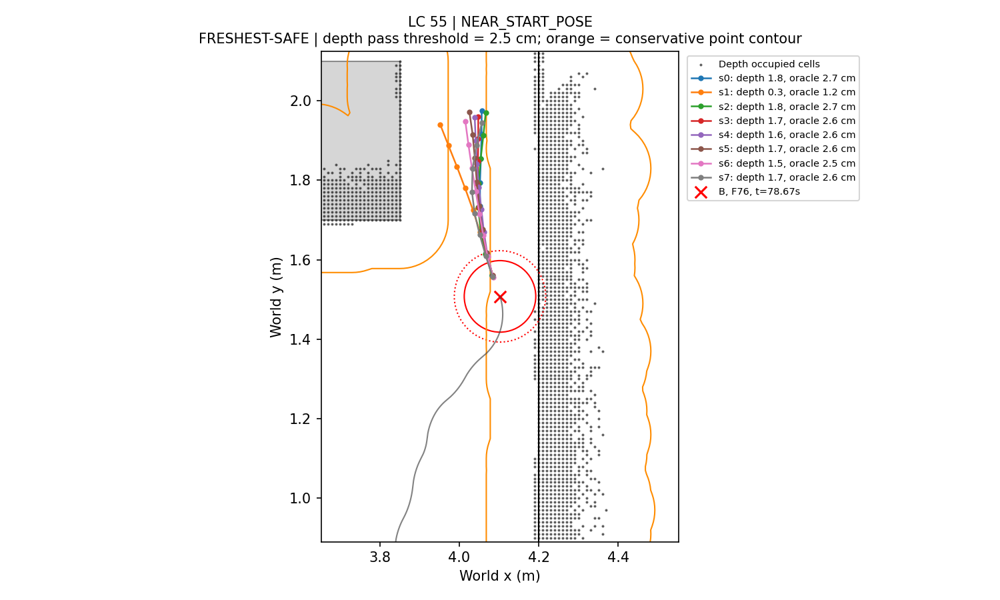

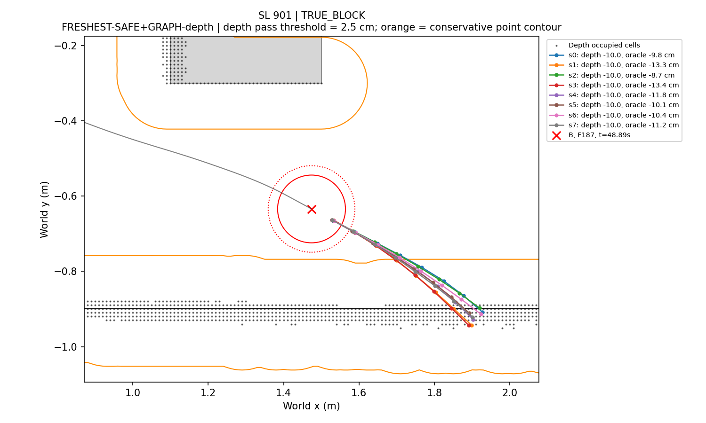

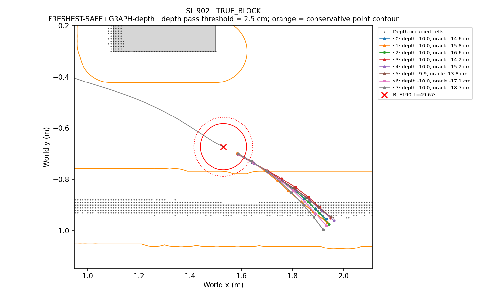

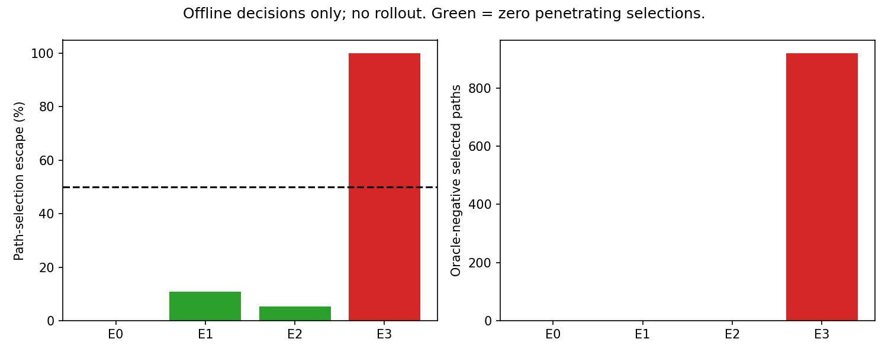

## Frozen measurement rules

```json
{
  "base_commit": "18de5fa",
  "main_inventory": 72,
  "gate_inventory": 6,
  "stop_fraction_strict_min": 0.2,
  "always_include_gates": [
    "SL_901_GRAPH-depth",
    "SL_902_GRAPH-depth"
  ],
  "target_clearance_m": 0.025,
  "depth_path": "unchanged suffix/evaluate_samples: sampled SDF minimum - h/sqrt(2) - max sample spacing/2",
  "depth_B": "SDF.query(B) - h/sqrt(2); nominal and exact occupied-site distance also reported; no segment spacing penalty at a single point",
  "oracle": "exact inherited polyline footprint clearance, minimum over static boxes AND outer rectangle; evaluation only",
  "best_sample_for_A": "maximum oracle clearance among all eight; depth-best oracle clearance is an additional field",
  "sample_change": "mean world XY distance over 8x8 same-index points, descriptive array change; sample indices are not physical correspondences",
  "near_start_radius_m": 0.3,
  "risk_location": "Euclidean radius from actual B; query points use the same conservative spacing allowance as the native selector; near/far can both be unsafe",
  "consecutive": "consecutive applied FRESH decisions, broken by NORMAL or KEEP_ACTIVE; median change during consecutive STOP_WAIT pairs, plus all-STOP-pair statistic",
  "B_neighborhood_m": 0.3,
  "B_matching": "first entry recorded; GRAPH_APPROACH_CLOSER compares point oracle clearance at B with SAFE closest recorded pose inside radius; prior active lineage must be corrected",
  "B_certificate": "sole exact certificate rejection: solver success + constraints_satisfied + exact_certificate_pass false + actual CONSTRAINT_FAILED; nonconvergence/stale alone is not certificate rejection",
  "B_different_route": "either SAFE or GF never enters the 0.30m neighborhood; tested after first two label conditions",
  "E1": "threshold=min(.025,c_B-.005), with no clamp at zero; eligible longest remaining suffix, then lower index",
  "E2": "threshold=.010; eligible longest remaining suffix, then lower index",
  "E3": "maximum depth clearance, then lower index (same Phase15B implementation)",
  "tie_order": [
    "E1",
    "E2",
    "E3",
    "E0"
  ],
  "speed_cap_m_s": 0.1,
  "selection": "pooled A STOP_WAIT events including D0 SL gates; retain candidates with zero oracle-negative selected paths, maximize escape fraction, require >=.50; descriptive main/gate strata also reported",
  "figure_event": "middle event of the earliest longest consecutive STOP_WAIT chain; never selected by escape-rule outcomes",
  "figure_scope": "all main STUCK runs plus the two SL gates; runs outside A are explicitly plot-only and use their last FRESH if no STOP_WAIT chain exists",
  "scope": "Offline same-data path selection, not execution safety, intervention causality, or navigation success. Nonpenetration is weaker than the 2.5cm margin. New-seed closed-loop validation required.",
  "navigation": 0,
  "inference": 0,
  "render": 0,
  "graph_solves": 0,
  "rollouts": 0
}
```
