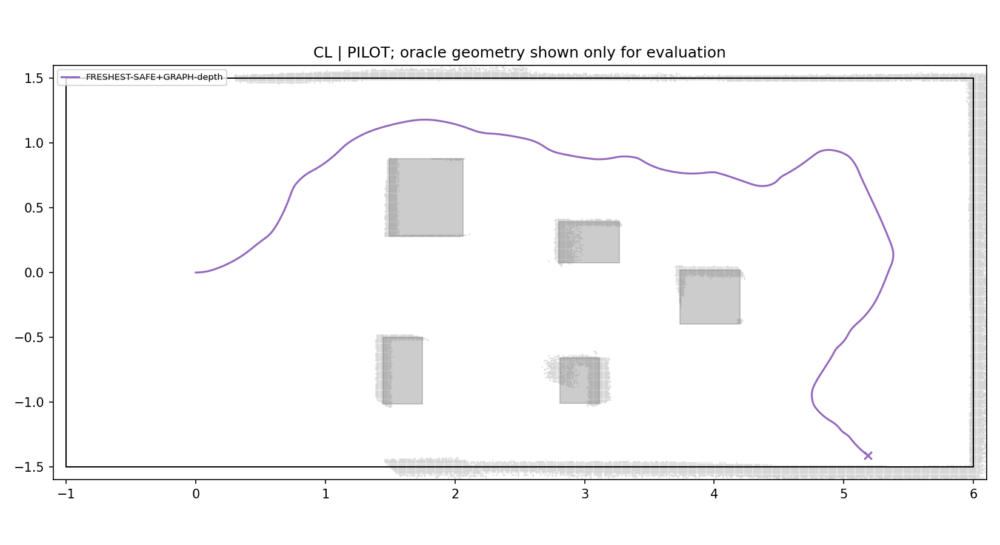
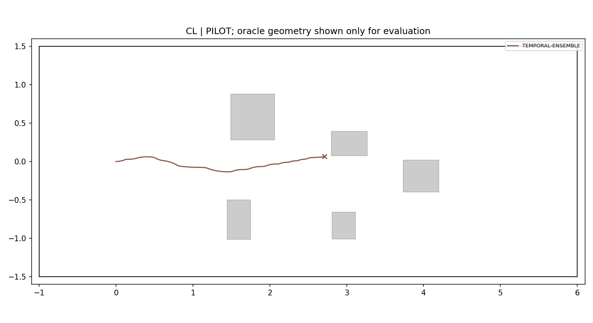
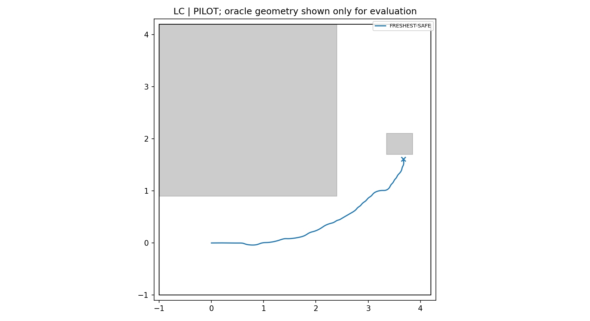
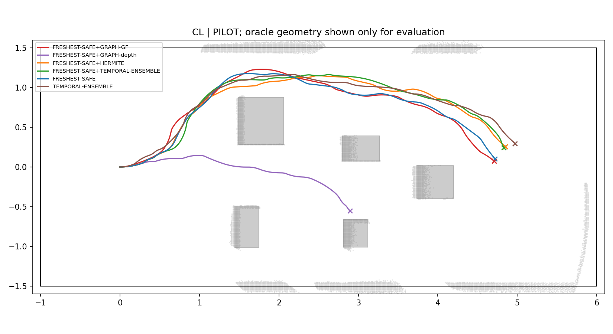
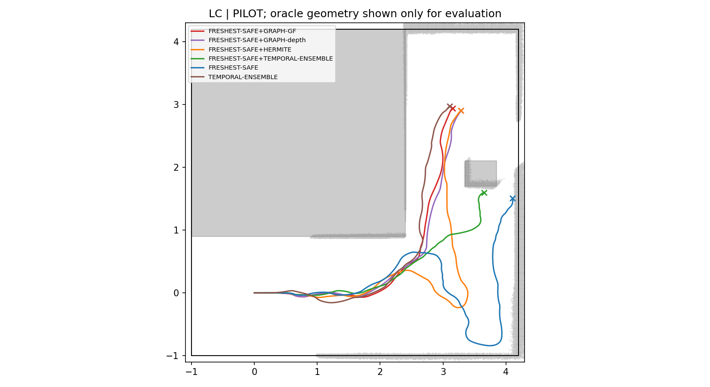
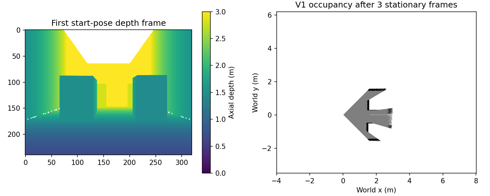
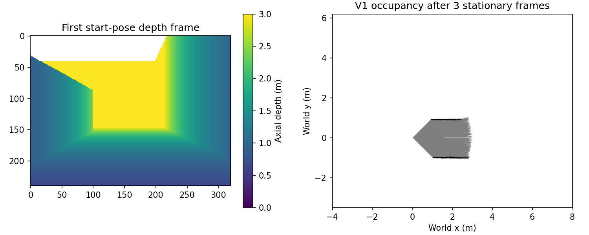
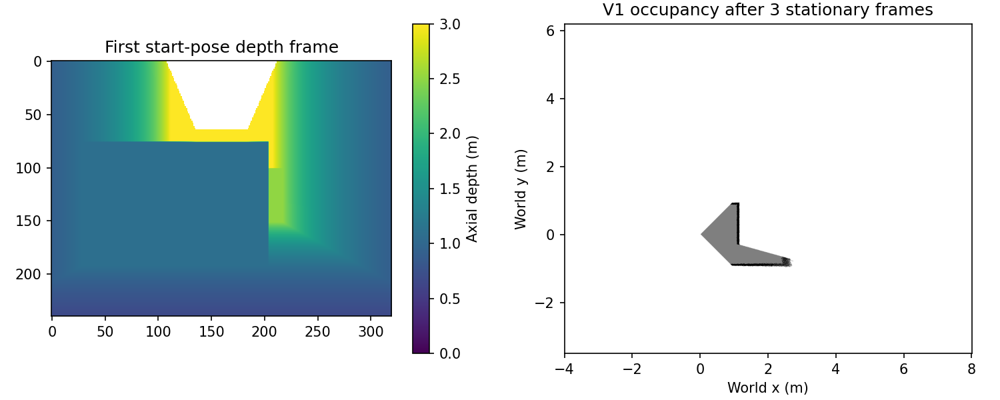
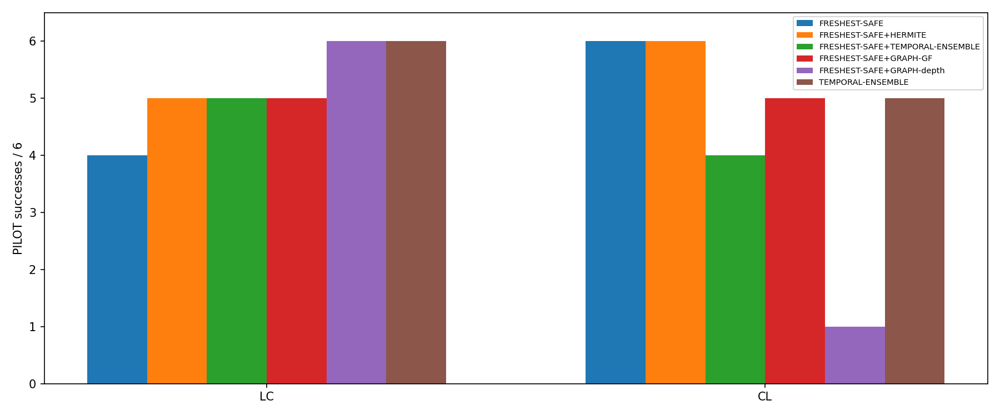

# Phase 16 — multiscene depth PILOT

Oracle geometry is used only for reference demonstration preparation and posthoc evaluation. All six methods use RGB-only NoMaD, the same noisy V1 depth map infrastructure, exact simulator odometry, and SE(2) kinematics. No PhysX/real-robot claim. Methods 1–5 share the depth sample-selection rule; closed-loop observations can differ. Original sample-0 TE is an external baseline.

Reference preparation is an oracle-guided human-demonstration analogue. The center-distance target is 0.25m from both obstacles and walls (not footprint clearance); sub-0.5m passages use a geometrically verified centerline exception if needed. The frozen clearance-weighted, smoothed path defines reference_length_m; the old shortest-grid length remains diagnostic only. Topomap uses actual Isaac RGB along the fixed PP reference rollout at 2s spacing including start/terminal; NoMaD never receives the route world poses. Static rendering features/camera and all solver weights remain frozen.

Scenes and map manifests

| scene | reference_length_m | reference | offline_pp | checkpoint | map | gate |
| --- | --- | --- | --- | --- | --- | --- |
| SL | 6.907 | {'grid_m': 0.02, 'cost': 'edge_length*(1+(.25/min(endpoint_center_clearance))^2)', 'cost_weight': 1.0, 'target_center_distance_m': 0.25, 'obstacles_and_outer_walls': True, 'expanded': 9733, 'smoothing_passes': 20, 'narrow_centerline_used': False, 'narrow_grid_nodes': 0, 'reference_length_m': 6.906954180660328, 'minimum_center_distance_m': 0.2999999999999987, 'minimum_footprint_clearance_m': 0.20999999999999872, 'minimum_box_center_distance_m': 0.29999999999999977, 'minimum_wall_center_distance_m': 0.2999999999999987} | {'reason': 'goal_entry', 'minimum_obstacle_clearance_m': 0.19803088752959216, 'minimum_wall_clearance_m': 0.19631860409212373, 'minimum_center_distance_m': 0.28631860409212373, 'minimum_footprint_clearance_m': 0.19631860409212373, 'duration_s': 32.68055555555556, 'goal': True, 'execution_distance_m': 6.536106970632271} | {'axis': 0, 'threshold_m': 4.6, 'meaning': 'last box far X face + 0.30m'} | {'manifest': '/home/gpuadmin/Workspace/NoMaD/artifacts/isaac6/phase16_multiscene_01/topomap/SL/topomap/manifest.json', 'node_count': 18, 'manifest_sha256': '95a50689f20cff56a6f67a3e2a4aad3bf9d4a1d1b1aef5475f164b2cad2dfcb4'} | NOMAD_INFEASIBLE |
| LC | 5.6934 | {'grid_m': 0.02, 'cost': 'edge_length*(1+(.25/min(endpoint_center_clearance))^2)', 'cost_weight': 1.0, 'target_center_distance_m': 0.25, 'obstacles_and_outer_walls': True, 'expanded': 17540, 'smoothing_passes': 20, 'narrow_centerline_used': False, 'narrow_grid_nodes': 0, 'reference_length_m': 5.693360086869726, 'minimum_center_distance_m': 0.41012193308819866, 'minimum_footprint_clearance_m': 0.3201219330881987, 'minimum_box_center_distance_m': 0.41012193308819866, 'minimum_wall_center_distance_m': 0.9000000000000004} | {'reason': 'goal_entry', 'minimum_obstacle_clearance_m': 0.3196821138554272, 'minimum_wall_clearance_m': 0.8989003088392814, 'minimum_center_distance_m': 0.4096821138554272, 'minimum_footprint_clearance_m': 0.3196821138554272, 'duration_s': 26.805555555555557, 'goal': True, 'execution_distance_m': 5.3611101899882705} | {'axis': 1, 'threshold_m': 2.4, 'meaning': 'after-corner obstacle far Y face + 0.30m'} | {'manifest': '/home/gpuadmin/Workspace/NoMaD/artifacts/isaac6/phase16_multiscene_01/topomap/LC/topomap/manifest.json', 'node_count': 15, 'manifest_sha256': 'f1c4f080632b69f1e6e39eddbe9f8f0284f9a4ba44ff8f51be9c300db1a3045f'} | PASS |
| CL | 5.8391 | {'grid_m': 0.02, 'cost': 'edge_length*(1+(.25/min(endpoint_center_clearance))^2)', 'cost_weight': 1.0, 'target_center_distance_m': 0.25, 'obstacles_and_outer_walls': True, 'expanded': 22672, 'smoothing_passes': 20, 'narrow_centerline_used': False, 'narrow_grid_nodes': 0, 'reference_length_m': 5.839123880126611, 'minimum_center_distance_m': 0.30193499770686383, 'minimum_footprint_clearance_m': 0.21193499770686383, 'minimum_box_center_distance_m': 0.30193499770686383, 'minimum_wall_center_distance_m': 0.3199999999999976} | {'reason': 'goal_entry', 'minimum_obstacle_clearance_m': 0.20829701619753624, 'minimum_wall_clearance_m': 0.22193930829557904, 'minimum_center_distance_m': 0.29829701619753624, 'minimum_footprint_clearance_m': 0.20829701619753624, 'duration_s': 27.84722222222222, 'goal': True, 'execution_distance_m': 5.569442744147168} | {'axis': 0, 'threshold_m': 4.497079173476586, 'meaning': 'last box far X face + 0.30m'} | {'manifest': '/home/gpuadmin/Workspace/NoMaD/artifacts/isaac6/phase16_multiscene_01/topomap/CL/topomap/manifest.json', 'node_count': 15, 'manifest_sha256': '358f4fa519cb9577b0a5e4ad25ea55cabc11e1cf2737e3022c33f5095678c5fa'} | PASS |

SL: 1.8m-wide slalom corridor with three alternating wall-attached boxes and 0.6m passages. LC: asymmetric [-1,4.2]² outer rectangle, a large inner-corner wall box, and an initially occluded after-corner obstacle. CL: five boxes from the single frozen placement seed 20261028; placements and reference routes are never adjusted to navigation outcomes.

Gate attempts (excluded from main results)

| scene | index | success | classification | technical_validation |
| --- | --- | --- | --- | --- |
| CL | 901 | True | SUCCESS | PASS |
| CL | 902 | True | SUCCESS | PASS |
| LC | 901 | True | SUCCESS | PASS |
| LC | 902 | True | SUCCESS | PASS |
| SL | 901 | False | STUCK | PASS |
| SL | 902 | False | STUCK | PASS |

NOMAD_INFEASIBLE is the prescribed operational exclusion label for this particular D0 GRAPH-depth gate, not a proof of geometric impossibility or an isolated failure of the NoMaD policy.

Main summary

| scene | method | planned | valid | technical | success | no_detour_success | collision | corridor | stuck | goal_time_mean_s | checkpoint_mean_s | minimum_oracle_clearance_m |
| --- | --- | --- | --- | --- | --- | --- | --- | --- | --- | --- | --- | --- |
| LC | FRESHEST-SAFE | 6 | 6 | 0 | 4 | 4 | 1 | 0 | 1 | 31.573 | 27.038 | -0.00039728 |
| LC | FRESHEST-SAFE+HERMITE | 6 | 6 | 0 | 5 | 5 | 0 | 0 | 1 | 36.144 | 30.297 | 0.072773 |
| LC | FRESHEST-SAFE+TEMPORAL-ENSEMBLE | 6 | 6 | 0 | 5 | 5 | 0 | 0 | 1 | 33.003 | 27.708 | 0.010296 |
| LC | FRESHEST-SAFE+GRAPH-GF | 6 | 6 | 0 | 5 | 5 | 0 | 0 | 1 | 32.511 | 27.439 | 0.11539 |
| LC | FRESHEST-SAFE+GRAPH-depth | 6 | 6 | 0 | 6 | 6 | 0 | 0 | 0 | 34.037 | 29.882 | 0.035911 |
| LC | TEMPORAL-ENSEMBLE | 6 | 6 | 0 | 6 | 6 | 0 | 0 | 0 | 38.458 | 33.65 | 0.060988 |
| CL | FRESHEST-SAFE | 6 | 6 | 0 | 6 | 6 | 0 | 0 | 0 | 36.539 | 32.664 | 0.053838 |
| CL | FRESHEST-SAFE+HERMITE | 6 | 6 | 0 | 6 | 6 | 0 | 0 | 0 | 36.236 | 32.743 | 0.038042 |
| CL | FRESHEST-SAFE+TEMPORAL-ENSEMBLE | 6 | 6 | 0 | 4 | 4 | 0 | 0 | 2 | 34.316 | 33.325 | 0.051085 |
| CL | FRESHEST-SAFE+GRAPH-GF | 6 | 6 | 0 | 5 | 5 | 0 | 0 | 1 | 34.194 | 32.019 | 0.015343 |
| CL | FRESHEST-SAFE+GRAPH-depth | 6 | 6 | 0 | 1 | 1 | 0 | 1 | 4 | 29.167 | 29.162 | -0.0018935 |
| CL | TEMPORAL-ENSEMBLE | 6 | 6 | 0 | 5 | 5 | 1 | 0 | 0 | 38.025 | 33.797 | -0.00084388 |
| ALL | FRESHEST-SAFE | 12 | 12 | 0 | 10 | 10 | 1 | 0 | 1 | 34.553 | 30.414 | -0.00039728 |
| ALL | FRESHEST-SAFE+HERMITE | 12 | 12 | 0 | 11 | 11 | 0 | 0 | 1 | 36.194 | 31.631 | 0.038042 |
| ALL | FRESHEST-SAFE+TEMPORAL-ENSEMBLE | 12 | 12 | 0 | 9 | 9 | 0 | 0 | 3 | 33.586 | 30.517 | 0.010296 |
| ALL | FRESHEST-SAFE+GRAPH-GF | 12 | 12 | 0 | 10 | 10 | 0 | 0 | 2 | 33.353 | 29.729 | 0.015343 |
| ALL | FRESHEST-SAFE+GRAPH-depth | 12 | 12 | 0 | 7 | 7 | 0 | 1 | 4 | 33.341 | 29.642 | -0.0018935 |
| ALL | TEMPORAL-ENSEMBLE | 12 | 12 | 0 | 11 | 11 | 1 | 0 | 0 | 38.261 | 33.717 | -0.00084388 |

Seed × scene × method

| index | scene | method | classification | goal_time_s | checkpoint_time_s | distance_m | no_detour_success |
| --- | --- | --- | --- | --- | --- | --- | --- |
| 55 | CL | FRESHEST-SAFE+GRAPH-GF | SUCCESS | 32.944 | 31.417 | 5.542 | True |
| 55 | CL | FRESHEST-SAFE+GRAPH-depth | STUCK | — | — | 3.1125 | False |
| 55 | CL | FRESHEST-SAFE+HERMITE | SUCCESS | 37.486 | 34.722 | 5.5483 | True |
| 55 | CL | FRESHEST-SAFE+TEMPORAL-ENSEMBLE | SUCCESS | 35.028 | 32.264 | 5.6156 | True |
| 55 | CL | FRESHEST-SAFE | SUCCESS | 35.528 | 33.444 | 5.5353 | True |
| 55 | CL | TEMPORAL-ENSEMBLE | SUCCESS | 37.097 | 33.278 | 5.6262 | True |
| 56 | CL | FRESHEST-SAFE+GRAPH-GF | SUCCESS | 31.958 | 29.819 | 5.6486 | True |
| 56 | CL | FRESHEST-SAFE+GRAPH-depth | STUCK | — | 29.653 | 7.9863 | False |
| 56 | CL | FRESHEST-SAFE+HERMITE | SUCCESS | 32.833 | 31.014 | 5.5499 | True |
| 56 | CL | FRESHEST-SAFE+TEMPORAL-ENSEMBLE | SUCCESS | 31.597 | 29.625 | 5.5223 | True |
| 56 | CL | FRESHEST-SAFE | SUCCESS | 37.764 | 31.972 | 5.9782 | True |
| 56 | CL | TEMPORAL-ENSEMBLE | SAFETY_FAILURE | — | — | 2.7734 | False |
| 57 | CL | FRESHEST-SAFE+GRAPH-GF | SUCCESS | 32.611 | 29.819 | 5.6157 | True |
| 57 | CL | FRESHEST-SAFE+GRAPH-depth | SAFETY_FAILURE | — | 30.889 | 8.4526 | False |
| 57 | CL | FRESHEST-SAFE+HERMITE | SUCCESS | 35.653 | 32.194 | 5.6466 | True |
| 57 | CL | FRESHEST-SAFE+TEMPORAL-ENSEMBLE | SUCCESS | 35.056 | 33.611 | 5.5508 | True |
| 57 | CL | FRESHEST-SAFE | SUCCESS | 35.861 | 33.486 | 5.6153 | True |
| 57 | CL | TEMPORAL-ENSEMBLE | SUCCESS | 36.569 | 32.625 | 5.1455 | True |
| 58 | CL | FRESHEST-SAFE+GRAPH-GF | SUCCESS | 43.556 | 41.222 | 5.804 | True |
| 58 | CL | FRESHEST-SAFE+GRAPH-depth | STUCK | — | — | 1.3589 | False |
| 58 | CL | FRESHEST-SAFE+HERMITE | SUCCESS | 39.361 | 37.167 | 5.1826 | True |
| 58 | CL | FRESHEST-SAFE+TEMPORAL-ENSEMBLE | STUCK | — | 39.347 | 12.145 | False |
| 58 | CL | FRESHEST-SAFE | SUCCESS | 39.597 | 33.958 | 5.4288 | True |
| 58 | CL | TEMPORAL-ENSEMBLE | SUCCESS | 41.028 | 37.319 | 5.8359 | True |
| 59 | CL | FRESHEST-SAFE+GRAPH-GF | STUCK | — | — | 1.6601 | False |
| 59 | CL | FRESHEST-SAFE+GRAPH-depth | STUCK | — | — | 4.3562 | False |
| 59 | CL | FRESHEST-SAFE+HERMITE | SUCCESS | 34.417 | 30.389 | 5.1872 | True |
| 59 | CL | FRESHEST-SAFE+TEMPORAL-ENSEMBLE | STUCK | — | — | 1.3958 | False |
| 59 | CL | FRESHEST-SAFE | SUCCESS | 35.042 | 32.542 | 5.1789 | True |
| 59 | CL | TEMPORAL-ENSEMBLE | SUCCESS | 39.639 | 33.167 | 6.0219 | True |
| 60 | CL | FRESHEST-SAFE+GRAPH-GF | SUCCESS | 29.903 | 27.819 | 5.5349 | True |
| 60 | CL | FRESHEST-SAFE+GRAPH-depth | SUCCESS | 29.167 | 26.944 | 5.5741 | True |
| 60 | CL | FRESHEST-SAFE+HERMITE | SUCCESS | 37.667 | 30.972 | 5.792 | True |
| 60 | CL | FRESHEST-SAFE+TEMPORAL-ENSEMBLE | SUCCESS | 35.583 | 31.778 | 5.7826 | True |
| 60 | CL | FRESHEST-SAFE | SUCCESS | 35.444 | 30.583 | 5.7965 | True |
| 60 | CL | TEMPORAL-ENSEMBLE | SUCCESS | 35.792 | 32.597 | 5.5533 | True |
| 55 | LC | FRESHEST-SAFE+GRAPH-GF | SUCCESS | 32.306 | 28.681 | 5.339 | True |
| 55 | LC | FRESHEST-SAFE+GRAPH-depth | SUCCESS | 33.694 | 29.833 | 5.3071 | True |
| 55 | LC | FRESHEST-SAFE+HERMITE | SUCCESS | 46.292 | 42.917 | 6.9283 | True |
| 55 | LC | FRESHEST-SAFE+TEMPORAL-ENSEMBLE | STUCK | — | — | 4.4939 | False |
| 55 | LC | FRESHEST-SAFE | STUCK | — | — | 7.6261 | False |
| 55 | LC | TEMPORAL-ENSEMBLE | SUCCESS | 37.069 | 31.639 | 5.3916 | True |
| 56 | LC | FRESHEST-SAFE+GRAPH-GF | STUCK | — | — | 13.097 | False |
| 56 | LC | FRESHEST-SAFE+GRAPH-depth | SUCCESS | 47.528 | 43.986 | 5.8875 | True |
| 56 | LC | FRESHEST-SAFE+HERMITE | SUCCESS | 33.833 | 28.806 | 5.2945 | True |
| 56 | LC | FRESHEST-SAFE+TEMPORAL-ENSEMBLE | SUCCESS | 34.708 | 28.958 | 5.3235 | True |
| 56 | LC | FRESHEST-SAFE | SUCCESS | 31.722 | 27.833 | 5.3323 | True |
| 56 | LC | TEMPORAL-ENSEMBLE | SUCCESS | 36.861 | 31.194 | 5.256 | True |
| 57 | LC | FRESHEST-SAFE+GRAPH-GF | SUCCESS | 34.528 | 29.708 | 5.3169 | True |
| 57 | LC | FRESHEST-SAFE+GRAPH-depth | SUCCESS | 31.625 | 26.694 | 5.2341 | True |
| 57 | LC | FRESHEST-SAFE+HERMITE | SUCCESS | 34.444 | 28.069 | 5.2105 | True |
| 57 | LC | FRESHEST-SAFE+TEMPORAL-ENSEMBLE | SUCCESS | 32.222 | 28.333 | 5.2848 | True |
| 57 | LC | FRESHEST-SAFE | SUCCESS | 32.292 | 28.25 | 5.3089 | True |
| 57 | LC | TEMPORAL-ENSEMBLE | SUCCESS | 40.833 | 37.167 | 5.3803 | True |
| 58 | LC | FRESHEST-SAFE+GRAPH-GF | SUCCESS | 33.097 | 26.333 | 5.2923 | True |
| 58 | LC | FRESHEST-SAFE+GRAPH-depth | SUCCESS | 31.792 | 27.139 | 5.3919 | True |
| 58 | LC | FRESHEST-SAFE+HERMITE | SUCCESS | 31.708 | 24.264 | 5.2142 | True |
| 58 | LC | FRESHEST-SAFE+TEMPORAL-ENSEMBLE | SUCCESS | 33.486 | 27.292 | 5.2743 | True |
| 58 | LC | FRESHEST-SAFE | SUCCESS | 30.958 | 25.403 | 5.2465 | True |
| 58 | LC | TEMPORAL-ENSEMBLE | SUCCESS | 32.681 | 29 | 5.389 | True |
| 59 | LC | FRESHEST-SAFE+GRAPH-GF | SUCCESS | 31.931 | 25.389 | 5.2593 | True |
| 59 | LC | FRESHEST-SAFE+GRAPH-depth | SUCCESS | 27.708 | 24.542 | 5.2403 | True |
| 59 | LC | FRESHEST-SAFE+HERMITE | STUCK | — | — | 12.47 | False |
| 59 | LC | FRESHEST-SAFE+TEMPORAL-ENSEMBLE | SUCCESS | 34.236 | 28.292 | 5.2061 | True |
| 59 | LC | FRESHEST-SAFE | SAFETY_FAILURE | — | — | 4.3494 | False |
| 59 | LC | TEMPORAL-ENSEMBLE | SUCCESS | 45.306 | 42.139 | 5.7401 | True |
| 60 | LC | FRESHEST-SAFE+GRAPH-GF | SUCCESS | 30.694 | 27.083 | 5.4075 | True |
| 60 | LC | FRESHEST-SAFE+GRAPH-depth | SUCCESS | 31.875 | 27.097 | 5.4179 | True |
| 60 | LC | FRESHEST-SAFE+HERMITE | SUCCESS | 34.444 | 27.431 | 5.326 | True |
| 60 | LC | FRESHEST-SAFE+TEMPORAL-ENSEMBLE | SUCCESS | 30.361 | 25.667 | 5.283 | True |
| 60 | LC | FRESHEST-SAFE | SUCCESS | 31.319 | 26.667 | 5.2092 | True |
| 60 | LC | TEMPORAL-ENSEMBLE | SUCCESS | 38 | 30.764 | 5.3488 | True |

Preregistered PILOT decisions

```json
{
  "5_vs_1": "PILOT_GRAPH_HURTS",
  "5_vs_2": "PILOT_GRAPH_HURTS",
  "5_vs_3": "PILOT_GRAPH_EQUAL",
  "Q2_all": "PILOT_CONSTRAINT_NO_DIFFERENCE",
  "Q2_scenes": {
    "LC": "PILOT_CONSTRAINT_ACTIVITY_BELOW_5_PERCENT",
    "CL": "PILOT_CONSTRAINT_ACTIVITY_BELOW_5_PERCENT"
  }
}
```

Fallback / Graph / depth metrics

| scene | method | keep_active_events | stop_wait_events | keep_active_fraction | stop_wait_fraction | te_removed_chunks | te_expired_chunks_at_fallback | graph_calls | graph_acceptance | initialization_rejected | solve_run_median_mean_s | solve_run_p95_mean_s | sdf_active_fraction | dangerous_false_safe_count | unknown_fraction_mean | depth_update_run_p95_mean_ms |
| --- | --- | --- | --- | --- | --- | --- | --- | --- | --- | --- | --- | --- | --- | --- | --- | --- |
| LC | FRESHEST-SAFE | 1 | 23 | 0.0018519 | 0.041358 | 0 | 0 | 0 | — | 0 | — | — | — | 0 | 0 | 33.772 |
| LC | FRESHEST-SAFE+HERMITE | 0 | 0 | 0 | 0 | 0 | 0 | 0 | — | 0 | — | — | — | 1 | 0 | 33.859 |
| LC | FRESHEST-SAFE+TEMPORAL-ENSEMBLE | 0 | 51 | 0 | 0.097049 | 0 | 3 | 0 | — | 0 | — | — | — | 0 | 0 | 33.505 |
| LC | FRESHEST-SAFE+GRAPH-GF | 0 | 1 | 0 | 0.0052197 | 0 | 0 | 242 | 0.79339 | 39 | 0.047661 | 0.07249 | — | 0 | 0 | 34.276 |
| LC | FRESHEST-SAFE+GRAPH-depth | 0 | 2 | 0 | 0.0070134 | 0 | 0 | 191 | 0.7801 | 32 | 0.068529 | 0.087317 | 0.013423 | 0 | 0 | 35.031 |
| LC | TEMPORAL-ENSEMBLE | 0 | 0 | 0 | 0 | 0 | 0 | 0 | — | 0 | — | — | — | 1 | 0 | 33.131 |
| CL | FRESHEST-SAFE | 0 | 0 | 0 | 0 | 0 | 0 | 0 | — | 0 | — | — | — | 0 | 0 | 35.841 |
| CL | FRESHEST-SAFE+HERMITE | 0 | 0 | 0 | 0 | 0 | 0 | 0 | — | 0 | — | — | — | 0 | 0 | 34.881 |
| CL | FRESHEST-SAFE+TEMPORAL-ENSEMBLE | 0 | 77 | 0 | 0.14193 | 0 | 5 | 0 | — | 0 | — | — | — | 0 | 0 | 35.573 |
| CL | FRESHEST-SAFE+GRAPH-GF | 1 | 77 | 0.0018519 | 0.14584 | 0 | 0 | 172 | 0.80814 | 31 | 0.048434 | 0.065323 | — | 0 | 0 | 35.494 |
| CL | FRESHEST-SAFE+GRAPH-depth | 1 | 232 | 0.0018519 | 0.42243 | 0 | 0 | 200 | 0.785 | 30 | 0.068921 | 0.11285 | 0.031847 | 0 | 0 | 33.826 |
| CL | TEMPORAL-ENSEMBLE | 0 | 0 | 0 | 0 | 0 | 0 | 0 | — | 0 | — | — | — | 0 | 0 | 35.453 |
| ALL | FRESHEST-SAFE | 1 | 23 | 0.00092593 | 0.020679 | 0 | 0 | 0 | — | 0 | — | — | — | 0 | 0 | 34.807 |
| ALL | FRESHEST-SAFE+HERMITE | 0 | 0 | 0 | 0 | 0 | 0 | 0 | — | 0 | — | — | — | 1 | 0 | 34.37 |
| ALL | FRESHEST-SAFE+TEMPORAL-ENSEMBLE | 0 | 128 | 0 | 0.11949 | 0 | 8 | 0 | — | 0 | — | — | — | 0 | 0 | 34.539 |
| ALL | FRESHEST-SAFE+GRAPH-GF | 1 | 78 | 0.00092593 | 0.075531 | 0 | 0 | 414 | 0.79952 | 70 | 0.048048 | 0.068906 | — | 0 | 0 | 34.885 |
| ALL | FRESHEST-SAFE+GRAPH-depth | 1 | 234 | 0.00092593 | 0.21472 | 0 | 0 | 391 | 0.78261 | 62 | 0.068725 | 0.10009 | 0.022876 | 0 | 0 | 34.429 |
| ALL | TEMPORAL-ENSEMBLE | 0 | 0 | 0 | 0 | 0 | 0 | 0 | — | 0 | — | — | — | 1 | 0 | 34.292 |

Q3: unknown-risk path points and spatially associated safety failures (within 0.12m of the terminal footprint center)

| method | unknown_risky_path_points | unknown_associated_safety_failures |
| --- | --- | --- |
| FRESHEST-SAFE | 0 | 0 |
| FRESHEST-SAFE+HERMITE | 0 | 0 |
| FRESHEST-SAFE+TEMPORAL-ENSEMBLE | 0 | 0 |
| FRESHEST-SAFE+GRAPH-GF | 0 | 0 |
| FRESHEST-SAFE+GRAPH-depth | 0 | 0 |
| TEMPORAL-ENSEMBLE | 0 | 0 |

Unknown-associated events are not causal proof; the number of failures caused by unknown geometry is not identifiable from these logs alone. All active TE component paths are included at application events. STOP_WAIT is excluded from path-following association; braking is not a certified trajectory. Rejected ALL_UNSAFE candidate uncertainty is recorded separately from newly selected safe paths. Counts are descriptive and not used in a decision label.

Paired checkpoint differences

| scene | method | comparator | n | mean_difference_s | ci95_s | negative_pairs | resampling |
| --- | --- | --- | --- | --- | --- | --- | --- |
| LC | FRESHEST-SAFE+GRAPH-depth | FRESHEST-SAFE | 4 | 4.191 | [-0.7326388888888902, 12.222222222222225] | 1 | paired seed clusters across scenes |
| LC | FRESHEST-SAFE+GRAPH-depth | FRESHEST-SAFE+HERMITE | 5 | 0.65278 | [-7.433541666666663, 8.975] | 3 | paired seed clusters across scenes |
| LC | FRESHEST-SAFE+GRAPH-depth | FRESHEST-SAFE+TEMPORAL-ENSEMBLE | 5 | 2.1833 | [-2.291666666666667, 8.955555555555557] | 3 | paired seed clusters across scenes |
| LC | FRESHEST-SAFE+GRAPH-depth | TEMPORAL-ENSEMBLE | 6 | -3.7685 | [-11.15509259259259, 4.030092592592595] | 5 | paired seed clusters across scenes |
| CL | FRESHEST-SAFE+GRAPH-depth | FRESHEST-SAFE | 3 | -2.8519 | [-3.6388888888888893, -2.319444444444443] | 3 | paired seed clusters across scenes |
| CL | FRESHEST-SAFE+GRAPH-depth | FRESHEST-SAFE+HERMITE | 3 | -2.2315 | [-4.027777777777779, -1.3055555555555536] | 3 | paired seed clusters across scenes |
| CL | FRESHEST-SAFE+GRAPH-depth | FRESHEST-SAFE+TEMPORAL-ENSEMBLE | 3 | -2.5093 | [-4.833333333333336, 0.027777777777778567] | 2 | paired seed clusters across scenes |
| CL | FRESHEST-SAFE+GRAPH-depth | TEMPORAL-ENSEMBLE | 2 | -3.6944 | [-5.652777777777779, -1.7361111111111107] | 2 | paired seed clusters across scenes |
| ALL | FRESHEST-SAFE+GRAPH-depth | FRESHEST-SAFE | 7 | 1.1726 | [-1.8402777777777795, 5.189814814814817] | 4 | paired seed clusters across scenes |
| ALL | FRESHEST-SAFE+GRAPH-depth | FRESHEST-SAFE+HERMITE | 8 | -0.42882 | [-6.5092592592592595, 4.441358024691358] | 6 | paired seed clusters across scenes |
| ALL | FRESHEST-SAFE+GRAPH-depth | FRESHEST-SAFE+TEMPORAL-ENSEMBLE | 8 | 0.42361 | [-2.572916666666668, 4.623456790123458] | 5 | paired seed clusters across scenes |
| ALL | FRESHEST-SAFE+GRAPH-depth | TEMPORAL-ENSEMBLE | 8 | -3.75 | [-9.522569444444443, 3.050925925925927] | 7 | paired seed clusters across scenes |

20,000 bootstrap replicates, seed 20261028; across scenes the paired seed index is resampled as a cluster. Missing checkpoints are never imputed. Timing aggregates are averages of run-level median/p95. Technical failures remain in the table; affected efficacy comparisons are inconclusive.

Technical failures

None.



















Smoke and reference/gate results are excluded from the main experimental denominators. KEEP_ACTIVE preserves path progress; STOP_WAIT decelerates rather than instantaneously repairing a safety violation. SAFE+TE filters existing, unexpired components only at ALL_UNSAFE events, inserts no unsafe chunk, retains only safe suffixes of length >=0.25m, and renormalizes the original oldest-first exp(-0.5k) weights. Expiry remains one second; other ticks use unchanged Phase12 TE.
