# Phase 17 — recovery + clearance preference PILOT

Oracle geometry is used only for reference demonstration preparation and posthoc evaluation. All seven methods use RGB-only NoMaD, the same noisy V1 depth map infrastructure, exact simulator odometry, and SE(2) kinematics. No PhysX/real-robot claim. Methods 1–6 share depth selection, fallback and recovery; closed-loop observations can differ. Original sample-0 TE is an external baseline.

Reference preparation is an oracle-guided human-demonstration analogue. The center-distance target is 0.25m from both obstacles and walls (not footprint clearance); sub-0.5m passages use a geometrically verified centerline exception if needed. The frozen clearance-weighted, smoothed path defines reference_length_m; the old shortest-grid length remains diagnostic only. Topomap uses actual Isaac RGB along the fixed PP reference rollout at 2s spacing including start/terminal; NoMaD never receives the route world poses. Static rendering features/camera and existing solver weights remain frozen; only method 6 adds the declared CLR residual.

Scenes and map manifests

| scene | reference_length_m | reference | offline_pp | checkpoint | map | gate |
| --- | --- | --- | --- | --- | --- | --- |
| SLW | 6.2971 | {'grid_m': 0.02, 'cost': 'edge_length*(1+(.25/min(endpoint_center_clearance))^2)', 'cost_weight': 1.0, 'target_center_distance_m': 0.25, 'obstacles_and_outer_walls': True, 'expanded': 10987, 'smoothing_passes': 20, 'narrow_centerline_used': False, 'narrow_grid_nodes': 0, 'reference_length_m': 6.2970805213361265, 'minimum_center_distance_m': 0.35355339048790335, 'minimum_footprint_clearance_m': 0.2635533904879034, 'minimum_box_center_distance_m': 0.35355339048790335, 'minimum_wall_center_distance_m': 0.3999999999999988} | {'reason': 'goal_entry', 'minimum_obstacle_clearance_m': 0.26614465687498634, 'minimum_wall_clearance_m': 0.296571566151576, 'minimum_center_distance_m': 0.3561446568749863, 'minimum_footprint_clearance_m': 0.26614465687498634, 'duration_s': 29.680555555555557, 'goal': True, 'execution_distance_m': 5.936108094155232} | {'axis': 0, 'threshold_m': 4.6, 'meaning': 'last box far X face + 0.30m'} | {'manifest': '/home/gpuadmin/Workspace/NoMaD/artifacts/isaac6/phase17_multiscene_01/topomap/SLW/topomap/manifest.json', 'node_count': 16, 'manifest_sha256': '5d667992e2bb0f3f3f4cece8c8745355c8a36a997b5dfda8ce46f3856655db57'} | PASS |
| LC | 5.6934 | {'grid_m': 0.02, 'cost': 'edge_length*(1+(.25/min(endpoint_center_clearance))^2)', 'cost_weight': 1.0, 'target_center_distance_m': 0.25, 'obstacles_and_outer_walls': True, 'expanded': 17540, 'smoothing_passes': 20, 'narrow_centerline_used': False, 'narrow_grid_nodes': 0, 'reference_length_m': 5.693360086869726, 'minimum_center_distance_m': 0.41012193308819866, 'minimum_footprint_clearance_m': 0.3201219330881987, 'minimum_box_center_distance_m': 0.41012193308819866, 'minimum_wall_center_distance_m': 0.9000000000000004} | {'reason': 'goal_entry', 'minimum_obstacle_clearance_m': 0.3196821138554272, 'minimum_wall_clearance_m': 0.8989003088392814, 'minimum_center_distance_m': 0.4096821138554272, 'minimum_footprint_clearance_m': 0.3196821138554272, 'duration_s': 26.805555555555557, 'goal': True, 'execution_distance_m': 5.3611101899882705} | {'axis': 1, 'threshold_m': 2.4, 'meaning': 'after-corner obstacle far Y face + 0.30m'} | {'manifest': '/home/gpuadmin/Workspace/NoMaD/artifacts/isaac6/phase16_multiscene_01/topomap/LC/topomap/manifest.json', 'node_count': 15, 'manifest_sha256': 'f1c4f080632b69f1e6e39eddbe9f8f0284f9a4ba44ff8f51be9c300db1a3045f'} | PASS |
| CL | 5.8391 | {'grid_m': 0.02, 'cost': 'edge_length*(1+(.25/min(endpoint_center_clearance))^2)', 'cost_weight': 1.0, 'target_center_distance_m': 0.25, 'obstacles_and_outer_walls': True, 'expanded': 22672, 'smoothing_passes': 20, 'narrow_centerline_used': False, 'narrow_grid_nodes': 0, 'reference_length_m': 5.839123880126611, 'minimum_center_distance_m': 0.30193499770686383, 'minimum_footprint_clearance_m': 0.21193499770686383, 'minimum_box_center_distance_m': 0.30193499770686383, 'minimum_wall_center_distance_m': 0.3199999999999976} | {'reason': 'goal_entry', 'minimum_obstacle_clearance_m': 0.20829701619753624, 'minimum_wall_clearance_m': 0.22193930829557904, 'minimum_center_distance_m': 0.29829701619753624, 'minimum_footprint_clearance_m': 0.20829701619753624, 'duration_s': 27.84722222222222, 'goal': True, 'execution_distance_m': 5.569442744147168} | {'axis': 0, 'threshold_m': 4.497079173476586, 'meaning': 'last box far X face + 0.30m'} | {'manifest': '/home/gpuadmin/Workspace/NoMaD/artifacts/isaac6/phase16_multiscene_01/topomap/CL/topomap/manifest.json', 'node_count': 15, 'manifest_sha256': '358f4fa519cb9577b0a5e4ad25ea55cabc11e1cf2737e3022c33f5095678c5fa'} | PASS |

SLW: 1.8m-wide slalom corridor with three alternating wall-attached boxes and 0.8m passages. LC: asymmetric [-1,4.2]² outer rectangle, a large inner-corner wall box, and an initially occluded after-corner obstacle. CL: unchanged Phase16 boxes from placement seed 20261028; placements and reference routes are never adjusted to navigation outcomes.

Gate attempts (excluded from main results)

| scene | index | success | classification | technical_validation |
| --- | --- | --- | --- | --- |
| CL | 901 | True | SUCCESS | PASS |
| CL | 902 | True | SUCCESS | PASS |
| LC | 901 | True | SUCCESS | PASS |
| LC | 902 | True | SUCCESS | PASS |
| SLW | 901 | True | SUCCESS | PASS |
| SLW | 902 | True | SUCCESS | PASS |

NOMAD_INFEASIBLE is the prescribed operational exclusion label for this particular D0 SAFE+RECOVER_ROTATE gate, not a proof of geometric impossibility or an isolated failure of the NoMaD policy.

Main summary

| scene | method | planned | valid | technical | success | no_detour_success | collision | corridor | stuck | goal_time_mean_s | checkpoint_mean_s | minimum_oracle_clearance_m |
| --- | --- | --- | --- | --- | --- | --- | --- | --- | --- | --- | --- | --- |
| SLW | FRESHEST-SAFE | 5 | 5 | 0 | 1 | 1 | 1 | 2 | 1 | 48.25 | 46.556 | -0.0012425 |
| SLW | FRESHEST-SAFE+HERMITE | 5 | 5 | 0 | 1 | 1 | 1 | 2 | 1 | 46.431 | 44.958 | -0.00028369 |
| SLW | FRESHEST-SAFE+TEMPORAL-ENSEMBLE | 5 | 5 | 0 | 2 | 2 | 1 | 2 | 0 | 46.542 | 45.056 | -0.0017416 |
| SLW | FRESHEST-SAFE+GRAPH-GF | 5 | 5 | 0 | 2 | 2 | 0 | 1 | 2 | 48.542 | 46.972 | -2.4847e-05 |
| SLW | FRESHEST-SAFE+GRAPH-depth | 5 | 5 | 0 | 2 | 2 | 1 | 1 | 1 | 47.639 | 46.222 | -0.00010038 |
| SLW | FRESHEST-SAFE+GRAPH-depth-CLR | 5 | 5 | 0 | 2 | 2 | 0 | 2 | 1 | 43.076 | 40.965 | -0.00054832 |
| SLW | TEMPORAL-ENSEMBLE | 5 | 5 | 0 | 1 | 1 | 0 | 4 | 0 | 56.722 | 53.431 | -0.0026477 |
| LC | FRESHEST-SAFE | 5 | 5 | 0 | 5 | 5 | 0 | 0 | 0 | 33.664 | 28.933 | 0.11697 |
| LC | FRESHEST-SAFE+HERMITE | 5 | 5 | 0 | 4 | 4 | 0 | 0 | 1 | 37.729 | 31.17 | 0.094378 |
| LC | FRESHEST-SAFE+TEMPORAL-ENSEMBLE | 5 | 5 | 0 | 5 | 4 | 0 | 0 | 0 | 45.592 | 40.703 | 0.053623 |
| LC | FRESHEST-SAFE+GRAPH-GF | 5 | 5 | 0 | 4 | 3 | 0 | 0 | 1 | 45.826 | 41.538 | 0.001464 |
| LC | FRESHEST-SAFE+GRAPH-depth | 5 | 5 | 0 | 4 | 4 | 0 | 0 | 1 | 30.465 | 25.896 | 0.081868 |
| LC | FRESHEST-SAFE+GRAPH-depth-CLR | 5 | 5 | 0 | 5 | 5 | 0 | 0 | 0 | 33.844 | 28.65 | 0.11688 |
| LC | TEMPORAL-ENSEMBLE | 5 | 5 | 0 | 5 | 5 | 0 | 0 | 0 | 37.783 | 30.492 | 0.13054 |
| CL | FRESHEST-SAFE | 5 | 5 | 0 | 5 | 5 | 0 | 0 | 0 | 39.825 | 36.219 | 0.0080154 |
| CL | FRESHEST-SAFE+HERMITE | 5 | 5 | 0 | 5 | 4 | 0 | 0 | 0 | 44.217 | 40.3 | 0.032343 |
| CL | FRESHEST-SAFE+TEMPORAL-ENSEMBLE | 5 | 5 | 0 | 4 | 4 | 0 | 0 | 1 | 33.781 | 32.581 | 0.060567 |
| CL | FRESHEST-SAFE+GRAPH-GF | 5 | 5 | 0 | 4 | 4 | 0 | 0 | 1 | 31.642 | 35.956 | 0.023108 |
| CL | FRESHEST-SAFE+GRAPH-depth | 5 | 5 | 0 | 5 | 5 | 0 | 0 | 0 | 31.903 | 28.769 | 0.028312 |
| CL | FRESHEST-SAFE+GRAPH-depth-CLR | 5 | 5 | 0 | 5 | 5 | 0 | 0 | 0 | 35.425 | 30.564 | 0.065961 |
| CL | TEMPORAL-ENSEMBLE | 5 | 5 | 0 | 3 | 3 | 2 | 0 | 0 | 36.801 | 34.174 | -0.0022529 |
| ALL | FRESHEST-SAFE | 15 | 15 | 0 | 11 | 11 | 1 | 2 | 1 | 37.79 | 33.847 | -0.0012425 |
| ALL | FRESHEST-SAFE+HERMITE | 15 | 15 | 0 | 10 | 9 | 1 | 2 | 2 | 41.843 | 37.114 | -0.00028369 |
| ALL | FRESHEST-SAFE+TEMPORAL-ENSEMBLE | 15 | 15 | 0 | 11 | 10 | 1 | 2 | 1 | 41.47 | 38.044 | -0.0017416 |
| ALL | FRESHEST-SAFE+GRAPH-GF | 15 | 15 | 0 | 10 | 9 | 0 | 1 | 4 | 40.696 | 39.989 | -2.4847e-05 |
| ALL | FRESHEST-SAFE+GRAPH-depth | 15 | 15 | 0 | 11 | 11 | 1 | 1 | 2 | 34.241 | 30.898 | -0.00010038 |
| ALL | FRESHEST-SAFE+GRAPH-depth-CLR | 15 | 15 | 0 | 12 | 12 | 0 | 2 | 1 | 36.042 | 31.5 | -0.00054832 |
| ALL | TEMPORAL-ENSEMBLE | 15 | 15 | 0 | 9 | 9 | 2 | 4 | 0 | 39.56 | 34.258 | -0.0026477 |

Seed × scene × method

| index | scene | method | classification | goal_time_s | checkpoint_time_s | distance_m | no_detour_success |
| --- | --- | --- | --- | --- | --- | --- | --- |
| 61 | CL | FRESHEST-SAFE+GRAPH-GF | STUCK | — | 67.25 | 11.78 | False |
| 61 | CL | FRESHEST-SAFE+GRAPH-depth-CLR | SUCCESS | 37.514 | 34.556 | 5.868 | True |
| 61 | CL | FRESHEST-SAFE+GRAPH-depth | SUCCESS | 34.458 | 31.792 | 5.643 | True |
| 61 | CL | FRESHEST-SAFE+HERMITE | SUCCESS | 79.722 | 76.903 | 10.015 | False |
| 61 | CL | FRESHEST-SAFE+TEMPORAL-ENSEMBLE | STUCK | — | 38.278 | 11.469 | False |
| 61 | CL | FRESHEST-SAFE | SUCCESS | 56.861 | 52.486 | 5.475 | True |
| 61 | CL | TEMPORAL-ENSEMBLE | SAFETY_FAILURE | — | 36.681 | 11.67 | False |
| 62 | CL | FRESHEST-SAFE+GRAPH-GF | SUCCESS | 33.361 | 26.847 | 5.7594 | True |
| 62 | CL | FRESHEST-SAFE+GRAPH-depth-CLR | SUCCESS | 37.611 | 31.444 | 6.0145 | True |
| 62 | CL | FRESHEST-SAFE+GRAPH-depth | SUCCESS | 33.861 | 27.722 | 6.0698 | True |
| 62 | CL | FRESHEST-SAFE+HERMITE | SUCCESS | 36.556 | 30.875 | 5.8729 | True |
| 62 | CL | FRESHEST-SAFE+TEMPORAL-ENSEMBLE | SUCCESS | 36.069 | 30.958 | 5.8451 | True |
| 62 | CL | FRESHEST-SAFE | SUCCESS | 37.403 | 34.569 | 5.6092 | True |
| 62 | CL | TEMPORAL-ENSEMBLE | SUCCESS | 38.653 | 32.722 | 5.3012 | True |
| 63 | CL | FRESHEST-SAFE+GRAPH-GF | SUCCESS | 30.069 | 27.375 | 5.479 | True |
| 63 | CL | FRESHEST-SAFE+GRAPH-depth-CLR | SUCCESS | 33.681 | 28.514 | 5.8525 | True |
| 63 | CL | FRESHEST-SAFE+GRAPH-depth | SUCCESS | 30.042 | 27.153 | 5.5905 | True |
| 63 | CL | FRESHEST-SAFE+HERMITE | SUCCESS | 32.125 | 29.708 | 5.6411 | True |
| 63 | CL | FRESHEST-SAFE+TEMPORAL-ENSEMBLE | SUCCESS | 32.806 | 31.278 | 5.6175 | True |
| 63 | CL | FRESHEST-SAFE | SUCCESS | 32.458 | 29.875 | 5.6935 | True |
| 63 | CL | TEMPORAL-ENSEMBLE | SUCCESS | 36.056 | 33.667 | 5.5231 | True |
| 64 | CL | FRESHEST-SAFE+GRAPH-GF | SUCCESS | 30.458 | 28.778 | 5.3549 | True |
| 64 | CL | FRESHEST-SAFE+GRAPH-depth-CLR | SUCCESS | 33.278 | 29.542 | 5.555 | True |
| 64 | CL | FRESHEST-SAFE+GRAPH-depth | SUCCESS | 28.5 | 27.194 | 5.415 | True |
| 64 | CL | FRESHEST-SAFE+HERMITE | SUCCESS | 34.931 | 29.694 | 5.721 | True |
| 64 | CL | FRESHEST-SAFE+TEMPORAL-ENSEMBLE | SUCCESS | 31.944 | 30.389 | 5.5111 | True |
| 64 | CL | FRESHEST-SAFE | SUCCESS | 33.472 | 29.722 | 5.6419 | True |
| 64 | CL | TEMPORAL-ENSEMBLE | SAFETY_FAILURE | — | — | 1.6262 | False |
| 65 | CL | FRESHEST-SAFE+GRAPH-GF | SUCCESS | 32.681 | 29.528 | 5.5684 | True |
| 65 | CL | FRESHEST-SAFE+GRAPH-depth-CLR | SUCCESS | 35.042 | 28.764 | 5.904 | True |
| 65 | CL | FRESHEST-SAFE+GRAPH-depth | SUCCESS | 32.653 | 29.986 | 5.5632 | True |
| 65 | CL | FRESHEST-SAFE+HERMITE | SUCCESS | 37.75 | 34.319 | 5.7228 | True |
| 65 | CL | FRESHEST-SAFE+TEMPORAL-ENSEMBLE | SUCCESS | 34.306 | 32 | 5.572 | True |
| 65 | CL | FRESHEST-SAFE | SUCCESS | 38.931 | 34.444 | 5.7017 | True |
| 65 | CL | TEMPORAL-ENSEMBLE | SUCCESS | 35.694 | 33.625 | 5.4485 | True |
| 61 | LC | FRESHEST-SAFE+GRAPH-GF | SUCCESS | 35.278 | 28.194 | 5.6742 | True |
| 61 | LC | FRESHEST-SAFE+GRAPH-depth-CLR | SUCCESS | 35.986 | 27.597 | 5.5356 | True |
| 61 | LC | FRESHEST-SAFE+GRAPH-depth | SUCCESS | 29.528 | 26.208 | 5.2831 | True |
| 61 | LC | FRESHEST-SAFE+HERMITE | SUCCESS | 35.958 | 28.278 | 5.3573 | True |
| 61 | LC | FRESHEST-SAFE+TEMPORAL-ENSEMBLE | SUCCESS | 33.403 | 27.778 | 5.3128 | True |
| 61 | LC | FRESHEST-SAFE | SUCCESS | 33.958 | 29.764 | 5.1976 | True |
| 61 | LC | TEMPORAL-ENSEMBLE | SUCCESS | 42.903 | 34.958 | 5.3778 | True |
| 62 | LC | FRESHEST-SAFE+GRAPH-GF | SUCCESS | 61.583 | 59.556 | 7.0072 | True |
| 62 | LC | FRESHEST-SAFE+GRAPH-depth-CLR | SUCCESS | 32.181 | 27.653 | 5.3312 | True |
| 62 | LC | FRESHEST-SAFE+GRAPH-depth | SUCCESS | 31.056 | 26.514 | 5.3905 | True |
| 62 | LC | FRESHEST-SAFE+HERMITE | STUCK | — | — | 12.707 | False |
| 62 | LC | FRESHEST-SAFE+TEMPORAL-ENSEMBLE | SUCCESS | 35.444 | 28.903 | 5.5029 | True |
| 62 | LC | FRESHEST-SAFE | SUCCESS | 36.806 | 27.736 | 5.4901 | True |
| 62 | LC | TEMPORAL-ENSEMBLE | SUCCESS | 37.028 | 32.319 | 5.2881 | True |
| 63 | LC | FRESHEST-SAFE+GRAPH-GF | STUCK | — | — | 10.518 | False |
| 63 | LC | FRESHEST-SAFE+GRAPH-depth-CLR | SUCCESS | 37.014 | 33.458 | 5.833 | True |
| 63 | LC | FRESHEST-SAFE+GRAPH-depth | STUCK | — | — | 12.779 | False |
| 63 | LC | FRESHEST-SAFE+HERMITE | SUCCESS | 42.236 | 37.444 | 5.6885 | True |
| 63 | LC | FRESHEST-SAFE+TEMPORAL-ENSEMBLE | SUCCESS | 48.958 | 45.847 | 7.0986 | True |
| 63 | LC | FRESHEST-SAFE | SUCCESS | 32.944 | 29.194 | 5.2162 | True |
| 63 | LC | TEMPORAL-ENSEMBLE | SUCCESS | 40.472 | 28.444 | 5.6086 | True |
| 64 | LC | FRESHEST-SAFE+GRAPH-GF | SUCCESS | 56.5 | 52.667 | 8.4811 | False |
| 64 | LC | FRESHEST-SAFE+GRAPH-depth-CLR | SUCCESS | 31.931 | 27.569 | 5.4979 | True |
| 64 | LC | FRESHEST-SAFE+GRAPH-depth | SUCCESS | 30.931 | 26.389 | 5.3918 | True |
| 64 | LC | FRESHEST-SAFE+HERMITE | SUCCESS | 38.236 | 27.958 | 5.8232 | True |
| 64 | LC | FRESHEST-SAFE+TEMPORAL-ENSEMBLE | SUCCESS | 75.222 | 73.361 | 9.3227 | False |
| 64 | LC | FRESHEST-SAFE | SUCCESS | 33.875 | 30.389 | 5.4089 | True |
| 64 | LC | TEMPORAL-ENSEMBLE | SUCCESS | 34.458 | 29.5 | 5.2757 | True |
| 65 | LC | FRESHEST-SAFE+GRAPH-GF | SUCCESS | 29.944 | 25.736 | 5.3703 | True |
| 65 | LC | FRESHEST-SAFE+GRAPH-depth-CLR | SUCCESS | 32.111 | 26.972 | 5.529 | True |
| 65 | LC | FRESHEST-SAFE+GRAPH-depth | SUCCESS | 30.347 | 24.472 | 5.2643 | True |
| 65 | LC | FRESHEST-SAFE+HERMITE | SUCCESS | 34.486 | 31 | 5.3609 | True |
| 65 | LC | FRESHEST-SAFE+TEMPORAL-ENSEMBLE | SUCCESS | 34.931 | 27.625 | 5.4195 | True |
| 65 | LC | FRESHEST-SAFE | SUCCESS | 30.736 | 27.583 | 5.2564 | True |
| 65 | LC | TEMPORAL-ENSEMBLE | SUCCESS | 34.056 | 27.236 | 5.1862 | True |
| 61 | SLW | FRESHEST-SAFE+GRAPH-GF | SUCCESS | 44.778 | 44.083 | 5.7652 | True |
| 61 | SLW | FRESHEST-SAFE+GRAPH-depth-CLR | SUCCESS | 40.111 | 39.667 | 6.0486 | True |
| 61 | SLW | FRESHEST-SAFE+GRAPH-depth | SAFETY_FAILURE | — | — | 2.856 | False |
| 61 | SLW | FRESHEST-SAFE+HERMITE | SUCCESS | 46.431 | 44.958 | 5.9054 | True |
| 61 | SLW | FRESHEST-SAFE+TEMPORAL-ENSEMBLE | SAFETY_FAILURE | — | — | 4.7818 | False |
| 61 | SLW | FRESHEST-SAFE | SAFETY_FAILURE | — | — | 2.5875 | False |
| 61 | SLW | TEMPORAL-ENSEMBLE | SAFETY_FAILURE | — | — | 1.881 | False |
| 62 | SLW | FRESHEST-SAFE+GRAPH-GF | STUCK | — | — | 9.833 | False |
| 62 | SLW | FRESHEST-SAFE+GRAPH-depth-CLR | SAFETY_FAILURE | — | — | 3.8469 | False |
| 62 | SLW | FRESHEST-SAFE+GRAPH-depth | SUCCESS | 50 | 47.694 | 6.4546 | True |
| 62 | SLW | FRESHEST-SAFE+HERMITE | STUCK | — | — | 8.0352 | False |
| 62 | SLW | FRESHEST-SAFE+TEMPORAL-ENSEMBLE | SUCCESS | 45.722 | 43.806 | 6.4384 | True |
| 62 | SLW | FRESHEST-SAFE | SAFETY_FAILURE | — | — | 2.1045 | False |
| 62 | SLW | TEMPORAL-ENSEMBLE | SUCCESS | 56.722 | 53.431 | 6.0909 | True |
| 63 | SLW | FRESHEST-SAFE+GRAPH-GF | SAFETY_FAILURE | — | — | 1.9388 | False |
| 63 | SLW | FRESHEST-SAFE+GRAPH-depth-CLR | STUCK | — | — | 9.7133 | False |
| 63 | SLW | FRESHEST-SAFE+GRAPH-depth | SUCCESS | 45.278 | 44.75 | 6.1785 | True |
| 63 | SLW | FRESHEST-SAFE+HERMITE | SAFETY_FAILURE | — | — | 5.3637 | False |
| 63 | SLW | FRESHEST-SAFE+TEMPORAL-ENSEMBLE | SAFETY_FAILURE | — | — | 4.0378 | False |
| 63 | SLW | FRESHEST-SAFE | SAFETY_FAILURE | — | — | 2.2853 | False |
| 63 | SLW | TEMPORAL-ENSEMBLE | SAFETY_FAILURE | — | — | 1.8467 | False |
| 64 | SLW | FRESHEST-SAFE+GRAPH-GF | SUCCESS | 52.306 | 49.861 | 6.6129 | True |
| 64 | SLW | FRESHEST-SAFE+GRAPH-depth-CLR | SUCCESS | 46.042 | 42.264 | 6.0255 | True |
| 64 | SLW | FRESHEST-SAFE+GRAPH-depth | SAFETY_FAILURE | — | — | 3.6838 | False |
| 64 | SLW | FRESHEST-SAFE+HERMITE | SAFETY_FAILURE | — | — | 5.6968 | False |
| 64 | SLW | FRESHEST-SAFE+TEMPORAL-ENSEMBLE | SAFETY_FAILURE | — | — | 2.088 | False |
| 64 | SLW | FRESHEST-SAFE | SUCCESS | 48.25 | 46.556 | 6.1738 | True |
| 64 | SLW | TEMPORAL-ENSEMBLE | SAFETY_FAILURE | — | — | 1.9038 | False |
| 65 | SLW | FRESHEST-SAFE+GRAPH-GF | STUCK | — | — | 6.7408 | False |
| 65 | SLW | FRESHEST-SAFE+GRAPH-depth-CLR | SAFETY_FAILURE | — | — | 2.0787 | False |
| 65 | SLW | FRESHEST-SAFE+GRAPH-depth | STUCK | — | — | 8.4598 | False |
| 65 | SLW | FRESHEST-SAFE+HERMITE | SAFETY_FAILURE | — | — | 4.9418 | False |
| 65 | SLW | FRESHEST-SAFE+TEMPORAL-ENSEMBLE | SUCCESS | 47.361 | 46.306 | 6.3433 | True |
| 65 | SLW | FRESHEST-SAFE | STUCK | — | — | 9.7915 | False |
| 65 | SLW | TEMPORAL-ENSEMBLE | SAFETY_FAILURE | — | — | 1.966 | False |

Preregistered PILOT decisions

```json
{
  "P1_CLEARANCE_TERM": "PILOT_CLR_EQUAL",
  "threshold": 3,
  "P2_6_vs_1": "PILOT_EQUAL",
  "no_detour_6_vs_1": "PILOT_EQUAL",
  "P2_6_vs_2": "PILOT_EQUAL",
  "no_detour_6_vs_2": "PILOT_BETTER",
  "P2_6_vs_3": "PILOT_EQUAL",
  "no_detour_6_vs_3": "PILOT_EQUAL",
  "P2_6_vs_4": "PILOT_EQUAL",
  "no_detour_6_vs_4": "PILOT_EQUAL",
  "P3_6_vs_7": "PILOT_BETTER",
  "no_detour_6_vs_7": "PILOT_BETTER"
}
```

Fallback / Graph / depth metrics

| scene | method | recovery_count | recovery_fraction | post_recovery_safe_fraction | recovery_limit_runs | clearance_delta_median | clearance_active_fraction | keep_active_events | stop_wait_events | keep_active_fraction | stop_wait_fraction | te_removed_chunks | te_expired_chunks_at_fallback | graph_calls | graph_acceptance | initialization_rejected | solve_run_median_mean_s | solve_run_p95_mean_s | sdf_active_fraction | dangerous_false_safe_count | unknown_fraction_mean | depth_update_run_p95_mean_ms |
| --- | --- | --- | --- | --- | --- | --- | --- | --- | --- | --- | --- | --- | --- | --- | --- | --- | --- | --- | --- | --- | --- | --- |
| SLW | FRESHEST-SAFE | 3 | 0.015032 | 0.66667 | 0 | — | — | 3 | 11 | 0.0069136 | 0.032046 | 0 | 0 | 0 | — | 0 | — | — | — | 0 | 0 | 32.286 |
| SLW | FRESHEST-SAFE+HERMITE | 5 | 0.019444 | 0.2 | 0 | — | — | 3 | 18 | 0.011178 | 0.038151 | 0 | 0 | 0 | — | 0 | — | — | — | 0 | 0 | 42.319 |
| SLW | FRESHEST-SAFE+TEMPORAL-ENSEMBLE | 6 | 0.044932 | 0.33333 | 0 | — | — | 1 | 16 | 0.0044118 | 0.042122 | 0 | 4 | 0 | — | 0 | — | — | — | 0 | 0 | 33.071 |
| SLW | FRESHEST-SAFE+GRAPH-GF | 20 | 0.087706 | 0.26316 | 0 | 0.00084065 | 0 | 2 | 51 | 0.0041975 | 0.087032 | 0 | 0 | 208 | 0.61058 | 53 | 0.04791 | 0.082644 | — | 0 | 0 | 32.316 |
| SLW | FRESHEST-SAFE+GRAPH-depth | 17 | 0.1095 | 0.29412 | 0 | 0.00022515 | 0 | 1 | 38 | 0.0063745 | 0.085495 | 0 | 0 | 171 | 0.62573 | 41 | 0.077123 | 0.1492 | — | 0 | 0 | 41.362 |
| SLW | FRESHEST-SAFE+GRAPH-depth-CLR | 7 | 0.04212 | 0.57143 | 0 | 0.0058921 | 0.46667 | 1 | 19 | 0.0043439 | 0.052937 | 0 | 0 | 197 | 0.55838 | 46 | 0.087153 | 0.19812 | 0 | 1 | 0 | 40.516 |
| SLW | TEMPORAL-ENSEMBLE | 0 | 0 | — | 0 | — | — | 0 | 0 | 0 | 0 | 0 | 0 | 0 | — | 0 | — | — | — | 0 | 0 | 33.908 |
| LC | FRESHEST-SAFE | 0 | 0 | — | 0 | — | — | 0 | 0 | 0 | 0 | 0 | 0 | 0 | — | 0 | — | — | — | 0 | 0 | 38.919 |
| LC | FRESHEST-SAFE+HERMITE | 0 | 0 | — | 0 | — | — | 0 | 0 | 0 | 0 | 0 | 0 | 0 | — | 0 | — | — | — | 0 | 0 | 39.067 |
| LC | FRESHEST-SAFE+TEMPORAL-ENSEMBLE | 0 | 0 | — | 0 | — | — | 0 | 0 | 0 | 0 | 0 | 0 | 0 | — | 0 | — | — | — | 0 | 0 | 38.596 |
| LC | FRESHEST-SAFE+GRAPH-GF | 7 | 0.036195 | 0.14286 | 0 | 0.0055954 | 0 | 0 | 15 | 0 | 0.022848 | 0 | 0 | 243 | 0.80247 | 27 | 0.04763 | 0.079238 | — | 0 | 0 | 33.917 |
| LC | FRESHEST-SAFE+GRAPH-depth | 0 | 0 | — | 0 | 0.0019888 | 0 | 0 | 0 | 0 | 0 | 0 | 0 | 203 | 0.78818 | 33 | 0.069357 | 0.089292 | — | 0 | 0 | 36.18 |
| LC | FRESHEST-SAFE+GRAPH-depth-CLR | 0 | 0 | — | 0 | 0.0078227 | 0.053846 | 0 | 0 | 0 | 0 | 0 | 0 | 158 | 0.77215 | 28 | 0.07844 | 0.096108 | 0 | 0 | 0 | 38.061 |
| LC | TEMPORAL-ENSEMBLE | 0 | 0 | — | 0 | — | — | 0 | 0 | 0 | 0 | 0 | 0 | 0 | — | 0 | — | — | — | 0 | 0 | 38.47 |
| CL | FRESHEST-SAFE | 3 | 0.018466 | 0.33333 | 0 | — | — | 0 | 6 | 0 | 0.0093796 | 0 | 0 | 0 | — | 0 | — | — | — | 0 | 0 | 47.695 |
| CL | FRESHEST-SAFE+HERMITE | 0 | 0 | — | 0 | — | — | 1 | 1 | 0.0025087 | 0.0054711 | 0 | 0 | 0 | — | 0 | — | — | — | 0 | 0 | 41.119 |
| CL | FRESHEST-SAFE+TEMPORAL-ENSEMBLE | 0 | 0 | — | 0 | — | — | 0 | 0 | 0 | 0 | 0 | 0 | 0 | — | 0 | — | — | — | 0 | 0 | 44.832 |
| CL | FRESHEST-SAFE+GRAPH-GF | 0 | 0 | — | 0 | 0.0046477 | 0 | 0 | 2 | 0 | 0.0085417 | 0 | 0 | 205 | 0.76585 | 39 | 0.051764 | 0.074358 | — | 0 | 0 | 42.828 |
| CL | FRESHEST-SAFE+GRAPH-depth | 0 | 0 | — | 0 | 0.0039189 | 0 | 0 | 1 | 0 | 0.0070175 | 0 | 0 | 149 | 0.81879 | 27 | 0.072732 | 0.07797 | — | 0 | 0 | 41.284 |
| CL | FRESHEST-SAFE+GRAPH-depth-CLR | 0 | 0 | — | 0 | 0.0092353 | 0.068182 | 0 | 0 | 0 | 0 | 0 | 0 | 168 | 0.77976 | 35 | 0.0777 | 0.086046 | 0 | 0 | 0 | 39.812 |
| CL | TEMPORAL-ENSEMBLE | 0 | 0 | — | 0 | — | — | 0 | 0 | 0 | 0 | 0 | 0 | 0 | — | 0 | — | — | — | 1 | 0 | 43.544 |
| ALL | FRESHEST-SAFE | 6 | 0.011166 | 0.5 | 0 | — | — | 3 | 17 | 0.0023045 | 0.013809 | 0 | 0 | 0 | — | 0 | — | — | — | 0 | 0 | 39.633 |
| ALL | FRESHEST-SAFE+HERMITE | 5 | 0.0064815 | 0.2 | 0 | — | — | 4 | 19 | 0.0045622 | 0.014541 | 0 | 0 | 0 | — | 0 | — | — | — | 0 | 0 | 40.835 |
| ALL | FRESHEST-SAFE+TEMPORAL-ENSEMBLE | 6 | 0.014977 | 0.33333 | 0 | — | — | 1 | 16 | 0.0014706 | 0.014041 | 0 | 4 | 0 | — | 0 | — | — | — | 0 | 0 | 38.833 |
| ALL | FRESHEST-SAFE+GRAPH-GF | 27 | 0.0413 | 0.23077 | 0 | 0.0034801 | 0 | 2 | 68 | 0.0013992 | 0.039474 | 0 | 0 | 656 | 0.73018 | 119 | 0.049101 | 0.078746 | — | 0 | 0 | 36.354 |
| ALL | FRESHEST-SAFE+GRAPH-depth | 17 | 0.036499 | 0.29412 | 0 | 0.0021095 | 0 | 1 | 39 | 0.0021248 | 0.030838 | 0 | 0 | 523 | 0.74379 | 101 | 0.07307 | 0.10549 | — | 0 | 0 | 39.609 |
| ALL | FRESHEST-SAFE+GRAPH-depth-CLR | 7 | 0.01404 | 0.57143 | 0 | 0.0075378 | 0.20874 | 1 | 19 | 0.001448 | 0.017646 | 0 | 0 | 523 | 0.69407 | 109 | 0.081097 | 0.12676 | 0 | 1 | 0 | 39.463 |
| ALL | TEMPORAL-ENSEMBLE | 0 | 0 | — | 0 | — | — | 0 | 0 | 0 | 0 | 0 | 0 | 0 | — | 0 | — | — | — | 1 | 0 | 38.641 |

Q3: unknown-risk path points and spatially associated safety failures (within 0.12m of the terminal footprint center)

| method | unknown_risky_path_points | unknown_associated_safety_failures |
| --- | --- | --- |
| FRESHEST-SAFE | 0 | 0 |
| FRESHEST-SAFE+HERMITE | 0 | 0 |
| FRESHEST-SAFE+TEMPORAL-ENSEMBLE | 0 | 0 |
| FRESHEST-SAFE+GRAPH-GF | 0 | 0 |
| FRESHEST-SAFE+GRAPH-depth | 0 | 0 |
| FRESHEST-SAFE+GRAPH-depth-CLR | 0 | 0 |
| TEMPORAL-ENSEMBLE | 0 | 0 |

Unknown-associated events are not causal proof; the number of failures caused by unknown geometry is not identifiable from these logs alone. All active TE component paths are included at application events. STOP_WAIT is excluded from path-following association; braking is not a certified trajectory. Rejected ALL_UNSAFE candidate uncertainty is recorded separately from newly selected safe paths. Counts are descriptive and not used in a decision label.

Paired checkpoint differences

| scene | method | comparator | n | mean_difference_s | ci95_s | negative_pairs | resampling |
| --- | --- | --- | --- | --- | --- | --- | --- |
| SLW | FRESHEST-SAFE+GRAPH-depth-CLR | FRESHEST-SAFE | 1 | -4.2917 | [-4.291666666666671, -4.291666666666671] | 1 | paired seed clusters across scenes |
| SLW | FRESHEST-SAFE+GRAPH-depth-CLR | FRESHEST-SAFE+HERMITE | 1 | -5.2917 | [-5.291666666666671, -5.291666666666671] | 1 | paired seed clusters across scenes |
| SLW | FRESHEST-SAFE+GRAPH-depth-CLR | FRESHEST-SAFE+TEMPORAL-ENSEMBLE | 0 | — | — | 0 | paired seed clusters across scenes |
| SLW | FRESHEST-SAFE+GRAPH-depth-CLR | FRESHEST-SAFE+GRAPH-GF | 2 | -6.0069 | [-7.5972222222222285, -4.416666666666671] | 2 | paired seed clusters across scenes |
| SLW | FRESHEST-SAFE+GRAPH-depth-CLR | FRESHEST-SAFE+GRAPH-depth | 0 | — | — | 0 | paired seed clusters across scenes |
| LC | FRESHEST-SAFE+GRAPH-depth-CLR | FRESHEST-SAFE | 5 | -0.28333 | [-2.141666666666668, 2.00277777777778] | 4 | paired seed clusters across scenes |
| LC | FRESHEST-SAFE+GRAPH-depth-CLR | FRESHEST-SAFE+HERMITE | 4 | -2.2708 | [-4.006944444444443, -0.5347222222222232] | 4 | paired seed clusters across scenes |
| LC | FRESHEST-SAFE+GRAPH-depth-CLR | FRESHEST-SAFE+TEMPORAL-ENSEMBLE | 5 | -12.053 | [-29.98888888888889, -0.5833333333333343] | 5 | paired seed clusters across scenes |
| LC | FRESHEST-SAFE+GRAPH-depth-CLR | FRESHEST-SAFE+GRAPH-GF | 4 | -14.09 | [-28.5, 0.31944444444444464] | 3 | paired seed clusters across scenes |
| LC | FRESHEST-SAFE+GRAPH-depth-CLR | FRESHEST-SAFE+GRAPH-depth | 4 | 1.5521 | [1.1597222222222214, 2.1701388888888884] | 0 | paired seed clusters across scenes |
| CL | FRESHEST-SAFE+GRAPH-depth-CLR | FRESHEST-SAFE | 5 | -5.6556 | [-11.930555555555557, -1.2416666666666658] | 5 | paired seed clusters across scenes |
| CL | FRESHEST-SAFE+GRAPH-depth-CLR | FRESHEST-SAFE+HERMITE | 5 | -9.7361 | [-26.405555555555555, -0.07222222222222144] | 4 | paired seed clusters across scenes |
| CL | FRESHEST-SAFE+GRAPH-depth-CLR | FRESHEST-SAFE+TEMPORAL-ENSEMBLE | 5 | -2.0167 | [-3.336111111111111, -0.525] | 4 | paired seed clusters across scenes |
| CL | FRESHEST-SAFE+GRAPH-depth-CLR | FRESHEST-SAFE+GRAPH-GF | 5 | -5.3917 | [-19.23611111111111, 2.758333333333333] | 2 | paired seed clusters across scenes |
| CL | FRESHEST-SAFE+GRAPH-depth-CLR | FRESHEST-SAFE+GRAPH-depth | 5 | 1.7944 | [0.20555555555555713, 3.063888888888889] | 1 | paired seed clusters across scenes |
| ALL | FRESHEST-SAFE+GRAPH-depth-CLR | FRESHEST-SAFE | 11 | -3.0896 | [-6.435606060606062, -0.38749999999999823] | 10 | paired seed clusters across scenes |
| ALL | FRESHEST-SAFE+GRAPH-depth-CLR | FRESHEST-SAFE+HERMITE | 10 | -6.3056 | [-12.286324786324787, -0.6406249999999991] | 9 | paired seed clusters across scenes |
| ALL | FRESHEST-SAFE+GRAPH-depth-CLR | FRESHEST-SAFE+TEMPORAL-ENSEMBLE | 10 | -7.0347 | [-15.583333333333334, -1.3208333333333335] | 9 | paired seed clusters across scenes |
| ALL | FRESHEST-SAFE+GRAPH-depth-CLR | FRESHEST-SAFE+GRAPH-GF | 11 | -8.6667 | [-12.458333333333332, -2.937500000000001] | 7 | paired seed clusters across scenes |
| ALL | FRESHEST-SAFE+GRAPH-depth-CLR | FRESHEST-SAFE+GRAPH-depth | 9 | 1.6867 | [1.0385802469135805, 2.1638888888888888] | 1 | paired seed clusters across scenes |

20,000 bootstrap replicates, seed 20261029; across scenes the paired seed index is resampled as a cluster. Missing checkpoints are never imputed. Timing aggregates are averages of run-level median/p95. Technical failures remain in the table; affected efficacy comparisons are inconclusive.

Technical failures

None.

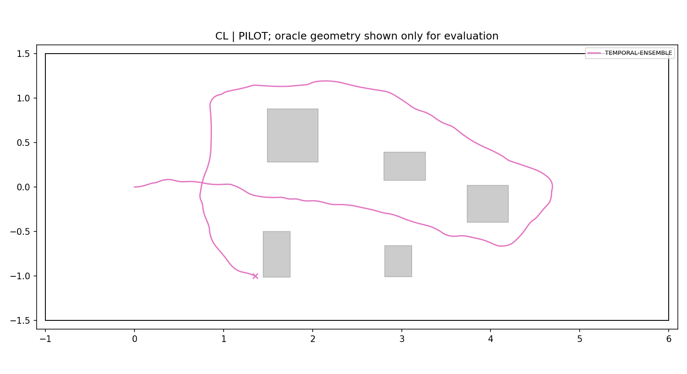

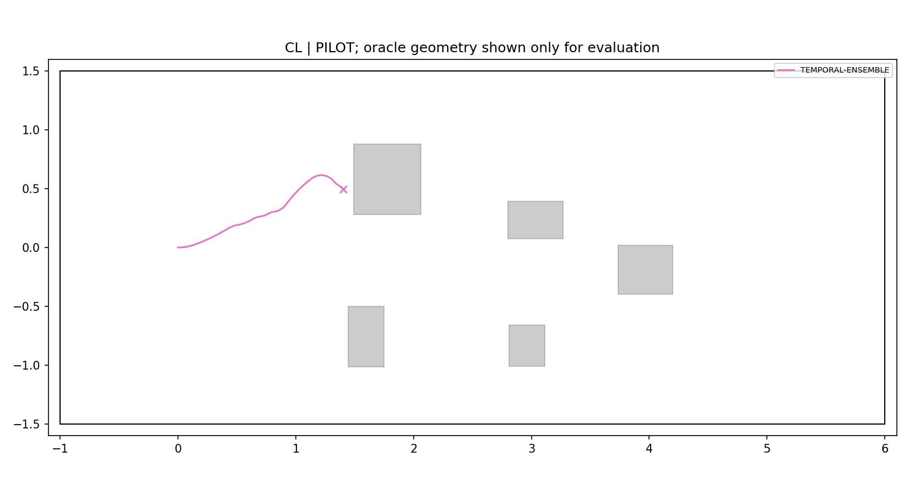

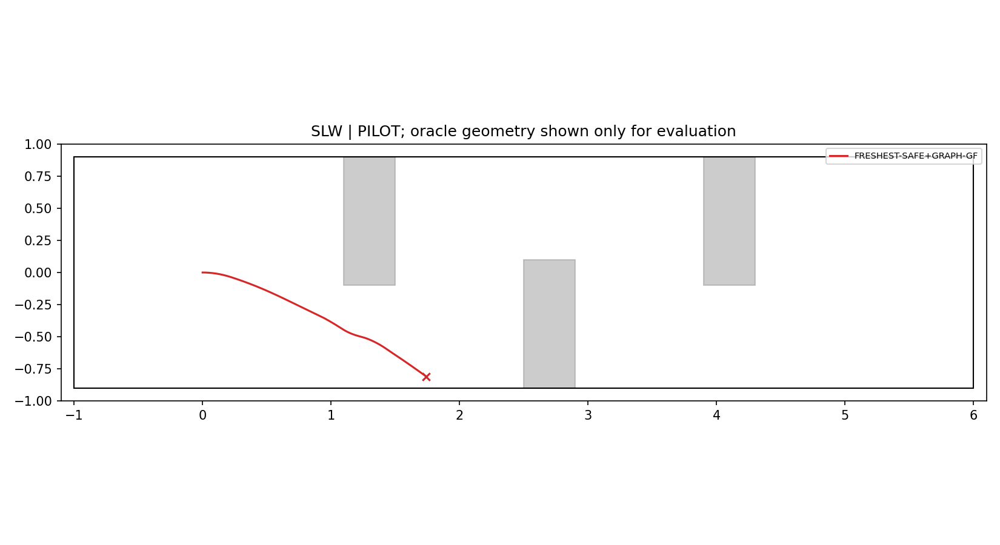

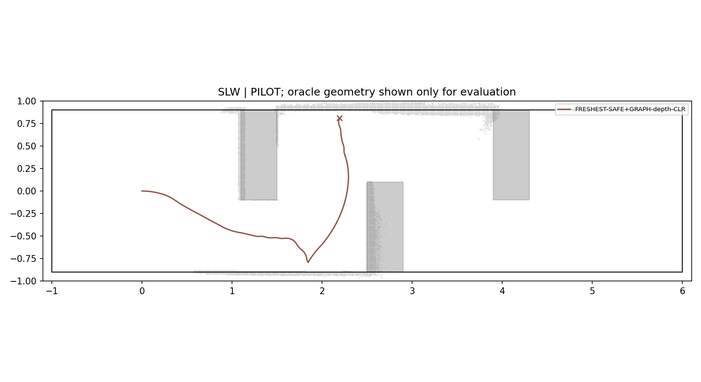

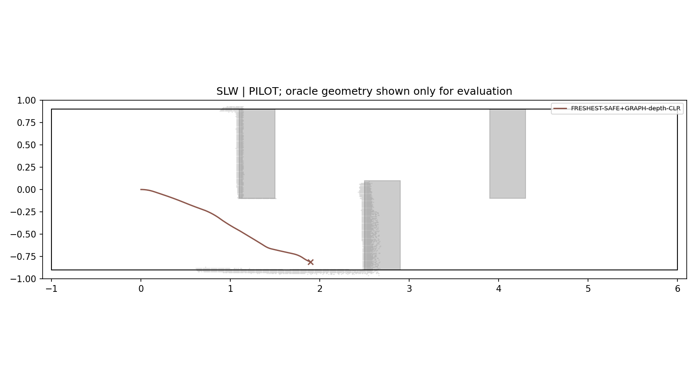

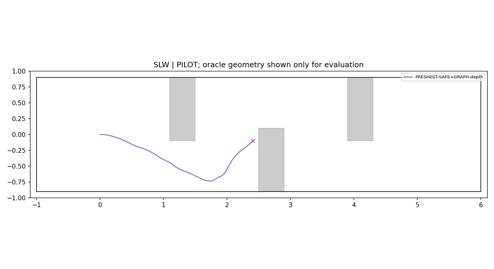


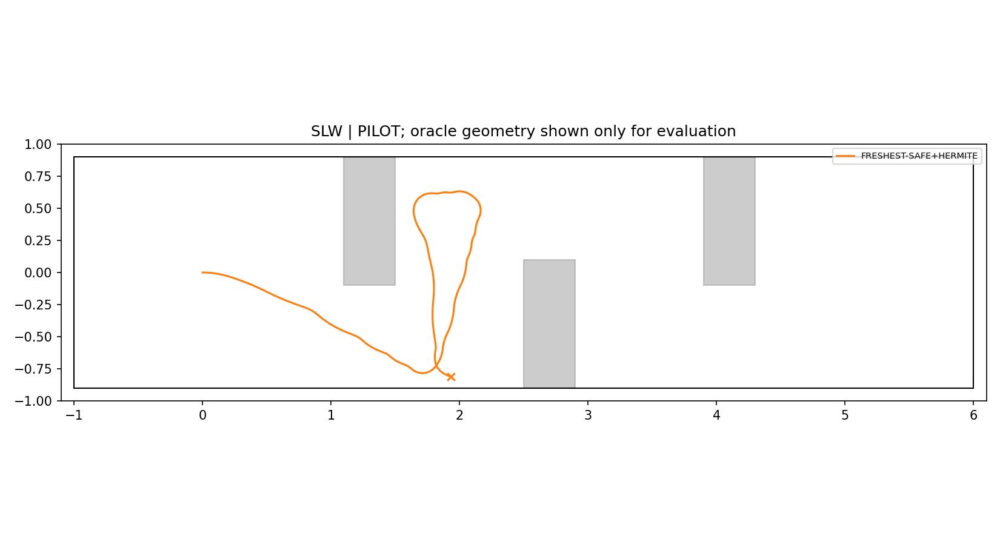

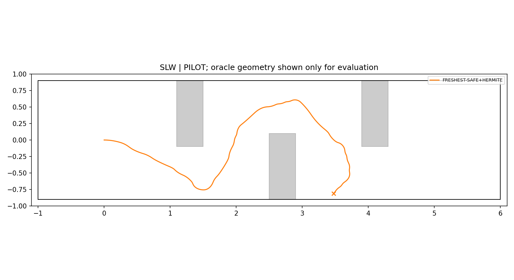

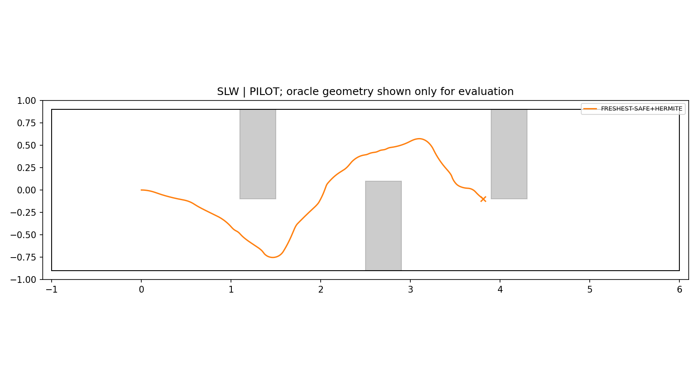

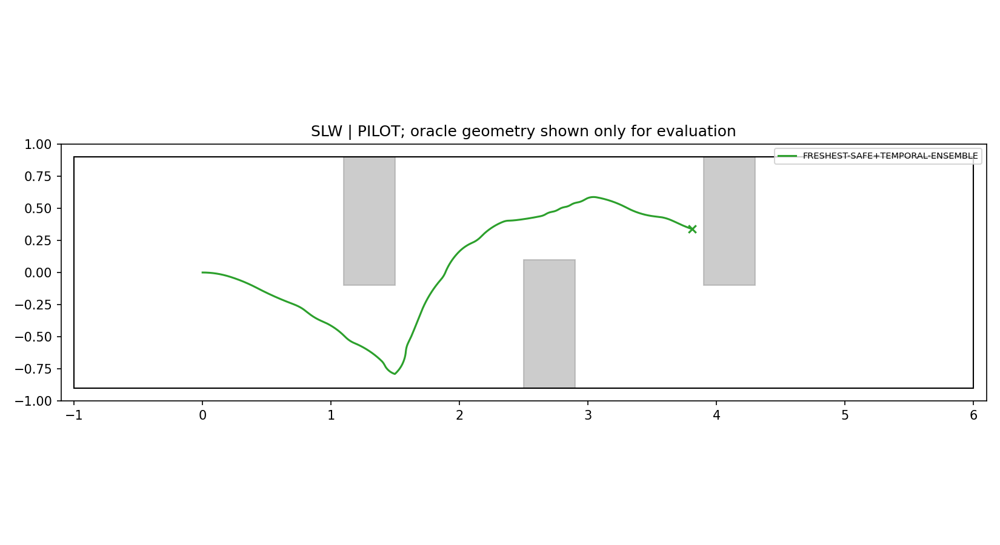


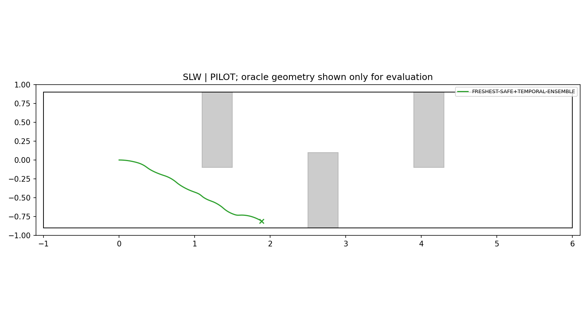

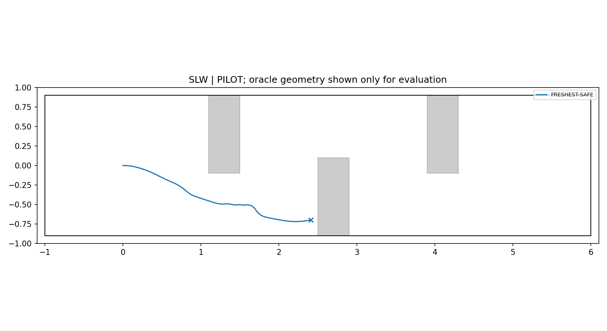

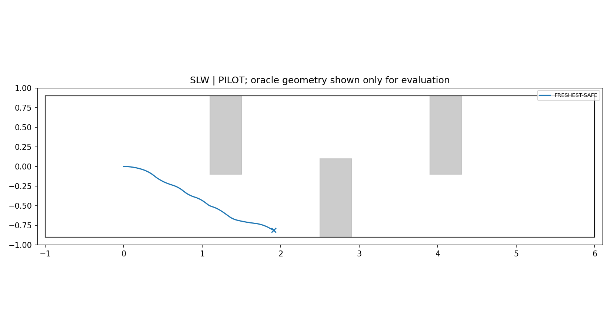


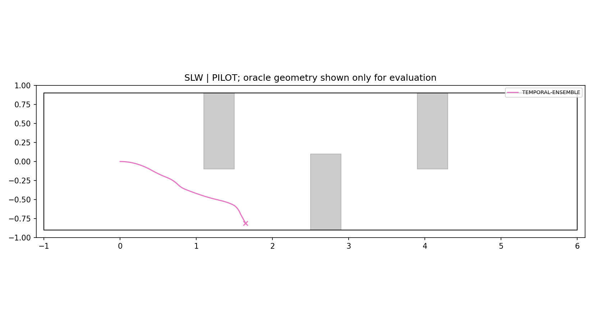


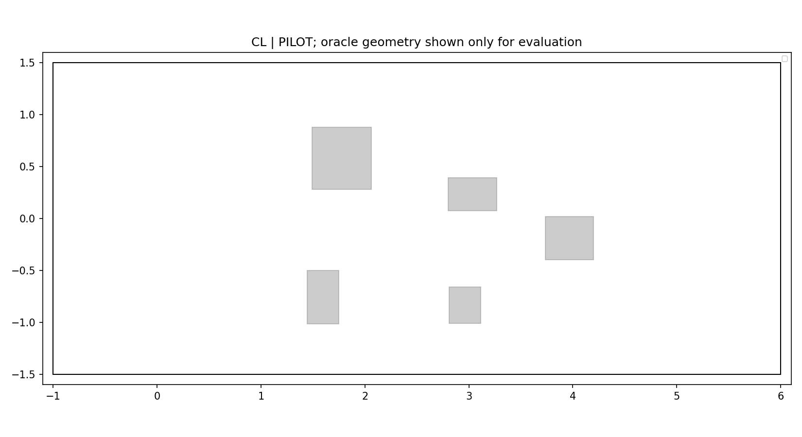

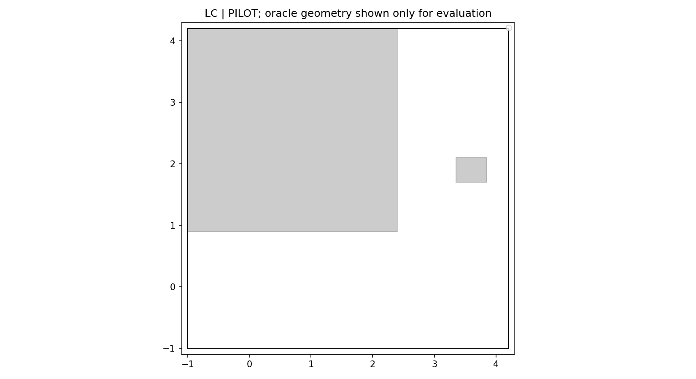

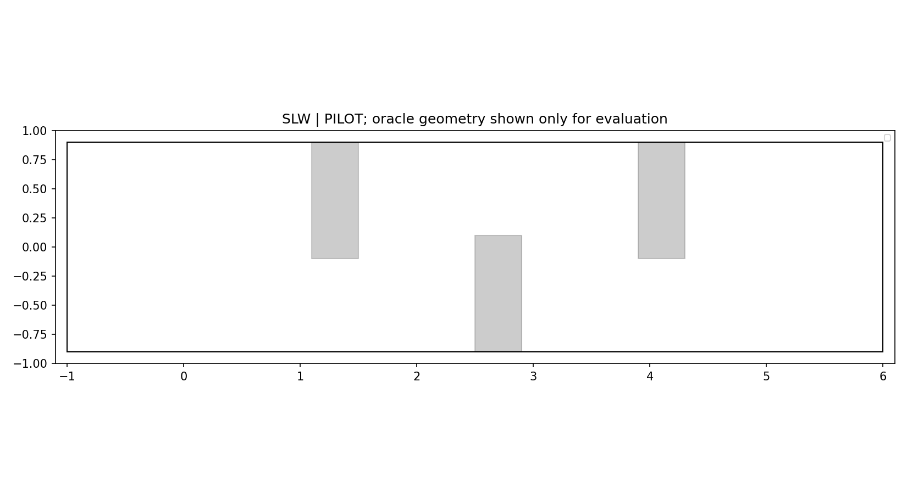

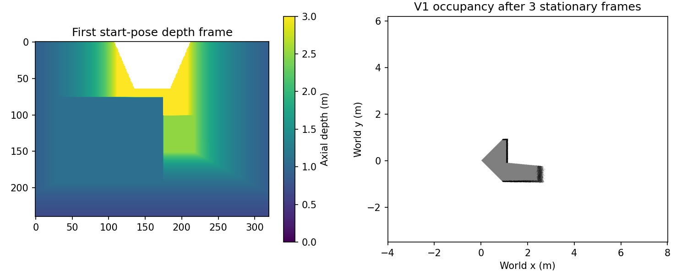

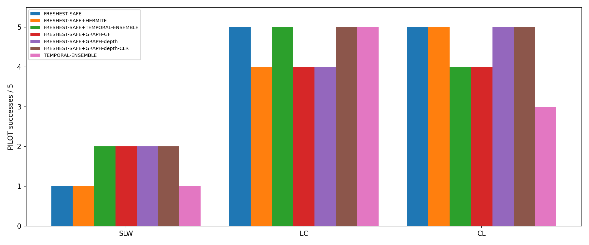

Smoke and reference/gate results are excluded from the main experimental denominators. KEEP_ACTIVE preserves path progress; STOP_WAIT decelerates rather than instantaneously repairing a safety violation. SAFE+TE filters existing, unexpired components only at ALL_UNSAFE events, inserts no unsafe chunk, retains only safe suffixes of length >=0.25m, and renormalizes the original oldest-first exp(-0.5k) weights. Expiry remains one second; other ticks use unchanged Phase12 TE.

Offline readiness (391 fixed inputs; one attempt each)

| label | baseline_acceptance_bounds | clr_acceptance | attempt_time_s | solver_started_time_s |
| --- | --- | --- | --- | --- |
| READY | [0.782608695652174, 0.7877237851662404] | 0.76471 | {'n': 391, 'median': 0.07601623400114477, 'p10': 0.0003652689920272678, 'p90': 0.10160194200580008, 'p95': 0.1312999035071698} | {'n': 328, 'median': 0.07678981949720765, 'p10': 0.07060065419937019, 'p90': 0.11090831580077068, 'p95': 0.13404490060056554} |

Only method 6 adds `max(0, (0.15 − d_depth)/0.05)` at the existing 9 points per segment. All hard constraints, exact depth certificate and other constants are unchanged. The offline timing excludes file I/O and oracle evaluation. Missing baseline worker results remain explicit bounds.

Recovery: two consecutive STOP_WAIT FRESH decisions and actual v<0.01 trigger up to 12 turns. ±30° depth rays are sampled every 1cm including B, maximum 2m; longer ray wins, ties turn left. Rotation uses v=0, |ω|=0.3 and ends exactly at 30° with a shortened final 72Hz interval. NoMaD/RGB continue; intermediate FRESH selections are deferred and Graph results discarded. The next FRESH after rotation resumes normal selection. No oracle direction or goal input is used.

Clearance mechanisms (posthoc oracle evaluation only)

| method | accepted_correction_delta_m | run_min_obstacle_clearance_m | delta_median_nonnegative |
| --- | --- | --- | --- |
| FRESHEST-SAFE+GRAPH-GF | {'median': 0.003480144108223615, 'p10': -0.039880724801091616, 'p90': 0.040569829450031666} | {'median': 0.08673998842221103, 'p10': 0.02636978499245247, 'p90': 0.2367854869484502} | True |
| FRESHEST-SAFE+GRAPH-depth | {'median': 0.002109508243491376, 'p10': -0.0414638526430691, 'p90': 0.03608715198034087} | {'median': 0.15446862168168507, 'p10': 0.014432056529347375, 'p90': 0.23869572706386005} | True |
| FRESHEST-SAFE+GRAPH-depth-CLR | {'median': 0.00753779733644222, 'p10': -0.030373081735843764, 'p90': 0.050838755673074686} | {'median': 0.12557267452515006, 'p10': 0.0668016032233136, 'p90': 0.2130095076622014} | True |

Phase16 stuck reference

| scene | method | phase17_n | phase17_stuck | phase16_n | phase16_stuck |
| --- | --- | --- | --- | --- | --- |
| SLW | FRESHEST-SAFE | 5 | 1 | 0 | 0 |
| LC | FRESHEST-SAFE | 5 | 0 | 6 | 1 |
| CL | FRESHEST-SAFE | 5 | 0 | 6 | 0 |
| SLW | FRESHEST-SAFE+HERMITE | 5 | 1 | 0 | 0 |
| LC | FRESHEST-SAFE+HERMITE | 5 | 1 | 6 | 1 |
| CL | FRESHEST-SAFE+HERMITE | 5 | 0 | 6 | 0 |
| SLW | FRESHEST-SAFE+TEMPORAL-ENSEMBLE | 5 | 0 | 0 | 0 |
| LC | FRESHEST-SAFE+TEMPORAL-ENSEMBLE | 5 | 0 | 6 | 1 |
| CL | FRESHEST-SAFE+TEMPORAL-ENSEMBLE | 5 | 1 | 6 | 2 |
| SLW | FRESHEST-SAFE+GRAPH-GF | 5 | 2 | 0 | 0 |
| LC | FRESHEST-SAFE+GRAPH-GF | 5 | 1 | 6 | 1 |
| CL | FRESHEST-SAFE+GRAPH-GF | 5 | 1 | 6 | 1 |
| SLW | FRESHEST-SAFE+GRAPH-depth | 5 | 1 | 0 | 0 |
| LC | FRESHEST-SAFE+GRAPH-depth | 5 | 1 | 6 | 0 |
| CL | FRESHEST-SAFE+GRAPH-depth | 5 | 0 | 6 | 4 |
| SLW | FRESHEST-SAFE+GRAPH-depth-CLR | 5 | 1 | 0 | 0 |
| LC | FRESHEST-SAFE+GRAPH-depth-CLR | 5 | 0 | 0 | 0 |
| CL | FRESHEST-SAFE+GRAPH-depth-CLR | 5 | 0 | 0 | 0 |
| SLW | TEMPORAL-ENSEMBLE | 5 | 0 | 0 | 0 |
| LC | TEMPORAL-ENSEMBLE | 5 | 0 | 6 | 0 |
| CL | TEMPORAL-ENSEMBLE | 5 | 0 | 6 | 0 |

Different seeds, changed SLW geometry and recovery imply this is not a paired or causal comparison. SL had no Phase16 main runs. No recovery is claimed for original TE.

Recovery example: CL_061_D750_FRESHEST-SAFE

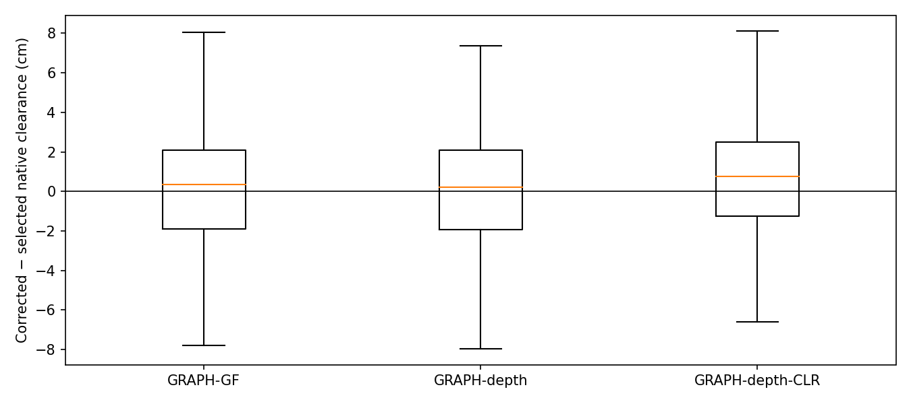

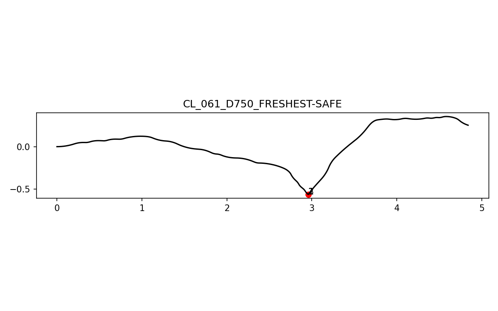

All decisions are PILOT labels. New-seed closed-loop outcomes include recovery and observation changes; no isolated Graph causal superiority is inferred.
