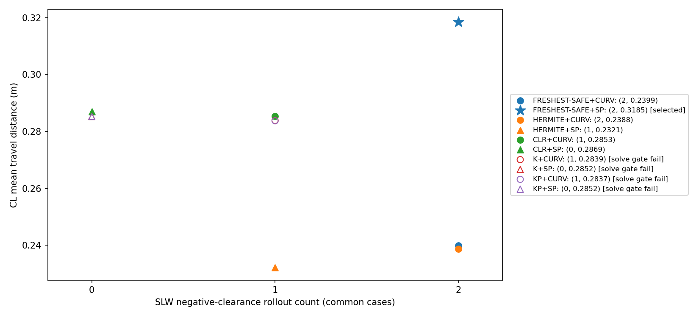
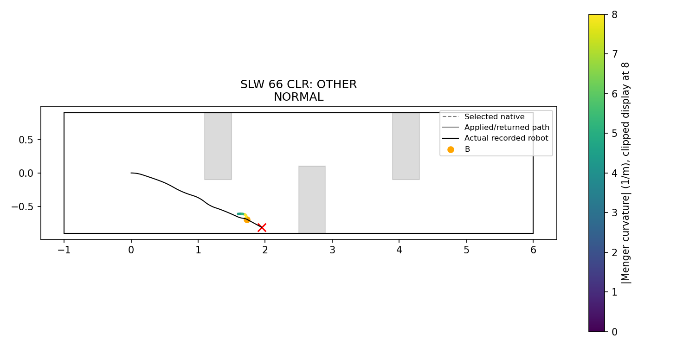
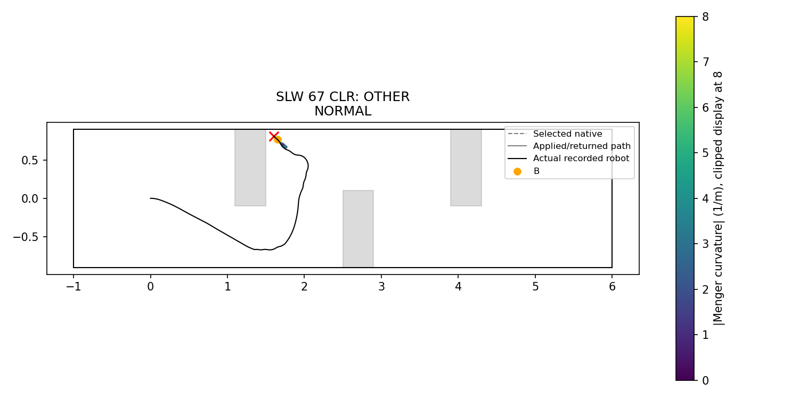
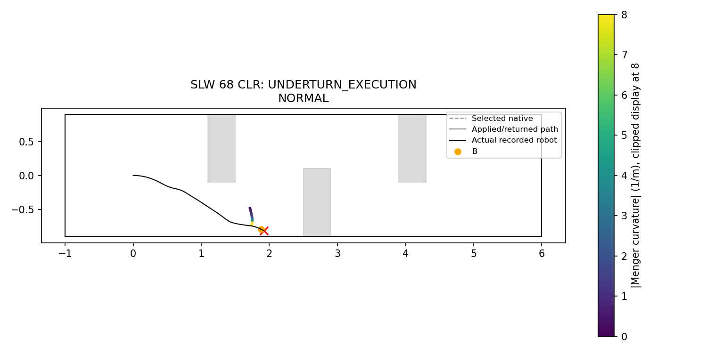
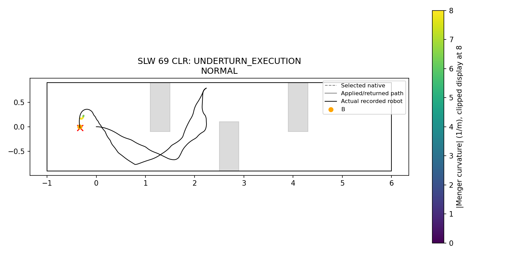
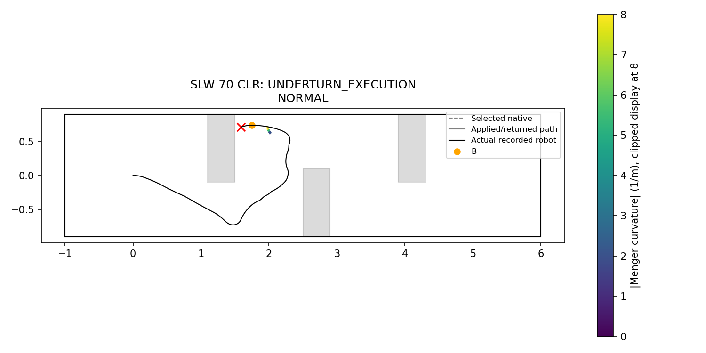
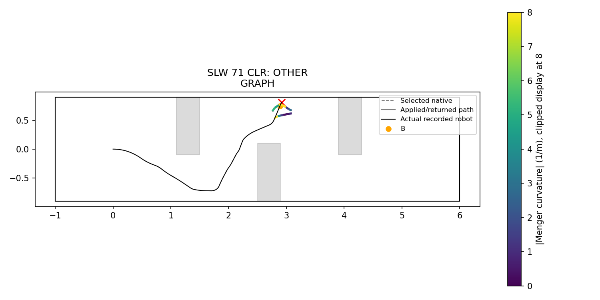
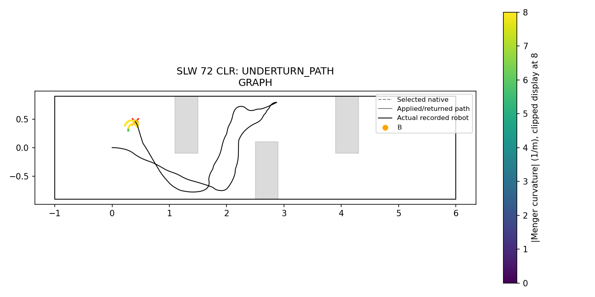
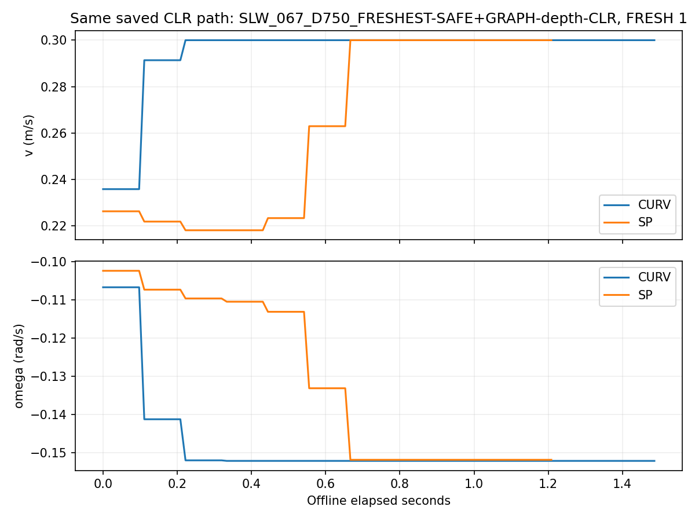
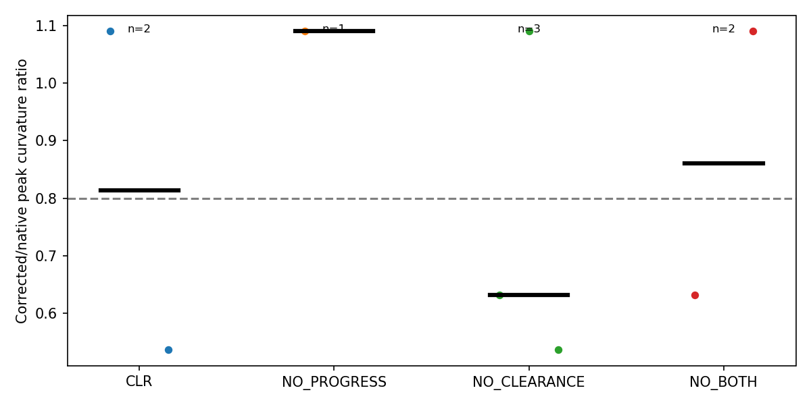

# Phase 18-D — curvature and anticipatory speed offline diagnosis

Execution SHA: `52e160b18f8b7bdbdb112d89a023699206f65175`. **ROLLOUT_VALID**, max position error 0 m. No Isaac navigation, NoMaD inference or rendering was run.

A fixed path is followed from the recorded B for at most 1.5 seconds. There is no future FRESH, regeneration, depth update, waypoint expiry or recovery in these counterfactuals. Oracle geometry is used solely for post-interval evaluation/termination. PP and speed targets never receive it. These rollouts cannot replace closed-loop navigation evidence.

## Measurement protocol

```json
{
  "base_commit": "5f1277a",
  "source": "research/results/phase18/runs.json",
  "Isaac_navigation": 0,
  "NoMaD_inference": 0,
  "render": 0,
  "scope": "fixed-path offline counterfactuals",
  "retries": 0,
  "tuning": 0,
  "regression": {
    "seed": 20261031,
    "n": 20,
    "population": "all Phase18 actual single-path NORMAL/GRAPH applications; exclude TE ensembles, STOP/recovery and invalid paths; at least8 ticks; truncate at next application, timeout/stop or108 ticks",
    "initial_state": "actual application pose, before_v, reset progress=0 for new path; no future commands supplied",
    "threshold_m": 0.01
  },
  "rollout": {
    "control_hz": 9,
    "integration_hz": 72,
    "max_ticks": 108,
    "lookahead_m": 0.25,
    "omega_max": 0.4,
    "v_max": 0.3,
    "v_min": 0.05,
    "acceleration": 0.5,
    "endpoint": "unchanged protected PP endpoint tolerance at control ticks",
    "termination": "endpoint,108 ticks,or negative swept oracle footprint lower bound; exact negative witness counted separately",
    "oracle": "passive evaluation only; boxes+outer wall; existing swept_clearance and exact corridor arc minimum reused",
    "no_next_fresh": true,
    "no_timeout_or_recovery": true
  },
  "SP": {
    "curvature": "Menger at interior vertices; endpoint repeats nearest interior, zero for2-point path",
    "limit": "min(.3,.4/abs(kappa)); no floor during planning",
    "passes": "one backwards braking pass then one forwards acceleration pass, v_i^2 <= v_neighbor^2+2*.5*ds",
    "terminal_speed": "no extra terminal speed constraint",
    "initial_speed": "actual before_v applied through common temporal acceleration cap; not imposed as node0 profile speed",
    "interpolation": "linear in geometric arclength, sampled at current nearest projection; execution target floor .05",
    "clipping": "omega=clip(v*kappa_PP,+/- .4); curvature infeasibility never silently terminates"
  },
  "curvature": {
    "after_B": "native Menger triple centered at a vertex whose arclength >= existing nearest B projection; no synthetic timestamps",
    "turn_threshold_m_inv": 2.0,
    "ratio": "max |curvature| afterB in executed/corrected path divided by native afterB maximum; no valid triple -> unavailable",
    "sign": "signs of respective largest-magnitude remaining curvature; not physical turn correspondence",
    "K": "max(0,abs(native_i)-abs(corrected_i))/.5, all6 native triples, exact inherited Menger XY derivative",
    "KP": "remove endpoint_progress rows only when original afterB max>=2; all other factors/constraints and acceptance fixed"
  },
  "A": {
    "target_methods": [
      "FRESHEST-SAFE",
      "FRESHEST-SAFE+HERMITE",
      "FRESHEST-SAFE+GRAPH-depth",
      "FRESHEST-SAFE+GRAPH-depth-CLR"
    ],
    "scene": "SLW",
    "switch_window": 3,
    "final_cause": "last actually tracked path at terminal interval; no path tracking during STOP/recovery -> OTHER",
    "same_box": "nearest box x-center to each B; first contiguous SAFE passage through box x extent +/- .30m; different observation/pose paths, not a causal match",
    "attribution": "last submitted job before failure, exactly one each CLR/NO_PROGRESS/NO_CLEARANCE/NO_BOTH; solver rejection retained; CLEARANCE_PUSH requires this job to be final active correction, off accepted, wall clearance gain>=.02",
    "label_order": [
      "UNDERTURN_PATH",
      "UNDERTURN_EXECUTION",
      "CLEARANCE_PUSH",
      "OTHER"
    ]
  },
  "B": {
    "scenes": [
      "SLW",
      "CL"
    ],
    "source_method": "FRESHEST-SAFE+GRAPH-depth-CLR",
    "all_fresh": 569,
    "normal_jobs": 512,
    "original": "actual depth-selected sample transformed by observation pose",
    "B": "actual FRESH switch boundary",
    "previous_prior": "same stored previous accepted path, no counterfactual propagation",
    "stored_CLR": "numerical accepted solution; runtime scheduling disposition retained; no fabricated result for missing terminal job",
    "unavailable": "STOP_WAIT/KEEP_ACTIVE/recovery with no graph job and rejected/missing solutions explicitly unavailable; all10 rows per event retained",
    "primary_population": "all5 paths available/accepted at same event, to avoid comparing unmatched denominators; acceptance rates use all512 submitted inputs; method-available results descriptive",
    "speed_example": "first sorted SLW common-valid turning event, saved CLR path, both speed rules"
  },
  "selection": {
    "candidate_scope": "ALL_TEN",
    "interpretation": "all10 combinations from user table are eligible; SAFE/HERMITE may win, making NO_CANDIDATE unlikely unless common evidence absent",
    "safety": "SLW overlap count <= SAFE+CURV on common population",
    "speed": "largest CL mean distance, common population",
    "solve_p95_s": 0.2,
    "timing": "new constructor+solve+certificate excluding snapshot I/O and oracle evaluation; p95 among started solves, all-attempt stats also retained; stored CLR solve+certificate times",
    "acceptance": "new variant lower bound no10pp-or-greater drop from stored CLR upper bound; missing baseline worker result explicitly bounded",
    "tie_path_order": [
      "KP",
      "K",
      "CLR",
      "HERMITE",
      "FRESHEST-SAFE"
    ],
    "tie_speed_order": [
      "SP",
      "CURV"
    ],
    "same_data_selection": true
  },
  "figures": "CLR SLW failed seeds66-73, final active path or explicitly labelled last returned iterate; accepted-only factor ratio distribution; common-case combo scatter; same-path speed example",
  "protected_sha256": {
    "research/nomad_phase0/pure_pursuit.py": "5e6010bad728dc7130457dfc71da0a92e5e0d86f1a63dfefc2aae1105475993d",
    "research/nomad_phase0/chunk_execution.py": "b93858c5a16818ea1c406f3b1c25142baeb6d2abc3c47a6c3222376961a142c8",
    "research/nomad_phase0/graph_v4.py": "e7b7a9b784189644564df24b7c0d02af6e1497f9ef11c63616f597634aa1c445",
    "research/nomad_phase0/graph_v4_protocol.json": "4def6d67a1b3398b4316cc832b214935e59ba2b323004c235fed2771e2d4576f",
    "research/nomad_phase12/methods.py": "e752ab9ee57f91ceee9338722e05814f60f2047a51eecc00b6316fd8c19df8cb",
    "research/nomad_phase17/graph.py": "168757f96f39023923b72e9f861263375f8cb55cdb0f87f03df466e0ce7c635e",
    "research/nomad_phase15b/graph.py": "46f20a442464fe37076071d2237c42c04b3bce1ceb75a964d59d8862cd862d69",
    "research/nomad_phase15b/depth.py": "f6072c9591c7696feef66d65d1048fbf7ad65b0ed0ba408a5f746e8577718919",
    "research/nomad_phase12/graph_gf.py": "c7b2e234302b07f894bdcaa6515ede9657d002869e4f462758880acd03a5a403",
    "research/nomad_phase5/graph.py": "f59d3d8d7c70bada8a40d62ec1769e8c69d5785b6a9f2fa169a8843e7ac4940a",
    "research/nomad_phase4/execution.py": "2a1ebb7047463108f1c6336700bd196854bf85eaca89268624f3e980569a2d86",
    "research/nomad_isaac/common.py": "37411b364e3d39547d2c134e2cbe67f9b9e5d09b7cfad6709567960859e4d03d",
    "research/nomad_isaac/clearance.py": "70213b966898efb17e070ead2c24a77b0b58478c1d6b228045157fe91dba048c",
    "research/nomad_phase16/geometry.py": "044ac3e855d1445d97e9e63400e521a80bbaffcf34f81c26fa2e2809157bc0e0",
    "research/nomad_phase0/s0_batch_metrics.py": "f01eef77549ccaf4b8609e5769da52402d875e930b9f1d039fbe9ae6d9390bec"
  }
}
```

## Regression

| run | application_index | start_tick | end_tick | kind | actual_ticks | rollout_ticks | maximum_position_error_m | maximum_yaw_error_rad | complete_comparison | termination |
| --- | --- | --- | --- | --- | --- | --- | --- | --- | --- | --- |
| CL_069_D750_FRESHEST-SAFE+GRAPH-depth | 42 | 1992 | 2000 | NORMAL | 8 | 8 | 0 | 0 | True | HORIZON |
| LC_071_D750_FRESHEST-SAFE+GRAPH-depth | 3 | 352 | 360 | NORMAL | 8 | 8 | 0 | 0 | True | HORIZON |
| CL_071_D750_FRESHEST-SAFE | 5 | 568 | 640 | NORMAL | 72 | 72 | 0 | 0 | True | HORIZON |
| LC_068_D750_FRESHEST-SAFE+RTC-hard | 8 | 784 | 824 | NORMAL | 40 | 40 | 0 | 0 | True | HORIZON |
| SLW_069_D750_FRESHEST-SAFE+GRAPH-depth-CLR | 42 | 1928 | 1992 | GRAPH | 64 | 64 | 0 | 0 | True | HORIZON |
| SLW_072_D750_FRESHEST-SAFE+GRAPH-depth-CLR | 63 | 4104 | 4168 | GRAPH | 64 | 64 | 0 | 0 | True | HORIZON |
| CL_066_D750_FRESHEST-SAFE+HERMITE | 2 | 352 | 424 | NORMAL | 72 | 72 | 0 | 0 | True | HORIZON |
| SLW_070_D750_FRESHEST-SAFE+RTC-hard | 6 | 640 | 704 | NORMAL | 64 | 64 | 0 | 0 | True | HORIZON |
| LC_071_D750_FRESHEST-SAFE+GRAPH-depth-CLR | 13 | 712 | 720 | NORMAL | 8 | 8 | 0 | 0 | True | HORIZON |
| SLW_066_D750_FRESHEST-SAFE+GRAPH-depth | 29 | 1464 | 1536 | NORMAL | 72 | 72 | 0 | 0 | True | HORIZON |
| SLW_067_D750_FRESHEST-SAFE | 39 | 2960 | 3024 | NORMAL | 64 | 64 | 0 | 0 | True | HORIZON |
| LC_073_D750_FRESHEST-SAFE+RTC-hard | 30 | 2368 | 2440 | NORMAL | 72 | 72 | 0 | 0 | True | HORIZON |
| CL_067_D750_FRESHEST-SAFE+GRAPH-depth | 23 | 1144 | 1152 | NORMAL | 8 | 8 | 0 | 0 | True | HORIZON |
| SLW_066_D750_FRESHEST-SAFE | 2 | 352 | 424 | NORMAL | 72 | 72 | 0 | 0 | True | HORIZON |
| SLW_066_D750_FRESHEST-SAFE+HERMITE | 23 | 1864 | 1936 | NORMAL | 72 | 72 | 0 | 0 | True | HORIZON |
| SLW_070_D750_FRESHEST-SAFE+HERMITE | 34 | 2760 | 2824 | NORMAL | 64 | 64 | 0 | 0 | True | HORIZON |
| SLW_070_D750_FRESHEST-SAFE+GRAPH-depth | 84 | 5072 | 5136 | GRAPH | 64 | 64 | 0 | 0 | True | HORIZON |
| CL_073_D750_FRESHEST-SAFE+GRAPH-depth-CLR | 51 | 2136 | 2144 | NORMAL | 8 | 8 | 0 | 0 | True | HORIZON |
| LC_073_D750_FRESHEST-SAFE+RTC-hard | 20 | 1648 | 1720 | NORMAL | 72 | 72 | 0 | 0 | True | HORIZON |
| LC_066_D750_FRESHEST-SAFE+HERMITE | 13 | 1144 | 1216 | NORMAL | 72 | 72 | 0 | 0 | True | HORIZON |

## A: failure labels

| run | method | classification | path_kind | label | native_kappa_max | path_kappa_max | curvature_ratio | dominant_sign_agrees | mean_speed_m_s | omega_saturation_fraction | clearance_off_wall_gain_m |
| --- | --- | --- | --- | --- | --- | --- | --- | --- | --- | --- | --- |
| SLW_066_D750_FRESHEST-SAFE+GRAPH-depth | FRESHEST-SAFE+GRAPH-depth | SAFETY_FAILURE | NORMAL | UNDERTURN_EXECUTION | 53.081 | 53.081 | 1 | True | 0.17163 | 1 | — |
| SLW_066_D750_FRESHEST-SAFE+GRAPH-depth-CLR | FRESHEST-SAFE+GRAPH-depth-CLR | SAFETY_FAILURE | NORMAL | OTHER | 34.137 | 34.137 | 1 | True | 0.25062 | 0 | — |
| SLW_066_D750_FRESHEST-SAFE+HERMITE | FRESHEST-SAFE+HERMITE | SAFETY_FAILURE | NORMAL | OTHER | 50.288 | 68.316 | 1.3585 | False | 0.22962 | 0 | — |
| SLW_067_D750_FRESHEST-SAFE+GRAPH-depth | FRESHEST-SAFE+GRAPH-depth | SAFETY_FAILURE | GRAPH | UNDERTURN_PATH | 12.674 | 8 | 0.63119 | True | 0.28651 | 0 | — |
| SLW_067_D750_FRESHEST-SAFE+GRAPH-depth-CLR | FRESHEST-SAFE+GRAPH-depth-CLR | SAFETY_FAILURE | NORMAL | OTHER | 104.72 | 104.72 | 1 | True | 0.19502 | 0 | — |
| SLW_067_D750_FRESHEST-SAFE+HERMITE | FRESHEST-SAFE+HERMITE | SAFETY_FAILURE | NORMAL | UNDERTURN_PATH | 138.21 | 21.391 | 0.15477 | False | 0.10341 | 1 | — |
| SLW_068_D750_FRESHEST-SAFE | FRESHEST-SAFE | SAFETY_FAILURE | NORMAL | OTHER | 51.044 | 51.044 | 1 | True | 0.3 | 0 | — |
| SLW_068_D750_FRESHEST-SAFE+GRAPH-depth | FRESHEST-SAFE+GRAPH-depth | SAFETY_FAILURE | NORMAL | UNDERTURN_EXECUTION | 14.434 | 14.434 | 1 | True | 0.062292 | 1 | — |
| SLW_068_D750_FRESHEST-SAFE+GRAPH-depth-CLR | FRESHEST-SAFE+GRAPH-depth-CLR | SAFETY_FAILURE | NORMAL | UNDERTURN_EXECUTION | 14.536 | 14.536 | 1 | True | 0.13258 | 1 | — |
| SLW_068_D750_FRESHEST-SAFE+HERMITE | FRESHEST-SAFE+HERMITE | STUCK | NORMAL | UNDERTURN_EXECUTION | 7.5132 | 10.823 | 1.4405 | True | 0.10567 | 1 | — |
| SLW_069_D750_FRESHEST-SAFE+GRAPH-depth | FRESHEST-SAFE+GRAPH-depth | SAFETY_FAILURE | NORMAL | UNDERTURN_EXECUTION | 32.67 | 32.67 | 1 | True | 0.076288 | 1 | — |
| SLW_069_D750_FRESHEST-SAFE+GRAPH-depth-CLR | FRESHEST-SAFE+GRAPH-depth-CLR | STUCK | NORMAL | UNDERTURN_EXECUTION | 41.055 | 41.055 | 1 | True | 0.17131 | 1 | — |
| SLW_069_D750_FRESHEST-SAFE+HERMITE | FRESHEST-SAFE+HERMITE | SAFETY_FAILURE | NORMAL | UNDERTURN_PATH | 78.444 | 59.183 | 0.75446 | True | 0.050023 | 1 | — |
| SLW_070_D750_FRESHEST-SAFE | FRESHEST-SAFE | SAFETY_FAILURE | NORMAL | UNDERTURN_EXECUTION | 2.7673 | 2.7673 | 1 | True | 0.21409 | 1 | — |
| SLW_070_D750_FRESHEST-SAFE+GRAPH-depth | FRESHEST-SAFE+GRAPH-depth | STUCK | GRAPH | UNDERTURN_EXECUTION | 6.9153 | 7.543 | 1.0908 | True | 0.085405 | 1 | — |
| SLW_070_D750_FRESHEST-SAFE+GRAPH-depth-CLR | FRESHEST-SAFE+GRAPH-depth-CLR | SAFETY_FAILURE | NORMAL | UNDERTURN_EXECUTION | 43.534 | 43.534 | 1 | True | 0.17593 | 1 | — |
| SLW_071_D750_FRESHEST-SAFE | FRESHEST-SAFE | SAFETY_FAILURE | NORMAL | OTHER | 39.423 | 39.423 | 1 | True | 0.10556 | 0 | — |
| SLW_071_D750_FRESHEST-SAFE+GRAPH-depth-CLR | FRESHEST-SAFE+GRAPH-depth-CLR | SAFETY_FAILURE | GRAPH | OTHER | 0.90771 | 8 | 8.8134 | True | 0.068519 | 1 | -0.0016852 |
| SLW_071_D750_FRESHEST-SAFE+HERMITE | FRESHEST-SAFE+HERMITE | SAFETY_FAILURE | NORMAL | OTHER | — | 93.974 | — | — | 0.3 | 0 | — |
| SLW_072_D750_FRESHEST-SAFE | FRESHEST-SAFE | STUCK | NO_PATH_TRACKING | OTHER | — | — | — | — | — | — | — |
| SLW_072_D750_FRESHEST-SAFE+GRAPH-depth | FRESHEST-SAFE+GRAPH-depth | SAFETY_FAILURE | NORMAL | UNDERTURN_EXECUTION | 57.733 | 57.733 | 1 | True | 0.05 | 1 | — |
| SLW_072_D750_FRESHEST-SAFE+GRAPH-depth-CLR | FRESHEST-SAFE+GRAPH-depth-CLR | STUCK | GRAPH | UNDERTURN_PATH | 14.931 | 8 | 0.5358 | True | 0.05 | 1 | 0 |
| SLW_072_D750_FRESHEST-SAFE+HERMITE | FRESHEST-SAFE+HERMITE | SAFETY_FAILURE | NORMAL | UNDERTURN_PATH | 377.54 | 70.637 | 0.1871 | True | 0.085251 | 1 | — |
| SLW_073_D750_FRESHEST-SAFE | FRESHEST-SAFE | SAFETY_FAILURE | NORMAL | OTHER | 5.6793 | 5.6793 | 1 | True | 0.05 | 1 | — |
| SLW_073_D750_FRESHEST-SAFE+GRAPH-depth | FRESHEST-SAFE+GRAPH-depth | SAFETY_FAILURE | KEEP_ACTIVE | UNDERTURN_EXECUTION | 10.586 | 10.586 | 1 | True | 0.060773 | 1 | — |
| SLW_073_D750_FRESHEST-SAFE+GRAPH-depth-CLR | FRESHEST-SAFE+GRAPH-depth-CLR | SAFETY_FAILURE | NORMAL | UNDERTURN_EXECUTION | 187.42 | 187.42 | 1 | True | 0.1419 | 0.5 | — |

Last three actual FRESH decisions (mode changes and unavailable paths retained)

| run | id | start_s | end_s | fallback | path_kind | native_kappa_max | path_kappa_max | curvature_ratio | mean_speed_m_s | omega_saturation_fraction | max_cross_track_m | minimum_obstacle_clearance_m | minimum_wall_clearance_m | safe_same_box |
| --- | --- | --- | --- | --- | --- | --- | --- | --- | --- | --- | --- | --- | --- | --- |
| SLW_066_D750_FRESHEST-SAFE+GRAPH-depth | 26 | 28.333 | 29.444 | NORMAL | NORMAL | 251.98 | 251.98 | 1 | 0.263 | 0 | 0.39393 | 0.29989 | 0.1216 | {'box': 'Slalom2', 'x_band_m': [2.2, 3.2], 'safe_run': 'SLW_066_D750_FRESHEST-SAFE', 'available': True, 'start_s': 29.26388888888889, 'end_s': 36.708333333333336, 'mean_speed_m_s': 0.14583389297804009, 'omega_saturation_fraction': 0.8600746268656716, 'max_cross_track_m': 0.07866627999020012, 'minimum_obstacle_clearance_m': 0.11589303930758187, 'minimum_wall_clearance_m': 0.40850675489666494, 'pp_curvature_median': 3.390597232021161, 'duration_s': 7.444444444444445} |
| SLW_066_D750_FRESHEST-SAFE+GRAPH-depth | 27 | 29.444 | 30.333 | NORMAL | NORMAL | 25.91 | 25.91 | 1 | 0.21667 | 0 | 0.42505 | 0.10779 | 0.12943 | {'box': 'Slalom1', 'x_band_m': [0.8, 1.8], 'safe_run': 'SLW_066_D750_FRESHEST-SAFE', 'available': True, 'start_s': 6.791666666666667, 'end_s': 20.22222222222222, 'mean_speed_m_s': 0.08677048019299728, 'omega_saturation_fraction': 0.7859358841778697, 'max_cross_track_m': 0.06019307948055574, 'minimum_obstacle_clearance_m': 0.10230695291767868, 'minimum_wall_clearance_m': 0.10481299211012018, 'pp_curvature_median': 6.061670843144618, 'duration_s': 13.430555555555555} |
| SLW_066_D750_FRESHEST-SAFE+GRAPH-depth | 28 | 30.333 | 30.972 | NORMAL | NORMAL | 53.081 | 53.081 | 1 | 0.17163 | 1 | 0.28184 | -0.00033781 | 0.12319 | {'box': 'Slalom1', 'x_band_m': [0.8, 1.8], 'safe_run': 'SLW_066_D750_FRESHEST-SAFE', 'available': True, 'start_s': 6.791666666666667, 'end_s': 20.22222222222222, 'mean_speed_m_s': 0.08677048019299728, 'omega_saturation_fraction': 0.7859358841778697, 'max_cross_track_m': 0.06019307948055574, 'minimum_obstacle_clearance_m': 0.10230695291767868, 'minimum_wall_clearance_m': 0.10481299211012018, 'pp_curvature_median': 6.061670843144618, 'duration_s': 13.430555555555555} |
| SLW_066_D750_FRESHEST-SAFE+GRAPH-depth-CLR | 8 | 10.889 | 11.889 | STOP_WAIT | NO_PATH_TRACKING | — | — | — | 0.0059822 | 0 | — | 0.51282 | 0.13253 | {'box': 'Slalom1', 'x_band_m': [0.8, 1.8], 'safe_run': 'SLW_066_D750_FRESHEST-SAFE', 'available': True, 'start_s': 6.791666666666667, 'end_s': 20.22222222222222, 'mean_speed_m_s': 0.08677048019299728, 'omega_saturation_fraction': 0.7859358841778697, 'max_cross_track_m': 0.06019307948055574, 'minimum_obstacle_clearance_m': 0.10230695291767868, 'minimum_wall_clearance_m': 0.10481299211012018, 'pp_curvature_median': 6.061670843144618, 'duration_s': 13.430555555555555} |
| SLW_066_D750_FRESHEST-SAFE+GRAPH-depth-CLR | 9 | 11.889 | 12.889 | NORMAL | NORMAL | 35.062 | 35.062 | 1 | 0.05 | 1 | 0.026777 | 0.51512 | 0.11803 | {'box': 'Slalom1', 'x_band_m': [0.8, 1.8], 'safe_run': 'SLW_066_D750_FRESHEST-SAFE', 'available': True, 'start_s': 6.791666666666667, 'end_s': 20.22222222222222, 'mean_speed_m_s': 0.08677048019299728, 'omega_saturation_fraction': 0.7859358841778697, 'max_cross_track_m': 0.06019307948055574, 'minimum_obstacle_clearance_m': 0.10230695291767868, 'minimum_wall_clearance_m': 0.10481299211012018, 'pp_curvature_median': 6.061670843144618, 'duration_s': 13.430555555555555} |
| SLW_066_D750_FRESHEST-SAFE+GRAPH-depth-CLR | 10 | 12.889 | 13.889 | NORMAL | NORMAL | 34.137 | 34.137 | 1 | 0.25062 | 0 | 0.2764 | 0.46149 | -0.0017077 | {'box': 'Slalom1', 'x_band_m': [0.8, 1.8], 'safe_run': 'SLW_066_D750_FRESHEST-SAFE', 'available': True, 'start_s': 6.791666666666667, 'end_s': 20.22222222222222, 'mean_speed_m_s': 0.08677048019299728, 'omega_saturation_fraction': 0.7859358841778697, 'max_cross_track_m': 0.06019307948055574, 'minimum_obstacle_clearance_m': 0.10230695291767868, 'minimum_wall_clearance_m': 0.10481299211012018, 'pp_curvature_median': 6.061670843144618, 'duration_s': 13.430555555555555} |
| SLW_066_D750_FRESHEST-SAFE+HERMITE | 44 | 46.333 | 47.333 | NORMAL | NORMAL | 3.2699 | 77.263 | 23.628 | 0.05 | 1 | 0.042718 | 0.1297 | 0.77081 | {'box': 'Slalom3', 'x_band_m': [3.5999999999999996, 4.6], 'safe_run': 'SLW_066_D750_FRESHEST-SAFE', 'available': True, 'start_s': 42.736111111111114, 'end_s': 49.02777777777778, 'mean_speed_m_s': 0.17658661631599315, 'omega_saturation_fraction': 0.7814569536423841, 'max_cross_track_m': 0.2381551762287644, 'minimum_obstacle_clearance_m': 0.11509409643625589, 'minimum_wall_clearance_m': 0.4773142339617097, 'pp_curvature_median': 3.256689611269965, 'duration_s': 6.291666666666667} |
| SLW_066_D750_FRESHEST-SAFE+HERMITE | 45 | 47.333 | 48.222 | NORMAL | NORMAL | 16.025 | 11.042 | 0.689 | 0.073132 | 1 | 0.010458 | 0.078486 | 0.78448 | {'box': 'Slalom3', 'x_band_m': [3.5999999999999996, 4.6], 'safe_run': 'SLW_066_D750_FRESHEST-SAFE', 'available': True, 'start_s': 42.736111111111114, 'end_s': 49.02777777777778, 'mean_speed_m_s': 0.17658661631599315, 'omega_saturation_fraction': 0.7814569536423841, 'max_cross_track_m': 0.2381551762287644, 'minimum_obstacle_clearance_m': 0.11509409643625589, 'minimum_wall_clearance_m': 0.4773142339617097, 'pp_curvature_median': 3.256689611269965, 'duration_s': 6.291666666666667} |
| SLW_066_D750_FRESHEST-SAFE+HERMITE | 46 | 48.222 | 48.778 | NORMAL | NORMAL | 50.288 | 68.316 | 1.3585 | 0.22962 | 0 | 0.12459 | -0.0010136 | 0.69711 | {'box': 'Slalom3', 'x_band_m': [3.5999999999999996, 4.6], 'safe_run': 'SLW_066_D750_FRESHEST-SAFE', 'available': True, 'start_s': 42.736111111111114, 'end_s': 49.02777777777778, 'mean_speed_m_s': 0.17658661631599315, 'omega_saturation_fraction': 0.7814569536423841, 'max_cross_track_m': 0.2381551762287644, 'minimum_obstacle_clearance_m': 0.11509409643625589, 'minimum_wall_clearance_m': 0.4773142339617097, 'pp_curvature_median': 3.256689611269965, 'duration_s': 6.291666666666667} |
| SLW_067_D750_FRESHEST-SAFE+GRAPH-depth | 31 | 33.667 | 34.667 | NORMAL | GRAPH | 6.2019 | 6.3343 | 1.0213 | 0.15545 | 1 | 0.016712 | 0.4733 | 0.10505 | {'box': 'Slalom2', 'x_band_m': [2.2, 3.2], 'safe_run': 'SLW_067_D750_FRESHEST-SAFE', 'available': True, 'start_s': 23.63888888888889, 'end_s': 33.5, 'mean_speed_m_s': 0.13863898826988777, 'omega_saturation_fraction': 0.6985915492957746, 'max_cross_track_m': 0.35330353365623157, 'minimum_obstacle_clearance_m': 0.12842157736155507, 'minimum_wall_clearance_m': 0.3262797017310266, 'pp_curvature_median': 4.141572344393475, 'duration_s': 9.86111111111111} |
| SLW_067_D750_FRESHEST-SAFE+GRAPH-depth | 32 | 34.667 | 35.667 | NORMAL | NORMAL | 34.246 | 34.246 | 1 | 0.077198 | 1 | 0.16445 | 0.51495 | 0.085318 | {'box': 'Slalom2', 'x_band_m': [2.2, 3.2], 'safe_run': 'SLW_067_D750_FRESHEST-SAFE', 'available': True, 'start_s': 23.63888888888889, 'end_s': 33.5, 'mean_speed_m_s': 0.13863898826988777, 'omega_saturation_fraction': 0.6985915492957746, 'max_cross_track_m': 0.35330353365623157, 'minimum_obstacle_clearance_m': 0.12842157736155507, 'minimum_wall_clearance_m': 0.3262797017310266, 'pp_curvature_median': 4.141572344393475, 'duration_s': 9.86111111111111} |
| SLW_067_D750_FRESHEST-SAFE+GRAPH-depth | 33 | 35.667 | 36.653 | NORMAL | GRAPH | 12.674 | 8 | 0.63119 | 0.25407 | 0 | 0.11679 | 0.53468 | -0.0005169 | {'box': 'Slalom2', 'x_band_m': [2.2, 3.2], 'safe_run': 'SLW_067_D750_FRESHEST-SAFE', 'available': True, 'start_s': 23.63888888888889, 'end_s': 33.5, 'mean_speed_m_s': 0.13863898826988777, 'omega_saturation_fraction': 0.6985915492957746, 'max_cross_track_m': 0.35330353365623157, 'minimum_obstacle_clearance_m': 0.12842157736155507, 'minimum_wall_clearance_m': 0.3262797017310266, 'pp_curvature_median': 4.141572344393475, 'duration_s': 9.86111111111111} |
| SLW_067_D750_FRESHEST-SAFE+GRAPH-depth-CLR | 34 | 36.667 | 37.667 | NORMAL | NORMAL | 20.827 | 20.827 | 1 | 0.05 | 1 | 0.038021 | 0.10609 | 0.10833 | {'box': 'Slalom1', 'x_band_m': [0.8, 1.8], 'safe_run': 'SLW_067_D750_FRESHEST-SAFE', 'available': True, 'start_s': 7.152777777777778, 'end_s': 17.694444444444443, 'mean_speed_m_s': 0.10436523222663757, 'omega_saturation_fraction': 0.7470355731225297, 'max_cross_track_m': 0.08181912258681097, 'minimum_obstacle_clearance_m': 0.2978810465464208, 'minimum_wall_clearance_m': 0.04675873495800342, 'pp_curvature_median': 12.21045908348383, 'duration_s': 10.541666666666666} |
| SLW_067_D750_FRESHEST-SAFE+GRAPH-depth-CLR | 35 | 37.667 | 38.667 | NORMAL | NORMAL | 44.796 | 44.796 | 1 | 0.079536 | 1 | 0.11259 | 0.059489 | 0.044523 | {'box': 'Slalom1', 'x_band_m': [0.8, 1.8], 'safe_run': 'SLW_067_D750_FRESHEST-SAFE', 'available': True, 'start_s': 7.152777777777778, 'end_s': 17.694444444444443, 'mean_speed_m_s': 0.10436523222663757, 'omega_saturation_fraction': 0.7470355731225297, 'max_cross_track_m': 0.08181912258681097, 'minimum_obstacle_clearance_m': 0.2978810465464208, 'minimum_wall_clearance_m': 0.04675873495800342, 'pp_curvature_median': 12.21045908348383, 'duration_s': 10.541666666666666} |
| SLW_067_D750_FRESHEST-SAFE+GRAPH-depth-CLR | 36 | 38.667 | 39.014 | NORMAL | NORMAL | 104.72 | 104.72 | 1 | 0.19502 | 0 | 0.11382 | 0.0096779 | -0.0013488 | {'box': 'Slalom1', 'x_band_m': [0.8, 1.8], 'safe_run': 'SLW_067_D750_FRESHEST-SAFE', 'available': True, 'start_s': 7.152777777777778, 'end_s': 17.694444444444443, 'mean_speed_m_s': 0.10436523222663757, 'omega_saturation_fraction': 0.7470355731225297, 'max_cross_track_m': 0.08181912258681097, 'minimum_obstacle_clearance_m': 0.2978810465464208, 'minimum_wall_clearance_m': 0.04675873495800342, 'pp_curvature_median': 12.21045908348383, 'duration_s': 10.541666666666666} |
| SLW_067_D750_FRESHEST-SAFE+HERMITE | 14 | 16.889 | 18 | NORMAL | NORMAL | 3.5148 | 4.3171 | 1.2283 | 0.22773 | 0 | 0.012946 | 0.12564 | 0.16228 | {'box': 'Slalom2', 'x_band_m': [2.2, 3.2], 'safe_run': 'SLW_067_D750_FRESHEST-SAFE', 'available': True, 'start_s': 23.63888888888889, 'end_s': 33.5, 'mean_speed_m_s': 0.13863898826988777, 'omega_saturation_fraction': 0.6985915492957746, 'max_cross_track_m': 0.35330353365623157, 'minimum_obstacle_clearance_m': 0.12842157736155507, 'minimum_wall_clearance_m': 0.3262797017310266, 'pp_curvature_median': 4.141572344393475, 'duration_s': 9.86111111111111} |
| SLW_067_D750_FRESHEST-SAFE+HERMITE | 15 | 18 | 18.889 | NORMAL | NORMAL | 111.26 | 96.372 | 0.8662 | 0.17791 | 0.625 | 0.15687 | 0.036475 | 0.38754 | {'box': 'Slalom2', 'x_band_m': [2.2, 3.2], 'safe_run': 'SLW_067_D750_FRESHEST-SAFE', 'available': True, 'start_s': 23.63888888888889, 'end_s': 33.5, 'mean_speed_m_s': 0.13863898826988777, 'omega_saturation_fraction': 0.6985915492957746, 'max_cross_track_m': 0.35330353365623157, 'minimum_obstacle_clearance_m': 0.12842157736155507, 'minimum_wall_clearance_m': 0.3262797017310266, 'pp_curvature_median': 4.141572344393475, 'duration_s': 9.86111111111111} |
| SLW_067_D750_FRESHEST-SAFE+HERMITE | 16 | 18.889 | 19.486 | NORMAL | NORMAL | 138.21 | 21.391 | 0.15477 | 0.10341 | 1 | 0.061602 | -0.00044653 | 0.51748 | {'box': 'Slalom2', 'x_band_m': [2.2, 3.2], 'safe_run': 'SLW_067_D750_FRESHEST-SAFE', 'available': True, 'start_s': 23.63888888888889, 'end_s': 33.5, 'mean_speed_m_s': 0.13863898826988777, 'omega_saturation_fraction': 0.6985915492957746, 'max_cross_track_m': 0.35330353365623157, 'minimum_obstacle_clearance_m': 0.12842157736155507, 'minimum_wall_clearance_m': 0.3262797017310266, 'pp_curvature_median': 4.141572344393475, 'duration_s': 9.86111111111111} |
| SLW_068_D750_FRESHEST-SAFE | 21 | 23.889 | 24.889 | NORMAL | NORMAL | 29.394 | 29.394 | 1 | 0.2571 | 0 | 0.05171 | 0.48067 | 0.1284 | {'box': 'Slalom1', 'x_band_m': [0.8, 1.8], 'safe_run': 'SLW_068_D750_FRESHEST-SAFE', 'available': True, 'start_s': 7.180555555555555, 'end_s': 24.541666666666668, 'mean_speed_m_s': 0.07151675333021808, 'omega_saturation_fraction': 0.352, 'max_cross_track_m': 0.2584666068180542, 'minimum_obstacle_clearance_m': 0.2033022086935922, 'minimum_wall_clearance_m': 0.021837597029687142, 'pp_curvature_median': 3.3483060166003966, 'duration_s': 17.36111111111111} |
| SLW_068_D750_FRESHEST-SAFE | 22 | 24.889 | 25.889 | NORMAL | NORMAL | 177.89 | 177.89 | 1 | 0.3 | 0 | 0.46137 | 0.24602 | 0.27921 | {'box': 'Slalom1', 'x_band_m': [0.8, 1.8], 'safe_run': 'SLW_068_D750_FRESHEST-SAFE', 'available': True, 'start_s': 7.180555555555555, 'end_s': 24.541666666666668, 'mean_speed_m_s': 0.07151675333021808, 'omega_saturation_fraction': 0.352, 'max_cross_track_m': 0.2584666068180542, 'minimum_obstacle_clearance_m': 0.2033022086935922, 'minimum_wall_clearance_m': 0.021837597029687142, 'pp_curvature_median': 3.3483060166003966, 'duration_s': 17.36111111111111} |
| SLW_068_D750_FRESHEST-SAFE | 23 | 25.889 | 26.833 | NORMAL | NORMAL | 51.044 | 51.044 | 1 | 0.3 | 0 | 0.50608 | -0.00046556 | 0.4038 | {'box': 'Slalom2', 'x_band_m': [2.2, 3.2], 'safe_run': 'SLW_068_D750_FRESHEST-SAFE', 'available': True, 'start_s': 26.02777777777778, 'end_s': 26.833333333333332, 'mean_speed_m_s': 0.30000000000000004, 'omega_saturation_fraction': 0.0, 'max_cross_track_m': 0.5060813753609952, 'minimum_obstacle_clearance_m': -0.00046556230022647496, 'minimum_wall_clearance_m': 0.4198710266903968, 'pp_curvature_median': 0.9461873688818565, 'duration_s': 0.8055555555555556} |
| SLW_068_D750_FRESHEST-SAFE+GRAPH-depth | 43 | 44.667 | 45.667 | NORMAL | GRAPH | 13.27 | 8 | 0.60285 | 0.18893 | 0.77778 | 0.023159 | 0.13059 | 0.787 | {'box': 'Slalom3', 'x_band_m': [3.5999999999999996, 4.6], 'safe_run': 'SLW_068_D750_FRESHEST-SAFE', 'available': False} |
| SLW_068_D750_FRESHEST-SAFE+GRAPH-depth | 44 | 45.667 | 46.667 | NORMAL | NORMAL | 16.265 | 16.265 | 1 | 0.10314 | 1 | 0.24466 | 0.028276 | 0.80066 | {'box': 'Slalom3', 'x_band_m': [3.5999999999999996, 4.6], 'safe_run': 'SLW_068_D750_FRESHEST-SAFE', 'available': False} |
| SLW_068_D750_FRESHEST-SAFE+GRAPH-depth | 45 | 46.667 | 47.125 | NORMAL | NORMAL | 14.434 | 14.434 | 1 | 0.062292 | 1 | 0.086119 | -0.00015293 | 0.80282 | {'box': 'Slalom3', 'x_band_m': [3.5999999999999996, 4.6], 'safe_run': 'SLW_068_D750_FRESHEST-SAFE', 'available': False} |
| SLW_068_D750_FRESHEST-SAFE+GRAPH-depth-CLR | 9 | 11.889 | 12.889 | NORMAL | NORMAL | 14.016 | 14.016 | 1 | 0.22593 | 0 | 0.05996 | 0.50682 | 0.074655 | {'box': 'Slalom1', 'x_band_m': [0.8, 1.8], 'safe_run': 'SLW_068_D750_FRESHEST-SAFE', 'available': True, 'start_s': 7.180555555555555, 'end_s': 24.541666666666668, 'mean_speed_m_s': 0.07151675333021808, 'omega_saturation_fraction': 0.352, 'max_cross_track_m': 0.2584666068180542, 'minimum_obstacle_clearance_m': 0.2033022086935922, 'minimum_wall_clearance_m': 0.021837597029687142, 'pp_curvature_median': 3.3483060166003966, 'duration_s': 17.36111111111111} |
| SLW_068_D750_FRESHEST-SAFE+GRAPH-depth-CLR | 10 | 12.889 | 13.889 | NORMAL | NORMAL | 26.886 | 26.886 | 1 | 0.20284 | 1 | 0.35955 | 0.53137 | 0.017791 | {'box': 'Slalom1', 'x_band_m': [0.8, 1.8], 'safe_run': 'SLW_068_D750_FRESHEST-SAFE', 'available': True, 'start_s': 7.180555555555555, 'end_s': 24.541666666666668, 'mean_speed_m_s': 0.07151675333021808, 'omega_saturation_fraction': 0.352, 'max_cross_track_m': 0.2584666068180542, 'minimum_obstacle_clearance_m': 0.2033022086935922, 'minimum_wall_clearance_m': 0.021837597029687142, 'pp_curvature_median': 3.3483060166003966, 'duration_s': 17.36111111111111} |
| SLW_068_D750_FRESHEST-SAFE+GRAPH-depth-CLR | 11 | 13.889 | 14.222 | NORMAL | NORMAL | 14.536 | 14.536 | 1 | 0.13258 | 1 | 0.19444 | 0.49115 | -0.00044259 | {'box': 'Slalom1', 'x_band_m': [0.8, 1.8], 'safe_run': 'SLW_068_D750_FRESHEST-SAFE', 'available': True, 'start_s': 7.180555555555555, 'end_s': 24.541666666666668, 'mean_speed_m_s': 0.07151675333021808, 'omega_saturation_fraction': 0.352, 'max_cross_track_m': 0.2584666068180542, 'minimum_obstacle_clearance_m': 0.2033022086935922, 'minimum_wall_clearance_m': 0.021837597029687142, 'pp_curvature_median': 3.3483060166003966, 'duration_s': 17.36111111111111} |
| SLW_068_D750_FRESHEST-SAFE+HERMITE | 86 | 87.333 | 88.333 | NORMAL | NORMAL | 2.0004 | 4.1018 | 2.0505 | 0.16488 | 0.88889 | 0.011463 | 0.21226 | 0.35497 | {'box': 'Slalom2', 'x_band_m': [2.2, 3.2], 'safe_run': 'SLW_068_D750_FRESHEST-SAFE', 'available': True, 'start_s': 26.02777777777778, 'end_s': 26.833333333333332, 'mean_speed_m_s': 0.30000000000000004, 'omega_saturation_fraction': 0.0, 'max_cross_track_m': 0.5060813753609952, 'minimum_obstacle_clearance_m': -0.00046556230022647496, 'minimum_wall_clearance_m': 0.4198710266903968, 'pp_curvature_median': 0.9461873688818565, 'duration_s': 0.8055555555555556} |
| SLW_068_D750_FRESHEST-SAFE+HERMITE | 87 | 88.333 | 89.333 | NORMAL | NORMAL | 2.5926 | 6.0784 | 2.3445 | 0.10562 | 1 | 0.0099551 | 0.26503 | 0.28716 | {'box': 'Slalom2', 'x_band_m': [2.2, 3.2], 'safe_run': 'SLW_068_D750_FRESHEST-SAFE', 'available': True, 'start_s': 26.02777777777778, 'end_s': 26.833333333333332, 'mean_speed_m_s': 0.30000000000000004, 'omega_saturation_fraction': 0.0, 'max_cross_track_m': 0.5060813753609952, 'minimum_obstacle_clearance_m': -0.00046556230022647496, 'minimum_wall_clearance_m': 0.4198710266903968, 'pp_curvature_median': 0.9461873688818565, 'duration_s': 0.8055555555555556} |
| SLW_068_D750_FRESHEST-SAFE+HERMITE | 88 | 89.333 | 90 | NORMAL | NORMAL | 7.5132 | 10.823 | 1.4405 | 0.10567 | 1 | 0.0024129 | 0.33284 | 0.22639 | {'box': 'Slalom2', 'x_band_m': [2.2, 3.2], 'safe_run': 'SLW_068_D750_FRESHEST-SAFE', 'available': True, 'start_s': 26.02777777777778, 'end_s': 26.833333333333332, 'mean_speed_m_s': 0.30000000000000004, 'omega_saturation_fraction': 0.0, 'max_cross_track_m': 0.5060813753609952, 'minimum_obstacle_clearance_m': -0.00046556230022647496, 'minimum_wall_clearance_m': 0.4198710266903968, 'pp_curvature_median': 0.9461873688818565, 'duration_s': 0.8055555555555556} |
| SLW_069_D750_FRESHEST-SAFE+GRAPH-depth | 25 | 27.667 | 28.667 | NORMAL | GRAPH | 12.435 | 8 | 0.64335 | 0.05 | 1 | 0.019094 | 0.52074 | 0.096652 | {'box': 'Slalom2', 'x_band_m': [2.2, 3.2], 'safe_run': 'SLW_069_D750_FRESHEST-SAFE', 'available': True, 'start_s': 27.75, 'end_s': 41.90277777777778, 'mean_speed_m_s': 0.11113213283090526, 'omega_saturation_fraction': 0.7939156035328754, 'max_cross_track_m': 0.06996944304218822, 'minimum_obstacle_clearance_m': 0.11439406824628803, 'minimum_wall_clearance_m': 0.18416312703883528, 'pp_curvature_median': 7.844163351699011, 'duration_s': 14.152777777777779} |
| SLW_069_D750_FRESHEST-SAFE+GRAPH-depth | 26 | 28.667 | 29.667 | NORMAL | NORMAL | 5.46 | 5.46 | 1 | 0.053755 | 1 | 0.072127 | 0.57032 | 0.048314 | {'box': 'Slalom2', 'x_band_m': [2.2, 3.2], 'safe_run': 'SLW_069_D750_FRESHEST-SAFE', 'available': True, 'start_s': 27.75, 'end_s': 41.90277777777778, 'mean_speed_m_s': 0.11113213283090526, 'omega_saturation_fraction': 0.7939156035328754, 'max_cross_track_m': 0.06996944304218822, 'minimum_obstacle_clearance_m': 0.11439406824628803, 'minimum_wall_clearance_m': 0.18416312703883528, 'pp_curvature_median': 7.844163351699011, 'duration_s': 14.152777777777779} |
| SLW_069_D750_FRESHEST-SAFE+GRAPH-depth | 27 | 29.667 | 30.389 | NORMAL | NORMAL | 32.67 | 32.67 | 1 | 0.076288 | 1 | 0.087236 | 0.61681 | -0.00010248 | {'box': 'Slalom2', 'x_band_m': [2.2, 3.2], 'safe_run': 'SLW_069_D750_FRESHEST-SAFE', 'available': True, 'start_s': 27.75, 'end_s': 41.90277777777778, 'mean_speed_m_s': 0.11113213283090526, 'omega_saturation_fraction': 0.7939156035328754, 'max_cross_track_m': 0.06996944304218822, 'minimum_obstacle_clearance_m': 0.11439406824628803, 'minimum_wall_clearance_m': 0.18416312703883528, 'pp_curvature_median': 7.844163351699011, 'duration_s': 14.152777777777779} |
| SLW_069_D750_FRESHEST-SAFE+GRAPH-depth-CLR | 87 | 87.889 | 88.889 | NORMAL | GRAPH | 8.9524 | 8 | 0.89361 | 0.091055 | 1 | 0.003858 | 1.3097 | 0.51357 | {'box': 'Slalom1', 'x_band_m': [0.8, 1.8], 'safe_run': 'SLW_069_D750_FRESHEST-SAFE', 'available': True, 'start_s': 7.152777777777778, 'end_s': 16.680555555555557, 'mean_speed_m_s': 0.11450558121236226, 'omega_saturation_fraction': 0.9533527696793003, 'max_cross_track_m': 0.2085561394412944, 'minimum_obstacle_clearance_m': 0.24155640078494214, 'minimum_wall_clearance_m': 0.1735173701899277, 'pp_curvature_median': 4.064911579073602, 'duration_s': 9.527777777777779} |
| SLW_069_D750_FRESHEST-SAFE+GRAPH-depth-CLR | 88 | 88.889 | 89.889 | NORMAL | GRAPH | 4.0049 | 4.615 | 1.1524 | 0.21639 | 0.77778 | 0.0040649 | 1.3442 | 0.56479 | {'box': 'Slalom1', 'x_band_m': [0.8, 1.8], 'safe_run': 'SLW_069_D750_FRESHEST-SAFE', 'available': True, 'start_s': 7.152777777777778, 'end_s': 16.680555555555557, 'mean_speed_m_s': 0.11450558121236226, 'omega_saturation_fraction': 0.9533527696793003, 'max_cross_track_m': 0.2085561394412944, 'minimum_obstacle_clearance_m': 0.24155640078494214, 'minimum_wall_clearance_m': 0.1735173701899277, 'pp_curvature_median': 4.064911579073602, 'duration_s': 9.527777777777779} |
| SLW_069_D750_FRESHEST-SAFE+GRAPH-depth-CLR | 89 | 89.889 | 90 | NORMAL | NORMAL | 41.055 | 41.055 | 1 | 0.17131 | 1 | 0.18227 | 1.3417 | 0.57439 | {'box': 'Slalom1', 'x_band_m': [0.8, 1.8], 'safe_run': 'SLW_069_D750_FRESHEST-SAFE', 'available': True, 'start_s': 7.152777777777778, 'end_s': 16.680555555555557, 'mean_speed_m_s': 0.11450558121236226, 'omega_saturation_fraction': 0.9533527696793003, 'max_cross_track_m': 0.2085561394412944, 'minimum_obstacle_clearance_m': 0.24155640078494214, 'minimum_wall_clearance_m': 0.1735173701899277, 'pp_curvature_median': 4.064911579073602, 'duration_s': 9.527777777777779} |
| SLW_069_D750_FRESHEST-SAFE+HERMITE | 49 | 51.111 | 52 | NORMAL | NORMAL | 7.8378 | 18.18 | 2.3196 | 0.055263 | 1 | 0.011183 | 0.050749 | 0.79481 | {'box': 'Slalom3', 'x_band_m': [3.5999999999999996, 4.6], 'safe_run': 'SLW_069_D750_FRESHEST-SAFE', 'available': True, 'start_s': 46.05555555555556, 'end_s': 56.013888888888886, 'mean_speed_m_s': 0.11789885548970157, 'omega_saturation_fraction': 0.899581589958159, 'max_cross_track_m': 0.1345719323007724, 'minimum_obstacle_clearance_m': 0.15407497068893455, 'minimum_wall_clearance_m': 0.39520963651497193, 'pp_curvature_median': 5.488925285021847, 'duration_s': 9.958333333333334} |
| SLW_069_D750_FRESHEST-SAFE+HERMITE | 50 | 52 | 52.889 | NORMAL | NORMAL | 50.887 | 68.001 | 1.3363 | 0.057314 | 1 | 0.04951 | 0.0058754 | 0.77875 | {'box': 'Slalom3', 'x_band_m': [3.5999999999999996, 4.6], 'safe_run': 'SLW_069_D750_FRESHEST-SAFE', 'available': True, 'start_s': 46.05555555555556, 'end_s': 56.013888888888886, 'mean_speed_m_s': 0.11789885548970157, 'omega_saturation_fraction': 0.899581589958159, 'max_cross_track_m': 0.1345719323007724, 'minimum_obstacle_clearance_m': 0.15407497068893455, 'minimum_wall_clearance_m': 0.39520963651497193, 'pp_curvature_median': 5.488925285021847, 'duration_s': 9.958333333333334} |
| SLW_069_D750_FRESHEST-SAFE+HERMITE | 51 | 52.889 | 53.014 | NORMAL | NORMAL | 78.444 | 59.183 | 0.75446 | 0.050023 | 1 | 0.0062523 | -3.8379e-05 | 0.77672 | {'box': 'Slalom3', 'x_band_m': [3.5999999999999996, 4.6], 'safe_run': 'SLW_069_D750_FRESHEST-SAFE', 'available': True, 'start_s': 46.05555555555556, 'end_s': 56.013888888888886, 'mean_speed_m_s': 0.11789885548970157, 'omega_saturation_fraction': 0.899581589958159, 'max_cross_track_m': 0.1345719323007724, 'minimum_obstacle_clearance_m': 0.15407497068893455, 'minimum_wall_clearance_m': 0.39520963651497193, 'pp_curvature_median': 5.488925285021847, 'duration_s': 9.958333333333334} |
| SLW_070_D750_FRESHEST-SAFE | 17 | 19.889 | 20.889 | NORMAL | NORMAL | 616 | 616 | 1 | 0.3 | 0 | 0.46492 | 0.30491 | 0.17378 | {'box': 'Slalom1', 'x_band_m': [0.8, 1.8], 'safe_run': 'SLW_070_D750_FRESHEST-SAFE', 'available': True, 'start_s': 6.597222222222222, 'end_s': 19.680555555555557, 'mean_speed_m_s': 0.0889533046629536, 'omega_saturation_fraction': 0.3821656050955414, 'max_cross_track_m': 0.06345621717699679, 'minimum_obstacle_clearance_m': 0.23056217868090853, 'minimum_wall_clearance_m': 0.02213884868801108, 'pp_curvature_median': 3.4109313007058883, 'duration_s': 13.083333333333334} |
| SLW_070_D750_FRESHEST-SAFE | 18 | 20.889 | 21.889 | NORMAL | NORMAL | 162.29 | 162.29 | 1 | 0.28479 | 1 | 0.51662 | 0.030634 | 0.33157 | {'box': 'Slalom2', 'x_band_m': [2.2, 3.2], 'safe_run': 'SLW_070_D750_FRESHEST-SAFE', 'available': True, 'start_s': 21.25, 'end_s': 22.041666666666668, 'mean_speed_m_s': 0.2711484637568531, 'omega_saturation_fraction': 1.0, 'max_cross_track_m': 0.5166236033649086, 'minimum_obstacle_clearance_m': -0.00197164951555339, 'minimum_wall_clearance_m': 0.3692415432789845, 'pp_curvature_median': 1.404525510764039, 'duration_s': 0.7916666666666666} |
| SLW_070_D750_FRESHEST-SAFE | 19 | 21.889 | 22.042 | NORMAL | NORMAL | 2.7673 | 2.7673 | 1 | 0.21409 | 1 | 0.22733 | -0.0019716 | 0.40091 | {'box': 'Slalom2', 'x_band_m': [2.2, 3.2], 'safe_run': 'SLW_070_D750_FRESHEST-SAFE', 'available': True, 'start_s': 21.25, 'end_s': 22.041666666666668, 'mean_speed_m_s': 0.2711484637568531, 'omega_saturation_fraction': 1.0, 'max_cross_track_m': 0.5166236033649086, 'minimum_obstacle_clearance_m': -0.00197164951555339, 'minimum_wall_clearance_m': 0.3692415432789845, 'pp_curvature_median': 1.404525510764039, 'duration_s': 0.7916666666666666} |
| SLW_070_D750_FRESHEST-SAFE+GRAPH-depth | 85 | 87.111 | 88.111 | NORMAL | GRAPH | 11.782 | 8 | 0.67902 | 0.053403 | 1 | 0.0056321 | 0.066682 | 0.59324 | {'box': 'Slalom1', 'x_band_m': [0.8, 1.8], 'safe_run': 'SLW_070_D750_FRESHEST-SAFE', 'available': True, 'start_s': 6.597222222222222, 'end_s': 19.680555555555557, 'mean_speed_m_s': 0.0889533046629536, 'omega_saturation_fraction': 0.3821656050955414, 'max_cross_track_m': 0.06345621717699679, 'minimum_obstacle_clearance_m': 0.23056217868090853, 'minimum_wall_clearance_m': 0.02213884868801108, 'pp_curvature_median': 3.4109313007058883, 'duration_s': 13.083333333333334} |
| SLW_070_D750_FRESHEST-SAFE+GRAPH-depth | 86 | 88.111 | 89.111 | NORMAL | NORMAL | 11.227 | 11.227 | 1 | 0.054247 | 1 | 0.061814 | 0.095342 | 0.53937 | {'box': 'Slalom1', 'x_band_m': [0.8, 1.8], 'safe_run': 'SLW_070_D750_FRESHEST-SAFE', 'available': True, 'start_s': 6.597222222222222, 'end_s': 19.680555555555557, 'mean_speed_m_s': 0.0889533046629536, 'omega_saturation_fraction': 0.3821656050955414, 'max_cross_track_m': 0.06345621717699679, 'minimum_obstacle_clearance_m': 0.23056217868090853, 'minimum_wall_clearance_m': 0.02213884868801108, 'pp_curvature_median': 3.4109313007058883, 'duration_s': 13.083333333333334} |
| SLW_070_D750_FRESHEST-SAFE+GRAPH-depth | 87 | 89.111 | 90 | NORMAL | GRAPH | 6.9153 | 7.543 | 1.0908 | 0.084132 | 1 | 0.010661 | 0.13405 | 0.46502 | {'box': 'Slalom1', 'x_band_m': [0.8, 1.8], 'safe_run': 'SLW_070_D750_FRESHEST-SAFE', 'available': True, 'start_s': 6.597222222222222, 'end_s': 19.680555555555557, 'mean_speed_m_s': 0.0889533046629536, 'omega_saturation_fraction': 0.3821656050955414, 'max_cross_track_m': 0.06345621717699679, 'minimum_obstacle_clearance_m': 0.23056217868090853, 'minimum_wall_clearance_m': 0.02213884868801108, 'pp_curvature_median': 3.4109313007058883, 'duration_s': 13.083333333333334} |
| SLW_070_D750_FRESHEST-SAFE+GRAPH-depth-CLR | 30 | 32.444 | 33.333 | NORMAL | NORMAL | 2.6841 | 2.6841 | 1 | 0.21611 | 0.125 | 0.025346 | 0.45293 | 0.10658 | {'box': 'Slalom2', 'x_band_m': [2.2, 3.2], 'safe_run': 'SLW_070_D750_FRESHEST-SAFE', 'available': True, 'start_s': 21.25, 'end_s': 22.041666666666668, 'mean_speed_m_s': 0.2711484637568531, 'omega_saturation_fraction': 1.0, 'max_cross_track_m': 0.5166236033649086, 'minimum_obstacle_clearance_m': -0.00197164951555339, 'minimum_wall_clearance_m': 0.3692415432789845, 'pp_curvature_median': 1.404525510764039, 'duration_s': 0.7916666666666666} |
| SLW_070_D750_FRESHEST-SAFE+GRAPH-depth-CLR | 31 | 33.333 | 34.333 | NORMAL | NORMAL | 280.7 | 280.7 | 1 | 0.3 | 0 | 0.46927 | 0.15555 | 0.072472 | {'box': 'Slalom2', 'x_band_m': [2.2, 3.2], 'safe_run': 'SLW_070_D750_FRESHEST-SAFE', 'available': True, 'start_s': 21.25, 'end_s': 22.041666666666668, 'mean_speed_m_s': 0.2711484637568531, 'omega_saturation_fraction': 1.0, 'max_cross_track_m': 0.5166236033649086, 'minimum_obstacle_clearance_m': -0.00197164951555339, 'minimum_wall_clearance_m': 0.3692415432789845, 'pp_curvature_median': 1.404525510764039, 'duration_s': 0.7916666666666666} |
| SLW_070_D750_FRESHEST-SAFE+GRAPH-depth-CLR | 32 | 34.333 | 35.236 | NORMAL | NORMAL | 43.534 | 43.534 | 1 | 0.17593 | 1 | 0.3914 | -5.2649e-05 | 0.072472 | {'box': 'Slalom1', 'x_band_m': [0.8, 1.8], 'safe_run': 'SLW_070_D750_FRESHEST-SAFE', 'available': True, 'start_s': 6.597222222222222, 'end_s': 19.680555555555557, 'mean_speed_m_s': 0.0889533046629536, 'omega_saturation_fraction': 0.3821656050955414, 'max_cross_track_m': 0.06345621717699679, 'minimum_obstacle_clearance_m': 0.23056217868090853, 'minimum_wall_clearance_m': 0.02213884868801108, 'pp_curvature_median': 3.4109313007058883, 'duration_s': 13.083333333333334} |
| SLW_071_D750_FRESHEST-SAFE | 11 | 13.889 | 14.889 | NORMAL | NORMAL | 13.858 | 13.858 | 1 | 0.063354 | 1 | 0.070785 | 0.5211 | 0.053382 | {'box': 'Slalom1', 'x_band_m': [0.8, 1.8], 'safe_run': 'SLW_071_D750_FRESHEST-SAFE', 'available': True, 'start_s': 6.916666666666667, 'end_s': 15.98611111111111, 'mean_speed_m_s': 0.11352017108200482, 'omega_saturation_fraction': 0.5482388973966309, 'max_cross_track_m': 0.21810306625395678, 'minimum_obstacle_clearance_m': 0.2577758329903952, 'minimum_wall_clearance_m': -0.00018376720999166234, 'pp_curvature_median': 5.857531785901889, 'duration_s': 9.069444444444445} |
| SLW_071_D750_FRESHEST-SAFE | 12 | 14.889 | 15.889 | NORMAL | NORMAL | 61.365 | 61.365 | 1 | 0.05 | 1 | 0.09017 | 0.58119 | 0.0095951 | {'box': 'Slalom1', 'x_band_m': [0.8, 1.8], 'safe_run': 'SLW_071_D750_FRESHEST-SAFE', 'available': True, 'start_s': 6.916666666666667, 'end_s': 15.98611111111111, 'mean_speed_m_s': 0.11352017108200482, 'omega_saturation_fraction': 0.5482388973966309, 'max_cross_track_m': 0.21810306625395678, 'minimum_obstacle_clearance_m': 0.2577758329903952, 'minimum_wall_clearance_m': -0.00018376720999166234, 'pp_curvature_median': 5.857531785901889, 'duration_s': 9.069444444444445} |
| SLW_071_D750_FRESHEST-SAFE | 13 | 15.889 | 15.986 | NORMAL | NORMAL | 39.423 | 39.423 | 1 | 0.10556 | 0 | 0.046674 | 0.62902 | -0.00018377 | {'box': 'Slalom1', 'x_band_m': [0.8, 1.8], 'safe_run': 'SLW_071_D750_FRESHEST-SAFE', 'available': True, 'start_s': 6.916666666666667, 'end_s': 15.98611111111111, 'mean_speed_m_s': 0.11352017108200482, 'omega_saturation_fraction': 0.5482388973966309, 'max_cross_track_m': 0.21810306625395678, 'minimum_obstacle_clearance_m': 0.2577758329903952, 'minimum_wall_clearance_m': -0.00018376720999166234, 'pp_curvature_median': 5.857531785901889, 'duration_s': 9.069444444444445} |
| SLW_071_D750_FRESHEST-SAFE+GRAPH-depth-CLR | 23 | 25.333 | 26.333 | NORMAL | GRAPH | 6.6468 | 8 | 1.2036 | 0.069775 | 1 | 0.0077981 | 0.25682 | 0.30559 | {'box': 'Slalom2', 'x_band_m': [2.2, 3.2], 'safe_run': 'SLW_071_D750_FRESHEST-SAFE', 'available': False} |
| SLW_071_D750_FRESHEST-SAFE+GRAPH-depth-CLR | 24 | 26.333 | 27.333 | NORMAL | GRAPH | 5.5041 | 6.7815 | 1.2321 | 0.25967 | 0 | 0.11877 | 0.31441 | 0.066263 | {'box': 'Slalom2', 'x_band_m': [2.2, 3.2], 'safe_run': 'SLW_071_D750_FRESHEST-SAFE', 'available': False} |
| SLW_071_D750_FRESHEST-SAFE+GRAPH-depth-CLR | 25 | 27.333 | 27.833 | NORMAL | GRAPH | 0.90771 | 8 | 8.8134 | 0.14877 | 1 | 0.2122 | 0.55373 | -0.00046798 | {'box': 'Slalom2', 'x_band_m': [2.2, 3.2], 'safe_run': 'SLW_071_D750_FRESHEST-SAFE', 'available': False} |
| SLW_071_D750_FRESHEST-SAFE+HERMITE | 17 | 19.667 | 20.667 | NORMAL | NORMAL | 42.398 | 59.624 | 1.4063 | 0.3 | 0 | 0.28612 | 0.28962 | 0.37692 | {'box': 'Slalom1', 'x_band_m': [0.8, 1.8], 'safe_run': 'SLW_071_D750_FRESHEST-SAFE', 'available': True, 'start_s': 6.916666666666667, 'end_s': 15.98611111111111, 'mean_speed_m_s': 0.11352017108200482, 'omega_saturation_fraction': 0.5482388973966309, 'max_cross_track_m': 0.21810306625395678, 'minimum_obstacle_clearance_m': 0.2577758329903952, 'minimum_wall_clearance_m': -0.00018376720999166234, 'pp_curvature_median': 5.857531785901889, 'duration_s': 9.069444444444445} |
| SLW_071_D750_FRESHEST-SAFE+HERMITE | 18 | 20.667 | 21.667 | NORMAL | NORMAL | — | 9.5062 | — | 0.3 | 0 | 0.3 | 0.071129 | 0.589 | {'box': 'Slalom2', 'x_band_m': [2.2, 3.2], 'safe_run': 'SLW_071_D750_FRESHEST-SAFE', 'available': False} |
| SLW_071_D750_FRESHEST-SAFE+HERMITE | 19 | 21.667 | 22.014 | NORMAL | NORMAL | — | 93.974 | — | 0.3 | 0 | 0.10409 | -5.6074e-05 | 0.74947 | {'box': 'Slalom2', 'x_band_m': [2.2, 3.2], 'safe_run': 'SLW_071_D750_FRESHEST-SAFE', 'available': False} |
| SLW_072_D750_FRESHEST-SAFE | 86 | 87.667 | 88.667 | STOP_WAIT | NO_PATH_TRACKING | — | — | — | 0 | 0 | — | 0.5528 | 0.067204 | {'box': 'Slalom1', 'x_band_m': [0.8, 1.8], 'safe_run': 'SLW_072_D750_FRESHEST-SAFE', 'available': True, 'start_s': 7.375, 'end_s': 16.52777777777778, 'mean_speed_m_s': 0.12100576421603283, 'omega_saturation_fraction': 0.22610015174506828, 'max_cross_track_m': 0.06531301836719619, 'minimum_obstacle_clearance_m': 0.23543569872844922, 'minimum_wall_clearance_m': 0.05118725199442973, 'pp_curvature_median': 1.0116056673623464, 'duration_s': 9.152777777777779} |
| SLW_072_D750_FRESHEST-SAFE | 87 | 88.667 | 89.667 | RECOVERY_DEFERRED | NO_PATH_TRACKING | — | — | — | 0 | 0 | — | 0.5528 | 0.067204 | {'box': 'Slalom1', 'x_band_m': [0.8, 1.8], 'safe_run': 'SLW_072_D750_FRESHEST-SAFE', 'available': True, 'start_s': 7.375, 'end_s': 16.52777777777778, 'mean_speed_m_s': 0.12100576421603283, 'omega_saturation_fraction': 0.22610015174506828, 'max_cross_track_m': 0.06531301836719619, 'minimum_obstacle_clearance_m': 0.23543569872844922, 'minimum_wall_clearance_m': 0.05118725199442973, 'pp_curvature_median': 1.0116056673623464, 'duration_s': 9.152777777777779} |
| SLW_072_D750_FRESHEST-SAFE | 88 | 89.667 | 90 | STOP_WAIT | NO_PATH_TRACKING | — | — | — | 0 | 0 | — | 0.5528 | 0.067204 | {'box': 'Slalom1', 'x_band_m': [0.8, 1.8], 'safe_run': 'SLW_072_D750_FRESHEST-SAFE', 'available': True, 'start_s': 7.375, 'end_s': 16.52777777777778, 'mean_speed_m_s': 0.12100576421603283, 'omega_saturation_fraction': 0.22610015174506828, 'max_cross_track_m': 0.06531301836719619, 'minimum_obstacle_clearance_m': 0.23543569872844922, 'minimum_wall_clearance_m': 0.05118725199442973, 'pp_curvature_median': 1.0116056673623464, 'duration_s': 9.152777777777779} |
| SLW_072_D750_FRESHEST-SAFE+GRAPH-depth | 27 | 29.667 | 30.667 | NORMAL | NORMAL | 14.891 | 14.891 | 1 | 0.064558 | 1 | 0.13463 | 0.51222 | 0.057833 | {'box': 'Slalom2', 'x_band_m': [2.2, 3.2], 'safe_run': 'SLW_072_D750_FRESHEST-SAFE', 'available': True, 'start_s': 20.59722222222222, 'end_s': 40.31944444444444, 'mean_speed_m_s': 0.0780233056631444, 'omega_saturation_fraction': 0.602112676056338, 'max_cross_track_m': 0.4627759433029589, 'minimum_obstacle_clearance_m': 0.11698254241824697, 'minimum_wall_clearance_m': 0.014769075683956023, 'pp_curvature_median': 6.8112894164947875, 'duration_s': 19.72222222222222} |
| SLW_072_D750_FRESHEST-SAFE+GRAPH-depth | 28 | 30.667 | 31.667 | NORMAL | NORMAL | 28.539 | 28.539 | 1 | 0.066183 | 1 | 0.11022 | 0.56217 | 0.0067586 | {'box': 'Slalom2', 'x_band_m': [2.2, 3.2], 'safe_run': 'SLW_072_D750_FRESHEST-SAFE', 'available': True, 'start_s': 20.59722222222222, 'end_s': 40.31944444444444, 'mean_speed_m_s': 0.0780233056631444, 'omega_saturation_fraction': 0.602112676056338, 'max_cross_track_m': 0.4627759433029589, 'minimum_obstacle_clearance_m': 0.11698254241824697, 'minimum_wall_clearance_m': 0.014769075683956023, 'pp_curvature_median': 6.8112894164947875, 'duration_s': 19.72222222222222} |
| SLW_072_D750_FRESHEST-SAFE+GRAPH-depth | 29 | 31.667 | 31.833 | NORMAL | NORMAL | 57.733 | 57.733 | 1 | 0.05 | 1 | 0.038052 | 0.61324 | -0.00049474 | {'box': 'Slalom2', 'x_band_m': [2.2, 3.2], 'safe_run': 'SLW_072_D750_FRESHEST-SAFE', 'available': True, 'start_s': 20.59722222222222, 'end_s': 40.31944444444444, 'mean_speed_m_s': 0.0780233056631444, 'omega_saturation_fraction': 0.602112676056338, 'max_cross_track_m': 0.4627759433029589, 'minimum_obstacle_clearance_m': 0.11698254241824697, 'minimum_wall_clearance_m': 0.014769075683956023, 'pp_curvature_median': 6.8112894164947875, 'duration_s': 19.72222222222222} |
| SLW_072_D750_FRESHEST-SAFE+GRAPH-depth-CLR | 86 | 87.889 | 88.889 | NORMAL | GRAPH | 6.7943 | 7.2528 | 1.0675 | 0.25062 | 0 | 0.027662 | 0.47901 | 0.47275 | {'box': 'Slalom1', 'x_band_m': [0.8, 1.8], 'safe_run': 'SLW_072_D750_FRESHEST-SAFE', 'available': True, 'start_s': 7.375, 'end_s': 16.52777777777778, 'mean_speed_m_s': 0.12100576421603283, 'omega_saturation_fraction': 0.22610015174506828, 'max_cross_track_m': 0.06531301836719619, 'minimum_obstacle_clearance_m': 0.23543569872844922, 'minimum_wall_clearance_m': 0.05118725199442973, 'pp_curvature_median': 1.0116056673623464, 'duration_s': 9.152777777777779} |
| SLW_072_D750_FRESHEST-SAFE+GRAPH-depth-CLR | 87 | 88.889 | 89.667 | NORMAL | NORMAL | 11.996 | 11.996 | 1 | 0.14699 | 1 | 0.2478 | 0.55168 | 0.36779 | {'box': 'Slalom1', 'x_band_m': [0.8, 1.8], 'safe_run': 'SLW_072_D750_FRESHEST-SAFE', 'available': True, 'start_s': 7.375, 'end_s': 16.52777777777778, 'mean_speed_m_s': 0.12100576421603283, 'omega_saturation_fraction': 0.22610015174506828, 'max_cross_track_m': 0.06531301836719619, 'minimum_obstacle_clearance_m': 0.23543569872844922, 'minimum_wall_clearance_m': 0.05118725199442973, 'pp_curvature_median': 1.0116056673623464, 'duration_s': 9.152777777777779} |
| SLW_072_D750_FRESHEST-SAFE+GRAPH-depth-CLR | 88 | 89.667 | 90 | NORMAL | GRAPH | 14.931 | 8 | 0.5358 | 0.053337 | 1 | 0.042817 | 0.59576 | 0.35355 | {'box': 'Slalom1', 'x_band_m': [0.8, 1.8], 'safe_run': 'SLW_072_D750_FRESHEST-SAFE', 'available': True, 'start_s': 7.375, 'end_s': 16.52777777777778, 'mean_speed_m_s': 0.12100576421603283, 'omega_saturation_fraction': 0.22610015174506828, 'max_cross_track_m': 0.06531301836719619, 'minimum_obstacle_clearance_m': 0.23543569872844922, 'minimum_wall_clearance_m': 0.05118725199442973, 'pp_curvature_median': 1.0116056673623464, 'duration_s': 9.152777777777779} |
| SLW_072_D750_FRESHEST-SAFE+HERMITE | 8 | 10.667 | 11.667 | NORMAL | NORMAL | 4.4489 | 2.3565 | 0.52967 | 0.22593 | 0 | 0.0074605 | 0.33465 | 0.10754 | {'box': 'Slalom1', 'x_band_m': [0.8, 1.8], 'safe_run': 'SLW_072_D750_FRESHEST-SAFE', 'available': True, 'start_s': 7.375, 'end_s': 16.52777777777778, 'mean_speed_m_s': 0.12100576421603283, 'omega_saturation_fraction': 0.22610015174506828, 'max_cross_track_m': 0.06531301836719619, 'minimum_obstacle_clearance_m': 0.23543569872844922, 'minimum_wall_clearance_m': 0.05118725199442973, 'pp_curvature_median': 1.0116056673623464, 'duration_s': 9.152777777777779} |
| SLW_072_D750_FRESHEST-SAFE+HERMITE | 9 | 11.667 | 12.667 | NORMAL | NORMAL | 97.109 | 50.098 | 0.51589 | 0.099383 | 1 | 0.086137 | 0.51245 | 0.028824 | {'box': 'Slalom1', 'x_band_m': [0.8, 1.8], 'safe_run': 'SLW_072_D750_FRESHEST-SAFE', 'available': True, 'start_s': 7.375, 'end_s': 16.52777777777778, 'mean_speed_m_s': 0.12100576421603283, 'omega_saturation_fraction': 0.22610015174506828, 'max_cross_track_m': 0.06531301836719619, 'minimum_obstacle_clearance_m': 0.23543569872844922, 'minimum_wall_clearance_m': 0.05118725199442973, 'pp_curvature_median': 1.0116056673623464, 'duration_s': 9.152777777777779} |
| SLW_072_D750_FRESHEST-SAFE+HERMITE | 10 | 12.667 | 13.361 | NORMAL | NORMAL | 377.54 | 70.637 | 0.1871 | 0.085251 | 1 | 0.059012 | 0.59201 | -0.00020314 | {'box': 'Slalom1', 'x_band_m': [0.8, 1.8], 'safe_run': 'SLW_072_D750_FRESHEST-SAFE', 'available': True, 'start_s': 7.375, 'end_s': 16.52777777777778, 'mean_speed_m_s': 0.12100576421603283, 'omega_saturation_fraction': 0.22610015174506828, 'max_cross_track_m': 0.06531301836719619, 'minimum_obstacle_clearance_m': 0.23543569872844922, 'minimum_wall_clearance_m': 0.05118725199442973, 'pp_curvature_median': 1.0116056673623464, 'duration_s': 9.152777777777779} |
| SLW_073_D750_FRESHEST-SAFE | 27 | 28.889 | 29.889 | NORMAL | NORMAL | 9.2281 | 9.2281 | 1 | 0.25185 | 0 | 0.024677 | 0.32363 | 0.12028 | {'box': 'Slalom2', 'x_band_m': [2.2, 3.2], 'safe_run': 'SLW_073_D750_FRESHEST-SAFE', 'available': True, 'start_s': 23.40277777777778, 'end_s': 31.125, 'mean_speed_m_s': 0.12925267120177916, 'omega_saturation_fraction': 0.7122302158273381, 'max_cross_track_m': 0.29039782341503256, 'minimum_obstacle_clearance_m': 0.18152747194799201, 'minimum_wall_clearance_m': -0.0004350367836748467, 'pp_curvature_median': 6.401086145092233, 'duration_s': 7.722222222222222} |
| SLW_073_D750_FRESHEST-SAFE | 28 | 29.889 | 30.889 | NORMAL | NORMAL | 18.857 | 18.857 | 1 | 0.12657 | 1 | 0.2904 | 0.49972 | 0.010758 | {'box': 'Slalom2', 'x_band_m': [2.2, 3.2], 'safe_run': 'SLW_073_D750_FRESHEST-SAFE', 'available': True, 'start_s': 23.40277777777778, 'end_s': 31.125, 'mean_speed_m_s': 0.12925267120177916, 'omega_saturation_fraction': 0.7122302158273381, 'max_cross_track_m': 0.29039782341503256, 'minimum_obstacle_clearance_m': 0.18152747194799201, 'minimum_wall_clearance_m': -0.0004350367836748467, 'pp_curvature_median': 6.401086145092233, 'duration_s': 7.722222222222222} |
| SLW_073_D750_FRESHEST-SAFE | 29 | 30.889 | 31.125 | NORMAL | NORMAL | 5.6793 | 5.6793 | 1 | 0.05 | 1 | 0.072669 | 0.60924 | -0.00043504 | {'box': 'Slalom2', 'x_band_m': [2.2, 3.2], 'safe_run': 'SLW_073_D750_FRESHEST-SAFE', 'available': True, 'start_s': 23.40277777777778, 'end_s': 31.125, 'mean_speed_m_s': 0.12925267120177916, 'omega_saturation_fraction': 0.7122302158273381, 'max_cross_track_m': 0.29039782341503256, 'minimum_obstacle_clearance_m': 0.18152747194799201, 'minimum_wall_clearance_m': -0.0004350367836748467, 'pp_curvature_median': 6.401086145092233, 'duration_s': 7.722222222222222} |
| SLW_073_D750_FRESHEST-SAFE+GRAPH-depth | 24 | 26.667 | 27.667 | NORMAL | NORMAL | 16.925 | 16.925 | 1 | 0.05 | 1 | 0.0396 | 0.51533 | 0.06141 | {'box': 'Slalom2', 'x_band_m': [2.2, 3.2], 'safe_run': 'SLW_073_D750_FRESHEST-SAFE', 'available': True, 'start_s': 23.40277777777778, 'end_s': 31.125, 'mean_speed_m_s': 0.12925267120177916, 'omega_saturation_fraction': 0.7122302158273381, 'max_cross_track_m': 0.29039782341503256, 'minimum_obstacle_clearance_m': 0.18152747194799201, 'minimum_wall_clearance_m': -0.0004350367836748467, 'pp_curvature_median': 6.401086145092233, 'duration_s': 7.722222222222222} |
| SLW_073_D750_FRESHEST-SAFE+GRAPH-depth | 25 | 27.667 | 28.667 | NORMAL | NORMAL | 10.586 | 10.586 | 1 | 0.060099 | 1 | 0.1099 | 0.56492 | 0.0028109 | {'box': 'Slalom2', 'x_band_m': [2.2, 3.2], 'safe_run': 'SLW_073_D750_FRESHEST-SAFE', 'available': True, 'start_s': 23.40277777777778, 'end_s': 31.125, 'mean_speed_m_s': 0.12925267120177916, 'omega_saturation_fraction': 0.7122302158273381, 'max_cross_track_m': 0.29039782341503256, 'minimum_obstacle_clearance_m': 0.18152747194799201, 'minimum_wall_clearance_m': -0.0004350367836748467, 'pp_curvature_median': 6.401086145092233, 'duration_s': 7.722222222222222} |
| SLW_073_D750_FRESHEST-SAFE+GRAPH-depth | 26 | 28.667 | 28.722 | KEEP_ACTIVE | KEEP_ACTIVE | 10.586 | 10.586 | 1 | 0.060773 | 1 | 0.11309 | 0.62454 | -0.00056471 | {'box': 'Slalom2', 'x_band_m': [2.2, 3.2], 'safe_run': 'SLW_073_D750_FRESHEST-SAFE', 'available': True, 'start_s': 23.40277777777778, 'end_s': 31.125, 'mean_speed_m_s': 0.12925267120177916, 'omega_saturation_fraction': 0.7122302158273381, 'max_cross_track_m': 0.29039782341503256, 'minimum_obstacle_clearance_m': 0.18152747194799201, 'minimum_wall_clearance_m': -0.0004350367836748467, 'pp_curvature_median': 6.401086145092233, 'duration_s': 7.722222222222222} |
| SLW_073_D750_FRESHEST-SAFE+GRAPH-depth-CLR | 28 | 30.667 | 31.667 | NORMAL | NORMAL | 22.764 | 22.764 | 1 | 0.05 | 1 | 0.064287 | 0.18731 | 0.073575 | {'box': 'Slalom1', 'x_band_m': [0.8, 1.8], 'safe_run': 'SLW_073_D750_FRESHEST-SAFE', 'available': True, 'start_s': 6.888888888888889, 'end_s': 14.652777777777779, 'mean_speed_m_s': 0.13852052420590544, 'omega_saturation_fraction': 0.28622540250447226, 'max_cross_track_m': 0.08447885476151065, 'minimum_obstacle_clearance_m': 0.28205154400223764, 'minimum_wall_clearance_m': 0.07051620715636664, 'pp_curvature_median': 1.5199939262439122, 'duration_s': 7.763888888888889} |
| SLW_073_D750_FRESHEST-SAFE+GRAPH-depth-CLR | 29 | 31.667 | 32.667 | NORMAL | NORMAL | 44.935 | 44.935 | 1 | 0.075141 | 1 | 0.096247 | 0.13638 | 0.019009 | {'box': 'Slalom1', 'x_band_m': [0.8, 1.8], 'safe_run': 'SLW_073_D750_FRESHEST-SAFE', 'available': True, 'start_s': 6.888888888888889, 'end_s': 14.652777777777779, 'mean_speed_m_s': 0.13852052420590544, 'omega_saturation_fraction': 0.28622540250447226, 'max_cross_track_m': 0.08447885476151065, 'minimum_obstacle_clearance_m': 0.28205154400223764, 'minimum_wall_clearance_m': 0.07051620715636664, 'pp_curvature_median': 1.5199939262439122, 'duration_s': 7.763888888888889} |
| SLW_073_D750_FRESHEST-SAFE+GRAPH-depth-CLR | 30 | 32.667 | 32.889 | NORMAL | NORMAL | 187.42 | 187.42 | 1 | 0.1419 | 0.5 | 0.097131 | 0.11149 | -0.00034466 | {'box': 'Slalom1', 'x_band_m': [0.8, 1.8], 'safe_run': 'SLW_073_D750_FRESHEST-SAFE', 'available': True, 'start_s': 6.888888888888889, 'end_s': 14.652777777777779, 'mean_speed_m_s': 0.13852052420590544, 'omega_saturation_fraction': 0.28622540250447226, 'max_cross_track_m': 0.08447885476151065, 'minimum_obstacle_clearance_m': 0.28205154400223764, 'minimum_wall_clearance_m': 0.07051620715636664, 'pp_curvature_median': 1.5199939262439122, 'duration_s': 7.763888888888889} |

## Factor removal, one solve per variant per final submitted job

| run | fresh_id | variant | disposition | curvature_ratio | path_wall_clearance_m | rollout_minimum_clearance_m | rollout_overlap | stored_regression_path_error_m |
| --- | --- | --- | --- | --- | --- | --- | --- | --- |
| SLW_066_D750_FRESHEST-SAFE+GRAPH-depth | 28 | CLR | NONCONVERGED | 0.15072 | 0.082753 | — | — | — |
| SLW_066_D750_FRESHEST-SAFE+GRAPH-depth | 28 | NO_PROGRESS | NONCONVERGED | 0.15071 | 0.082688 | — | — | — |
| SLW_066_D750_FRESHEST-SAFE+GRAPH-depth | 28 | NO_CLEARANCE | NONCONVERGED | 0.15071 | 0.07896 | — | — | — |
| SLW_066_D750_FRESHEST-SAFE+GRAPH-depth | 28 | NO_BOTH | NONCONVERGED | 0.15071 | 0.079031 | — | — | — |
| SLW_066_D750_FRESHEST-SAFE+GRAPH-depth-CLR | 10 | CLR | NONCONVERGED | 0.23435 | 0.10076 | — | — | 0 |
| SLW_066_D750_FRESHEST-SAFE+GRAPH-depth-CLR | 10 | NO_PROGRESS | NONCONVERGED | 0.23435 | 0.10061 | — | — | — |
| SLW_066_D750_FRESHEST-SAFE+GRAPH-depth-CLR | 10 | NO_CLEARANCE | NONCONVERGED | 0.23436 | 0.097665 | — | — | — |
| SLW_066_D750_FRESHEST-SAFE+GRAPH-depth-CLR | 10 | NO_BOTH | NONCONVERGED | 0.23436 | 0.097361 | — | — | — |
| SLW_067_D750_FRESHEST-SAFE+GRAPH-depth | 33 | CLR | NONCONVERGED | 0.63119 | 0.06442 | — | — | — |
| SLW_067_D750_FRESHEST-SAFE+GRAPH-depth | 33 | NO_PROGRESS | NONCONVERGED | 0.6312 | 0.064405 | — | — | — |
| SLW_067_D750_FRESHEST-SAFE+GRAPH-depth | 33 | NO_CLEARANCE | ACCEPTED | 0.63119 | 0.032613 | -0.00011298 | True | — |
| SLW_067_D750_FRESHEST-SAFE+GRAPH-depth | 33 | NO_BOTH | ACCEPTED | 0.63119 | 0.032613 | -0.00032328 | True | — |
| SLW_067_D750_FRESHEST-SAFE+GRAPH-depth-CLR | 36 | CLR | NONCONVERGED | 0.23581 | 0.035945 | — | — | — |
| SLW_067_D750_FRESHEST-SAFE+GRAPH-depth-CLR | 36 | NO_PROGRESS | NONCONVERGED | 0.21582 | 0.03394 | — | — | — |
| SLW_067_D750_FRESHEST-SAFE+GRAPH-depth-CLR | 36 | NO_CLEARANCE | NONCONVERGED | 0.87145 | 0.031171 | — | — | — |
| SLW_067_D750_FRESHEST-SAFE+GRAPH-depth-CLR | 36 | NO_BOTH | NONCONVERGED | 0.040519 | 0.035636 | — | — | — |
| SLW_068_D750_FRESHEST-SAFE+GRAPH-depth | 45 | CLR | NONCONVERGED | 0.87194 | 0.41475 | — | — | — |
| SLW_068_D750_FRESHEST-SAFE+GRAPH-depth | 45 | NO_PROGRESS | NONCONVERGED | 1.9756 | 0.28513 | — | — | — |
| SLW_068_D750_FRESHEST-SAFE+GRAPH-depth | 45 | NO_CLEARANCE | NONCONVERGED | 0.53124 | 0.24312 | — | — | — |
| SLW_068_D750_FRESHEST-SAFE+GRAPH-depth | 45 | NO_BOTH | NONCONVERGED | 0.56253 | 0.49785 | — | — | — |
| SLW_068_D750_FRESHEST-SAFE+GRAPH-depth-CLR | 11 | CLR | NONCONVERGED | 0.54528 | 0.0431 | — | — | — |
| SLW_068_D750_FRESHEST-SAFE+GRAPH-depth-CLR | 11 | NO_PROGRESS | NONCONVERGED | 0.55692 | 0.042698 | — | — | — |
| SLW_068_D750_FRESHEST-SAFE+GRAPH-depth-CLR | 11 | NO_CLEARANCE | NONCONVERGED | 0.55575 | 0.042686 | — | — | — |
| SLW_068_D750_FRESHEST-SAFE+GRAPH-depth-CLR | 11 | NO_BOTH | NONCONVERGED | 1.215 | 0.042703 | — | — | — |
| SLW_069_D750_FRESHEST-SAFE+GRAPH-depth | 27 | CLR | NONCONVERGED | 0.19703 | 0.0408 | — | — | — |
| SLW_069_D750_FRESHEST-SAFE+GRAPH-depth | 27 | NO_PROGRESS | NONCONVERGED | 0.097275 | 0.039622 | — | — | — |
| SLW_069_D750_FRESHEST-SAFE+GRAPH-depth | 27 | NO_CLEARANCE | NONCONVERGED | 1.3071 | 0.038049 | — | — | — |
| SLW_069_D750_FRESHEST-SAFE+GRAPH-depth | 27 | NO_BOTH | NONCONVERGED | 0.8321 | 0.043347 | — | — | — |
| SLW_069_D750_FRESHEST-SAFE+GRAPH-depth-CLR | 89 | CLR | NONCONVERGED | 0.19486 | 0.54165 | — | — | — |
| SLW_069_D750_FRESHEST-SAFE+GRAPH-depth-CLR | 89 | NO_PROGRESS | NONCONVERGED | 0.19486 | 0.54124 | — | — | — |
| SLW_069_D750_FRESHEST-SAFE+GRAPH-depth-CLR | 89 | NO_CLEARANCE | NONCONVERGED | 0.19486 | 0.54165 | — | — | — |
| SLW_069_D750_FRESHEST-SAFE+GRAPH-depth-CLR | 89 | NO_BOTH | NONCONVERGED | 0.19486 | 0.54124 | — | — | — |
| SLW_070_D750_FRESHEST-SAFE+GRAPH-depth | 87 | CLR | ACCEPTED | 1.0908 | 0.20742 | 0.13405 | False | — |
| SLW_070_D750_FRESHEST-SAFE+GRAPH-depth | 87 | NO_PROGRESS | ACCEPTED | 1.0908 | 0.20742 | 0.13405 | False | — |
| SLW_070_D750_FRESHEST-SAFE+GRAPH-depth | 87 | NO_CLEARANCE | ACCEPTED | 1.0908 | 0.20742 | 0.13405 | False | — |
| SLW_070_D750_FRESHEST-SAFE+GRAPH-depth | 87 | NO_BOTH | ACCEPTED | 1.0908 | 0.20742 | 0.13405 | False | — |
| SLW_070_D750_FRESHEST-SAFE+GRAPH-depth-CLR | 32 | CLR | NONCONVERGED | 0.18377 | 0.05866 | — | — | 0 |
| SLW_070_D750_FRESHEST-SAFE+GRAPH-depth-CLR | 32 | NO_PROGRESS | NONCONVERGED | 0.18377 | 0.058662 | — | — | — |
| SLW_070_D750_FRESHEST-SAFE+GRAPH-depth-CLR | 32 | NO_CLEARANCE | NONCONVERGED | 0.18377 | 0.053176 | — | — | — |
| SLW_070_D750_FRESHEST-SAFE+GRAPH-depth-CLR | 32 | NO_BOTH | NONCONVERGED | 0.18377 | 0.053038 | — | — | — |
| SLW_071_D750_FRESHEST-SAFE+GRAPH-depth-CLR | 25 | CLR | ACCEPTED | 8.8134 | 0.046739 | -0.00046749 | True | 0 |
| SLW_071_D750_FRESHEST-SAFE+GRAPH-depth-CLR | 25 | NO_PROGRESS | NONCONVERGED | 8.8134 | 0.046742 | — | — | — |
| SLW_071_D750_FRESHEST-SAFE+GRAPH-depth-CLR | 25 | NO_CLEARANCE | ACCEPTED | 2.6907 | 0.045054 | -0.00046749 | True | — |
| SLW_071_D750_FRESHEST-SAFE+GRAPH-depth-CLR | 25 | NO_BOTH | NONCONVERGED | 2.7048 | 0.045048 | — | — | — |
| SLW_072_D750_FRESHEST-SAFE+GRAPH-depth | 29 | CLR | NONCONVERGED | 0.21833 | 0.032442 | — | — | — |
| SLW_072_D750_FRESHEST-SAFE+GRAPH-depth | 29 | NO_PROGRESS | NONCONVERGED | 1.111 | 0.032381 | — | — | — |
| SLW_072_D750_FRESHEST-SAFE+GRAPH-depth | 29 | NO_CLEARANCE | NONCONVERGED | 0.16399 | 0.032461 | — | — | — |
| SLW_072_D750_FRESHEST-SAFE+GRAPH-depth | 29 | NO_BOTH | NONCONVERGED | 0.28529 | 0.032405 | — | — | — |
| SLW_072_D750_FRESHEST-SAFE+GRAPH-depth-CLR | 88 | CLR | ACCEPTED | 0.5358 | 0.33637 | 0.31963 | False | 0 |
| SLW_072_D750_FRESHEST-SAFE+GRAPH-depth-CLR | 88 | NO_PROGRESS | NONCONVERGED | 0.5358 | 0.33683 | — | — | — |
| SLW_072_D750_FRESHEST-SAFE+GRAPH-depth-CLR | 88 | NO_CLEARANCE | ACCEPTED | 0.5358 | 0.33637 | 0.31963 | False | — |
| SLW_072_D750_FRESHEST-SAFE+GRAPH-depth-CLR | 88 | NO_BOTH | NONCONVERGED | 0.5358 | 0.33683 | — | — | — |
| SLW_073_D750_FRESHEST-SAFE+GRAPH-depth | 25 | CLR | NONCONVERGED | 0.75575 | 0.042257 | — | — | — |
| SLW_073_D750_FRESHEST-SAFE+GRAPH-depth | 25 | NO_PROGRESS | NONCONVERGED | 0.75573 | 0.042276 | — | — | — |
| SLW_073_D750_FRESHEST-SAFE+GRAPH-depth | 25 | NO_CLEARANCE | NONCONVERGED | 0.75577 | 0.035697 | — | — | — |
| SLW_073_D750_FRESHEST-SAFE+GRAPH-depth | 25 | NO_BOTH | NONCONVERGED | 0.75575 | 0.035711 | — | — | — |
| SLW_073_D750_FRESHEST-SAFE+GRAPH-depth-CLR | 30 | CLR | NONCONVERGED | 0.18672 | 0.03843 | — | — | — |
| SLW_073_D750_FRESHEST-SAFE+GRAPH-depth-CLR | 30 | NO_PROGRESS | NONCONVERGED | 0.14517 | 0.035393 | — | — | — |
| SLW_073_D750_FRESHEST-SAFE+GRAPH-depth-CLR | 30 | NO_CLEARANCE | NONCONVERGED | 0.070827 | -0.18163 | — | — | — |
| SLW_073_D750_FRESHEST-SAFE+GRAPH-depth-CLR | 30 | NO_BOTH | NONCONVERGED | 0.050719 | 0.035004 | — | — | — |

Paired accepted turning solutions: ratio change relative to CLR

| variant | paired_n | ratio_change | overlap_change |
| --- | --- | --- | --- |
| NO_PROGRESS | 1 | {'n': 1, 'median': -1.2890151910305292e-05, 'p10': -1.2890151910305292e-05, 'p90': -1.2890151910305292e-05, 'p95': -1.2890151910305292e-05} | 0 |
| NO_CLEARANCE | 2 | {'n': 2, 'median': -9.223083409226618e-07, 'p10': -1.6601550136607911e-06, 'p90': -1.844616681845323e-07, 'p95': -9.223083409226626e-08} | 0 |
| NO_BOTH | 1 | {'n': 1, 'median': -2.155802802494833e-06, 'p10': -2.155802802494833e-06, 'p90': -2.155802802494833e-06, 'p95': -2.155802802494833e-06} | 0 |

Only 1–2 accepted turning pairs support each factor-removal comparison here; their changes do not identify a robust progress/clearance-factor cause. The unchanged hard curvature limit is 8/m. When native curvature exceeds 8/m, the new soft preservation residual cannot reach zero while satisfying that hard constraint.

CLR final executed path kinds: {"NORMAL": 6, "GRAPH": 2}. In particular, a native fallback failure is not a failure while executing a corrected path.

Final submitted jobs can differ from the path actually executed at failure. CLEARANCE_PUSH requires the tested job to match the final active correction; unavailable/rejected solutions are never treated as applied paths. Labels follow the prescribed first-match order and are mechanism candidates, not isolated causal proofs.

## B: identical-case comparison

| scene | path_type | speed | n | overlap | negative_witness | conservative_only_negative | margin_violation | mean_progress_m | mean_speed_m_s | omega_saturation_fraction | maximum_cross_track_m | endpoint_stops | curvature_ratio |
| --- | --- | --- | --- | --- | --- | --- | --- | --- | --- | --- | --- | --- | --- |
| SLW | FRESHEST-SAFE | CURV | 85 | 2 | 2 | 0 | 3 | 0.22734 | 0.18725 | 0.68142 | 0.21413 | 33 | {'n': 36, 'median': 1.0, 'p10': 1.0, 'p90': 1.0, 'p95': 1.0} |
| SLW | FRESHEST-SAFE | SP | 85 | 2 | 2 | 0 | 3 | 0.30263 | 0.22785 | 0.57678 | 0.33679 | 19 | {'n': 36, 'median': 1.0, 'p10': 1.0, 'p90': 1.0, 'p95': 1.0} |
| SLW | HERMITE | CURV | 85 | 2 | 2 | 0 | 3 | 0.22726 | 0.18719 | 0.68424 | 0.21413 | 33 | {'n': 36, 'median': 1.6201474995695317, 'p10': 0.6357620402321209, 'p90': 3.275565960273268, 'p95': 3.7848873834976122} |
| SLW | HERMITE | SP | 85 | 1 | 1 | 0 | 1 | 0.20677 | 0.16779 | 0.32157 | 0.2716 | 30 | {'n': 36, 'median': 1.6201474995695317, 'p10': 0.6357620402321209, 'p90': 3.275565960273268, 'p95': 3.7848873834976122} |
| SLW | CLR | CURV | 85 | 1 | 1 | 0 | 1 | 0.2717 | 0.21624 | 0.52204 | 0.36778 | 29 | {'n': 36, 'median': 1.1416065564489908, 'p10': 0.8400352688008873, 'p90': 1.437739092593296, 'p95': 1.6617148058231914} |
| SLW | CLR | SP | 85 | 0 | 0 | 0 | 0 | 0.2549 | 0.20749 | 0.28498 | 0.33314 | 33 | {'n': 36, 'median': 1.1416065564489908, 'p10': 0.8400352688008873, 'p90': 1.437739092593296, 'p95': 1.6617148058231914} |
| SLW | K | CURV | 85 | 1 | 1 | 0 | 1 | 0.26123 | 0.21657 | 0.51542 | 0.36765 | 35 | {'n': 36, 'median': 1.1053861921650636, 'p10': 0.9525325194804998, 'p90': 1.4375355610927474, 'p95': 1.660505322809839} |
| SLW | K | SP | 85 | 0 | 0 | 0 | 0 | 0.25049 | 0.20324 | 0.26199 | 0.26844 | 32 | {'n': 36, 'median': 1.1053861921650636, 'p10': 0.9525325194804998, 'p90': 1.4375355610927474, 'p95': 1.660505322809839} |
| SLW | KP | CURV | 85 | 1 | 1 | 0 | 1 | 0.26379 | 0.21638 | 0.51673 | 0.36765 | 34 | {'n': 36, 'median': 1.1083490553484552, 'p10': 0.9525325202238561, 'p90': 1.4410078888436721, 'p95': 1.6721874431788715} |
| SLW | KP | SP | 85 | 0 | 0 | 0 | 0 | 0.25023 | 0.20317 | 0.26787 | 0.26844 | 32 | {'n': 36, 'median': 1.1083490553484552, 'p10': 0.9525325202238561, 'p90': 1.4410078888436721, 'p95': 1.6721874431788715} |
| CL | FRESHEST-SAFE | CURV | 166 | 0 | 0 | 0 | 0 | 0.23992 | 0.18905 | 0.64529 | 0.33333 | 66 | {'n': 77, 'median': 1.0, 'p10': 1.0, 'p90': 1.0, 'p95': 1.0} |
| CL | FRESHEST-SAFE | SP | 166 | 0 | 0 | 0 | 0 | 0.31853 | 0.23101 | 0.5941 | 0.33943 | 41 | {'n': 77, 'median': 1.0, 'p10': 1.0, 'p90': 1.0, 'p95': 1.0} |
| CL | HERMITE | CURV | 166 | 0 | 0 | 0 | 0 | 0.23876 | 0.18903 | 0.64884 | 0.33333 | 67 | {'n': 77, 'median': 1.632168990410658, 'p10': 0.8747949802091755, 'p90': 3.719429953548938, 'p95': 4.042739260484796} |
| CL | HERMITE | SP | 166 | 0 | 0 | 0 | 0 | 0.2321 | 0.17475 | 0.40095 | 0.33333 | 55 | {'n': 77, 'median': 1.632168990410658, 'p10': 0.8747949802091755, 'p90': 3.719429953548938, 'p95': 4.042739260484796} |
| CL | CLR | CURV | 166 | 0 | 0 | 0 | 0 | 0.28527 | 0.23092 | 0.47925 | 0.30128 | 75 | {'n': 77, 'median': 1.0521403280963149, 'p10': 0.875885202704286, 'p90': 1.3738611611420253, 'p95': 1.5122423293413976} |
| CL | CLR | SP | 166 | 0 | 0 | 0 | 0 | 0.28693 | 0.22054 | 0.31154 | 0.33501 | 62 | {'n': 77, 'median': 1.0521403280963149, 'p10': 0.875885202704286, 'p90': 1.3738611611420253, 'p95': 1.5122423293413976} |
| CL | K | CURV | 166 | 0 | 0 | 0 | 0 | 0.28386 | 0.23024 | 0.47535 | 0.30132 | 79 | {'n': 77, 'median': 1.0415465885324326, 'p10': 0.9949548953684081, 'p90': 1.4784352112908112, 'p95': 1.5967646575737846} |
| CL | K | SP | 166 | 0 | 0 | 0 | 0 | 0.28525 | 0.21602 | 0.3125 | 0.31267 | 54 | {'n': 77, 'median': 1.0415465885324326, 'p10': 0.9949548953684081, 'p90': 1.4784352112908112, 'p95': 1.5967646575737846} |
| CL | KP | CURV | 166 | 0 | 0 | 0 | 0 | 0.28374 | 0.2301 | 0.48049 | 0.30132 | 78 | {'n': 77, 'median': 1.0415931323076306, 'p10': 0.9949548953684081, 'p90': 1.462527884032064, 'p95': 1.5595434368295096} |
| CL | KP | SP | 166 | 0 | 0 | 0 | 0 | 0.28524 | 0.216 | 0.3125 | 0.31232 | 54 | {'n': 77, 'median': 1.0415931323076306, 'p10': 0.9949548953684081, 'p90': 1.462527884032064, 'p95': 1.5595434368295096} |

Graph acceptance uses all actual submitted inputs, including zero-speed initialization rejections. A missing saved worker result has an explicit acceptance interval. Stored CLR timing and new sequential CPU timing were collected under different load.

| variant | attempts | known | accepted | acceptance_lower | acceptance_upper | solve_time_s | started_solve_time_s | dispositions |
| --- | --- | --- | --- | --- | --- | --- | --- | --- |
| CLR | 512 | 507 | 331 | 0.64648 | 0.65625 | {'n': 397, 'median': 0.07711256900802255, 'p10': 0.06985286940471269, 'p90': 0.14628400520887228, 'p95': 0.1964909767906647} | {'n': 397, 'median': 0.07711256900802255, 'p10': 0.06985286940471269, 'p90': 0.14628400520887228, 'p95': 0.1964909767906647} | {'INITIALIZATION_REJECTED': 110, 'ACCEPTED': 331, 'MISSING_STORED_WORKER_RESULT': 5, 'NONCONVERGED': 66} |
| K | 512 | 512 | 265 | 0.51758 | 0.51758 | {'n': 512, 'median': 0.09877054099342786, 'p10': 0.0003430899989325553, 'p90': 0.13404378649720458, 'p95': 0.19156803631485667} | {'n': 402, 'median': 0.10430053100571968, 'p10': 0.054129069202463145, 'p90': 0.15303110957902394, 'p95': 0.2121723480944637} | {'INITIALIZATION_REJECTED': 110, 'ACCEPTED': 265, 'NONCONVERGED': 137} |
| KP | 512 | 512 | 260 | 0.50781 | 0.50781 | {'n': 512, 'median': 0.09976420001476072, 'p10': 0.00025411901879124343, 'p90': 0.13635759430471808, 'p95': 0.20311661190789884} | {'n': 402, 'median': 0.10498637649288867, 'p10': 0.04812509730109014, 'p90': 0.1529292203864316, 'p95': 0.2415569461387349} | {'INITIALIZATION_REJECTED': 110, 'ACCEPTED': 260, 'NONCONVERGED': 142} |

Coverage (all requested FRESH, all ten rows per FRESH, never omitted)

| scene | all_fresh | common_valid | availability |
| --- | --- | --- | --- |
| SLW | 329 | 85 | {'INITIALIZATION_REJECTED': 61, 'AVAILABLE': 141, 'NO_GRAPH_INPUT_STOP_WAIT': 41, 'NONCONVERGED': 66, 'NO_GRAPH_INPUT_RECOVERY_DEFERRED': 15, 'MISSING_STORED_WORKER_RESULT': 4, 'NO_GRAPH_INPUT_KEEP_ACTIVE': 1} |
| CL | 240 | 166 | {'INITIALIZATION_REJECTED': 49, 'AVAILABLE': 190, 'MISSING_STORED_WORKER_RESULT': 1} |

Method-available descriptive rows are also saved in combo_summary.csv; primary pairing uses the common accepted-path intersection. This conditioning limits generalization and is not a failure-free claim about the original pipeline. STOP_WAIT/deferred/absent/rejected graph cases remain explicitly unavailable rather than receiving a fabricated trajectory.

## Preregistered selection and SP_FAIRNESS

| path_type | speed | safety_pass | timing_pass | acceptance_pass | slw_overlap | slw_n | cl_progress_m | cl_n |
| --- | --- | --- | --- | --- | --- | --- | --- | --- |
| FRESHEST-SAFE | CURV | True | True | True | 2 | 85 | 0.23992 | 166 |
| FRESHEST-SAFE | SP | True | True | True | 2 | 85 | 0.31853 | 166 |
| HERMITE | CURV | True | True | True | 2 | 85 | 0.23876 | 166 |
| HERMITE | SP | True | True | True | 1 | 85 | 0.2321 | 166 |
| CLR | CURV | True | True | True | 1 | 85 | 0.28527 | 166 |
| CLR | SP | True | True | True | 0 | 85 | 0.28693 | 166 |
| K | CURV | True | False | False | 1 | 85 | 0.28386 | 166 |
| K | SP | True | False | False | 0 | 85 | 0.28525 | 166 |
| KP | CURV | True | False | False | 1 | 85 | 0.28374 | 166 |
| KP | SP | True | False | False | 0 | 85 | 0.28524 | 166 |

| scene | path_type | speed | n | overlap | mean_progress_m |
| --- | --- | --- | --- | --- | --- |
| SLW | FRESHEST-SAFE | SP | 85 | 2 | 0.30263 |
| CL | FRESHEST-SAFE | SP | 166 | 0 | 0.31853 |
| SLW | HERMITE | SP | 85 | 1 | 0.20677 |
| CL | HERMITE | SP | 166 | 0 | 0.2321 |

**CANDIDATE_FRESHEST-SAFE_SP**. This is same-data offline selection. Confirmation requires new seeds and new scenes in real closed-loop runs.






















All rejected solves and cases are preserved. No outcome-based tuning or retry was used.
