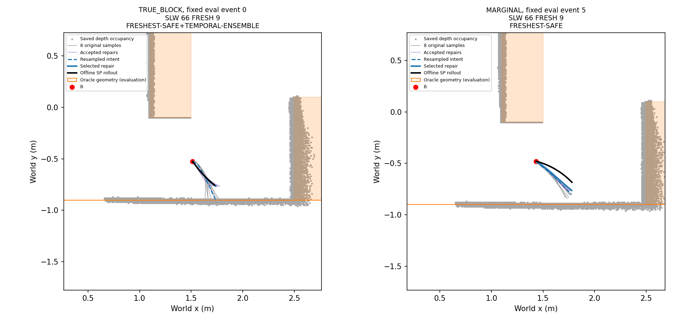
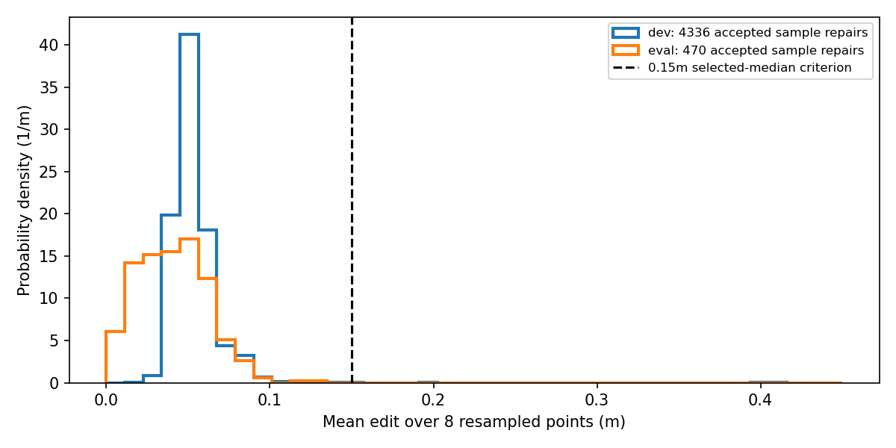
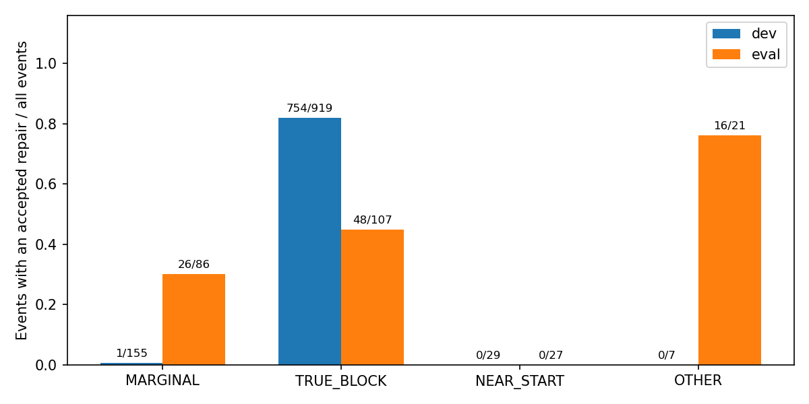

# Phase 19-R — depth-only XY repair, offline validation

Execution SHA: `5b459a9b38d447753eaa081bfccf7d9f82154726`. **REPAIR_UNSAFE**. No Isaac navigation, NoMaD inference, or Isaac rendering.

## Graph definition and symbols

| symbol | meaning |
| --- | --- |
| b, θ_B | recorded robot position and yaw at the decision boundary; b is fixed |
| q̂_0…q̂_7 | equal-arclength 8-point intent reference; q̂_0=b |
| p_0…p_7 | repair points, p_0=b; x=(p_1…p_7) has 14 XY variables, no yaw variables |
| σ_p, σ_s, σ_h | 0.10m, 0.02m, π/6 rad |
| d_depth(q) | saved depth occupied-site distance minus radius 0.09m; unknown is not occupied |
| h, L_i, ℓ_i⁰ | 1cm grid; repaired segment length; initial resampled segment length |
| κ_i | signed Menger curvature for successive triples, i=1…6 |

\[E(x)=\frac12\left[\sum_{i=1}^7\frac{\|p_i-\hat q_i\|^2}{0.10^2}+\sum_{i=1}^6\frac{\|p_{i+1}-2p_i+p_{i-1}\|^2}{0.02^2}+\left(\frac{2\sin((\operatorname{atan2}(p_1-b)-\theta_B)/2)}{\pi/6}\right)^2\right].\]

For $t_j=j/8$, $q_{ij}=(1-t_j)p_i+t_jp_{i+1}$: $d_{depth}(q_{ij})-h/\sqrt2-L_i/16\ge0.025$, $|\kappa_i|\le8$, $L_i\ge0.5\ell_i^0$, $\sum L_i\ge0.7\sum\ell_i^0$, and $|p_{i,a}-\hat q_{i,a}|\le0.75$ for each coordinate.

SLSQP, analytic residual/constraint Jacobians, maxiter=100, ftol=1e−8. Acceptance requires solver success, maximum raw-unit constraint/bound violation ≤1e−7, and exact distance to depth occupied cell centers (minus robot radius) ≥0.025m. No optimizer restart, alternate seed, or parameter tuning.

The native sample remains observation-anchored. Initialization projects B onto it, keeps its suffix, adds the explicit B→projection connector, and resamples that polyline. Eligibility uses native suffix length before adding the connector (≥0.25m). Edit metrics compare the repaired 8 points with this resampled intent reference, including the unchanged B point; they are not same-index distances to the original eight NoMaD outputs.

## Frozen protocol

```json
{
  "base_commit": "6d5ec94",
  "status": "FROZEN",
  "scope": "saved-event offline path repair only",
  "Isaac_navigation": 0,
  "NoMaD_inference": 0,
  "Isaac_render": 0,
  "datasets": {
    "development": "exact1110 entries of Phase16D stop_events.csv, including657 SL gate events",
    "evaluation": "all241 Phase18 actual ALL_UNSAFE selection decisions: SLW210 LC19 CL12",
    "evaluation_modes": {
      "STOP_WAIT": 145,
      "RECOVER_ROTATE": 87,
      "KEEP_ACTIVE": 9
    },
    "recovery_deferred_without_selection": 89,
    "ordering": "dev CSV order; eval Phase18 frozen main_order then FRESH event order",
    "example_selection": "first eval event of TRUE_BLOCK and MARGINAL, chosen in inventory before any saved-event repair solve"
  },
  "initialization": {
    "anchor": "native world XY transformed by its own observation pose; never rigid re-anchor the full sample",
    "projection": "protected XYPath nearest projection of B",
    "eligibility": "native remaining arclength before connector >=.25m",
    "reference": "polyline [B, projected point, suffix original vertices], duplicates removed by XYPath; uniform arclength8 samples; q0=B",
    "degenerate_segment_epsilon_m": 1e-10,
    "objective_reference": "resampled qhat, not raw sample indices"
  },
  "variables": "p1..p7 XY (14 scalars), fixed p0=B position, no yaw/time variables",
  "objective": {
    "convention": ".5*sum squared residuals",
    "sigma_position_m": 0.1,
    "sigma_second_difference_m": 0.02,
    "sigma_heading_rad": 0.5235987755982988,
    "heading": "2*sin((atan2(p1-b)-theta_B)/2)/sigma_h; measured B yaw, no native yaw"
  },
  "constraints": {
    "depth_margin_m": 0.025,
    "segment_samples": 9,
    "depth_formula": "d_depth(q)-h/sqrt(2)-L/16 >= .025",
    "curvature_max_m_inv": 8,
    "segment_length_ratio_min": 0.5,
    "total_length_ratio_min": 0.7,
    "coordinate_trust_m": 0.75,
    "certificate": "Snapshot.exact_clearance to occupied cell centers minus radius >=.025, no oracle boxes/wall halfplanes",
    "fixed_B": "never moved; an impossible fixed-B constraint is recorded but eligible samples still receive exactly one solve"
  },
  "solver": {
    "method": "SLSQP",
    "jacobian": "analytic for residuals and all constraints; inherited Menger derivative",
    "maxiter": 100,
    "ftol": 1e-08,
    "acceptance": "success AND raw-unit max constraint/bound violation <=1e-7 AND exact depth certificate",
    "constraint_tolerance": 1e-07,
    "retries": 0,
    "warm_restart": false,
    "initialization": "single resampled intent only",
    "SDF_out_of_domain": "failed attempt, no clipping/field extension"
  },
  "selection": {
    "rule": "minimum mean Euclidean edit among accepted paths, then lowest sample index",
    "mean_edit": "over all8 resampled-reference points including fixed zero-edit B; max over same8",
    "freshest_only": "original largest remaining suffix length, ties lower index; reuse its one solve, no second solve"
  },
  "causes": {
    "event": "Phase16D first-match with n=1: MARGINAL if max oracle suffix clearance in [0,.025), else TRUE_BLOCK if all8<0, else NEAR_START if query(B)-h/sqrt2<.025, else OTHER",
    "run": "also record same70percent Phase16D aggregate rule, separately from event-cause success rates",
    "oracle_scope": "posthoc labels, safety evaluation and plotting only; never repair or selection input"
  },
  "rollout": {
    "source": "unchanged Phase18D.rollout",
    "rule": "SP",
    "initial_speed": "actual incoming 72Hz speed at B, before new decision command",
    "horizon_ticks": 108,
    "heading": "actual B yaw; no preparatory rotation",
    "termination": "same endpoint/horizon/negative conservative oracle bound as Phase18D; exact negative witness separately",
    "fixed_path": true,
    "no_future_fresh_or_depth": true
  },
  "timing": {
    "sample": "initialize + necessary-bound diagnostic + solve + exact certificate; no file I/O or oracle evaluation",
    "decision_p95": "solver-started eligible samples; short/degenerate exclusions separate",
    "eight": "actual serial wall time of all8 decisions, before oracle evaluation/rollout"
  },
  "decision": {
    "population": "evaluation only",
    "unsafe": "any accepted sample repair has oracle box/wall footprint clearance<0 OR selected-event rollout overlap fraction>.01",
    "viable": "not unsafe AND success fraction>=.50 AND selected mean-edit median<=.15m AND eligible-sample solve p95<=.20s",
    "rare": "not unsafe and success<.50",
    "slow": "not unsafe and success>=.50 but timing or edit gate fails",
    "order": [
      "REPAIR_UNSAFE",
      "REPAIR_VIABLE",
      "REPAIR_RARE",
      "REPAIR_SLOW"
    ],
    "zero_repairs": "REPAIR_RARE; rollout fraction unavailable and safety_evidence_available=false, no claim of safety validation"
  },
  "recovery_reference": "Phase17/18 saved main-run recovery summaries and exact Phase18 trigger-event links; not an offline replay or matched causal comparison",
  "tests": {
    "finite_difference_tolerance": 1e-05,
    "finite_difference_step": 1e-07,
    "free": "straight uniformly sampled x=0..0.7, y0, B(0,0,0)",
    "blocking": "occupied grid box x[.55,.75], y[-.25,-.03], radius .09; robot footprint intersects a straight x0..1.4,y0 path",
    "constants_never_tuned": true
  },
  "protected_sha256": {
    "research/nomad_phase0/graph_v4.py": "e7b7a9b784189644564df24b7c0d02af6e1497f9ef11c63616f597634aa1c445",
    "research/nomad_phase0/pure_pursuit.py": "5e6010bad728dc7130457dfc71da0a92e5e0d86f1a63dfefc2aae1105475993d",
    "research/nomad_phase15/depth_sdf.py": "12f48eb36abbc5cdec32ba974f86a9dca943448ff43bec0114552351ce7b5a26",
    "research/nomad_phase15/evaluate.py": "b1147d50f0a7dce3e2146fe66981caad7ec7366d5a096b3bd99eb37e0224e8f4",
    "research/nomad_phase15b/depth.py": "f6072c9591c7696feef66d65d1048fbf7ad65b0ed0ba408a5f746e8577718919",
    "research/nomad_phase16/geometry.py": "044ac3e855d1445d97e9e63400e521a80bbaffcf34f81c26fa2e2809157bc0e0",
    "research/nomad_phase16d/diagnose.py": "e0fd752e9f0eca7f20b33d90e925ee1ee8b8df386d468032eae2cff2854566df",
    "research/nomad_phase18d/rollout.py": "1cd7b1bdbd3139369ef7c3c36839923afa8b09c0d09bcf55f4b0076d3728798f",
    "research/nomad_phase18d/speed_profile.py": "912432a9458db68799f2a2603643f03c74cf5a254f5ee713104ab4ba3f572629",
    "research/nomad_phase4/execution.py": "2a1ebb7047463108f1c6336700bd196854bf85eaca89268624f3e980569a2d86",
    "research/nomad_isaac/common.py": "37411b364e3d39547d2c134e2cbe67f9b9e5d09b7cfad6709567960859e4d03d",
    "research/nomad_isaac/clearance.py": "70213b966898efb17e070ead2c24a77b0b58478c1d6b228045157fe91dba048c",
    "research/nomad_phase0/chunk_execution.py": "b93858c5a16818ea1c406f3b1c25142baeb6d2abc3c47a6c3222376961a142c8",
    "research/nomad_phase0/chunk_pilot_protocol.json": "3be16f5ec1e9b61cda39dd0c511a915c187acae6b118ff5daa40dd02d6048a6e",
    "research/nomad_phase0/s0_batch_metrics.py": "f01eef77549ccaf4b8609e5769da52402d875e930b9f1d039fbe9ae6d9390bec"
  }
}
```

## Development and evaluation

| split | cause | events | repair_successes | repair_success_fraction | accepted_paths | oracle_penetrations | rollout_overlaps | rollout_count | selected_mean_edit_m | selected_rollout_progress_m | zero_progress_selections | per_sample_solve_s | eight_sample_wall_s | no_eligible_events | fixed_B_infeasible_samples | freshest_only_successes | E1_selected | E1_penetrating | E2_selected | E2_penetrating | dispositions |
| --- | --- | --- | --- | --- | --- | --- | --- | --- | --- | --- | --- | --- | --- | --- | --- | --- | --- | --- | --- | --- | --- |
| dev | ALL | 1110 | 755 | 0.68018 | 4336 | 4 | 195 | 755 | {'n': 755, 'median': 0.04525696424957937, 'p95': 0.07202544137544459, 'max': 0.14619810777988101} | {'n': 755, 'median': 0.34080998906777926, 'p95': 0.3759259259259259, 'max': 0.423522698391874} | 0 | {'n': 7425, 'median': 0.01374157500686124, 'p95': 0.0475657313945703, 'max': 0.11118714799522422} | {'n': 1110, 'median': 0.12237486698722932, 'p95': 0.27776661128154956, 'max': 0.4765915869793389} | 141 | 267 | 504 | 121 | 0 | 58 | 0 | {'SHORT_REMAINING': 1455, 'ACCEPTED': 4336, 'NONCONVERGED': 3089} |
| dev | MARGINAL | 155 | 1 | 0.0064516 | 8 | 0 | 0 | 1 | {'n': 1, 'median': 0.012183543419035478, 'p95': 0.012183543419035478, 'max': 0.012183543419035478} | {'n': 1, 'median': 0.29259259259259285, 'p95': 0.29259259259259285, 'max': 0.29259259259259285} | 0 | {'n': 79, 'median': 0.030916392017388716, 'p95': 0.08160703429603017, 'max': 0.09963224097737111} | {'n': 155, 'median': 0.0003740150132216513, 'p95': 0.09461032699327915, 'max': 0.30589995501213707} | 114 | 71 | 1 | 87 | 0 | 22 | 0 | {'SHORT_REMAINING': 1161, 'NONCONVERGED': 71, 'ACCEPTED': 8} |
| dev | TRUE_BLOCK | 919 | 754 | 0.82046 | 4328 | 4 | 195 | 754 | {'n': 754, 'median': 0.04527046589276163, 'p95': 0.07202955646120804, 'max': 0.14619810777988101} | {'n': 754, 'median': 0.34081902681618903, 'p95': 0.3759259259259259, 'max': 0.423522698391874} | 0 | {'n': 7170, 'median': 0.013603225001133978, 'p95': 0.04408552533568578, 'max': 0.11118714799522422} | {'n': 919, 'median': 0.1327498229802586, 'p95': 0.2701697894925018, 'max': 0.3543861150101293} | 13 | 20 | 503 | 0 | 0 | 0 | 0 | {'SHORT_REMAINING': 182, 'ACCEPTED': 4328, 'NONCONVERGED': 2842} |
| dev | NEAR_START | 29 | 0 | 0 | 0 | 0 | 0 | 0 | {'n': 0, 'median': None, 'p95': None, 'max': None} | {'n': 0, 'median': None, 'p95': None, 'max': None} | 0 | {'n': 176, 'median': 0.03410648449789733, 'p95': 0.08691295599419391, 'max': 0.11040154300280847} | {'n': 29, 'median': 0.28552772401599213, 'p95': 0.40756775999907396, 'max': 0.4765915869793389} | 7 | 176 | 0 | 29 | 0 | 29 | 0 | {'SHORT_REMAINING': 56, 'NONCONVERGED': 176} |
| dev | OTHER | 7 | 0 | 0 | 0 | 0 | 0 | 0 | {'n': 0, 'median': None, 'p95': None, 'max': None} | {'n': 0, 'median': None, 'p95': None, 'max': None} | 0 | {'n': 0, 'median': None, 'p95': None, 'max': None} | {'n': 7, 'median': 0.0003685950068756938, 'p95': 0.00042350390285719183, 'max': 0.0004324369947426021} | 7 | 0 | 0 | 5 | 0 | 7 | 0 | {'SHORT_REMAINING': 56} |
| eval | ALL | 241 | 90 | 0.37344 | 470 | 4 | 10 | 90 | {'n': 90, 'median': 0.036226903080457167, 'p95': 0.07415018315815318, 'max': 0.09195611711635132} | {'n': 90, 'median': 0.24266818835587234, 'p95': 0.4028129975953948, 'max': 0.42256159853806186} | 0 | {'n': 1005, 'median': 0.016330159996869043, 'p95': 0.05602310200338243, 'max': 0.10577529002330266} | {'n': 241, 'median': 0.08370156999444589, 'p95': 0.2691143300035037, 'max': 0.3902814629836939} | 53 | 374 | 64 | 61 | 1 | 56 | 0 | {'NONCONVERGED': 535, 'ACCEPTED': 470, 'SHORT_REMAINING': 923} |
| eval | MARGINAL | 86 | 26 | 0.30233 | 135 | 0 | 2 | 26 | {'n': 26, 'median': 0.02066184404612001, 'p95': 0.08137646374234743, 'max': 0.09195611711635132} | {'n': 26, 'median': 0.2996440943709231, 'p95': 0.4165364304364208, 'max': 0.42256159853806186} | 0 | {'n': 256, 'median': 0.01386617450043559, 'p95': 0.06080825300159631, 'max': 0.10199347999878228} | {'n': 86, 'median': 0.045901799996499904, 'p95': 0.232650959995226, 'max': 0.2969622590171639} | 27 | 104 | 22 | 32 | 1 | 15 | 0 | {'ACCEPTED': 135, 'SHORT_REMAINING': 432, 'NONCONVERGED': 121} |
| eval | TRUE_BLOCK | 107 | 48 | 0.4486 | 244 | 4 | 7 | 48 | {'n': 48, 'median': 0.043725336471753404, 'p95': 0.07180769738150504, 'max': 0.08138034816142303} | {'n': 48, 'median': 0.22134006972888057, 'p95': 0.3759259259259259, 'max': 0.40244654257263796} | 0 | {'n': 598, 'median': 0.01829886849736795, 'p95': 0.05013863793865311, 'max': 0.10577529002330266} | {'n': 107, 'median': 0.12983077598619275, 'p95': 0.2762105268164304, 'max': 0.3640434189874213} | 8 | 218 | 29 | 0 | 0 | 0 | 0 | {'NONCONVERGED': 354, 'ACCEPTED': 244, 'SHORT_REMAINING': 258} |
| eval | NEAR_START | 27 | 0 | 0 | 0 | 0 | 0 | 0 | {'n': 0, 'median': None, 'p95': None, 'max': None} | {'n': 0, 'median': None, 'p95': None, 'max': None} | 0 | {'n': 52, 'median': 0.028479550514020957, 'p95': 0.07434509699814949, 'max': 0.1020472520031035} | {'n': 27, 'median': 0.016672083002049476, 'p95': 0.34602085649385106, 'max': 0.3902814629836939} | 13 | 52 | 0 | 27 | 0 | 25 | 0 | {'SHORT_REMAINING': 164, 'NONCONVERGED': 52} |
| eval | OTHER | 21 | 16 | 0.7619 | 91 | 0 | 1 | 16 | {'n': 16, 'median': 0.016880395884863692, 'p95': 0.05764369977199023, 'max': 0.05924189588512668} | {'n': 16, 'median': 0.2546213286630058, 'p95': 0.38921429237573957, 'max': 0.4091717796018847} | 0 | {'n': 99, 'median': 0.013185728021198884, 'p95': 0.03030999660841188, 'max': 0.0795121320115868} | {'n': 21, 'median': 0.09346542501589283, 'p95': 0.14553180101211183, 'max': 0.19353037400287576} | 5 | 0 | 13 | 2 | 0 | 16 | 0 | {'ACCEPTED': 91, 'SHORT_REMAINING': 69, 'NONCONVERGED': 8} |

Per-event causes use Phase16-D priority: MARGINAL if the best original oracle suffix clearance is [0,0.025); otherwise TRUE_BLOCK if all8 penetrate; otherwise NEAR_START if B depth clearance<0.025; otherwise OTHER. The corresponding per-run 70% rule is also recorded in event CSVs. Oracle labels never enter the repair or selection function.

Development contains exactly 1,110 Phase16-D listed events including SL gates. Evaluation contains 241 actual ALL_UNSAFE decisions from all Phase18 methods/scenes. 89 FRESH packets deferred during recovery had no selection decision and are separately counted, not relabelled ALL_UNSAFE. Evaluation modes: {'STOP_WAIT': 145, 'KEEP_ACTIVE': 9, 'RECOVER_ROTATE': 87}.

## Evaluation-only decision

```json
{
  "label": "REPAIR_UNSAFE",
  "eval_events": 241,
  "repair_successes": 90,
  "repair_success_fraction": 0.37344398340248963,
  "accepted_sample_paths": 470,
  "accepted_oracle_penetrations": 4,
  "selected_rollout_overlaps": 10,
  "selected_path_oracle_penetrations": 0,
  "selected_rollout_count": 90,
  "selected_rollout_overlap_fraction": 0.1111111111111111,
  "selected_mean_edit_m": {
    "n": 90,
    "median": 0.036226903080457167,
    "p95": 0.07415018315815318,
    "max": 0.09195611711635132
  },
  "sample_solve_time_s": {
    "n": 1005,
    "median": 0.016330159996869043,
    "p95": 0.05602310200338243,
    "max": 0.10577529002330266
  },
  "eight_sample_wall_s": {
    "n": 241,
    "median": 0.08370156999444589,
    "p95": 0.2691143300035037,
    "max": 0.3902814629836939
  },
  "safety_evidence_available": true,
  "no_repair_convention": "If no accepted repair: REPAIR_RARE, rollout rate unavailable; never claim safety validated",
  "selected_rollout_progress_m": {
    "n": 90,
    "median": 0.24266818835587234,
    "p95": 0.4028129975953948,
    "max": 0.42256159853806186
  },
  "zero_progress_selections": 0,
  "cause_success": {
    "MARGINAL": {
      "events": 86,
      "successes": 26,
      "fraction": 0.3023255813953488
    },
    "TRUE_BLOCK": {
      "events": 107,
      "successes": 48,
      "fraction": 0.4485981308411215
    },
    "NEAR_START": {
      "events": 27,
      "successes": 0,
      "fraction": 0.0
    },
    "OTHER": {
      "events": 21,
      "successes": 16,
      "fraction": 0.7619047619047619
    }
  },
  "scope": "Offline path repair and same-event short rollout; no subsequent NoMaD, depth update or FRESH; closed-loop confirmation required"
}
```

Accepted-path oracle penetration: 4/470. Selected-path oracle penetration: 0/90. Selected SP rollout negative-clearance count: 10/90. Selected-path nonpenetration therefore did not imply safe execution in the fixed-path PP rollout.

Path safety counts **all accepted sample repairs**, not only the selected one. Rollout safety counts one selected repair per successful event. Unaccepted solver iterates are preserved but are not executed or counted as accepted repair paths. The original FRESHEST-only reference reuses that sample’s one solve; it is never re-solved.

One-sample timing includes initialization, optimizer and exact certificate; the decision p95 uses eligible solver attempts, with short/degenerate exclusions reported separately. Eight-sample timing is actual serial wall time including all8 decisions, excluding snapshot file I/O and oracle evaluation. No latency claim about an online worker is made.

## Actual recovery reference (no offline recovery simulation)

| phase | scene | method | runs | started | completed | first_fresh_observed | first_fresh_safe | first_fresh_safe_fraction | actual_rotation_seconds | rotation_time_fraction | scope |
| --- | --- | --- | --- | --- | --- | --- | --- | --- | --- | --- | --- |
| 17 | CL | FRESHEST-SAFE+GRAPH-GF | 5 | 0 | 0 | 0 | 0 | — | 0 | 0 | Actual main-run reference only; not a matched offline recovery counterfactual |
| 17 | CL | FRESHEST-SAFE+GRAPH-depth-CLR | 5 | 0 | 0 | 0 | 0 | — | 0 | 0 | Actual main-run reference only; not a matched offline recovery counterfactual |
| 17 | CL | FRESHEST-SAFE+GRAPH-depth | 5 | 0 | 0 | 0 | 0 | — | 0 | 0 | Actual main-run reference only; not a matched offline recovery counterfactual |
| 17 | CL | FRESHEST-SAFE+HERMITE | 5 | 0 | 0 | 0 | 0 | — | 0 | 0 | Actual main-run reference only; not a matched offline recovery counterfactual |
| 17 | CL | FRESHEST-SAFE+TEMPORAL-ENSEMBLE | 5 | 0 | 0 | 0 | 0 | — | 0 | 0 | Actual main-run reference only; not a matched offline recovery counterfactual |
| 17 | CL | FRESHEST-SAFE | 5 | 3 | 3 | 3 | 1 | 0.33333 | 5.25 | 0.026365 | Actual main-run reference only; not a matched offline recovery counterfactual |
| 17 | CL | TEMPORAL-ENSEMBLE | 5 | 0 | 0 | 0 | 0 | — | 0 | 0 | Actual main-run reference only; not a matched offline recovery counterfactual |
| 17 | LC | FRESHEST-SAFE+GRAPH-GF | 5 | 7 | 7 | 7 | 1 | 0.14286 | 12.25 | 0.044822 | Actual main-run reference only; not a matched offline recovery counterfactual |
| 17 | LC | FRESHEST-SAFE+GRAPH-depth-CLR | 5 | 0 | 0 | 0 | 0 | — | 0 | 0 | Actual main-run reference only; not a matched offline recovery counterfactual |
| 17 | LC | FRESHEST-SAFE+GRAPH-depth | 5 | 0 | 0 | 0 | 0 | — | 0 | 0 | Actual main-run reference only; not a matched offline recovery counterfactual |
| 17 | LC | FRESHEST-SAFE+HERMITE | 5 | 0 | 0 | 0 | 0 | — | 0 | 0 | Actual main-run reference only; not a matched offline recovery counterfactual |
| 17 | LC | FRESHEST-SAFE+TEMPORAL-ENSEMBLE | 5 | 0 | 0 | 0 | 0 | — | 0 | 0 | Actual main-run reference only; not a matched offline recovery counterfactual |
| 17 | LC | FRESHEST-SAFE | 5 | 0 | 0 | 0 | 0 | — | 0 | 0 | Actual main-run reference only; not a matched offline recovery counterfactual |
| 17 | LC | TEMPORAL-ENSEMBLE | 5 | 0 | 0 | 0 | 0 | — | 0 | 0 | Actual main-run reference only; not a matched offline recovery counterfactual |
| 17 | SLW | FRESHEST-SAFE+GRAPH-GF | 5 | 20 | 19 | 19 | 5 | 0.26316 | 33.917 | 0.11757 | Actual main-run reference only; not a matched offline recovery counterfactual |
| 17 | SLW | FRESHEST-SAFE+GRAPH-depth-CLR | 5 | 7 | 7 | 7 | 4 | 0.57143 | 12.25 | 0.052045 | Actual main-run reference only; not a matched offline recovery counterfactual |
| 17 | SLW | FRESHEST-SAFE+GRAPH-depth | 5 | 17 | 17 | 17 | 5 | 0.29412 | 29.75 | 0.12576 | Actual main-run reference only; not a matched offline recovery counterfactual |
| 17 | SLW | FRESHEST-SAFE+HERMITE | 5 | 5 | 5 | 5 | 1 | 0.2 | 8.75 | 0.029632 | Actual main-run reference only; not a matched offline recovery counterfactual |
| 17 | SLW | FRESHEST-SAFE+TEMPORAL-ENSEMBLE | 5 | 6 | 6 | 6 | 2 | 0.33333 | 10.5 | 0.052394 | Actual main-run reference only; not a matched offline recovery counterfactual |
| 17 | SLW | FRESHEST-SAFE | 5 | 3 | 3 | 3 | 2 | 0.66667 | 5.25 | 0.027917 | Actual main-run reference only; not a matched offline recovery counterfactual |
| 17 | SLW | TEMPORAL-ENSEMBLE | 5 | 0 | 0 | 0 | 0 | — | 0 | 0 | Actual main-run reference only; not a matched offline recovery counterfactual |
| 18 | CL | FRESHEST-SAFE+GRAPH-depth-CLR | 8 | 0 | 0 | 0 | 0 | — | 0 | 0 | Actual main-run reference only; not a matched offline recovery counterfactual |
| 18 | CL | FRESHEST-SAFE+GRAPH-depth | 8 | 0 | 0 | 0 | 0 | — | 0 | 0 | Actual main-run reference only; not a matched offline recovery counterfactual |
| 18 | CL | FRESHEST-SAFE+HERMITE | 8 | 0 | 0 | 0 | 0 | — | 0 | 0 | Actual main-run reference only; not a matched offline recovery counterfactual |
| 18 | CL | FRESHEST-SAFE+RTC-hard | 8 | 2 | 2 | 2 | 2 | 1 | 3.5 | 0.0083292 | Actual main-run reference only; not a matched offline recovery counterfactual |
| 18 | CL | FRESHEST-SAFE+TEMPORAL-ENSEMBLE | 8 | 1 | 1 | 1 | 1 | 1 | 1.75 | 0.0058191 | Actual main-run reference only; not a matched offline recovery counterfactual |
| 18 | CL | FRESHEST-SAFE | 8 | 0 | 0 | 0 | 0 | — | 0 | 0 | Actual main-run reference only; not a matched offline recovery counterfactual |
| 18 | LC | FRESHEST-SAFE+GRAPH-depth-CLR | 8 | 0 | 0 | 0 | 0 | — | 0 | 0 | Actual main-run reference only; not a matched offline recovery counterfactual |
| 18 | LC | FRESHEST-SAFE+GRAPH-depth | 8 | 0 | 0 | 0 | 0 | — | 0 | 0 | Actual main-run reference only; not a matched offline recovery counterfactual |
| 18 | LC | FRESHEST-SAFE+HERMITE | 8 | 0 | 0 | 0 | 0 | — | 0 | 0 | Actual main-run reference only; not a matched offline recovery counterfactual |
| 18 | LC | FRESHEST-SAFE+RTC-hard | 8 | 0 | 0 | 0 | 0 | — | 0 | 0 | Actual main-run reference only; not a matched offline recovery counterfactual |
| 18 | LC | FRESHEST-SAFE+TEMPORAL-ENSEMBLE | 8 | 7 | 7 | 7 | 1 | 0.14286 | 12.25 | 0.024936 | Actual main-run reference only; not a matched offline recovery counterfactual |
| 18 | LC | FRESHEST-SAFE | 8 | 0 | 0 | 0 | 0 | — | 0 | 0 | Actual main-run reference only; not a matched offline recovery counterfactual |
| 18 | SLW | FRESHEST-SAFE+GRAPH-depth-CLR | 8 | 15 | 15 | 15 | 2 | 0.13333 | 26.25 | 0.076512 | Actual main-run reference only; not a matched offline recovery counterfactual |
| 18 | SLW | FRESHEST-SAFE+GRAPH-depth | 8 | 14 | 14 | 14 | 7 | 0.5 | 24.5 | 0.072024 | Actual main-run reference only; not a matched offline recovery counterfactual |
| 18 | SLW | FRESHEST-SAFE+HERMITE | 8 | 16 | 16 | 16 | 4 | 0.25 | 28 | 0.073075 | Actual main-run reference only; not a matched offline recovery counterfactual |
| 18 | SLW | FRESHEST-SAFE+RTC-hard | 8 | 5 | 5 | 5 | 3 | 0.6 | 8.75 | 0.028992 | Actual main-run reference only; not a matched offline recovery counterfactual |
| 18 | SLW | FRESHEST-SAFE+TEMPORAL-ENSEMBLE | 8 | 16 | 16 | 16 | 6 | 0.375 | 28 | 0.067064 | Actual main-run reference only; not a matched offline recovery counterfactual |
| 18 | SLW | FRESHEST-SAFE | 8 | 11 | 11 | 11 | 5 | 0.45455 | 19.25 | 0.056136 | Actual main-run reference only; not a matched offline recovery counterfactual |

These are Phase17/18 main-run actual records, not matched interventions on the Phase16 development events. Rates divide safe first post-rotation FRESH by observed first post-rotation FRESH; missing terminal outcomes remain missing. Exact Phase18 recovery-trigger events are linked in events_eval.csv. Recovery data are evaluation references only.

## Fixed examples

The first evaluation event of each cause was chosen and written to inventory.json before any saved-event repair solve. Examples remain even when no sample is repairable.







## Limits

This is a path-level offline counterfactual. The inherited Phase18-D SP rollout fixes one path for ≤1.5s, uses actual initial speed, and stops at an endpoint or oracle negative clearance. Its conservative swept lower-bound overlap count and exact negative witness are recorded separately. Future NoMaD responses, depth updates, next FRESH and recovery are absent. A fixed B that already violates the depth constraint cannot be repaired by moving only future points. Unknown cells remain free in depth and can conceal oracle obstacles. Effects can only be established in new closed-loop navigation experiments.
Event rates are event-weighted and include repeated stops near the same pose; they are not independent navigation trials. The full numerical path journal is retained locally; the committed per-sample CSV preserves all dispositions and metrics.
