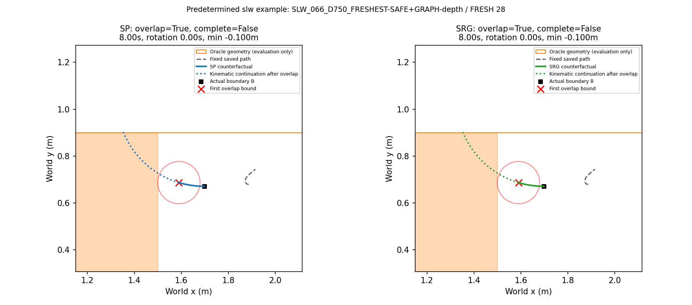
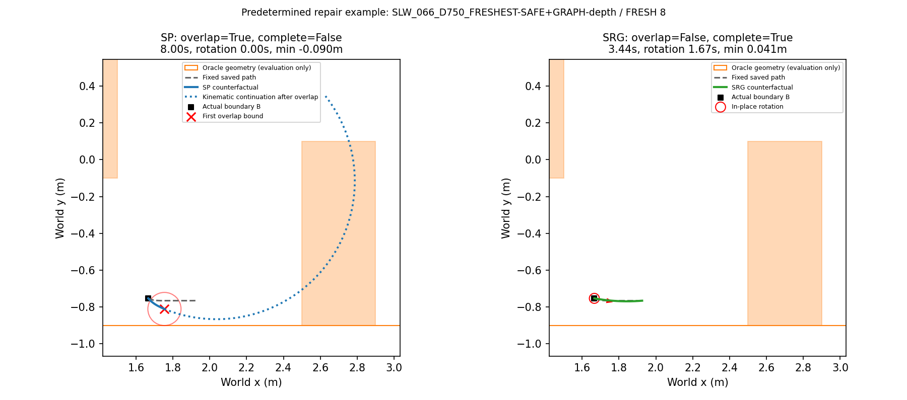
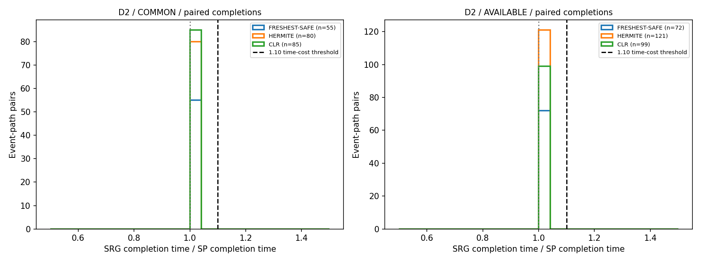

# Phase 19-S — conditional stop–rotate–go, post-hoc offline validation

Execution SHA: `680c19a229da000c45da981f0b3cc5a2b03007e2`. Protocol SHA256: `ddd1d0bf21e511a075e829d586de52c9b3333e2593712015987966d054b47efe`. **SRG_NOT_ENOUGH**.

## Fixed rules

SP uses the protected Phase18-D Menger-based forward/backward speed profile, interpolation at the current PP projection, execution floor 0.05m/s, maximum 0.3m/s, acceleration 0.5m/s² and ω clipping ±0.4rad/s. The protected PP lookahead is 0.25m. Commands update at 9Hz and exact SE(2) integration at 72Hz. No stored path is re-anchored.

SRG S: at rollout start only, if actual v<0.01m/s and heading error to the first existing path point at least 0.05m from B is ≥20°, brake to zero and rotate toward that point. SRG P: combine <1cm chords for turn detection only; ≥45° turns ahead of the initial projection split the unchanged native polyline into legs. Each incoming pivot leg uses SP with terminal v_limit=0 and the same backward/forward passes. The 0.05m/s floor is removed on pivot stopping legs; otherwise a zero-speed pivot would be impossible. Within 1cm of a pivot, finish bounded braking, then rotate to the next merged-chord heading. A new leg resumes SP and acceleration limiting from zero.

Rotation keeps v exactly zero and |ω|≤0.4. The final 9Hz rotation command is reduced to hit the target yaw without overshoot; there is no pose or yaw teleport. S is checked once at initial departure; subsequent explicit pivot rotations implement P. P candidates behind B are excluded. Multiple pivots are handled in path order. The original unmerged points remain in each PP leg.

Both rules stop the numerical trial at endpoint tolerance 1cm or 8s. Oracle geometry is queried only in a separate evaluation pass, after all commands/poses have been generated. An oracle overlap does not change the fixed-path controller or abort this 8s trajectory. Consequently, a kinematic completion after an overlap is **not** a safe completion. Both-completed time pairs and both-safely-completed time pairs are shown separately. This explicitly differs from the previous ≤1.5s evaluation cutoff at first overlap.

## Dataset coverage and verification

D1/D2 reuse the exact Phase18-D common 85/166 events (the original five-path intersection, not recomputed for three paths). Method-available rows are also included; unavailable paths remain excluded with reasons in unavailable.csv. D3 contains all 90 selected evaluation repairs and D4 all 755 selected development repairs. No repair/Graph solve is repeated. Original sample choice and paths are unchanged.

The SP prefix of every available path is checked against its saved Phase18-D/19-R ≤1.5s result, including the old first-overlap cutoff.

| tests | prefix_regressions | prefix_pass | max_prefix_clearance_error_m | maximum_command_dv | maximum_abs_w |
| --- | --- | --- | --- | --- | --- |
| 5 | 2200 | 2200 | 0 | 0.055556 | 0.4 |

## Safety, completion and progress

| dataset | scope | path_type | rule | n | overlaps | margin_violations | completions | safe_completions | completion_time_median_s | distance_mean_m | rotation_time_mean_s | trigger_fraction |
| --- | --- | --- | --- | --- | --- | --- | --- | --- | --- | --- | --- | --- |
| D1 | COMMON | FRESHEST-SAFE | SP | 85 | 50 | 51 | 26 | 26 | 1 | 1.507 | 0 | 0 |
| D1 | COMMON | FRESHEST-SAFE | SRG | 85 | 50 | 51 | 26 | 26 | 1 | 1.507 | 0 | 0 |
| D1 | COMMON | HERMITE | SP | 85 | 22 | 28 | 42 | 42 | 1.1111 | 0.80923 | 0 | 0 |
| D1 | COMMON | HERMITE | SRG | 85 | 22 | 28 | 42 | 42 | 1.1111 | 0.80923 | 0 | 0 |
| D1 | COMMON | CLR | SP | 85 | 26 | 28 | 44 | 44 | 1.0556 | 1.0635 | 0 | 0 |
| D1 | COMMON | CLR | SRG | 85 | 26 | 28 | 44 | 44 | 1.0556 | 1.0635 | 0 | 0 |
| D1 | AVAILABLE | FRESHEST-SAFE | SP | 272 | 120 | 130 | 67 | 67 | 1.3333 | 1.0455 | 0 | 0 |
| D1 | AVAILABLE | FRESHEST-SAFE | SRG | 272 | 100 | 111 | 61 | 61 | 1.7778 | 0.91061 | 0.9134 | 0.15809 |
| D1 | AVAILABLE | HERMITE | SP | 272 | 82 | 96 | 89 | 89 | 1.2222 | 0.749 | 0 | 0 |
| D1 | AVAILABLE | HERMITE | SRG | 272 | 57 | 75 | 99 | 99 | 1.4444 | 0.66833 | 0.55964 | 0.15809 |
| D1 | AVAILABLE | CLR | SP | 141 | 39 | 44 | 64 | 64 | 1.1111 | 0.93816 | 0 | 0 |
| D1 | AVAILABLE | CLR | SRG | 141 | 39 | 44 | 64 | 64 | 1.1111 | 0.93816 | 0 | 0 |
| D2 | COMMON | FRESHEST-SAFE | SP | 166 | 70 | 71 | 55 | 55 | 1.2222 | 1.3921 | 0 | 0 |
| D2 | COMMON | FRESHEST-SAFE | SRG | 166 | 70 | 71 | 55 | 55 | 1.2222 | 1.3921 | 0 | 0 |
| D2 | COMMON | HERMITE | SP | 166 | 37 | 40 | 80 | 80 | 1.2222 | 0.83306 | 0 | 0 |
| D2 | COMMON | HERMITE | SRG | 166 | 37 | 40 | 80 | 80 | 1.2222 | 0.83306 | 0 | 0 |
| D2 | COMMON | CLR | SP | 166 | 58 | 62 | 85 | 85 | 1.2222 | 1.1288 | 0 | 0 |
| D2 | COMMON | CLR | SRG | 166 | 58 | 62 | 85 | 85 | 1.2222 | 1.1288 | 0 | 0 |
| D2 | AVAILABLE | FRESHEST-SAFE | SP | 240 | 89 | 90 | 87 | 87 | 1.3333 | 1.304 | 0 | 0 |
| D2 | AVAILABLE | FRESHEST-SAFE | SRG | 240 | 76 | 77 | 73 | 73 | 1.3333 | 1.0957 | 1.1782 | 0.15833 |
| D2 | AVAILABLE | HERMITE | SP | 240 | 49 | 52 | 121 | 121 | 1.4444 | 0.77273 | 0 | 0 |
| D2 | AVAILABLE | HERMITE | SRG | 240 | 47 | 50 | 123 | 123 | 1.4444 | 0.76637 | 0.034722 | 0.016667 |
| D2 | AVAILABLE | CLR | SP | 190 | 61 | 65 | 99 | 99 | 1.2222 | 1.0631 | 0 | 0 |
| D2 | AVAILABLE | CLR | SRG | 190 | 61 | 65 | 99 | 99 | 1.2222 | 1.0631 | 0 | 0 |
| D3 | ALL | REPAIR | SP | 90 | 46 | 52 | 38 | 37 | 1.5556 | 1.1476 | 0 | 0 |
| D3 | ALL | REPAIR | SRG | 90 | 38 | 45 | 43 | 42 | 1.6667 | 1.0436 | 0.20247 | 0.11111 |
| D4 | ALL | REPAIR | SP | 755 | 583 | 603 | 242 | 172 | 1.8889 | 1.6382 | 0 | 0 |
| D4 | ALL | REPAIR | SRG | 755 | 403 | 472 | 260 | 260 | 1.8889 | 1.4791 | 0.54908 | 0.26358 |

Overlap uses the existing swept conservative lower bound <0; exact negative witnesses and conservative-only negatives remain separate in rollouts.csv. Clearance includes the 0.09m circular footprint and the outer corridor rectangle. No new safety geometry formula is introduced. Completion-average speed is the fixed path arclength divided by completion time, as requested; actual travelled distance/time and initial remaining arclength are separate fields. Incomplete trials retain progress and FOLLOWING/BRAKING/ROTATING reasons.

## D2 paired time cost

| scope | path_type | require_both_safe | candidates | pairs | median | p90 | trigger_fraction | SP_only_complete | SRG_only_complete |
| --- | --- | --- | --- | --- | --- | --- | --- | --- | --- |
| COMMON | ALL | False | 498 | 220 | 1 | 1 | 0 | 0 | 0 |
| COMMON | ALL | True | 498 | 220 | 1 | 1 | 0 | 0 | 0 |
| COMMON | FRESHEST-SAFE | False | 166 | 55 | 1 | 1 | 0 | 0 | 0 |
| COMMON | FRESHEST-SAFE | True | 166 | 55 | 1 | 1 | 0 | 0 | 0 |
| COMMON | HERMITE | False | 166 | 80 | 1 | 1 | 0 | 0 | 0 |
| COMMON | HERMITE | True | 166 | 80 | 1 | 1 | 0 | 0 | 0 |
| COMMON | CLR | False | 166 | 85 | 1 | 1 | 0 | 0 | 0 |
| COMMON | CLR | True | 166 | 85 | 1 | 1 | 0 | 0 | 0 |
| AVAILABLE | ALL | False | 670 | 292 | 1 | 1 | 0.062687 | 15 | 3 |
| AVAILABLE | ALL | True | 670 | 292 | 1 | 1 | 0.062687 | 15 | 3 |
| AVAILABLE | FRESHEST-SAFE | False | 240 | 72 | 1 | 1 | 0.15833 | 15 | 1 |
| AVAILABLE | FRESHEST-SAFE | True | 240 | 72 | 1 | 1 | 0.15833 | 15 | 1 |
| AVAILABLE | HERMITE | False | 240 | 121 | 1 | 1 | 0.016667 | 0 | 2 |
| AVAILABLE | HERMITE | True | 240 | 121 | 1 | 1 | 0.016667 | 0 | 2 |
| AVAILABLE | CLR | False | 190 | 99 | 1 | 1 | 0 | 0 | 0 |
| AVAILABLE | CLR | True | 190 | 99 | 1 | 1 | 0 | 0 | 0 |

The primary median pools the three path types over the original 166 common events, using only pairs with two completion times. It is event-path weighted; repetitions/path types are not independent trials. Per-path and all-available ratios, p90, completion attrition, and collision-free pairs are reported separately. No censored time is replaced by 8s. Trigger rate divides triggered SRG trials by all eligible SRG trials, not only completed pairs.

## Trigger coverage and completion censoring

| dataset | event_paths | initial_v_below_001 | S_events | P_events | trials_with_pivot_candidates | triggered_completions |
| --- | --- | --- | --- | --- | --- | --- |
| D1 | 685 | 120 | 56 | 32 | 61 | 22 |
| D2 | 670 | 98 | 41 | 1 | 2 | 3 |
| D3 | 90 | 32 | 10 | 0 | 1 | 6 |
| D4 | 755 | 744 | 195 | 4 | 6 | 90 |

D2 all-available trigger trials: 42. Among them, both complete=0, SP only=15, SRG only=3, neither=24. The observed paired median of 1.0 therefore does **not** establish negligible SRG time cost: no triggered D2 trial provides two completion times. The common D1/D2 sets have no fired triggers; equality there reflects an inactive conditional rule.

The ≤1.5s prefixes are also shown for horizon context; they are extracted from the already computed trajectories, without new rollouts.

| dataset | rule | overlaps |
| --- | --- | --- |
| D3 | SP | 10 |
| D3 | SRG | 6 |
| D4 | SP | 195 |
| D4 | SRG | 4 |

The reported total ω-saturation includes deliberate in-place rotation. Translation-only saturation is a separate CSV field; rotation saturation is not treated as understeering.

## Prespecified decision

```json
{
  "label": "SRG_NOT_ENOUGH",
  "D3_SP_overlaps": 46,
  "D3_SRG_overlaps": 38,
  "D3_n": 90,
  "D3_SRG_overlap_fraction": 0.4222222222222222,
  "D1_safety_violations": [],
  "safety_pass": false,
  "D2_primary_time": {
    "scope": "COMMON",
    "path_type": "ALL",
    "require_both_safe": false,
    "candidates": 498,
    "pairs": 220,
    "median": 1.0,
    "p90": 1.0,
    "trigger_fraction": 0.0,
    "SP_only_complete": 0,
    "SRG_only_complete": 0
  },
  "decision_scope": "D1 safety: common AND method-available; D2 timing: common 166, pooled three paths, paired completions only",
  "historical_D3_SP_1p5s_overlaps": 10,
  "post_hoc": true,
  "closed_loop_claim": false
}
```

Safety requires D3 overlap≤1% and no D1 overlap increase for any path type in either the common or all-available scope. The D2 timing threshold uses the common pooled completion pairs. Empty completion pairs would be reported as INCONCLUSIVE_NO_COMPLETION_PAIRS instead of an invented median.

The historical D3 SP count is 10/90 at ≤1.5s. The table above is the new, identical-horizon 8s SP→SRG comparison. A larger SP count at 8s is additional exposure, not a regression mismatch.

## Predetermined figures

The SLW example is the first published Phase18-D UNDERTURN_EXECUTION row, using its saved active path and boundary. It may belong to a different method than the CLR source dataset and is supplemental only. The repair example is the first D3 event with a previously recorded SP overlap; neither figure is selected from new SRG outcomes.







## Limits

D1 and D3 reuse data involved in earlier decisions; this is post-hoc offline analysis. D4 is descriptive development data. The controller sees only geometry of one fixed path and the recorded B/speed. Future FRESH, regenerated NoMaD predictions, depth updates, timeout replacement, online solve delay and feedback from a changed observation are absent. Geometry during rotation is invariant for the assumed circular SE(2) footprint; this is not a validation of robot dynamics or collision-free translation into/out of a pivot. Effects can only be confirmed with new seeds and closed-loop navigation.

## Frozen protocol

```json
{
  "phase": "19-S",
  "base_commit": "87c3ef0",
  "scope": "post-hoc saved-path offline counterfactual; no navigation, inference, render, Graph solve",
  "controller": {
    "protected_PP_lookahead_m": 0.25,
    "maximum_v_m_s": 0.3,
    "maximum_abs_w_rad_s": 0.4,
    "acceleration_m_s2": 0.5,
    "control_hz": 9,
    "integration_hz": 72,
    "horizon_s": 8,
    "endpoint_tolerance_m": 0.01
  },
  "SP": "Import Phase18D speed profile unchanged; exact original execution calculation; extend to 8s. No new terminal speed constraint at final path endpoint.",
  "SRG": {
    "S": {
      "initial_actual_v_less_than": 0.01,
      "first_existing_path_point_distance_at_least_m": 0.05,
      "heading_error_at_least_degrees": 20,
      "frequency": "once at initial departure; scan stored path point order, no fabricated tangent/yaw"
    },
    "P": {
      "direction_change_at_least_degrees": 45,
      "merge_short_chord_m": 0.01,
      "merge_scope": "turn detection only; retain native path vertices in each leg",
      "exclude_pivots_behind_initial_projection": true,
      "incoming_leg": "same SP limits and two passes, terminal speed limit zero; remove .05 execution floor on stopping leg",
      "arrival_tolerance_m": 0.01,
      "rotation_direction": "outgoing merged chord heading"
    },
    "rotation": "bounded braking to actual v=0 first; 9Hz command abs(w)=.4 except final command clipped to remaining angle/control_dt; 72Hz integration; no teleport",
    "after_pivot": "new PP leg, reset geometric progress, resume SP from zero with the same acceleration cap",
    "oracle_input": false
  },
  "evaluation": {
    "oracle": "existing exact/swept box and corridor evaluator; circular radius .09m; never input to controller",
    "collision_feedback": false,
    "termination": "endpoint or 8s; oracle overlap never terminates command generation",
    "unsafe_completion": "recorded as kinematic completion only, separately safe_completion false",
    "time_pairs": "both completed; also separately both completed without overlap; no missing-time imputation",
    "completion_average_speed": "full fixed path arclength / elapsed completion time; actual travelled distance/time separately"
  },
  "datasets": {
    "D1": "Phase18D SLW common85 plus all available paths; RAW/FRESHEST-SAFE, HERMITE, stored accepted CLR",
    "D2": "Phase18D CL common166 plus all available paths; same three paths",
    "D3": "all90 selected Phase19R evaluation repairs",
    "D4": "all755 selected Phase19R development repairs, descriptive only",
    "unavailable": "retain exclusion reason; do not fabricate a CLR path or re-solve"
  },
  "decision": {
    "priority": [
      "SRG_NOT_ENOUGH",
      "SRG_SAFE_BUT_SLOW",
      "SRG_FIXES_EXECUTION"
    ],
    "safety": "D3 overlap fraction <=.01 AND for each D1 path type SRG overlaps <= SP, checked in BOTH original common and method-available scopes",
    "timing": "D2 original common166 events, pooled three path types; median SRG/SP among paired completions <=1.10",
    "empty_time_pairs": "INCONCLUSIVE_NO_COMPLETION_PAIRS (do not fabricate a ratio)",
    "historical_D3_SP_overlap_1p5s": 10
  },
  "examples": {
    "slw": {
      "dataset": "EXAMPLE_ONLY",
      "event_id": "SLW_066_D750_FRESHEST-SAFE+GRAPH-depth:F28",
      "run": "SLW_066_D750_FRESHEST-SAFE+GRAPH-depth",
      "scene": "SLW",
      "index": 66,
      "fresh_id": 28,
      "path_type": "NORMAL",
      "common": false,
      "B": [
        1.6977954215394235,
        0.6706210298260761,
        3.107802299757335
      ],
      "previous_v": 0.3
    },
    "repair": {
      "dataset": "D3",
      "event_id": 8,
      "run": "SLW_066_D750_FRESHEST-SAFE+GRAPH-depth",
      "scene": "SLW",
      "index": 66,
      "fresh_id": 8,
      "path_type": "REPAIR",
      "common": true,
      "B": [
        1.6664561889871812,
        -0.7529137850081349,
        -0.8435993125183927
      ],
      "previous_v": 0.0,
      "cause": "TRUE_BLOCK",
      "selected_sample": 1
    }
  },
  "checks": "five unit tests; every SP path prefix compared with saved <=1.5s metrics; initial B and native observation frame preserved; bounds verified on every command",
  "analysis_defaults": "Clarification offered before execution; no reply by freeze. Oracle-passive full-horizon evaluation and common/available reporting disclosed before data rollouts.",
  "protected_sha256": {
    "research/nomad_phase0/pure_pursuit.py": "5e6010bad728dc7130457dfc71da0a92e5e0d86f1a63dfefc2aae1105475993d",
    "research/nomad_phase0/chunk_execution.py": "b93858c5a16818ea1c406f3b1c25142baeb6d2abc3c47a6c3222376961a142c8",
    "research/nomad_phase0/chunk_pilot_protocol.json": "3be16f5ec1e9b61cda39dd0c511a915c187acae6b118ff5daa40dd02d6048a6e",
    "research/nomad_phase18d/rollout.py": "1cd7b1bdbd3139369ef7c3c36839923afa8b09c0d09bcf55f4b0076d3728798f",
    "research/nomad_phase18d/speed_profile.py": "912432a9458db68799f2a2603643f03c74cf5a254f5ee713104ab4ba3f572629",
    "research/nomad_phase18d/diagnose.py": "cadd6cf4dec7f985ba56374c7539512d5bb0dd60c60a85e9980e8dd90f189ee6",
    "research/nomad_phase12/methods.py": "e752ab9ee57f91ceee9338722e05814f60f2047a51eecc00b6316fd8c19df8cb",
    "research/nomad_phase19r/repair.py": "01314bdc267cfda557275f5ba5844e4433eea2ac86bfbdf9c8ea7f2b04eb516a",
    "research/nomad_phase19r/evaluate.py": "7520b87af37728e5e192021ef9290183f866e9b91c6327a4937628a6ad2b2f3c",
    "research/nomad_phase16/geometry.py": "044ac3e855d1445d97e9e63400e521a80bbaffcf34f81c26fa2e2809157bc0e0",
    "research/nomad_isaac/common.py": "37411b364e3d39547d2c134e2cbe67f9b9e5d09b7cfad6709567960859e4d03d",
    "research/nomad_isaac/clearance.py": "70213b966898efb17e070ead2c24a77b0b58478c1d6b228045157fe91dba048c",
    "research/nomad_phase0/s0_batch_metrics.py": "f01eef77549ccaf4b8609e5769da52402d875e930b9f1d039fbe9ae6d9390bec"
  }
}
```
