# Phase 20-B — blockage-level repair pilot / 파일럿

Protocol hash: `bd12270488dc3b602b4120d94bdbfdc3cbf2b8d02dd5d827337e99ddf5b483e6`. New runs: L2/L3 × M1/M2 × indices80–82. L1 is reused; no navigation retry.

Preflight limitation: the single40s L3 M2 smoke had zero ALL_UNSAFE events and no repair call, so in-navigation eight-sample timing was unavailable before the main runs. The four-process solver matched serial results and its real result reached the executor/plant in a CPU unit test. No scenario or seed was changed to force a repair event.

The Phase20 R2/SP/start-alignment/selection/fallback/recovery code is unchanged. M2 alone uses four CPU processes and a fixed1.0s wait limit. Processes initialize before the navigation clock without warmup solves; per-job timing includes snapshot loading and process scheduling, with sample solve/certificate times separately recorded. All late and terminal results retain timing logs. Oracle geometry is used only for placement/rendering and evaluation.

Per-sample attempt timings include initialization and certificate. Short-path/negative-B rejections do not run SLSQP: solver_started, disposition and optimizer-only time are preserved per sample to distinguish these from actual solves.

Box center y is fixed in corridor coordinates (L2=0; L3 even+0.3/odd−0.3m), preserving the specified gaps despite robot lateral drift. d=1.0m is measured from footprint front to the front box face along +X. L3 narrow gap0.20m is smaller than the0.23m required by radius0.09 plus two0.025m margins; it is not a proof that a0.18m diameter circle geometrically cannot fit.

## Per-level results

| scene | method | planned | valid | success | collision | corridor | stuck | technical | goal_time_s | passed_box | box_passage_time_s | all_unsafe | all_unsafe_per_run | recovery_count | stopped_fraction | repair_attempts | repair_accepted | repair_rejected | repair_timeout | repair_acceptance | sample_solve_median_s | sample_solve_p95_s | eight_solve_median_s | eight_solve_p95_s | dispatch_complete_median_s | dispatch_complete_p95_s | post_repair_safe | post_repair_observed | post_repair_safe_fraction |
| --- | --- | --- | --- | --- | --- | --- | --- | --- | --- | --- | --- | --- | --- | --- | --- | --- | --- | --- | --- | --- | --- | --- | --- | --- | --- | --- | --- | --- | --- |
| L1 | M1_ROTATE | 6 | 6 | 5 | 0 | 0 | 1 | 0 | 67.842 | 6 | 16.301 | 5 | 0.83333 | 2 | 0.013062 | 0 | 0 | 0 | 0 | — | — | — | — | — | — | — | 0 | 0 | — |
| L1 | M2_REPAIR | 6 | 6 | 6 | 0 | 0 | 0 | 0 | 68.326 | 6 | 15.604 | 2 | 0.33333 | 1 | 0.0077519 | 2 | 0 | 0 | 2 | 0 | — | — | — | — | — | — | 0 | 0 | — |
| L2 | M1_ROTATE | 3 | 3 | 1 | 0 | 0 | 2 | 0 | 80.944 | 3 | 29.801 | 3 | 1 | 1 | 0.011111 | 0 | 0 | 0 | 0 | — | — | — | — | — | — | — | 0 | 0 | — |
| L2 | M2_REPAIR | 3 | 3 | 1 | 0 | 0 | 2 | 0 | 81.347 | 2 | 25.34 | 4 | 1.3333 | 0 | 0.0021889 | 4 | 4 | 0 | 0 | 1 | 0.019414 | 0.029774 | 0.089298 | 0.1442 | 0.090262 | 0.14651 | 3 | 4 | 0.75 |
| L3 | M1_ROTATE | 3 | 2 | 0 | 0 | 0 | 2 | 1 | — | 0 | — | 0 | 0 | 0 | 0 | 0 | 0 | 0 | 0 | — | — | — | — | — | — | — | 0 | 0 | — |
| L3 | M2_REPAIR | 3 | 2 | 0 | 0 | 0 | 2 | 1 | — | 0 | — | 0 | 0 | 0 | 0 | 0 | 0 | 0 | 0 | — | — | — | — | — | — | — | 0 | 0 | — |

## Pilot labels and descriptive blockage trend

| scene | label | scope | M1_success | M2_success | success_difference | success_rate_difference | M1_all_unsafe | M2_all_unsafe | M1_all_unsafe_per_run | M2_all_unsafe_per_run | M2_repair_accepted | passed_pairs | all_pair_passage_times_shorter | passage_pairs |
| --- | --- | --- | --- | --- | --- | --- | --- | --- | --- | --- | --- | --- | --- | --- |
| L1 | REPAIR_UNUSED | 파일럿 | 5 | 6 | 1 | 0.16667 | 5 | 2 | 0.83333 | 0.33333 | 0 | 6 | False | [{'index': 74, 'difference_s': -0.652777777777775}, {'index': 75, 'difference_s': 0.013888888888889284}, {'index': 76, 'difference_s': -1.152777777777775}, {'index': 77, 'difference_s': 2.597222222222218}, {'index': 78, 'difference_s': -8.041666666666664}, {'index': 79, 'difference_s': 3.0555555555555536}] |
| L2 | REPAIR_NO_HELP | 파일럿 | 1 | 1 | 0 | 0 | 3 | 4 | 1 | 1.3333 | 4 | 2 | False | [{'index': 80, 'difference_s': -22.847222222222225}, {'index': 81, 'difference_s': 9.305555555555546}] |
| L3 | PILOT_INCONCLUSIVE | 파일럿 | 0 | 0 | 0 | 0 | 0 | 0 | 0 | 0 | 0 | 0 | False | [] |

REPAIR_HELPS follows the frozen success/acceptance rule, including the equal-success paired-passage alternative. An empty paired subset never counts as all-faster. Technical/missing trials are retained and make an interpreted per-level label inconclusive.

L1 has six seeds and the former serial0.5s repair backend; L2/L3 have three new seeds and the four-process1.0s backend. Across-level count/rate differences are descriptive, not paired causal estimates. In saved L1, both methods passed the box6/6, while goal success was M1=5/6 and M2=6/6. Goal success and box passage remain separate.

## Seed × level × method

| scene | index | method | classification | success | goal_time_s | passed_box | box_passage_time_s | pass_side | all_unsafe | repair_attempts | repair_accepted | repair_rejected | repair_timeout | repair_dispositions | recovery_count | stopped_fraction | sample_solve_s | eight_solve_s | post_repair_safe_count | post_repair_fresh_count |
| --- | --- | --- | --- | --- | --- | --- | --- | --- | --- | --- | --- | --- | --- | --- | --- | --- | --- | --- | --- | --- |
| L1 | 74 | M2_REPAIR | SUCCESS | True | 66.958 | True | 15.514 | +Y | 0 | 0 | 0 | 0 | 0 | {} | 0 | 0 | — | — | 0 | 0 |
| L1 | 74 | M1_ROTATE | SUCCESS | True | 65.611 | True | 16.167 | +Y | 0 | 0 | 0 | 0 | 0 | {} | 0 | 0 | — | — | 0 | 0 |
| L1 | 75 | M1_ROTATE | SUCCESS | True | 65.014 | True | 15.25 | -Y | 0 | 0 | 0 | 0 | 0 | {} | 0 | 0 | — | — | 0 | 0 |
| L1 | 75 | M2_REPAIR | SUCCESS | True | 64.431 | True | 15.264 | -Y | 0 | 0 | 0 | 0 | 0 | {} | 0 | 0 | — | — | 0 | 0 |
| L1 | 76 | M2_REPAIR | SUCCESS | True | 57.931 | True | 13.042 | +Y | 0 | 0 | 0 | 0 | 0 | {} | 0 | 0 | — | — | 0 | 0 |
| L1 | 76 | M1_ROTATE | STUCK | False | — | True | 14.194 | +Y | 0 | 0 | 0 | 0 | 0 | {} | 0 | 0 | — | — | 0 | 0 |
| L1 | 77 | M1_ROTATE | SUCCESS | True | 66.236 | True | 14.722 | +Y | 0 | 0 | 0 | 0 | 0 | {} | 0 | 0 | — | — | 0 | 0 |
| L1 | 77 | M2_REPAIR | SUCCESS | True | 79.931 | True | 17.319 | -Y | 0 | 0 | 0 | 0 | 0 | {} | 0 | 0 | — | — | 0 | 0 |
| L1 | 78 | M1_ROTATE | SUCCESS | True | 73.722 | True | 23 | +Y | 4 | 0 | 0 | 0 | 0 | {} | 2 | 0.078372 | — | — | 0 | 0 |
| L1 | 78 | M2_REPAIR | SUCCESS | True | 69.042 | True | 14.958 | +Y | 0 | 0 | 0 | 0 | 0 | {} | 0 | 0 | — | — | 0 | 0 |
| L1 | 79 | M1_ROTATE | SUCCESS | True | 68.625 | True | 14.472 | -Y | 1 | 0 | 0 | 0 | 0 | {} | 0 | 0 | — | — | 0 | 0 |
| L1 | 79 | M2_REPAIR | SUCCESS | True | 71.667 | True | 17.528 | -Y | 2 | 2 | 0 | 0 | 2 | {'TIMEOUT': 2} | 1 | 0.046512 | — | — | 0 | 0 |
| L2 | 80 | M1_ROTATE | STUCK | False | — | True | 37.875 | +Y | 1 | 0 | 0 | 0 | 0 | {} | 0 | 0 | {'n': 0, 'median': None, 'p95': None} | {'n': 0, 'median': None, 'p95': None} | 0 | 0 |
| L2 | 80 | M2_REPAIR | SUCCESS | True | 81.347 | True | 15.028 | +Y | 3 | 3 | 3 | 0 | 0 | {'ACCEPTED': 3} | 0 | 0.0040977 | {'n': 24, 'median': 0.018818653479684144, 'p95': 0.02176011702686082} | {'n': 3, 'median': 0.081716825, 'p95': 0.0953621165} | 2 | 3 |
| L3 | 80 | M1_ROTATE | STUCK | False | — | False | — | — | 0 | 0 | 0 | 0 | 0 | {} | 0 | 0 | {'n': 0, 'median': None, 'p95': None} | {'n': 0, 'median': None, 'p95': None} | 0 | 0 |
| L3 | 80 | M2_REPAIR | STUCK | False | — | False | — | — | 0 | 0 | 0 | 0 | 0 | {} | 0 | 0 | {'n': 0, 'median': None, 'p95': None} | {'n': 0, 'median': None, 'p95': None} | 0 | 0 |
| L2 | 81 | M2_REPAIR | STUCK | False | — | True | 35.653 | +Y | 1 | 1 | 1 | 0 | 0 | {'ACCEPTED': 1} | 0 | 0.0024691 | {'n': 8, 'median': 0.02785133451106958, 'p95': 0.046529332903446616} | {'n': 1, 'median': 0.152554449, 'p95': 0.152554449} | 1 | 1 |
| L2 | 81 | M1_ROTATE | STUCK | False | — | True | 26.347 | +Y | 2 | 0 | 0 | 0 | 0 | {} | 1 | 0.033333 | {'n': 0, 'median': None, 'p95': None} | {'n': 0, 'median': None, 'p95': None} | 0 | 0 |
| L3 | 81 | M1_ROTATE | TECHNICAL_FAILURE | False | — | — | — | — | — | — | — | — | — | — | — | — | — | — | — | — |
| L3 | 81 | M2_REPAIR | STUCK | False | — | False | — | — | 0 | 0 | 0 | 0 | 0 | {} | 0 | 0 | {'n': 0, 'median': None, 'p95': None} | {'n': 0, 'median': None, 'p95': None} | 0 | 0 |
| L2 | 82 | M2_REPAIR | STUCK | False | — | False | — | — | 0 | 0 | 0 | 0 | 0 | {} | 0 | 0 | {'n': 0, 'median': None, 'p95': None} | {'n': 0, 'median': None, 'p95': None} | 0 | 0 |
| L2 | 82 | M1_ROTATE | SUCCESS | True | 80.944 | True | 25.181 | +Y | 0 | 0 | 0 | 0 | 0 | {} | 0 | 0 | {'n': 0, 'median': None, 'p95': None} | {'n': 0, 'median': None, 'p95': None} | 0 | 0 |
| L3 | 82 | M2_REPAIR | TECHNICAL_FAILURE | False | — | — | — | — | — | — | — | — | — | — | — | — | — | — | — | — |
| L3 | 82 | M1_ROTATE | STUCK | False | — | False | — | — | 0 | 0 | 0 | 0 | 0 | {} | 0 | 0 | {'n': 0, 'median': None, 'p95': None} | {'n': 0, 'median': None, 'p95': None} | 0 | 0 |

## Technical failures

| scene | index | method | output | error |
| --- | --- | --- | --- | --- |
| L3 | 81 | M1_ROTATE | /home/gpuadmin/Workspace/NoMaD/artifacts/isaac6/phase20b_blockage_01/main/L3_081_D750_M1_ROTATE | Launcher exit 1 |
| L3 | 82 | M2_REPAIR | /home/gpuadmin/Workspace/NoMaD/artifacts/isaac6/phase20b_blockage_01/main/L3_082_D750_M2_REPAIR | Launcher exit 1 |

## Frozen scene and per-seed visualizations

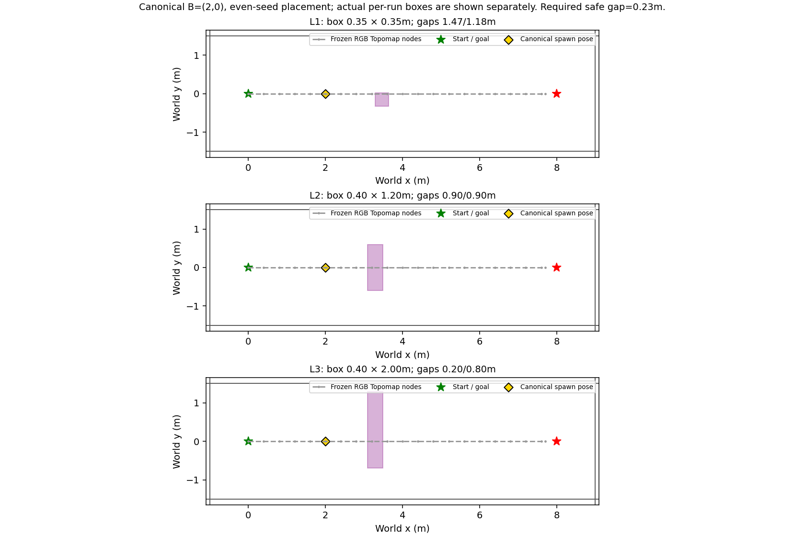

### L2 / seed 80

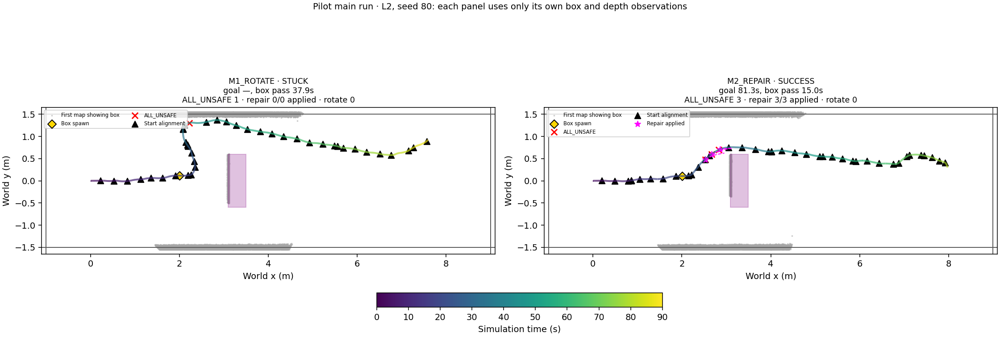

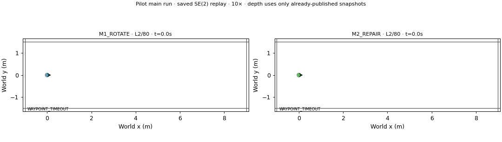

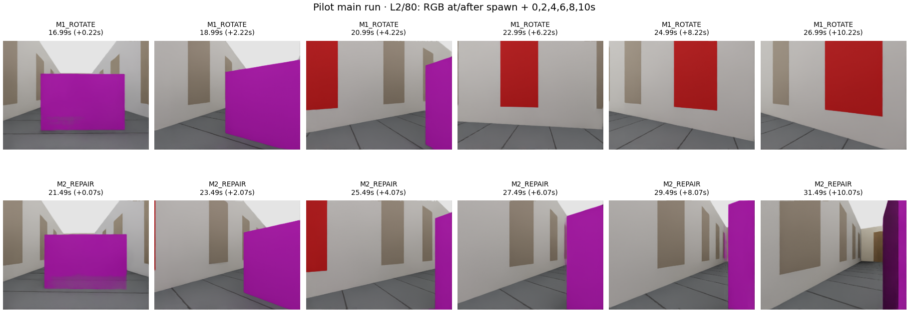

### L2 / seed 81

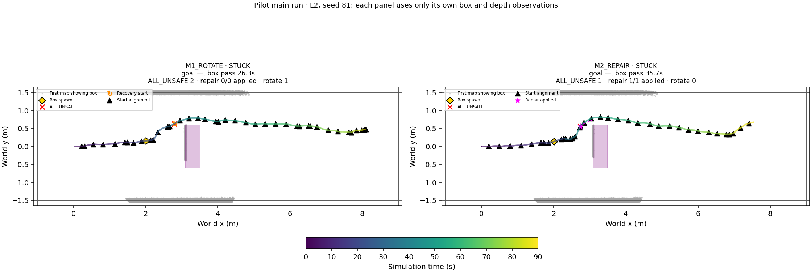

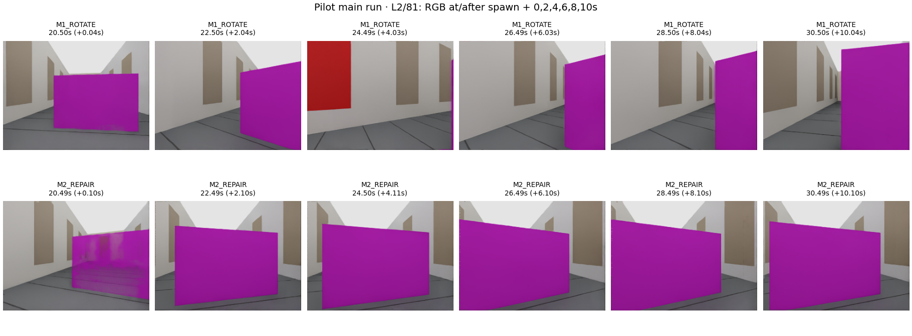

### L2 / seed 82

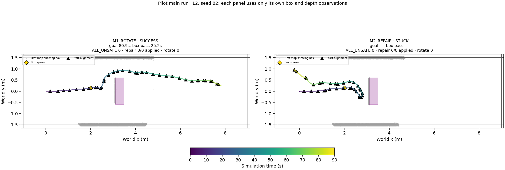

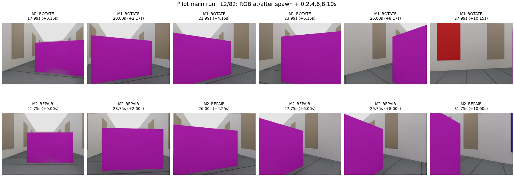

### L3 / seed 80

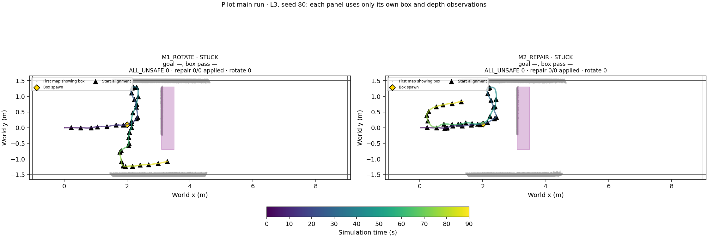

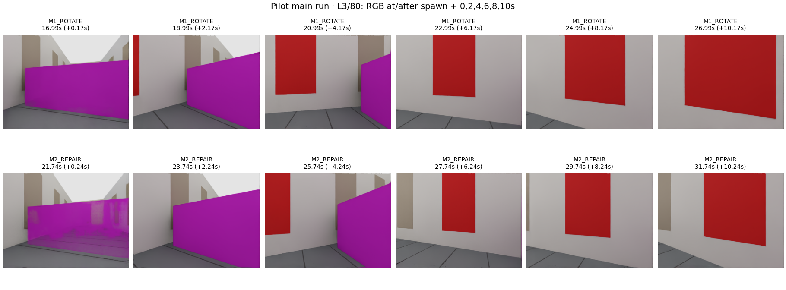

### L3 / seed 81

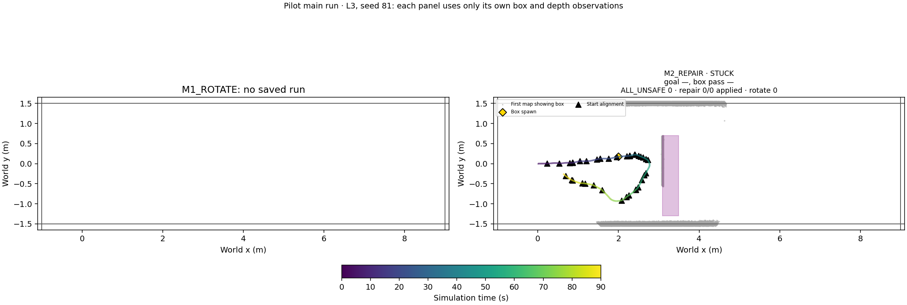

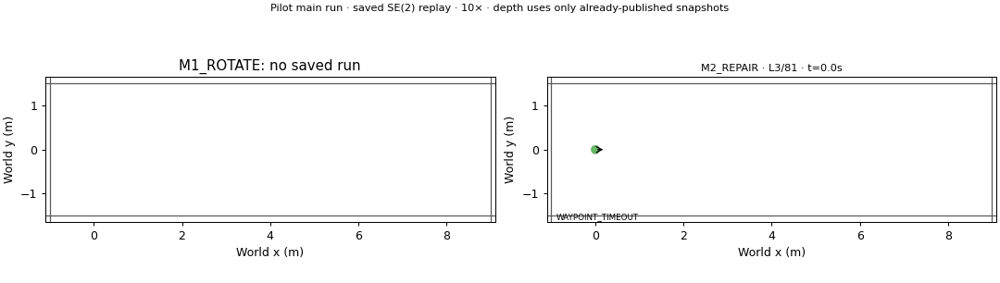

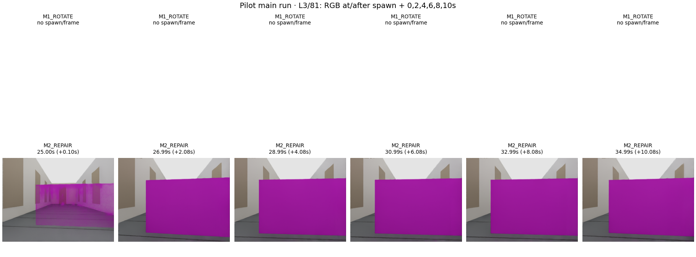

### L3 / seed 82

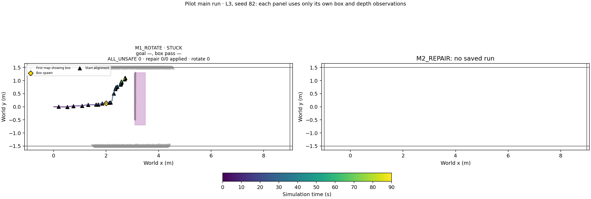

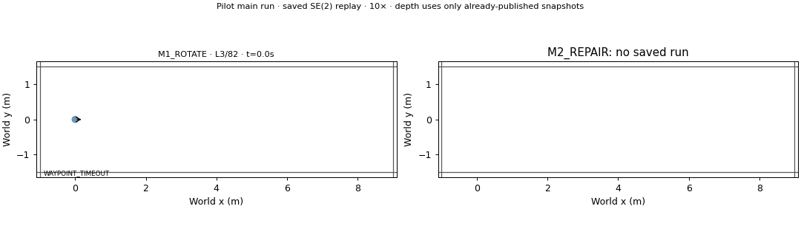

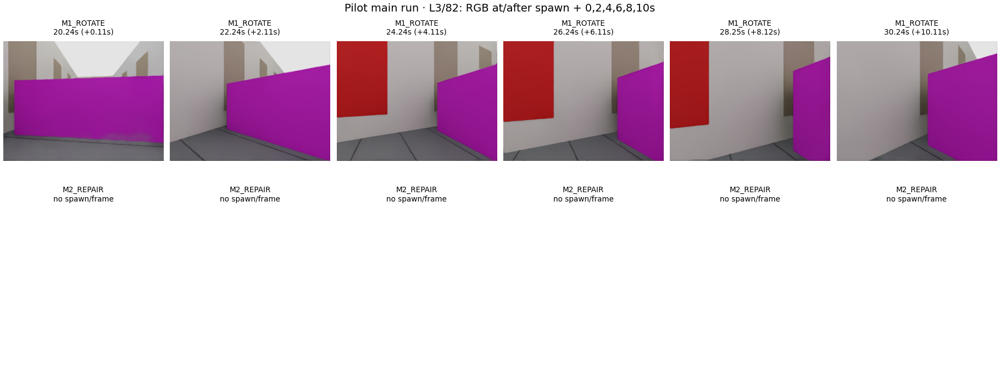

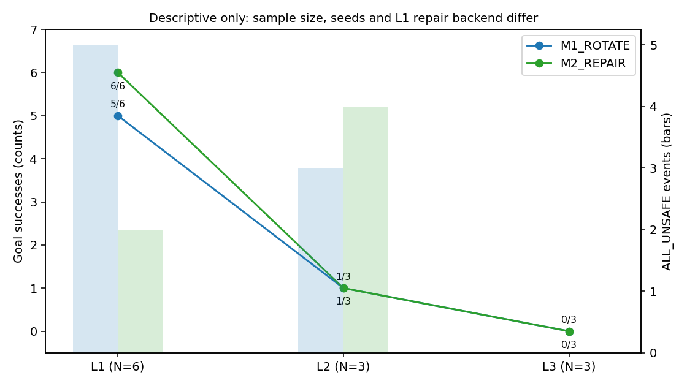

Animation uses stored72Hz poses at1 simulation-second intervals,10fps for10× playback, capped at15s. After a run ends its last pose is held and labelled; no missing motion or RGB is invented. Depth animation never uses a snapshot before its actual publication. Static overlays use the first map that observed that run’s box.

The simulator provides exact pose (no odometry error), RGB remains the only NoMaD input, and unknown depth cells remain free. No Graph or placement parameter was tuned from pilot results. A single scene family and N=3 do not establish generalization or statistical superiority.
