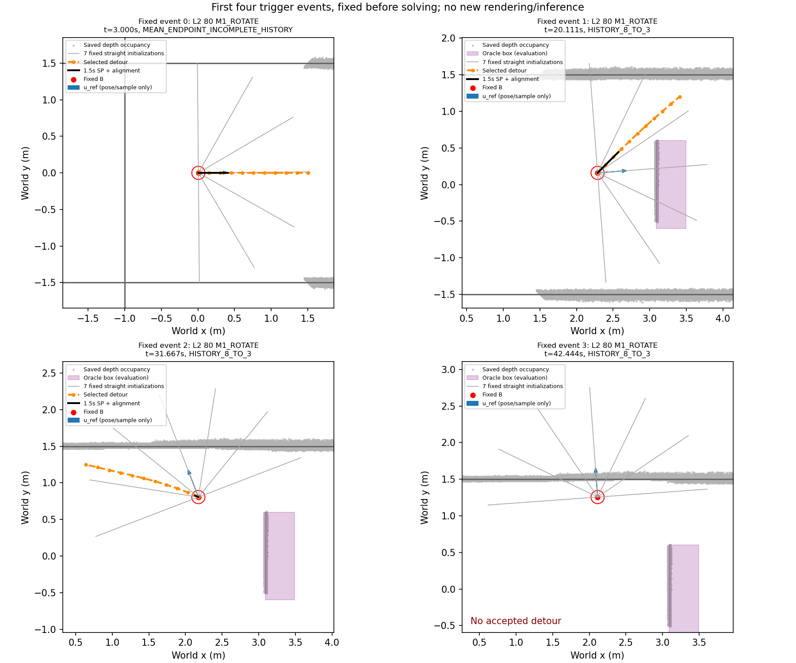

# Phase 20-C — R3 depth detour offline gate / 파일럿

**NOT_READY**. Execution SHA `d227f9e3902daf75ec23d44ab5e23ec742198f92`; protocol SHA256 `63f77173a60de8f9f031a1a31dee6014f9ad883bd1eec40e2d9751623a5bd357`. No new Isaac navigation, NoMaD inference or depth/RGB rendering.

## Frozen R3

B is fixed; ten editable XY points follow it. Seven straight1.5m initializations use0,+30,−30,+60,−60,+90,−90 degrees relative to u_ref. No native yaw or waypoint timing is inferred. SLSQP uses analytic derivatives, maxiter100, ftol1e−8, one attempt per initialization.

\[E=\tfrac12\big[(\max(0,1.2-(p_{10}-b)\cdot u_{ref})/0.10)^2+\sum_{i=1}^{9}\|(p_{i+1}-2p_i+p_{i-1})/0.03\|^2+\sum_q(\max(0,0.15-d_{depth}(q))/0.05)^2+(2\sin((\operatorname{atan2}(p_1-b)-\theta_B)/2)/(\pi/6))^2\big].\]

Each of ten segments has nine inspection points. Safety is d_depth−h/√2−L/16≥min(0.025,max(0,c_B−0.005)) within0.30m along the current optimized path and≥0.025 thereafter. c_B is SDF(B)−h/√2; negative c_B rejects the solve. Exact occupied-cell-site distance certificates split the continuous path at0.30m. The zone boundary is nonsmooth; derivatives are analytic within each zone, unchanged from R2.

All nine Menger curvatures have |κ|≤4m⁻¹; ten segment lengths are0.10–0.20m; editable points lie inside the1.6m disk around B. Redundant coordinate bounds B±1.6m implement the same disk bounding box. Acceptance needs solver success, violation≤1e−7, exact depth certificate and relative progress≥0.5m. Selection maximizes relative progress, then minimizes path length, then uses initialization index for an exact tie. No oracle geometry enters solve or selection.

## Trigger inventory and limitations

Ten technically valid L2/L3 Phase20-B runs are included; the two technical failures below are excluded as requested. Frozen Phase20-B main_order followed by9Hz controller tick order defines event IDs. At each tick, the latest latched NoMaD packet and latest actually published depth snapshot are used; future outputs/snapshots are excluded. Metric samples remain anchored at their observation pose.

u_ref uses displacement from t−8s to t−3s if its length≥0.30m. Otherwise it uses the normalized mean world endpoint minus current robot position. Before eight seconds, incomplete history uses this sample fallback; no pre-start pose is invented. The trigger requires a complete recent3s window and signed projected displacement<0.20m. A zero mean direction or absent samples is explicitly skipped. Rotation, departure-alignment braking/rotation and an outstanding R2 repair wait block the trigger.

The saved runs contain no R3 end event. Before solving, the offline inventory therefore uses a fixed virtual6s detour window followed by the prescribed3s cooldown; earliest recheck is9s after the trigger. Saved poses continue unchanged throughout that window. This convention, offered for clarification and fixed before results, is not a reconstruction of actual detour execution or variable solve latency. Online cooldown would start at the actual detour end.

Post-box and pre-spawn triggers are retained, with phases reported separately. Relative progress may point in −X if recent motion or NoMaD endpoints do; no goal/oracle axis is substituted. “Endpoint beyond box front or in a side gap” is descriptive and not part of READY. It is not a proof of box passage, especially for events already past the box.

| run | error |
| --- | --- |
| L3_081_D750_M1_ROTATE | Launcher exit 1 |
| L3_082_D750_M2_REPAIR | Launcher exit 1 |

| run | triggers | accepted | selected_penetrations | rollout_overlaps |
| --- | --- | --- | --- | --- |
| L2_080_D750_M1_ROTATE | 7 | 6 | 0 | 0 |
| L2_080_D750_M2_REPAIR | 6 | 6 | 0 | 0 |
| L3_080_D750_M1_ROTATE | 8 | 7 | 1 | 0 |
| L3_080_D750_M2_REPAIR | 7 | 7 | 2 | 0 |
| L2_081_D750_M2_REPAIR | 6 | 6 | 0 | 0 |
| L2_081_D750_M1_ROTATE | 5 | 5 | 0 | 0 |
| L3_081_D750_M2_REPAIR | 7 | 7 | 0 | 0 |
| L2_082_D750_M2_REPAIR | 9 | 9 | 3 | 0 |
| L2_082_D750_M1_ROTATE | 4 | 4 | 1 | 0 |
| L3_082_D750_M1_ROTATE | 7 | 4 | 1 | 0 |

## Gate

```json
{
  "label": "NOT_READY",
  "reasons": [
    "ACCEPTED_PATH_ORACLE_PENETRATION"
  ],
  "triggers": 66,
  "accepted_triggers": 61,
  "acceptance_fraction": 0.9242424242424242,
  "accepted_initializations": 290,
  "accepted_path_oracle_penetrations": 34,
  "selected_path_oracle_penetrations": 8,
  "rollout_overlaps": 0,
  "rollout_count": 61,
  "rollout_overlap_fraction": 0.0,
  "seven_parallel_s": {
    "n": 66,
    "median": 0.1818024600215722,
    "p95": 0.27492748049553484,
    "max": 0.31940734799718484
  },
  "timeout_events": 0,
  "accepted_within_1s": 61,
  "gap_direction_applicable": 44,
  "gap_direction_count": 31,
  "post_hoc": true,
  "scope": "Saved poses remain unchanged during virtual detour windows; no closed-loop counterfactual claim"
}
```

Penetration is checked across **all accepted initialization paths**, with selected-path penetrations separately reported. One SP+revised-start-alignment rollout per accepted event uses actual recorded speed/yaw, max1.5s, and oracle only for passive clearance evaluation. Its clock includes braking and rotation. Empty-obstacle/pre-spawn evaluation uses the same corridor function without inventing an obstacle.

Seven-start timing includes four-process dispatch, snapshot loading, solving, certificate and result transfer; pool initialization and oracle evaluation are excluded. Acceptance before the1s online cutoff is separately recorded. No solve is restarted or tuned.

| scene | phase | triggers | accepted | acceptance | accepted_initializations | all_accepted_penetrations | selected_penetrations | rollout_overlap | rollout_count | unknown_median | relative_progress_median | gap_direction | gap_applicable | seven_solve_p95_s | u_ref_negative_world_x |
| --- | --- | --- | --- | --- | --- | --- | --- | --- | --- | --- | --- | --- | --- | --- | --- |
| ALL | ALL | 66 | 61 | 0.92424 | 290 | 34 | 8 | 0 | 61 | 0 | 1.2296 | 31 | 44 | 0.27493 | 21 |
| L2 | PRE_SPAWN | 10 | 10 | 1 | 66 | 0 | 0 | 0 | 10 | 0 | 1.5 | 0 | 0 | 0.15719 | 0 |
| L2 | BEFORE_BOX_PASSAGE | 19 | 18 | 0.94737 | 75 | 23 | 4 | 0 | 18 | 0 | 1.1943 | 15 | 18 | 0.25286 | 8 |
| L2 | AFTER_BOX_PASSAGE | 8 | 8 | 1 | 36 | 0 | 0 | 0 | 8 | 0 | 1.4371 | 8 | 8 | 0.24744 | 0 |
| L3 | PRE_SPAWN | 7 | 7 | 1 | 44 | 0 | 0 | 0 | 7 | 0 | 1.5 | 0 | 0 | 0.16893 | 0 |
| L3 | BEFORE_BOX_PASSAGE | 22 | 18 | 0.81818 | 69 | 11 | 4 | 0 | 18 | 0 | 1.1777 | 8 | 18 | 0.30272 | 13 |
| L3 | AFTER_BOX_PASSAGE | 0 | 0 | — | 0 | 0 | 0 | 0 | 0 | — | — | 0 | 0 | — | 0 |

Dispositions: `{"ACCEPTED": 290, "NONCONVERGED": 155, "INSUFFICIENT_PROGRESS": 17}`.



## Saved-path failure detail

All accepted negative-clearance paths: {'BOX': 23, 'CORRIDOR': 11}. Selected negative-clearance paths: {'BOX': 5, 'CORRIDOR': 3}.

| event_id | initialization | selected | kind | oracle_clearance_m | depth_clearance_m | unknown_fraction | phase |
| --- | --- | --- | --- | --- | --- | --- | --- |
| 14 | 6 | True | BOX | -0.09 | 0.14293 | 0 | BEFORE_BOX_PASSAGE |
| 23 | 4 | True | BOX | -0.09 | 0.1399 | 0 | BEFORE_BOX_PASSAGE |
| 26 | 4 | True | CORRIDOR | -0.036195 | 0.86006 | 0 | BEFORE_BOX_PASSAGE |
| 48 | 3 | True | BOX | -0.09 | 1.1448 | 0 | BEFORE_BOX_PASSAGE |
| 53 | 5 | True | CORRIDOR | -0.30242 | 0.2736 | 0.090909 | BEFORE_BOX_PASSAGE |
| 54 | 3 | True | CORRIDOR | -0.58424 | 0.1485 | 0.31752 | BEFORE_BOX_PASSAGE |
| 56 | 6 | True | BOX | -0.09 | 0.86016 | 0 | BEFORE_BOX_PASSAGE |
| 61 | 6 | True | BOX | -0.09 | 0.13055 | 0 | BEFORE_BOX_PASSAGE |

The selected1.5s rollouts travelled a median 0.3759m; 12/61 travelled≤1cm and 17 triggered alignment. Zero short-horizon rollout overlap therefore does not establish safety of the entire detour.

Some oracle-penetrating selected paths have unknown fraction0. Unknown denotes cell observation coverage, not a proof that free/occupied classification or the whole solid obstacle is correct; these data do not support attributing all failures solely to unseen cells.

## Validation and next stage

Four completed unit tests passed: analytic residual/constraint Jacobians versus finite differences≤1e−5, free straight path, blocked synthetic gap detour, and NO_PROGRESS/busy/end-time cooldown. They were not repeated after the capacity interruption.

The mandatory gate failed. Smoke and online campaign preparation stop here; no smoke/main navigation was run and no campaign command is supplied. The failed candidates and original saved data remain preserved.

This is post-hoc offline analysis of correlated saved events, not a driving comparison. Future FRESH responses, changed depth maps, motion during a live solve and subsequent closed-loop behavior are absent.

## Preregistered protocol

```json
{
  "phase": "20C",
  "base_commit": "f0d2f7e",
  "status": "OFFLINE_GATE_FROZEN",
  "scope": "파일럿",
  "graph": {
    "variables": "p1..p10 XY, p0=B fixed",
    "angles_deg": [
      0,
      30,
      -30,
      60,
      -60,
      90,
      -90
    ],
    "initial_length_m": 1.5,
    "objective": {
      "progress_target_m": 1.2,
      "sigma_progress_m": 0.1,
      "sigma_smooth_m": 0.03,
      "clearance_preference_m": 0.15,
      "sigma_clearance_m": 0.05,
      "sigma_heading_deg": 30
    },
    "constraints": {
      "start_region_m": 0.3,
      "start_threshold": "min(.025,max(0,c_B-.005))",
      "c_B": "SDF(B)-h/sqrt(2)",
      "negative_B": "reject without solve",
      "far_clearance_m": 0.025,
      "inspection_points_per_segment": 9,
      "interpolation_margin": "h/sqrt(2)+L/16",
      "menger_max_m_inv": 4.0,
      "segment_length_m": [
        0.1,
        0.2
      ],
      "radius_from_B_m": 1.6,
      "coordinate_bounds": "redundant B+-1.6m box implied by disk"
    },
    "solver": {
      "method": "SLSQP",
      "jacobian": "analytic; piecewise zone threshold as R2",
      "maxiter": 100,
      "ftol": 1e-08,
      "restarts": 0
    },
    "acceptance": "solver success AND violation<=1e-7 AND piecewise exact depth certificate AND relative progress>=.5m",
    "selection": "largest relative progress, then shortest length, then initialization index"
  },
  "reference_direction": {
    "history_window_s": [
      -8,
      -3
    ],
    "minimum_displacement_m": 0.3,
    "fallback": "normalize(mean(observation-anchored world endpoints)-current B)",
    "incomplete_history": "sample fallback; no fabricated pre-start pose",
    "undefined_mean": "skip with explicit reason; no arbitrary yaw"
  },
  "trigger": {
    "control_hz": 9,
    "recent_window_s": 3.0,
    "minimum_progress_m": 0.2,
    "minimum_history_s": 3.0,
    "blocked_sources": [
      "RECOVER_ROTATE",
      "ALIGN_BRAKE",
      "ALIGN_ROTATE",
      "REPAIR_WAIT"
    ],
    "cooldown_after_actual_end_s": 3.0,
    "offline_virtual_execution_s": 6.0,
    "offline_earliest_retrigger_s": 9.0,
    "offline_convention": "Proposed via clarification before solving; no answer received. Use virtual6s execution then3s cooldown, never use solve outcome to select next event."
  },
  "offline": {
    "source": "research/results/phase20b/runs.json",
    "valid_runs": 10,
    "excluded_technical_runs": 2,
    "expected_events": 66,
    "ordering": "Phase20B frozen main_order, then actual controller tick",
    "example_event_ids": [
      0,
      1,
      2,
      3
    ],
    "samples": "latest latched packet as of controller monotonic time; world transform at observation pose",
    "depth": "latest actually published snapshot as of controller time",
    "include_phases": [
      "PRE_SPAWN",
      "BEFORE_BOX_PASSAGE",
      "AFTER_BOX_PASSAGE"
    ],
    "oracle": "evaluation only; include dynamic box only after physical spawn",
    "rollout": "protected Phase20 revised start alignment + SP, actual speed/yaw,1.5s, no pivot; passive oracle evaluation",
    "empty_obstacle_evaluation": "reuse corridor arc evaluator with no fabricated obstacle",
    "gate": {
      "accepted_trigger_fraction_min": 0.5,
      "all_accepted_path_oracle_penetrations_max": 0,
      "selected_rollout_overlap_fraction_max": 0.07,
      "seven_parallel_p95_s_max": 1.0
    },
    "gate_scope": "all accepted initialization paths for penetration; selected path rollout per accepted trigger; selected penetration also reported",
    "timing": "four preinitialized CPU processes; includes dispatch, saved snapshot loading, solve/certificate and result transfer; excludes pool startup and oracle evaluation"
  },
  "online_planned": {
    "methods": [
      "M1_ROTATE",
      "M3_DETOUR"
    ],
    "levels": {
      "L2": {
        "size_xyz_m": [
          0.4,
          1.2,
          0.8
        ],
        "center_y_m": 0.0,
        "gaps_m": [
          0.9,
          0.9
        ]
      },
      "L3": {
        "size_xyz_m": [
          0.4,
          2.0,
          0.8
        ],
        "center_y_rule": "even +.3, odd -.3 (corridor frame)",
        "gaps_m": [
          0.8,
          0.2
        ]
      }
    },
    "indices": [
      83,
      84,
      85
    ],
    "shuffle_seed": 20261102,
    "navigation_count": 12,
    "main_order": [
      {
        "scene": "L2",
        "index": 83,
        "method": "M1_ROTATE"
      },
      {
        "scene": "L2",
        "index": 83,
        "method": "M3_DETOUR"
      },
      {
        "scene": "L3",
        "index": 83,
        "method": "M1_ROTATE"
      },
      {
        "scene": "L3",
        "index": 83,
        "method": "M3_DETOUR"
      },
      {
        "scene": "L2",
        "index": 84,
        "method": "M3_DETOUR"
      },
      {
        "scene": "L2",
        "index": 84,
        "method": "M1_ROTATE"
      },
      {
        "scene": "L3",
        "index": 84,
        "method": "M1_ROTATE"
      },
      {
        "scene": "L3",
        "index": 84,
        "method": "M3_DETOUR"
      },
      {
        "scene": "L2",
        "index": 85,
        "method": "M3_DETOUR"
      },
      {
        "scene": "L2",
        "index": 85,
        "method": "M1_ROTATE"
      },
      {
        "scene": "L3",
        "index": 85,
        "method": "M1_ROTATE"
      },
      {
        "scene": "L3",
        "index": 85,
        "method": "M3_DETOUR"
      }
    ],
    "common_control": {
      "lookahead_m": 0.25,
      "vmax_m_s": 0.3,
      "omega_max_rad_s": 0.4,
      "acceleration_m_s2": 0.5,
      "observation_hz": 4,
      "controller_hz": 9,
      "integration_hz": 72,
      "waypoint_timeout_s": 1,
      "navigation_timeout_s": 90,
      "delivery_delay_ms": 750,
      "speed": "protected Phase18D SP; rebuild on path replacement",
      "start_alignment": "On new path: heading error>=45deg at any speed; if v<.01 retain20deg; bounded braking then in-place |w|<=.4",
      "pivot_trigger_P": false,
      "fallback": "Phase16 KEEP_ACTIVE / STOP_WAIT",
      "recovery": "Phase17 RECOVER_ROTATE (30deg, .3rad/s, maximum12 per run)"
    },
    "depth": {
      "variant": "15A2 V1",
      "noise_sigma": "0.01*d^2",
      "unknown": "not occupied",
      "odometry": "exact simulator pose",
      "oracle_controller_input": false,
      "allocation_bounds_m": [
        -4.0,
        -3.5,
        12.0,
        6.2
      ],
      "allocation_note": "SO x extent is longer than Phase16; extend xmax8 to12 to cover corridor and3m sensor range; map resolution, occupancy/noise rules unchanged; no oracle wall occupancy inserted"
    },
    "trigger_A": "ALL_UNSAFE -> R2 -> if failure R3 -> if failure unchanged fallback",
    "detour": "STOP_WAIT during <=1s solve; align+SP selected path; suppress NoMaD replacement; recheck remaining path on each new depth snapshot; terminate endpoint/unsafe/6s, then3s cooldown",
    "smoke": {
      "level": "L3",
      "method": "M3_DETOUR",
      "limit_s": 60,
      "excluded": true,
      "only_after_offline_READY": true
    }
  },
  "decisions": {
    "helps": "M3 success>=M1+1 AND accepted detours>=2, OR equal success AND more box passages AND accepted detours>=2",
    "unused": "accepted detours<2",
    "otherwise": "DETOUR_NO_HELP"
  },
  "completed_unit_tests": {
    "count": 4,
    "log_sha256": "df0cda453c78a67e252001f2938cd315ba433b89bfd17f277d8341ff4570dfc1",
    "repeat_after_interruption": false
  },
  "protected_sha256": {
    "research/nomad_phase0/graph_v4.py": "e7b7a9b784189644564df24b7c0d02af6e1497f9ef11c63616f597634aa1c445",
    "research/nomad_phase0/pure_pursuit.py": "5e6010bad728dc7130457dfc71da0a92e5e0d86f1a63dfefc2aae1105475993d",
    "research/nomad_phase20/repair.py": "65a70b2f4fc597dfd6a47af38df8f4f7b4e6d6d1ae3aa9655025e3f8d8c6b70c",
    "research/nomad_phase20/execution.py": "89956a9310336dbb575d2651af9576732845262e5c531a83e45d3c203cab22e6",
    "research/nomad_phase19s/srg.py": "865c8d457604da192bf86e1d911cec0ca006efe6c1143cbb361269c33ba70054",
    "research/nomad_phase18d/rollout.py": "1cd7b1bdbd3139369ef7c3c36839923afa8b09c0d09bcf55f4b0076d3728798f",
    "research/nomad_phase18d/speed_profile.py": "912432a9458db68799f2a2603643f03c74cf5a254f5ee713104ab4ba3f572629",
    "research/nomad_phase15b/depth.py": "f6072c9591c7696feef66d65d1048fbf7ad65b0ed0ba408a5f746e8577718919",
    "research/nomad_phase16/geometry.py": "044ac3e855d1445d97e9e63400e521a80bbaffcf34f81c26fa2e2809157bc0e0",
    "research/nomad_phase2/config.py": "be623b0edd9359de14d18f4e86eaa6d1cae97970a62d4c8890eccea491bc6240",
    "research/nomad_isaac/clearance.py": "70213b966898efb17e070ead2c24a77b0b58478c1d6b228045157fe91dba048c"
  }
}
```
