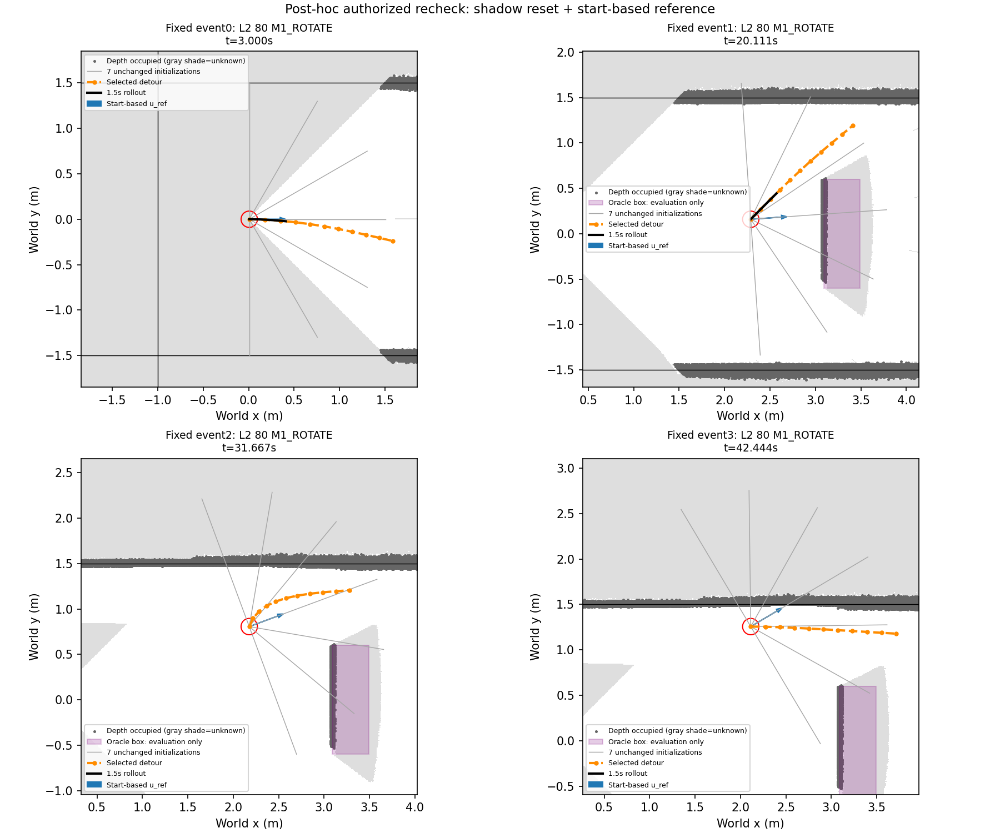

# Phase20-C — 사후 수정 후 재점검

**NOT_READY**. Numerical execution SHA `b785df3541eb0b695fa6b1f8681be559fca2f4c2`. Protocol SHA256 `8ded0a5e827ef4de4d7949a644bc66fe5ba79368b6ec81c743839f8afa6da476`.

## Only the authorized changes

After the unchanged V1 frame-wise update, each height/range-valid occupied depth endpoint casts a0.50m Bresenham tail away from the camera in XY. Its own endpoint cell is excluded. Negative log-odds cells in the union become0 and observed=False (unknown); positive cells are untouched by this reset. Floor, high and out-of-range points do not cast tails. Existing observation state outside reset cells, occupied threshold>0.85, hit/free increments, clipping, camera/filter/noise and SDF formula remain unchanged.

Selection, R2 and fallback use the shadow-reset base map, with unknown still nonoccupied. R3 uses that base SDF within the first0.30m **path arclength**, and a second SDF of occupied OR unknown cells afterwards. This same piecewise field supplies the clearance preference and hard constraints; exact certificates use the corresponding near/far occupied sets. Radius, sampling margins, all objective weights, curvature/length constraints, initialization angles, solver and acceptance thresholds are unchanged.

u_ref is now normalized (current position−run start position), falling back to the run start heading when distance<0.50m. The old history-displacement and NoMaD endpoint average have no role in u_ref. Latest packet IDs remain provenance only. NO_PROGRESS thresholds, blocked states and the frozen offline6s virtual action+3s cooldown remain unchanged.

## Phase15-A2 accuracy comparison

The same24 archived Phase15-A runs and3,002 depth frames are replayed once per original noise condition. Original float16 frames, camera transforms, deterministic per-frame noise, native paths, frame-availability rule, 5mm path queries and2.5cm classification threshold are reused. Stored V1 baseline statistics are reused without another baseline replay. Fractions divide all sample decisions. These accuracy numbers apply to the common selection/R2/fallback view where unknown is not occupied; conservative R3 safety is evaluated separately below.

| noise | split | runs | samples | old_dangerous_fraction | new_dangerous_fraction | old_conservative_fraction | new_conservative_fraction | dangerous_change_pp | conservative_change_pp | update_median_ms | update_p95_ms | usage |
| --- | --- | --- | --- | --- | --- | --- | --- | --- | --- | --- | --- | --- |
| none | selection | 12 | 3448 | 0 | 0 | 0.0052204 | 0.0052204 | 0 | 0 | 47.92 | 63.606 | common selection/R2/fallback view; unknown is not occupied |
| none | judgment | 12 | 2336 | 0 | 0 | 0.0055651 | 0.0055651 | 0 | 0 | 48.166 | 62.524 | common selection/R2/fallback view; unknown is not occupied |
| none | all | 24 | 5784 | 0 | 0 | 0.0053596 | 0.0053596 | 0 | 0 | 48.008 | 63.326 | common selection/R2/fallback view; unknown is not occupied |
| gaussian | selection | 12 | 3448 | 0 | 0 | 0.0078306 | 0.0078306 | 0 | 0 | 52.044 | 67.435 | common selection/R2/fallback view; unknown is not occupied |
| gaussian | judgment | 12 | 2336 | 0 | 0 | 0.0072774 | 0.0077055 | 0 | 0.042808 | 52.671 | 66.315 | common selection/R2/fallback view; unknown is not occupied |
| gaussian | all | 24 | 5784 | 0 | 0 | 0.0076072 | 0.0077801 | 0 | 0.017289 | 52.291 | 66.978 | common selection/R2/fallback view; unknown is not occupied |

The historical renderer source differs from the current simulator.py; its recorded hash was verified against the original render commit0033986196eac1afb319e53099600e58344e7297. Archive/frame hashes and transforms were verified. No old code was reverted and no new rendering was performed.

## Rebuilt gate inputs and results

Saved Phase20-B depth uses its original SeedSequence(20261027,run offset,frame ID), existing grid allocation and actual camera transform. Rebuilt snapshots retain the original frame/publication eligibility; this isolates geometry processing and does not pretend to simulate changed live publication latency. The changed u_ref is used to recompute trigger events from the same ten valid saved runs; first-four examples are fixed before the R3 solves. Two technical failures remain excluded.

| run | error |
| --- | --- |
| L3_081_D750_M1_ROTATE | Launcher exit 1 |
| L3_082_D750_M2_REPAIR | Launcher exit 1 |

Old gate: `{"triggers": 66, "accepted_triggers": 61, "accepted_path_oracle_penetrations": 34, "selected_path_oracle_penetrations": 8, "rollout_overlaps": 0}`.

```json
{
  "label": "NOT_READY",
  "reasons": [
    "ACCEPTED_PATH_ORACLE_PENETRATION",
    "SEVEN_PARALLEL_P95_ABOVE_1_SECOND"
  ],
  "triggers": 69,
  "accepted_triggers": 61,
  "acceptance_fraction": 0.8840579710144928,
  "accepted_initializations": 311,
  "accepted_path_oracle_penetrations": 16,
  "selected_path_oracle_penetrations": 4,
  "rollout_overlaps": 0,
  "rollout_count": 61,
  "rollout_overlap_fraction": 0.0,
  "seven_parallel_s": {
    "n": 69,
    "median": 2.09791234502336,
    "p95": 2.445950846385676,
    "max": 2.7226218929863535
  },
  "timeout_events": 69,
  "accepted_within_1s": 0,
  "gap_direction_applicable": 44,
  "gap_direction_count": 34,
  "post_hoc": true,
  "scope": "Saved poses remain unchanged during virtual detour windows; no closed-loop counterfactual claim",
  "assessment_label": "사후 수정 후 재점검",
  "negative_world_x_references": 1,
  "accepted_unknown_median": 0.0,
  "accepted_unknown_max": 0.0,
  "accepted_far_unknown_max": 0.0,
  "accepted_paths_with_unknown": 0
}
```

| scene | phase | triggers | accepted | acceptance | accepted_initializations | all_accepted_penetrations | selected_penetrations | rollout_overlap | rollout_count | unknown_median | relative_progress_median | gap_direction | gap_applicable | seven_solve_p95_s | u_ref_negative_world_x |
| --- | --- | --- | --- | --- | --- | --- | --- | --- | --- | --- | --- | --- | --- | --- | --- |
| ALL | ALL | 69 | 61 | 0.88406 | 311 | 16 | 4 | 0 | 61 | 0 | 1.1935 | 34 | 44 | 2.446 | 1 |
| L2 | PRE_SPAWN | 10 | 10 | 1 | 66 | 0 | 0 | 0 | 10 | 0 | 1.5821 | 0 | 0 | 2.6253 | 0 |
| L2 | BEFORE_BOX_PASSAGE | 19 | 18 | 0.94737 | 81 | 11 | 2 | 0 | 18 | 0 | 1.1822 | 18 | 18 | 2.2302 | 1 |
| L2 | AFTER_BOX_PASSAGE | 8 | 8 | 1 | 44 | 0 | 0 | 0 | 8 | 0 | 1.2462 | 8 | 8 | 1.9832 | 0 |
| L3 | PRE_SPAWN | 7 | 7 | 1 | 47 | 0 | 0 | 0 | 7 | 0 | 1.5819 | 0 | 0 | 2.4508 | 0 |
| L3 | BEFORE_BOX_PASSAGE | 25 | 18 | 0.72 | 73 | 5 | 2 | 0 | 18 | 0 | 1.0907 | 8 | 18 | 2.2798 | 0 |
| L3 | AFTER_BOX_PASSAGE | 0 | 0 | — | 0 | 0 | 0 | 0 | 0 | — | — | 0 | 0 | — | 0 |

READY still requires≥50% accepted triggers, zero oracle penetration across all accepted initialization paths,≤7% selected1.5s rollout overlap and four-process seven-start p95≤1.0s. Selected-path violations and within-deadline acceptance are also reported. Conservative-field EDT construction/loading and exact unknown-cell certificate cost are included in the seven-start timing. No speed optimization or extra restarts were introduced.

Full-path unknown fraction is measured on the new base observation mask; the first0.30m is the declared exception. Far-path unknown fraction is reported separately. −X counts refer to u_ref[0]<0 and are not forced to zero.



## Saved-result diagnostics (no additional solves)

Accepted path failures: {'BOX': 16}; selected path failures: {'BOX': 4}.

| event_id | initialization | selected | kind | oracle_clearance_m | depth_clearance_m | unknown_fraction | near_unknown_fraction | far_unknown_fraction |
| --- | --- | --- | --- | --- | --- | --- | --- | --- |
| 14 | 6 | True | BOX | -0.035587 | 0.13159 | 0 | 0 | 0 |
| 23 | 4 | True | BOX | -0.081949 | 0.13348 | 0 | 0 | 0 |
| 51 | 3 | True | BOX | -0.09 | 0.15184 | 0 | 0 | 0 |
| 59 | 6 | True | BOX | -0.09 | 0.1497 | 0 | 0 | 0 |

| scope | paths | paths_with_unknown | path_mean_unknown_fraction | maximum_unknown_fraction | maximum_far_unknown_fraction |
| --- | --- | --- | --- | --- | --- |
| all_accepted | 311 | 0 | 0 | 0 | 0 |
| selected | 61 | 0 | 0 | 0 | 0 |

The remaining penetrating paths have unknown fraction0 under the updated observation mask. Marking unknown as occupied therefore does not eliminate these observed-but-optimistic map errors; the data do not identify one unique cause of those errors.

Post-optimizer validation/statistics overhead per initialized solve: `{"n": 483, "median": 0.9056417670217343, "p95": 1.1423704484826884, "max": 1.4657676770002581}` seconds. This includes the unchanged exact certificate over the much denser occupied+unknown set; it is not an isolated certificate benchmark. No timing optimization was applied after seeing the result.

## Status and limits

Five new tests passed for shadow reset, positive preservation, endpoint filtering, piecewise unknown constraint/certificate and Jacobian, and start-only direction. All original source/data/result files remain unchanged.

The gate is NOT_READY. Online integration, L3 M3 smoke and campaign preparation stop here; no navigation, inference, new depth render or campaign command follows. Failed results are retained.

This is a post-hoc saved-input recheck. Changed control, new NoMaD observations, future depth updates during the detour and online compute contention are absent. Only a new driving experiment can establish effects on navigation.

## Fixed protocol

```json
{
  "phase": "20C",
  "base_commit": "bfd2472",
  "status": "POSTHOC_RECHECK_FROZEN",
  "assessment_label": "사후 수정 후 재점검",
  "only_changes": [
    "0.5m occlusion-tail negative-evidence reset; unknown occupied for R3 far path only",
    "start-to-current reference direction with0.5m start-heading fallback"
  ],
  "shadow": {
    "base": "unchanged Phase15A2 V1",
    "length_m": 0.5,
    "input_points": "same height0.03<z<=0.6m and range<=3.0m occupied endpoints; floor/high/range-rejected rays do not extend",
    "direction": "camera-to-hit XY direction; nearest1cm endpoint/start/end cells, Bresenham tail excludes hit cell",
    "frame_order": "original frame-wise log-odds update first, then union of tails; reset only cells whose current log-odds<0",
    "reset": "log-odds=0 and observed=False",
    "positive": "preserved by reset; original per-frame evidence updates unchanged",
    "other_cells": "original observation state/log-odds unchanged",
    "occupied_threshold": "unchanged >0.85; positive subthreshold cells are not reclassified",
    "common_methods": "selection/R2/fallback use base SDF, unknown nonoccupied"
  },
  "R3_unknown": {
    "near_region": "existing first0.30m cumulative path arclength, not Euclidean radius",
    "near_field": "shadow-reset base occupancy; original R2 start threshold",
    "far_field": "occupied OR unknown",
    "applies_to": [
      "clearance preference",
      "hard safety constraint",
      "exact far-path certificate"
    ],
    "near_certificate": "base occupied cell centers",
    "far_certificate": "base occupied and unknown cell centers",
    "distance_formula": "unchanged EDT-to-cell-centers minus0.09m, bilinear derivatives and h/sqrt2 bound",
    "near_region_clarification": "Offered before implementation; absent reply, retain original path-arclength interpretation"
  },
  "u_ref": {
    "definition": "normalize(B_xy-start_xy)",
    "minimum_displacement_m": 0.5,
    "fallback": "start heading unit vector",
    "NoMaD_endpoints_used": false,
    "history_window_used": false,
    "NoMaD_packet_required": false
  },
  "unchanged_graph": {
    "variables": "p1..p10 XY, p0=B fixed",
    "angles_deg": [
      0,
      30,
      -30,
      60,
      -60,
      90,
      -90
    ],
    "initial_length_m": 1.5,
    "objective": {
      "progress_target_m": 1.2,
      "sigma_progress_m": 0.1,
      "sigma_smooth_m": 0.03,
      "clearance_preference_m": 0.15,
      "sigma_clearance_m": 0.05,
      "sigma_heading_deg": 30
    },
    "constraints": {
      "start_region_m": 0.3,
      "start_threshold": "min(.025,max(0,c_B-.005))",
      "c_B": "SDF(B)-h/sqrt(2)",
      "negative_B": "reject without solve",
      "far_clearance_m": 0.025,
      "inspection_points_per_segment": 9,
      "interpolation_margin": "h/sqrt(2)+L/16",
      "menger_max_m_inv": 4.0,
      "segment_length_m": [
        0.1,
        0.2
      ],
      "radius_from_B_m": 1.6,
      "coordinate_bounds": "redundant B+-1.6m box implied by disk"
    },
    "solver": {
      "method": "SLSQP",
      "jacobian": "analytic; piecewise zone threshold as R2",
      "maxiter": 100,
      "ftol": 1e-08,
      "restarts": 0
    },
    "acceptance": "solver success AND violation<=1e-7 AND piecewise exact depth certificate AND relative progress>=.5m",
    "selection": "largest relative progress, then shortest length, then initialization index"
  },
  "unchanged_trigger": {
    "control_hz": 9,
    "recent_window_s": 3.0,
    "minimum_progress_m": 0.2,
    "minimum_history_s": 3.0,
    "blocked_sources": [
      "RECOVER_ROTATE",
      "ALIGN_BRAKE",
      "ALIGN_ROTATE",
      "REPAIR_WAIT"
    ],
    "cooldown_after_actual_end_s": 3.0,
    "offline_virtual_execution_s": 6.0,
    "offline_earliest_retrigger_s": 9.0,
    "offline_convention": "Proposed via clarification before solving; no answer received. Use virtual6s execution then3s cooldown, never use solve outcome to select next event."
  },
  "unchanged_gate": {
    "accepted_trigger_fraction_min": 0.5,
    "all_accepted_path_oracle_penetrations_max": 0,
    "selected_rollout_overlap_fraction_max": 0.07,
    "seven_parallel_p95_s_max": 1.0
  },
  "gate_scope": "all accepted initialization paths for penetration; selected path rollout per accepted trigger; selected penetration also reported",
  "accuracy": {
    "source": "Phase15-A stored float16 depth archives, same24 runs and original noise seeds",
    "conditions": [
      "none",
      "gaussian"
    ],
    "replay_count_per_run_condition": 1,
    "baseline": "stored Phase15A2 V1 rows, not replayed",
    "query_view": "common unknown-nonoccupied view as Phase15A2; R3 strict policy is tested separately by gate",
    "comparison": [
      "dangerous false-safe fraction",
      "conservative false-unsafe fraction"
    ],
    "original_splits_preserved": true,
    "new_accuracy_gate": false
  },
  "recheck": {
    "source": "same10 valid Phase20B L2/L3 saved runs; same2 technical exclusions",
    "events": 69,
    "negative_x_references": 1,
    "example_event_ids": [
      0,
      1,
      2,
      3
    ],
    "frame_availability": "same recorded published-frame eligibility; map processing times measured separately, no counterfactual clock invented",
    "noise": "Phase20B SeedSequence(20261027,seed_offset,frame_id), unchanged raw depth and camera_to_world",
    "pool_processes": 4,
    "initializations_per_event": 7,
    "retries": 0,
    "timing": "includes strict-field construction/loading and unchanged exact cell-site certificate; no latency tuning",
    "new_snapshot_root": "/home/gpuadmin/Workspace/NoMaD/artifacts/isaac6/phase20c_shadow_replay_01"
  },
  "new_tests": {
    "count": 5,
    "log_sha256": "9dba3d065dda699002c6700e0740fb00e5184e83516519bdc79a2bac07f27713"
  },
  "next_stage": "Only if unchanged R3 gate is READY: online integration + one excluded L3 M3 smoke; otherwise stop",
  "protected_sha256": {
    "research/nomad_phase20c/detour.py": "0fbf4404017e6cba858a825c850f12b26b3cb66b32096daf9999d3c9968ab0f5",
    "research/nomad_phase20c/trigger.py": "a26d387dab70b89802e31df59d1ae51ed8c3429a29945b37940f97f1f802f090",
    "research/nomad_phase20c/offline.py": "926a50fb5eef9559002992eab66fb166fd1fda1f986a853df4cc046a183d9e04",
    "research/nomad_phase20/repair.py": "65a70b2f4fc597dfd6a47af38df8f4f7b4e6d6d1ae3aa9655025e3f8d8c6b70c",
    "research/nomad_phase20/execution.py": "89956a9310336dbb575d2651af9576732845262e5c531a83e45d3c203cab22e6",
    "research/nomad_phase15/depth_sdf.py": "12f48eb36abbc5cdec32ba974f86a9dca943448ff43bec0114552351ce7b5a26",
    "research/nomad_phase15/occupancy.py": "5cd5c399467f4ffc657231110b4af21d74e05eee756974763dd5bdc898df72ec",
    "research/nomad_phase15/occupancy_rays.c": "2af80e0f9302270a73de2ad1f2551630e921bbe19a0c8742f7f96c6dd7f1f423",
    "research/nomad_phase15/occupancy_report.py": "7f4006309c34997824c3344efaa3b8a388cd8570f25b073885627d93c84ce6d0",
    "research/nomad_phase15/evaluate.py": "b1147d50f0a7dce3e2146fe66981caad7ec7366d5a096b3bd99eb37e0224e8f4",
    "research/nomad_phase15b/depth.py": "f6072c9591c7696feef66d65d1048fbf7ad65b0ed0ba408a5f746e8577718919"
  }
}
```
