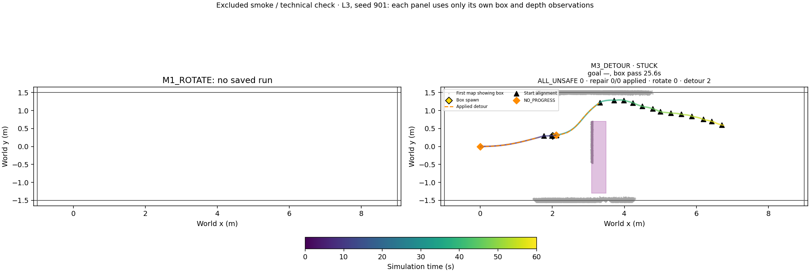

# Phase20D preflight — 탐색적 파일럿

## Saved-log diagnosis / offline recheck

Historical gap attribution is observational. CPU overlap is not proof of CPU causation; queue lengths and CPU utilization were not instrumented in the old logs. No old result is relabelled. The old FIFO preserved every recorded capture but synchronous compressed archival/hash delayed publication. The new immutable latest pointer is published before archival on a separate thread, for both methods. New logs record capture, processing, publication, archive, queue lengths and zero drops separately.

Publication gaps and snapshot age differ: a regular stream can still deliver queued old frames. Saved22 runs yielded27 gaps≥0.5s (PUBLISH_BUG23, CPU_CONTENTION2, OTHER2), maxgap2.170357s and maxcapture-age14.430556s; two Phase20B runs lacked required technical artifacts and remain excluded from this diagnosis. Full gap intervals, states, repair overlap, evidence and per-run summaries are in phase20d_diagnosis CSVs.

| method | runs | maximum_snapshot_age_s | maximum_publication_gap_s | mean_gap_time_fraction | mean_excess_gap_fraction |
| --- | --- | --- | --- | --- | --- |
| M1_ROTATE | 11 | 14.431 | 1.9973 | 0.019622 | 0.012111 |
| M2_REPAIR | 11 | 13.167 | 2.1704 | 0.022382 | 0.013999 |

Offline label: **사후 수정 후 재점검 2**. Exactly the same69 archived trigger events were solved once. Replayed occupancy/observed/SDF arrays were bitwise equal to20C shadow maps; only last-free evidence times were added. Old capture/publication eligibility is retained in this counterfactual, so it does not claim to predict the publication fix.

| label | triggers | accepted_triggers | acceptance_fraction | accepted_initializations | accepted_path_oracle_penetrations | selected_path_oracle_penetrations | rollout_overlaps | rollout_count | seven_parallel_s | timeout_events |
| --- | --- | --- | --- | --- | --- | --- | --- | --- | --- | --- |
| NOT_READY | 69 | 27 | 0.3913 | 149 | 0 | 0 | 0 | 27 | {'n': 69, 'median': 0.397146765, 'p95': 0.5593552148, 'max': 0.575769492} | 0 |

All accepted/selected penetrating paths are zero, so penetration-specific snapshot ages/recent-cell fractions have an empty denominator. Per-candidate recent-free/unknown fractions and snapshot ages are retained in offline CSVs. u_ref uses displacement from the run start (start heading within0.5m); the saved event list contains one negative-X u_ref. This recheck never gates the new-seed pilot.

R3 far cells are blocked if occupied, unknown or last-free age>2.0s. The original first0.30m path-arclength exception stays unchanged. One EDT per (source frame,evaluation tick) is shared by all7 optimizations and exact certificates; the EDT provides an upper bound for pruning exact segment-to-cell calculations, not a sampled substitute. Current-time validation between updates checks the same blocked-cell definition with an exact local threshold test and no EDT rebuild.

Unit tests9/9. One excluded60s L3 M3 smoke: technical=PASS; NO_PROGRESS=2, detours applied=2; command replay=0.0,72Hz pose replay=0.0; snapshot maxage=1.402778s.

Smoke is a technical observation, not evidence of navigation benefit; no seed, placement or parameter was adjusted. All raw is retained. Main12 trials have not been run.

R3 job0: parallel=0.402653s; seven attempts=[0.08663979498669505, 0.039145751972682774, 0.21323272300651297, 0.18838970601791516, 0.1013344990205951, 0.0793440819834359, 0.09538892103591934]s.

R3 job1: parallel=0.374156s; seven attempts=[0.04946443601511419, 0.05548484798055142, 0.05221769702620804, 0.0916338199749589, 0.03327358700335026, 0.10786761902272701, 0.10223759297514334]s.

After the single smoke, application-certificate frame/tick identifiers were added to the event log to eliminate a possible audit race with a newly published snapshot. This is logging-only; no command logic, geometry, solver, timing threshold or protocol decision changed, and navigation was not rerun.
