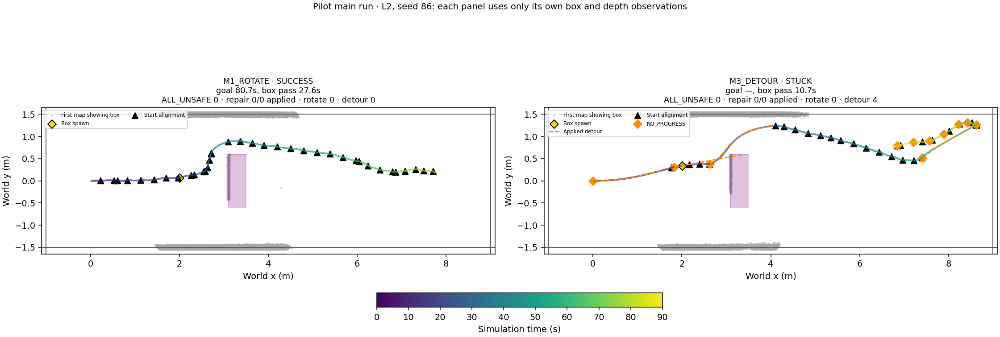
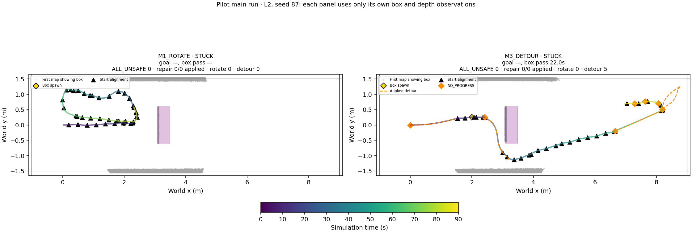
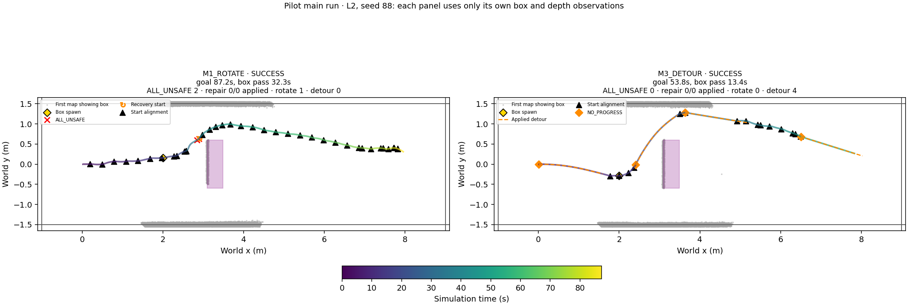
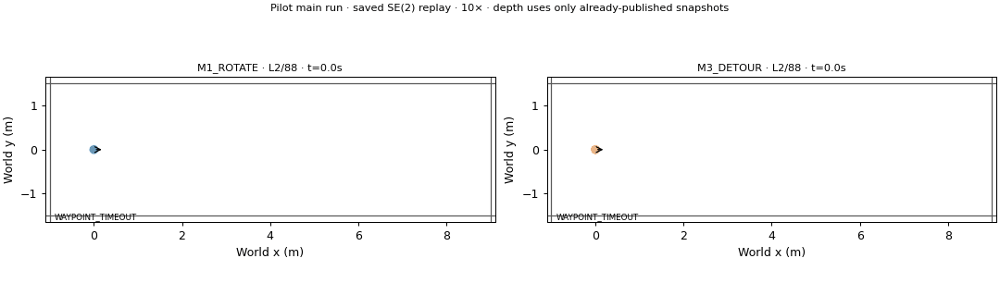
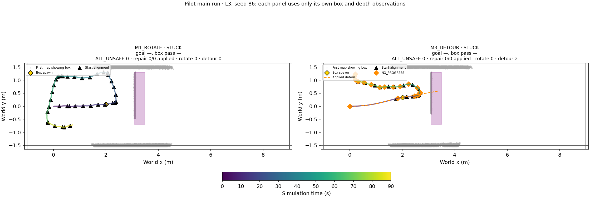
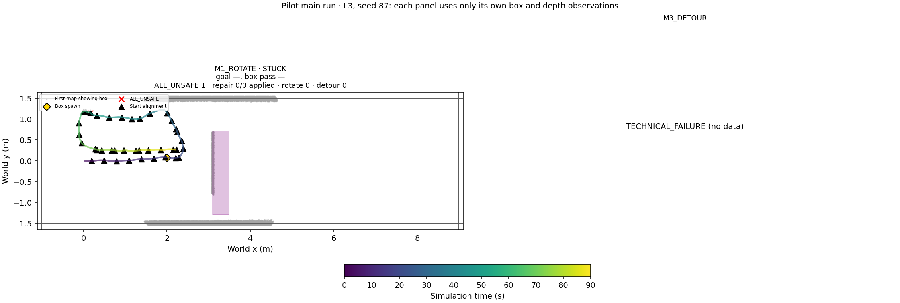
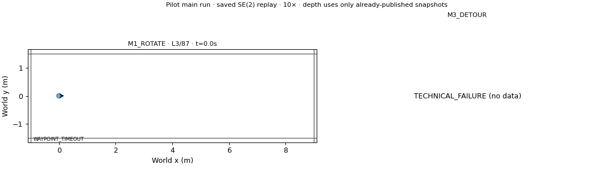
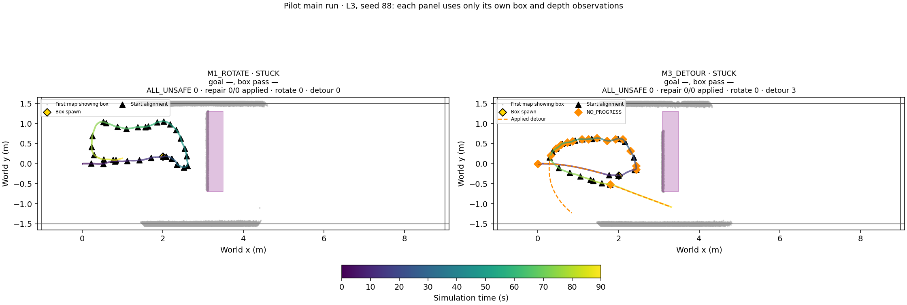

# Phase 20-D — recent-depth detour / 탐색적 파일럿

Protocol SHA256 `79597cec578272741e1a1028cb66e814a2ddc37b1004d22defc69e842b5b48aa`. New seeds86–88; D750; L2/L3;12 sequential trials, no retries.

## Saved-log diagnosis / offline recheck

Historical gap attribution is observational. CPU overlap is not proof of CPU causation; queue lengths and CPU utilization were not instrumented in the old logs. No old result is relabelled. The old FIFO preserved every recorded capture but synchronous compressed archival/hash delayed publication. The new immutable latest pointer is published before archival on a separate thread, for both methods. New logs record capture, processing, publication, archive, queue lengths and zero drops separately.

Publication gaps and snapshot age differ: a regular stream can still deliver queued old frames. Saved22 runs yielded27 gaps≥0.5s (PUBLISH_BUG23, CPU_CONTENTION2, OTHER2), maxgap2.170357s and maxcapture-age14.430556s; two Phase20B runs lacked required technical artifacts and remain excluded from this diagnosis. Full gap intervals, states, repair overlap, evidence and per-run summaries are in phase20d_diagnosis CSVs.

| method | runs | maximum_snapshot_age_s | maximum_publication_gap_s | mean_gap_time_fraction | mean_excess_gap_fraction |
| --- | --- | --- | --- | --- | --- |
| M1_ROTATE | 11 | 14.431 | 1.9973 | 0.019622 | 0.012111 |
| M2_REPAIR | 11 | 13.167 | 2.1704 | 0.022382 | 0.013999 |

Offline label: **사후 수정 후 재점검 2**. Exactly the same69 archived trigger events were solved once. Replayed occupancy/observed/SDF arrays were bitwise equal to20C shadow maps; only last-free evidence times were added. Old capture/publication eligibility is retained in this counterfactual, so it does not claim to predict the publication fix.

| label | triggers | accepted_triggers | acceptance_fraction | accepted_initializations | accepted_path_oracle_penetrations | selected_path_oracle_penetrations | rollout_overlaps | rollout_count | seven_parallel_s | timeout_events |
| --- | --- | --- | --- | --- | --- | --- | --- | --- | --- | --- |
| NOT_READY | 69 | 27 | 0.3913 | 149 | 0 | 0 | 0 | 27 | {'n': 69, 'median': 0.397146765, 'p95': 0.5593552148, 'max': 0.575769492} | 0 |

All accepted/selected penetrating paths are zero, so penetration-specific snapshot ages/recent-cell fractions have an empty denominator. Per-candidate recent-free/unknown fractions and snapshot ages are retained in offline CSVs. u_ref uses displacement from the run start (start heading within0.5m); the saved event list contains one negative-X u_ref. This recheck never gates the new-seed pilot.

R3 far cells are blocked if occupied, unknown or last-free age>2.0s. The original first0.30m path-arclength exception stays unchanged. One EDT per (source frame,evaluation tick) is shared by all7 optimizations and exact certificates; the EDT provides an upper bound for pruning exact segment-to-cell calculations, not a sampled substitute. Current-time validation between updates checks the same blocked-cell definition with an exact local threshold test and no EDT rebuild.

## New-seed pilot

| scene | method | planned | valid | success | collision | corridor | stuck | technical | goal_time_s | passed_box | box_passage_time_s | all_unsafe | recovery_count | stopped_fraction | trigger_A | trigger_B | detour_attempts | detour_applied | detour_timeout | detour_execution_s | detour_collision_count | post_detour_progress_recovered | post_detour_outcome_count | detour_then_box_pass_count | detour_before_box_pass_count | solve_median_s | solve_p95_s | snapshot_max_age_s |
| --- | --- | --- | --- | --- | --- | --- | --- | --- | --- | --- | --- | --- | --- | --- | --- | --- | --- | --- | --- | --- | --- | --- | --- | --- | --- | --- | --- | --- |
| L2 | M1_ROTATE | 3 | 3 | 2 | 0 | 0 | 1 | 0 | 83.979 | 2 | 29.958 | 2 | 1 | 0.011463 | 0 | 0 | 0 | 0 | 0 | 0 | 0 | 0 | 0 | 0 | 0 | — | — | 1.4028 |
| L2 | M3_DETOUR | 3 | 3 | 1 | 0 | 0 | 2 | 0 | 53.847 | 3 | 15.347 | 0 | 0 | 0.086067 | 0 | 23 | 23 | 13 | 0 | 58.403 | 0 | 6 | 12 | 7 | 7 | 0.31172 | 0.52833 | 1.4028 |
| L3 | M1_ROTATE | 3 | 3 | 0 | 0 | 0 | 3 | 0 | — | 0 | — | 1 | 0 | 0 | 0 | 0 | 0 | 0 | 0 | 0 | 0 | 0 | 0 | 0 | 0 | — | — | 1.3889 |
| L3 | M3_DETOUR | 3 | 2 | 0 | 0 | 0 | 2 | 1 | — | 0 | — | 0 | 0 | 0.19074 | 0 | 37 | 37 | 5 | 0 | 20.778 | 0 | 3 | 4 | 0 | 5 | 0.34237 | 0.49227 | 1.4028 |

## Frozen decisions

| scene | label | scope | M1_success | M3_success | detour_applied |
| --- | --- | --- | --- | --- | --- |
| L2 | DETOUR_NO_HELP | 탐색적 파일럿 | 2 | 1 | 13 |
| L3 | INCONCLUSIVE | 탐색적 파일럿 | 0 | 0 | 5 |

DETOUR_HELPS requires ≥1 additional goal success and ≥2 actually applied detours; <2 applications is DETOUR_UNUSED. Otherwise DETOUR_NO_HELP. Missing/technical trials remain visible and make the interpreted comparison INCONCLUSIVE. Goal success, box passage and safety margin are separate.

## Seed × level × method

| scene | index | method | execution_git_sha | classification | goal_time_s | passed_box | box_passage_time_s | minimum_clearance_m | minimum_wall_clearance_m | all_unsafe | recovery_count | detour_triggers | detour_dispositions | detour_applied | detour_execution_s | detour_collision_count | seven_solve_s | snapshot_max_age_s |
| --- | --- | --- | --- | --- | --- | --- | --- | --- | --- | --- | --- | --- | --- | --- | --- | --- | --- | --- |
| L2 | 86 | M1_ROTATE | 5c92004ecd5cfcaf4d662ee203ef898433b5e7f1 | SUCCESS | 80.722 | True | 27.639 | 0.17626 | 0.51742 | 0 | 0 | {} | {} | 0 | 0 | 0 | {'n': 0, 'median': None, 'p95': None} | 1.375 |
| L2 | 86 | M3_DETOUR | 5c92004ecd5cfcaf4d662ee203ef898433b5e7f1 | STUCK | — | True | 10.694 | 0.035861 | 0.096921 | 0 | 0 | {'B': 11} | {'ACCEPTED': 4, 'REJECTED': 7} | 4 | 17.667 | 0 | {'n': 11, 'median': 0.34656272, 'p95': 0.518712811} | 1.4028 |
| L3 | 86 | M3_DETOUR | 5c92004ecd5cfcaf4d662ee203ef898433b5e7f1 | STUCK | — | False | — | 0.32367 | 0.17894 | 0 | 0 | {'B': 21} | {'ACCEPTED': 2, 'REJECTED': 19} | 2 | 6.8889 | 0 | {'n': 21, 'median': 0.32548328, 'p95': 0.468893831} | 1.3889 |
| L3 | 86 | M1_ROTATE | 5c92004ecd5cfcaf4d662ee203ef898433b5e7f1 | STUCK | — | False | — | 0.61346 | 0.10711 | 0 | 0 | {} | {} | 0 | 0 | 0 | {'n': 0, 'median': None, 'p95': None} | 1.3056 |
| L2 | 87 | M3_DETOUR | 5c92004ecd5cfcaf4d662ee203ef898433b5e7f1 | STUCK | — | True | 21.958 | 0.12388 | 0.27874 | 0 | 0 | {'B': 8} | {'ACCEPTED': 5, 'REJECTED': 3} | 5 | 18.111 | 0 | {'n': 8, 'median': 0.2888162785, 'p95': 0.5065528261999999} | 1.3889 |
| L2 | 87 | M1_ROTATE | 5c92004ecd5cfcaf4d662ee203ef898433b5e7f1 | STUCK | — | False | — | 0.58401 | 0.25123 | 0 | 0 | {} | {} | 0 | 0 | 0 | {'n': 0, 'median': None, 'p95': None} | 1.3889 |
| L3 | 87 | M1_ROTATE | 5c92004ecd5cfcaf4d662ee203ef898433b5e7f1 | STUCK | — | False | — | 0.60418 | 0.18287 | 1 | 0 | {} | {} | 0 | 0 | 0 | {'n': 0, 'median': None, 'p95': None} | 1.3889 |
| L3 | 87 | M3_DETOUR | 5c92004ecd5cfcaf4d662ee203ef898433b5e7f1 | TECHNICAL_FAILURE | — | — | — | — | — | — | — | — | — | — | — | — | — | — |
| L2 | 88 | M1_ROTATE | 5c92004ecd5cfcaf4d662ee203ef898433b5e7f1 | SUCCESS | 87.236 | True | 32.278 | 0.083857 | 0.41697 | 2 | 1 | {} | {} | 0 | 0 | 0 | {'n': 0, 'median': None, 'p95': None} | 1.4028 |
| L2 | 88 | M3_DETOUR | 5c92004ecd5cfcaf4d662ee203ef898433b5e7f1 | SUCCESS | 53.847 | True | 13.389 | 0.14871 | 0.12833 | 0 | 0 | {'B': 4} | {'ACCEPTED': 4} | 4 | 22.625 | 0 | {'n': 4, 'median': 0.269911454, 'p95': 0.32723772185} | 1.3333 |
| L3 | 88 | M1_ROTATE | 5c92004ecd5cfcaf4d662ee203ef898433b5e7f1 | STUCK | — | False | — | 0.38184 | 0.35355 | 0 | 0 | {} | {} | 0 | 0 | 0 | {'n': 0, 'median': None, 'p95': None} | 1.3194 |
| L3 | 88 | M3_DETOUR | 5c92004ecd5cfcaf4d662ee203ef898433b5e7f1 | STUCK | — | False | — | 0.19189 | 0.32068 | 0 | 0 | {'B': 16} | {'ACCEPTED': 3, 'REJECTED': 12, 'APPLICATION_UNSAFE': 1} | 3 | 13.889 | 0 | {'n': 16, 'median': 0.3764684195, 'p95': 0.50168431075} | 1.4028 |

## Technical failures

| scene | index | method | output | error |
| --- | --- | --- | --- | --- |
| L3 | 87 | M3_DETOUR | /home/gpuadmin/Workspace/NoMaD/artifacts/isaac6/phase20d_recent_01/main/L3_087_D750_M3_DETOUR | Launcher exit 1 |

R3 wait/execution defers new NoMaD path application while preserving all packets; the independent action ends at endpoint,6s or a failed current-depth check. R2/R3 share four CPU processes. The1s deadline includes serialization, EDT/cache preparation, scheduling and solving; late results are preserved but not applied. No oracle geometry is provided to the controller. Exact simulator pose is assumed (no odometry error).

Detour outcomes are descriptive: box passage after an application is associated with that action, not attributed causally; first nondeferred FRESH progress recovery means selected endpoint projected on job u_ref≥0.2m. Missing outcomes are censored. Gray thick trajectory segments mark publication gaps≥0.5s, not proof of unsafe control. Orange dashed paths are actually applied detours; diamonds mark NO_PROGRESS.

## Visualization availability

- L3/87: Unavailable panels display TECHNICAL_FAILURE (no data). M3_DETOUR: Missing required files: summary.json

This is an exploratory pilot after repeated offline changes on the same saved data, not a confirmatory study. Old Phase20/20B outcomes are not reinterpreted.
