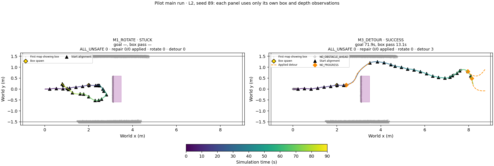
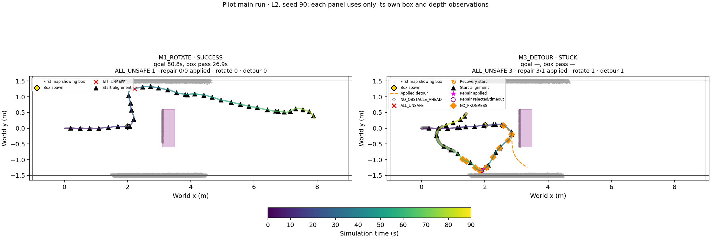
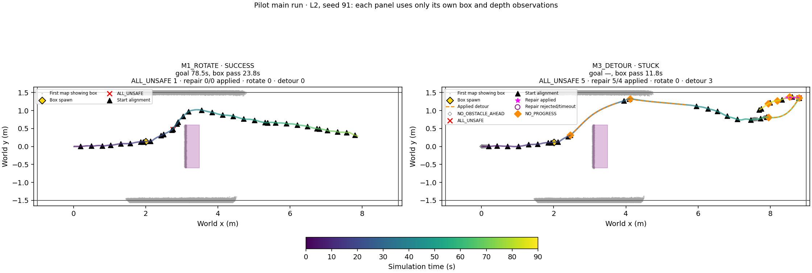
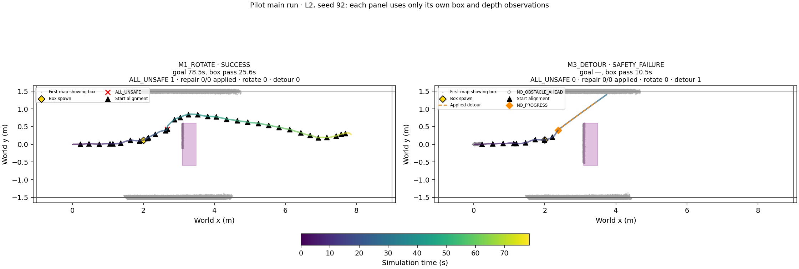
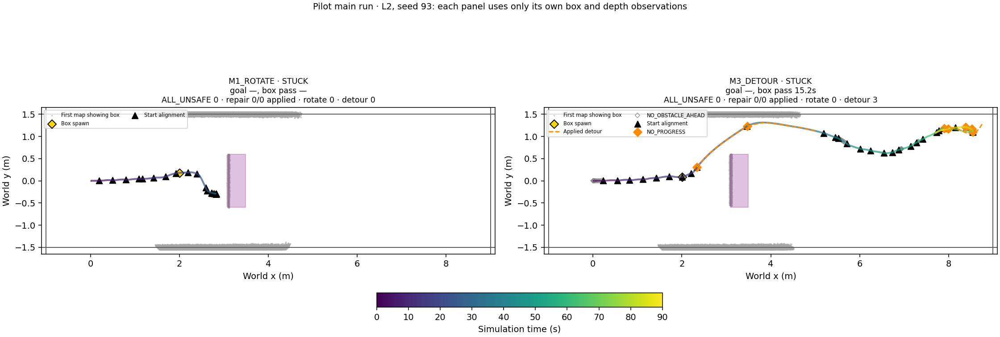
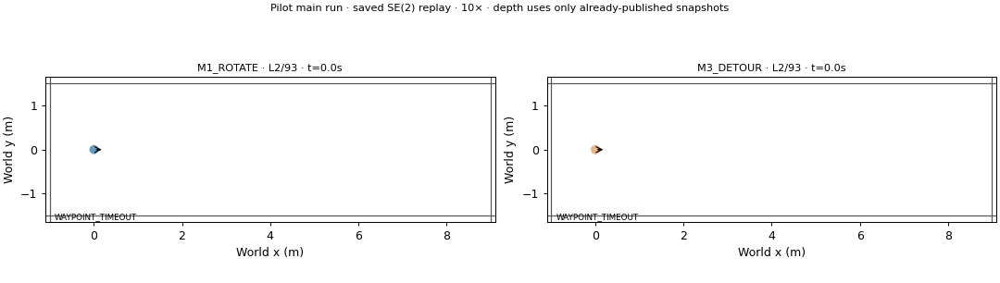
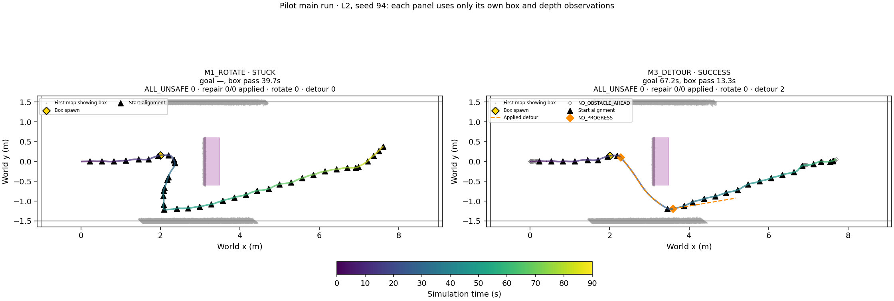
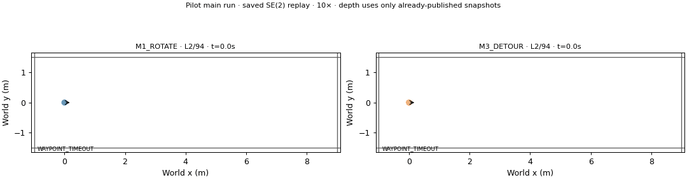
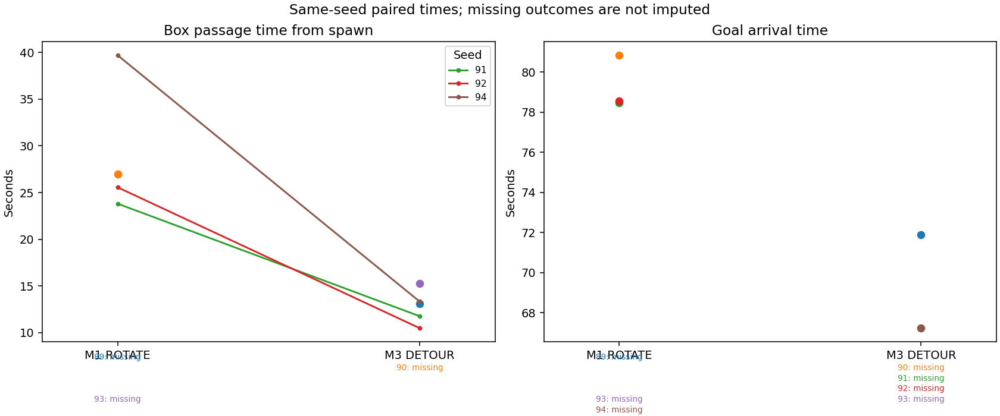

# Phase20E — obstacle-conditional NO_PROGRESS / 파일럿

Protocol SHA256 `ab4e7a8b216139733520bcdf4537b9432c217393be6732e8f5b85b2b64ab8b82`. L2 × M1/M3 × indices89–94;12 attempts; no retries or parameter changes.

Saved20D L2 trigger predicate check (no solve/navigation): before passage 3/7 retained; after passage 7/16 retained. Before spawn 0/4. Later motion is held unchanged, so these are not predicted online event counts. This check does not gate execution.

Preflight limitation: the single excluded60s L2 M3 smoke had no obstacle-conditioned NO_PROGRESS trigger. Offline saved-trigger and unit checks passed; no trigger was forced by retry or tuning.

The only algorithm change is NO_PROGRESS AND at least one occupied cell center in the closed1.0m×0.40m rectangle from the current robot position along u_ref. Unknown/stale cells do not count as occupied for this extra predicate. Phase20D asynchronous map publication, R3 recency rule, start-relative u_ref, R2, SP, alignment, fallback and recovery are reused. The20E wrapper binds the existing clean serialization helper missing in the inherited R2 logging globals; function bytecode and repair definition are unchanged.

## Three primary outcomes and mechanism

| scene | method | planned | valid | success | collision | corridor | stuck | technical | goal_time_s | passed_box | box_passage_time_s | all_unsafe | recovery_count | stopped_fraction | trigger_A | trigger_B | detour_attempts | detour_applied | detour_timeout | detour_execution_s | detour_collision_count | post_detour_progress_recovered | post_detour_outcome_count | detour_then_box_pass_count | detour_before_box_pass_count | solve_median_s | solve_p95_s | snapshot_max_age_s | no_obstacle_ahead | detour_applied_after_passage | triggers_before_passage | triggers_after_passage |
| --- | --- | --- | --- | --- | --- | --- | --- | --- | --- | --- | --- | --- | --- | --- | --- | --- | --- | --- | --- | --- | --- | --- | --- | --- | --- | --- | --- | --- | --- | --- | --- | --- |
| L2 | M1_ROTATE | 6 | 6 | 3 | 0 | 0 | 3 | 0 | 79.278 | 4 | 28.997 | 3 | 0 | 0.0021243 | 0 | 0 | 0 | 0 | 0 | 0 | 0 | 0 | 0 | 0 | 0 | — | — | 1.4028 | 0 | 0 | 0 | 0 |
| L2 | M3_DETOUR | 6 | 6 | 2 | 0 | 1 | 3 | 0 | 69.569 | 5 | 12.803 | 8 | 1 | 0.067957 | 3 | 30 | 33 | 13 | 0 | 51.722 | 0 | 7 | 11 | 6 | 7 | 0.37726 | 0.51823 | 1.4028 | 230 | 6 | 18 | 15 |

## Frozen label

| label | scope | M1_success | M3_success | M1_passed_box | M3_passed_box | M1_valid | M3_valid | paired_passage_n | M3_passage_faster_seeds | paired_goal_n | goal_difference_mean_s | goal_difference_median_s |
| --- | --- | --- | --- | --- | --- | --- | --- | --- | --- | --- | --- | --- |
| DETOUR_MIXED | 파일럿 | 3 | 2 | 4 | 5 | 6 | 6 | 3 | 3 | 0 | — | — |

Order: +2 goal successes → DETOUR_HELPS; no fewer goal successes or passages AND a strict majority of nonempty jointly-passed seed pairs faster → DETOUR_PASSES_FASTER; −2 goal successes → DETOUR_WORSE; otherwise DETOUR_MIXED. Technical failures remain in the12 attempts and provide no observed success/passage; valid N is explicit. No missing timing is imputed.

## Same-seed paired outcomes

| index | M1_classification | M1_success | M1_passed_box | M1_passage_s | M1_goal_s | M3_classification | M3_success | M3_passed_box | M3_passage_s | M3_goal_s | passage_difference_s | goal_difference_s |
| --- | --- | --- | --- | --- | --- | --- | --- | --- | --- | --- | --- | --- |
| 89 | STUCK | False | False | — | — | SUCCESS | True | True | 13.139 | 71.903 | — | — |
| 90 | SUCCESS | True | True | 26.944 | 80.833 | STUCK | False | False | — | — | — | — |
| 91 | SUCCESS | True | True | 23.806 | 78.458 | STUCK | False | True | 11.778 | — | -12.028 | — |
| 92 | SUCCESS | True | True | 25.556 | 78.542 | SAFETY_FAILURE | False | True | 10.5 | — | -15.056 | — |
| 93 | STUCK | False | False | — | — | STUCK | False | True | 15.25 | — | — | — |
| 94 | STUCK | False | True | 39.681 | — | SUCCESS | True | True | 13.347 | 67.236 | -26.333 | — |

## Run records

| index | method | execution_git_sha | classification | goal_time_s | passed_box | box_passage_time_s | minimum_clearance_m | detour_triggers | detour_applied | detour_collision_count | trigger_stages | no_obstacle_ahead_count | blocked_stages | detour_applied_after_passage | snapshot_max_age_s |
| --- | --- | --- | --- | --- | --- | --- | --- | --- | --- | --- | --- | --- | --- | --- | --- |
| 89 | M3_DETOUR | b561d8ab52feaa1c15516cb6623b3089aa70fe4d | SUCCESS | 71.903 | True | 13.139 | 0.077952 | {'B': 3} | 3 | 0 | {'BEFORE_PASSAGE': 1, 'AFTER_PASSAGE': 2} | 25 | {'BEFORE_PASSAGE': 8, 'AFTER_PASSAGE': 17} | 2 | 1.3194 |
| 89 | M1_ROTATE | b561d8ab52feaa1c15516cb6623b3089aa70fe4d | STUCK | — | False | — | 0.19532 | {} | 0 | 0 | {'BEFORE_PASSAGE': 0, 'AFTER_PASSAGE': 0} | 0 | {'BEFORE_PASSAGE': 0, 'AFTER_PASSAGE': 0} | 0 | 1.3056 |
| 90 | M1_ROTATE | b561d8ab52feaa1c15516cb6623b3089aa70fe4d | SUCCESS | 80.833 | True | 26.944 | 0.43286 | {} | 0 | 0 | {'BEFORE_PASSAGE': 0, 'AFTER_PASSAGE': 0} | 0 | {'BEFORE_PASSAGE': 0, 'AFTER_PASSAGE': 0} | 0 | 1.4028 |
| 90 | M3_DETOUR | b561d8ab52feaa1c15516cb6623b3089aa70fe4d | STUCK | — | False | — | 0.15084 | {'B': 10, 'A': 2} | 1 | 0 | {'BEFORE_PASSAGE': 12, 'AFTER_PASSAGE': 0} | 96 | {'BEFORE_PASSAGE': 96, 'AFTER_PASSAGE': 0} | 0 | 1.3194 |
| 91 | M3_DETOUR | b561d8ab52feaa1c15516cb6623b3089aa70fe4d | STUCK | — | True | 11.778 | 0.14101 | {'B': 7, 'A': 1} | 3 | 0 | {'BEFORE_PASSAGE': 1, 'AFTER_PASSAGE': 7} | 41 | {'BEFORE_PASSAGE': 8, 'AFTER_PASSAGE': 33} | 2 | 1.3889 |
| 91 | M1_ROTATE | b561d8ab52feaa1c15516cb6623b3089aa70fe4d | SUCCESS | 78.458 | True | 23.806 | 0.11807 | {} | 0 | 0 | {'BEFORE_PASSAGE': 0, 'AFTER_PASSAGE': 0} | 0 | {'BEFORE_PASSAGE': 0, 'AFTER_PASSAGE': 0} | 0 | 1.3889 |
| 92 | M3_DETOUR | b561d8ab52feaa1c15516cb6623b3089aa70fe4d | SAFETY_FAILURE | — | True | 10.5 | 0.18122 | {'B': 1} | 1 | 0 | {'BEFORE_PASSAGE': 1, 'AFTER_PASSAGE': 0} | 8 | {'BEFORE_PASSAGE': 8, 'AFTER_PASSAGE': 0} | 0 | 1.3056 |
| 92 | M1_ROTATE | b561d8ab52feaa1c15516cb6623b3089aa70fe4d | SUCCESS | 78.542 | True | 25.556 | 0.081754 | {} | 0 | 0 | {'BEFORE_PASSAGE': 0, 'AFTER_PASSAGE': 0} | 0 | {'BEFORE_PASSAGE': 0, 'AFTER_PASSAGE': 0} | 0 | 1.3056 |
| 93 | M3_DETOUR | b561d8ab52feaa1c15516cb6623b3089aa70fe4d | STUCK | — | True | 15.25 | 0.22009 | {'B': 7} | 3 | 0 | {'BEFORE_PASSAGE': 2, 'AFTER_PASSAGE': 5} | 30 | {'BEFORE_PASSAGE': 9, 'AFTER_PASSAGE': 21} | 1 | 1.4028 |
| 93 | M1_ROTATE | b561d8ab52feaa1c15516cb6623b3089aa70fe4d | STUCK | — | False | — | 0.17337 | {} | 0 | 0 | {'BEFORE_PASSAGE': 0, 'AFTER_PASSAGE': 0} | 0 | {'BEFORE_PASSAGE': 0, 'AFTER_PASSAGE': 0} | 0 | 1.4028 |
| 94 | M1_ROTATE | b561d8ab52feaa1c15516cb6623b3089aa70fe4d | STUCK | — | True | 39.681 | 0.30188 | {} | 0 | 0 | {'BEFORE_PASSAGE': 0, 'AFTER_PASSAGE': 0} | 0 | {'BEFORE_PASSAGE': 0, 'AFTER_PASSAGE': 0} | 0 | 1.3194 |
| 94 | M3_DETOUR | b561d8ab52feaa1c15516cb6623b3089aa70fe4d | SUCCESS | 67.236 | True | 13.347 | 0.14433 | {'B': 2} | 2 | 0 | {'BEFORE_PASSAGE': 1, 'AFTER_PASSAGE': 1} | 30 | {'BEFORE_PASSAGE': 8, 'AFTER_PASSAGE': 22} | 1 | 1.3056 |

NO_OBSTACLE_AHEAD counts eligible9Hz checks, not deduplicated stop episodes; rejecting the obstacle condition does not start a cooldown or alter commands. Pre/post classification uses first recorded footprint passage, for evaluation only. Runs that never pass retain all events in the before group. Oracle box geometry is used only for placement/rendering and evaluation. Simulator pose is exact (no odometry error).

## Technical failures

None.

## Visualization availability

Small gray open diamonds mark NO_OBSTACLE_AHEAD; orange diamonds mark applied NO_PROGRESS triggers; orange dashed paths are applied detours. Gray thick trajectory segments mark publication gaps.

This six-seed pilot does not establish generalization. Successful box passage and goal arrival are distinct outcomes.
