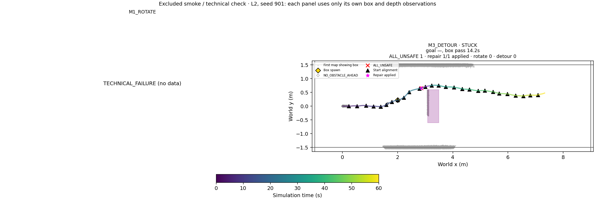

# Phase20E preflight / 파일럿

Saved20D L2 trigger predicate check (no solve/navigation): before passage 3/7 retained; after passage 7/16 retained. Before spawn 0/4. Later motion is held unchanged, so these are not predicted online event counts. This check does not gate execution.

Unit tests5/5. One excluded60s L2 M3 smoke: technical=PASS; NO_PROGRESS=0, before/after passage={'BEFORE_PASSAGE': 0, 'AFTER_PASSAGE': 0}, detours applied=0; NO_OBSTACLE_AHEAD=13; command/72Hz pose errors=0.0/0.0.

Smoke limitation: no actual obstacle-conditioned NO_PROGRESS trigger occurred. Trigger/rectangle unit tests and saved-trigger checks passed, but a new live trigger-to-detour chain was not observed in this smoke. No extra navigation was run.

No retry or tuning. Main12 trials are reserved for the user.20D code/data remain unchanged; only the obstacle predicate and20E serialization import binding are new.

