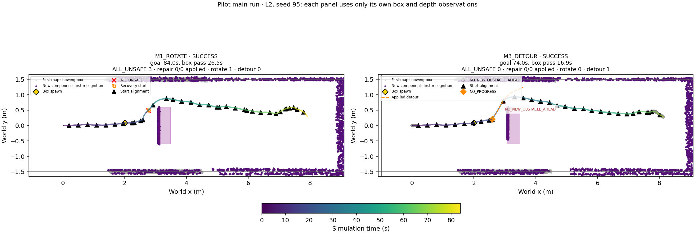
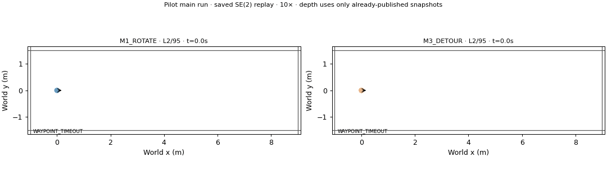
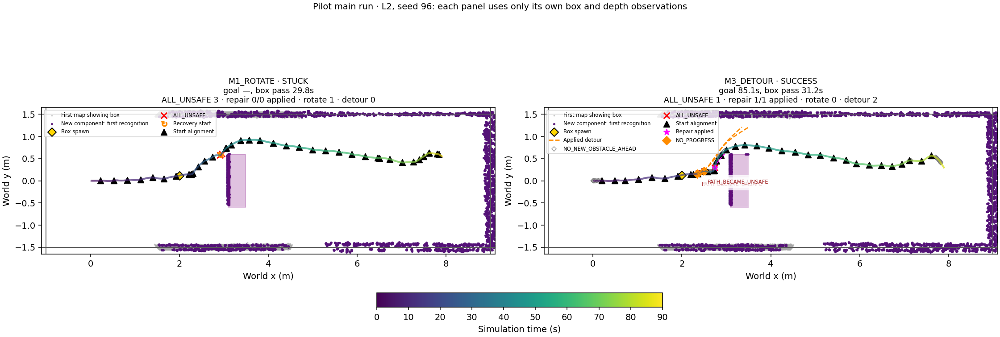
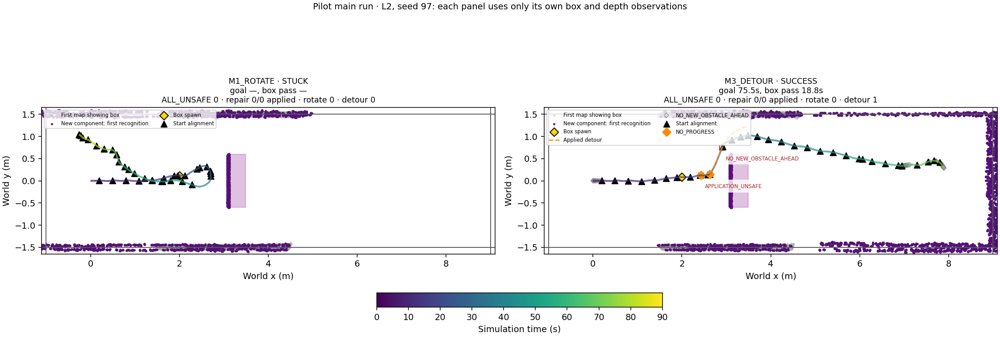
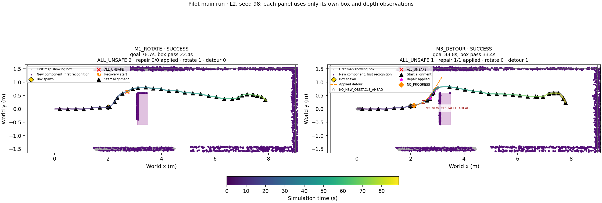
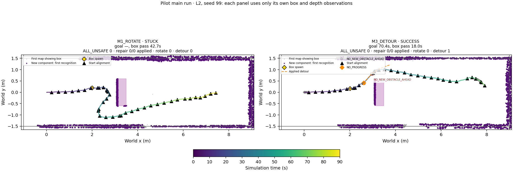
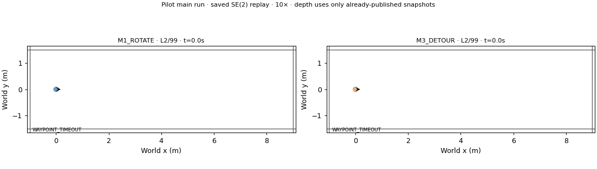
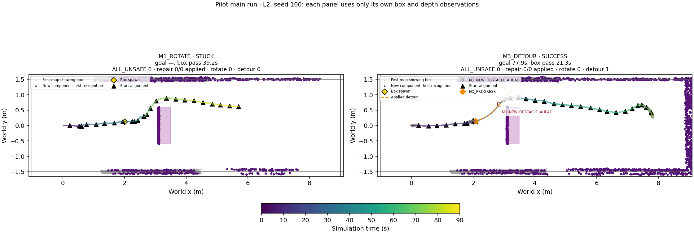
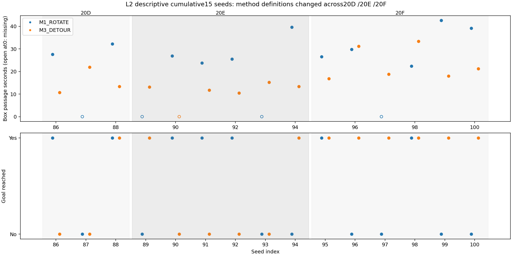
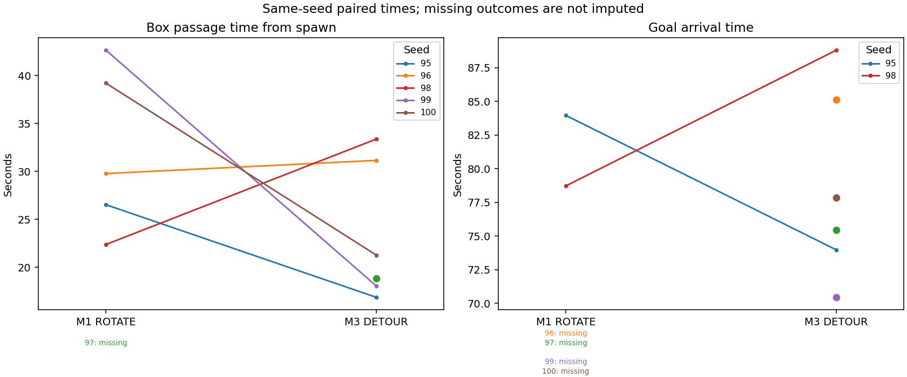

# Phase20F — obstacle-conditional NO_PROGRESS / 파일럿

Protocol SHA256 `214e8814c63db85a7d2b7d3ffad1868d7fbd77c4bd1663964cf96498d3765a01`. L2 × M1/M3 × indices95–100;12 attempts; no retries or parameter changes.

Saved20E new-trigger check: before passage 6/16, after passage 1/14, goal-near x>6.5m 0/12. No solver, new inference, rendering or closed-loop motion. Scope: Only actual20E M3 NO_PROGRESS trigger instants; direction/progress and new-cell predicate re-evaluated; no future counterfactual motion or newly arising trigger is inferred.

New obstacle cells require earlier free evidence, first occupied age≤10s, current log-odds occupancy and a four-neighbour component of≥5 cells. Direction is fixed from the3s preappearance displacement (heading fallback below0.3m). Existing map values, R2, R3 objective/constraints, SP and recovery are reused. Component identity and branch scope are frozen in protocol. No-new-cells termination can reflect expiry or occlusion and is not proof of physical box passage.

## Three primary outcomes and mechanism

| scene | method | planned | valid | success | collision | corridor | stuck | technical | goal_time_s | passed_box | box_passage_time_s | all_unsafe | recovery_count | stopped_fraction | trigger_A | trigger_B | detour_attempts | detour_applied | detour_timeout | detour_execution_s | detour_collision_count | post_detour_progress_recovered | post_detour_outcome_count | detour_then_box_pass_count | detour_before_box_pass_count | solve_median_s | solve_p95_s | snapshot_max_age_s | no_new_obstacle_ahead | detour_applied_after_passage | triggers_before_passage | triggers_after_passage |
| --- | --- | --- | --- | --- | --- | --- | --- | --- | --- | --- | --- | --- | --- | --- | --- | --- | --- | --- | --- | --- | --- | --- | --- | --- | --- | --- | --- | --- | --- | --- | --- | --- |
| L2 | M1_ROTATE | 6 | 6 | 2 | 0 | 0 | 4 | 0 | 81.34 | 5 | 32.108 | 8 | 3 | 0.021699 | 0 | 0 | 0 | 0 | 0 | 0 | 0 | 0 | 0 | 0 | 0 | — | — | 1.4167 | 0 | 0 | 0 | 0 |
| L2 | M3_DETOUR | 6 | 6 | 6 | 0 | 0 | 0 | 0 | 78.611 | 6 | 23.252 | 2 | 0 | 0.016675 | 0 | 8 | 8 | 7 | 0 | 16.222 | 0 | 4 | 7 | 7 | 7 | 0.33551 | 0.48017 | 1.4028 | 399 | 0 | 8 | 0 |

## Frozen label

| label | scope | M1_success | M3_success | M1_passed_box | M3_passed_box | M1_valid | M3_valid | paired_passage_n | M3_passage_faster_seeds | paired_goal_n | goal_difference_mean_s | goal_difference_median_s |
| --- | --- | --- | --- | --- | --- | --- | --- | --- | --- | --- | --- | --- |
| DETOUR_HELPS | 파일럿 | 2 | 6 | 5 | 6 | 6 | 6 | 5 | 3 | 2 | 0.048611 | 0.048611 |

Order: +2 goal successes → DETOUR_HELPS; no fewer goal successes or passages AND a strict majority of nonempty jointly-passed seed pairs faster → DETOUR_PASSES_FASTER; −2 goal successes → DETOUR_WORSE; otherwise DETOUR_MIXED. Technical failures remain in the12 attempts and provide no observed success/passage; valid N is explicit. No missing timing is imputed.

## Same-seed paired outcomes

| index | M1_classification | M1_success | M1_passed_box | M1_passage_s | M1_goal_s | M3_classification | M3_success | M3_passed_box | M3_passage_s | M3_goal_s | passage_difference_s | goal_difference_s |
| --- | --- | --- | --- | --- | --- | --- | --- | --- | --- | --- | --- | --- |
| 95 | SUCCESS | True | True | 26.528 | 83.958 | SUCCESS | True | True | 16.861 | 73.972 | -9.6667 | -9.9861 |
| 96 | STUCK | False | True | 29.778 | — | SUCCESS | True | True | 31.153 | 85.125 | 1.375 | — |
| 97 | STUCK | False | False | — | — | SUCCESS | True | True | 18.819 | 75.458 | — | — |
| 98 | SUCCESS | True | True | 22.375 | 78.722 | SUCCESS | True | True | 33.375 | 88.806 | 11 | 10.083 |
| 99 | STUCK | False | True | 42.653 | — | SUCCESS | True | True | 18.042 | 70.444 | -24.611 | — |
| 100 | STUCK | False | True | 39.208 | — | SUCCESS | True | True | 21.264 | 77.861 | -17.944 | — |

## Run records

| index | method | execution_git_sha | classification | goal_time_s | passed_box | box_passage_time_s | minimum_clearance_m | detour_triggers | detour_applied | detour_collision_count | trigger_stages | no_new_obstacle_ahead_count | detour_end_reasons | detour_durations_s | detour_end_vs_passage | goal_y_m | detour_applied_after_passage | snapshot_max_age_s |
| --- | --- | --- | --- | --- | --- | --- | --- | --- | --- | --- | --- | --- | --- | --- | --- | --- | --- | --- |
| 95 | M1_ROTATE | 10e079d7ad1df3dbf44b8fc8a5292e1a8dda279f | SUCCESS | 83.958 | True | 26.528 | 0.092629 | {} | 0 | 0 | {'BEFORE_PASSAGE': 0, 'AFTER_PASSAGE': 0} | 0 | {} | [] | [] | 0.28819 | 0 | 1.4028 |
| 95 | M3_DETOUR | 10e079d7ad1df3dbf44b8fc8a5292e1a8dda279f | SUCCESS | 73.972 | True | 16.861 | 0.1334 | {'B': 1} | 1 | 0 | {'BEFORE_PASSAGE': 1, 'AFTER_PASSAGE': 0} | 54 | {'NO_NEW_OBSTACLE_AHEAD': 1} | [3.7777777777777786] | [{'job_id': 0, 'end_s': 26.77777777777778, 'end_pose': [2.9348384967865955, 0.7716677621319828, 0.9857621747902137], 'passage_s': 32.861111111111114, 'after_physical_passage': False, 'reason': 'NO_NEW_OBSTACLE_AHEAD'}] | 0.2631 | 0 | 1.4028 |
| 96 | M1_ROTATE | 10e079d7ad1df3dbf44b8fc8a5292e1a8dda279f | STUCK | — | True | 29.778 | 0.031669 | {} | 0 | 0 | {'BEFORE_PASSAGE': 0, 'AFTER_PASSAGE': 0} | 0 | {} | [] | [] | — | 0 | 1.4167 |
| 96 | M3_DETOUR | 10e079d7ad1df3dbf44b8fc8a5292e1a8dda279f | SUCCESS | 85.125 | True | 31.153 | 0.04192 | {'B': 2} | 2 | 0 | {'BEFORE_PASSAGE': 2, 'AFTER_PASSAGE': 0} | 87 | {'PATH_BECAME_UNSAFE': 2} | [1.7777777777777786, 0.22222222222222143] | [{'job_id': 0, 'end_s': 22.666666666666668, 'end_pose': [2.369028490282656, 0.1690407842156457, 0.5407081415837496], 'passage_s': 48.083333333333336, 'after_physical_passage': False, 'reason': 'PATH_BECAME_UNSAFE'}, {'job_id': 1, 'end_s': 26.333333333333332, 'end_pose': [2.4993746349871646, 0.221310583506374, -0.0780301873906808], 'passage_s': 48.083333333333336, 'after_physical_passage': False, 'reason': 'PATH_BECAME_UNSAFE'}] | 0.28364 | 0 | 1.4028 |
| 97 | M3_DETOUR | 10e079d7ad1df3dbf44b8fc8a5292e1a8dda279f | SUCCESS | 75.458 | True | 18.819 | 0.13607 | {'B': 2} | 1 | 0 | {'BEFORE_PASSAGE': 2, 'AFTER_PASSAGE': 0} | 51 | {'NO_NEW_OBSTACLE_AHEAD': 1} | [2.4444444444444464] | [{'job_id': 1, 'end_s': 27.77777777777778, 'end_pose': [2.908441778492165, 0.745245893718792, 1.1239679254840045], 'passage_s': 36.05555555555556, 'after_physical_passage': False, 'reason': 'NO_NEW_OBSTACLE_AHEAD'}] | 0.28159 | 0 | 1.3889 |
| 97 | M1_ROTATE | 10e079d7ad1df3dbf44b8fc8a5292e1a8dda279f | STUCK | — | False | — | 0.29682 | {} | 0 | 0 | {'BEFORE_PASSAGE': 0, 'AFTER_PASSAGE': 0} | 0 | {} | [] | [] | — | 0 | 1.4028 |
| 98 | M1_ROTATE | 10e079d7ad1df3dbf44b8fc8a5292e1a8dda279f | SUCCESS | 78.722 | True | 22.375 | 0.092937 | {} | 0 | 0 | {'BEFORE_PASSAGE': 0, 'AFTER_PASSAGE': 0} | 0 | {} | [] | [] | 0.28956 | 0 | 1.4028 |
| 98 | M3_DETOUR | 10e079d7ad1df3dbf44b8fc8a5292e1a8dda279f | SUCCESS | 88.806 | True | 33.375 | 0.11004 | {'B': 1} | 1 | 0 | {'BEFORE_PASSAGE': 1, 'AFTER_PASSAGE': 0} | 111 | {'NO_NEW_OBSTACLE_AHEAD': 1} | [2.555555555555557] | [{'job_id': 0, 'end_s': 27.0, 'end_pose': [2.48741592556928, 0.26363898989396173, 0.557435014119017], 'passage_s': 49.34722222222222, 'after_physical_passage': False, 'reason': 'NO_NEW_OBSTACLE_AHEAD'}] | 0.22046 | 0 | 1.4028 |
| 99 | M1_ROTATE | 10e079d7ad1df3dbf44b8fc8a5292e1a8dda279f | STUCK | — | True | 42.653 | 0.19249 | {} | 0 | 0 | {'BEFORE_PASSAGE': 0, 'AFTER_PASSAGE': 0} | 0 | {} | [] | [] | — | 0 | 1.3889 |
| 99 | M3_DETOUR | 10e079d7ad1df3dbf44b8fc8a5292e1a8dda279f | SUCCESS | 70.444 | True | 18.042 | 0.14036 | {'B': 1} | 1 | 0 | {'BEFORE_PASSAGE': 1, 'AFTER_PASSAGE': 0} | 35 | {'NO_NEW_OBSTACLE_AHEAD': 1} | [2.0] | [{'job_id': 0, 'end_s': 27.22222222222222, 'end_pose': [2.9670074953578713, 0.8003919869632742, 0.7618846012272922], 'passage_s': 35.375, 'after_physical_passage': False, 'reason': 'NO_NEW_OBSTACLE_AHEAD'}] | 0.28932 | 0 | 1.3889 |
| 100 | M1_ROTATE | 10e079d7ad1df3dbf44b8fc8a5292e1a8dda279f | STUCK | — | True | 39.208 | 0.087811 | {} | 0 | 0 | {'BEFORE_PASSAGE': 0, 'AFTER_PASSAGE': 0} | 0 | {} | [] | [] | — | 0 | 1.3194 |
| 100 | M3_DETOUR | 10e079d7ad1df3dbf44b8fc8a5292e1a8dda279f | SUCCESS | 77.861 | True | 21.264 | 0.14772 | {'B': 1} | 1 | 0 | {'BEFORE_PASSAGE': 1, 'AFTER_PASSAGE': 0} | 61 | {'NO_NEW_OBSTACLE_AHEAD': 1} | [3.4444444444444464] | [{'job_id': 0, 'end_s': 32.333333333333336, 'end_pose': [2.8489606693357725, 0.6851269600235276, 0.8868281571314514], 'passage_s': 39.916666666666664, 'after_physical_passage': False, 'reason': 'NO_NEW_OBSTACLE_AHEAD'}] | 0.24081 | 0 | 1.3194 |

NO_NEW_OBSTACLE_AHEAD counts eligible9Hz checks, not deduplicated stop episodes; rejecting the obstacle condition does not start a cooldown or alter commands. Pre/post classification uses first recorded footprint passage, for evaluation only. Runs that never pass retain all events in the before group. Oracle box geometry is used only for placement/rendering and evaluation. Simulator pose is exact (no odometry error).

## Technical failures

None.

## Visualization availability

Small gray open diamonds mark NO_NEW_OBSTACLE_AHEAD; purple points show cells when a new component was first recognized; squares mark detour ending and reason; orange diamonds mark applied NO_PROGRESS triggers; orange dashed paths are applied detours. Gray thick trajectory segments mark publication gaps.

## Descriptive cumulative L2 table

| phase | method | attempts | valid | goal_success | box_passed | passage_mean_s |
| --- | --- | --- | --- | --- | --- | --- |
| 20D | M1_ROTATE | 3 | 3 | 2 | 2 | 29.958 |
| 20D | M3_DETOUR | 3 | 3 | 1 | 3 | 15.347 |
| 20E | M1_ROTATE | 6 | 6 | 3 | 4 | 28.997 |
| 20E | M3_DETOUR | 6 | 6 | 2 | 5 | 12.803 |
| 20F | M1_ROTATE | 6 | 6 | 2 | 5 | 32.108 |
| 20F | M3_DETOUR | 6 | 6 | 6 | 6 | 23.252 |
| ALL | M1_ROTATE | 15 | 15 | 7 | 11 | 30.586 |
| ALL | M3_DETOUR | 15 | 15 | 9 | 14 | 17.826 |

20D3+20E6+20F6 seeds per method. Trigger/direction/termination definitions changed between phases; pooled values are not one homogeneous trial or a causal paired comparison.

This six-seed pilot does not establish generalization. Successful box passage and goal arrival are distinct outcomes.
