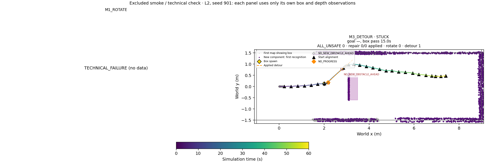

# Phase20F preflight / 파일럿

Saved20E new-trigger check: before passage 6/16, after passage 1/14, goal-near x>6.5m 0/12. No solver, new inference, rendering or closed-loop motion. Scope: Only actual20E M3 NO_PROGRESS trigger instants; direction/progress and new-cell predicate re-evaluated; no future counterfactual motion or newly arising trigger is inferred.

Unit tests7/7. One excluded60s L2 M3 smoke: technical=PASS; NO_PROGRESS=1, before/after passage={'BEFORE_PASSAGE': 1, 'AFTER_PASSAGE': 0}, detours applied=1; NO_NEW_OBSTACLE_AHEAD=23; command/72Hz pose errors=0.0/0.0.

Detour ending reasons: {'NO_NEW_OBSTACLE_AHEAD': 1}; execution durations: [3.1111111111111107]s.

Early end vs physical box passage: [{'job_id': 0, 'end_s': 22.333333333333332, 'end_pose': [2.798405641585567, 0.777069352009696, 0.7254612831736686], 'passage_s': 30.875, 'after_physical_passage': False, 'reason': 'NO_NEW_OBSTACLE_AHEAD'}].

The smoke map also logged qualifying free→occupied cells along existing wall regions; this is a grid-evidence proxy, not an object-identity detector. No parameter or cell rule was changed after observing this.

No retry or tuning. Main12 trials are reserved for the user.20D/20E code/data remain unchanged; B uses new-cell history, fixed preappearance direction and early end. A remains20E.

