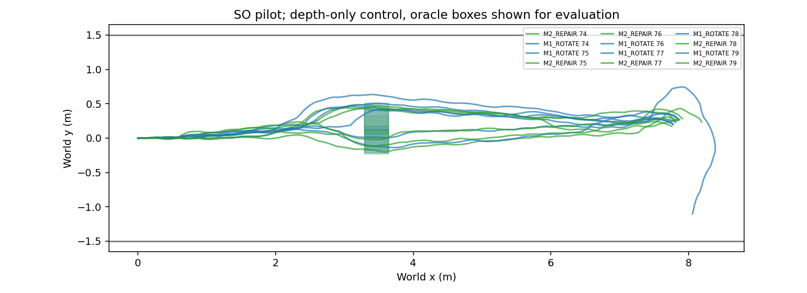
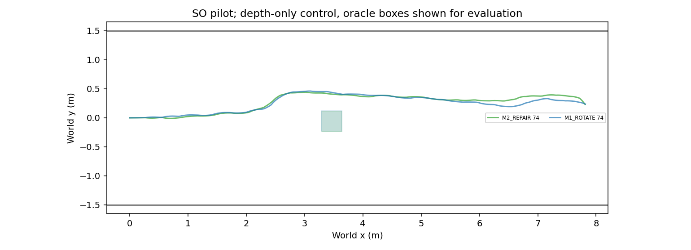
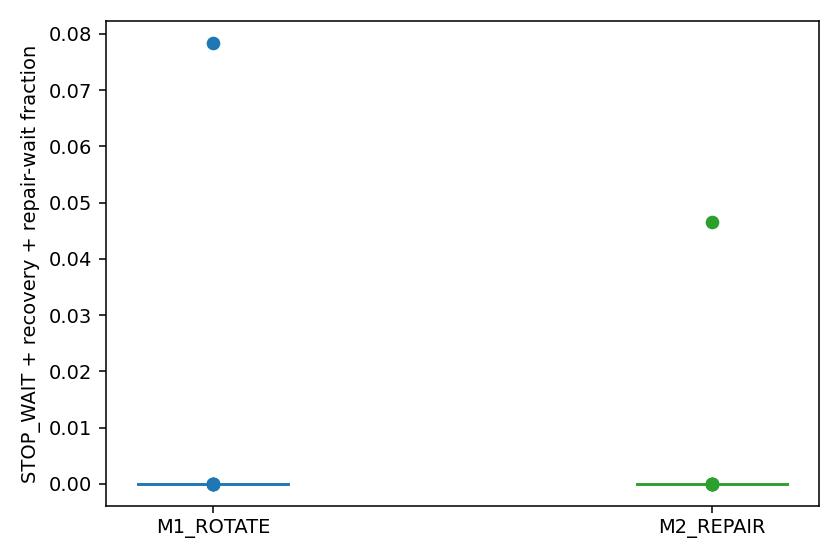

# Phase 20 — SO repair recovery 파일럿

Protocol SHA256: `8cac8cfee799a363872ae79805fd386309f905fadfedbf7aa4820b1573498119`. Offline assessment: **사후 수정 후 재점검 / READY**.

SP and revised stop–align–go are shared by M1/M2. R2 repair is used only at ALL_UNSAFE; it waits at STOP_WAIT, uses no oracle, and falls back after rejection or0.5s timeout. Main runs are seed74–79, SO only. This is a 파일럿, not a confirmatory experiment.

## Offline gate

```json
{
  "label": "READY",
  "reasons": [],
  "events": 241,
  "repair_successes": 141,
  "repair_success_fraction": 0.5850622406639004,
  "selected_path_oracle_penetrations": 0,
  "selected_rollout_overlaps": 6,
  "selected_rollout_count": 141,
  "selected_rollout_overlap_fraction": 0.0425531914893617,
  "accepted_sample_paths": 643,
  "all_accepted_path_oracle_penetrations": 4,
  "cause_success": {
    "MARGINAL": {
      "events": 86,
      "successes": 44,
      "fraction": 0.5116279069767442
    },
    "TRUE_BLOCK": {
      "events": 107,
      "successes": 69,
      "fraction": 0.6448598130841121
    },
    "NEAR_START": {
      "events": 27,
      "successes": 12,
      "fraction": 0.4444444444444444
    },
    "OTHER": {
      "events": 21,
      "successes": 16,
      "fraction": 0.7619047619047619
    }
  },
  "per_sample_solve_s": {
    "n": 914,
    "median": 0.016204606989049353,
    "p95": 0.04135010400932511,
    "max": 0.11791799598722719
  },
  "eight_sample_wall_s": {
    "n": 241,
    "median": 0.05706489199656062,
    "p95": 0.2150250990234781,
    "max": 0.43242758899577893
  },
  "eight_sample_over_half_second": 0,
  "selected_mean_edit_m": {
    "n": 141,
    "median": 0.026214602198188688,
    "p95": 0.07411372784312453,
    "max": 0.11072891644468626
  },
  "post_hoc": true,
  "assessment_label": "\uc0ac\ud6c4 \uc218\uc815 \ud6c4 \uc7ac\uc810\uac80",
  "negative_depth_B_events": 27,
  "alignment_events": 52,
  "alignment_braking_total_s": 1.4444444444444444,
  "alignment_rotation_total_s": 71.33333333333333
}
```

[Original NOT_READY](../research/results/phase20_preflight/readiness.json) and [recheck diagnosis](PHASE20_REPAIR_DRIVE_RECHECK.md) remain available.

## Method summary

| method | planned | valid | success | collision | corridor | stuck | technical | safety_failure | goal_time_s | stopped_fraction | box_passage_time_s | passed_box | minimum_clearance_m | all_unsafe | recovery_count | repair_attempts | repair_accepted | repair_timeout | alignment_count | alignment_braking_s | alignment_rotation_s |
| --- | --- | --- | --- | --- | --- | --- | --- | --- | --- | --- | --- | --- | --- | --- | --- | --- | --- | --- | --- | --- | --- |
| M1_ROTATE | 6 | 6 | 5 | 0 | 0 | 1 | 0 | 0 | 67.842 | 0.013062 | 16.301 | 6 | 0.053367 | 5 | 2 | 0 | 0 | 0 | 212 | 17.981 | 16.815 |
| M2_REPAIR | 6 | 6 | 6 | 0 | 0 | 0 | 0 | 0 | 68.326 | 0.0077519 | 15.604 | 6 | 0.04455 | 2 | 1 | 2 | 0 | 2 | 204 | 17.37 | 16.111 |

## Seed × method

| index | method | classification | success | collision | corridor | stuck | goal_time_s | stopped_fraction | box_passage_time_s | minimum_clearance_m | all_unsafe | repair_attempts | repair_accepted | repair_timeout | recovery_count | alignment_count | alignment_braking_s | alignment_rotation_s | first_visible_s | first_depth_observed_s | first_depth_map_observed_s | pass_side |
| --- | --- | --- | --- | --- | --- | --- | --- | --- | --- | --- | --- | --- | --- | --- | --- | --- | --- | --- | --- | --- | --- | --- |
| 74 | M2_REPAIR | SUCCESS | True | False | False | False | 66.958 | 0 | 15.514 | 0.19403 | 0 | 0 | 0 | 0 | 0 | 33 | 17.556 | 14.889 | 15.986 | 15.986 | 16.75 | +Y |
| 74 | M1_ROTATE | SUCCESS | True | False | False | False | 65.611 | 0 | 16.167 | 0.19343 | 0 | 0 | 0 | 0 | 0 | 33 | 17.778 | 15 | 15.486 | 15.486 | 16.236 | +Y |
| 75 | M1_ROTATE | SUCCESS | True | False | False | False | 65.014 | 0 | 15.25 | 0.055167 | 0 | 0 | 0 | 0 | 0 | 32 | 17.111 | 14 | 16.236 | 16.236 | 16.986 | -Y |
| 75 | M2_REPAIR | SUCCESS | True | False | False | False | 64.431 | 0 | 15.264 | 0.04455 | 0 | 0 | 0 | 0 | 0 | 31 | 17.111 | 13.556 | 15.986 | 15.986 | 16.736 | -Y |
| 76 | M2_REPAIR | SUCCESS | True | False | False | False | 57.931 | 0 | 13.042 | 0.22572 | 0 | 0 | 0 | 0 | 0 | 29 | 17 | 11.333 | 15.736 | 15.736 | 16.486 | +Y |
| 76 | M1_ROTATE | STUCK | False | False | False | True | — | 0 | 14.194 | 0.25695 | 0 | 0 | 0 | 0 | 0 | 47 | 21.889 | 23.778 | 15.986 | 15.986 | 16.75 | +Y |
| 77 | M1_ROTATE | SUCCESS | True | False | False | False | 66.236 | 0 | 14.722 | 0.053367 | 0 | 0 | 0 | 0 | 0 | 33 | 17.444 | 15.111 | 18.736 | 18.736 | 19.486 | +Y |
| 77 | M2_REPAIR | SUCCESS | True | False | False | False | 79.931 | 0 | 17.319 | 0.04598 | 0 | 0 | 0 | 0 | 0 | 41 | 18.111 | 22.333 | 17.236 | 17.236 | 17.986 | -Y |
| 78 | M1_ROTATE | SUCCESS | True | False | False | False | 73.722 | 0.078372 | 23 | 0.064691 | 4 | 0 | 0 | 0 | 2 | 34 | 17.222 | 16.556 | 16.236 | 16.236 | 16.986 | +Y |
| 78 | M2_REPAIR | SUCCESS | True | False | False | False | 69.042 | 0 | 14.958 | 0.16063 | 0 | 0 | 0 | 0 | 0 | 37 | 17.222 | 19.222 | 20.736 | 20.736 | 21.486 | +Y |
| 79 | M1_ROTATE | SUCCESS | True | False | False | False | 68.625 | 0 | 14.472 | 0.057093 | 1 | 0 | 0 | 0 | 0 | 33 | 16.444 | 16.444 | 17.236 | 17.236 | 17.986 | -Y |
| 79 | M2_REPAIR | SUCCESS | True | False | False | False | 71.667 | 0.046512 | 17.528 | 0.059868 | 2 | 2 | 0 | 2 | 1 | 33 | 17.222 | 15.333 | 17.486 | 17.486 | 18.236 | -Y |

## Pilot decision

```json
{
  "label": "REPAIR_EQUAL_SO",
  "scope": "\ud30c\uc77c\ub7ff",
  "success_M1": 5,
  "success_M2": 6,
  "safety_M1": 0,
  "safety_M2": 0
}
```

## Paired descriptive differences (M2−M1)

| metric | n | mean_difference | ci95 | paired_indices | interpretation |
| --- | --- | --- | --- | --- | --- |
| stopped_fraction | 6 | -0.0053101 | [-0.03918613413715137, 0.023255813953488327] | [74, 75, 76, 77, 78, 79] | descriptive only; paired seed resampling, one scene; missing times not imputed |
| box_passage_time_s | 6 | -0.69676 | [-3.8958333333333317, 1.7777777777777761] | [74, 75, 76, 77, 78, 79] | descriptive only; paired seed resampling, one scene; missing times not imputed |

Box passage is first tick with the entire footprint beyond box rear (+X); passage time starts at physical spawn. Missing passage times remain missing. Stopped fraction is the union of STOP_WAIT, repair wait, recovery rotation and WAIT_FRESH; departure-alignment braking/rotation and actual near-zero-speed fraction are separately recorded. A conservative contact stop without a geometric witness is not relabelled a collision. All technical failures are retained; missing valid trials prevent an interpreted six-pair verdict.

## Technical failures

None.







NoMaD uses RGB only. Both methods use the same noisy V1 depth map and exact simulator odometry (no odometry error); oracle boxes/walls are used only for rendering, placement and evaluation. The physical box can differ across methods because placement depends on actual pose. Paired seeds therefore do not imply identical RGB, trajectories or box positions. Depth unknown remains free; neither short offline readiness nor a successful pilot establishes general safety.
