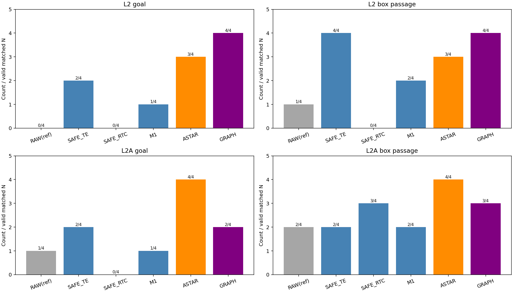
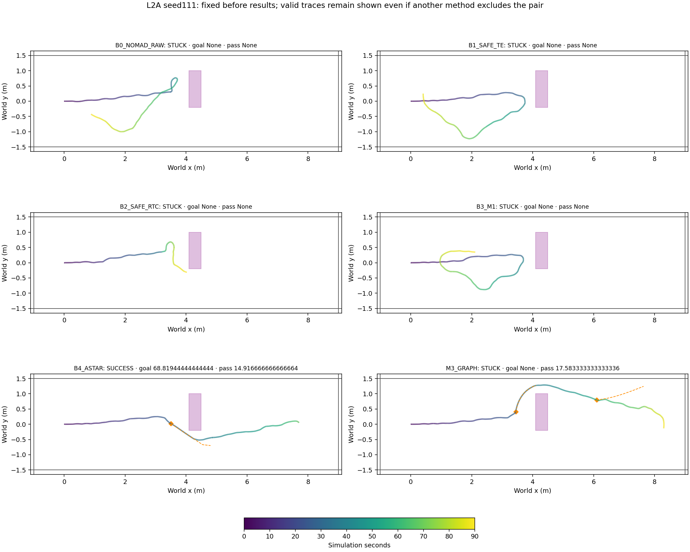
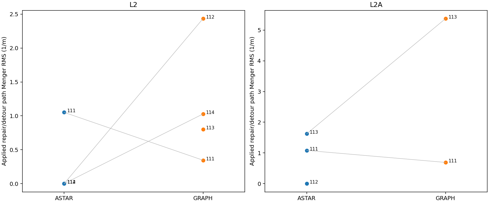

# Phase21 — 사전등록 돌발 장애물 baseline 비교

Protocol SHA256 `42f6768c90836142c6c39131691565581d2ecbf013c4748fe68867c0b4419e79`. Base20F `3744de7`. Main seeds [111, 112, 113, 114], 48 planned runs; at most one same-seed technical retry. Final label prioritizes held-out L2A; pooled results are descriptive.

## Frozen methods

B1 SAFE_TE and B2 SAFE_RTC: **Phase18 handoff 규칙 + 20-F 공통 실행기**. All use PP lookahead0.25m, SP speed planning, start alignment, D750 and unchanged NoMaD metric scaling. B0 uses sample0 without depth/filter/fallback/recovery and is reference-only. B1 keeps TE target averaging/K3/expiry/KEEP, with SP/alignment from its latest selected active chunk. B2 uses the unchanged RTC hard-masking ablation (DDPM adaptation), beta5, and SAFE selection over all8 generated samples. B3/M3 use protected20F implementations. A* replaces only stage solvers, retaining A/B transitions and B-only new-obstacle direction/early-end. Oracle geometry is evaluation/placement-only; odometry is exact simulator pose.

A* frozen selection: {'smoothing_iterations': 0, 'lambda': 4.0}; tuned only on saved20D/E/F jobs, before L2A geometry. R2 keeps native endpoint/nearest safe cell within0.2m, unknown-free,8 output points and0.75m trust. R3 uses recency/unknown-blocked map and B+10 points. Residual curvature>4 after selected smoothing is retained and flagged; it is not silently hidden.

## Results (primary matched groups; B0 reference)

| scene | method | n | attempted | technical_final | goal | passed | censored | passage_median_s | goal_median_s | collisions | box_collisions | corridor | minimum_clearance_m | minimum_box_clearance_m | minimum_wall_clearance_m | curvature_rms | curvature_max | curvature_paths | angular_delta_rms_median | angular_jerk_rms_median | planner_median_s | planner_p95_s | triggers | false_trigger_B | reblock | detour_applied |
| --- | --- | --- | --- | --- | --- | --- | --- | --- | --- | --- | --- | --- | --- | --- | --- | --- | --- | --- | --- | --- | --- | --- | --- | --- | --- | --- |
| L2 | B0_NOMAD_RAW | 4 | 4 | 0 | 0 | 1 | 3 | 90 | — | 2 | 2 | 0 | -0.0012878 | -0.0012878 | 0.60116 | — | — | 0 | — | — | — | — | 0 | 0 | 0 | 0 |
| L2 | B1_SAFE_TE | 4 | 4 | 0 | 2 | 4 | 0 | 29.604 | 75.424 | 0 | 0 | 0 | 0.077874 | 0.077874 | 0.37423 | — | — | 0 | — | — | — | — | 0 | 0 | 0 | 0 |
| L2 | B2_SAFE_RTC | 4 | 4 | 0 | 0 | 0 | 4 | 90 | — | 0 | 0 | 0 | 0.05016 | 0.05016 | 0.33735 | — | — | 0 | — | — | — | — | 0 | 0 | 0 | 0 |
| L2 | B3_M1 | 4 | 4 | 0 | 1 | 2 | 2 | 62.049 | 70.014 | 0 | 0 | 0 | 0.073493 | 0.073493 | 0.19024 | — | — | 0 | — | — | — | — | 0 | 0 | 0 | 0 |
| L2 | B4_ASTAR | 4 | 4 | 0 | 3 | 3 | 1 | 15.5 | 75.514 | 0 | 0 | 0 | 0.052776 | 0.052776 | 0.23983 | 0.6068 | 3.153 | 3 | 0.026338 | 0.96531 | 0.27172 | 0.34753 | 5 | 0 | 1 | 3 |
| L2 | M3_GRAPH | 4 | 4 | 0 | 4 | 4 | 0 | 17.937 | 71.972 | 0 | 0 | 0 | 0.0078389 | 0.0078389 | 0.33056 | 1.7044 | 5.7111 | 12 | 0.080585 | 7.1115 | 0.13219 | 0.51867 | 6 | 0 | 2 | 5 |
| L2A | B0_NOMAD_RAW | 4 | 4 | 0 | 1 | 2 | 2 | 52.194 | 72.542 | 0 | 0 | 0 | 0.050421 | 0.050421 | 0.32078 | — | — | 0 | — | — | — | — | 0 | 0 | 0 | 0 |
| L2A | B1_SAFE_TE | 4 | 4 | 0 | 2 | 2 | 2 | 51.639 | 81.181 | 0 | 0 | 0 | 0.0684 | 0.0684 | 0.17831 | — | — | 0 | — | — | — | — | 0 | 0 | 0 | 0 |
| L2A | B2_SAFE_RTC | 4 | 4 | 0 | 0 | 3 | 1 | 23.174 | — | 0 | 0 | 0 | 0.044205 | 0.044205 | 0.7258 | — | — | 0 | — | — | — | — | 0 | 0 | 0 | 0 |
| L2A | B3_M1 | 4 | 4 | 0 | 1 | 2 | 2 | 51.646 | 64.667 | 0 | 0 | 0 | 0.094496 | 0.094496 | 0.12285 | — | — | 0 | — | — | — | — | 0 | 0 | 0 | 0 |
| L2A | B4_ASTAR | 4 | 4 | 0 | 4 | 4 | 0 | 14.826 | 67.875 | 0 | 0 | 0 | 0.052876 | 0.052876 | 0.77939 | 1.1253 | 4.8667 | 3 | 0.039825 | 1.3832 | 0.24955 | 0.8153 | 3 | 0 | 0 | 3 |
| L2A | M3_GRAPH | 4 | 4 | 0 | 2 | 3 | 1 | 16.312 | 67.958 | 0 | 0 | 0 | 0.086758 | 0.086758 | 0.12168 | 2.7541 | 8 | 3 | 0.030823 | 3.8298 | 0.32315 | 0.35522 | 2 | 0 | 0 | 2 |
| POOLED | B0_NOMAD_RAW | 8 | 8 | 0 | 1 | 3 | 5 | 90 | 72.542 | 2 | 2 | 0 | -0.0012878 | -0.0012878 | 0.32078 | — | — | 0 | — | — | — | — | 0 | 0 | 0 | 0 |
| POOLED | B1_SAFE_TE | 8 | 8 | 0 | 4 | 6 | 2 | 29.604 | 78.132 | 0 | 0 | 0 | 0.0684 | 0.0684 | 0.17831 | — | — | 0 | — | — | — | — | 0 | 0 | 0 | 0 |
| POOLED | B2_SAFE_RTC | 8 | 8 | 0 | 0 | 3 | 5 | 90 | — | 0 | 0 | 0 | 0.044205 | 0.044205 | 0.33735 | — | — | 0 | — | — | — | — | 0 | 0 | 0 | 0 |
| POOLED | B3_M1 | 8 | 8 | 0 | 2 | 4 | 4 | 62.049 | 67.34 | 0 | 0 | 0 | 0.073493 | 0.073493 | 0.12285 | — | — | 0 | — | — | — | — | 0 | 0 | 0 | 0 |
| POOLED | B4_ASTAR | 8 | 8 | 0 | 7 | 7 | 1 | 15.028 | 74.472 | 0 | 0 | 0 | 0.052776 | 0.052776 | 0.23983 | 0.904 | 4.8667 | 6 | 0.033004 | 1.1742 | 0.26063 | 0.69538 | 8 | 0 | 1 | 6 |
| POOLED | M3_GRAPH | 8 | 8 | 0 | 6 | 7 | 1 | 17.375 | 69.868 | 0 | 0 | 0 | 0.0078389 | 0.0078389 | 0.12168 | 1.9791 | 8 | 15 | 0.062964 | 5.4668 | 0.21402 | 0.51732 | 8 | 0 | 2 | 7 |

## Scene labels and ASTAR comparison

| scene | label | n | threshold | graph_goal | best_heuristic_goal | astar_goal | graph_collisions | astar_collisions | graph_passage_median | astar_passage_median | graph_curvature_rms | astar_curvature_rms | note |
| --- | --- | --- | --- | --- | --- | --- | --- | --- | --- | --- | --- | --- | --- |
| L2 | GRAPH_BEATS_HEURISTICS | 4 | 2 | 4 | 2 | 3 | 0 | 0 | 17.937 | 15.5 | 1.7044 | 0.6068 | — |
| L2A | NO_GRAPH_ADVANTAGE | 4 | 2 | 2 | 2 | 4 | 0 | 0 | 16.312 | 14.826 | 2.7541 | 1.1253 | ASTAR_BETTER |
| POOLED | NO_GRAPH_ADVANTAGE | 8 | 3 | 6 | 4 | 7 | 0 | 0 | 17.375 | 15.028 | 1.9791 | 0.904 | ASTAR_BETTER |

Final: **NO_GRAPH_ADVANTAGE**. Additional: **MIXED_HELDOUT**.

Scene goal advantage threshold remains2 and pooled threshold3, even if the timing rule reduced the seed count to4. No valid pairs yields an unavailable-data label, not evidence of no effect. GRAPH_BEST additionally needs no fewer goals than ASTAR, strictly smaller passage median or curvature RMS, and zero Graph collisions in the analyzed sample. GRAPH_BEATS_HEURISTICS requires only the heuristic threshold; ASTAR differences and collisions remain visible.

## Pair exclusions

None.

A primary-method final technical failure excludes all5 primary methods at that scene×seed. B0 failure never excludes primary pairs. All attempts remain archived.

## Seed pairs

| scene | index | baseline | graph_goal | baseline_goal | goal_difference | graph_passed | baseline_passed | graph_passage_s | baseline_passage_s | graph_censored | baseline_censored | goal_time_difference_s |
| --- | --- | --- | --- | --- | --- | --- | --- | --- | --- | --- | --- | --- |
| L2 | 111 | B1_SAFE_TE | True | True | 0 | True | True | 18.708 | 20.806 | False | False | -0.63889 |
| L2 | 111 | B2_SAFE_RTC | True | False | 1 | True | False | 18.708 | 90 | False | True | — |
| L2 | 111 | B3_M1 | True | True | 0 | True | True | 18.708 | 20.514 | False | False | -0.041667 |
| L2 | 111 | B4_ASTAR | True | True | 0 | True | True | 18.708 | 15.333 | False | False | -7.0972 |
| L2 | 112 | B1_SAFE_TE | True | False | 1 | True | True | 17.167 | 38.403 | False | False | — |
| L2 | 112 | B2_SAFE_RTC | True | False | 1 | True | False | 17.167 | 90 | False | True | — |
| L2 | 112 | B3_M1 | True | False | 1 | True | False | 17.167 | 90 | False | True | — |
| L2 | 112 | B4_ASTAR | True | True | 0 | True | True | 17.167 | 14.208 | False | False | -6.875 |
| L2 | 113 | B1_SAFE_TE | True | False | 1 | True | True | 16.5 | 50.083 | False | False | — |
| L2 | 113 | B2_SAFE_RTC | True | False | 1 | True | False | 16.5 | 90 | False | True | — |
| L2 | 113 | B3_M1 | True | False | 1 | True | True | 16.5 | 34.097 | False | False | — |
| L2 | 113 | B4_ASTAR | True | False | 1 | True | False | 16.5 | 90 | False | True | — |
| L2 | 114 | B1_SAFE_TE | True | True | 0 | True | True | 25.097 | 20.403 | False | False | 4.3333 |
| L2 | 114 | B2_SAFE_RTC | True | False | 1 | True | False | 25.097 | 90 | False | True | — |
| L2 | 114 | B3_M1 | True | False | 1 | True | False | 25.097 | 90 | False | True | — |
| L2 | 114 | B4_ASTAR | True | True | 0 | True | True | 25.097 | 15.667 | False | False | 10.097 |
| L2A | 111 | B1_SAFE_TE | False | False | 0 | True | False | 17.583 | 90 | False | True | — |
| L2A | 111 | B2_SAFE_RTC | False | False | 0 | True | False | 17.583 | 90 | False | True | — |
| L2A | 111 | B3_M1 | False | False | 0 | True | False | 17.583 | 90 | False | True | — |
| L2A | 111 | B4_ASTAR | False | True | -1 | True | True | 17.583 | 14.917 | False | False | — |
| L2A | 112 | B1_SAFE_TE | True | True | 0 | True | True | 13.778 | 11.306 | False | False | -9.875 |
| L2A | 112 | B2_SAFE_RTC | True | False | 1 | True | True | 13.778 | 16.847 | False | False | — |
| L2A | 112 | B3_M1 | True | False | 1 | True | True | 13.778 | 11.694 | False | False | — |
| L2A | 112 | B4_ASTAR | True | True | 0 | True | True | 13.778 | 14.736 | False | False | -0.77778 |
| L2A | 113 | B1_SAFE_TE | False | False | 0 | False | False | 90 | 90 | True | True | — |
| L2A | 113 | B2_SAFE_RTC | False | False | 0 | False | True | 90 | 25.167 | True | False | — |
| L2A | 113 | B3_M1 | False | False | 0 | False | False | 90 | 90 | True | True | — |
| L2A | 113 | B4_ASTAR | False | True | -1 | False | True | 90 | 15.139 | True | False | — |
| L2A | 114 | B1_SAFE_TE | True | True | 0 | True | True | 15.042 | 13.278 | False | False | -16.569 |
| L2A | 114 | B2_SAFE_RTC | True | False | 1 | True | True | 15.042 | 21.181 | False | False | — |
| L2A | 114 | B3_M1 | True | True | 0 | True | True | 15.042 | 13.292 | False | False | 5.0972 |
| L2A | 114 | B4_ASTAR | True | True | 0 | True | True | 15.042 | 10.736 | False | False | 3.5694 |

## Win/loss/sign test (technical reference only)

| scene | baseline | n | goal_wins | goal_losses | goal_ties | exact_sign_p_reference |
| --- | --- | --- | --- | --- | --- | --- |
| L2 | B1_SAFE_TE | 4 | 2 | 0 | 2 | 0.5 |
| L2 | B2_SAFE_RTC | 4 | 4 | 0 | 0 | 0.125 |
| L2 | B3_M1 | 4 | 3 | 0 | 1 | 0.25 |
| L2 | B4_ASTAR | 4 | 1 | 0 | 3 | 1 |
| L2A | B1_SAFE_TE | 4 | 0 | 0 | 4 | — |
| L2A | B2_SAFE_RTC | 4 | 2 | 0 | 2 | 0.5 |
| L2A | B3_M1 | 4 | 1 | 0 | 3 | 1 |
| L2A | B4_ASTAR | 4 | 0 | 2 | 2 | 0.5 |
| POOLED | B1_SAFE_TE | 8 | 2 | 0 | 6 | 0.5 |
| POOLED | B2_SAFE_RTC | 8 | 6 | 0 | 2 | 0.03125 |
| POOLED | B3_M1 | 8 | 4 | 0 | 4 | 0.125 |
| POOLED | B4_ASTAR | 8 | 1 | 2 | 5 | 1 |

Oracle collision counts include box overlap or wall intrusion; box/wall counts are also separate. Minimum clearance includes both box and wall. Passage time is spawn-to-footprint passage; nonpassage has the preregistered90s censored display value. Reported median is the median of these capped values, not a claim of90s actual follow-up after an early collision. Technical missing data are excluded, never imputed. Goal time uses goal-success pairs only. Curvature RMS pools Menger vertices from actually applied repair/detour paths; unavailable if none. Angular jerk is the second9Hz command difference divided by dt²; |delta omega| is separately saved. A triggers may intentionally start without new cells and are counted separately from unintended B triggers. Reblock is the first subsequent trigger after handover and before physical box passage.

## Technical failure attempts (including recovered retries)

None.

## Technical attempts and provenance

| scene | index | method | classification | attempt_count | execution_git_sha | output | error |
| --- | --- | --- | --- | --- | --- | --- | --- |
| L2 | 111 | B0_NOMAD_RAW | SAFETY_FAILURE | 1 | b07d2717db04b941cf1dbe44d6f98bccba2e9f42 | /home/gpuadmin/Workspace/NoMaD/artifacts/isaac6/phase21_baseline_01/main/L2_111_B0_NOMAD_RAW/attempt1 | — |
| L2 | 111 | B1_SAFE_TE | SUCCESS | 1 | b07d2717db04b941cf1dbe44d6f98bccba2e9f42 | /home/gpuadmin/Workspace/NoMaD/artifacts/isaac6/phase21_baseline_01/main/L2_111_B1_SAFE_TE/attempt1 | — |
| L2 | 111 | B2_SAFE_RTC | STUCK | 1 | b07d2717db04b941cf1dbe44d6f98bccba2e9f42 | /home/gpuadmin/Workspace/NoMaD/artifacts/isaac6/phase21_baseline_01/main/L2_111_B2_SAFE_RTC/attempt1 | — |
| L2 | 111 | B3_M1 | SUCCESS | 1 | b07d2717db04b941cf1dbe44d6f98bccba2e9f42 | /home/gpuadmin/Workspace/NoMaD/artifacts/isaac6/phase21_baseline_01/main/L2_111_B3_M1/attempt1 | — |
| L2 | 111 | B4_ASTAR | SUCCESS | 1 | b07d2717db04b941cf1dbe44d6f98bccba2e9f42 | /home/gpuadmin/Workspace/NoMaD/artifacts/isaac6/phase21_baseline_01/main/L2_111_B4_ASTAR/attempt1 | — |
| L2 | 111 | M3_GRAPH | SUCCESS | 1 | b07d2717db04b941cf1dbe44d6f98bccba2e9f42 | /home/gpuadmin/Workspace/NoMaD/artifacts/isaac6/phase21_baseline_01/main/L2_111_M3_GRAPH/attempt1 | — |
| L2A | 111 | B0_NOMAD_RAW | STUCK | 1 | b07d2717db04b941cf1dbe44d6f98bccba2e9f42 | /home/gpuadmin/Workspace/NoMaD/artifacts/isaac6/phase21_baseline_01/main/L2A_111_B0_NOMAD_RAW/attempt1 | — |
| L2A | 111 | B1_SAFE_TE | STUCK | 1 | b07d2717db04b941cf1dbe44d6f98bccba2e9f42 | /home/gpuadmin/Workspace/NoMaD/artifacts/isaac6/phase21_baseline_01/main/L2A_111_B1_SAFE_TE/attempt1 | — |
| L2A | 111 | B2_SAFE_RTC | STUCK | 1 | b07d2717db04b941cf1dbe44d6f98bccba2e9f42 | /home/gpuadmin/Workspace/NoMaD/artifacts/isaac6/phase21_baseline_01/main/L2A_111_B2_SAFE_RTC/attempt1 | — |
| L2A | 111 | B3_M1 | STUCK | 1 | b07d2717db04b941cf1dbe44d6f98bccba2e9f42 | /home/gpuadmin/Workspace/NoMaD/artifacts/isaac6/phase21_baseline_01/main/L2A_111_B3_M1/attempt1 | — |
| L2A | 111 | B4_ASTAR | SUCCESS | 1 | b07d2717db04b941cf1dbe44d6f98bccba2e9f42 | /home/gpuadmin/Workspace/NoMaD/artifacts/isaac6/phase21_baseline_01/main/L2A_111_B4_ASTAR/attempt1 | — |
| L2A | 111 | M3_GRAPH | STUCK | 1 | b07d2717db04b941cf1dbe44d6f98bccba2e9f42 | /home/gpuadmin/Workspace/NoMaD/artifacts/isaac6/phase21_baseline_01/main/L2A_111_M3_GRAPH/attempt1 | — |
| L2 | 112 | B0_NOMAD_RAW | STUCK | 1 | b07d2717db04b941cf1dbe44d6f98bccba2e9f42 | /home/gpuadmin/Workspace/NoMaD/artifacts/isaac6/phase21_baseline_01/main/L2_112_B0_NOMAD_RAW/attempt1 | — |
| L2 | 112 | B1_SAFE_TE | STUCK | 1 | b07d2717db04b941cf1dbe44d6f98bccba2e9f42 | /home/gpuadmin/Workspace/NoMaD/artifacts/isaac6/phase21_baseline_01/main/L2_112_B1_SAFE_TE/attempt1 | — |
| L2 | 112 | B2_SAFE_RTC | STUCK | 1 | b07d2717db04b941cf1dbe44d6f98bccba2e9f42 | /home/gpuadmin/Workspace/NoMaD/artifacts/isaac6/phase21_baseline_01/main/L2_112_B2_SAFE_RTC/attempt1 | — |
| L2 | 112 | B3_M1 | STUCK | 1 | b07d2717db04b941cf1dbe44d6f98bccba2e9f42 | /home/gpuadmin/Workspace/NoMaD/artifacts/isaac6/phase21_baseline_01/main/L2_112_B3_M1/attempt1 | — |
| L2 | 112 | B4_ASTAR | SUCCESS | 1 | b07d2717db04b941cf1dbe44d6f98bccba2e9f42 | /home/gpuadmin/Workspace/NoMaD/artifacts/isaac6/phase21_baseline_01/main/L2_112_B4_ASTAR/attempt1 | — |
| L2 | 112 | M3_GRAPH | SUCCESS | 1 | b07d2717db04b941cf1dbe44d6f98bccba2e9f42 | /home/gpuadmin/Workspace/NoMaD/artifacts/isaac6/phase21_baseline_01/main/L2_112_M3_GRAPH/attempt1 | — |
| L2A | 112 | B0_NOMAD_RAW | STUCK | 1 | b07d2717db04b941cf1dbe44d6f98bccba2e9f42 | /home/gpuadmin/Workspace/NoMaD/artifacts/isaac6/phase21_baseline_01/main/L2A_112_B0_NOMAD_RAW/attempt1 | — |
| L2A | 112 | B1_SAFE_TE | SUCCESS | 1 | b07d2717db04b941cf1dbe44d6f98bccba2e9f42 | /home/gpuadmin/Workspace/NoMaD/artifacts/isaac6/phase21_baseline_01/main/L2A_112_B1_SAFE_TE/attempt1 | — |
| L2A | 112 | B2_SAFE_RTC | STUCK | 1 | b07d2717db04b941cf1dbe44d6f98bccba2e9f42 | /home/gpuadmin/Workspace/NoMaD/artifacts/isaac6/phase21_baseline_01/main/L2A_112_B2_SAFE_RTC/attempt1 | — |
| L2A | 112 | B3_M1 | STUCK | 1 | b07d2717db04b941cf1dbe44d6f98bccba2e9f42 | /home/gpuadmin/Workspace/NoMaD/artifacts/isaac6/phase21_baseline_01/main/L2A_112_B3_M1/attempt1 | — |
| L2A | 112 | B4_ASTAR | SUCCESS | 1 | b07d2717db04b941cf1dbe44d6f98bccba2e9f42 | /home/gpuadmin/Workspace/NoMaD/artifacts/isaac6/phase21_baseline_01/main/L2A_112_B4_ASTAR/attempt1 | — |
| L2A | 112 | M3_GRAPH | SUCCESS | 1 | b07d2717db04b941cf1dbe44d6f98bccba2e9f42 | /home/gpuadmin/Workspace/NoMaD/artifacts/isaac6/phase21_baseline_01/main/L2A_112_M3_GRAPH/attempt1 | — |
| L2 | 113 | B0_NOMAD_RAW | STUCK | 1 | b07d2717db04b941cf1dbe44d6f98bccba2e9f42 | /home/gpuadmin/Workspace/NoMaD/artifacts/isaac6/phase21_baseline_01/main/L2_113_B0_NOMAD_RAW/attempt1 | — |
| L2 | 113 | B1_SAFE_TE | STUCK | 1 | b07d2717db04b941cf1dbe44d6f98bccba2e9f42 | /home/gpuadmin/Workspace/NoMaD/artifacts/isaac6/phase21_baseline_01/main/L2_113_B1_SAFE_TE/attempt1 | — |
| L2 | 113 | B2_SAFE_RTC | STUCK | 1 | b07d2717db04b941cf1dbe44d6f98bccba2e9f42 | /home/gpuadmin/Workspace/NoMaD/artifacts/isaac6/phase21_baseline_01/main/L2_113_B2_SAFE_RTC/attempt1 | — |
| L2 | 113 | B3_M1 | STUCK | 1 | b07d2717db04b941cf1dbe44d6f98bccba2e9f42 | /home/gpuadmin/Workspace/NoMaD/artifacts/isaac6/phase21_baseline_01/main/L2_113_B3_M1/attempt1 | — |
| L2 | 113 | B4_ASTAR | STUCK | 1 | b07d2717db04b941cf1dbe44d6f98bccba2e9f42 | /home/gpuadmin/Workspace/NoMaD/artifacts/isaac6/phase21_baseline_01/main/L2_113_B4_ASTAR/attempt1 | — |
| L2 | 113 | M3_GRAPH | SUCCESS | 1 | b07d2717db04b941cf1dbe44d6f98bccba2e9f42 | /home/gpuadmin/Workspace/NoMaD/artifacts/isaac6/phase21_baseline_01/main/L2_113_M3_GRAPH/attempt1 | — |
| L2A | 113 | B0_NOMAD_RAW | STUCK | 1 | b07d2717db04b941cf1dbe44d6f98bccba2e9f42 | /home/gpuadmin/Workspace/NoMaD/artifacts/isaac6/phase21_baseline_01/main/L2A_113_B0_NOMAD_RAW/attempt1 | — |
| L2A | 113 | B1_SAFE_TE | STUCK | 1 | b07d2717db04b941cf1dbe44d6f98bccba2e9f42 | /home/gpuadmin/Workspace/NoMaD/artifacts/isaac6/phase21_baseline_01/main/L2A_113_B1_SAFE_TE/attempt1 | — |
| L2A | 113 | B2_SAFE_RTC | STUCK | 1 | b07d2717db04b941cf1dbe44d6f98bccba2e9f42 | /home/gpuadmin/Workspace/NoMaD/artifacts/isaac6/phase21_baseline_01/main/L2A_113_B2_SAFE_RTC/attempt1 | — |
| L2A | 113 | B3_M1 | STUCK | 1 | b07d2717db04b941cf1dbe44d6f98bccba2e9f42 | /home/gpuadmin/Workspace/NoMaD/artifacts/isaac6/phase21_baseline_01/main/L2A_113_B3_M1/attempt1 | — |
| L2A | 113 | B4_ASTAR | SUCCESS | 1 | b07d2717db04b941cf1dbe44d6f98bccba2e9f42 | /home/gpuadmin/Workspace/NoMaD/artifacts/isaac6/phase21_baseline_01/main/L2A_113_B4_ASTAR/attempt1 | — |
| L2A | 113 | M3_GRAPH | STUCK | 1 | b07d2717db04b941cf1dbe44d6f98bccba2e9f42 | /home/gpuadmin/Workspace/NoMaD/artifacts/isaac6/phase21_baseline_01/main/L2A_113_M3_GRAPH/attempt1 | — |
| L2 | 114 | B0_NOMAD_RAW | SAFETY_FAILURE | 1 | b07d2717db04b941cf1dbe44d6f98bccba2e9f42 | /home/gpuadmin/Workspace/NoMaD/artifacts/isaac6/phase21_baseline_01/main/L2_114_B0_NOMAD_RAW/attempt1 | — |
| L2 | 114 | B1_SAFE_TE | SUCCESS | 1 | b07d2717db04b941cf1dbe44d6f98bccba2e9f42 | /home/gpuadmin/Workspace/NoMaD/artifacts/isaac6/phase21_baseline_01/main/L2_114_B1_SAFE_TE/attempt1 | — |
| L2 | 114 | B2_SAFE_RTC | STUCK | 1 | b07d2717db04b941cf1dbe44d6f98bccba2e9f42 | /home/gpuadmin/Workspace/NoMaD/artifacts/isaac6/phase21_baseline_01/main/L2_114_B2_SAFE_RTC/attempt1 | — |
| L2 | 114 | B3_M1 | STUCK | 1 | b07d2717db04b941cf1dbe44d6f98bccba2e9f42 | /home/gpuadmin/Workspace/NoMaD/artifacts/isaac6/phase21_baseline_01/main/L2_114_B3_M1/attempt1 | — |
| L2 | 114 | B4_ASTAR | SUCCESS | 1 | b07d2717db04b941cf1dbe44d6f98bccba2e9f42 | /home/gpuadmin/Workspace/NoMaD/artifacts/isaac6/phase21_baseline_01/main/L2_114_B4_ASTAR/attempt1 | — |
| L2 | 114 | M3_GRAPH | SUCCESS | 1 | b07d2717db04b941cf1dbe44d6f98bccba2e9f42 | /home/gpuadmin/Workspace/NoMaD/artifacts/isaac6/phase21_baseline_01/main/L2_114_M3_GRAPH/attempt1 | — |
| L2A | 114 | B0_NOMAD_RAW | SUCCESS | 1 | b07d2717db04b941cf1dbe44d6f98bccba2e9f42 | /home/gpuadmin/Workspace/NoMaD/artifacts/isaac6/phase21_baseline_01/main/L2A_114_B0_NOMAD_RAW/attempt1 | — |
| L2A | 114 | B1_SAFE_TE | SUCCESS | 1 | b07d2717db04b941cf1dbe44d6f98bccba2e9f42 | /home/gpuadmin/Workspace/NoMaD/artifacts/isaac6/phase21_baseline_01/main/L2A_114_B1_SAFE_TE/attempt1 | — |
| L2A | 114 | B2_SAFE_RTC | STUCK | 1 | b07d2717db04b941cf1dbe44d6f98bccba2e9f42 | /home/gpuadmin/Workspace/NoMaD/artifacts/isaac6/phase21_baseline_01/main/L2A_114_B2_SAFE_RTC/attempt1 | — |
| L2A | 114 | B3_M1 | SUCCESS | 1 | b07d2717db04b941cf1dbe44d6f98bccba2e9f42 | /home/gpuadmin/Workspace/NoMaD/artifacts/isaac6/phase21_baseline_01/main/L2A_114_B3_M1/attempt1 | — |
| L2A | 114 | B4_ASTAR | SUCCESS | 1 | b07d2717db04b941cf1dbe44d6f98bccba2e9f42 | /home/gpuadmin/Workspace/NoMaD/artifacts/isaac6/phase21_baseline_01/main/L2A_114_B4_ASTAR/attempt1 | — |
| L2A | 114 | M3_GRAPH | SUCCESS | 1 | b07d2717db04b941cf1dbe44d6f98bccba2e9f42 | /home/gpuadmin/Workspace/NoMaD/artifacts/isaac6/phase21_baseline_01/main/L2A_114_M3_GRAPH/attempt1 | — |

L2A geometry was checked by depth-only spawn rendering at both parity offsets before any method execution. No held-out navigation result was used for tuning. Identical seed offsets do not imply identical closed-loop RGB or FRESH trajectories. N is small; exact sign p-values are descriptive and do not replace the registered decision rules.
