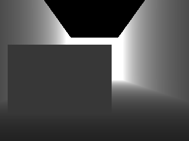
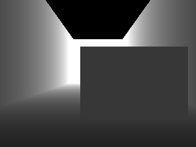

# Phase21 preflight — 사전등록 baseline 비교

Protocol `42f6768c90836142c6c39131691565581d2ecbf013c4748fe68867c0b4419e79` is FROZEN. Base20F3744de7 and protected sources/checkpoint/21-node Topomap are unchanged. No main navigation has run.

A* tuning used only registered20D/E/F saved jobs, before L2A geometry: {'smoothing_iterations': 0, 'lambda': 4.0}. {'lambda_value': 4.0, 'smoothing_iterations': 0, 'stage_balanced_acceptance': 0.6736111111111112, 'accepted': 18, 'cases': 26, 'median_depth_clearance_m': 0.04857756795673332, 'p95_s': 0.43151434699999996}

L2A depth-only spawn check passed for odd/even offsets±0.4m; no offset adjustment. Gaps0.5/1.3m; wide-gap center angle±37.95deg inside90deg FOV; over20,000 measured rays traversed the gap in each rendering. No navigation/inference or method execution was used in held-out geometry.

 

Unit tests10/10. Six L2 seed95 smokes only; their navigation outcomes are not used to tune or interpret performance. Maximum command replay error3.997e-15 (tolerance1e-12),72Hz pose replay error0.

| method | technical_validation | total_wall_s | command_replay_error | pose_replay_error |
| --- | --- | --- | --- | --- |
| B0_NOMAD_RAW | PASS | 198.16 | 0 | 0 |
| B1_SAFE_TE | PASS | 201.61 | 9.992e-16 | 0 |
| B2_SAFE_RTC | PASS | 204.28 | 3.9968e-15 | 0 |
| B3_M1 | PASS | 186.97 | 0 | 0 |
| B4_ASTAR | PASS | 187.27 | 0 | 0 |
| M3_GRAPH | PASS | 179.97 | 0 | 0 |

Measured60-run estimate=3.217h >2.5h, so the registered rule reduces main seeds to111–114:48 runs, estimated2.574h. Scene threshold2 and pooled threshold3 remain unchanged. The reduced estimate is still about4.4 minutes above2.5h; no further reduction was authorized. Technical retries can add time.

B1/B2 are Phase18 handoff 규칙 +20-F 공통 실행기. TE SP/alignment uses its latest selected active chunk while steering/expiry/KEEP retain the original ensemble. R2 A* outputs8 points with native endpoint/nearby free goal and trust region; R3 outputs B+10 points. Curvature remaining above4 is flagged. ASTAR live smoke applied a detour; no post-smoke algorithm or parameter adjustment.

One technical retry is allowed for each main attempt at the same scene/seed/method. A final primary technical failure excludes the whole scene×seed primary group; B0 never excludes primary comparisons. Final label prioritizes L2A and marks differing L2 labels MIXED_HELDOUT.
