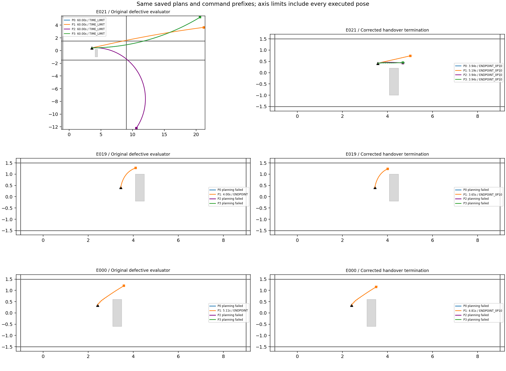
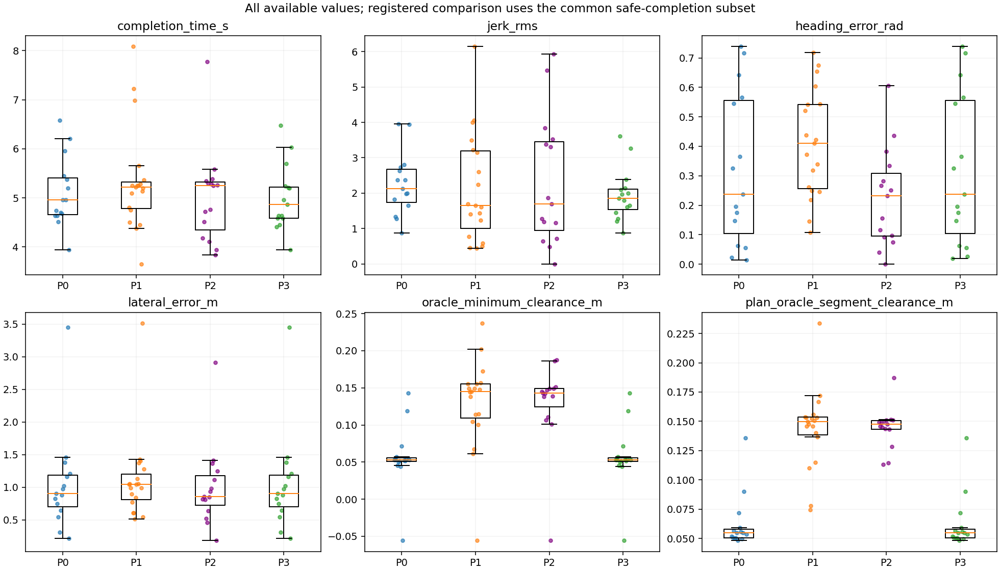
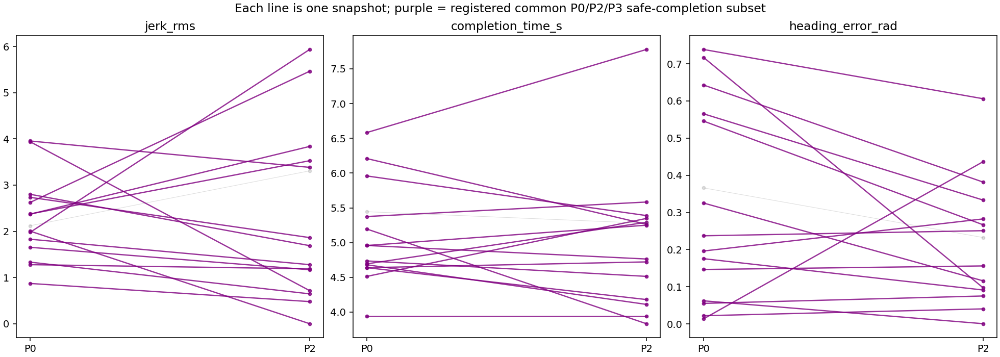

# Phase22-O2 — evaluator correction and reevaluation

Original label: **REFINE_NOT_BETTER — EVALUATION_DEFECT**. Original report, numeric results and trajectories are retained. Corrected label: **REFINE_READY**.

Frozen method/weight/criterion commit: `6250433`. All24 saved evaluation snapshots and all planned paths/dispositions/timings were reused unchanged. No Graph solve, retuning, Isaac, rendering or inference was performed.

## Registered evaluator correction

At every72Hz pose, stop at the first of: endpoint distance≤0.10m; monotone nearest-polyline projected progress≥path length; elapsed time>path length/0.05+actual accumulated initial alignment time (braking+rotation). All three set completed=True; the last also sets TIMEOUT=True. Priority for simultaneous conditions is endpoint, projection, timeout. Only intervals before this cutoff are evaluated for collision/clearance. This is a handover proxy, not a simulated next NoMaD prediction.

Commands/integration are unchanged: every corrected trajectory is an exact prefix of its saved original trajectory (maximum prefix pose error0). TIMEOUT and PROJECTED_END completions are kept in the existing common-completion calculation as explicitly requested; their counts and endpoint distances remain visible.

## Plan success and geometric safety (P1 included)

| scene | method | n | plan_success | plan_success_rate | plan_point_collisions | plan_segment_collisions | old_rollout_collisions | new_rollout_collisions | safe_completed | endpoint_0p10 | projected_end | TIMEOUT | minimum_clearance_m | time_median_s | jerk_median | heading_median_rad | lateral_median_m |
| --- | --- | --- | --- | --- | --- | --- | --- | --- | --- | --- | --- | --- | --- | --- | --- | --- | --- |
| L2 | P0 | 18 | 11 | 0.61111 | 0 | 0 | 7 | 1 | 10 | 11 | 0 | 0 | -0.055677 | 4.7361 | 2.3712 | 0.32527 | 0.88044 |
| L2 | P1 | 18 | 14 | 0.77778 | 0 | 0 | 2 | 1 | 13 | 14 | 0 | 0 | -0.055495 | 5.2361 | 2.4219 | 0.39112 | 1.0182 |
| L2 | P2 | 18 | 11 | 0.61111 | 0 | 0 | 6 | 1 | 10 | 11 | 0 | 0 | -0.055495 | 5.25 | 1.864 | 0.23257 | 0.85183 |
| L2 | P3 | 18 | 11 | 0.61111 | 0 | 0 | 4 | 1 | 10 | 11 | 0 | 0 | -0.055677 | 4.6389 | 1.8527 | 0.32527 | 0.88044 |
| L2A | P0 | 6 | 4 | 0.66667 | 0 | 0 | 2 | 0 | 4 | 4 | 0 | 0 | 0.052876 | 5.2847 | 1.9909 | 0.14633 | 1.1848 |
| L2A | P1 | 6 | 5 | 0.83333 | 0 | 0 | 2 | 0 | 5 | 5 | 0 | 0 | 0.14772 | 5.1944 | 1.2387 | 0.5431 | 1.2797 |
| L2A | P2 | 6 | 4 | 0.66667 | 0 | 0 | 2 | 0 | 4 | 3 | 1 | 0 | 0.14935 | 4.6042 | 0.94206 | 0.17423 | 1.1807 |
| L2A | P3 | 6 | 4 | 0.66667 | 0 | 0 | 1 | 0 | 4 | 4 | 0 | 0 | 0.052876 | 5.2014 | 1.8283 | 0.14633 | 1.1848 |
| ALL | P0 | 24 | 15 | 0.625 | 0 | 0 | 9 | 1 | 14 | 15 | 0 | 0 | -0.055677 | 4.9583 | 2.1212 | 0.23727 | 0.90352 |
| ALL | P1 | 24 | 19 | 0.79167 | 0 | 0 | 4 | 1 | 18 | 19 | 0 | 0 | -0.055495 | 5.2222 | 1.6482 | 0.40978 | 1.0464 |
| ALL | P2 | 24 | 15 | 0.625 | 0 | 0 | 8 | 1 | 14 | 14 | 1 | 0 | -0.055495 | 5.25 | 1.6894 | 0.23257 | 0.85405 |
| ALL | P3 | 24 | 15 | 0.625 | 0 | 0 | 5 | 1 | 14 | 15 | 0 | 0 | -0.055677 | 4.8611 | 1.8527 | 0.23727 | 0.90352 |

Point clearance tests vertices; segment clearance uses the existing exact segment/AABB distance and wall geometry, including the0.09m footprint. Plan collision columns are descriptive and were not added to frozen criterion(i).

## Unchanged criteria(i–v) and new LOW_N rule

| original_label | original_status | new_label | LOW_N | snapshot_n | common_completed_n | side_n | same_side | i | ii | iii | iv | v |
| --- | --- | --- | --- | --- | --- | --- | --- | --- | --- | --- | --- | --- |
| REFINE_NOT_BETTER | EVALUATION_DEFECT | REFINE_READY | False | 24 | 14 | 15 | 15 | True | True | True | True | True |

Criterion computation is the byte-identical6250433 decision function. The sole label annotation change is LOW_N when the corrected common safe-completion subset has fewer than10 snapshots (the prior snapshot-N<15 check is also retained). Plans and planned endpoint heading/lateral errors do not change. A changed common subset can change their comparison medians.

| method | completion_time_s | jerk_rms | heading_error_rad | lateral_error_m |
| --- | --- | --- | --- | --- |
| P0 | 4.8472 | 2.1873 | 0.2168 | 0.89198 |
| P2 | 5.0069 | 1.4838 | 0.20357 | 0.85294 |
| P3 | 4.75 | 1.907 | 0.2168 | 0.89198 |

## Snapshot-wise P2−P0 reference pairs

| case_id | scene | P0_accepted | P2_accepted | P0_jerk_rms | P2_jerk_rms | delta_jerk_rms | P0_completion_time_s | P2_completion_time_s | delta_completion_time_s | P0_heading_error_rad | P2_heading_error_rad | delta_heading_error_rad | both_safe_completed |
| --- | --- | --- | --- | --- | --- | --- | --- | --- | --- | --- | --- | --- | --- |
| E000 | L2 | False | False | — | — | — | — | — | — | — | — | — | False |
| E001 | L2 | True | True | 1.8284 | 1.2781 | -0.55027 | 4.6389 | 4.1806 | -0.45833 | 0.022191 | 0.04062 | 0.018429 | True |
| E002 | L2 | True | True | 1.3324 | 0.64609 | -0.68629 | 4.7361 | 4.5139 | -0.22222 | 0.32527 | 0.11609 | -0.20918 | True |
| E003 | L2 | True | True | 1.2776 | 1.1881 | -0.08947 | 4.6389 | 4.7222 | 0.083333 | 0.54574 | 0.26693 | -0.27881 | True |
| E004 | L2 | True | True | 2.3712 | 3.8369 | 1.4657 | 4.5139 | 5.3472 | 0.83333 | 0.14661 | 0.15616 | 0.0095511 | True |
| E005 | L2 | True | True | 3.9545 | 3.3842 | -0.57031 | 6.5833 | 7.7778 | 1.1944 | 0.19632 | 0.28261 | 0.086281 | True |
| E006 | L2 | False | False | — | — | — | — | — | — | — | — | — | False |
| E007 | L2 | False | False | — | — | — | — | — | — | — | — | — | False |
| E008 | L2 | False | False | — | — | — | — | — | — | — | — | — | False |
| E009 | L2 | False | False | — | — | — | — | — | — | — | — | — | False |
| E010 | L2 | False | False | — | — | — | — | — | — | — | — | — | False |
| E011 | L2 | False | False | — | — | — | — | — | — | — | — | — | False |
| E012 | L2 | True | True | 2.6254 | 5.4642 | 2.8388 | 4.6944 | 5.2917 | 0.59722 | 0.17556 | 0.091435 | -0.084126 | True |
| E013 | L2 | True | True | 2.7349 | 1.864 | -0.87084 | 4.6806 | 4.1111 | -0.56944 | 0.062247 | 0.00077037 | -0.061477 | True |
| E014 | L2 | True | True | 0.8709 | 0.4782 | -0.3927 | 4.9583 | 4.7639 | -0.19444 | 0.64278 | 0.38179 | -0.26099 | True |
| E015 | L2 | True | True | 2.1212 | 3.3085 | 1.1872 | 5.4444 | 5.2778 | -0.16667 | 0.36605 | 0.23257 | -0.13349 | False |
| E016 | L2 | True | True | 2.8008 | 1.6894 | -1.1114 | 5.9583 | 5.3889 | -0.56944 | 0.73845 | 0.60603 | -0.13242 | True |
| E017 | L2 | True | True | 2.3758 | 3.5276 | 1.1518 | 4.9583 | 5.25 | 0.29167 | 0.56531 | 0.33339 | -0.23192 | True |
| E018 | L2A | True | True | 1.9784 | 5.9357 | 3.9573 | 5.375 | 5.5833 | 0.20833 | 0.23727 | 0.25098 | 0.013708 | True |
| E019 | L2A | False | False | — | — | — | — | — | — | — | — | — | False |
| E020 | L2A | True | True | 2.0033 | 0 | -2.0033 | 5.1944 | 3.8333 | -1.3611 | 0.7169 | 0.09749 | -0.61941 | True |
| E021 | L2A | True | True | 1.6532 | 1.1677 | -0.48553 | 3.9444 | 3.9444 | 0 | 0.055382 | 0.075302 | 0.01992 | True |
| E022 | L2A | True | True | 3.938 | 0.7164 | -3.2216 | 6.2083 | 5.2639 | -0.94444 | 0.013932 | 0.43652 | 0.42259 | True |
| E023 | L2A | False | False | — | — | — | — | — | — | — | — | — | False |

## Why terminal heading worsens: diagnostic only

| accepted_pairs | heading_worsened_pairs | heading_gradient_share_median | heading_cost_fraction_median | heading_descent_blocked_pairs | other_cost_opposes_heading_descent_pairs | resampling_worsened_pairs | optimization_worsened_pairs | conclusion | dominant_opposing_factors |
| --- | --- | --- | --- | --- | --- | --- | --- | --- | --- |
| 15 | 6 | 0.09985 | 0.015858 | 0 | 6 | 0 | 6 | Stored-solution factor/constraint trade-off only. The causal claim that sigma0.52 alone is too weak cannot be established without a forbidden changed-weight counterfactual solve. | {'smoothness': 3, 'curvature_change': 2, 'terminal_lateral': 1} |

Planned heading errors are unchanged snapshot by snapshot. The old common subset had3 snapshots; the corrected subset has14. Thus the changed heading median is solely a conditioning/subset effect, not a changed path or weight. The earlier group-level degradation does not by itself establish that sigma0.52 is too weak.

| evaluation | method | heading_median_rad |
| --- | --- | --- |
| original defective | P0 | 0.062247 |
| original defective | P2 | 0.28261 |
| original defective | P3 | 0.062247 |
| corrected | P0 | 0.2168 |
| corrected | P2 | 0.20357 |
| corrected | P3 | 0.2168 |

Individual heading worsens in6/15 accepted P0/P2 pairs. In those cases, terminal-heading cost share median=1.59%, gradient share median=9.99%. Other terms oppose heading descent in6/6; direct active-constraint blockers occur in0/6. Dominant opposing terms: {'smoothness': 3, 'curvature_change': 2, 'terminal_lateral': 1}. This supports a soft-objective trade-off at the existing weights, not a causal demonstration that changing sigma would improve the complete criterion set.

The terminal heading factor is soft: r=2sin(error/2)/0.52, cost=r²/2. At30° its cost is about0.495; it is neither a hard heading tolerance nor a guarantee of improvement over P0. The table separates initialization resampling from optimization and compares heading cost/gradient contribution with other factors. At the saved solution, negative heading-gradient directions are checked against active frozen constraints (slack≤1e−5). No sigma was changed and no alternative optimum was computed.

| case_id | P0_heading_rad | initial_heading_rad | P2_heading_rad | delta_resampling_rad | delta_optimization_rad | heading_cost_fraction | heading_gradient_share | other_cost_directional_derivative | total_directional_derivative | active_constraint_blockers |
| --- | --- | --- | --- | --- | --- | --- | --- | --- | --- | --- |
| E001 | 0.022191 | 0.022191 | 0.04062 | 0 | 0.018429 | 0.00069212 | 0.029325 | 1.614 | 9.6165e-05 | [] |
| E002 | 0.32527 | 0.32527 | 0.11609 | 0 | -0.20918 | 0.0049533 | 0.08944 | 5.0662 | -0.00058494 | [] |
| E003 | 0.54574 | 0.54574 | 0.26693 | 0 | -0.27881 | 0.014985 | 0.050269 | -2.8749 | -13.946 | [] |
| E004 | 0.14661 | 0.14661 | 0.15616 | 0 | 0.0095511 | 0.016531 | 0.08489 | 6.2387 | -0.00027413 | [] |
| E005 | 0.19632 | 0.19632 | 0.28261 | 4.4409e-16 | 0.086281 | 0.015186 | 0.038303 | 0.22369 | -10.014 | [] |
| E012 | 0.17556 | 0.17556 | 0.091435 | 0 | -0.084126 | 0.0044879 | 0.050768 | 3.6075 | -0.00039178 | [] |
| E013 | 0.062247 | 0.062247 | 0.00077037 | 0 | -0.061477 | 2.0782e-07 | 0.00041776 | 0.028917 | -0.00088642 | [] |
| E014 | 0.64278 | 0.64278 | 0.38179 | -8.8818e-16 | -0.26099 | 0.046872 | 0.24209 | 14.888 | 0.00086948 | [] |
| E015 | 0.36605 | 0.36605 | 0.23257 | 0 | -0.13349 | 0.012151 | 0.074064 | 7.3253 | -1.4311 | [] |
| E016 | 0.73845 | 0.73845 | 0.60603 | -4.4409e-16 | -0.13242 | 0.014384 | 0.039022 | 23.833 | 4.219 | [] |
| E017 | 0.56531 | 0.56531 | 0.33339 | -4.4409e-16 | -0.23192 | 0.0079108 | 0.060346 | 9.449 | -1.615 | [] |
| E018 | 0.23727 | 0.23727 | 0.25098 | 0 | 0.013708 | 0.014002 | 0.11481 | 9.1667 | -0.0011585 | [] |
| E020 | 0.7169 | 0.7169 | 0.09749 | 0 | -0.61941 | 0.00032061 | 0.029823 | 3.8364 | -0.64997 | [] |
| E021 | 0.055382 | 0.055382 | 0.075302 | 0 | 0.01992 | 0.031379 | 0.14529 | 3.2387 | 0.00051846 | [] |
| E022 | 0.013932 | 0.013932 | 0.43652 | 0 | 0.42259 | 0.032449 | 0.16199 | 8.6374 | -5.4141 | [] |

Full factor costs, cost changes, gradients and blockers are in heading_diagnostics.csv/json. These can support a relative soft-objective trade-off or a constraint conflict, but cannot isolate sigma0.52 as a sufficient causal explanation.

## Corrected snapshot records

| case_id | method | accepted | termination | TIMEOUT | completed | duration_s | endpoint_distance_m | old_oracle_collision | oracle_collision | old_oracle_minimum_clearance_m | oracle_minimum_clearance_m | plan_oracle_point_collision | plan_oracle_segment_collision |
| --- | --- | --- | --- | --- | --- | --- | --- | --- | --- | --- | --- | --- | --- |
| E000 | P0 | False | — | — | — | — | — | — | — | — | — | — | — |
| E000 | P1 | True | ENDPOINT_0P10 | False | True | 4.8056 | 0.098586 | False | False | 0.15531 | 0.15531 | False | False |
| E000 | P3 | False | — | — | — | — | — | — | — | — | — | — | — |
| E000 | P2 | False | — | — | — | — | — | — | — | — | — | — | — |
| E001 | P0 | True | ENDPOINT_0P10 | False | True | 4.6389 | 0.099958 | False | False | 0.052773 | 0.052773 | False | False |
| E001 | P1 | True | ENDPOINT_0P10 | False | True | 4.5 | 0.096164 | True | False | -8.6794 | 0.14922 | False | False |
| E001 | P3 | True | ENDPOINT_0P10 | False | True | 4.4028 | 0.098918 | False | False | 0.052773 | 0.052773 | False | False |
| E001 | P2 | True | ENDPOINT_0P10 | False | True | 4.1806 | 0.098112 | True | False | -1.4247 | 0.14502 | False | False |
| E002 | P0 | True | ENDPOINT_0P10 | False | True | 4.7361 | 0.096441 | True | False | -0.38548 | 0.052761 | False | False |
| E002 | P1 | True | ENDPOINT_0P10 | False | True | 4.75 | 0.099291 | False | False | 0.14419 | 0.14419 | False | False |
| E002 | P3 | True | ENDPOINT_0P10 | False | True | 4.5833 | 0.095986 | False | False | 0.052761 | 0.052761 | False | False |
| E002 | P2 | True | ENDPOINT_0P10 | False | True | 4.5139 | 0.09639 | True | False | -0.551 | 0.14326 | False | False |
| E003 | P0 | True | ENDPOINT_0P10 | False | True | 4.6389 | 0.096802 | True | False | -10.087 | 0.057234 | False | False |
| E003 | P1 | True | ENDPOINT_0P10 | False | True | 5.0972 | 0.097946 | False | False | 0.13824 | 0.13824 | False | False |
| E003 | P3 | True | ENDPOINT_0P10 | False | True | 4.6389 | 0.096802 | True | False | -10.087 | 0.057234 | False | False |
| E003 | P2 | True | ENDPOINT_0P10 | False | True | 4.7222 | 0.095962 | True | False | -0.090002 | 0.13836 | False | False |
| E004 | P0 | True | ENDPOINT_0P10 | False | True | 4.5139 | 0.098259 | True | False | -0.090003 | 0.045418 | False | False |
| E004 | P1 | True | ENDPOINT_0P10 | False | True | 5.25 | 0.09839 | False | False | 0.14484 | 0.14484 | False | False |
| E004 | P3 | True | ENDPOINT_0P10 | False | True | 4.4444 | 0.096229 | False | False | 0.045418 | 0.045418 | False | False |
| E004 | P2 | True | ENDPOINT_0P10 | False | True | 5.3472 | 0.098128 | False | False | 0.14201 | 0.14201 | False | False |
| E005 | P0 | True | ENDPOINT_0P10 | False | True | 6.5833 | 0.099523 | False | False | 0.050512 | 0.050512 | False | False |
| E005 | P1 | True | ENDPOINT_0P10 | False | True | 8.0833 | 0.099763 | False | False | 0.10475 | 0.10475 | False | False |
| E005 | P3 | True | ENDPOINT_0P10 | False | True | 6.4722 | 0.098485 | False | False | 0.050186 | 0.050186 | False | False |
| E005 | P2 | True | ENDPOINT_0P10 | False | True | 7.7778 | 0.098675 | False | False | 0.10644 | 0.10644 | False | False |
| E006 | P0 | False | — | — | — | — | — | — | — | — | — | — | — |
| E006 | P1 | True | ENDPOINT_0P10 | False | True | 7.2222 | 0.095843 | False | False | 0.061378 | 0.061378 | False | False |
| E006 | P3 | False | — | — | — | — | — | — | — | — | — | — | — |
| E006 | P2 | False | — | — | — | — | — | — | — | — | — | — | — |
| E007 | P0 | False | — | — | — | — | — | — | — | — | — | — | — |
| E007 | P1 | False | — | — | — | — | — | — | — | — | — | — | — |
| E007 | P3 | False | — | — | — | — | — | — | — | — | — | — | — |
| E007 | P2 | False | — | — | — | — | — | — | — | — | — | — | — |
| E008 | P0 | False | — | — | — | — | — | — | — | — | — | — | — |
| E008 | P1 | False | — | — | — | — | — | — | — | — | — | — | — |
| E008 | P3 | False | — | — | — | — | — | — | — | — | — | — | — |
| E008 | P2 | False | — | — | — | — | — | — | — | — | — | — | — |
| E009 | P0 | False | — | — | — | — | — | — | — | — | — | — | — |
| E009 | P1 | True | ENDPOINT_0P10 | False | True | 6.9861 | 0.097642 | False | False | 0.067196 | 0.067196 | False | False |
| E009 | P3 | False | — | — | — | — | — | — | — | — | — | — | — |
| E009 | P2 | False | — | — | — | — | — | — | — | — | — | — | — |
| E010 | P0 | False | — | — | — | — | — | — | — | — | — | — | — |
| E010 | P1 | False | — | — | — | — | — | — | — | — | — | — | — |
| E010 | P3 | False | — | — | — | — | — | — | — | — | — | — | — |
| E010 | P2 | False | — | — | — | — | — | — | — | — | — | — | — |
| E011 | P0 | False | — | — | — | — | — | — | — | — | — | — | — |
| E011 | P1 | False | — | — | — | — | — | — | — | — | — | — | — |
| E011 | P3 | False | — | — | — | — | — | — | — | — | — | — | — |
| E011 | P2 | False | — | — | — | — | — | — | — | — | — | — | — |
| E012 | P0 | True | ENDPOINT_0P10 | False | True | 4.6944 | 0.099476 | False | False | 0.051444 | 0.051444 | False | False |
| E012 | P1 | True | ENDPOINT_0P10 | False | True | 5.2222 | 0.09879 | False | False | 0.14918 | 0.14918 | False | False |
| E012 | P3 | True | ENDPOINT_0P10 | False | True | 4.6389 | 0.096653 | True | False | -0.090003 | 0.051444 | False | False |
| E012 | P2 | True | ENDPOINT_0P10 | False | True | 5.2917 | 0.099596 | True | False | -1.5491 | 0.14682 | False | False |
| E013 | P0 | True | ENDPOINT_0P10 | False | True | 4.6806 | 0.099906 | False | False | 0.043907 | 0.043907 | False | False |
| E013 | P1 | True | ENDPOINT_0P10 | False | True | 4.375 | 0.096572 | False | False | 0.11386 | 0.11386 | False | False |
| E013 | P3 | True | ENDPOINT_0P10 | False | True | 4.5833 | 0.099732 | False | False | 0.043907 | 0.043907 | False | False |
| E013 | P2 | True | ENDPOINT_0P10 | False | True | 4.1111 | 0.099638 | False | False | 0.11049 | 0.11049 | False | False |
| E014 | P0 | True | ENDPOINT_0P10 | False | True | 4.9583 | 0.098945 | True | False | -8.637 | 0.071567 | False | False |
| E014 | P1 | True | ENDPOINT_0P10 | False | True | 5.25 | 0.099373 | False | False | 0.15544 | 0.15544 | False | False |
| E014 | P3 | True | ENDPOINT_0P10 | False | True | 4.9583 | 0.098945 | True | False | -8.637 | 0.071567 | False | False |
| E014 | P2 | True | ENDPOINT_0P10 | False | True | 4.7639 | 0.098591 | False | False | 0.14916 | 0.14916 | False | False |
| E015 | P0 | True | ENDPOINT_0P10 | False | True | 5.4444 | 0.098094 | True | True | -0.055677 | -0.055677 | False | False |
| E015 | P1 | True | ENDPOINT_0P10 | False | True | 5.25 | 0.097668 | True | True | -0.090003 | -0.055495 | False | False |
| E015 | P3 | True | ENDPOINT_0P10 | False | True | 5.2361 | 0.098077 | True | True | -0.055677 | -0.055677 | False | False |
| E015 | P2 | True | ENDPOINT_0P10 | False | True | 5.2778 | 0.09943 | True | True | -0.090003 | -0.055495 | False | False |
| E016 | P0 | True | ENDPOINT_0P10 | False | True | 5.9583 | 0.096044 | True | False | -0.048483 | 0.052541 | False | False |
| E016 | P1 | True | ENDPOINT_0P10 | False | True | 5.6528 | 0.096179 | False | False | 0.10017 | 0.10017 | False | False |
| E016 | P3 | True | ENDPOINT_0P10 | False | True | 5.6944 | 0.097663 | False | False | 0.052955 | 0.052955 | False | False |
| E016 | P2 | True | ENDPOINT_0P10 | False | True | 5.3889 | 0.098079 | True | False | -0.090002 | 0.10137 | False | False |
| E017 | P0 | True | ENDPOINT_0P10 | False | True | 4.9583 | 0.09832 | True | False | -10.371 | 0.051399 | False | False |
| E017 | P1 | True | ENDPOINT_0P10 | False | True | 4.4444 | 0.098856 | False | False | 0.11486 | 0.11486 | False | False |
| E017 | P3 | True | ENDPOINT_0P10 | False | True | 4.8611 | 0.09926 | False | False | 0.051399 | 0.051399 | False | False |
| E017 | P2 | True | ENDPOINT_0P10 | False | True | 5.25 | 0.098816 | False | False | 0.13882 | 0.13882 | False | False |
| E018 | P0 | True | ENDPOINT_0P10 | False | True | 5.375 | 0.098541 | True | False | -0.090003 | 0.054023 | False | False |
| E018 | P1 | True | ENDPOINT_0P10 | False | True | 5.2778 | 0.099173 | True | False | -11.304 | 0.14772 | False | False |
| E018 | P3 | True | ENDPOINT_0P10 | False | True | 5.2083 | 0.098193 | False | False | 0.054023 | 0.054023 | False | False |
| E018 | P2 | True | ENDPOINT_0P10 | False | True | 5.5833 | 0.097962 | False | False | 0.14935 | 0.14935 | False | False |
| E019 | P0 | False | — | — | — | — | — | — | — | — | — | — | — |
| E019 | P1 | True | ENDPOINT_0P10 | False | True | 3.6528 | 0.099939 | False | False | 0.13531 | 0.15642 | False | False |
| E019 | P3 | False | — | — | — | — | — | — | — | — | — | — | — |
| E019 | P2 | False | — | — | — | — | — | — | — | — | — | — | — |
| E020 | P0 | True | ENDPOINT_0P10 | False | True | 5.1944 | 0.099773 | False | False | 0.087611 | 0.1189 | False | False |
| E020 | P1 | True | ENDPOINT_0P10 | False | True | 5.1389 | 0.099449 | False | False | 0.16935 | 0.20218 | False | False |
| E020 | P3 | True | ENDPOINT_0P10 | False | True | 5.1944 | 0.099773 | False | False | 0.087611 | 0.1189 | False | False |
| E020 | P2 | True | PROJECTED_END | False | True | 3.8333 | 0.1016 | True | False | -0.84513 | 0.18639 | False | False |
| E021 | P0 | True | ENDPOINT_0P10 | False | True | 3.9444 | 0.096119 | True | False | -11.704 | 0.14302 | False | False |
| E021 | P1 | True | ENDPOINT_0P10 | False | True | 5.1944 | 0.096905 | True | False | -12.29 | 0.23699 | False | False |
| E021 | P3 | True | ENDPOINT_0P10 | False | True | 3.9444 | 0.096119 | True | False | -11.704 | 0.14302 | False | False |
| E021 | P2 | True | ENDPOINT_0P10 | False | True | 3.9444 | 0.097393 | True | False | -10.787 | 0.15104 | False | False |
| E022 | P0 | True | ENDPOINT_0P10 | False | True | 6.2083 | 0.099115 | False | False | 0.052876 | 0.052876 | False | False |
| E022 | P1 | True | ENDPOINT_0P10 | False | True | 5.3611 | 0.096865 | False | False | 0.17236 | 0.17236 | False | False |
| E022 | P3 | True | ENDPOINT_0P10 | False | True | 6.0278 | 0.099582 | False | False | 0.052876 | 0.052876 | False | False |
| E022 | P2 | True | ENDPOINT_0P10 | False | True | 5.2639 | 0.097304 | False | False | 0.18734 | 0.18734 | False | False |
| E023 | P0 | False | — | — | — | — | — | — | — | — | — | — | — |
| E023 | P1 | False | — | — | — | — | — | — | — | — | — | — | — |
| E023 | P3 | False | — | — | — | — | — | — | — | — | — | — | — |
| E023 | P2 | False | — | — | — | — | — | — | — | — | — | — | — |

This remains post-hoc offline mechanism validation on the same snapshots. The defect correction removes post-path collision counting; it does not validate closed-loop navigation, future depth updates, NoMaD reaction or3D contact physics.

REFINE_READY
