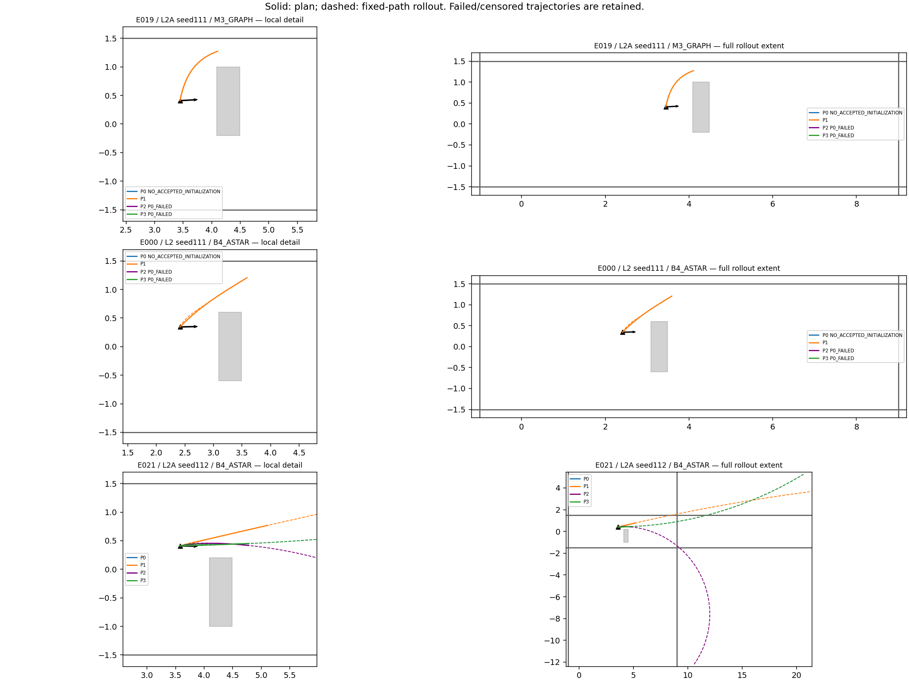
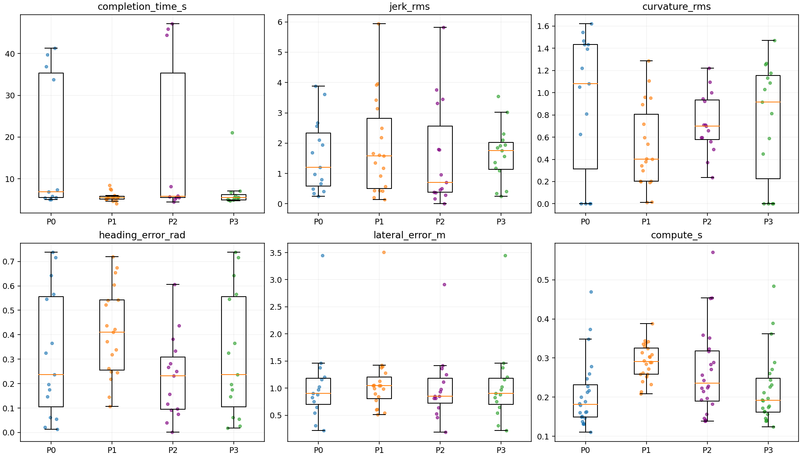
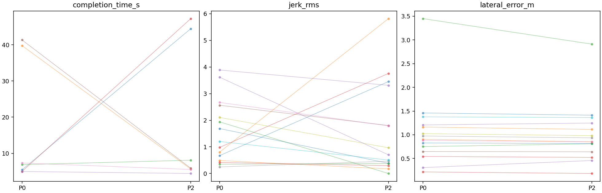

# Phase22-O — A* + Graph refinement / offline mechanism validation

> **EVALUATION_DEFECT** — The original `REFINE_NOT_BETTER` label and results below are preserved. The1cm endpoint check could miss handover and count collisions during continued60s execution beyond the path. See [Phase22-O2 corrected reevaluation](PHASE22O2_REEVAL.md); methods and weights remain frozen.

Frozen weights: `{'p3_strength': 0.5, 'p3_name': 'P3_01', 'p2_settings': {'sigma_k': 0.5, 'sigma_delta': 1.0, 'sigma_heading': 0.52, 'sigma_lateral': 0.3}, 'p2_candidate': 7}`. Training26 saved20D/E/F snapshots; evaluation24 final Phase21 B4/M3 A/B triggers. Disjoint run/seed/snapshot identities verified. No Isaac, new render or NoMaD inference. Original files and Phase21 parameters unchanged.

P0 is frozen Phase21 A* R3. P1 is frozen20F seven-start R3, four CPU workers. P2 uses only resampled P0 as initialization plus the registered path-tube, curvature, curvature-change and terminal consistency terms. P3 uses the selected Chaikin strength with three halvings and P0 fallback. P2 failure behavior: reject.

Every method has the same1s planning budget. P2/P3 include P0 plus transfer/refinement; timings exceeding1s are reported and rejected. Worker initialization is outside the per-snapshot budget, matching the existing runtime. Planning is counterfactually applied at fixed B: solve latency does not move B.

Anchor convention: spawn_pose. Spawn-preceding odometry is a logged experimental appearance-time input, not an online detector; the two pre-spawn training snapshots use current B rather than future pose. Oracle box/wall coordinates enter only passive evaluation.

Evaluation frozen Git SHA: `6250433ea27c09f8a98918bda970070698df39e1`.

Summary tables and distribution plots use all available values per method. The registered comparison medians below use only the explicitly reported common safe-completion subset, which is3 snapshots here; these denominators must not be conflated.

## By scene and overall

| scene | method | n | plans | plan_failed | oracle_collisions | completed | safe_completion | depth_collisions | oracle_minimum_clearance_m | wide_choice | wide_choice_n | completion_median_s | jerk_median | omega_saturation_median | tracking_rms_median | tracking_max_median | curvature_rms_median | curvature_max_median | delta_curvature_rms_median | heading_error_median_rad | lateral_error_median_m | compute_p50_s | compute_p95_s | over_1s |
| --- | --- | --- | --- | --- | --- | --- | --- | --- | --- | --- | --- | --- | --- | --- | --- | --- | --- | --- | --- | --- | --- | --- | --- | --- |
| L2 | P0 | 18 | 11 | 7 | 7 | 8 | 4 | 0 | -10.371 | 0 | 0 | 6.3333 | 1.2026 | 0.0037037 | 0.89693 | 1.6067 | 1.2209 | 3.6628 | 1.8314 | 0.32527 | 0.88044 | 0.16243 | 0.26211 | 0 |
| L2 | P1 | 18 | 14 | 4 | 2 | 12 | 12 | 0 | -8.6794 | 0 | 0 | 5.5556 | 1.9217 | 0.14609 | 0.0055356 | 0.015612 | 0.47108 | 0.75755 | 0.21649 | 0.39112 | 1.0182 | 0.28893 | 0.34289 | 0 |
| L2 | P2 | 18 | 11 | 7 | 6 | 8 | 5 | 0 | -1.5491 | 0 | 0 | 6.8889 | 0.96741 | 0.18 | 0.74567 | 1.3937 | 0.70891 | 0.95284 | 0.13916 | 0.23257 | 0.85183 | 0.22377 | 0.37275 | 0 |
| L2 | P3 | 18 | 11 | 7 | 4 | 9 | 7 | 0 | -10.087 | 0 | 0 | 5.2222 | 1.7589 | 0.042553 | 0.0080106 | 0.020711 | 1.0289 | 2.8003 | 1.3524 | 0.32527 | 0.88044 | 0.17537 | 0.27572 | 0 |
| L2A | P0 | 6 | 4 | 2 | 2 | 3 | 2 | 0 | -11.704 | 3 | 4 | 7.3333 | 1.3712 | 0.079461 | 0.49802 | 0.90118 | 0.54016 | 1.6205 | 0.81024 | 0.14633 | 1.1848 | 0.26924 | 0.44522 | 0 |
| L2A | P1 | 6 | 5 | 1 | 2 | 3 | 3 | 0 | -12.29 | 3 | 5 | 5.4444 | 0.56738 | 0 | 0.048722 | 0.092099 | 0.20511 | 0.33469 | 0.094068 | 0.5431 | 1.2797 | 0.29588 | 0.36809 | 0 |
| L2A | P2 | 6 | 4 | 2 | 2 | 2 | 2 | 0 | -10.787 | 3 | 4 | 5.7222 | 0.49743 | 0.066038 | 0.37888 | 0.66949 | 0.5243 | 0.63169 | 0.036215 | 0.17423 | 1.1807 | 0.28646 | 0.542 | 0 |
| L2A | P3 | 6 | 4 | 2 | 1 | 3 | 3 | 0 | -11.704 | 3 | 4 | 5.5556 | 1.7511 | 0.081829 | 0.053017 | 0.096049 | 0.40589 | 1.144 | 0.47918 | 0.14633 | 1.1848 | 0.28006 | 0.46045 | 0 |
| ALL | P0 | 24 | 15 | 9 | 9 | 11 | 6 | 0 | -11.704 | 3 | 4 | 6.8889 | 1.2026 | 0.0074074 | 0.89693 | 1.6067 | 1.0803 | 3.241 | 1.6205 | 0.23727 | 0.90352 | 0.18128 | 0.36937 | 0 |
| ALL | P1 | 24 | 19 | 5 | 4 | 15 | 15 | 0 | -12.29 | 3 | 5 | 5.5556 | 1.5744 | 0.13636 | 0.0055557 | 0.015879 | 0.40152 | 0.62515 | 0.17412 | 0.40978 | 1.0464 | 0.29116 | 0.34394 | 0 |
| ALL | P2 | 24 | 15 | 9 | 8 | 10 | 7 | 0 | -10.787 | 3 | 4 | 5.7778 | 0.70132 | 0.13208 | 0.74567 | 1.3348 | 0.70029 | 0.92151 | 0.12431 | 0.23257 | 0.85405 | 0.2355 | 0.45418 | 0 |
| ALL | P3 | 24 | 15 | 9 | 5 | 12 | 10 | 0 | -11.704 | 3 | 4 | 5.5556 | 1.7589 | 0.042553 | 0.010536 | 0.025605 | 0.91497 | 2.534 | 0.95835 | 0.23727 | 0.90352 | 0.19167 | 0.38528 | 0 |

## Registered decision

| label | LOW_N | snapshot_n | common_completion_n | side_n | same_side | i | ii | iii | iv | v |
| --- | --- | --- | --- | --- | --- | --- | --- | --- | --- | --- |
| REFINE_NOT_BETTER | False | 24 | 3 | 15 | 15 | False | True | True | True | False |

Criteria(iii–v) use the same jointly planned, collision-free completed snapshots across P0/P2/P3; the paired N is shown, no failed or censored time is imputed. Side matching excludes undefined P0 choices and counts missing P2 side as mismatch; no side denominator cannot pass. Wider-gap rates exclude equal-width ties. Front-face/gap intent and actual rear-footprint passage side are separately recorded.

| method | completion_time_s | jerk_rms | heading_error_rad | lateral_error_m |
| --- | --- | --- | --- | --- |
| P0 | 6.8889 | 3.6173 | 0.062247 | 0.88044 |
| P2 | 5.5556 | 1.789 | 0.28261 | 0.85183 |
| P3 | 6.7778 | 3.0135 | 0.062247 | 0.88044 |

## All snapshots, including failures

| case_id | scene | index | source_method | method | disposition | completed | oracle_collision | oracle_minimum_clearance_m | side | side_source | executed_side | compute_s |
| --- | --- | --- | --- | --- | --- | --- | --- | --- | --- | --- | --- | --- |
| E000 | L2 | 111 | B4_ASTAR | P0 | NO_ACCEPTED_INITIALIZATION | — | — | — | — | — | — | 0.1835 |
| E000 | L2 | 111 | B4_ASTAR | P1 | ACCEPTED | True | False | 0.15531 | +Y | FRONT_FACE_CROSSING | +Y | 0.25882 |
| E000 | L2 | 111 | B4_ASTAR | P3 | P0_FAILED | — | — | — | — | — | — | 0.19282 |
| E000 | L2 | 111 | B4_ASTAR | P2 | P0_FAILED | — | — | — | — | — | — | 0.19282 |
| E001 | L2 | 111 | B4_ASTAR | P0 | ACCEPTED | True | False | 0.052773 | +Y | FRONT_FACE_CROSSING | +Y | 0.16006 |
| E001 | L2 | 111 | B4_ASTAR | P1 | ACCEPTED | False | True | -8.6794 | +Y | FRONT_FACE_CROSSING | +Y | 0.20895 |
| E001 | L2 | 111 | B4_ASTAR | P3 | ACCEPTED | True | False | 0.052773 | +Y | FRONT_FACE_CROSSING | +Y | 0.17222 |
| E001 | L2 | 111 | B4_ASTAR | P2 | ACCEPTED | True | True | -1.4247 | +Y | FRONT_FACE_CROSSING | +Y | 0.22277 |
| E002 | L2 | 111 | M3_GRAPH | P0 | ACCEPTED | True | True | -0.38548 | +Y | FRONT_FACE_CROSSING | +Y | 0.17906 |
| E002 | L2 | 111 | M3_GRAPH | P1 | ACCEPTED | True | False | 0.14419 | +Y | FRONT_FACE_CROSSING | +Y | 0.21399 |
| E002 | L2 | 111 | M3_GRAPH | P3 | ACCEPTED | True | False | 0.052761 | +Y | FRONT_FACE_CROSSING | +Y | 0.19052 |
| E002 | L2 | 111 | M3_GRAPH | P2 | ACCEPTED | False | True | -0.551 | +Y | FRONT_FACE_CROSSING | +Y | 0.25692 |
| E003 | L2 | 112 | B4_ASTAR | P0 | ACCEPTED | False | True | -10.087 | +Y | FRONT_FACE_CROSSING | +Y | 0.19974 |
| E003 | L2 | 112 | B4_ASTAR | P1 | ACCEPTED | True | False | 0.13824 | +Y | FRONT_FACE_CROSSING | — | 0.31419 |
| E003 | L2 | 112 | B4_ASTAR | P3 | ACCEPTED | False | True | -10.087 | +Y | FRONT_FACE_CROSSING | +Y | 0.2115 |
| E003 | L2 | 112 | B4_ASTAR | P2 | ACCEPTED | True | True | -0.090002 | +Y | FRONT_FACE_CROSSING | +Y | 0.35854 |
| E004 | L2 | 112 | M3_GRAPH | P0 | ACCEPTED | True | True | -0.090003 | +Y | FRONT_FACE_CROSSING | +Y | 0.1491 |
| E004 | L2 | 112 | M3_GRAPH | P1 | ACCEPTED | True | False | 0.14484 | +Y | FRONT_FACE_CROSSING | +Y | 0.23969 |
| E004 | L2 | 112 | M3_GRAPH | P3 | ACCEPTED | True | False | 0.045418 | +Y | FRONT_FACE_CROSSING | +Y | 0.16285 |
| E004 | L2 | 112 | M3_GRAPH | P2 | ACCEPTED | True | False | 0.14201 | +Y | FRONT_FACE_CROSSING | +Y | 0.21515 |
| E005 | L2 | 112 | M3_GRAPH | P0 | ACCEPTED | True | False | 0.050512 | +Y | FRONT_FACE_CROSSING | +Y | 0.15111 |
| E005 | L2 | 112 | M3_GRAPH | P1 | ACCEPTED | True | False | 0.10475 | +Y | FRONT_FACE_CROSSING | +Y | 0.26147 |
| E005 | L2 | 112 | M3_GRAPH | P3 | ACCEPTED | True | False | 0.050186 | +Y | FRONT_FACE_CROSSING | +Y | 0.16404 |
| E005 | L2 | 112 | M3_GRAPH | P2 | ACCEPTED | True | False | 0.10644 | +Y | FRONT_FACE_CROSSING | +Y | 0.24308 |
| E006 | L2 | 112 | M3_GRAPH | P0 | NO_ACCEPTED_INITIALIZATION | — | — | — | — | — | — | 0.13758 |
| E006 | L2 | 112 | M3_GRAPH | P1 | ACCEPTED | True | False | 0.061378 | +Y | FRONT_FACE_CROSSING | +Y | 0.33627 |
| E006 | L2 | 112 | M3_GRAPH | P3 | P0_FAILED | — | — | — | — | — | — | 0.14548 |
| E006 | L2 | 112 | M3_GRAPH | P2 | P0_FAILED | — | — | — | — | — | — | 0.14548 |
| E007 | L2 | 112 | M3_GRAPH | P0 | NO_ACCEPTED_INITIALIZATION | — | — | — | — | — | — | 0.13088 |
| E007 | L2 | 112 | M3_GRAPH | P1 | NO_ACCEPTED_INITIALIZATION | — | — | — | — | — | — | 0.29312 |
| E007 | L2 | 112 | M3_GRAPH | P3 | P0_FAILED | — | — | — | — | — | — | 0.13902 |
| E007 | L2 | 112 | M3_GRAPH | P2 | P0_FAILED | — | — | — | — | — | — | 0.13902 |
| E008 | L2 | 112 | M3_GRAPH | P0 | NO_ACCEPTED_INITIALIZATION | — | — | — | — | — | — | 0.13226 |
| E008 | L2 | 112 | M3_GRAPH | P1 | NO_ACCEPTED_INITIALIZATION | — | — | — | — | — | — | 0.32944 |
| E008 | L2 | 112 | M3_GRAPH | P3 | P0_FAILED | — | — | — | — | — | — | 0.14163 |
| E008 | L2 | 112 | M3_GRAPH | P2 | P0_FAILED | — | — | — | — | — | — | 0.14163 |
| E009 | L2 | 112 | M3_GRAPH | P0 | NO_ACCEPTED_INITIALIZATION | — | — | — | — | — | — | 0.13151 |
| E009 | L2 | 112 | M3_GRAPH | P1 | ACCEPTED | True | False | 0.067196 | +Y | FRONT_FACE_CROSSING | +Y | 0.34417 |
| E009 | L2 | 112 | M3_GRAPH | P3 | P0_FAILED | — | — | — | — | — | — | 0.13968 |
| E009 | L2 | 112 | M3_GRAPH | P2 | P0_FAILED | — | — | — | — | — | — | 0.13968 |
| E010 | L2 | 112 | M3_GRAPH | P0 | NO_ACCEPTED_INITIALIZATION | — | — | — | — | — | — | 0.14736 |
| E010 | L2 | 112 | M3_GRAPH | P1 | NO_ACCEPTED_INITIALIZATION | — | — | — | — | — | — | 0.3384 |
| E010 | L2 | 112 | M3_GRAPH | P3 | P0_FAILED | — | — | — | — | — | — | 0.15609 |
| E010 | L2 | 112 | M3_GRAPH | P2 | P0_FAILED | — | — | — | — | — | — | 0.15609 |
| E011 | L2 | 113 | B4_ASTAR | P0 | NO_ACCEPTED_INITIALIZATION | — | — | — | — | — | — | 0.18836 |
| E011 | L2 | 113 | B4_ASTAR | P1 | NO_ACCEPTED_INITIALIZATION | — | — | — | — | — | — | 0.28475 |
| E011 | L2 | 113 | B4_ASTAR | P3 | P0_FAILED | — | — | — | — | — | — | 0.19674 |
| E011 | L2 | 113 | B4_ASTAR | P2 | P0_FAILED | — | — | — | — | — | — | 0.19674 |
| E012 | L2 | 113 | M3_GRAPH | P0 | ACCEPTED | True | False | 0.051444 | +Y | FRONT_FACE_CROSSING | +Y | 0.16168 |
| E012 | L2 | 113 | M3_GRAPH | P1 | ACCEPTED | True | False | 0.14918 | +Y | FRONT_FACE_CROSSING | +Y | 0.25217 |
| E012 | L2 | 113 | M3_GRAPH | P3 | ACCEPTED | True | True | -0.090003 | +Y | FRONT_FACE_CROSSING | +Y | 0.17367 |
| E012 | L2 | 113 | M3_GRAPH | P2 | ACCEPTED | True | True | -1.5491 | +Y | FRONT_FACE_CROSSING | +Y | 0.22477 |
| E013 | L2 | 113 | M3_GRAPH | P0 | ACCEPTED | True | False | 0.043907 | +Y | FRONT_FACE_CROSSING | +Y | 0.16319 |
| E013 | L2 | 113 | M3_GRAPH | P1 | ACCEPTED | True | False | 0.11386 | +Y | FRONT_FACE_CROSSING | +Y | 0.25899 |
| E013 | L2 | 113 | M3_GRAPH | P3 | ACCEPTED | True | False | 0.043907 | +Y | FRONT_FACE_CROSSING | +Y | 0.17706 |
| E013 | L2 | 113 | M3_GRAPH | P2 | ACCEPTED | True | False | 0.11049 | +Y | FRONT_FACE_CROSSING | +Y | 0.22793 |
| E014 | L2 | 114 | B4_ASTAR | P0 | ACCEPTED | False | True | -8.637 | +Y | FRONT_FACE_CROSSING | +Y | 0.24689 |
| E014 | L2 | 114 | B4_ASTAR | P1 | ACCEPTED | True | False | 0.15544 | +Y | FRONT_FACE_CROSSING | — | 0.32397 |
| E014 | L2 | 114 | B4_ASTAR | P3 | ACCEPTED | False | True | -8.637 | +Y | FRONT_FACE_CROSSING | +Y | 0.26044 |
| E014 | L2 | 114 | B4_ASTAR | P2 | ACCEPTED | True | False | 0.14916 | +Y | FRONT_FACE_CROSSING | — | 0.31697 |
| E015 | L2 | 114 | M3_GRAPH | P0 | ACCEPTED | True | True | -0.055677 | +Y | FRONT_FACE_CROSSING | +Y | 0.21249 |
| E015 | L2 | 114 | M3_GRAPH | P1 | ACCEPTED | False | True | -0.090003 | +Y | FRONT_FACE_CROSSING | +Y | 0.34266 |
| E015 | L2 | 114 | M3_GRAPH | P3 | ACCEPTED | True | True | -0.055677 | +Y | FRONT_FACE_CROSSING | +Y | 0.2264 |
| E015 | L2 | 114 | M3_GRAPH | P2 | ACCEPTED | False | True | -0.090003 | +Y | FRONT_FACE_CROSSING | +Y | 0.32354 |
| E016 | L2 | 114 | M3_GRAPH | P0 | ACCEPTED | True | True | -0.048483 | -Y | FRONT_FACE_CROSSING | -Y | 0.2269 |
| E016 | L2 | 114 | M3_GRAPH | P1 | ACCEPTED | True | False | 0.10017 | -Y | FRONT_FACE_CROSSING | — | 0.27244 |
| E016 | L2 | 114 | M3_GRAPH | P3 | ACCEPTED | True | False | 0.052955 | -Y | FRONT_FACE_CROSSING | — | 0.24417 |
| E016 | L2 | 114 | M3_GRAPH | P2 | ACCEPTED | False | True | -0.090002 | -Y | FRONT_FACE_CROSSING | -Y | 0.35112 |
| E017 | L2 | 114 | M3_GRAPH | P0 | ACCEPTED | False | True | -10.371 | -Y | FRONT_FACE_CROSSING | -Y | 0.34834 |
| E017 | L2 | 114 | M3_GRAPH | P1 | ACCEPTED | True | False | 0.11486 | -Y | FRONT_FACE_CROSSING | -Y | 0.30361 |
| E017 | L2 | 114 | M3_GRAPH | P3 | ACCEPTED | True | False | 0.051399 | -Y | FRONT_FACE_CROSSING | -Y | 0.36231 |
| E017 | L2 | 114 | M3_GRAPH | P2 | ACCEPTED | True | False | 0.13882 | -Y | FRONT_FACE_CROSSING | -Y | 0.45332 |
| E018 | L2A | 111 | B4_ASTAR | P0 | ACCEPTED | True | True | -0.090003 | -Y | FRONT_FACE_CROSSING | -Y | 0.21704 |
| E018 | L2A | 111 | B4_ASTAR | P1 | ACCEPTED | False | True | -11.304 | -Y | FRONT_FACE_CROSSING | -Y | 0.30257 |
| E018 | L2A | 111 | B4_ASTAR | P3 | ACCEPTED | True | False | 0.054023 | -Y | FRONT_FACE_CROSSING | -Y | 0.2311 |
| E018 | L2A | 111 | B4_ASTAR | P2 | ACCEPTED | True | False | 0.14935 | -Y | FRONT_FACE_CROSSING | -Y | 0.28363 |
| E019 | L2A | 111 | M3_GRAPH | P0 | NO_ACCEPTED_INITIALIZATION | — | — | — | — | — | — | 0.25999 |
| E019 | L2A | 111 | M3_GRAPH | P1 | ACCEPTED | True | False | 0.13531 | +Y | FRONT_FACE_CROSSING | — | 0.28881 |
| E019 | L2A | 111 | M3_GRAPH | P3 | P0_FAILED | — | — | — | — | — | — | 0.27082 |
| E019 | L2A | 111 | M3_GRAPH | P2 | P0_FAILED | — | — | — | — | — | — | 0.27082 |
| E020 | L2A | 111 | M3_GRAPH | P0 | ACCEPTED | True | False | 0.087611 | +Y | ENDPOINT_IN_GAP | — | 0.37308 |
| E020 | L2A | 111 | M3_GRAPH | P1 | ACCEPTED | True | False | 0.16935 | +Y | ENDPOINT_IN_GAP | — | 0.23222 |
| E020 | L2A | 111 | M3_GRAPH | P3 | ACCEPTED | True | False | 0.087611 | +Y | ENDPOINT_IN_GAP | — | 0.38933 |
| E020 | L2A | 111 | M3_GRAPH | P2 | ACCEPTED | False | True | -0.84513 | +Y | ENDPOINT_IN_GAP | — | 0.45433 |
| E021 | L2A | 112 | B4_ASTAR | P0 | ACCEPTED | False | True | -11.704 | +Y | FRONT_FACE_CROSSING | +Y | 0.10999 |
| E021 | L2A | 112 | B4_ASTAR | P1 | ACCEPTED | False | True | -12.29 | +Y | FRONT_FACE_CROSSING | +Y | 0.28919 |
| E021 | L2A | 112 | B4_ASTAR | P3 | ACCEPTED | False | True | -11.704 | +Y | FRONT_FACE_CROSSING | +Y | 0.12414 |
| E021 | L2A | 112 | B4_ASTAR | P2 | ACCEPTED | False | True | -10.787 | +Y | FRONT_FACE_CROSSING | +Y | 0.18257 |
| E022 | L2A | 113 | B4_ASTAR | P0 | ACCEPTED | True | False | 0.052876 | -Y | FRONT_FACE_CROSSING | -Y | 0.46927 |
| E022 | L2A | 113 | B4_ASTAR | P1 | ACCEPTED | True | False | 0.17236 | -Y | FRONT_FACE_CROSSING | -Y | 0.30868 |
| E022 | L2A | 113 | B4_ASTAR | P3 | ACCEPTED | True | False | 0.052876 | -Y | FRONT_FACE_CROSSING | -Y | 0.48416 |
| E022 | L2A | 113 | B4_ASTAR | P2 | ACCEPTED | True | False | 0.18734 | -Y | FRONT_FACE_CROSSING | — | 0.57123 |
| E023 | L2A | 113 | M3_GRAPH | P0 | NO_ACCEPTED_INITIALIZATION | — | — | — | — | — | — | 0.2785 |
| E023 | L2A | 113 | M3_GRAPH | P1 | NO_ACCEPTED_INITIALIZATION | — | — | — | — | — | — | 0.38789 |
| E023 | L2A | 113 | M3_GRAPH | P3 | P0_FAILED | — | — | — | — | — | — | 0.28929 |
| E023 | L2A | 113 | M3_GRAPH | P2 | P0_FAILED | — | — | — | — | — | — | 0.28929 |

The controller reuses protected SPAlignment at9/72Hz, with a60s diagnostic cap. Oracle evaluation is passive; collision does not shorten execution to make a method appear faster. The0.30m tube is a distance constraint, not a mathematical homotopy guarantee. A first-stage ALL_UNSAFE snapshot is counterfactually evaluated at the R3 slot for every method; it is not a replay of the original R2 output. The fixed controller can miss its1cm endpoint tolerance and continue until the60s cap; incompletion and the full trajectory are preserved. There is no next FRESH, depth update,3D contact physics or NoMaD reaction. These results cannot establish closed-loop navigation improvement.

REFINE_NOT_BETTER
