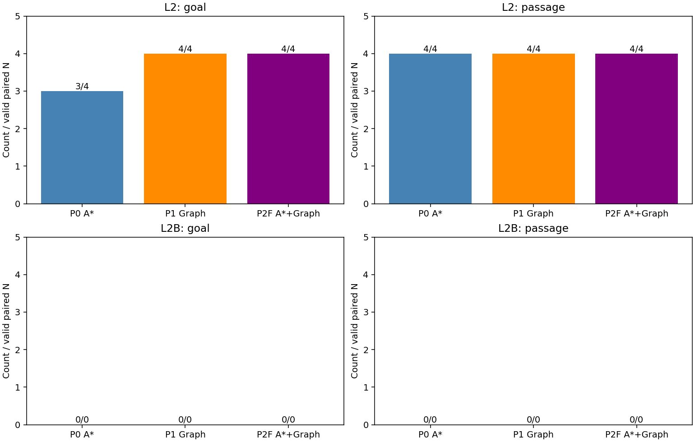
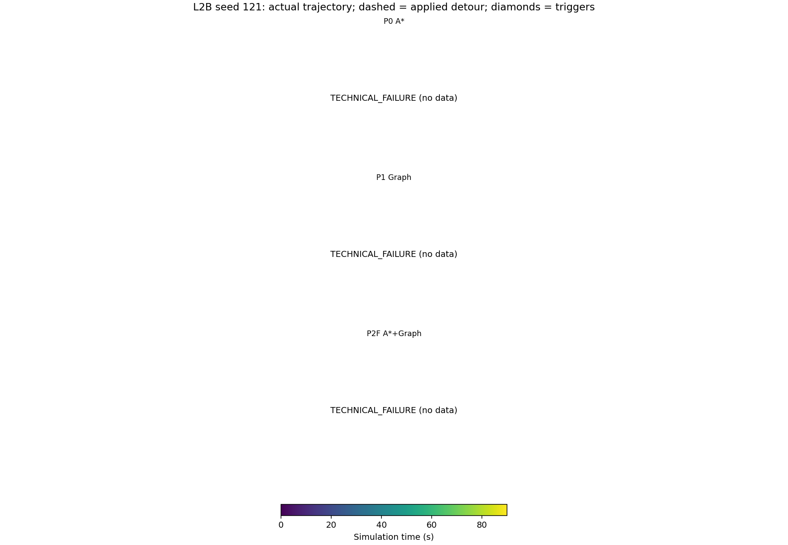
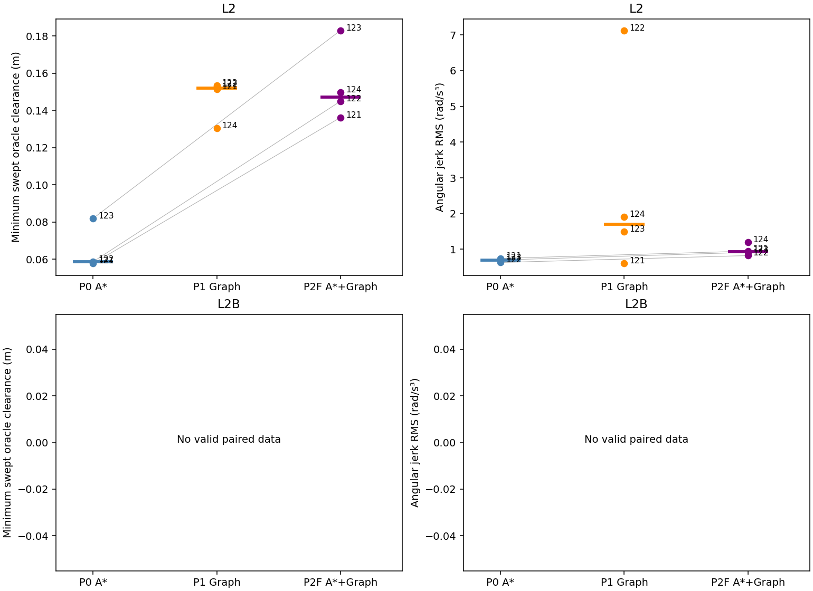

# Phase22 — preregistered A* + Graph refinement drive comparison

Protocol SHA256 `1a95ebbdc2a5fc3666a5cffd6fd16a37344e53f12c075532747ad0a4f2f932a0`; seeds [121, 122, 123, 124]; 24 planned runs. Final label: **REFINE_INCONCLUSIVE**; additional: **MIXED_HELDOUT**. L2B takes priority; pooled results are descriptive.

P0 is frozen Phase21 B4; P1 is frozen Phase21 M3. P2F keeps R2 as Phase21 A* and substitutes only the R3 composite: A* → frozen6250433 refinement; refinement failure/timeout uses its cached A* path; A* failure attempts the unchanged seven-start Graph only within the remaining1s. No remaining budget gives NONE. All use unchanged SP/alignment/selection/fallback/recovery/trigger/NoMaD timing. The22-O2 evaluator cutoff is not an online controller change.

Anchor source: B trigger: depth component t_new odometry XY, unchanged20F component u_ref ([t_new-216,t_new], heading fallback if displacement<0.3m); A trigger: current B XY and unchanged20F A u_ref. No spawn timing input.. Box/wall coordinates are not sent to planners. L2B uses actual±20° box rendering and exact rigid-transformed swept collision, not an enclosing-AABB collision approximation. Front placement follows the inherited world+X support-distance convention; the actual forward-ray distance is also logged.

Unlike22-O offline (spawn-previous odometry), the online return line uses observable depth history only. Trigger B uses the component first-occupied t_new pose and the frozen20-F u_ref from [t_new−216,t_new] (its existing heading fallback for displacement<0.3m). Trigger A uses its unchanged20-F u_ref through the trigger B pose. Weights and optimizer remain frozen; spawn timing is not supplied to the planner.

## Outcomes and execution metrics

| scene | method | n | goal | passage | passage_censored | passage_median_s | goal_time_median_s | collisions | box_collisions | wall_intrusions | detour_clearance_median_m | detour_box_clearance_median_m | detour_wall_clearance_median_m | jerk_rms_median | curvature_rms_median | reblock | handover_3s_progress_median_m | GRAPH_FALLBACK_runs | branch_applications | backend_time_s | decision_latency_s | technical_final | technical_attempts |
| --- | --- | --- | --- | --- | --- | --- | --- | --- | --- | --- | --- | --- | --- | --- | --- | --- | --- | --- | --- | --- | --- | --- | --- |
| L2 | P0_ASTAR | 4 | 3 | 4 | 0 | 19.458 | 72.722 | 0 | 0 | 0 | 0.058635 | 0.058635 | 0.60705 | 0.69998 | 0.40292 | 1 | 0.18771 | 0 | {'REFINED': 0, 'A*_RAW': 0, 'GRAPH_FALLBACK': 0, 'NONE': 0} | {'n': 4, 'p50': 0.2561023345, 'p95': 0.2932607864} | {'n': 4, 'p50': 0.32112856749999996, 'p95': 0.325943606} | 0 | 0 |
| L2 | P1_GRAPH | 4 | 4 | 4 | 0 | 15.014 | 67.278 | 0 | 0 | 0 | 0.15209 | 0.15209 | 0.61275 | 1.6988 | 0.63911 | 0 | 0.21793 | 0 | {'REFINED': 0, 'A*_RAW': 0, 'GRAPH_FALLBACK': 0, 'NONE': 0} | {'n': 4, 'p50': 0.3177036405, 'p95': 0.4809981679499999} | {'n': 4, 'p50': 0.379890096, 'p95': 0.5297760726499999} | 0 | 0 |
| L2 | P2F_ASTAR_GRAPH | 4 | 4 | 4 | 0 | 16.118 | 67.681 | 0 | 0 | 0 | 0.14727 | 0.14727 | 0.61149 | 0.93117 | 0.5441 | 0 | 0.19981 | 1 | {'REFINED': 3, 'A*_RAW': 0, 'GRAPH_FALLBACK': 1, 'NONE': 0} | {'n': 4, 'p50': 0.4573343575, 'p95': 0.6370993476999999} | {'n': 4, 'p50': 0.547054267, 'p95': 0.7373163776499999} | 0 | 0 |
| L2B | P0_ASTAR | 0 | 0 | 0 | 0 | — | — | 0 | 0 | 0 | — | — | — | — | — | 0 | — | 0 | {'REFINED': 0, 'A*_RAW': 0, 'GRAPH_FALLBACK': 0, 'NONE': 0} | {'n': 0, 'p50': None, 'p95': None} | {'n': 0, 'p50': None, 'p95': None} | 4 | 8 |
| L2B | P1_GRAPH | 0 | 0 | 0 | 0 | — | — | 0 | 0 | 0 | — | — | — | — | — | 0 | — | 0 | {'REFINED': 0, 'A*_RAW': 0, 'GRAPH_FALLBACK': 0, 'NONE': 0} | {'n': 0, 'p50': None, 'p95': None} | {'n': 0, 'p50': None, 'p95': None} | 4 | 8 |
| L2B | P2F_ASTAR_GRAPH | 0 | 0 | 0 | 0 | — | — | 0 | 0 | 0 | — | — | — | — | — | 0 | — | 0 | {'REFINED': 0, 'A*_RAW': 0, 'GRAPH_FALLBACK': 0, 'NONE': 0} | {'n': 0, 'p50': None, 'p95': None} | {'n': 0, 'p50': None, 'p95': None} | 4 | 8 |
| POOLED | P0_ASTAR | 4 | 3 | 4 | 0 | 19.458 | 72.722 | 0 | 0 | 0 | 0.058635 | 0.058635 | 0.60705 | 0.69998 | 0.40292 | 1 | 0.18771 | 0 | {'REFINED': 0, 'A*_RAW': 0, 'GRAPH_FALLBACK': 0, 'NONE': 0} | {'n': 4, 'p50': 0.2561023345, 'p95': 0.2932607864} | {'n': 4, 'p50': 0.32112856749999996, 'p95': 0.325943606} | 4 | 8 |
| POOLED | P1_GRAPH | 4 | 4 | 4 | 0 | 15.014 | 67.278 | 0 | 0 | 0 | 0.15209 | 0.15209 | 0.61275 | 1.6988 | 0.63911 | 0 | 0.21793 | 0 | {'REFINED': 0, 'A*_RAW': 0, 'GRAPH_FALLBACK': 0, 'NONE': 0} | {'n': 4, 'p50': 0.3177036405, 'p95': 0.4809981679499999} | {'n': 4, 'p50': 0.379890096, 'p95': 0.5297760726499999} | 4 | 8 |
| POOLED | P2F_ASTAR_GRAPH | 4 | 4 | 4 | 0 | 16.118 | 67.681 | 0 | 0 | 0 | 0.14727 | 0.14727 | 0.61149 | 0.93117 | 0.5441 | 0 | 0.19981 | 1 | {'REFINED': 3, 'A*_RAW': 0, 'GRAPH_FALLBACK': 1, 'NONE': 0} | {'n': 4, 'p50': 0.4573343575, 'p95': 0.6370993476999999} | {'n': 4, 'p50': 0.547054267, 'p95': 0.7373163776499999} | 4 | 8 |

## Registered decisions

| scene | label | n | P0_goal | P2F_goal | P0_collision | P2F_collision | passage_within15percent | clearance_benefit | jerk_benefit | secondary_pair_n | secondary_medians | conditions_met | conditions_not_met |
| --- | --- | --- | --- | --- | --- | --- | --- | --- | --- | --- | --- | --- | --- |
| L2 | REFINE_HELPS | 4 | 3 | 4 | 0 | 0 | True | True | False | {'detour_minimum_clearance_m': 3, 'detour_execution_jerk_rms': 3} | {'detour_minimum_clearance_m': {'P0': 0.05863545631952587, 'P2F': 0.1449567142616064}, 'detour_execution_jerk_rms': {'P0': 0.6999811607723361, 'P2F': 0.9134608487647956}} | ['valid_pairs', 'zero_P2F_collisions', 'goal_not_lower', 'passage_within15percent', 'clearance_benefit', 'absolute_goal_difference_le1'] | ['jerk_benefit', 'no_secondary_benefit', 'goal_deficit_ge2', 'more_P2F_collisions'] |
| L2B | REFINE_INCONCLUSIVE | 0 | 0 | 0 | 0 | 0 | False | False | False | {'detour_minimum_clearance_m': 0, 'detour_execution_jerk_rms': 0} | {'detour_minimum_clearance_m': {'P0': None, 'P2F': None}, 'detour_execution_jerk_rms': {'P0': None, 'P2F': None}} | ['zero_P2F_collisions', 'goal_not_lower', 'absolute_goal_difference_le1', 'no_secondary_benefit'] | ['valid_pairs', 'passage_within15percent', 'clearance_benefit', 'jerk_benefit', 'goal_deficit_ge2', 'more_P2F_collisions'] |
| POOLED | REFINE_HELPS | 4 | 3 | 4 | 0 | 0 | True | True | False | {'detour_minimum_clearance_m': 3, 'detour_execution_jerk_rms': 3} | {'detour_minimum_clearance_m': {'P0': 0.05863545631952587, 'P2F': 0.1449567142616064}, 'detour_execution_jerk_rms': {'P0': 0.6999811607723361, 'P2F': 0.9134608487647956}} | ['valid_pairs', 'zero_P2F_collisions', 'goal_not_lower', 'passage_within15percent', 'clearance_benefit', 'absolute_goal_difference_le1'] | ['jerk_benefit', 'no_secondary_benefit', 'goal_deficit_ge2', 'more_P2F_collisions'] |

Secondary comparisons use matched seeds with both detour metrics observed, without imputation. All primary matched seeds contribute to goal and capped/censored90s passage medians. Actual applied-detour intervals include alignment; curvature uses actual w/v only while translating. Jerk uses consecutive9Hz omega samples within the same interval. No-passage/failed plans and technical exclusions are retained.

## Seed pairs

| scene | index | P0_success | P0_passed_box | P0_passage_time_capped_s | P0_goal_time_s | P0_detour_minimum_clearance_m | P0_detour_execution_jerk_rms | P0_handover_3s_progress_mean_m | P0_GRAPH_FALLBACK_used | P2F_success | P2F_passed_box | P2F_passage_time_capped_s | P2F_goal_time_s | P2F_detour_minimum_clearance_m | P2F_detour_execution_jerk_rms | P2F_handover_3s_progress_mean_m | P2F_GRAPH_FALLBACK_used |
| --- | --- | --- | --- | --- | --- | --- | --- | --- | --- | --- | --- | --- | --- | --- | --- | --- | --- |
| L2 | 121 | True | True | 16.083 | 68.069 | 0.057667 | 0.74428 | 0.18771 | False | True | True | 15.389 | 67.833 | 0.1362 | 0.94887 | 0.16595 | False |
| L2 | 122 | True | True | 22.833 | 77.319 | 0.058635 | 0.62964 | 0.16747 | False | True | True | 16.847 | 65.917 | 0.14496 | 0.82386 | 0.21077 | False |
| L2 | 123 | True | True | 13.097 | 72.722 | 0.081904 | 0.69998 | 0.19766 | False | True | True | 14.875 | 67.528 | 0.183 | 0.91346 | 0.36865 | True |
| L2 | 124 | False | True | 59.764 | — | — | — | — | False | True | True | 17.264 | 74.861 | 0.14958 | 1.1911 | 0.18884 | False |

## Technical exclusions

| scene | index | failed_methods |
| --- | --- | --- |
| L2B | 121 | ['P0_ASTAR', 'P1_GRAPH', 'P2F_ASTAR_GRAPH'] |
| L2B | 122 | ['P0_ASTAR', 'P1_GRAPH', 'P2F_ASTAR_GRAPH'] |
| L2B | 123 | ['P0_ASTAR', 'P1_GRAPH', 'P2F_ASTAR_GRAPH'] |
| L2B | 124 | ['P0_ASTAR', 'P1_GRAPH', 'P2F_ASTAR_GRAPH'] |

## All three methods by seed

| scene | index | method | success | passed_box | passage_time_capped_s | goal_time_s | collision | corridor | GRAPH_FALLBACK_used | technical_validation |
| --- | --- | --- | --- | --- | --- | --- | --- | --- | --- | --- |
| L2 | 121 | P0_ASTAR | True | True | 16.083 | 68.069 | False | False | False | PASS |
| L2 | 121 | P1_GRAPH | True | True | 15.097 | 60.778 | False | False | False | PASS |
| L2 | 121 | P2F_ASTAR_GRAPH | True | True | 15.389 | 67.833 | False | False | False | PASS |
| L2B | 121 | P0_ASTAR | False | — | — | — | — | — | — | FAIL |
| L2B | 121 | P1_GRAPH | False | — | — | — | — | — | — | FAIL |
| L2B | 121 | P2F_ASTAR_GRAPH | False | — | — | — | — | — | — | FAIL |
| L2 | 122 | P0_ASTAR | True | True | 22.833 | 77.319 | False | False | False | PASS |
| L2 | 122 | P1_GRAPH | True | True | 16.889 | 72.653 | False | False | False | PASS |
| L2 | 122 | P2F_ASTAR_GRAPH | True | True | 16.847 | 65.917 | False | False | False | PASS |
| L2B | 122 | P0_ASTAR | False | — | — | — | — | — | — | FAIL |
| L2B | 122 | P1_GRAPH | False | — | — | — | — | — | — | FAIL |
| L2B | 122 | P2F_ASTAR_GRAPH | False | — | — | — | — | — | — | FAIL |
| L2 | 123 | P0_ASTAR | True | True | 13.097 | 72.722 | False | False | False | PASS |
| L2 | 123 | P1_GRAPH | True | True | 12.653 | 64.889 | False | False | False | PASS |
| L2 | 123 | P2F_ASTAR_GRAPH | True | True | 14.875 | 67.528 | False | False | True | PASS |
| L2B | 123 | P0_ASTAR | False | — | — | — | — | — | — | FAIL |
| L2B | 123 | P1_GRAPH | False | — | — | — | — | — | — | FAIL |
| L2B | 123 | P2F_ASTAR_GRAPH | False | — | — | — | — | — | — | FAIL |
| L2 | 124 | P0_ASTAR | False | True | 59.764 | — | False | False | False | PASS |
| L2 | 124 | P1_GRAPH | True | True | 14.931 | 69.667 | False | False | False | PASS |
| L2 | 124 | P2F_ASTAR_GRAPH | True | True | 17.264 | 74.861 | False | False | False | PASS |
| L2B | 124 | P0_ASTAR | False | — | — | — | — | — | — | FAIL |
| L2B | 124 | P1_GRAPH | False | — | — | — | — | — | — | FAIL |
| L2B | 124 | P2F_ASTAR_GRAPH | False | — | — | — | — | — | — | FAIL |

## Branches and run provenance

| scene | index | method | classification | attempt_count | execution_git_sha | GRAPH_FALLBACK_used | branch_selections | branch_applications | branch_executed | branch_backend_time_s | branch_decision_latency_s | stage_time_s | handover_reblock_count | handover_3s_progress_mean_m | output | error |
| --- | --- | --- | --- | --- | --- | --- | --- | --- | --- | --- | --- | --- | --- | --- | --- | --- |
| L2 | 121 | P0_ASTAR | SUCCESS | 1 | a955e0aaf4142c5d1e77a74579ad0d61f57ccdb1 | False | {'ASTAR': 1} | {'ASTAR': 1} | {'ASTAR': 1} | {'n': 1, 'median': 0.254634655, 'p95': 0.254634655} | {'n': 1, 'median': 0.324715084, 'p95': 0.324715084} | {'astar': {'n': 0, 'median': None, 'p95': None}, 'refine': {'n': 0, 'median': None, 'p95': None}, 'graph_fallback': {'n': 0, 'median': None, 'p95': None}} | 0 | 0.18771 | /home/gpuadmin/Workspace/NoMaD/artifacts/isaac6/phase22_refine_drive_01/main/L2_121_P0_ASTAR/attempt1 | — |
| L2 | 121 | P1_GRAPH | SUCCESS | 1 | a955e0aaf4142c5d1e77a74579ad0d61f57ccdb1 | False | {'GRAPH': 1} | {'GRAPH': 1} | {'GRAPH': 1} | {'n': 1, 'median': 0.504997407, 'p95': 0.504997407} | {'n': 1, 'median': 0.546436397, 'p95': 0.546436397} | {'astar': {'n': 0, 'median': None, 'p95': None}, 'refine': {'n': 0, 'median': None, 'p95': None}, 'graph_fallback': {'n': 0, 'median': None, 'p95': None}} | 0 | 0.2503 | /home/gpuadmin/Workspace/NoMaD/artifacts/isaac6/phase22_refine_drive_01/main/L2_121_P1_GRAPH/attempt1 | — |
| L2 | 121 | P2F_ASTAR_GRAPH | SUCCESS | 1 | a955e0aaf4142c5d1e77a74579ad0d61f57ccdb1 | False | {'REFINED': 1} | {'REFINED': 1} | {'REFINED': 1} | {'n': 1, 'median': 0.467933961, 'p95': 0.467933961} | {'n': 1, 'median': 0.548144484, 'p95': 0.548144484} | {'astar': {'n': 1, 'median': 0.359410314, 'p95': 0.359410314}, 'refine': {'n': 1, 'median': 0.09003205, 'p95': 0.09003205}, 'graph_fallback': {'n': 0, 'median': None, 'p95': None}} | 0 | 0.16595 | /home/gpuadmin/Workspace/NoMaD/artifacts/isaac6/phase22_refine_drive_01/main/L2_121_P2F_ASTAR_GRAPH/attempt1 | — |
| L2B | 121 | P0_ASTAR | TECHNICAL_FAILURE | 2 | a955e0aaf4142c5d1e77a74579ad0d61f57ccdb1 | — | — | — | — | — | — | — | — | — | /home/gpuadmin/Workspace/NoMaD/artifacts/isaac6/phase22_refine_drive_01/main/L2B_121_P0_ASTAR/attempt2 | Launcher exit 1; preserved attempt |
| L2B | 121 | P1_GRAPH | TECHNICAL_FAILURE | 2 | a955e0aaf4142c5d1e77a74579ad0d61f57ccdb1 | — | — | — | — | — | — | — | — | — | /home/gpuadmin/Workspace/NoMaD/artifacts/isaac6/phase22_refine_drive_01/main/L2B_121_P1_GRAPH/attempt2 | Launcher exit 1; preserved attempt |
| L2B | 121 | P2F_ASTAR_GRAPH | TECHNICAL_FAILURE | 2 | a955e0aaf4142c5d1e77a74579ad0d61f57ccdb1 | — | — | — | — | — | — | — | — | — | /home/gpuadmin/Workspace/NoMaD/artifacts/isaac6/phase22_refine_drive_01/main/L2B_121_P2F_ASTAR_GRAPH/attempt2 | Launcher exit 1; preserved attempt |
| L2 | 122 | P0_ASTAR | SUCCESS | 1 | a955e0aaf4142c5d1e77a74579ad0d61f57ccdb1 | False | {'ASTAR': 2} | {'ASTAR': 2} | {'ASTAR': 2} | {'n': 2, 'median': 0.2290317635, 'p95': 0.25471618895000003} | {'n': 2, 'median': 0.265415283, 'p95': 0.3123293742} | {'astar': {'n': 0, 'median': None, 'p95': None}, 'refine': {'n': 0, 'median': None, 'p95': None}, 'graph_fallback': {'n': 0, 'median': None, 'p95': None}} | 1 | 0.16747 | /home/gpuadmin/Workspace/NoMaD/artifacts/isaac6/phase22_refine_drive_01/main/L2_122_P0_ASTAR/attempt1 | — |
| L2 | 122 | P1_GRAPH | SUCCESS | 1 | a955e0aaf4142c5d1e77a74579ad0d61f57ccdb1 | False | {'GRAPH': 1} | {'GRAPH': 1} | {'GRAPH': 1} | {'n': 1, 'median': 0.257936856, 'p95': 0.257936856} | {'n': 1, 'median': 0.323388683, 'p95': 0.323388683} | {'astar': {'n': 0, 'median': None, 'p95': None}, 'refine': {'n': 0, 'median': None, 'p95': None}, 'graph_fallback': {'n': 0, 'median': None, 'p95': None}} | 0 | 0.30871 | /home/gpuadmin/Workspace/NoMaD/artifacts/isaac6/phase22_refine_drive_01/main/L2_122_P1_GRAPH/attempt1 | — |
| L2 | 122 | P2F_ASTAR_GRAPH | SUCCESS | 1 | a955e0aaf4142c5d1e77a74579ad0d61f57ccdb1 | False | {'REFINED': 1} | {'REFINED': 1} | {'REFINED': 1} | {'n': 1, 'median': 0.666952063, 'p95': 0.666952063} | {'n': 1, 'median': 0.770699653, 'p95': 0.770699653} | {'astar': {'n': 1, 'median': 0.471991266, 'p95': 0.471991266}, 'refine': {'n': 1, 'median': 0.173894156, 'p95': 0.173894156}, 'graph_fallback': {'n': 0, 'median': None, 'p95': None}} | 0 | 0.21077 | /home/gpuadmin/Workspace/NoMaD/artifacts/isaac6/phase22_refine_drive_01/main/L2_122_P2F_ASTAR_GRAPH/attempt1 | — |
| L2B | 122 | P0_ASTAR | TECHNICAL_FAILURE | 2 | a955e0aaf4142c5d1e77a74579ad0d61f57ccdb1 | — | — | — | — | — | — | — | — | — | /home/gpuadmin/Workspace/NoMaD/artifacts/isaac6/phase22_refine_drive_01/main/L2B_122_P0_ASTAR/attempt2 | Launcher exit 1; preserved attempt |
| L2B | 122 | P1_GRAPH | TECHNICAL_FAILURE | 2 | a955e0aaf4142c5d1e77a74579ad0d61f57ccdb1 | — | — | — | — | — | — | — | — | — | /home/gpuadmin/Workspace/NoMaD/artifacts/isaac6/phase22_refine_drive_01/main/L2B_122_P1_GRAPH/attempt2 | Launcher exit 1; preserved attempt |
| L2B | 122 | P2F_ASTAR_GRAPH | TECHNICAL_FAILURE | 2 | a955e0aaf4142c5d1e77a74579ad0d61f57ccdb1 | — | — | — | — | — | — | — | — | — | /home/gpuadmin/Workspace/NoMaD/artifacts/isaac6/phase22_refine_drive_01/main/L2B_122_P2F_ASTAR_GRAPH/attempt2 | Launcher exit 1; preserved attempt |
| L2 | 123 | P0_ASTAR | SUCCESS | 1 | a955e0aaf4142c5d1e77a74579ad0d61f57ccdb1 | False | {'ASTAR': 1} | {'ASTAR': 1} | {'ASTAR': 1} | {'n': 1, 'median': 0.299559158, 'p95': 0.299559158} | {'n': 1, 'median': 0.326160404, 'p95': 0.326160404} | {'astar': {'n': 0, 'median': None, 'p95': None}, 'refine': {'n': 0, 'median': None, 'p95': None}, 'graph_fallback': {'n': 0, 'median': None, 'p95': None}} | 0 | 0.19766 | /home/gpuadmin/Workspace/NoMaD/artifacts/isaac6/phase22_refine_drive_01/main/L2_123_P0_ASTAR/attempt1 | — |
| L2 | 123 | P1_GRAPH | SUCCESS | 1 | a955e0aaf4142c5d1e77a74579ad0d61f57ccdb1 | False | {'GRAPH': 1} | {'GRAPH': 1} | {'GRAPH': 1} | {'n': 1, 'median': 0.290404801, 'p95': 0.290404801} | {'n': 1, 'median': 0.324412624, 'p95': 0.324412624} | {'astar': {'n': 0, 'median': None, 'p95': None}, 'refine': {'n': 0, 'median': None, 'p95': None}, 'graph_fallback': {'n': 0, 'median': None, 'p95': None}} | 0 | 0.16903 | /home/gpuadmin/Workspace/NoMaD/artifacts/isaac6/phase22_refine_drive_01/main/L2_123_P1_GRAPH/attempt1 | — |
| L2 | 123 | P2F_ASTAR_GRAPH | SUCCESS | 1 | a955e0aaf4142c5d1e77a74579ad0d61f57ccdb1 | True | {'GRAPH_FALLBACK': 1} | {'GRAPH_FALLBACK': 1} | {'GRAPH_FALLBACK': 1} | {'n': 1, 'median': 0.433692729, 'p95': 0.433692729} | {'n': 1, 'median': 0.54596405, 'p95': 0.54596405} | {'astar': {'n': 1, 'median': 0.276926461, 'p95': 0.276926461}, 'refine': {'n': 0, 'median': None, 'p95': None}, 'graph_fallback': {'n': 1, 'median': 0.139561869, 'p95': 0.139561869}} | 0 | 0.36865 | /home/gpuadmin/Workspace/NoMaD/artifacts/isaac6/phase22_refine_drive_01/main/L2_123_P2F_ASTAR_GRAPH/attempt1 | — |
| L2B | 123 | P0_ASTAR | TECHNICAL_FAILURE | 2 | a955e0aaf4142c5d1e77a74579ad0d61f57ccdb1 | — | — | — | — | — | — | — | — | — | /home/gpuadmin/Workspace/NoMaD/artifacts/isaac6/phase22_refine_drive_01/main/L2B_123_P0_ASTAR/attempt2 | Launcher exit 1; preserved attempt |
| L2B | 123 | P1_GRAPH | TECHNICAL_FAILURE | 2 | a955e0aaf4142c5d1e77a74579ad0d61f57ccdb1 | — | — | — | — | — | — | — | — | — | /home/gpuadmin/Workspace/NoMaD/artifacts/isaac6/phase22_refine_drive_01/main/L2B_123_P1_GRAPH/attempt2 | Launcher exit 1; preserved attempt |
| L2B | 123 | P2F_ASTAR_GRAPH | TECHNICAL_FAILURE | 2 | a955e0aaf4142c5d1e77a74579ad0d61f57ccdb1 | — | — | — | — | — | — | — | — | — | /home/gpuadmin/Workspace/NoMaD/artifacts/isaac6/phase22_refine_drive_01/main/L2B_123_P2F_ASTAR_GRAPH/attempt2 | Launcher exit 1; preserved attempt |
| L2 | 124 | P0_ASTAR | STUCK | 1 | a955e0aaf4142c5d1e77a74579ad0d61f57ccdb1 | False | {} | {} | {} | {'n': 0, 'median': None, 'p95': None} | {'n': 0, 'median': None, 'p95': None} | {'astar': {'n': 0, 'median': None, 'p95': None}, 'refine': {'n': 0, 'median': None, 'p95': None}, 'graph_fallback': {'n': 0, 'median': None, 'p95': None}} | 0 | — | /home/gpuadmin/Workspace/NoMaD/artifacts/isaac6/phase22_refine_drive_01/main/L2_124_P0_ASTAR/attempt1 | — |
| L2 | 124 | P1_GRAPH | SUCCESS | 1 | a955e0aaf4142c5d1e77a74579ad0d61f57ccdb1 | False | {'GRAPH': 1} | {'GRAPH': 1} | {'GRAPH': 1} | {'n': 1, 'median': 0.34500248, 'p95': 0.34500248} | {'n': 1, 'median': 0.435367568, 'p95': 0.435367568} | {'astar': {'n': 0, 'median': None, 'p95': None}, 'refine': {'n': 0, 'median': None, 'p95': None}, 'graph_fallback': {'n': 0, 'median': None, 'p95': None}} | 0 | 0.18557 | /home/gpuadmin/Workspace/NoMaD/artifacts/isaac6/phase22_refine_drive_01/main/L2_124_P1_GRAPH/attempt1 | — |
| L2 | 124 | P2F_ASTAR_GRAPH | SUCCESS | 1 | a955e0aaf4142c5d1e77a74579ad0d61f57ccdb1 | False | {'REFINED': 1} | {'REFINED': 1} | {'REFINED': 1} | {'n': 1, 'median': 0.446734754, 'p95': 0.446734754} | {'n': 1, 'median': 0.538424415, 'p95': 0.538424415} | {'astar': {'n': 1, 'median': 0.349605251, 'p95': 0.349605251}, 'refine': {'n': 1, 'median': 0.079230396, 'p95': 0.079230396}, 'graph_fallback': {'n': 0, 'median': None, 'p95': None}} | 0 | 0.18884 | /home/gpuadmin/Workspace/NoMaD/artifacts/isaac6/phase22_refine_drive_01/main/L2_124_P2F_ASTAR_GRAPH/attempt1 | — |
| L2B | 124 | P0_ASTAR | TECHNICAL_FAILURE | 2 | a955e0aaf4142c5d1e77a74579ad0d61f57ccdb1 | — | — | — | — | — | — | — | — | — | /home/gpuadmin/Workspace/NoMaD/artifacts/isaac6/phase22_refine_drive_01/main/L2B_124_P0_ASTAR/attempt2 | Launcher exit 1; preserved attempt |
| L2B | 124 | P1_GRAPH | TECHNICAL_FAILURE | 2 | a955e0aaf4142c5d1e77a74579ad0d61f57ccdb1 | — | — | — | — | — | — | — | — | — | /home/gpuadmin/Workspace/NoMaD/artifacts/isaac6/phase22_refine_drive_01/main/L2B_124_P1_GRAPH/attempt2 | Launcher exit 1; preserved attempt |
| L2B | 124 | P2F_ASTAR_GRAPH | TECHNICAL_FAILURE | 2 | a955e0aaf4142c5d1e77a74579ad0d61f57ccdb1 | — | — | — | — | — | — | — | — | — | /home/gpuadmin/Workspace/NoMaD/artifacts/isaac6/phase22_refine_drive_01/main/L2B_124_P2F_ASTAR_GRAPH/attempt2 | Launcher exit 1; preserved attempt |

Branch selections and applications are separate; GRAPH_FALLBACK-used requires at least one executed interval. Cached A* fallback preserves its real predeadline readiness timestamp, while decision/delivery/backend completion times remain separately recorded, including late refinement results. A terminal run before3s after handover is censored, not extrapolated.

This is a small paired pilot. Same seeds do not imply identical closed-loop RGB/FRESH. Exact simulator odometry is assumed; oracle geometry and appearance timing are evaluation/placement only.
