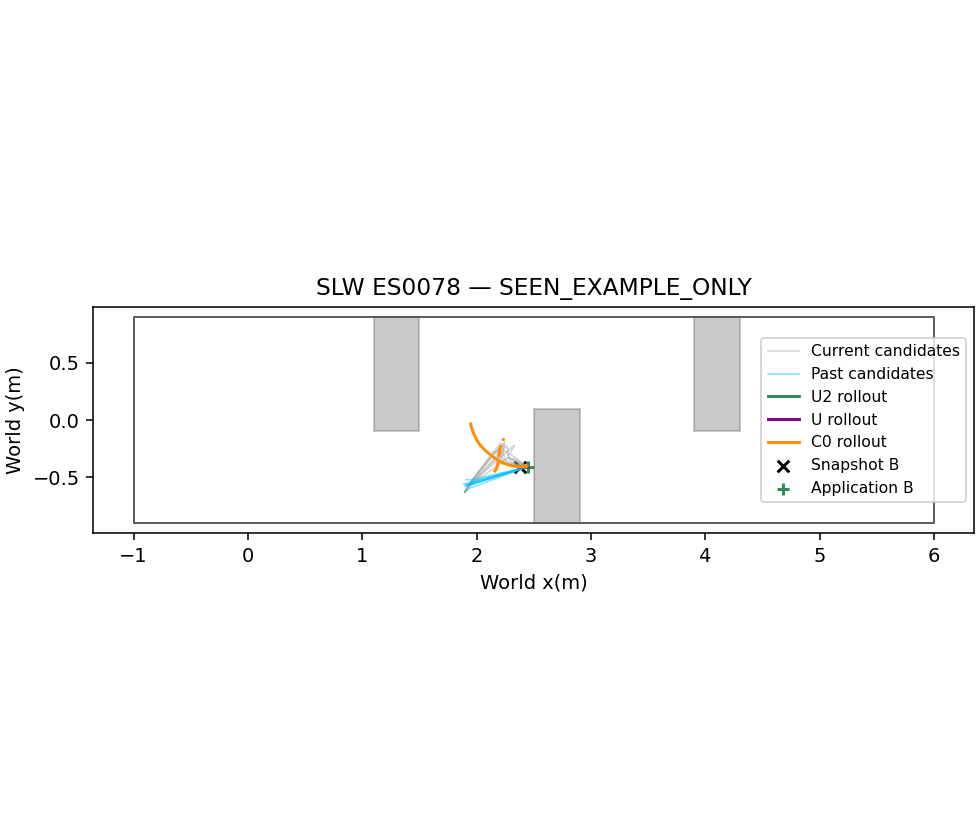
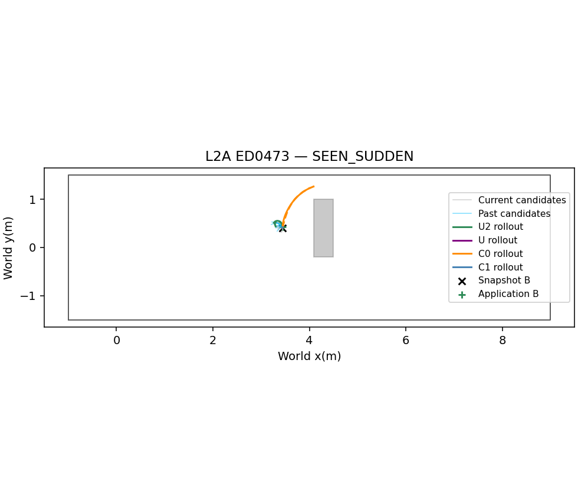
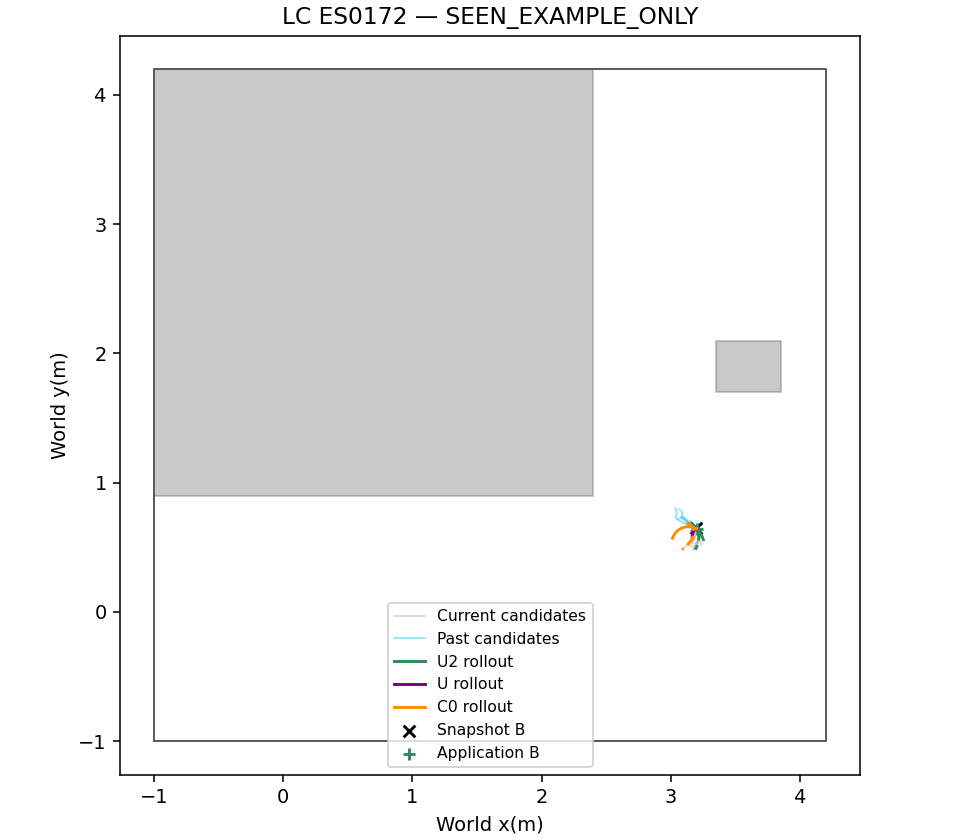
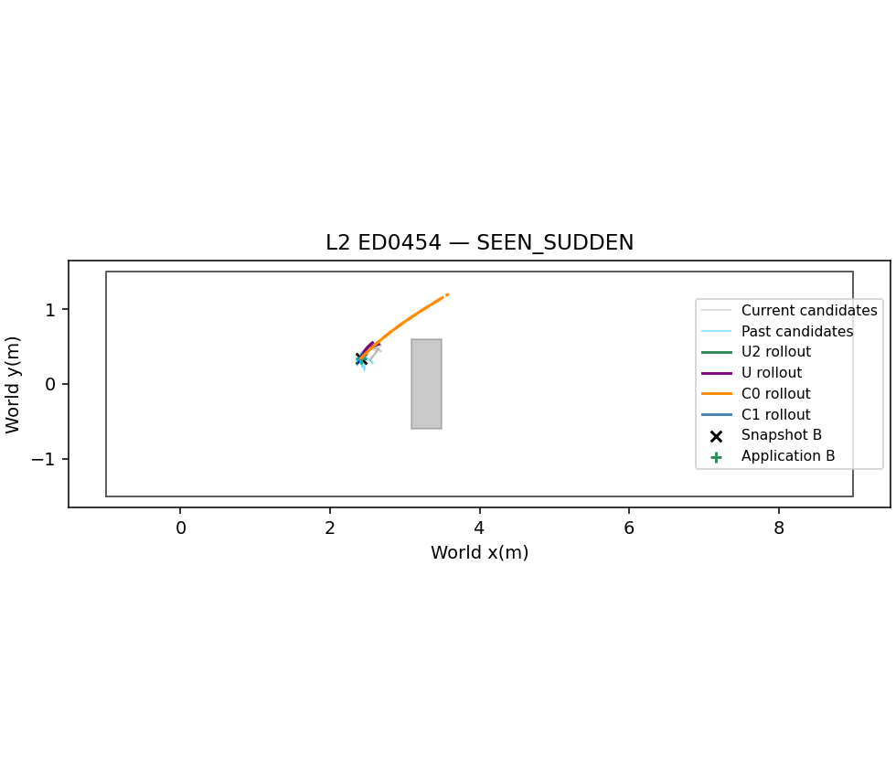
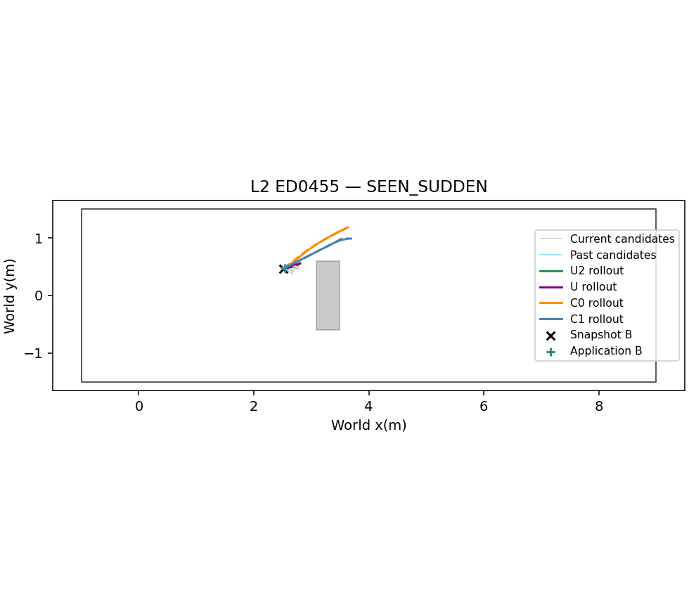

# Phase23-O2 — offline U2 validation

## Input/output and the three changes

Input: current8NoMaD candidates, saved delivered native candidate sets in the last2s (current plus at most7past sets), current pose/speed and installed OLD path, source depth V1 snapshot. Output:11SE(2)poses and10time intervals, then frozen PP graph-speed execution. No A*, u_ref, trigger, progress history, new-obstacle classifier or Topomap input enters U2. Oracle is evaluation-only.

U2 subclasses the frozen cached U graph. All other F2-F6 formulas, solver options,8current-candidate+available left/right starts,4workers,500ms anytime delivery and computation-window motion are unchanged. Historical components do not add extra starts or change side-initialization geometry.

For each component j, transform its observed world XY path into the predicted application-B frame after the same protected B-suffix projection. Current short-candidate supplementation is unchanged; historical components contain only native NoMaD geometry, never applied OLD/A* paths. All candidates are retained. The base sigma_p is the original clipped dispersion of the current8candidates at B; history does not redefine that dispersion.

Let tau_j be dispatch time minus actual post-delay arrival time (received_sim_s; application_sim_s only if absent). Keep at most7strictly earlier arrivals with tau<=2s; retain the current set. No future arrival during the0.5s computation window is used. sigma_j=sigma_p(1+tau_j/T_m), -log(w_j)=tau_j/T_m. F1 component cost is

$$C_j=\sum_{i=1}^{10}c^2\log(1+\|p_i-\hat p_{ji}\|^2/(c^2\sigma_j^2))+\tau_j/T_m.$$

Choose the minimum robust+age cost (ties: current first, then newest historical set, lower sample index). F5 uses the same active component endpoint. Its active-region gradient is $\sum_i2(p_i-\hat p_{ji})/(\sigma_j^2+\|p_i-\hat p_{ji}\|^2/c^2)$. The age constant has zero position gradient.

Frozen initial acceleration $a_0=(v_0-v_{actual})/dt_0$, and subsequent $a_i=2(v_i-v_{i-1})/(dt_i+dt_{i-1})$ now contribute $\sum_i[\max(0,|a_i|-.5)/.05]^2$, including the initial-speed boundary. Only those20upper/lower acceleration inequalities are removed. Speed<=0.3, |omega|<=0.4, dt in[0.05,1] and all depth constraints remain hard. Execution still enforces acceleration0.5: making the plan penalty soft does not relax the robot limit.

Fixed weights: time1.0, goal1.0, curvature0.01. Only c in{1,2,4} × T_m in{0.5,1,2}s is tuned. Selection order is the frozen23-O order: p95<=0.5s eligibility; then collision count, planning failure fraction, summed within-group progress median ranks, p50. If every setting exceeds the deadline, select minimum p95 and flag. SLSQP maxiter100, ftol1e-8; analytic derivatives.

## Dataset and interpretation

Training:242unchanged snapshot inputs, augmented only with earlier saved native sets. Actual held-out static set difference is524: original795minus271shared with the reduced454. The reduced5uniform samples were independently chosen from raw events, not a subset of the original10; subtracting795-454=341 was therefore not the held-out count. All524unused original static snapshots are HELDOUT_STATIC. The34sudden snapshots are reused and labeled SEEN_SUDDEN. SLW ES0078 and LC ES0172 are seen illustration-only cases, excluded from every tuning/decision denominator. L2A ED0473 and two additional sudden examples are fixed by event order before new results.

New U2 solves run on all evaluation cases. Frozen U/C0 are computed on new static cases; U/C0/C1 saved results are reused on seen sudden and illustration-only cases. Their inputs and paths are unchanged. The old23-O UNIFIED_NOT_READY label is preserved. The new label is a U2 offline result, not confirmation on the seen sudden set.

All methods retain the23-O computation-motion rules. U/U2 applies exactly0.5s after snapshot while following OLD; C0/C1 retain original switch B for safe selection and measured R2/R3/A* computation up to1s. Post-delay motion is included in safety/progress. No next FRESH, new inference, depth update or closed-loop reaction is simulated.

Historical-active and prior-departure fractions use accepted U2plans as denominator. Departure means at least one of10future nodes differs from its active prior by>=0.30m; mean and maximum displacement are also recorded. Failure constraints refer to the latest received iterate; deadline-pending starts are censored. Time bounds are listed separately from obstacle and speed/angular constraints. Report both collision-free planned box-passage paths and actual fixed-path rollout passage; neither is a goal-success claim.

Protocol SHA256 `f3fddbbc5b52abc5b100a5dcf318dd3ba2838cf38bcd6436d67943a6ff74782f`; selected `{'c': 1.0, 'T_m': 0.5}`.

## Tuning evidence

| index | weights | n | collisions | failure_fraction | progress | p95 | p50 | timing_eligible | progress_rank | score | selected |
| --- | --- | --- | --- | --- | --- | --- | --- | --- | --- | --- | --- |
| 0 | {'c': 1.0, 'T_m': 0.5} | 242 | 10 | 0.16116 | {'static': 0.09011269266081057, 'sudden': 0.0} | 0.41552 | 0.31853 | True | {'static': 8, 'sudden': 0} | [10, 0.16115702479338842, 8, 0.31852747800000003, 0] | True |
| 1 | {'c': 1.0, 'T_m': 1.0} | 242 | 14 | 0.15702 | {'static': 0.09563782057362513, 'sudden': 0.0} | 0.40912 | 0.31492 | True | {'static': 6, 'sudden': 0} | [14, 0.15702479338842976, 6, 0.3149202875, 1] | False |
| 2 | {'c': 1.0, 'T_m': 2.0} | 242 | 13 | 0.15289 | {'static': 0.09655594654235293, 'sudden': 0.0} | 0.40471 | 0.31507 | True | {'static': 5, 'sudden': 0} | [13, 0.15289256198347106, 5, 0.3150682655, 2] | False |
| 3 | {'c': 2.0, 'T_m': 0.5} | 242 | 13 | 0.1281 | {'static': 0.09779240705046893, 'sudden': 0.0} | 0.40951 | 0.30922 | True | {'static': 4, 'sudden': 0} | [13, 0.128099173553719, 4, 0.309220316, 3] | False |
| 4 | {'c': 2.0, 'T_m': 1.0} | 242 | 15 | 0.1157 | {'static': 0.10508020872744658, 'sudden': 0.0} | 0.4027 | 0.31101 | True | {'static': 1, 'sudden': 0} | [15, 0.11570247933884298, 1, 0.311007442, 4] | False |
| 5 | {'c': 2.0, 'T_m': 2.0} | 242 | 15 | 0.13223 | {'static': 0.10072847567058117, 'sudden': 0.0} | 0.40859 | 0.31607 | True | {'static': 2, 'sudden': 0} | [15, 0.1322314049586777, 2, 0.316073449, 5] | False |
| 6 | {'c': 4.0, 'T_m': 0.5} | 242 | 11 | 0.15289 | {'static': 0.09526796059687037, 'sudden': 0.0} | 0.41515 | 0.30964 | True | {'static': 7, 'sudden': 0} | [11, 0.15289256198347106, 7, 0.309640018, 6] | False |
| 7 | {'c': 4.0, 'T_m': 1.0} | 242 | 11 | 0.1281 | {'static': 0.10678189858598833, 'sudden': 0.0} | 0.40739 | 0.31451 | True | {'static': 0, 'sudden': 0} | [11, 0.128099173553719, 0, 0.31451418249999996, 7] | False |
| 8 | {'c': 4.0, 'T_m': 2.0} | 242 | 14 | 0.1157 | {'static': 0.10035451274541898, 'sudden': 0.0} | 0.41173 | 0.31383 | True | {'static': 3, 'sudden': 0} | [14, 0.11570247933884298, 3, 0.313830405, 8] | False |

## Group comparisons

| group | method | stratum | n | oracle_collisions | planning_failure_fraction | progress_median | compute_p50_s | compute_p95_s | planned_box_passage_fraction | passage_fraction |
| --- | --- | --- | --- | --- | --- | --- | --- | --- | --- | --- |
| static | U2 | HELDOUT_STATIC | 524 | 9 | 0.20229 | 0.077243 | 0.33086 | 0.40642 | — | 0 |
| sudden | U2 | SEEN_SUDDEN | 34 | 0 | 0 | 0 | 0.36851 | 0.42709 | 0.029412 | 0.029412 |
| static | U | HELDOUT_STATIC | 524 | 12 | 0.12023 | 0.099684 | 0.27422 | 0.33432 | — | 0 |
| sudden | U | SEEN_SUDDEN | 34 | 3 | 0.14706 | 0 | 0.28433 | 0.39441 | 0 | 0.029412 |
| static | C0 | HELDOUT_STATIC | 524 | 175 | 0.019084 | 0.059152 | 0.0012823 | 0.0014699 | — | 0 |
| sudden | C0 | SEEN_SUDDEN | 34 | 6 | 0 | 0 | 0.2274 | 0.32002 | 0.26471 | 0.14706 |
| sudden | C1 | SEEN_SUDDEN | 34 | 4 | 0.11765 | 0 | 0.24627 | 0.6082 | 0.26471 | 0.20588 |

## U2 memory and prior deviation

| group | active_history_fraction | history_age_median_s | history_age_p95_s | prior_departure_030_fraction | prior_deviation_max_median_m | prior_deviation_mean_median_m |
| --- | --- | --- | --- | --- | --- | --- |
| static | 0.23923 | 1.0694 | 1.125 | 0.011962 | 0.016034 | 0.0065566 |
| sudden | 0.5 | 1.0833 | 1.8889 | 0.029412 | 0.038663 | 0.014095 |

## Failed-plan active constraints

| group | method | failed_snapshots_obstacle_active | failed_snapshots_kinematic_active | failed_snapshots_dt_active | pending_initializations |
| --- | --- | --- | --- | --- | --- |
| static | U2 | 0 | 67 | 60 | 1 |
| sudden | U2 | 0 | 0 | 0 | 0 |
| static | U | 2 | 55 | 57 | 0 |
| sudden | U | 0 | 5 | 5 | 0 |

## Registered U2 vs C0 decision

| group | safety | planning | progress | timing |
| --- | --- | --- | --- | --- |
| static | True | False | True | True |
| sudden | True | True | True | True |

**UNIFIED_PARTIAL**. Old U: UNIFIED_NOT_READY (unchanged).

## Draft only — not executed

L2+SLW ×4new seeds×U2/C0/C1=24runs. C1 on SLW is a reference only. Freeze common sensing, computation-time motion and executors; report goal/collision and paired passage/checkpoint time per scene. Pre-register no increased collisions, goal success at least C0, planning failure within5%p, and p95<=0.5s for U2; do not claim unseen-sudden generalization from this offline dataset. This is an unexecuted pilot proposal.
