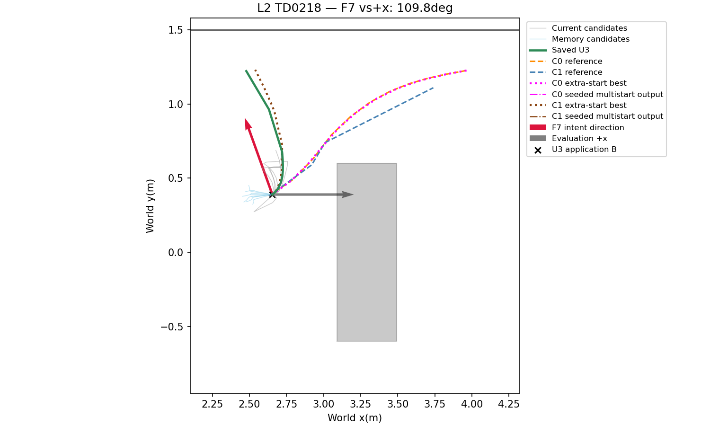
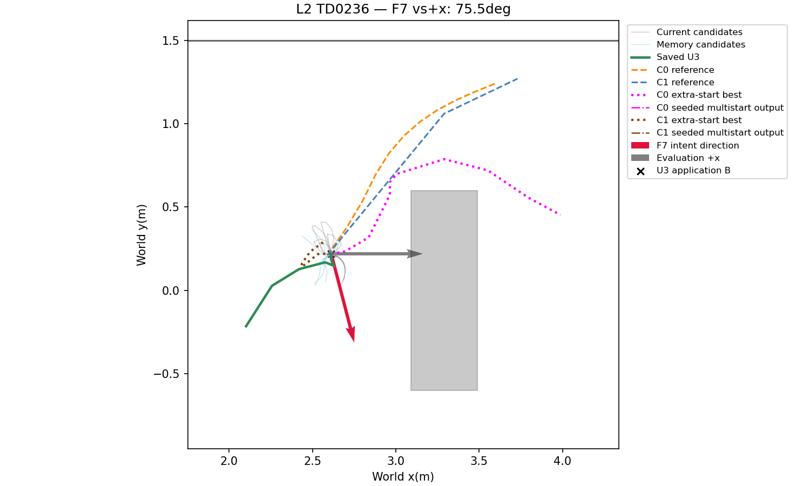
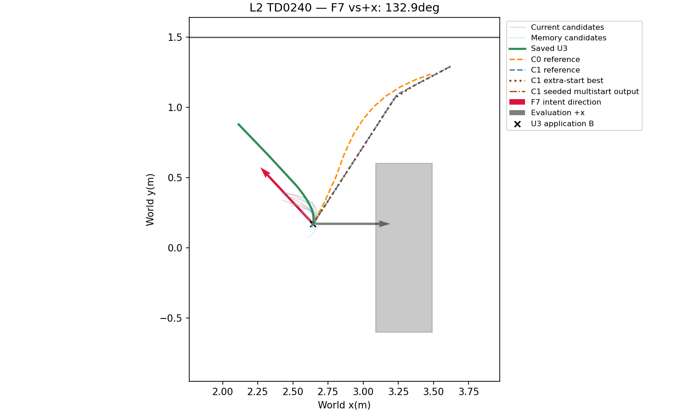
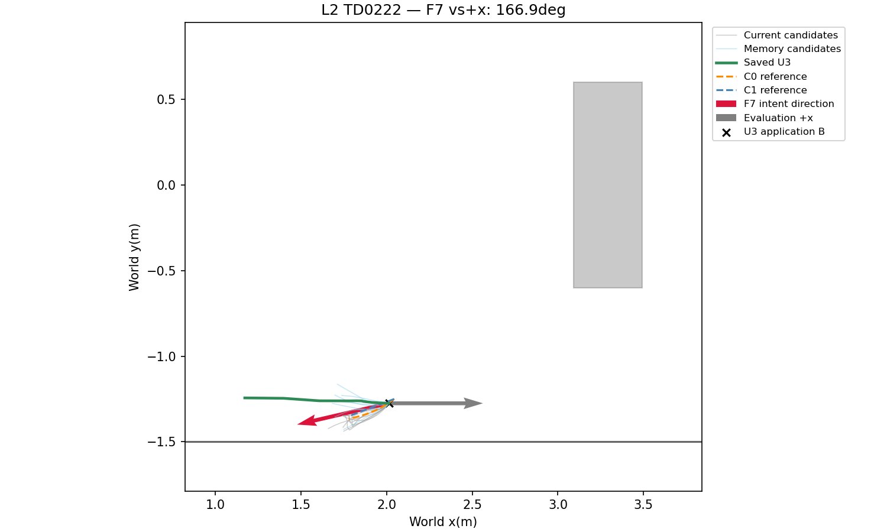

# Phase23-O3 — frozen-weight pre-passage diagnosis

**PRE_PASSAGE_NO_GO**. Original **GO_ONLINE** is preserved at commit `a2ce323` and in `research/results/phase23o3/gate.json`.

이미 상자를 지난 snapshot 8건으로 충족, 통과 전 입력에서 U3 0/16(C0 2/16, C1 3/16)이라 회피 경로 생성 개선으로 해석 불가。

| input_stage | n | U2 | U3 | C0 | C1 |
| --- | --- | --- | --- | --- | --- |
| PRE_SPAWN | 2 | 0 | 0 | 0 | 0 |
| PRE_PASSAGE | 16 | 0 | 0 | 2 | 3 |
| ALREADY_PASSED | 8 | 7 | 8 | 8 | 7 |

## Scope and fixed conversion

Only the16pre-passage training snapshots are used. The5passing comparator paths belong to3snapshots (twoC0and threeC1paths). No tuning, evaluation-set rerun, navigation, inference or rendering was performed for this diagnosis. U3weights remain w7=0.5, T_m=2s, c=1, time/goal/curvature=1/1/0.01.

Every reference is projected and re-sampled to11positions from the saved U3predicted application pose. Native comparator XY has no yaw/timestamps. Chord-heading targets are sequentially projected onto the existing0.4rad per1s limit; dt=max(0.05,segment_length/0.3,abs(delta_heading)/0.4). Unmodified chord headings would require dt>1s in4/5paths, so heading lag is explicitly reported and its nonholonomic soft cost is included. Positions are not optimized during conversion. The test uses the U3hard motion constraints; acceleration remains the unchanged soft penalty. Hard depth feasibility is checked independently, never assumed from the source path.

Factor sums reproduce the exact frozen objective; saved U3costs are checked against the recorded values. F1includes Cauchy+age cost; F2is clearance preference; F3includes nonholonomic/backward and soft acceleration; F4time; F5active-candidate goal; F6curvature change; F7intent progress.

## Cost comparison

| case_id | method | reference_cost | U3_cost | cost_delta_vs_U3 | cost_label | largest_term_delta | largest_term_delta_value | reference_strict_feasible | reference_heading_lag_max_deg | reference_planned_passage |
| --- | --- | --- | --- | --- | --- | --- | --- | --- | --- | --- |
| TD0218 | C0 | 120.88 | 20.432 | 100.44 | OBJECTIVE_LIMITED | F7 | 30.284 | True | 0 | True |
| TD0218 | C1 | 121.03 | 20.432 | 100.6 | OBJECTIVE_LIMITED | F7 | 33.157 | True | 4.636 | True |
| TD0236 | C0 | 279.44 | 71.977 | 207.47 | OBJECTIVE_LIMITED | F7 | 147.24 | True | 23.924 | True |
| TD0236 | C1 | 294.4 | 71.977 | 222.43 | OBJECTIVE_LIMITED | F7 | 146.28 | True | 18.335 | True |
| TD0240 | C1 | 155.17 | 23.111 | 132.06 | OBJECTIVE_LIMITED | F7 | 49.567 | True | 1.0181 | True |

| case_id | reference_method | trajectory | F1 | F2 | F3 | F4 | F5 | F6 | F7 | total | strict_feasible |
| --- | --- | --- | --- | --- | --- | --- | --- | --- | --- | --- | --- |
| TD0218 | C0 | saved_U3 | 5.7288 | 0.059692 | 0.050606 | 4.9559 | 3.186 | 0.077869 | 6.3731 | 20.432 | True |
| TD0218 | C0 | converted_C0 | 34.677 | 8.8085 | 3.7688 | 5.3513 | 31.601 | 0.012497 | 36.657 | 120.88 | True |
| TD0218 | C1 | saved_U3 | 5.7288 | 0.059692 | 0.050606 | 4.9559 | 3.186 | 0.077869 | 6.3731 | 20.432 | True |
| TD0218 | C1 | converted_C1 | 31.401 | 14.454 | 7.5776 | 5.0221 | 22.673 | 0.37811 | 39.53 | 121.03 | True |
| TD0236 | C0 | saved_U3 | 6.4249 | 0 | 10.237 | 10 | 2.5951 | 1.5425 | 41.177 | 71.977 | True |
| TD0236 | C0 | converted_C0 | 31.407 | 0.56184 | 31.254 | 5.8518 | 21.932 | 0.017076 | 188.42 | 279.44 | True |
| TD0236 | C1 | saved_U3 | 6.4249 | 0 | 10.237 | 10 | 2.5951 | 1.5425 | 41.177 | 71.977 | True |
| TD0236 | C1 | converted_C1 | 32.936 | 13.478 | 28.119 | 6.2619 | 26.035 | 0.11937 | 187.45 | 294.4 | True |
| TD0240 | C1 | saved_U3 | 9.9262 | 0 | 0.090625 | 4.7909 | 3.0691 | 0.072752 | 5.1619 | 23.111 | True |
| TD0240 | C1 | converted_C1 | 51.627 | 15.91 | 5.3525 | 5.5766 | 21.851 | 0.12416 | 54.729 | 155.17 | True |

## Soft penalties and constraint checks

| case_id | reference_method | trajectory | F1_age | F3_nonholonomic | F3_backward | F3_acceleration | max_abs_acceleration | F2_minimum_slack_m | v_max | omega_max | dt_min | dt_max |
| --- | --- | --- | --- | --- | --- | --- | --- | --- | --- | --- | --- | --- |
| TD0218 | C0 | saved_U3 | 0.13889 | 0.050606 | 0 | 0 | 0.48155 | 0.11278 | 0.3 | 0.4 | 0.12016 | 1 |
| TD0218 | C0 | converted_C0 | 0.65278 | 3.7688 | 0 | 0 | 0.47926 | 0.035094 | 0.3 | 0.27956 | 0.52164 | 0.53741 |
| TD0218 | C1 | saved_U3 | 0.13889 | 0.050606 | 0 | 0 | 0.48155 | 0.11278 | 0.3 | 0.4 | 0.12016 | 1 |
| TD0218 | C1 | converted_C1 | 0.65278 | 7.5776 | 0 | 0 | 0.48977 | 0.023825 | 0.3 | 0.4 | 0.43508 | 1 |
| TD0236 | C0 | saved_U3 | 0.92361 | 9.1058 | 1.1314 | 0 | 0.11243 | 0.33542 | 0.28824 | 0.4 | 1 | 1 |
| TD0236 | C0 | converted_C0 | 0.92361 | 31.254 | 0 | 0 | 0.19512 | 0.094458 | 0.3 | 0.4 | 0.49282 | 1 |
| TD0236 | C1 | saved_U3 | 0.92361 | 9.1058 | 1.1314 | 0 | 0.11243 | 0.33542 | 0.28824 | 0.4 | 1 | 1 |
| TD0236 | C1 | converted_C1 | 0.92361 | 28.119 | 0 | 0 | 0.18627 | 0.025384 | 0.3 | 0.4 | 0.52274 | 1 |
| TD0240 | C1 | saved_U3 | 0.027778 | 0.090625 | 0 | 0 | 0.49955 | 0.31759 | 0.3 | 0.4 | 0.12854 | 1 |
| TD0240 | C1 | converted_C1 | 0.53472 | 5.3525 | 0 | 0 | 0.49546 | 0.023934 | 0.3 | 0.4 | 0.50458 | 1 |

## Additional initialization experiment (diagnostic only)

One run per reference pair, no retries. The additional converted state is scheduled first, followed by the unchanged8current starts and available left/right starts. Four workers, shared0.5s, maxiter100, ftol1e-8, frozen output policy. Extra-first scheduling is diagnostic-only and is not installed in U3. Extra-start convergence/output and the whole multistart selection are separate columns. Pending-at-deadline convergence is unknown, not declared successful.

| case_id | method | extra_solver_success | extra_iterations | extra_accepted | extra_strict_feasible | extra_passage | extra_cost | selected_initializer | selected_passage | selected_cost | wall_s |
| --- | --- | --- | --- | --- | --- | --- | --- | --- | --- | --- | --- |
| TD0218 | C0 | False | 100 | True | True | True | 120.88 | CURRENT_0 | False | 20.432 | 0.38806 |
| TD0218 | C1 | True | 77 | True | True | False | 27.752 | CURRENT_0 | False | 20.432 | 0.37938 |
| TD0236 | C0 | False | 100 | True | True | True | 218.26 | CURRENT_7 | False | 71.977 | 0.44467 |
| TD0236 | C1 | False | 100 | True | True | False | 130.09 | CURRENT_7 | False | 71.977 | 0.45856 |
| TD0240 | C1 | False | 100 | True | True | True | 155.17 | CURRENT_6 | False | 23.111 | 0.34054 |

Extra-start solver success:1/5; converged passage outputs:0/5. The3feasible passage candidates retained by extra starts are not converged passage solutions (two remain at their initial path). All5overall selections are non-passage paths.

## Left/right initialization availability

| case_id | left | right | reason | initialization_count | component | cell_count | source |
| --- | --- | --- | --- | --- | --- | --- | --- |
| TD0218 | False | False | NO_INTERSECTING_DEPTH_COMPONENT | 8 | — | — | — |
| TD0222 | True | True | DEPTH_COMPONENT_SELECTED | 10 | 12 | 4006 | 4-connected depth component; two straight polylines via edge±0.25m |
| TD0223 | True | True | DEPTH_COMPONENT_SELECTED | 10 | 12 | 3874 | 4-connected depth component; two straight polylines via edge±0.25m |
| TD0224 | True | True | DEPTH_COMPONENT_SELECTED | 10 | 12 | 3863 | 4-connected depth component; two straight polylines via edge±0.25m |
| TD0228 | False | False | NO_INTERSECTING_DEPTH_COMPONENT | 8 | — | — | — |
| TD0231 | False | False | NO_INTERSECTING_DEPTH_COMPONENT | 8 | — | — | — |
| TD0232 | False | False | NO_INTERSECTING_DEPTH_COMPONENT | 8 | — | — | — |
| TD0233 | False | False | NO_INTERSECTING_DEPTH_COMPONENT | 8 | — | — | — |
| TD0234 | True | True | DEPTH_COMPONENT_SELECTED | 10 | 60 | 514 | 4-connected depth component; two straight polylines via edge±0.25m |
| TD0235 | True | True | DEPTH_COMPONENT_SELECTED | 10 | 47 | 648 | 4-connected depth component; two straight polylines via edge±0.25m |
| TD0236 | False | False | NO_INTERSECTING_DEPTH_COMPONENT | 8 | — | — | — |
| TD0237 | False | False | NO_INTERSECTING_DEPTH_COMPONENT | 8 | — | — | — |
| TD0238 | False | False | NO_INTERSECTING_DEPTH_COMPONENT | 8 | — | — | — |
| TD0239 | False | False | NO_INTERSECTING_DEPTH_COMPONENT | 8 | — | — | — |
| TD0240 | False | False | NO_INTERSECTING_DEPTH_COMPONENT | 8 | — | — | — |
| TD0241 | False | False | NO_INTERSECTING_DEPTH_COMPONENT | 8 | — | — | — |

Reasons are the existing initializer metadata; absence of a candidate-intersecting depth component is not evidence that a geometric detour does not exist.

## F7 direction and memory

+x is evaluation-only. Angles refer to the actual F7mean of unit endpoint directions, with the same age weights. Candidate-level signed/absolute angles, lengths, eligibility and supplementation are preserved in candidate_directions.csv; set-level distributions are below.

| case_id | angle_to_oracle_positive_x_deg | wrong_45_deg |
| --- | --- | --- |
| TD0218 | 109.76 | True |
| TD0222 | 166.95 | True |
| TD0223 | 153.3 | True |
| TD0224 | 144.7 | True |
| TD0228 | 60.521 | True |
| TD0231 | 26.7 | False |
| TD0232 | 171.02 | True |
| TD0233 | 179.02 | True |
| TD0234 | 36.41 | False |
| TD0235 | 70.066 | True |
| TD0236 | 75.452 | True |
| TD0237 | 128.26 | True |
| TD0238 | 73.247 | True |
| TD0239 | 1.0889 | False |
| TD0240 | 132.95 | True |
| TD0241 | 50.226 | True |

| case_id | set_index | age_s | age_weight | effective_direction_weight | valid_candidates | mean_direction_deg | angle_p10 | angle_median | angle_p90 |
| --- | --- | --- | --- | --- | --- | --- | --- | --- | --- |
| TD0218 | 0 | 0.27778 | 0.87032 | 6.9626 | 8 | 74.689 | 66.22 | 77.862 | 82.353 |
| TD0218 | 1 | 1.3056 | 0.5206 | 4.1648 | 8 | -175.17 | 157.28 | 169.5 | 177.44 |
| TD0222 | 0 | 0.041667 | 0.97938 | 7.8351 | 8 | -160.19 | 151.1 | 164.24 | 165.02 |
| TD0222 | 1 | 1.0417 | 0.59403 | 4.7522 | 8 | -178.44 | 156.75 | 170.27 | 178.13 |
| TD0223 | 0 | 0.041667 | 0.97938 | 7.8351 | 8 | -156.95 | 136.35 | 153.86 | 179.7 |
| TD0223 | 1 | 1.0417 | 0.59403 | 4.7522 | 8 | -147.26 | 127.85 | 144.96 | 165.37 |
| TD0224 | 0 | 0.013889 | 0.99308 | 7.9446 | 8 | -141.06 | 135.61 | 138.48 | 148.34 |
| TD0224 | 1 | 1.0417 | 0.59403 | 4.7522 | 8 | -150.84 | 141.15 | 151.25 | 159.53 |
| TD0228 | 0 | 0.83333 | 0.65924 | 5.2739 | 8 | 34.579 | 34.579 | 34.579 | 34.579 |
| TD0228 | 1 | 1.8333 | 0.39985 | 3.1988 | 8 | 141.96 | 103.03 | 125.74 | 173.36 |
| TD0231 | 0 | 0.013889 | 0.99308 | 6.9516 | 7 | -67.094 | 9.5955 | 106.32 | 118.74 |
| TD0231 | 1 | 0.83333 | 0.65924 | 5.2739 | 8 | 56.633 | 32.406 | 65.334 | 75.578 |
| TD0231 | 2 | 1.8333 | 0.39985 | 3.1988 | 8 | -93.02 | 76.378 | 86.778 | 115.08 |
| TD0232 | 0 | 0.013889 | 0.99308 | 7.9446 | 8 | 171.64 | 159.43 | 164.81 | 174.67 |
| TD0232 | 1 | 1.0139 | 0.60233 | 4.8187 | 8 | -142.19 | 132.93 | 143.08 | 148.4 |
| TD0233 | 0 | 0.45833 | 0.7952 | 6.3616 | 8 | 164.03 | 154.14 | 165.26 | 170.49 |
| TD0233 | 1 | 1.4444 | 0.48567 | 3.8854 | 8 | -150.01 | 132 | 151.63 | 162.19 |
| TD0234 | 0 | 0.097222 | 0.95255 | 7.6204 | 8 | 30.297 | 22.654 | 28.01 | 41.07 |
| TD0234 | 1 | 1.0833 | 0.58178 | 4.6542 | 8 | 47.432 | 35.744 | 38.805 | 68.405 |
| TD0235 | 0 | 0.041667 | 0.97938 | 7.8351 | 8 | 36.982 | 30.828 | 36.788 | 43.59 |
| TD0235 | 1 | 1.0694 | 0.58583 | 4.6867 | 8 | 155.45 | 138.57 | 144.73 | 163.04 |
| TD0236 | 0 | 0.84722 | 0.65468 | 4.5827 | 7 | -52.245 | 32.345 | 51.575 | 69.771 |
| TD0236 | 1 | 1.8472 | 0.39708 | 3.1767 | 8 | -130.85 | 93.54 | 118.49 | 139.96 |
| TD0237 | 0 | 0.98611 | 0.61076 | 0 | 0 | — | — | — | — |
| TD0237 | 1 | 1.9861 | 0.37044 | 2.5931 | 7 | -128.26 | 38.607 | 140.33 | 155.2 |
| TD0238 | 0 | 0.097222 | 0.95255 | 6.6679 | 7 | -73.445 | 60.524 | 62.99 | 99.325 |
| TD0238 | 1 | 1.0972 | 0.57775 | 4.622 | 8 | -72.972 | 65.075 | 73.913 | 79.053 |
| TD0239 | 0 | 0.29167 | 0.8643 | 6.9144 | 8 | -19.274 | 19.274 | 19.274 | 19.274 |
| TD0239 | 1 | 1.2778 | 0.52788 | 4.223 | 8 | 146.44 | 121.63 | 151.88 | 162.87 |
| TD0240 | 0 | 0.055556 | 0.9726 | 7.7808 | 8 | 134.36 | 127.75 | 135.21 | 141.16 |
| TD0240 | 1 | 1.0694 | 0.58583 | 2.9292 | 5 | 127.18 | 99.098 | 111.76 | 128.41 |
| TD0241 | 0 | 1.0556 | 0.58991 | 4.7193 | 8 | -50.226 | 39.165 | 49.531 | 60.063 |

## Representative snapshots

The three snapshots with passing references plus the first other pre-passage input were fixed before the new solves. The fourth has no passing reference and therefore no extra-initialization solve. Thin candidate curves: current gray/history cyan; comparator paths dashed; extra-start best and multistart-selected outputs are distinct when different.

## Conclusions

- OBJECTIVE_LIMITED: 5/5converted detours have higher frozen U3 cost; F7 is the largest increasing term in5/5pairs. Seeded multistart selects a passage path in0/5cases. This compares these particular feasible-heading/time embeddings, not every possible SE(2)timing for the polyline.
- DIRECTION_WRONG: 13/16intent directions differ from evaluation-only+x by at least45degrees, exceeding half.
