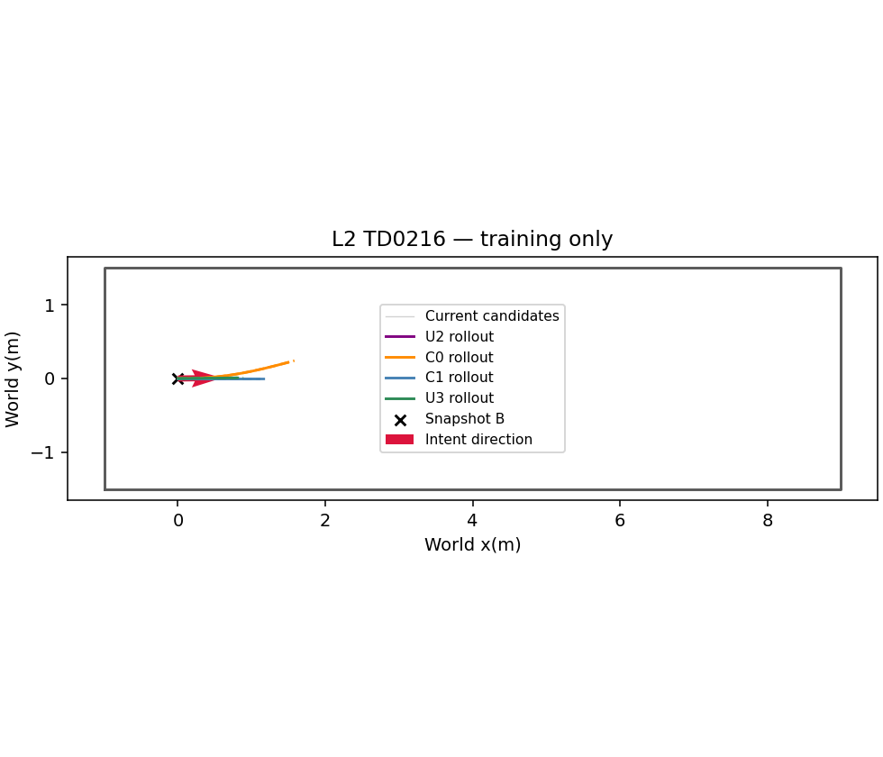
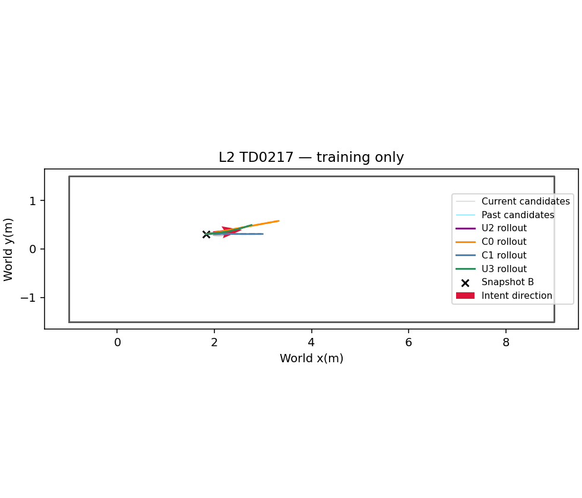
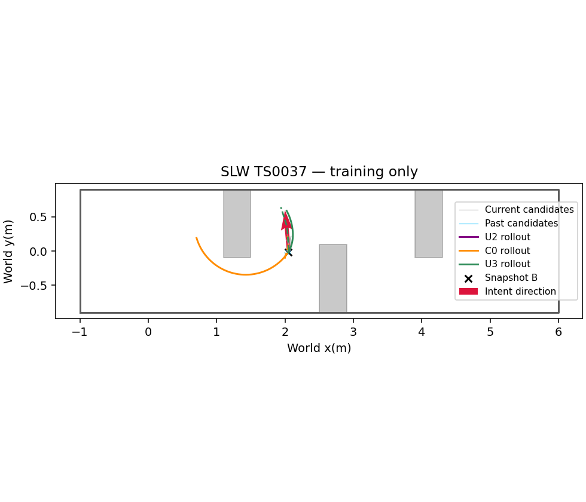

# Phase23-O3 — training-only offline check

## U3 definition

U3 preserves frozen U2 factors, Cauchy c=1, acceleration sigma0.05, and time/goal/curvature weights1/1/0.01. Only F7 and the specified output policy are added. Eight current policy starts plus available depth-side starts,4workers, SLSQP maxiter100/ftol1e-8,500ms anytime and the frozen computation-window rollout remain unchanged. No A*, u_ref, odometry history, trigger, Topomap or new-obstacle classifier enters U3.

For each current/memory component j, use its B-frame endpoint displacement e_j. Exclude only from the F7 direction average those with |e_j|<0.05m. Direction is the unit vector of sum_j exp(-tau_j/T_m) e_j/|e_j|. No valid endpoint, or an exactly canceled mean (numerical norm<=1e-12), leaves direction mathematically undefined and F7 inactive. No substitute heading is introduced. The original mixture still retains all candidates.

$$F_7=w_7[\max(0,1.2-(p_{10}-p_0)\cdot\hat d)/0.10]^2.$$

Direction is fixed from observed inputs during each solve, so its active derivative is $-2w_7r\hat d^T(J_{p10}-J_{p0})/0.10$. Grid:w7 in{0.5,1,2} × T_m in{0.5,1,2}s; c=1fixed. No other tuning.

Output first selects the lowest-cost strict feasible iterate received within500ms, as before. Only if none exists, it considers the last available iterate from each start: every F2 node/midpoint inequality must have nonnegative slack; v<=0.33, |omega|<=0.44 and dt in[0.045,1.10]. It picks the lowest-cost qualified last iterate. A later unsafe iterate invalidates that start's earlier tolerated iterate. These are output tolerances only: the optimizer's original hard bounds and constraints are unchanged. All late messages are discarded. FEASIBLE / KINEMATIC_TOLERATED / STOP are recorded. The frozen executor still clips v<=0.3, |omega|<=0.4 and acceleration<=0.5. STOP brakes only after the fixed0.5s computation prefix.

Selection uses only the unchanged242training snapshots(216static,26sudden): timing p95<=0.5s, then minimum rollout collisions, maximum collision-free planned box-passage fraction on26sudden inputs, minimum STOP fraction, maximum static progress median, minimum p50 (fixed grid index only breaks exact ties). As in the prior protocol, if no timing-eligible setting exists, minimum p95 is retained for diagnosis and timing necessarily fails the gate. No evaluation-set snapshot is solved.

U2 uses its frozen selected training outputs. C0 is computed on the same242inputs, and C1 on the same26sudden inputs. They retain frozen23-O timing and rollout. For the comparators, the FEASIBLE column denotes their original accepted-path output, not an added U3 certificate; C1's ALL row contains only26sudden inputs. The path-passage metric is unchanged from23-O2: an output path reaches beyond the box rear with its footprint and has no oracle box/wall overlap. Rollout passage is also shown separately. All output failures remain in denominators.

Gate GO_ONLINE requires: U3 sudden planned-passage fraction>=0.8*C0, total U3 rollout collisions<=C0 across242inputs, total STOP fraction<=10%, and total compute p95<=0.5s. Otherwise NO_GO. These are training-set diagnostics used for selection, not held-out performance or closed-loop evidence.

Protocol SHA256 `af6713d7a2c9d20b42400806e1b116704861bf8f785f9408a951897c17459a16`; selected `{'w7': 0.5, 'T_m': 2.0}`.

## Tuning evidence

| index | settings | n | collisions | sudden_planned_passage_fraction | stop_fraction | static_progress_median | p95 | p50 | timing_eligible | selected |
| --- | --- | --- | --- | --- | --- | --- | --- | --- | --- | --- |
| 0 | {'w7': 0.5, 'T_m': 0.5} | 242 | 21 | 0.30769 | 0.045455 | 0.68173 | 0.43109 | 0.33944 | True | False |
| 1 | {'w7': 0.5, 'T_m': 1.0} | 242 | 21 | 0.30769 | 0.045455 | 0.68126 | 0.43751 | 0.34776 | True | False |
| 2 | {'w7': 0.5, 'T_m': 2.0} | 242 | 19 | 0.30769 | 0.03719 | 0.67708 | 0.43476 | 0.33783 | True | True |
| 3 | {'w7': 1.0, 'T_m': 0.5} | 242 | 22 | 0.26923 | 0.03719 | 0.86526 | 0.42131 | 0.3266 | True | False |
| 4 | {'w7': 1.0, 'T_m': 1.0} | 242 | 23 | 0.30769 | 0.033058 | 0.86287 | 0.42369 | 0.34306 | True | False |
| 5 | {'w7': 1.0, 'T_m': 2.0} | 242 | 23 | 0.30769 | 0.033058 | 0.85957 | 0.43066 | 0.33762 | True | False |
| 6 | {'w7': 2.0, 'T_m': 0.5} | 242 | 27 | 0.34615 | 0.028926 | 0.97372 | 0.39461 | 0.30941 | True | False |
| 7 | {'w7': 2.0, 'T_m': 1.0} | 242 | 25 | 0.34615 | 0.028926 | 0.96944 | 0.40726 | 0.31198 | True | False |
| 8 | {'w7': 2.0, 'T_m': 2.0} | 242 | 26 | 0.30769 | 0.028926 | 0.96526 | 0.40013 | 0.32409 | True | False |

## Same-input comparisons

| group | method | n | collisions | feasible_fraction | tolerated_fraction | stop_fraction | planned_box_passage | sudden_n | planned_box_passage_fraction | rollout_box_passage | progress_median | omega_saturation_median | compute_p50_s | compute_p95_s |
| --- | --- | --- | --- | --- | --- | --- | --- | --- | --- | --- | --- | --- | --- | --- |
| static | U3 | 216 | 16 | 0.80093 | 0.15741 | 0.041667 | 0 | 0 | — | 0 | 0.67708 | 0 | 0.34137 | 0.43405 |
| static | U2 | 216 | 10 | 0.83796 | 0 | 0.16204 | 0 | 0 | — | 0 | 0.090113 | 0 | 0.31784 | 0.4151 |
| static | C0 | 216 | 42 | 0.98148 | 0 | 0.018519 | 0 | 0 | — | 0 | 0.18625 | 0.44659 | 0.0014603 | 0.0021006 |
| sudden | U3 | 26 | 3 | 0.92308 | 0.076923 | 0 | 8 | 26 | 0.30769 | 8 | 0 | 0.30193 | 0.33706 | 0.44933 |
| sudden | U2 | 26 | 0 | 0.84615 | 0 | 0.15385 | 7 | 26 | 0.26923 | 8 | 0 | 0.3178 | 0.33183 | 0.43571 |
| sudden | C0 | 26 | 1 | 0.92308 | 0 | 0.076923 | 10 | 26 | 0.38462 | 9 | 0 | 0.3292 | 0.24912 | 0.54379 |
| sudden | C1 | 26 | 1 | 0.88462 | 0 | 0.11538 | 10 | 26 | 0.38462 | 10 | 0 | 0.31824 | 0.19844 | 0.43902 |
| ALL | U3 | 242 | 19 | 0.81405 | 0.14876 | 0.03719 | 8 | 26 | 0.30769 | 8 | 0.66897 | 0 | 0.33783 | 0.43476 |
| ALL | U2 | 242 | 10 | 0.83884 | 0 | 0.16116 | 7 | 26 | 0.26923 | 8 | 0.073365 | 0 | 0.31853 | 0.41552 |
| ALL | C0 | 242 | 43 | 0.97521 | 0 | 0.024793 | 10 | 26 | 0.38462 | 9 | 0.16063 | 0.43709 | 0.0014803 | 0.28079 |
| ALL | C1 | 26 | 1 | 0.88462 | 0 | 0.11538 | 10 | 26 | 0.38462 | 10 | 0 | 0.31824 | 0.19844 | 0.43902 |

## F7 and prior deviation

| group | method | f7_enabled_fraction | f7_positive_residual_fraction | prior_departure_030_fraction |
| --- | --- | --- | --- | --- |
| static | U3 | 1 | 1 | 0.80193 |
| static | U2 | — | — | 0.01105 |
| sudden | U3 | 1 | 1 | 0.88462 |
| sudden | U2 | — | — | 0 |
| ALL | U3 | 1 | 1 | 0.81116 |
| ALL | U2 | — | — | 0.0098522 |

## Online gate

| condition | passed |
| --- | --- |
| planned_passage | True |
| collision | True |
| stop | True |
| timing | True |

**GO_ONLINE**; failed criteria: [].

No23-O/23-O2 evaluation case was rerun. No new inference, rendering or closed-loop experiment was part of this offline check. GO_ONLINE permits the requested pilot preparation and smoke only; the main campaign remains user-run.
