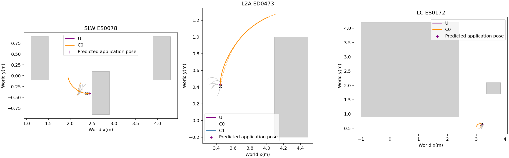
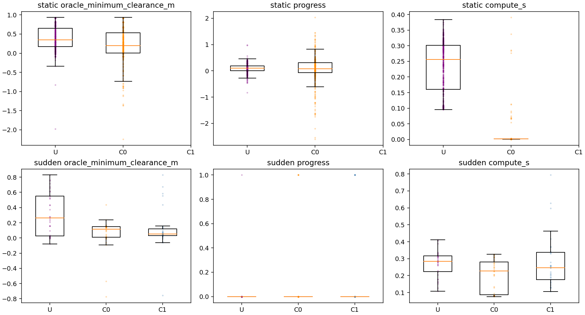
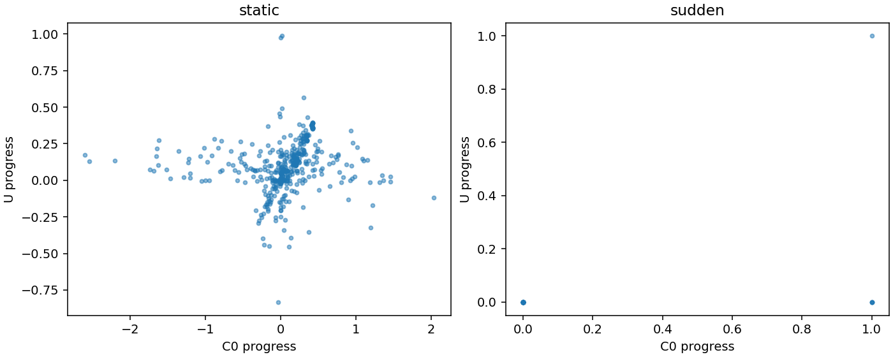

# Phase23-O — offline unified SE(2) graph

## Input/output and pipeline

| Component | Input / output |
|---|---|
| U input | Eight observation-anchored NoMaD XY candidates; available depth V1 SDF; current pose/speed and executing path; OLD remainder for short-candidate supplementation |
| Computation motion | Continue the current path for0.5s; predict application pose and speed without future observations. The same prefix is included in rollout safety/progress evaluation. |
| U solve | B-local poses $x_0\ldots x_{10}$ and ten $\Delta t$; four-worker SLSQP multi-start; no oracle, Topomap pose, trigger, progress history, u_ref or A* input |
| U output | Eleven world SE(2) poses and ten time intervals; graph segment speeds → PP direction at lookahead0.25m; separately registered handling of pure graph rotations |
| Evaluation only | Oracle rotated boxes/walls, Topomap next-node metadata, recorded trigger membership |

| Current rule | Unified counterpart |
|---|---|
| FRESHEST + candidate rejection | F1 selects a max-mixture component inside the objective; all8 candidates retained |
| Depth safety filter | F2 point/midpoint constraints and clearance preference |
| SP + heuristic start alignment | F3 pose/time kinematics; PP + graph speed; no heading-threshold alignment rule |
| Trigger/u_ref detour target | F5 active NoMaD candidate endpoint, applied at every selected snapshot |
| Detour handover | Single finite trajectory; no online handover trigger in U |

## Factor definitions

Let $p_i\in\mathbb R^2$, $\theta_i\in\mathbb R$, $\tau_i=\Delta t_i$;
$p_0=0,\theta_0=0$ in the predicted application-pose frame. The prediction horizon is0.5s from the current snapshot. The supplied SDF already subtracts radius0.09m; it is **not subtracted twice**.
All distances are metres and times seconds. $R_Bp_i+b$ transforms queries to world coordinates.

F1: $j^*=\arg\min_{j\in0..7}\sum_{i=1}^{10}\|p_i-\hat p_{ji}\|^2/\sigma_p^2$ (ties: smallest index).
$\sigma_p=\operatorname{clip}(\operatorname{median}_i\sqrt{\operatorname{Var}_j\hat p_{ji,x}+\operatorname{Var}_j\hat p_{ji,y}},.03,.15)$.
Only this component contributes F1 and F5 at each objective evaluation. Candidate headings/timestamps are not assumed native.
Suffix projection reuses the protected PP polyline rule; short suffixes append only the required prefix of the projected OLD remainder up to0.3m, then arclength-resample. Short/unavailable OLD handling is registered separately.

F2 queries $Q=\{p_0,...,p_{10},(p_i+p_{i+1})/2\}$.
$d(q)\ge m(q)$, where $m=\min(.025,\max(0,d(B)-.005))$ for current path arclength≤0.30m and $m=.025$ thereafter.
Soft loss $\sum_{q\in Q}[\max(0,.15-d(q))/.05]^2$.
These are node/midpoint constraints, **not a continuous-segment safety certificate**. Out-of-grid queries are infeasible; unknown cells inside the input grid retain the source V1 free-space treatment.

F3: $\ell_i=\|p_{i+1}-p_i\|$, $v_i=\ell_i/\tau_i$, $\omega_i=\operatorname{wrap}(\theta_{i+1}-\theta_i)/\tau_i$.
Hard $v_i\le.3$, $|\omega_i|\le.4$, $.05\le\tau_i\le1$.
Initial acceleration $a_0=(v_0-v_{actual})/\tau_0$; subsequent $a_i=2(v_i-v_{i-1})/(\tau_i+\tau_{i-1})$; $|a_i|\le.5$.
The actual initial speed is a boundary value, not an invented native waypoint time.
TEB-style nonholonomic residual $r_{nh,i}=((\cos\theta_i+\cos\theta_{i+1})\delta y_i-(\sin\theta_i+\sin\theta_{i+1})\delta x_i)/\sigma_{nh}$.
Forward consistency $r_{back,i}=\min(0,\delta p_i\cdot[\cos\theta_i,\sin\theta_i])/\sigma_{nh}$.
Their squared sums are fixed-weight terms; $\sigma_{nh}$ is preregistered and not tuned.

F4: $w_t\sum_i\tau_i$ (equivalently unary residual $\sqrt{w_t\tau_i}$).
F5: $w_g\|p_{10}-\hat p_{j^*,10}\|^2/.3^2$.
F6: $w_c\sum_i(\kappa_{i+1}-\kappa_i)^2$, with signed Menger curvature and analytic derivatives reused from Graph v4.
Only adjacent valid triples (chords and endpoint chord≥1cm) contribute; zero-translation rotation has no defined spatial curvature.
Total objective is F1+F2soft+F3soft+F4+F5+F6. Hard constraints are F2/F3.

Eight policy starts plus up to two straight polylines through depth-component left/right edges offset0.25m; a missing intersecting component produces no fabricated side seed.
Connected components use4-connectivity, within2m of B and intersecting a candidate footprint.
SLSQP uses analytic Jacobians, maxiter100, ftol1e−8. Any observed feasible iterate (violation≤1e−7) before the shared500ms deadline can be selected by minimum objective; solver success and feasibility are recorded separately.
The reported wall time includes initialization, IPC, worker SDF loading and result collection, including overruns.

References: [Olson & Agarwal author manuscript](https://april.eecs.umich.edu/pdfs/olson2013ijrr.pdf) and [official TEB nonholonomic formulation](https://github.com/rst-tu-dortmund/teb_local_planner/blob/noetic-devel/include/teb_local_planner/g2o_types/edge_kinematics.h), [TEB acceleration](https://github.com/rst-tu-dortmund/teb_local_planner/blob/noetic-devel/include/teb_local_planner/g2o_types/edge_acceleration.h).
The max-mixture here is the user-specified equal-weight policy-candidate adaptation, not a reproduction of SLAM results.

## Pre-evaluation amendment

The user selected solver-check variant(ii): the shared cutoff and tuning/decision timing thresholds change from0.25s to0.5s before evaluation. Diagnostic feasible output was29/30without a limit, versus19/30delivered within0.25s. Eight policy starts plus available side starts,4workers, factor definitions, the8weight grid, maxiter100 and ftol1e-8 stay fixed. Optimized implementation SHA256:069f1c651640e5e32593825b819dffdfb4e6662d839d560047fbfc7bc1fd053d. Diagnostic results are not evaluation results.

U fixes x0 to the predicted application pose0.5s ahead. The current-path computation prefix is included in collision, progress, duration and distance evaluation. Compute wall time is reported without rounding or clipping; it is separate from the scheduled0.5s application delay. Only feasible messages received before cutoff are eligible. Late paths are discarded, while worker exceptions still propagate. The2026-11-03user decision fixes all computation prefixes to the existing rollout code/controller and exact72Hz SE(2) integrator: no constant-speed or constant-twist surrogate. U applies exactly0.5s later even if a feasible result arrives earlier; no-feasible braking starts only at that application pose. C0/C1 retain FRESHEST selection at the saved B and apply R2/R3/A* output after measured computation, with a shared1s delivery cap and late paths rejected. Separate work-time and application-delay distributions are reported.

The recorded OLD input contains XY geometry and current speed, not invented native timestamps. Its prefix uses frozen PP/SP, resuming the installed path and any saved SP alignment mode rather than triggering a fresh alignment on OLD. An explicit pose/dt OLD, when supplied, reuses the existing PP/graph-speed rollout instead. Newly applied U paths always use graph speeds. The bounded prefix reuses the existing rollout function bytecode and changes only its horizon; a fractional final72Hz interval uses that same controller command with the existing exact integrator. If OLD ends before computation finishes, its existing bounded braking/hold is used; no synthetic forward extension is invented.

Before any tuning/evaluation, the user approved the runtime reduction: static evaluation uniform samples10→5per run, preserving all5final10s failure-window samples and deduplication. Evaluation is454static+34sudden=488instead of829; training242snapshots and8weight combinations remain byte-identical. This was a scheduling amendment (about2h08m versus2h42m), not selection based on method outcomes. Original manifests/context are preserved under registration_history. Protocol settings are FROZEN before running; weights_status remains PENDING until training selects and commits the weights, before any evaluation.

## Descriptive diagnostics

Response origin is the first published saved depth snapshot with occupied cells in the evaluation box footprint (15mm localization tolerance). A qualifying avoiding output has nonnegative exact box clearance and reaches beyond a lateral box support plus footprint radius and25mm while making positive world-x progress. Oracle geometry is used only for these measurements. Among sparse selected snapshots, the earliest qualifying output gives an upper bound on response time/distance; it is not a densely observed onset. Missing qualifying output is censored, not zero. Distance includes historical pre-snapshot odometry and computation-prefix motion. reaction.csv has one row per recorded run/method.

Stop fraction counts no-feasible-plan braking requests. Braking and stationary duration cover only the finite trace; waiting for missing future candidates is right-censored. Iteration-limit rate uses completed initializer diagnostics, with pending starts separately reported. Failed-plan obstacle/kinematic active constraints are nonexclusive counts from the last received iterates. Initializer adoption uses accepted outputs (0-7policy,8-9available sides). Intent error compares the active endpoint with the evaluation progress direction; that direction is never passed into U.

## Registered execution and warm starts

Translation uses protected PP lookahead0.25m and graph segment speeds linearly interpolated at the **projected arclength**, with knots at translating-segment midpoints. No elapsed-time lookup or SP is used for U. Rotation segments are those with graph v<0.01m/s: brake within0.5m/s², then use graph omega's signed magnitude (limited to0.4rad/s). Only the last9Hz angular step is shortened to avoid overshooting the target heading. Completed rotation segments advance the segment cursor; zero-speed rotation knots are excluded from translating-speed interpolation. No heading-threshold start alignment is introduced. Only absence of a feasible solution available at the500ms cutoff produces a bounded braking stop; late worker output does not invalidate an already received feasible solution. The22-O2 endpoint/projection/time stopping rules remain; U has no heuristic-alignment time exemption.

The selected planning configuration is the measured variant(ii):8candidate starts and up to2depth-edge starts,4workers,500ms total cutoff. The earlier extra warm initialization is not used. Feasible improving iterates are published during solving; the parent selects the cheapest received pre-cutoff iterate and does not join late workers before returning. Solver options and all factor formulas/weights are unchanged. A* output is never a U seed or fallback; an A*-derived historical OLD path is withheld from U supplementation and recorded.

This offline dataset contains selected saved candidate arrivals, not a new4Hz closed-loop stream. It evaluates those selected arrivals chronologically; it does not simulate overlapping500ms jobs at250ms arrival intervals. No missing candidates are generated and no future depth/NoMaD feedback is invented. Thus the evaluation cannot establish closed-loop4Hz behavior.

Short original FRESH means native suffix<0.3m. Available non-A* OLD geometry may supplement it as originally specified; if it is still short, all8mixture candidates remain and resampling stays inside the available polyline. The report separately gives native-short and still-short active fractions (denominator: plans with an active candidate), and graph endpoint forward displacement conditional on each category. Forward displacement is measured along B heading, not u_ref.

## Frozen weight selection evidence

Timing gate p95≤0.5s first. If all exceed it, choose minimum p95 and flag. Otherwise: fewest oracle collisions, lowest planning-failure fraction, lowest sum of within-group progression-median ranks, then lowest compute p50 (exact ties: lower grid index).

{'all_combinations_exceed_limit': False, 'timing_limit_s': 0.5, 'reason': 'TIMING_GATE_THEN_COLLISION_FAILURE_RANKSUM_P50'}

| index | weights | n | collisions | failure_fraction | progress | p95 | p50 | timing_eligible | progress_rank | score | selected |
| --- | --- | --- | --- | --- | --- | --- | --- | --- | --- | --- | --- |
| 0 | {'time': 0.1, 'goal': 1.0, 'curvature': 0.001} | 242 | 17 | 0.028926 | {'static': 0.11579517170013703, 'sudden': 0.0} | 0.30096 | 0.18404 | True | {'static': 5, 'sudden': 0} | [17, 0.028925619834710745, 5, 0.184038932, 0] | False |
| 1 | {'time': 0.1, 'goal': 1.0, 'curvature': 0.01} | 242 | 17 | 0.041322 | {'static': 0.12944689898858114, 'sudden': 0.0} | 0.32192 | 0.21186 | True | {'static': 1, 'sudden': 0} | [17, 0.04132231404958678, 1, 0.211859922, 1] | False |
| 2 | {'time': 0.1, 'goal': 4.0, 'curvature': 0.001} | 242 | 17 | 0.028926 | {'static': 0.11002526136989836, 'sudden': 0.0} | 0.30214 | 0.17409 | True | {'static': 7, 'sudden': 0} | [17, 0.028925619834710745, 7, 0.17409203750000002, 2] | False |
| 3 | {'time': 0.1, 'goal': 4.0, 'curvature': 0.01} | 242 | 17 | 0.028926 | {'static': 0.13116425998210776, 'sudden': 0.0} | 0.32207 | 0.22027 | True | {'static': 0, 'sudden': 0} | [17, 0.028925619834710745, 0, 0.220271731, 3] | False |
| 4 | {'time': 1.0, 'goal': 1.0, 'curvature': 0.001} | 242 | 17 | 0.03719 | {'static': 0.11999081310984397, 'sudden': 0.0} | 0.30447 | 0.18927 | True | {'static': 3, 'sudden': 0} | [17, 0.0371900826446281, 3, 0.189270746, 4] | False |
| 5 | {'time': 1.0, 'goal': 1.0, 'curvature': 0.01} | 242 | 15 | 0.078512 | {'static': 0.1140910071127353, 'sudden': 0.0} | 0.33311 | 0.22063 | True | {'static': 6, 'sudden': 0} | [15, 0.07851239669421488, 6, 0.2206296955, 5] | True |
| 6 | {'time': 1.0, 'goal': 4.0, 'curvature': 0.001} | 242 | 17 | 0.03719 | {'static': 0.11876785377887125, 'sudden': 0.0} | 0.30885 | 0.19003 | True | {'static': 4, 'sudden': 0} | [17, 0.0371900826446281, 4, 0.1900292345, 6] | False |
| 7 | {'time': 1.0, 'goal': 4.0, 'curvature': 0.01} | 242 | 16 | 0.082645 | {'static': 0.12331365404039418, 'sudden': 0.0} | 0.32319 | 0.23324 | True | {'static': 2, 'sudden': 0} | [16, 0.08264462809917356, 2, 0.2332364295, 7] | False |

Protocol SHA256 `f8c747a8530f24862c6fbd227a5a066c512bda4361f89a6818182d6c181c0b6c`. Label **UNIFIED_NOT_READY**. Training242, evaluation488; distinct runs and indices.

Registered execution/input handling: `{'rotation_policy': 'graph_rotation', 'short_policy': 'retain', 'kinematic_sigma': 0.03, 'stop_policy': 'acceleration_limited_stop', 'speed_interpolation': 'linear_at_translating_segment_midpoint_arclength', 'rotation_threshold_m_s': 0.01, 'rotation_final_step': 'same sign, magnitude capped only on final9Hz step to land at target heading', 'prediction_mode': 'existing_rollout', 'baseline_wait_model': 'existing_rollout'}`. Selected weights: `{'time': 1.0, 'goal': 1.0, 'curvature': 0.01}`.

| group | method | n | oracle_collisions | planning_failure_fraction | progress_median | execution_time_median_s | compute_p50_s | compute_p95_s | over05 | min_clearance_median | omega_saturation_median | intent_error_fraction | passage_fraction | active_switches | active_native_short_fraction | active_remaining_short_fraction | short_active_graph_forward_median_m | still_short_graph_forward_median_m | warm_start_used | zero_motion_rollouts | active_switch_fraction | stop_snapshot_fraction | application_delay_p50_s | application_delay_p95_s | deceleration_stop_fraction | observed_stationary_median_s | braking_duration_median_s | iteration_limit_fraction_known | completed_initializations | pending_initializations | failed_snapshots_obstacle_active | failed_snapshots_kinematic_active | selected_initializer_counts |
| --- | --- | --- | --- | --- | --- | --- | --- | --- | --- | --- | --- | --- | --- | --- | --- | --- | --- | --- | --- | --- | --- | --- | --- | --- | --- | --- | --- | --- | --- | --- | --- | --- | --- |
| static | U | 454 | 30 | 0.11674 | 0.098665 | 1.3194 | 0.25641 | 0.33885 | 0 | 0.35134 | 0.055051 | 0.17955 | 0 | 74356 | 0.78304 | 0.59601 | 0.12285 | 0.14213 | 0 | 20 | 0.26306 | 0.11674 | 0.5 | 0.5 | 0.57269 | 0.048611 | 0.11111 | 0.49169 | 3732 | 0 | 0 | 35 | {0: 53, 1: 37, 2: 40, 3: 42, 4: 45, 5: 56, 6: 69, 7: 54, 8: 4, 9: 1} |
| static | C0 | 454 | 110 | 0.0088106 | 0.083462 | 4.9444 | 0.0013319 | 0.0014754 | 0 | 0.19852 | 0.52491 | — | 0 | 0 | — | — | — | — | 0 | 21 | 0 | 0.0088106 | 0 | 0 | 0.011013 | 2.4444 | 0 | — | 0 | 0 | 0 | 0 | {} |
| sudden | U | 34 | 3 | 0.14706 | 0 | 1.8611 | 0.28433 | 0.39441 | 0 | 0.26371 | 0.25747 | 0.068966 | 0.029412 | 6289 | 0.48276 | 0.24138 | 0.16264 | 0.15808 | 0 | 1 | 0.25634 | 0.14706 | 0.5 | 0.5 | 0.20588 | 0.22222 | 0 | 0.61 | 300 | 0 | 0 | 5 | {0: 2, 1: 1, 2: 3, 3: 5, 4: 5, 5: 3, 6: 3, 7: 5, 9: 2} |
| sudden | C0 | 34 | 6 | 0 | 0 | 5.2669 | 0.2274 | 0.32002 | 0 | 0.11731 | 0.19909 | — | 0.14706 | 0 | — | — | — | — | 0 | 0 | 0 | 0 | 0.2274 | 0.32002 | 0 | 0.17833 | 0 | — | 0 | 0 | 0 | 0 | {} |
| sudden | C1 | 34 | 4 | 0.11765 | 0 | 4.6288 | 0.24627 | 0.6082 | 3 | 0.053073 | 0.27312 | — | 0.20588 | 0 | — | — | — | — | 0 | 2 | 0 | 0.11765 | 0.24627 | 0.6082 | 0.058824 | 0.20332 | 0 | — | 0 | 0 | 0 | 0 | {} |

| group | safety | planning | progress | timing |
| --- | --- | --- | --- | --- |
| static | True | False | True | True |
| sudden | True | False | True | True |

## Observed response bounds

| run | method | snapshots | case_id | reaction_delay_upper_bound_s | reaction_distance_upper_bound_m | status | snapshot_status_counts |
| --- | --- | --- | --- | --- | --- | --- | --- |
| /home/gpuadmin/Workspace/NoMaD/artifacts/isaac6/phase21_baseline_01/main/L2A_111_B4_ASTAR/attempt1 | C0 | 1 | ED0472 | 5.4538 | 0.51324 | SPARSE_OBSERVATION_UPPER_BOUND | {'OBSERVED_AVOIDING_OUTPUT_UPPER_BOUND': 1} |
| /home/gpuadmin/Workspace/NoMaD/artifacts/isaac6/phase21_baseline_01/main/L2A_111_B4_ASTAR/attempt1 | C1 | 1 | ED0472 | 5.3652 | 0.51324 | SPARSE_OBSERVATION_UPPER_BOUND | {'OBSERVED_AVOIDING_OUTPUT_UPPER_BOUND': 1} |
| /home/gpuadmin/Workspace/NoMaD/artifacts/isaac6/phase21_baseline_01/main/L2A_111_B4_ASTAR/attempt1 | U | 1 | — | — | — | NO_QUALIFYING_OUTPUT_OBSERVED | {'NO_AVOIDING_OUTPUT_CENSORED': 1} |
| /home/gpuadmin/Workspace/NoMaD/artifacts/isaac6/phase21_baseline_01/main/L2A_111_M3_GRAPH/attempt1 | C0 | 2 | ED0473 | 5.3799 | 0.34386 | SPARSE_OBSERVATION_UPPER_BOUND | {'OBSERVED_AVOIDING_OUTPUT_UPPER_BOUND': 1, 'ALREADY_PASSED_AT_SNAPSHOT': 1} |
| /home/gpuadmin/Workspace/NoMaD/artifacts/isaac6/phase21_baseline_01/main/L2A_111_M3_GRAPH/attempt1 | C1 | 2 | — | — | — | NO_QUALIFYING_OUTPUT_OBSERVED | {'NO_AVOIDING_OUTPUT_CENSORED': 1, 'ALREADY_PASSED_AT_SNAPSHOT': 1} |
| /home/gpuadmin/Workspace/NoMaD/artifacts/isaac6/phase21_baseline_01/main/L2A_111_M3_GRAPH/attempt1 | U | 2 | — | — | — | NO_QUALIFYING_OUTPUT_OBSERVED | {'NO_AVOIDING_OUTPUT_CENSORED': 1, 'ALREADY_PASSED_AT_SNAPSHOT': 1} |
| /home/gpuadmin/Workspace/NoMaD/artifacts/isaac6/phase21_baseline_01/main/L2A_112_B4_ASTAR/attempt1 | C0 | 1 | ED0475 | 6.8577 | 0.44588 | SPARSE_OBSERVATION_UPPER_BOUND | {'OBSERVED_AVOIDING_OUTPUT_UPPER_BOUND': 1} |
| /home/gpuadmin/Workspace/NoMaD/artifacts/isaac6/phase21_baseline_01/main/L2A_112_B4_ASTAR/attempt1 | C1 | 1 | ED0475 | 6.6545 | 0.41878 | SPARSE_OBSERVATION_UPPER_BOUND | {'OBSERVED_AVOIDING_OUTPUT_UPPER_BOUND': 1} |
| /home/gpuadmin/Workspace/NoMaD/artifacts/isaac6/phase21_baseline_01/main/L2A_112_B4_ASTAR/attempt1 | U | 1 | ED0475 | 7.0488 | 0.49007 | SPARSE_OBSERVATION_UPPER_BOUND | {'OBSERVED_AVOIDING_OUTPUT_UPPER_BOUND': 1} |
| /home/gpuadmin/Workspace/NoMaD/artifacts/isaac6/phase21_baseline_01/main/L2A_113_B4_ASTAR/attempt1 | C0 | 1 | ED0476 | 5.5896 | 0.31489 | SPARSE_OBSERVATION_UPPER_BOUND | {'OBSERVED_AVOIDING_OUTPUT_UPPER_BOUND': 1} |
| /home/gpuadmin/Workspace/NoMaD/artifacts/isaac6/phase21_baseline_01/main/L2A_113_B4_ASTAR/attempt1 | C1 | 1 | ED0476 | 5.7296 | 0.3462 | SPARSE_OBSERVATION_UPPER_BOUND | {'OBSERVED_AVOIDING_OUTPUT_UPPER_BOUND': 1} |
| /home/gpuadmin/Workspace/NoMaD/artifacts/isaac6/phase21_baseline_01/main/L2A_113_B4_ASTAR/attempt1 | U | 1 | — | — | — | NO_QUALIFYING_OUTPUT_OBSERVED | {'NO_AVOIDING_OUTPUT_CENSORED': 1} |
| /home/gpuadmin/Workspace/NoMaD/artifacts/isaac6/phase21_baseline_01/main/L2A_113_M3_GRAPH/attempt1 | C0 | 1 | — | — | — | NO_QUALIFYING_OUTPUT_OBSERVED | {'NO_AVOIDING_OUTPUT_CENSORED': 1} |
| /home/gpuadmin/Workspace/NoMaD/artifacts/isaac6/phase21_baseline_01/main/L2A_113_M3_GRAPH/attempt1 | C1 | 1 | — | — | — | NO_QUALIFYING_OUTPUT_OBSERVED | {'NO_AVOIDING_OUTPUT_CENSORED': 1} |
| /home/gpuadmin/Workspace/NoMaD/artifacts/isaac6/phase21_baseline_01/main/L2A_113_M3_GRAPH/attempt1 | U | 1 | — | — | — | NO_QUALIFYING_OUTPUT_OBSERVED | {'NO_AVOIDING_OUTPUT_CENSORED': 1} |
| /home/gpuadmin/Workspace/NoMaD/artifacts/isaac6/phase21_baseline_01/main/L2_111_B4_ASTAR/attempt1 | C0 | 2 | ED0454 | 4.3479 | 0.42415 | SPARSE_OBSERVATION_UPPER_BOUND | {'OBSERVED_AVOIDING_OUTPUT_UPPER_BOUND': 2} |
| /home/gpuadmin/Workspace/NoMaD/artifacts/isaac6/phase21_baseline_01/main/L2_111_B4_ASTAR/attempt1 | C1 | 2 | ED0455 | 7.7146 | 0.59489 | SPARSE_OBSERVATION_UPPER_BOUND | {'NO_AVOIDING_OUTPUT_CENSORED': 1, 'OBSERVED_AVOIDING_OUTPUT_UPPER_BOUND': 1} |
| /home/gpuadmin/Workspace/NoMaD/artifacts/isaac6/phase21_baseline_01/main/L2_111_B4_ASTAR/attempt1 | U | 2 | — | — | — | NO_QUALIFYING_OUTPUT_OBSERVED | {'NO_AVOIDING_OUTPUT_CENSORED': 2} |
| /home/gpuadmin/Workspace/NoMaD/artifacts/isaac6/phase21_baseline_01/main/L2_111_M3_GRAPH/attempt1 | C0 | 1 | ED0456 | 6.1804 | 0.56234 | SPARSE_OBSERVATION_UPPER_BOUND | {'OBSERVED_AVOIDING_OUTPUT_UPPER_BOUND': 1} |
| /home/gpuadmin/Workspace/NoMaD/artifacts/isaac6/phase21_baseline_01/main/L2_111_M3_GRAPH/attempt1 | C1 | 1 | ED0456 | 6.1507 | 0.55904 | SPARSE_OBSERVATION_UPPER_BOUND | {'OBSERVED_AVOIDING_OUTPUT_UPPER_BOUND': 1} |
| /home/gpuadmin/Workspace/NoMaD/artifacts/isaac6/phase21_baseline_01/main/L2_111_M3_GRAPH/attempt1 | U | 1 | — | — | — | NO_QUALIFYING_OUTPUT_OBSERVED | {'NO_AVOIDING_OUTPUT_CENSORED': 1} |
| /home/gpuadmin/Workspace/NoMaD/artifacts/isaac6/phase21_baseline_01/main/L2_112_B4_ASTAR/attempt1 | C0 | 1 | ED0457 | 4.3637 | 0.3 | SPARSE_OBSERVATION_UPPER_BOUND | {'OBSERVED_AVOIDING_OUTPUT_UPPER_BOUND': 1} |
| /home/gpuadmin/Workspace/NoMaD/artifacts/isaac6/phase21_baseline_01/main/L2_112_B4_ASTAR/attempt1 | C1 | 1 | ED0457 | 4.2555 | 0.3 | SPARSE_OBSERVATION_UPPER_BOUND | {'OBSERVED_AVOIDING_OUTPUT_UPPER_BOUND': 1} |
| /home/gpuadmin/Workspace/NoMaD/artifacts/isaac6/phase21_baseline_01/main/L2_112_B4_ASTAR/attempt1 | U | 1 | — | — | — | NO_QUALIFYING_OUTPUT_OBSERVED | {'NO_AVOIDING_OUTPUT_CENSORED': 1} |
| /home/gpuadmin/Workspace/NoMaD/artifacts/isaac6/phase21_baseline_01/main/L2_112_M3_GRAPH/attempt1 | C0 | 7 | ED0459 | 8.1372 | 0.91787 | SPARSE_OBSERVATION_UPPER_BOUND | {'NO_AVOIDING_OUTPUT_CENSORED': 1, 'OBSERVED_AVOIDING_OUTPUT_UPPER_BOUND': 6} |
| /home/gpuadmin/Workspace/NoMaD/artifacts/isaac6/phase21_baseline_01/main/L2_112_M3_GRAPH/attempt1 | C1 | 7 | ED0459 | 8.6513 | 0.91787 | SPARSE_OBSERVATION_UPPER_BOUND | {'NO_AVOIDING_OUTPUT_CENSORED': 2, 'OBSERVED_AVOIDING_OUTPUT_UPPER_BOUND': 5} |
| /home/gpuadmin/Workspace/NoMaD/artifacts/isaac6/phase21_baseline_01/main/L2_112_M3_GRAPH/attempt1 | U | 7 | ED0459 | 8.554 | 0.91787 | SPARSE_OBSERVATION_UPPER_BOUND | {'NO_AVOIDING_OUTPUT_CENSORED': 1, 'OBSERVED_AVOIDING_OUTPUT_UPPER_BOUND': 6} |
| /home/gpuadmin/Workspace/NoMaD/artifacts/isaac6/phase21_baseline_01/main/L2_113_B4_ASTAR/attempt1 | C0 | 1 | — | — | — | NO_QUALIFYING_OUTPUT_OBSERVED | {'NO_AVOIDING_OUTPUT_CENSORED': 1} |
| /home/gpuadmin/Workspace/NoMaD/artifacts/isaac6/phase21_baseline_01/main/L2_113_B4_ASTAR/attempt1 | C1 | 1 | — | — | — | NO_QUALIFYING_OUTPUT_OBSERVED | {'NO_AVOIDING_OUTPUT_CENSORED': 1} |
| /home/gpuadmin/Workspace/NoMaD/artifacts/isaac6/phase21_baseline_01/main/L2_113_B4_ASTAR/attempt1 | U | 1 | — | — | — | NO_QUALIFYING_OUTPUT_OBSERVED | {'NO_AVOIDING_OUTPUT_CENSORED': 1} |
| /home/gpuadmin/Workspace/NoMaD/artifacts/isaac6/phase21_baseline_01/main/L2_113_M3_GRAPH/attempt1 | C0 | 2 | ED0467 | 6.378 | 0.78709 | SPARSE_OBSERVATION_UPPER_BOUND | {'NO_AVOIDING_OUTPUT_CENSORED': 1, 'OBSERVED_AVOIDING_OUTPUT_UPPER_BOUND': 1} |
| /home/gpuadmin/Workspace/NoMaD/artifacts/isaac6/phase21_baseline_01/main/L2_113_M3_GRAPH/attempt1 | C1 | 2 | ED0467 | 6.2937 | 0.76693 | SPARSE_OBSERVATION_UPPER_BOUND | {'NO_AVOIDING_OUTPUT_CENSORED': 1, 'OBSERVED_AVOIDING_OUTPUT_UPPER_BOUND': 1} |
| /home/gpuadmin/Workspace/NoMaD/artifacts/isaac6/phase21_baseline_01/main/L2_113_M3_GRAPH/attempt1 | U | 2 | — | — | — | NO_QUALIFYING_OUTPUT_OBSERVED | {'NO_AVOIDING_OUTPUT_CENSORED': 2} |
| /home/gpuadmin/Workspace/NoMaD/artifacts/isaac6/phase21_baseline_01/main/L2_114_B4_ASTAR/attempt1 | C0 | 1 | ED0468 | 2.346 | 0.14401 | SPARSE_OBSERVATION_UPPER_BOUND | {'OBSERVED_AVOIDING_OUTPUT_UPPER_BOUND': 1} |
| /home/gpuadmin/Workspace/NoMaD/artifacts/isaac6/phase21_baseline_01/main/L2_114_B4_ASTAR/attempt1 | C1 | 1 | ED0468 | 2.273 | 0.14401 | SPARSE_OBSERVATION_UPPER_BOUND | {'OBSERVED_AVOIDING_OUTPUT_UPPER_BOUND': 1} |
| /home/gpuadmin/Workspace/NoMaD/artifacts/isaac6/phase21_baseline_01/main/L2_114_B4_ASTAR/attempt1 | U | 1 | — | — | — | NO_QUALIFYING_OUTPUT_OBSERVED | {'NO_AVOIDING_OUTPUT_CENSORED': 1} |
| /home/gpuadmin/Workspace/NoMaD/artifacts/isaac6/phase21_baseline_01/main/L2_114_M3_GRAPH/attempt1 | C0 | 3 | ED0469 | 4.4874 | 0.37737 | SPARSE_OBSERVATION_UPPER_BOUND | {'OBSERVED_AVOIDING_OUTPUT_UPPER_BOUND': 3} |
| /home/gpuadmin/Workspace/NoMaD/artifacts/isaac6/phase21_baseline_01/main/L2_114_M3_GRAPH/attempt1 | C1 | 3 | ED0469 | 4.3732 | 0.36816 | SPARSE_OBSERVATION_UPPER_BOUND | {'OBSERVED_AVOIDING_OUTPUT_UPPER_BOUND': 3} |
| /home/gpuadmin/Workspace/NoMaD/artifacts/isaac6/phase21_baseline_01/main/L2_114_M3_GRAPH/attempt1 | U | 3 | — | — | — | NO_QUALIFYING_OUTPUT_OBSERVED | {'NO_AVOIDING_OUTPUT_CENSORED': 3} |
| /home/gpuadmin/Workspace/NoMaD/artifacts/isaac6/phase22_l2b_rerun_01/main/L2B_121_P0_ASTAR/attempt1 | C0 | 4 | ED0478 | 6.0556 | 0.63617 | SPARSE_OBSERVATION_UPPER_BOUND | {'OBSERVED_AVOIDING_OUTPUT_UPPER_BOUND': 4} |
| /home/gpuadmin/Workspace/NoMaD/artifacts/isaac6/phase22_l2b_rerun_01/main/L2B_121_P0_ASTAR/attempt1 | C1 | 4 | ED0478 | 6.0915 | 0.63796 | SPARSE_OBSERVATION_UPPER_BOUND | {'OBSERVED_AVOIDING_OUTPUT_UPPER_BOUND': 4} |
| /home/gpuadmin/Workspace/NoMaD/artifacts/isaac6/phase22_l2b_rerun_01/main/L2B_121_P0_ASTAR/attempt1 | U | 4 | ED0479 | 13.22 | 1.7675 | SPARSE_OBSERVATION_UPPER_BOUND | {'NO_AVOIDING_OUTPUT_CENSORED': 1, 'OBSERVED_AVOIDING_OUTPUT_UPPER_BOUND': 3} |
| /home/gpuadmin/Workspace/NoMaD/artifacts/isaac6/phase22_l2b_rerun_01/main/L2B_121_P2F_ASTAR_GRAPH/attempt1 | C0 | 2 | ED0482 | 6.9797 | 0.56126 | SPARSE_OBSERVATION_UPPER_BOUND | {'OBSERVED_AVOIDING_OUTPUT_UPPER_BOUND': 2} |
| /home/gpuadmin/Workspace/NoMaD/artifacts/isaac6/phase22_l2b_rerun_01/main/L2B_121_P2F_ASTAR_GRAPH/attempt1 | C1 | 2 | ED0483 | 20.462 | 1.7481 | SPARSE_OBSERVATION_UPPER_BOUND | {'NO_AVOIDING_OUTPUT_CENSORED': 1, 'OBSERVED_AVOIDING_OUTPUT_UPPER_BOUND': 1} |
| /home/gpuadmin/Workspace/NoMaD/artifacts/isaac6/phase22_l2b_rerun_01/main/L2B_121_P2F_ASTAR_GRAPH/attempt1 | U | 2 | — | — | — | NO_QUALIFYING_OUTPUT_OBSERVED | {'NO_AVOIDING_OUTPUT_CENSORED': 2} |
| /home/gpuadmin/Workspace/NoMaD/artifacts/isaac6/phase22_l2b_rerun_01/main/L2B_122_P1_GRAPH/attempt1 | C0 | 1 | ED0484 | 5.2046 | 0.56418 | SPARSE_OBSERVATION_UPPER_BOUND | {'OBSERVED_AVOIDING_OUTPUT_UPPER_BOUND': 1} |
| /home/gpuadmin/Workspace/NoMaD/artifacts/isaac6/phase22_l2b_rerun_01/main/L2B_122_P1_GRAPH/attempt1 | C1 | 1 | ED0484 | 5.1478 | 0.54714 | SPARSE_OBSERVATION_UPPER_BOUND | {'OBSERVED_AVOIDING_OUTPUT_UPPER_BOUND': 1} |
| /home/gpuadmin/Workspace/NoMaD/artifacts/isaac6/phase22_l2b_rerun_01/main/L2B_122_P1_GRAPH/attempt1 | U | 1 | ED0484 | 5.5057 | 0.65167 | SPARSE_OBSERVATION_UPPER_BOUND | {'OBSERVED_AVOIDING_OUTPUT_UPPER_BOUND': 1} |
| /home/gpuadmin/Workspace/NoMaD/artifacts/isaac6/phase22_l2b_rerun_01/main/L2B_123_P0_ASTAR/attempt1 | C0 | 1 | ED0485 | 4.7976 | 0.5114 | SPARSE_OBSERVATION_UPPER_BOUND | {'OBSERVED_AVOIDING_OUTPUT_UPPER_BOUND': 1} |
| /home/gpuadmin/Workspace/NoMaD/artifacts/isaac6/phase22_l2b_rerun_01/main/L2B_123_P0_ASTAR/attempt1 | C1 | 1 | ED0485 | 4.7967 | 0.51122 | SPARSE_OBSERVATION_UPPER_BOUND | {'OBSERVED_AVOIDING_OUTPUT_UPPER_BOUND': 1} |
| /home/gpuadmin/Workspace/NoMaD/artifacts/isaac6/phase22_l2b_rerun_01/main/L2B_123_P0_ASTAR/attempt1 | U | 1 | — | — | — | NO_QUALIFYING_OUTPUT_OBSERVED | {'NO_AVOIDING_OUTPUT_CENSORED': 1} |
| /home/gpuadmin/Workspace/NoMaD/artifacts/isaac6/phase22_l2b_rerun_01/main/L2B_123_P1_GRAPH/attempt1 | C0 | 1 | ED0486 | 5.5204 | 0.38868 | SPARSE_OBSERVATION_UPPER_BOUND | {'OBSERVED_AVOIDING_OUTPUT_UPPER_BOUND': 1} |
| /home/gpuadmin/Workspace/NoMaD/artifacts/isaac6/phase22_l2b_rerun_01/main/L2B_123_P1_GRAPH/attempt1 | C1 | 1 | — | — | — | NO_QUALIFYING_OUTPUT_OBSERVED | {'NO_AVOIDING_OUTPUT_CENSORED': 1} |
| /home/gpuadmin/Workspace/NoMaD/artifacts/isaac6/phase22_l2b_rerun_01/main/L2B_123_P1_GRAPH/attempt1 | U | 1 | — | — | — | NO_QUALIFYING_OUTPUT_OBSERVED | {'NO_AVOIDING_OUTPUT_CENSORED': 1} |
| /home/gpuadmin/Workspace/NoMaD/artifacts/isaac6/phase22_l2b_rerun_01/main/L2B_123_P2F_ASTAR_GRAPH/attempt1 | C0 | 1 | ED0487 | 5.8204 | 0.227 | SPARSE_OBSERVATION_UPPER_BOUND | {'OBSERVED_AVOIDING_OUTPUT_UPPER_BOUND': 1} |
| /home/gpuadmin/Workspace/NoMaD/artifacts/isaac6/phase22_l2b_rerun_01/main/L2B_123_P2F_ASTAR_GRAPH/attempt1 | C1 | 1 | ED0487 | 5.7946 | 0.227 | SPARSE_OBSERVATION_UPPER_BOUND | {'OBSERVED_AVOIDING_OUTPUT_UPPER_BOUND': 1} |
| /home/gpuadmin/Workspace/NoMaD/artifacts/isaac6/phase22_l2b_rerun_01/main/L2B_123_P2F_ASTAR_GRAPH/attempt1 | U | 1 | — | — | — | NO_QUALIFYING_OUTPUT_OBSERVED | {'NO_AVOIDING_OUTPUT_CENSORED': 1} |

SLW saturation: {'U': 0.06451612903225806, 'C0': 0.5565476190476191}

C0/C1 retain frozen selection and R2→R3 solvers (C1 reference on sudden cases only). Missing Phase18 free timestamps are replayed from saved depth and V1 occupancy is checked for exact equality. U receives the unchanged source V1 snapshot. C0/C1 follow22-O2 SP/alignment and stopping. Fallback has no future NoMaD regeneration; recovery-driven replanning cannot be inferred from a fixed snapshot. All failed plans stay in denominators; braking displacement and collision are evaluated too. Sudden progress is the binary footprint passage indicator; therefore a zero baseline median can make the95% progression condition weak. Passage fractions are shown separately.

This is a fixed-path offline counterfactual, not closed-loop navigation evidence. No new RGB, depth render, inference or Isaac run was performed. Timing and safety claims apply only to this evaluation. Full per-case checkpoints stay locally in training/evaluation; summary, examples and provenance are published.

